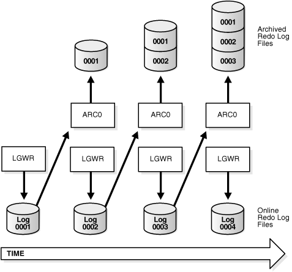

## 13 Managing Archived Redo Logs

In this chapter:

## What Is the Archived Redo Log?

Oracle Database lets you save filled groups of redo log files to one or more offline destinations, known collectively as the archived redo log. The process of turning redo log files into archived redo log files is called archiving. This process is only possible if the database is running in `ARCHIVELOG` mode. You can choose automatic or manual archiving.

An archived redo log file is a copy of one of the filled members of a redo log group. It includes the redo entries and the unique log sequence number of the identical member of the redo log group. For example, if you are multiplexing your redo log, and if group 1 contains identical member files `a_log1` and `b_log1`, then the archiver process (ARCn) will archive one of these member files. Should `a_log1` become corrupted, then ARCn can still archive the identical `b_log1`. The archived redo log contains a copy of every group created since you enabled archiving.

When the database is running in `ARCHIVELOG` mode, the log writer process (LGWR) cannot reuse and hence overwrite a redo log group until it has been archived. The background process ARCn automates archiving operations when automatic archiving is enabled. The database starts multiple archiver processes as needed to ensure that the archiving of filled redo logs does not fall behind.

You can use archived redo logs to:

- Recover a database
- Update a standby database
- Get information about the history of a database using the LogMiner utility
	See Also:
	The following sources document the uses for archived redo logs:
	- [Oracle Database Backup and Recovery User's Guide](https://docs.oracle.com/cd/E11882_01/backup.112/e10642/toc.htm)
	- [Oracle Data Guard Concepts and Administration](https://docs.oracle.com/cd/E11882_01/server.112/e41134/toc.htm) discusses setting up and maintaining a standby database
	- [Oracle Database Utilities](https://docs.oracle.com/cd/E11882_01/server.112/e22490/logminer.htm#SUTIL019) contains instructions for using the LogMiner PL/SQL package

## Choosing Between NOARCHIVELOG and ARCHIVELOG Mode

This section describes the issues you must consider when choosing to run your database in `NOARCHIVELOG` or `ARCHIVELOG` mode, and contains these topics:

- Running a Database in NOARCHIVELOG Mode
- Running a Database in ARCHIVELOG Mode

The choice of whether to enable the archiving of filled groups of redo log files depends on the availability and reliability requirements of the application running on the database. If you cannot afford to lose any data in your database in the event of a disk failure, use `ARCHIVELOG` mode. The archiving of filled redo log files can require you to perform extra administrative operations.

### Running a Database in NOARCHIVELOG Mode

When you run your database in `NOARCHIVELOG` mode, you disable the archiving of the redo log. The database control file indicates that filled groups are not required to be archived. Therefore, when a filled group becomes inactive after a log switch, the group is available for reuse by LGWR.

`NOARCHIVELOG` mode protects a database from instance failure but not from media failure. Only the most recent changes made to the database, which are stored in the online redo log groups, are available for instance recovery. If a media failure occurs while the database is in `NOARCHIVELOG` mode, you can only restore the database to the point of the most recent full database backup. You cannot recover transactions subsequent to that backup.

In `NOARCHIVELOG` mode you cannot perform online tablespace backups, nor can you use online tablespace backups taken earlier while the database was in `ARCHIVELOG` mode. To restore a database operating in `NOARCHIVELOG` mode, you can use only whole database backups taken while the database is closed. Therefore, if you decide to operate a database in `NOARCHIVELOG` mode, take whole database backups at regular, frequent intervals.

### Running a Database in ARCHIVELOG Mode

When you run a database in `ARCHIVELOG` mode, you enable the archiving of the redo log. The database control file indicates that a group of filled redo log files cannot be reused by LGWR until the group is archived. A filled group becomes available for archiving immediately after a redo log switch occurs.

The archiving of filled groups has these advantages:

- A database backup, together with online and archived redo log files, guarantees that you can recover all committed transactions in the event of an operating system or disk failure.
- If you keep archived logs available, you can use a backup taken while the database is open and in normal system use.
- You can keep a standby database current with its original database by continuously applying the original archived redo logs to the standby.

You can configure an instance to archive filled redo log files automatically, or you can archive manually. For convenience and efficiency, automatic archiving is usually best. Figure 13-1 illustrates how the archiver process (ARC0 in this illustration) writes filled redo log files to the database archived redo log.

If all databases in a distributed database operate in `ARCHIVELOG` mode, you can perform coordinated distributed database recovery. However, if any database in a distributed database is in `NOARCHIVELOG` mode, recovery of a global distributed database (to make all databases consistent) is limited by the last full backup of any database operating in `NOARCHIVELOG` mode.

Figure 13-1 Redo Log File Use in ARCHIVELOG Mode



> This is a text description of admin056.gif. This figure illustrates how online redo log files are archived. In this case there is only one archive process (ARC0) and only one archived redo log. It shows the following sequence:
>
> - LGWR writes to online redo log file 1 (Log0001).
> - When Log0001 is full, ARC0 writes it to the archived redo log.
> - LGWR writes to online redo log file 2 (Log0002).
> - When Log0002 is full, ARC0 writes it to the archived redo log.
> - LGWR writes to online redo log file 3 (Log0003).
> - When Log0003 is full, ARC0 writes it to the archived redo log.
> - LGWR writes to online redo log file 4 (Log0004).
> - When Log0004 is full, ARC0 writes it to the archived redo log.
>
> End of image description.
  

Tip:

It is good practice to move archived redo log files and corresponding database backups from the local disk to permanent offline storage media such as tape. A primary value of archived logs is database recovery, so you want to ensure that these logs are safe should disaster strike your primary database.

## Controlling Archiving

This section describes how to set the archiving mode of the database and how to control the archiving process. The following topics are discussed:

- Setting the Initial Database Archiving Mode
- Changing the Database Archiving Mode
- Performing Manual Archiving
- Adjusting the Number of Archiver Processes
	See Also:
	your Oracle operating system specific documentation for additional information on controlling archiving modes

### Setting the Initial Database Archiving Mode

You set the initial archiving mode as part of database creation in the `CREATE DATABASE` statement. Usually, you can use the default of `NOARCHIVELOG` mode at database creation because there is no need to archive the redo information generated by that process. After creating the database, decide whether to change the initial archiving mode.

If you specify `ARCHIVELOG` mode, you must have initialization parameters set that specify the destinations for the archived redo log files (see "Setting Initialization Parameters for Archive Destinations").

### Changing the Database Archiving Mode

To change the archiving mode of the database, use the `ALTER DATABASE` statement with the `ARCHIVELOG` or `NOARCHIVELOG` clause. To change the archiving mode, you must be connected to the database with administrator privileges (`AS SYSDBA`).

The following steps switch the database archiving mode from `NOARCHIVELOG` to `ARCHIVELOG`:

1. Shut down the database instance.
	```
	SHUTDOWN IMMEDIATE
	```
	An open database must first be closed and any associated instances shut down before you can switch the database archiving mode. You cannot change the mode from `ARCHIVELOG` to `NOARCHIVELOG` if any data files need media recovery.
2. Back up the database.
	Before making any major change to a database, always back up the database to protect against any problems. This will be your final backup of the database in `NOARCHIVELOG` mode and can be used if something goes wrong during the change to `ARCHIVELOG` mode. See [Oracle Database Backup and Recovery User's Guide](https://docs.oracle.com/cd/E11882_01/backup.112/e10642/toc.htm) for information about taking database backups.
3. Edit the initialization parameter file to include the initialization parameters that specify the destinations for the archived redo log files (see "Setting Initialization Parameters for Archive Destinations").
4. Start a new instance and mount, but do not open, the database.
	```
	STARTUP MOUNT
	```
	To enable or disable archiving, the database must be mounted but not open.
5. Change the database archiving mode. Then open the database for normal operations.
	```
	ALTER DATABASE ARCHIVELOG;
	ALTER DATABASE OPEN;
	```
6. Shut down the database.
	```
	SHUTDOWN IMMEDIATE
	```
7. Back up the database.
	Changing the database archiving mode updates the control file. After changing the database archiving mode, you must back up all of your database files and control file. Any previous backup is no longer usable because it was taken in `NOARCHIVELOG` mode.
	See Also:
	[Oracle Real Application Clusters Administration and Deployment Guide](https://docs.oracle.com/cd/E11882_01/rac.112/e41960/rman.htm#RACAD327) for more information about switching the archiving mode when using Real Application Clusters

### Performing Manual Archiving

As mentioned in "Running a Database in ARCHIVELOG Mode", for convenience and efficiency, automatic archiving is usually best. However, you can configure your database for manual archiving only. To operate your database in manual archiving mode, follow the procedure described in "Changing the Database Archiving Mode", but replace the `ALTER` `DATABASE` statement in step [^1] with the following statement:

```
ALTER DATABASE ARCHIVELOG MANUAL;
```

When you operate your database in manual `ARCHIVELOG` mode, you must archive inactive groups of filled redo log files or your database operation can be temporarily suspended. To archive a filled redo log group manually, connect with administrator privileges. Ensure that the database is either mounted or open. Use the `ALTER SYSTEM` statement with the `ARCHIVE LOG` clause to manually archive filled redo log files. The following statement archives all unarchived log files:

```
ALTER SYSTEM ARCHIVE LOG ALL;
```

When you use manual archiving mode, you cannot specify any standby databases in the archiving destinations.

Even when automatic archiving is enabled, you can use manual archiving for such actions as rearchiving an inactive group of filled redo log members to another location. In this case, it is possible for the instance to reuse the redo log group before you have finished manually archiving, and thereby overwrite the files. If this happens, the database writes an error message to the alert log.

### Adjusting the Number of Archiver Processes

The `LOG_ARCHIVE_MAX_PROCESSES` initialization parameter specifies the number of ARCn processes that the database initially starts. The default is four processes.

To avoid any run-time overhead of starting additional ARCn processes, you can set the `LOG_ARCHIVE_MAX_PROCESSES` initialization parameter to specify that up to 30 ARCn processes be started at instance startup. The `LOG_ARCHIVE_MAX_PROCESSES` parameter is dynamic, so you can change it using the `ALTER SYSTEM` statement.

The following statement configures the database to start six ARCn processes upon startup:

```
ALTER SYSTEM SET LOG_ARCHIVE_MAX_PROCESSES=6;
```

The statement also has an immediate effect on the currently running instance. It increases or decreases the current number of running ARCn processes to six.

## Specifying Archive Destinations

Before you can archive redo logs, you must determine the destination to which you will archive, and familiarize yourself with the various destination states. The dynamic performance (V$) views, listed in "Viewing Information About the Archived Redo Log", provide all needed archive information.

This section contains:

- Setting Initialization Parameters for Archive Destinations
- Understanding Archive Destination Status
- Specifying Alternate Destinations

### Setting Initialization Parameters for Archive Destinations

You can choose to archive redo logs to a single destination or to multiple destinations. Destinations can be local—within the local file system or an Oracle Automatic Storage Management (Oracle ASM) disk group—or remote (on a standby database). When you archive to multiple destinations, a copy of each filled redo log file is written to each destination. These redundant copies help ensure that archived logs are always available in the event of a failure at one of the destinations.

To archive to only a single destination, specify that destination using the `LOG_ARCHIVE_DEST` initialization parameter. To archive to multiple destinations, you can choose to archive to two or more locations using the `LOG_ARCHIVE_DEST_` `n` initialization parameters, or to archive only to a primary and secondary destination using the `LOG_ARCHIVE_DEST` and `LOG_ARCHIVE_DUPLEX_DEST` initialization parameters.

For local destinations, in addition to the local file system or an Oracle ASM disk group, you can archive to the Fast Recovery Area. The database uses the Fast Recovery Area to store and automatically manage disk space for a variety of files related to backup and recovery. See [Oracle Database Backup and Recovery User's Guide](https://docs.oracle.com/cd/E11882_01/backup.112/e10642/rcmconfb.htm#BRADV8183) for details about the Fast Recovery Area.

Typically, you determine archive log destinations during database planning, and you set the initialization parameters for archive destinations during database installation. However, you can use the `ALTER` `SYSTEM` command to dynamically add or change archive destinations after your database is running. Any destination changes that you make take effect at the next log switch (automatic or manual).

The following table summarizes the archive destination alternatives, which are further described in the sections that follow.

| Method | Initialization Parameter | Host | Example |
| --- | --- | --- | --- |
| 1 | `LOG_ARCHIVE_DEST_` `n`  where:  n is an integer from 1 to 31. Archive destinations 1 to 10 are available for local or remote locations. Archive destinations 11 to 31 are available for remote locations only. | Local or remote | `LOG_ARCHIVE_DEST_1 = 'LOCATION=/disk1/arc'`  `LOG_ARCHIVE_DEST_2 = 'LOCATION=/disk2/arc'`  `LOG_ARCHIVE_DEST_3 = 'SERVICE=standby1'` |
| 2 | `LOG_ARCHIVE_DEST` and  `LOG_ARCHIVE_DUPLEX_DEST` | Local only | `LOG_ARCHIVE_DEST = '/disk1/arc'`  `LOG_ARCHIVE_DUPLEX_DEST = '/disk2/arc'` |

#### Method 1: Using the LOG\_ARCHIVE\_DEST\_n Parameter

Use the `LOG_ARCHIVE_DEST_` `n` parameter (where n is an integer from 1 to 31) to specify from one to 31 different destinations for archived logs. Each numerically suffixed parameter uniquely identifies an individual destination.

You specify the location for `LOG_ARCHIVE_DEST_` `n` using the keywords explained in the following table:

| Keyword | Indicates | Example |
| --- | --- | --- |
| `LOCATION` | A local file system location or Oracle ASM disk group | `LOG_ARCHIVE_DEST_` `n` `= 'LOCATION=/disk1/arc'`  `LOG_ARCHIVE_DEST_` `n` `= 'LOCATION=+DGROUP1/orcl/arc_1'` |
| `LOCATION` | The Fast Recovery Area | `LOG_ARCHIVE_DEST_` `n` `= 'LOCATION=USE_DB_RECOVERY_FILE_DEST'` |
| `SERVICE` | Remote archival through Oracle Net service name. | `LOG_ARCHIVE_DEST_` `n` `= 'SERVICE=standby1'` |

If you use the `LOCATION` keyword, specify one of the following:

- A valid path name in your operating system's local file system
- An Oracle ASM disk group
- The keyword `USE_DB_RECOVERY_FILE_DEST` to indicate the Fast Recovery Area

If you specify `SERVICE`, supply a net service name that Oracle Net can resolve to a connect descriptor for a standby database. The connect descriptor contains the information necessary for connecting to the remote database.

Perform the following steps to set the destination for archived redo logs using the `LOG_ARCHIVE_DEST_` `n` initialization parameter:

1. Set the `LOG_ARCHIVE_DEST_` `n` initialization parameter to specify from one to 31 archiving locations. For example, enter:
	```
	LOG_ARCHIVE_DEST_1 = 'LOCATION = /disk1/archive'
	LOG_ARCHIVE_DEST_2 = 'LOCATION = /disk2/archive'
	LOG_ARCHIVE_DEST_3 = 'LOCATION = +RECOVERY/orcl/arc_3'
	```
	If you are archiving to a standby database, then use the `SERVICE` keyword to specify a valid net service name. For example, enter:
	```
	LOG_ARCHIVE_DEST_4 = 'SERVICE = standby1'
	```
2. Optionally, set the `LOG_ARCHIVE_FORMAT` initialization parameter, using `%t` to include the thread number as part of the file name, `%s` to include the log sequence number, and `%r` to include the resetlogs ID (a timestamp value represented in ub4). Use capital letters (`%T`, `%S`, and `%R`) to pad the file name to the left with zeroes.
	Note:
	If the `COMPATIBLE` initialization parameter is set to 10.0.0 or higher, the database requires the specification of resetlogs ID (`%r`) when you include the `LOG_ARCHIVE_FORMAT` parameter. The default for this parameter is operating system dependent.
	The incarnation of a database changes when you open it with the `RESETLOGS` option. Specifying `%r` causes the database to capture the resetlogs ID in the archived redo log file name. See [Oracle Database Backup and Recovery User's Guide](https://docs.oracle.com/cd/E11882_01/backup.112/e10642/rcmrvcon.htm#BRADV1171) for more information about this method of recovery.
	The following example shows a setting of `LOG_ARCHIVE_FORMAT`:
	```
	LOG_ARCHIVE_FORMAT = arch_%t_%s_%r.arc
	```
	This setting will generate archived logs as follows for thread 1; log sequence numbers 100, 101, and 102; resetlogs ID 509210197. The identical resetlogs ID indicates that the files are all from the same database incarnation:
	```
	/disk1/archive/arch_1_100_509210197.arc, 
	/disk1/archive/arch_1_101_509210197.arc, 
	/disk1/archive/arch_1_102_509210197.arc
	/disk2/archive/arch_1_100_509210197.arc, 
	/disk2/archive/arch_1_101_509210197.arc, 
	/disk2/archive/arch_1_102_509210197.arc
	/disk3/archive/arch_1_100_509210197.arc, 
	/disk3/archive/arch_1_101_509210197.arc, 
	/disk3/archive/arch_1_102_509210197.arc
	```

#### Method 2: Using LOG\_ARCHIVE\_DEST and LOG\_ARCHIVE\_DUPLEX\_DEST

To specify a maximum of two locations, use the `LOG_ARCHIVE_DEST` parameter to specify a primary archive destination and the `LOG_ARCHIVE_DUPLEX_DEST` to specify an optional secondary archive destination. All locations must be local. Whenever the database archives a redo log, it archives it to every destination specified by either set of parameters.

Perform the following steps the use method 2:

1. Specify destinations for the `LOG_ARCHIVE_DEST` and `LOG_ARCHIVE_DUPLEX_DEST` parameter (you can also specify `LOG_ARCHIVE_DUPLEX_DEST` dynamically using the `ALTER SYSTEM` statement). For example, enter:
	```
	LOG_ARCHIVE_DEST = '/disk1/archive'
	LOG_ARCHIVE_DUPLEX_DEST = '/disk2/archive'
	```
2. Set the `LOG_ARCHIVE_FORMAT` initialization parameter as described in step [^2] for method 1.

Note:

If you configure a Fast Recovery Area (by setting the `DB_RECOVERY_FILE_DEST` and `DB_RECOVERY_FILE_DEST_SIZE` parameters) and do not specify any local archive destinations, the database automatically selects the Fast Recovery Area as a local archive destination and sets `LOG_ARCHIVE_DEST_1` to `USE_DB_RECOVERY_FILE_DEST`.

WARNING:

You must ensure that there is sufficient disk space at all times for archive log destinations. If the database encounters a disk full error as it attempts to archive a log file, a fatal error occurs and the database stops responding. You can check the alert log for a disk full message.

See Also:

- [Oracle Database Reference](https://docs.oracle.com/cd/E11882_01/server.112/e40402/toc.htm) for additional information about the initialization parameters used to control the archiving of redo logs
- [Oracle Data Guard Concepts and Administration](https://docs.oracle.com/cd/E11882_01/server.112/e41134/log_transport.htm#SBYDB00400) for information about using the `LOG_ARCHIVE_DEST_` `n` initialization parameter for specifying a standby destination. There are additional keywords that can be specified with this initialization parameter that are not discussed in this book.
- [Oracle Database Net Services Administrator's Guide](https://docs.oracle.com/cd/E11882_01/network.112/e41945/concepts.htm#NETAG186) for a discussion of net service names and connect descriptors.
- [Oracle Database Backup and Recovery User's Guide](https://docs.oracle.com/cd/E11882_01/backup.112/e10642/rcmconfb.htm#BRADV8183) for information about the Fast Recovery Area

### Understanding Archive Destination Status

Each archive destination has the following variable characteristics that determine its status:

- Valid/Invalid: indicates whether the disk location or service name information is specified and valid
- Enabled/Disabled: indicates the availability state of the location and whether the database can use the destination
- Active/Inactive: indicates whether there was a problem accessing the destination

Several combinations of these characteristics are possible. To obtain the current status and other information about each destination for an instance, query the `V$ARCHIVE_DEST` view.

The `LOG_ARCHIVE_DEST_STATE_` `n` (where n is an integer from 1 to 31) initialization parameter lets you control the availability state of the specified destination (n).

- `ENABLE` indicates that the database can use the destination.
- `DEFER` indicates that the location is temporarily disabled.
- `ALTERNATE` indicates that the destination is an alternate. The availability state of an alternate destination is `DEFER`. If its parent destination fails, the availability state of the alternate becomes `ENABLE`. `ALTERNATE` cannot be specified for destinations `LOG_ARCHIVE_DEST_11` to `LOG_ARCHIVE_DEST_31`.

### Specifying Alternate Destinations

To specify that a location be an archive destination only in the event of a failure of another destination, you can make it an alternate destination. Both local and remote destinations can be alternates. The following example makes `LOG_ARCHIVE_DEST_4` an alternate for `LOG_ARCHIVE_DEST_3`:

```
ALTER SYSTEM SET LOG_ARCHIVE_DEST_4 = 'LOCATION=/disk4/arch';
ALTER SYSTEM SET LOG_ARCHIVE_DEST_3 = 'LOCATION=/disk3/arch MAX_FAILURE=1
   ALTERNATE=LOG_ARCHIVE_DEST_4';
ALTER SYSTEM SET LOG_ARCHIVE_DEST_STATE_4=ALTERNATE;

SQL> SELECT dest_name, status, destination FROM v$archive_dest;
 
DEST_NAME               STATUS    DESTINATION
----------------------- --------- ----------------------------------------------
LOG_ARCHIVE_DEST_1      VALID     /disk1/arch
LOG_ARCHIVE_DEST_2      VALID     /disk2/arch
LOG_ARCHIVE_DEST_3      VALID     /disk3/arch
LOG_ARCHIVE_DEST_4      ALTERNATE /disk4/arch
```

## About Log Transmission Modes

The two modes of transmitting archived logs to their destination are normal archiving transmission and standby transmission mode. Normal transmission involves transmitting files to a local disk. Standby transmission involves transmitting files through a network to either a local or remote standby database.

### Normal Transmission Mode

In normal transmission mode, the archiving destination is another disk drive of the database server. In this configuration archiving does not contend with other files required by the instance and can complete more quickly. Specify the destination with either the `LOG_ARCHIVE_DEST_` `n` or `LOG_ARCHIVE_DEST` parameters.

### Standby Transmission Mode

In standby transmission mode, the archiving destination is either a local or remote standby database.

Caution:

You can maintain a standby database on a local disk, but Oracle strongly encourages you to maximize disaster protection by maintaining your standby database at a remote site.

See Also:

- [Oracle Data Guard Concepts and Administration](https://docs.oracle.com/cd/E11882_01/server.112/e41134/toc.htm)
- [Oracle Database Net Services Administrator's Guide](https://docs.oracle.com/cd/E11882_01/network.112/e41945/concepts.htm#NETAG002) for information about connecting to a remote database using a service name

## Managing Archive Destination Failure

Sometimes archive destinations can fail, causing problems when you operate in automatic archiving mode. Oracle Database provides procedures to help you minimize the problems associated with destination failure. These procedures are discussed in the sections that follow:

- Specifying the Minimum Number of Successful Destinations
- Rearchiving to a Failed Destination

### Specifying the Minimum Number of Successful Destinations

The optional initialization parameter `LOG_ARCHIVE_MIN_SUCCEED_DEST=` `n` determines the minimum number of destinations to which the database must successfully archive a redo log group before it can reuse online log files. The default value is 1. Valid values for n are 1 to 2 if you are using duplexing, or 1 to 31 if you are multiplexing.

#### Specifying Mandatory and Optional Destinations

The `LOG_ARCHIVE_DEST_` `n` parameter lets you specify whether a destination is `OPTIONAL` (the default) or `MANDATORY`. The `LOG_ARCHIVE_MIN_SUCCEED_DEST=` `n` parameter uses all `MANDATORY` destinations plus some number of non-standby `OPTIONAL` destinations to determine whether LGWR can overwrite the online log. The following rules apply:

- Omitting the `MANDATORY` attribute for a destination is the same as specifying `OPTIONAL`.
- You must have at least one local destination, which you can declare `OPTIONAL` or `MANDATORY`.
- The `MANDATORY` attribute can only be specified for destinations `LOG_ARCHIVE_DEST_1` through `LOG_ARCHIVE_DEST_10`.
- When you specify a value for `LOG_ARCHIVE_MIN_SUCCEED_DEST=` `n`, Oracle Database will treat at least one local destination as `MANDATORY`, because the minimum value for `LOG_ARCHIVE_MIN_SUCCEED_DEST` is 1.
- The `LOG_ARCHIVE_MIN_SUCCEED_DEST` value cannot be greater than the number of destinations, nor can it be greater than the number of `MANDATORY` destinations plus the number of `OPTIONAL` local destinations.
- If you `DEFER` a `MANDATORY` destination, and the database overwrites the online log without transferring the archived log to the standby site, then you must transfer the log to the standby manually.

If you are duplexing the archived logs, you can establish which destinations are mandatory or optional by using the `LOG_ARCHIVE_DEST` and `LOG_ARCHIVE_DUPLEX_DEST` parameters. The following rules apply:

- Any destination declared by `LOG_ARCHIVE_DEST` is mandatory.
- Any destination declared by `LOG_ARCHIVE_DUPLEX_DEST` is optional if `LOG_ARCHIVE_MIN_SUCCEED_DEST = 1` and mandatory if `LOG_ARCHIVE_MIN_SUCCEED_DEST = 2`.

#### Specifying the Number of Successful Destinations: Scenarios

You can see the relationship between the `LOG_ARCHIVE_DEST_` `n` and `LOG_ARCHIVE_MIN_SUCCEED_DEST` parameters most easily through sample scenarios.

##### Scenario for Archiving to Optional Local Destinations

In this scenario, you archive to three local destinations, each of which you declare as `OPTIONAL`. Table 13-1 illustrates the possible values for `LOG_ARCHIVE_MIN_SUCCEED_DEST=` `n` in this case.

Table 13-1 LOG\_ARCHIVE\_MIN\_SUCCEED\_DEST Values for Scenario 1

| Value | Meaning |
| --- | --- |
| 1 | The database can reuse log files only if at least one of the `OPTIONAL` destinations succeeds. |
| 2 | The database can reuse log files only if at least two of the `OPTIONAL` destinations succeed. |
| 3 | The database can reuse log files only if all of the `OPTIONAL` destinations succeed. |
| 4 or greater | `ERROR`: The value is greater than the number of destinations. |

This scenario shows that even though you do not explicitly set any of your destinations to `MANDATORY` using the `LOG_ARCHIVE_DEST_` `n` parameter, the database must successfully archive to one or more of these locations when `LOG_ARCHIVE_MIN_SUCCEED_DEST` is set to 1, 2, or 3.

##### Scenario for Archiving to Both Mandatory and Optional Destinations

Consider a case in which:

- You specify two `MANDATORY` destinations.
- You specify two `OPTIONAL` destinations.
- No destination is a standby database.

Table 13-2 shows the possible values for `LOG_ARCHIVE_MIN_SUCCEED_DEST=` `n`.

Table 13-2 LOG\_ARCHIVE\_MIN\_SUCCEED\_DEST Values for Scenario 2

| Value | Meaning |
| --- | --- |
| 1 | The database ignores the value and uses the number of `MANDATORY` destinations (in this example, 2). |
| 2 | The database can reuse log files even if no `OPTIONAL` destination succeeds. |
| 3 | The database can reuse logs only if at least one `OPTIONAL` destination succeeds. |
| 4 | The database can reuse logs only if both `OPTIONAL` destinations succeed. |
| 5 or greater | `ERROR`: The value is greater than the number of destinations. |

This case shows that the database must archive to the destinations you specify as `MANDATORY`, regardless of whether you set `LOG_ARCHIVE_MIN_SUCCEED_DEST` to archive to a smaller number of destinations.

### Rearchiving to a Failed Destination

Use the `REOPEN` attribute of the `LOG_ARCHIVE_DEST_` `n` parameter to specify whether and when ARCn should attempt to rearchive to a failed destination following an error. `REOPEN` applies to all errors, not just `OPEN` errors.

`REOPEN=` `n` sets the minimum number of seconds before ARCn should try to reopen a failed destination. The default value for n is 300 seconds. A value of 0 is the same as turning off the `REOPEN` attribute; ARCn will not attempt to archive after a failure. If you do not specify the `REOPEN` keyword, ARCn will never reopen a destination following an error.

You cannot use `REOPEN` to specify the number of attempts ARCn should make to reconnect and transfer archived logs. The `REOPEN` attempt either succeeds or fails.

When you specify `REOPEN` for an `OPTIONAL` destination, the database can overwrite online logs if there is an error. If you specify `REOPEN` for a `MANDATORY` destination, the database stalls the production database when it cannot successfully archive. In this situation, consider the following options:

- Archive manually to the failed destination.
- Change the destination by deferring the destination, specifying the destination as optional, or changing the service.
- Drop the destination.

When using the `REOPEN` keyword, note the following:

- ARCn reopens a destination only when starting an archive operation from the beginning of the log file, never during a current operation. ARCn always retries the log copy from the beginning.
- If you specified `REOPEN`, either with a specified time the default, ARCn checks to see whether the time of the recorded error plus the `REOPEN` interval is less than the current time. If it is, ARCn retries the log copy.
- The `REOPEN` clause successfully affects the `ACTIVE=TRUE` destination state. The `VALID` and `ENABLED` states are not changed.

## Controlling Trace Output Generated by the Archivelog Process

Background processes always write to a trace file when appropriate. (See the discussion of this topic in ["Monitoring Errors with Trace Files and the Alert Log"](monitoring.md).) In the case of the archivelog process, you can control the output that is generated to the trace file. You do this by setting the `LOG_ARCHIVE_TRACE` initialization parameter to specify a trace level. The following values can be specified:

| Trace Level | Meaning |
| --- | --- |
| 0 | Disable archivelog tracing. This is the default. |
| 1 | Track archival of redo log file. |
| 2 | Track archival status for each archivelog destination. |
| 4 | Track archival operational phase. |
| 8 | Track archivelog destination activity. |
| 16 | Track detailed archivelog destination activity. |
| 32 | Track archivelog destination parameter modifications. |
| 64 | Track ARCn process state activity. |
| 128 | Track FAL (fetch archived log) server related activities. |
| 256 | Supported in a future release. |
| 512 | Tracks asynchronous LGWR activity. |
| 1024 | RFS physical client tracking. |
| 2048 | ARCn/RFS heartbeat tracking. |
| 4096 | Track real-time apply |
| 8192 | Track redo apply activity (media recovery or physical standby) |

You can combine tracing levels by specifying a value equal to the sum of the individual levels that you would like to trace. For example, setting `LOG_ARCHIVE_TRACE=12`, will generate trace level 8 and 4 output. You can set different values for the primary and any standby database.

The default value for the `LOG_ARCHIVE_TRACE` parameter is 0. At this level, the archivelog process generates appropriate alert and trace entries for error conditions.

You can change the value of this parameter dynamically using the `ALTER SYSTEM` statement. For example:

```
ALTER SYSTEM SET LOG_ARCHIVE_TRACE=12;
```

Changes initiated in this manner will take effect at the start of the next archiving operation.

See Also:

[Oracle Data Guard Concepts and Administration](https://docs.oracle.com/cd/E11882_01/server.112/e41134/trace.htm#SBYDB01880) for information about using this parameter with a standby database

## Viewing Information About the Archived Redo Log

You can display information about the archived redo log using dynamic performance views or the `ARCHIVE` `LOG` `LIST` command.

This section contains the following topics:

- Archived Redo Logs Views
- The ARCHIVE LOG LIST Command

### Archived Redo Logs Views

Several dynamic performance views contain useful information about archived redo logs, as summarized in the following table.

| Dynamic Performance View | Description |
| --- | --- |
| `V$DATABASE` | Shows if the database is in `ARCHIVELOG` or `NOARCHIVELOG` mode and if `MANUAL` (archiving mode) has been specified. |
| `V$ARCHIVED_LOG` | Displays historical archived log information from the control file. If you use a recovery catalog, the `RC_ARCHIVED_LOG` view contains similar information. |
| `V$ARCHIVE_DEST` | Describes the current instance, all archive destinations, and the current value, mode, and status of these destinations. |
| `V$ARCHIVE_PROCESSES` | Displays information about the state of the various archive processes for an instance. |
| `V$BACKUP_REDOLOG` | Contains information about any backups of archived logs. If you use a recovery catalog, the `RC_BACKUP_REDOLOG` contains similar information. |
| `V$LOG` | Displays all redo log groups for the database and indicates which need to be archived. |
| `V$LOG_HISTORY` | Contains log history information such as which logs have been archived and the SCN range for each archived log. |

For example, the following query displays which redo log group requires archiving:

```
SELECT GROUP#, ARCHIVED
   FROM SYS.V$LOG;

GROUP#     ARC
--------   ---
       1   YES
       2   NO
```

To see the current archiving mode, query the `V$DATABASE` view:

```
SELECT LOG_MODE FROM SYS.V$DATABASE;

LOG_MODE
------------
NOARCHIVELOG
```

See Also:

[Oracle Database Reference](https://docs.oracle.com/cd/E11882_01/server.112/e40402/toc.htm) for detailed descriptions of dynamic performance views

### The ARCHIVE LOG LIST Command

The SQL\*Plus command `ARCHIVE LOG LIST` displays archiving information for the connected instance. For example:

```
SQL> ARCHIVE LOG LIST

Database log mode              Archive Mode
Automatic archival             Enabled
Archive destination            D:\oracle\oradata\IDDB2\archive
Oldest online log sequence     11160
Next log sequence to archive   11163
Current log sequence           11163
```

This display tells you all the necessary information regarding the archived redo log settings for the current instance:

- The database is currently operating in `ARCHIVELOG` mode.
- Automatic archiving is enabled.
- The archived redo log destination is D:\\oracle\\oradata\\IDDB2\\archive.
- The oldest filled redo log group has a sequence number of 11160.
- The next filled redo log group to archive has a sequence number of 11163.
- The current redo log file has a sequence number of 11163.

See Also:

[SQL\*Plus User's Guide and Reference](https://docs.oracle.com/cd/E11882_01/server.112/e16604/ch_twelve007.htm#SQPUG028) for more information on the `ARCHIVE LOG LIST` command

[^1]: Change the database archiving mode. Then open the database for normal operations.

```
ALTER DATABASE ARCHIVELOG;
ALTER DATABASE OPEN;
```

[^undefined]: Shut down the database.

```
SHUTDOWN IMMEDIATE
```

[^undefined]: Back up the database.

Changing the database archiving mode updates the control file. After changing the database archiving mode, you must back up all of your database files and control file. Any previous backup is no longer usable because it was taken in `NOARCHIVELOG` mode.

See Also:

[Oracle Real Application Clusters Administration and Deployment Guide](https://docs.oracle.com/cd/E11882_01/rac.112/e41960/rman.htm#RACAD327) for more information about switching the archiving mode when using Real Application Clusters

[^2]: Optionally, set the `LOG_ARCHIVE_FORMAT` initialization parameter, using `%t` to include the thread number as part of the file name, `%s` to include the log sequence number, and `%r` to include the resetlogs ID (a timestamp value represented in ub4). Use capital letters (`%T`, `%S`, and `%R`) to pad the file name to the left with zeroes.

Note:

If the `COMPATIBLE` initialization parameter is set to 10.0.0 or higher, the database requires the specification of resetlogs ID (`%r`) when you include the `LOG_ARCHIVE_FORMAT` parameter. The default for this parameter is operating system dependent.

The incarnation of a database changes when you open it with the `RESETLOGS` option. Specifying `%r` causes the database to capture the resetlogs ID in the archived redo log file name. See [Oracle Database Backup and Recovery User's Guide](https://docs.oracle.com/cd/E11882_01/backup.112/e10642/rcmrvcon.htm#BRADV1171) for more information about this method of recovery.

The following example shows a setting of `LOG_ARCHIVE_FORMAT`:

```
LOG_ARCHIVE_FORMAT = arch_%t_%s_%r.arc
```

This setting will generate archived logs as follows for thread 1; log sequence numbers 100, 101, and 102; resetlogs ID 509210197. The identical resetlogs ID indicates that the files are all from the same database incarnation:

```
/disk1/archive/arch_1_100_509210197.arc, 
/disk1/archive/arch_1_101_509210197.arc, 
/disk1/archive/arch_1_102_509210197.arc

/disk2/archive/arch_1_100_509210197.arc, 
/disk2/archive/arch_1_101_509210197.arc, 
/disk2/archive/arch_1_102_509210197.arc

/disk3/archive/arch_1_100_509210197.arc, 
/disk3/archive/arch_1_101_509210197.arc, 
/disk3/archive/arch_1_102_509210197.arc
```