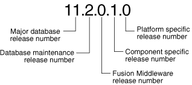
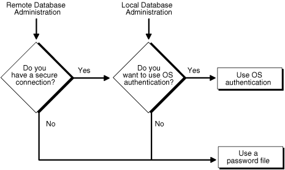

## 1 Getting Started with Database Administration

In this chapter:

## Types of Oracle Database Users

The types of users and their roles and responsibilities depend on the database site. A small site can have one database administrator who administers the database for application developers and users. A very large site can find it necessary to divide the duties of a database administrator among several people and among several areas of specialization.

### Database Administrators

Each database requires at least one database administrator (DBA). An Oracle Database system can be large and can have many users. Therefore, database administration is sometimes not a one-person job, but a job for a group of DBAs who share responsibility.

A database administrator's responsibilities can include the following tasks:

- Installing and upgrading the Oracle Database server and application tools
- Allocating system storage and planning future storage requirements for the database system
- Creating primary database storage structures (tablespaces) after application developers have designed an application
- Creating primary objects (tables, views, indexes) once application developers have designed an application
- Modifying the database structure, as necessary, from information given by application developers
- Enrolling users and maintaining system security
- Ensuring compliance with Oracle license agreements
- Controlling and monitoring user access to the database
- Monitoring and optimizing the performance of the database
- Planning for backup and recovery of database information
- Maintaining archived data on tape
- Backing up and restoring the database
- Contacting Oracle for technical support

### Security Officers

In some cases, a site assigns one or more security officers to a database. A security officer enrolls users, controls and monitors user access to the database, and maintains system security. As a DBA, you might not be responsible for these duties if your site has a separate security officer. See [Oracle Database Security Guide](https://docs.oracle.com/cd/E11882_01/network.112/e36292/toc.htm) for information about the duties of security officers.

### Network Administrators

Some sites have one or more network administrators. A network administrator, for example, administers Oracle networking products, such as Oracle Net Services. See [Oracle Database Net Services Administrator's Guide](https://docs.oracle.com/cd/E11882_01/network.112/e41945/toc.htm) for information about the duties of network administrators.

See Also:

[Part I, "Distributed Database Management"](part7.md), for information on network administration in a distributed environment

### Application Developers

Application developers design and implement database applications. Their responsibilities include the following tasks:

- Designing and developing the database application
- Designing the database structure for an application
- Estimating storage requirements for an application
- Specifying modifications of the database structure for an application
- Relaying this information to a database administrator
- Tuning the application during development
- Establishing security measures for an application during development

Application developers can perform some of these tasks in collaboration with DBAs. See [Oracle Database Advanced Application Developer's Guide](https://docs.oracle.com/cd/E11882_01/appdev.112/e41502/toc.htm) for information about application development tasks.

### Application Administrators

An Oracle Database site can assign one or more application administrators to administer a particular application. Each application can have its own administrator.

### Database Users

Database users interact with the database through applications or utilities. A typical user's responsibilities include the following tasks:

- Entering, modifying, and deleting data, where permitted
- Generating reports from the data

## Tasks of a Database Administrator

The following tasks present a prioritized approach for designing, implementing, and maintaining an Oracle Database:

Task 1: Evaluate the Database Server Hardware

Task 2: Install the Oracle Database Software

Task 3: Plan the Database

Task 4: Create and Open the Database

Task 5: Back Up the Database

Task 6: Enroll System Users

Task 7: Implement the Database Design

Task 8: Back Up the Fully Functional Database

Task 9: Tune Database Performance

Task 10: Download and Install Patches

Task 11: Roll Out to Additional Hosts

These tasks are discussed in the sections that follow.

Note:

When upgrading to a new release, back up your existing production environment, both software and database, before installation. For information on preserving your existing production database, see [Oracle Database Upgrade Guide](https://docs.oracle.com/cd/E11882_01/server.112/e23633/toc.htm).

### Task 1: Evaluate the Database Server Hardware

Evaluate how Oracle Database and its applications can best use the available computer resources. This evaluation should reveal the following information:

- How many disk drives are available to the Oracle products
- How many, if any, dedicated tape drives are available to Oracle products
- How much memory is available to the instances of Oracle Database you will run (see your system configuration documentation)

### Task 2: Install the Oracle Database Software

As the database administrator, you install the Oracle Database server software and any front-end tools and database applications that access the database. In some distributed processing installations, the database is controlled by a central computer (database server) and the database tools and applications are executed on remote computers (clients). In this case, you must also install the Oracle Net components necessary to connect the remote systems to the computer that executes Oracle Database.

For more information on what software to install, see "Identifying Your Oracle Database Software Release".

See Also:

For specific requirements and instructions for installation, see the following documentation:
- The Oracle documentation specific to your operating system
- The installation guides for your front-end tools and Oracle Net drivers

### Task 3: Plan the Database

As the database administrator, you must plan:

- The logical storage structure of the database
- The overall database design
- A backup strategy for the database

It is important to plan how the logical storage structure of the database will affect system performance and various database management operations. For example, before creating any tablespaces for your database, you should know how many data files will comprise the tablespace, what type of information will be stored in each tablespace, and on which disk drives the data files will be physically stored. When planning the overall logical storage of the database structure, consider the effects that this structure will have when the database is actually created and running. Consider how the logical storage structure of the database will affect:

- The performance of the computer running Oracle Database
- The performance of the database during data access operations
- The efficiency of backup and recovery procedures for the database

Plan the relational design of the database objects and the storage characteristics for each of these objects. By planning the relationship between each object and its physical storage before creating it, you can directly affect the performance of the database as a unit. Be sure to plan for the growth of the database.

In distributed database environments, this planning stage is extremely important. The physical location of frequently accessed data dramatically affects application performance.

During the planning stage, develop a backup strategy for the database. You can alter the logical storage structure or design of the database to improve backup efficiency.

It is beyond the scope of this book to discuss relational and distributed database design. If you are not familiar with such design issues, see accepted industry-standard documentation.

[Part I, "Oracle Database Structure and Storage"](part2.md), and [Part I, "Schema Objects"](part4.md), provide specific information on creating logical storage structures, objects, and integrity constraints for your database.

### Task 4: Create and Open the Database

After you complete the database design, you can create the database and open it for normal use. You can create a database at installation time, using the Database Configuration Assistant, or you can supply your own scripts for creating a database.

See [Chapter 2, "Creating and Configuring an Oracle Database"](create.md), for information on creating a database and [Chapter 3, "Starting Up and Shutting Down"](start.md) for guidance in starting up the database.

### Task 5: Back Up the Database

After you create the database structure, perform the backup strategy you planned for the database. Create any additional redo log files, take the first full database backup (online or offline), and schedule future database backups at regular intervals.

See Also:

[Oracle Database Backup and Recovery User's Guide](https://docs.oracle.com/cd/E11882_01/backup.112/e10642/toc.htm)

### Task 6: Enroll System Users

After you back up the database structure, you can enroll the users of the database in accordance with your Oracle license agreement, and grant appropriate privileges and roles to these users. See [Chapter 7, "Managing Users and Securing the Database"](secure.md) for guidance in this task.

### Task 7: Implement the Database Design

After you create and start the database, and enroll the system users, you can implement the planned logical structure database by creating all necessary tablespaces. When you have finished creating tablespaces, you can create the database objects.

[Part I, "Oracle Database Structure and Storage"](part2.md) and [Part I, "Schema Objects"](part4.md) provide information on creating logical storage structures and objects for your database.

### Task 8: Back Up the Fully Functional Database

When the database is fully implemented, again back up the database. In addition to regularly scheduled backups, you should always back up your database immediately after implementing changes to the database structure.

### Task 9: Tune Database Performance

Optimizing the performance of the database is one of your ongoing responsibilities as a DBA. Oracle Database provides a database resource management feature that helps you to control the allocation of resources among various user groups. The database resource manager is described in [Chapter 27, "Managing Resources with Oracle Database Resource Manager"](dbrm.md).

See Also:

[Oracle Database Performance Tuning Guide](https://docs.oracle.com/cd/E11882_01/server.112/e41573/toc.htm) for information about tuning your database and applications

### Task 10: Download and Install Patches

After installation and on a regular basis, download and install patches. Patches are available as single interim patches and as patchsets (or patch releases). Interim patches address individual software bugs and may or may not be needed at your installation. Patch releases are collections of bug fixes that are applicable for all customers. Patch releases have release numbers. For example, if you installed Oracle Database 11.2.0.1, the first patch release will have a release number of 11.2.0.2.

See Also:

[Oracle Database Installation Guide](http://www.oracle.com/pls/topic/lookup?ctx=db112&id=GINST) for your platform for instructions on downloading and installing patches.

### Task 11: Roll Out to Additional Hosts

After you have an Oracle Database installation properly configured, tuned, patched, and tested, you may want to roll that exact installation out to other hosts. Reasons to do this include the following:

- You have multiple production database systems.
- You want to create development and test systems that are identical to your production system.

Instead of installing, tuning, and patching on each additional host, you can clone your tested Oracle Database installation to other hosts, saving time and avoiding inconsistencies. There are two types of cloning available to you:

- Cloning an Oracle home—Just the configured and patched binaries from the Oracle home directory and subdirectories are copied to the destination host and "fixed" to match the new environment. You can then start an instance with this cloned home and create a database.
	You can use the Enterprise Manager Clone Oracle Home tool to clone an Oracle home to one or more destination hosts. You can also manually clone an Oracle home using a set of provided scripts and Oracle Universal Installer.
- Cloning a database—The tuned database, including database files, initialization parameters, and so on, are cloned to an existing Oracle home (possibly a cloned home).
	You can use the Enterprise Manager Clone Database tool to clone an Oracle database instance to an existing Oracle home.

See Also:

- [Oracle Universal Installer and OPatch User's Guide for Windows and UNIX](https://docs.oracle.com/cd/E11882_01/em.112/e12255/oui6_cloning.htm#OUICG294) for information about cloning Oracle software.
- Enterprise Manager online help for instructions for cloning a database.

## Submitting Commands and SQL to the Database

The primary means of communicating with Oracle Database is by submitting SQL statements. Oracle Database also supports a superset of SQL, which includes commands for starting up and shutting down the database, modifying database configuration, and so on. There are three ways to submit these SQL statements and commands to Oracle Database:

- Directly, using the command-line interface of SQL\*Plus
- Indirectly, using the graphical user interface of Oracle Enterprise Manager
	With Oracle Enterprise Manager (Enterprise Manager), you use an intuitive graphical interface to administer the database, and Enterprise Manager submits SQL statements and commands behind the scenes.
	See [Oracle Database 2 Day DBA](https://docs.oracle.com/cd/E11882_01/server.112/e10897/toc.htm) for more information.
- Directly, using SQL Developer
	Developers use SQL Developer to create and test database schemas and applications, although you can also use it for database administration tasks.
	See [Oracle Database 2 Day Developer's Guide](https://docs.oracle.com/cd/E11882_01/appdev.112/e10766/toc.htm) for more information.

This section focuses on using SQL\*Plus to submit SQL statements and commands to the database. It includes the following topics:

- About SQL\*Plus
- Connecting to the Database with SQL\*Plus

### About SQL\*Plus

SQL\*Plus is the primary command-line interface to your Oracle database. You use SQL\*Plus to start up and shut down the database, set database initialization parameters, create and manage users, create and alter database objects (such as tables and indexes), insert and update data, run SQL queries, and more.

Before you can submit SQL statements and commands, you must connect to the database. With SQL\*Plus, you can connect locally or remotely. Connecting locally means connecting to an Oracle database running on the same computer on which you are running SQL\*Plus. Connecting remotely means connecting over a network to an Oracle database that is running on a remote computer. Such a database is referred to as a remote database. The SQL\*Plus executable on the local computer is provided by a full Oracle Database installation, an Oracle Client installation, or an Instant Client installation.

See Also:

[SQL\*Plus User's Guide and Reference](https://docs.oracle.com/cd/E11882_01/server.112/e16604/toc.htm)

### Connecting to the Database with SQL\*Plus

Oracle Database includes the following components:

- The Oracle Database instance, which is a collection of processes and memory
- A set of disk files that contain user data and system data

When you connect with SQL\*Plus, you are connecting to the Oracle instance. Each instance has an instance ID, also known as a system ID (SID). Because there can be multiple Oracle instances on a host computer, each with its own set of data files, you must identify the instance to which you want to connect. For a local connection, you identify the instance by setting operating system environment variables. For a remote connection, you identify the instance by specifying a network address and a database service name. For both local and remote connections, you must set environment variables to help the operating system find the SQL\*Plus executable and to provide the executable with a path to its support files and scripts. To connect to an Oracle instance with SQL\*Plus, therefore, you must complete the following steps:

  
Step 1: Open a Command Window  
Step 2: Set Operating System Environment Variables  
Step 3: Start SQL\*Plus  
Step 4: Submit the SQL\*Plus CONNECT Statement

See Also:

[Oracle Database Concepts](https://docs.oracle.com/cd/E11882_01/server.112/e40540/startup.htm#CNCPT601) for background information about the Oracle instance

#### Step 1: Open a Command Window

Take the necessary action on your platform to open a window into which you can enter operating system commands.

#### Step 2: Set Operating System Environment Variables

Depending on your platform, you may have to set environment variables before starting SQL\*Plus, or at least verify that they are set properly.

For example, on most platforms, `ORACLE_SID` and `ORACLE_HOME` must be set. In addition, it is advisable to set the `PATH` environment variable to include the ORACLE\_HOME/bin directory. Some platforms may require additional environment variables:

- On the UNIX and Linux platforms, you must set environment variables by entering operating system commands.
- On the Windows platform, Oracle Universal Installer (OUI) automatically assigns values to `ORACLE_HOME` and `ORACLE_SID` in the Windows registry.

If you did not create a database upon installation, OUI does not set `ORACLE_SID` in the registry; after you create your database at a later time, you must set the `ORACLE_SID` environment variable from a command window.

UNIX and Linux installations come with two scripts, `oraenv` and `coraenv`, that you can use to easily set environment variables. For more information, see Administrator's Reference for UNIX Systems.

For all platforms, when switching between instances with different Oracle homes, you must change the `ORACLE_HOME` environment variable. If multiple instances share the same Oracle home, you must change only `ORACLE_SID` when switching instances.

See the [Oracle Database Installation Guide](http://www.oracle.com/pls/topic/lookup?ctx=db112&id=GINST) or administration guide for your operating system for details on environment variables and for information on switching instances.

Example 1-1 Setting Environment Variables in UNIX (C Shell)

```
setenv ORACLE_SID orcl
setenv ORACLE_HOME /u01/app/oracle/product/11.2.0/db_1
setenv LD_LIBRARY_PATH $ORACLE_HOME/lib:/usr/lib:/usr/dt/lib:/usr/openwin/lib:/usr/ccs/lib
```

Example 1-2 Setting Environment Variables in Windows

```
SET ORACLE_SID=orawin2
```

Example 1-2 assumes that `ORACLE_HOME` and `ORACLE_SID` are set in the registry but that you want to override the registry value of `ORACLE_SID` to connect to a different instance.

On Windows, environment variable values that you set in a command prompt window override the values in the registry.

#### Step 3: Start SQL\*Plus

To start SQL\*Plus:

1. Do one of the following:
	- Ensure that the `PATH` environment variable contains ORACLE\_HOME/bin.
		- Change directory to ORACLE\_HOME/bin.
2. Enter the following command (case-sensitive on UNIX and Linux):
	```
	sqlplus /nolog
	```

#### Step 4: Submit the SQL\*Plus CONNECT Statement

You submit the SQL\*Plus `CONNECT` statement to initially connect to the Oracle instance or at any time to reconnect as a different user. The syntax of the `CONNECT` statement is as follows:

```
CONN[ECT] [logon] [AS {SYSOPER | SYSDBA}]
```

The syntax of `logon` is as follows:

```
{username | /}[@connect_identifier] [edition={edition_name | DATABASE_DEFAULT}]
```

When you provide `username`, SQL\*Plus prompts for a password. The password is not echoed as you type it.

The following table describes the syntax components of the `CONNECT` statement.

| Syntax Component | Description |
| --- | --- |
| `/` | Calls for external authentication of the connection request. A database password is not used in this type of authentication. The most common form of external authentication is operating system authentication, where the database user is authenticated by having logged in to the host operating system with a certain host user account. External authentication can also be performed with an Oracle wallet or by a network service. See [Oracle Database Security Guide](https://docs.oracle.com/cd/E11882_01/network.112/e36292/authentication.htm#DBSEG30038) for more information. See also "Using Operating System Authentication". |
| `AS {SYSOPER \| SYSDBA}` | Indicates that the database user is connecting with either the `SYSOPER` or `SYSDBA` system privilege. Only certain predefined administrative users or users who have been added to the password file may connect with these privileges. See "Administrative Privileges" for more information. |
| `username` | A valid database user name. The database authenticates the connection request by matching `username` against the data dictionary and prompting for a user password. |
| `connect_identifier` (1) | An Oracle Net connect identifier, for a remote connection. The exact syntax depends on the Oracle Net configuration. If omitted, SQL\*Plus attempts connection to a local instance.  A common connect identifier is a net service name. This is an alias for an Oracle Net connect descriptor (network address and database service name). The alias is typically resolved in the `tnsnames.ora` file on the local computer, but can be resolved in other ways.  See [Oracle Database Net Services Administrator's Guide](https://docs.oracle.com/cd/E11882_01/network.112/e41945/naming.htm#NETAG008) for more information on connect identifiers. |
| `connect_identifier` (2) | As an alternative, a connect identifier can use easy connect syntax. Easy connect provides out-of-the-box TCP/IP connectivity for remote databases without having to configure Oracle Net Services on the client (local) computer.  Easy connect syntax for the connect identifier is as follows (the enclosing double-quotes must be included):  ``` "host[:port][/service_name][:server][/instance_name]" ```  where:  - `host` is the host name or IP address of the computer hosting the remote database. 	Both IP version 4 (IPv4) and IP version 6 (IPv6) addresses are supported. IPv6 addresses must be enclosed in square brackets. See [Oracle Database Net Services Administrator's Guide](https://docs.oracle.com/cd/E11882_01/network.112/e41945/layers.htm#NETAG999) for information about IPv6 addressing. - `port` is the TCP port on which the Oracle Net listener on `host` listens for database connections. If omitted, 1521 is assumed. - `service_name` is the database service name to which to connect. Can be omitted if the Net Services listener configuration on the remote host designates a default service. If no default service is configured, `service_name` must be supplied. Each database typically offers a standard service with a name equal to the global database name, which is made up of the `DB_NAME` and `DB_DOMAIN` initialization parameters as follows: 	``` 	DB_NAME.DB_DOMAIN 	``` 	If `DB_DOMAIN` is null, then the standard service name is just the `DB_NAME`. For example, if `DB_NAME` is `orcl` and `DB_DOMAIN` is `us.example.com`, then the standard service name is `orcl.us.example.com`. 	See ["Managing Application Workloads with Database Services"](create.md) for more information. - `server` is the type of service handler. Acceptable values are `dedicated`, `shared`, and `pooled`. If omitted, the default type of server is chosen by the listener: shared server if configured, otherwise dedicated server. - `instance_name` is the instance to which to connect. You can specify both service name and instance name, which you would typically do only for Oracle Real Application Clusters (Oracle RAC) environments. For Oracle RAC or single instance environments, if you specify only instance name, you connect to the default database service. If there is no default service configured in the `listener.ora` file, an error is generated.You can obtain the instance name from the `instance_name` initialization parameter.  See [Oracle Database Net Services Administrator's Guide](https://docs.oracle.com/cd/E11882_01/network.112/e41945/naming.htm#NETAG255) for more information on easy connect. |
| `edition` ={ `edition_name` \| `DATABASE_DEFAULT` } | Specifies the edition in which the new database session starts. If you specify an edition, it must exist and you must have the `USE` privilege on it. If this clause is not specified, the database default edition is used for the session.  See [Oracle Database Advanced Application Developer's Guide](https://docs.oracle.com/cd/E11882_01/appdev.112/e41502/adfns_editions.htm#ADFNS020) for information on editions and edition-based redefinition. |

Example 1-3

This simple example connects to a local database as user `SYSTEM`. SQL\*Plus prompts for the `SYSTEM` user password.

```
connect system
```

Example 1-4

This example connects to a local database as user `SYS` with the `SYSDBA` privilege. SQL\*Plus prompts for the `SYS` user password.

```
connect sys as sysdba
```

When connecting as user `SYS`, you must connect `AS SYSDBA`.

Example 1-5

This example connects locally with the `SYSDBA` privilege with operating system authentication.

```
connect / as sysdba
```

Example 1-6

This example uses easy connect syntax to connect as user `salesadmin` to a remote database running on the host `dbhost.example.com`. The Oracle Net listener (the listener) is listening on the default port (1521). The database service is `sales.example.com`. SQL\*Plus prompts for the `salesadmin` user password.

```
connect salesadmin@"dbhost.example.com/sales.example.com"
```

Example 1-7

This example is identical to Example 1-6, except that the service handler type is indicated.

```
connect salesadmin@"dbhost.example.com/sales.example.com:dedicated"
```

Example 1-8

This example is identical to Example 1-6, except that the listener is listening on the nondefault port number 1522.

```
connect salesadmin@"dbhost.example.com:1522/sales.example.com"
```

Example 1-9

This example is identical to Example 1-6, except that the host IP address is substituted for the host name.

```
connect salesadmin@"192.0.2.5/sales.example.com"
```

Example 1-10

This example connects using an IPv6 address. Note the enclosing square brackets.

```
connect salesadmin@"[2001:0DB8:0:0::200C:417A]/sales.example.com"
```

Example 1-11

This example specifies the instance to which to connect and omits the database service name. A default database service must have been specified, otherwise an error is generated. Note that when you specify the instance only, you cannot specify the service handler type.

```
connect salesadmin@"dbhost.example.com//orcl"
```

Example 1-12

This example connects remotely as user `salesadmin` to the database service designated by the net service name `sales1`. SQL\*Plus prompts for the `salesadmin` user password.

```
connect salesadmin@sales1
```

Example 1-13

This example connects remotely with external authentication to the database service designated by the net service name `sales1`.

```
connect /@sales1
```

Example 1-14

This example connects remotely with the `SYSDBA` privilege and with external authentication to the database service designated by the net service name `sales1`.

```
connect /@sales1 as sysdba
```

Example 1-15

This example connects remotely as user `salesadmin` to the database service designated by the net service name `sales1`. The database session starts in the `rev21` edition. SQL\*Plus prompts for the `salesadmin` user password.

```
connect salesadmin@sales1 edition=rev21
```

See Also:

- "Using Operating System Authentication"
- ["Managing Application Workloads with Database Services"](create.md) for information about database services
- [SQL\*Plus User's Guide and Reference](https://docs.oracle.com/cd/E11882_01/server.112/e16604/ch_twelve015.htm#SQPUG036) for more information on the `CONNECT` statement
- [Oracle Database Net Services Administrator's Guide](https://docs.oracle.com/cd/E11882_01/network.112/e41945/naming.htm#NETAG008) for more information on net service names
- [Oracle Database Net Services Reference](https://docs.oracle.com/cd/E11882_01/network.112/e10835/listener.htm#NETRF309) for information on how to define the default service in `listener.ora`

## Identifying Your Oracle Database Software Release

Because Oracle Database continues to evolve and can require maintenance, Oracle periodically produces new releases. Not all customers initially subscribe to a new release or require specific maintenance for their existing release. As a result, multiple releases of the product exist simultaneously.

As many as five numbers may be required to fully identify a release. The significance of these numbers is discussed in the sections that follow.

### Release Number Format

To understand the release nomenclature used by Oracle, examine the following example of an Oracle Database release labeled "11.2.0.1.0".

Figure 1-1 Example of an Oracle Database Release Number



> This is a text description of admin002.gif. The figure displays a release number and notes the significance of each numeral. The release number is 11.2.0.1.0.
>
> The significance of each number (reading from left to right) is as follows:
>
> - 11 is the major database release number
> - 2 is the database maintenance release number
> - 0 is the Oracle Fusion Middleware release number
> - 1 is the component-specific release number
> - 0 is the platform-specific release number
>
> End of image description.
  

Note:

Starting with release 9.2, maintenance releases of Oracle Database are denoted by a change to the second numeral of a release number. In previous releases, the third numeral indicated a particular maintenance release.

#### Major Database Release Number

The first numeral is the most general identifier. It represents a major new version of the software that contains significant new functionality.

#### Database Maintenance Release Number

The second numeral represents a maintenance release level. Some new features may also be included.

#### Fusion Middleware Release Number

The third numeral reflects the release level of Oracle Fusion Middleware.

#### Component-Specific Release Number

The fourth numeral identifies a release level specific to a component. Different components can have different numbers in this position depending upon, for example, component patch sets or interim releases.

#### Platform-Specific Release Number

The fifth numeral identifies a platform-specific release. Usually this is a patch set. When different platforms require the equivalent patch set, this numeral will be the same across the affected platforms.

### Checking Your Current Release Number

To identify the release of Oracle Database that is currently installed and to see the release levels of other database components you are using, query the data dictionary view `PRODUCT_COMPONENT_VERSION`. A sample query follows. (You can also query the `V$VERSION` view to see component-level information.) Other product release levels may increment independent of the database server.

```
COL PRODUCT FORMAT A40
COL VERSION FORMAT A15
COL STATUS FORMAT A15 
SELECT * FROM PRODUCT_COMPONENT_VERSION;

PRODUCT                                  VERSION     STATUS
---------------------------------------- ----------- -----------
NLSRTL                                   11.2.0.0.1  Production
Oracle Database 11g Enterprise Edition   11.2.0.0.1  Production
PL/SQL                                   11.2.0.0.1  Production
...
```

It is important to convey to Oracle the results of this query when you report problems with the software.

## About Database Administrator Security and Privileges

To perform the administrative tasks of an Oracle Database DBA, you need specific privileges within the database and possibly in the operating system of the server on which the database runs. Access to a database administrator's account should be tightly controlled.

This section contains the following topics:

- The Database Administrator's Operating System Account
- Administrative User Accounts

### The Database Administrator's Operating System Account

To perform many of the administrative duties for a database, you must be able to execute operating system commands. Depending on the operating system on which Oracle Database is running, you might need an operating system account or ID to gain access to the operating system. If so, your operating system account might require operating system privileges or access rights that other database users do not require (for example, to perform Oracle Database software installation). Although you do not need the Oracle Database files to be stored in your account, you should have access to them.

See Also:

Your operating system-specific Oracle documentation. The method of creating the account of the database administrator is specific to the operating system.

### Administrative User Accounts

Two administrative user accounts are automatically created when Oracle Database is installed:

- `SYS` (default password: `CHANGE_ON_INSTALL`)
- `SYSTEM` (default password: `MANAGER`)
	Note:
	Both Oracle Universal Installer (OUI) and Database Configuration Assistant (DBCA) now prompt for `SYS` and `SYSTEM` passwords and do not accept the default passwords "change\_on\_install" or "manager", respectively.
	If you create the database manually, Oracle strongly recommends that you specify passwords for `SYS` and `SYSTEM` at database creation time, rather than using these default passwords. See ["Protecting Your Database: Specifying Passwords for Users SYS and SYSTEM"](create.md) for more information.

Create at least one additional administrative user and grant to that user an appropriate administrative role to use when performing daily administrative tasks. Do not use `SYS` and `SYSTEM` for these purposes.

Note Regarding Security Enhancements:

In this release of Oracle Database and in subsequent releases, several enhancements are being made to ensure the security of default database user accounts. You can find a security checklist for this release in [Oracle Database Security Guide](https://docs.oracle.com/cd/E11882_01/network.112/e36292/guidelines.htm#DBSEG009). Oracle recommends that you read this checklist and configure your database accordingly.

#### SYS

When you create an Oracle database, the user `SYS` is automatically created and granted the `DBA` role.

All of the base tables and views for the database data dictionary are stored in the schema `SYS`. These base tables and views are critical for the operation of Oracle Database. To maintain the integrity of the data dictionary, tables in the `SYS` schema are manipulated only by the database. They should never be modified by any user or database administrator, and no one should create any tables in the schema of user `SYS`. (However, you can change the storage parameters of the data dictionary settings if necessary.)

Ensure that most database users are never able to connect to Oracle Database using the `SYS` account.

#### SYSTEM

When you create an Oracle Database, the user `SYSTEM` is also automatically created and granted the `DBA` role.

The `SYSTEM` user name is used to create additional tables and views that display administrative information, and internal tables and views used by various Oracle Database options and tools. Never use the `SYSTEM` schema to store tables of interest to non-administrative users.

#### The DBA Role

A predefined `DBA` role is automatically created with every Oracle Database installation. This role contains most database system privileges. Therefore, the DBA role should be granted only to actual database administrators.

Note:

The DBA role does not include the `SYSDBA` or `SYSOPER` system privileges. These are special administrative privileges that allow an administrator to perform basic database administration tasks, such as creating the database and instance startup and shutdown. These system privileges are discussed in "Administrative Privileges".

## Database Administrator Authentication

As a DBA, you often perform special operations such as shutting down or starting up a database. Because only a DBA should perform these operations, the database administrator usernames require a secure authentication scheme.

This section contains the following topics:

- Administrative Privileges
- Selecting an Authentication Method for Database Administrators
- Using Operating System Authentication
- Using Password File Authentication

### Administrative Privileges

Administrative privileges that are required for an administrator to perform basic database operations are granted through two special system privileges, `SYSDBA` and `SYSOPER`. You must have one of these privileges granted to you, depending upon the level of authorization you require.

Note:

The `SYSDBA` and `SYSOPER` system privileges allow access to a database instance even when the database is not open. Control of these privileges is totally outside of the database itself.

The `SYSDBA` and `SYSOPER` privileges can also be thought of as types of connections that enable you to perform certain database operations for which privileges cannot be granted in any other fashion. For example, if you have the `SYSDBA` privilege, you can connect to the database by specifying `CONNECT AS SYSDBA`.

#### SYSDBA and SYSOPER

The following operations are authorized by the `SYSDBA` and `SYSOPER` system privileges:

| System Privilege | Operations Authorized |
| --- | --- |
| `SYSDBA` | - Perform `STARTUP` and `SHUTDOWN` operations - `ALTER DATABASE`: open, mount, back up, or change character set - `CREATE DATABASE` - `DROP DATABASE` - `CREATE SPFILE` - `ALTER DATABASE ARCHIVELOG` - `ALTER DATABASE RECOVER` - Includes the `RESTRICTED SESSION` privilege  Effectively, this system privilege allows a user to connect as user `SYS`. |
| `SYSOPER` | - Perform `STARTUP` and `SHUTDOWN` operations - `CREATE SPFILE` - `ALTER DATABASE OPEN/MOUNT/BACKUP` - `ALTER DATABASE ARCHIVELOG` - `ALTER DATABASE RECOVER` (Complete recovery only. Any form of incomplete recovery, such as `UNTIL TIME\|CHANGE\|CANCEL\|CONTROLFILE` requires connecting as `SYSDBA`.) - Includes the `RESTRICTED SESSION` privilege  This privilege allows a user to perform basic operational tasks, but without the ability to look at user data. |

The manner in which you are authorized to use these privileges depends upon the method of authentication that you use.

When you connect with `SYSDBA` or `SYSOPER` privileges, you connect with a default schema, not with the schema that is generally associated with your username. For `SYSDBA` this schema is `SYS`; for `SYSOPER` the schema is `PUBLIC`.

#### Connecting with Administrative Privileges: Example

This example illustrates that a user is assigned another schema (`SYS`) when connecting with the `SYSDBA` system privilege. Assume that the sample user `oe` has been granted the `SYSDBA` system privilege and has issued the following statements:

```
CONNECT oe
CREATE TABLE admin_test(name VARCHAR2(20));
```

Later, user `oe` issues these statements:

```
CONNECT oe AS SYSDBA
SELECT * FROM admin_test;
```

User `oe` now receives the following error:

```
ORA-00942: table or view does not exist
```

Having connected as `SYSDBA`, user `oe` now references the `SYS` schema, but the table was created in the `oe` schema.

See Also:

- "Using Operating System Authentication"
- "Using Password File Authentication"

### Selecting an Authentication Method for Database Administrators

Database Administrators can authenticate database administrators through the data dictionary, (using an account password) like other users. Keep in mind that beginning with Oracle Database 11g Release 1, database passwords are case-sensitive. (You can disable case sensitivity and return to pre–Release 11g behavior by setting the `SEC_CASE_SENSITIVE_LOGON` initialization parameter to `FALSE`.)

In addition to normal data dictionary authentication, the following methods are available for authenticating database administrators with the `SYSDBA` or `SYSOPER` privilege:

- Operating system (OS) authentication
- Password files
- Strong authentication with a network-based authentication service, such as Oracle Internet Directory

These methods are required to authenticate a database administrator when the database is not started or otherwise unavailable. (They can also be used when the database is available.)

The remainder of this section focuses on operating system authentication and password file authentication. See [Oracle Database Security Guide](https://docs.oracle.com/cd/E11882_01/network.112/e36292/authentication.htm#DBSEG33331) for information about authenticating database administrators with network-based authentication services.

Notes:

- These methods replace the `CONNECT INTERNAL` syntax provided with earlier versions of Oracle Database. `CONNECT INTERNAL` is no longer supported.
- Operating system authentication takes precedence over password file authentication. If you meet the requirements for operating system authentication, then even if you use a password file, you will be authenticated by operating system authentication.

Your choice will be influenced by whether you intend to administer your database locally on the same system where the database resides, or whether you intend to administer many different databases from a single remote client. Figure 1-2 illustrates the choices you have for database administrator authentication schemes.

Figure 1-2 Database Administrator Authentication Methods



> This is a text description of admin001.gif. This illustration is a flow diagram showing the choices available for database authentication schemes, depending on whether you are administering the database from a remote client or locally from the same system where the database resides. If you are administering the database locally, or from a remote client with a secure connection, then you have the following choices:
>
> - Operating system authentication
> - Password file authentication
>
> If you are administering the database from a remote client, and you do not have a secure connection, then your only choice is to use password file authentication.
>
> End of image description.
  

If you are performing remote database administration, consult your Oracle Net documentation to determine whether you are using a secure connection. Most popular connection protocols, such as TCP/IP and DECnet, are not secure.

See Also:

- [Oracle Database Security Guide](https://docs.oracle.com/cd/E11882_01/network.112/e36292/authentication.htm#DBSEG33331) for information about authenticating database administrators with network-based authentication services.
- [Oracle Database Net Services Administrator's Guide](https://docs.oracle.com/cd/E11882_01/network.112/e41945/toc.htm)

#### Nonsecure Remote Connections

To connect to Oracle Database as a privileged user over a nonsecure connection, you must be authenticated by a password file. When using password file authentication, the database uses a password file to keep track of database user names that have been granted the `SYSDBA` or `SYSOPER` system privilege. This form of authentication is discussed in "Using Password File Authentication".

#### Local Connections and Secure Remote Connections

You can connect to Oracle Database as a privileged user over a local connection or a secure remote connection in two ways:

- If the database has a password file and you have been granted the `SYSDBA` or `SYSOPER` system privilege, then you can connect and be authenticated by a password file.
- If the server is not using a password file, or if you have not been granted `SYSDBA` or `SYSOPER` privileges and are therefore not in the password file, you can use operating system authentication. On most operating systems, authentication for database administrators involves placing the operating system username of the database administrator in a special group, generically referred to as OSDBA. Users in that group are granted `SYSDBA` privileges. A similar group, OSOPER, is used to grant `SYSOPER` privileges to users.

### Using Operating System Authentication

This section describes how to authenticate an administrator using the operating system.

#### OSDBA and OSOPER

Membership in one of two special operating system groups enables a DBA to authenticate to the database through the operating system rather than with a database user name and password. This is known as operating system authentication. These operating system groups are generically referred to as OSDBA and OSOPER. The groups are created and assigned specific names as part of the database installation process. The default names vary depending upon your operating system, and are listed in the following table:

| Operating System Group | UNIX User Group | Windows User Group |
| --- | --- | --- |
| OSDBA | `dba` | `ORA_DBA` |
| OSOPER | `oper` | `ORA_OPER` |

Oracle Universal Installer uses these default names, but you can override them. One reason to override them is if you have multiple instances running on the same host computer. If each instance is to have a different person as the principal DBA, you can improve the security of each instance by creating a different OSDBA group for each instance. For example, for two instances on the same host, the OSDBA group for the first instance could be named `dba1`, and OSDBA for the second instance could be named `dba2`. The first DBA would be a member of `dba1` only, and the second DBA would be a member of `dba2` only. Thus, when using operating system authentication, each DBA would be able to connect only to his assigned instance.

Membership in the OSDBA or OSOPER group affects your connection to the database in the following ways:

- If you are a member of the OSDBA group and you specify `AS SYSDBA` when you connect to the database, then you connect to the database with the `SYSDBA` system privilege.
- If you are a member of the OSOPER group and you specify `AS SYSOPER` when you connect to the database, then you connect to the database with the `SYSOPER` system privilege.
- If you are not a member of either of these operating system groups and you attempt to connect as `SYSDBA` or `SYSOPER`, the `CONNECT` command fails.
	See Also:
	Your operating system specific Oracle documentation for information about creating the OSDBA and OSOPER groups

#### Preparing to Use Operating System Authentication

To enable operating system authentication of an administrative user:

1. Create an operating system account for the user.
2. Add the account to the `OSDBA` or `OSOPER` operating system defined groups.

#### Connecting Using Operating System Authentication

A user can be authenticated, enabled as an administrative user, and connected to a local database by typing one of the following SQL\*Plus commands:

```
CONNECT / AS SYSDBA
CONNECT / AS SYSOPER
```

For the Windows platform only, remote operating system authentication over a secure connection is supported. You must specify the net service name for the remote database:

```
CONNECT /@net_service_name AS SYSDBA
CONNECT /@net_service_name AS SYSOPER
```

Both the client computer and database host computer must be on a Windows domain.

See Also:

- "Connecting to the Database with SQL\*Plus"
- [SQL\*Plus User's Guide and Reference](https://docs.oracle.com/cd/E11882_01/server.112/e16604/ch_twelve015.htm#SQPUG036) for syntax of the `CONNECT` command

### Using Password File Authentication

This section describes how to authenticate an administrative user using password file authentication.

#### Preparing to Use Password File Authentication

To enable authentication of an administrative user using password file authentication you must do the following:

1. If not already created, create the password file using the `ORAPWD` utility:
	```
	ORAPWD FILE=filename ENTRIES=max_users
	```
	See "Creating and Maintaining a Password File" for details.
	Notes:
	- When you invoke Database Configuration Assistant (DBCA) as part of the Oracle Database installation process, DBCA creates a password file.
	- Beginning with Oracle Database 11g Release 1, passwords in the password file are case-sensitive unless you include the `IGNORECASE` `=` `Y` command-line argument.
2. Set the `REMOTE_LOGIN_PASSWORDFILE` initialization parameter to `EXCLUSIVE`. (This is the default).
	Note:
	`REMOTE_LOGIN_PASSWORDFILE` is a static initialization parameter and therefore cannot be changed without restarting the database.
3. Connect to the database as user `SYS` (or as another user with the administrative privileges).
4. If the user does not already exist in the database, create the user and assign a password.
	Keep in mind that beginning with Oracle Database 11g Release 1, database passwords are case-sensitive. (You can disable case sensitivity and return to pre–Release 11g behavior by setting the `SEC_CASE_SENSITIVE_LOGON` initialization parameter to `FALSE`.)
5. Grant the `SYSDBA` or `SYSOPER` system privilege to the user:
	```
	GRANT SYSDBA to oe;
	```
	This statement adds the user to the password file, thereby enabling connection `AS` `SYSDBA`.
	See Also:
	"Creating and Maintaining a Password File" for instructions for creating and maintaining a password file.

#### Connecting Using Password File Authentication

Administrative users can be connected and authenticated to a local or remote database by using the SQL\*Plus `CONNECT` command. They must connect using their username and password and the `AS SYSDBA` or `AS SYSOPER` clause. Note that beginning with Oracle Database 11g Release 1, passwords are case-sensitive unless the password file was created with the `IGNORECASE` `=` `Y` option.

For example, user `oe` has been granted the `SYSDBA` privilege, so `oe` can connect as follows:

```
CONNECT oe AS SYSDBA
```

However, user `oe` has not been granted the `SYSOPER` privilege, so the following command will fail:

```
CONNECT oe AS SYSOPER
```

Note:

Operating system authentication takes precedence over password file authentication. Specifically, if you are a member of the OSDBA or OSOPER group for the operating system, and you connect as SYSDBA or SYSOPER, you will be connected with associated administrative privileges regardless of the username/password that you specify.

If you are not in the OSDBA or OSOPER groups, and you are not in the password file, then attempting to connect as `SYSDBA` or as `SYSOPER` fails.

See Also:

- "Connecting to the Database with SQL\*Plus"
- [SQL\*Plus User's Guide and Reference](https://docs.oracle.com/cd/E11882_01/server.112/e16604/toc.htm) for syntax of the `CONNECT` command

## Creating and Maintaining a Password File

You can create a password file using the password file creation utility, `ORAPWD`. For some operating systems, you can create this file as part of your standard installation.

This section contains the following topics:

- Creating a Password File with ORAPWD
- Sharing and Disabling the Password File
- Adding Users to a Password File
- Maintaining a Password File

### Creating a Password File with ORAPWD

The syntax of the `ORAPWD` command is as follows:

```
ORAPWD FILE=filename [ENTRIES=numusers] [FORCE={Y|N}] [IGNORECASE={Y|N}]
```

Command arguments are summarized in the following table.

| Argument | Description |
| --- | --- |
| `FILE` | Name to assign to the password file. You must supply a complete path. If you supply only a file name, the file is written to the current directory. |
| `ENTRIES` | (Optional) Maximum number of entries (user accounts) to permit in the file. |
| `FORCE` | (Optional) If `y`, permits overwriting an existing password file. |
| `IGNORECASE` | (Optional) If `y`, passwords are treated as case-insensitive. |

There are no spaces permitted around the equal-to (=) character.

The command prompts for the `SYS` password and stores the password in the created password file.

Example

The following command creates a password file named `orapworcl` that allows up to 30 privileged users with different passwords.

```
orapwd FILE=orapworcl ENTRIES=30
```

#### ORAPWD Command Line Argument Descriptions

The following sections describe the `ORAPWD` command line arguments.

FILE

This argument sets the name of the password file being created. You must specify the full path name for the file. This argument is mandatory.

The file name required for the password file is operating system specific. Some operating systems require the password file to adhere to a specific format and be located in a specific directory. Other operating systems allow the use of environment variables to specify the name and location of the password file.

Table 1-1 lists the required name and location for the password file on the UNIX, Linux, and Windows platforms. For other platforms, consult your platform-specific documentation.

Table 1-1 Required Password File Name and Location on UNIX, Linux, and Windows

| Platform | Required Name | Required Location) |
| --- | --- | --- |
| UNIX and Linux | `orapw` `ORACLE_SID` | ORACLE\_HOME `/dbs` |
| Windows | `PWD` `ORACLE_SID``.ora` | ORACLE\_HOME `\database` |

For example, for a database instance with the SID `orcldw`, the password file must be named `orapworcldw` on Linux and `PWDorcldw.ora` on Windows.

In an Oracle Real Application Clusters environment on a platform that requires an environment variable to be set to the path of the password file, the environment variable for each instance must point to the same password file.

Caution:

It is critically important to the security of your system that you protect your password file and the environment variables that identify the location of the password file. Any user with access to these could potentially compromise the security of the connection.

ENTRIES

This argument specifies the number of entries that you require the password file to accept. This number corresponds to the number of distinct users allowed to connect to the database as `SYSDBA` or `SYSOPER`. The actual number of allowable entries can be higher than the number of users, because the `ORAPWD` utility continues to assign password entries until an operating system block is filled. For example, if your operating system block size is 512 bytes, it holds four password entries. The number of password entries allocated is always a multiple of four.

Entries can be reused as users are added to and removed from the password file. If you intend to specify `REMOTE_LOGIN_PASSWORDFILE=EXCLUSIVE`, and to allow the granting of `SYSDBA` and `SYSOPER` privileges to users, this argument is required.

Caution:

When you exceed the allocated number of password entries, you must create a new password file. To avoid this necessity, allocate more entries than you think you will ever need.

FORCE

This argument, if set to `Y`, enables you to overwrite an existing password file. An error is returned if a password file of the same name already exists and this argument is omitted or set to `N`.

IGNORECASE

If this argument is set to `y`, passwords are case-insensitive. That is, case is ignored when comparing the password that the user supplies during login with the password in the password file.

See Also:

[Oracle Database Security Guide](https://docs.oracle.com/cd/E11882_01/network.112/e36292/authentication.htm#DBSEG3225) for more information about case-sensitivity in passwords.

### Sharing and Disabling the Password File

You use the initialization parameter `REMOTE_LOGIN_PASSWORDFILE` to control whether a password file is shared among multiple Oracle Database instances. You can also use this parameter to disable password file authentication. The values recognized for `REMOTE_LOGIN_PASSWORDFILE` are:

- `NONE`: Setting this parameter to `NONE` causes Oracle Database to behave as if the password file does not exist. That is, no privileged connections are allowed over nonsecure connections.
- `EXCLUSIVE`: (The default) An `EXCLUSIVE` password file can be used with only one instance of one database. Only an `EXCLUSIVE` file can be modified. Using an `EXCLUSIVE` password file enables you to add, modify, and delete users. It also enables you to change the `SYS` password with the `ALTER USER` command.
- `SHARED`: A `SHARED` password file can be used by multiple databases running on the same server, or multiple instances of an Oracle Real Application Clusters (Oracle RAC) database. A `SHARED` password file cannot be modified. Therefore, you cannot add users to a `SHARED` password file. Any attempt to do so or to change the password of `SYS` or other users with the `SYSDBA` or `SYSOPER` privileges generates an error. All users needing `SYSDBA` or `SYSOPER` system privileges must be added to the password file when `REMOTE_LOGIN_PASSWORDFILE` is set to `EXCLUSIVE`. After all users are added, you can change `REMOTE_LOGIN_PASSWORDFILE` to `SHARED`, and then share the file.
	This option is useful if you are administering multiple databases or an Oracle RAC database.

If `REMOTE_LOGIN_PASSWORDFILE` is set to `EXCLUSIVE` or `SHARED` and the password file is missing, this is equivalent to setting `REMOTE_LOGIN_PASSWORDFILE` to `NONE`.

Note:

You cannot change the password for `SYS` if `REMOTE_LOGIN_PASSWORDFILE` is set to `SHARED`. An error message is issued if you attempt to do so.

Keeping Administrator Passwords Synchronized with the Data Dictionary

If you change the `REMOTE_LOGIN_PASSWORDFILE` initialization parameter from `NONE` to `EXCLUSIVE` or `SHARED`, or if you re-create the password file with a different `SYS` password, then you must ensure that the passwords in the data dictionary and password file for the `SYS` user are the same.

To synchronize the `SYS` passwords, use the `ALTER USER` statement to change the `SYS` password. The `ALTER USER` statement updates and synchronizes both the dictionary and password file passwords.

To synchronize the passwords for non- `SYS` users who log in using the `SYSDBA` or `SYSOPER` privilege, you must revoke and then regrant the privilege to the user, as follows:

1. Find all users who have been granted the `SYSDBA` privilege.
	```
	SELECT USERNAME FROM V$PWFILE_USERS WHERE USERNAME != 'SYS' AND SYSDBA='TRUE';
	```
2. Revoke and then re-grant the `SYSDBA` privilege to these users.
	```
	REVOKE SYSDBA FROM non-SYS-user;
	GRANT SYSDBA TO non-SYS-user;
	```
3. Find all users who have been granted the `SYSOPER` privilege.
	```
	SELECT USERNAME FROM V$PWFILE_USERS WHERE USERNAME != 'SYS' AND SYSOPER='TRUE';
	```
4. Revoke and regrant the `SYSOPER` privilege to these users.
	```
	REVOKE SYSOPER FROM non-SYS-user;
	GRANT SYSOPER TO non-SYS-user;
	```

### Adding Users to a Password File

When you grant `SYSDBA` or `SYSOPER` privileges to a user, that user's name and privilege information are added to the password file. If the server does not have an `EXCLUSIVE` password file (that is, if the initialization parameter `REMOTE_LOGIN_PASSWORDFILE` is `NONE` or `SHARED`, or the password file is missing), Oracle Database issues an error if you attempt to grant these privileges.

A user's name remains in the password file only as long as that user has at least one of these two privileges. If you revoke both of these privileges, Oracle Database removes the user from the password file.

Creating a Password File and Adding New Users to It

Use the following procedure to create a password and add new users to it:

1. Follow the instructions for creating a password file as explained in "Creating a Password File with ORAPWD".
2. Set the `REMOTE_LOGIN_PASSWORDFILE` initialization parameter to `EXCLUSIVE`. (This is the default.)
	Note:
	`REMOTE_LOGIN_PASSWORDFILE` is a static initialization parameter and therefore cannot be changed without restarting the database.
3. Connect with `SYSDBA` privileges as shown in the following example, and enter the `SYS` password when prompted:
	```
	CONNECT SYS AS SYSDBA
	```
4. Start up the instance and create the database if necessary, or mount and open an existing database.
5. Create users as necessary. Grant `SYSDBA` or `SYSOPER` privileges to yourself and other users as appropriate. See "Granting and Revoking SYSDBA and SYSOPER Privileges", later in this section.

#### Granting and Revoking SYSDBA and SYSOPER Privileges

If your server is using an `EXCLUSIVE` password file, use the `GRANT` statement to grant the `SYSDBA` or `SYSOPER` system privilege to a user, as shown in the following example:

```
GRANT SYSDBA TO oe;
```

Use the `REVOKE` statement to revoke the `SYSDBA` or `SYSOPER` system privilege from a user, as shown in the following example:

```
REVOKE SYSDBA FROM oe;
```

Because `SYSDBA` and `SYSOPER` are the most powerful database privileges, the `WITH ADMIN OPTION` is not used in the `GRANT` statement. That is, the grantee cannot in turn grant the `SYSDBA` or `SYSOPER` privilege to another user. Only a user currently connected as `SYSDBA` can grant or revoke another user's `SYSDBA` or `SYSOPER` system privileges. These privileges cannot be granted to roles, because roles are available only after database startup. Do not confuse the `SYSDBA` and `SYSOPER` database privileges with operating system roles.

See Also:

[Oracle Database Security Guide](https://docs.oracle.com/cd/E11882_01/network.112/e36292/authorization.htm#DBSEG004) for more information on system privileges

#### Viewing Password File Members

Use the `V$PWFILE_USERS` view to see the users who have been granted the `SYSDBA`, `SYSOPER`, or `SYSASM` system privileges. The columns displayed by this view are as follows:

| Column | Description |
| --- | --- |
| `USERNAME` | This column contains the name of the user that is recognized by the password file. |
| `SYSDBA` | If the value of this column is `TRUE`, then the user can log on with the `SYSDBA` system privileges. |
| `SYSOPER` | If the value of this column is `TRUE`, then the user can log on with the `SYSOPER` system privileges. |
| `SYSASM` | If the value of this column is `TRUE`, then the user can log on with the `SYSASM` system privileges. |

Note:

`SYSASM` is valid only for Oracle Automatic Storage Management instances.

### Maintaining a Password File

This section describes how to:

- Expand the number of password file users if the password file becomes full
- Remove the password file

#### Expanding the Number of Password File Users

If you receive an error when you try to grant `SYSDBA` or `SYSOPER` system privileges to a user because the file is full, then you must create a larger password file and regrant the privileges to the users.

Replacing a Password File

Use the following procedure to replace a password file:

1. Identify the users who have `SYSDBA` or `SYSOPER` privileges by querying the `V$PWFILE_USERS` view.
2. Delete the existing password file.
3. Follow the instructions for creating a new password file using the `ORAPWD` utility in "Creating a Password File with ORAPWD". Ensure that the `ENTRIES` parameter is set to a number larger than you think you will ever need.
4. Follow the instructions in "Adding Users to a Password File".

#### Removing a Password File

If you determine that you no longer require a password file to authenticate users, you can delete the password file and then optionally reset the `REMOTE_LOGIN_PASSWORDFILE` initialization parameter to `NONE`. After you remove this file, only those users who can be authenticated by the operating system can perform `SYSDBA` or `SYSOPER` database administration operations.

## Data Utilities

Oracle utilities are available to help you maintain the data in your Oracle Database.

SQL\*Loader

SQL\*Loader is used both by database administrators and by other users of Oracle Database. It loads data from standard operating system files (such as, files in text or C data format) into database tables.

Export and Import Utilities

The Data Pump utility enables you to archive data and to move data between one Oracle Database and another. Also available are the original Import (IMP) and Export (EXP) utilities for importing and exporting data from and to earlier releases.

See Also:

[Oracle Database Utilities](https://docs.oracle.com/cd/E11882_01/server.112/e22490/toc.htm) for detailed information about these utilities