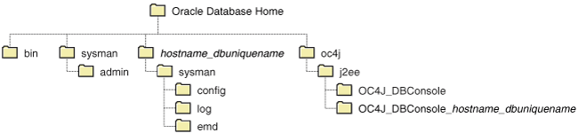
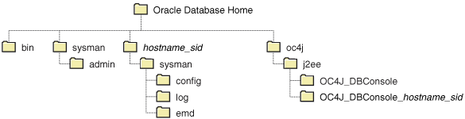

## 10 Managing Oracle Enterprise Manager Database Control

In this chapter:

## Database Control Overview

This chapter describes the functionality and administration of Oracle Enterprise Manager Database Control (Database Control), the Web-based interface and primary tool for managing an Oracle database. Using Database Control, you can perform administrative tasks such as creating schema objects (tables, views, indexes, and so on), managing user security, managing database memory and storage, backing up and recovering your database, and importing and exporting data. You can also view performance and status information about your database.

After you have installed the Oracle Database software, created or upgraded a database, and configured the network, you can use Database Control to manage your database. Database Control also provides an interface for both performance advisors and Oracle utilities such as SQL\*Loader and Recovery Manager (RMAN).

Oracle also offers separately licensed Oracle Enterprise Manager management packs, management plug-ins, and other products that you can purchase to enhance the capabilities of Oracle Enterprise Manager in specific environments.

### Understanding the Enterprise Manager Directories

When you install Oracle Database, you also install Database Control by default. As a result, the Oracle Database installation procedure installs a set of Enterprise Manager directories and files into the `$ORACLE_HOME` directory.

In particular, the `emctl` commands required to control Database Control are installed into the `$ORACLE_HOME/bin` directory.

The Management Agent and Management Service support files are installed in two locations in an installation of Oracle Database:

- Files that are common and shared among all instances of the database are stored in the following directory:
	- `$ORACLE_HOME/sysman`
		For example, the administration files, which define the supported target types and the scripts used to perform Management Agent configuration tasks are stored in the `$ORACLE_HOME` `/sysman/admin` directory
- Files that are unique to each instance of the database are stored in the following directory:
	- `$ORACLE_HOME/` `hostname_dbuniquename` `/` (for a single-instance database)
		- `$ORACLE_HOME/` `nodename_dbuniquename` / (for an Oracle Real Applications Cluster (Oracle RAC) database)
		Note:
		In Oracle Database 10g, files that are unique to each instance of the database are stored in following directory of the Oracle Database 10g home:
		- `$ORACLE_HOME/` `hostname_sid` `/` (for a single-instance database)
		- `$ORACLE_HOME/` `nodename_sid` `/` (for an Oracle RAC database)

Throughout the rest of this chapter, `$ORACLE_HOME/` `hostname_dbuniquename` `/` and `$ORACLE_HOME/` `nodename_dbuniquename` may be used interchangeably. (For release 10g of the database, the directories are `$ORACLE_HOME/` `hostname_sid` `/` and `$ORACLE_HOME/` `nodename_sid` `/`.) Both paths refer to the same concept: the Enterprise Manager directory for the specific database instance. The difference is that `$ORACLE_HOME/` `hostname_dbuniquename` `/` is used for single-instance databases, while `$ORACLE_HOME/` `nodename_dbuniquename` / is used for cluster (Oracle RAC) databases. In cluster databases, nodename refers to the public name of the node, as specified during Cluster Ready Services (CRS) configuration for cluster environments.

For example, if the database host name is `mgmt1.example.com` and the system identifier for the database name is `db11`, the log files for the Management Agent and Management Service for that instance are installed in the following directory:

`$ORACLE_HOME/mgmt1.example.com_db11/sysman/log/`

If a `hostname_dbuniquename` directory does not exist in the Oracle home directory, then Database Control was never configured for the database instance. Note that in Oracle Database Release 10g, the directory is `hostname_sid`.

In addition, the files required to deploy the Database Control as a J2EE application are installed into the `$ORACLE_HOME/oc4j/j2ee/` directory structure. Database Control is a J2EE application that is deployed using the standalone version of Oracle Application Server Containers for J2EE (OC4J). The `OC4J_DBConsole` directory contains the template files that are used to create database-specific deployment directories for each Database Control instance deployed in the Oracle home.

The installation and configuration files are stored in the `$ORACLE_HOME` directory in the following sub-directories:

- `cfgtoollogs/dbua`
- `cfgtoollogs/rconfig`
- `cfgtoollogs/dbca`
- `cfgtoollogs/emca`

Figure 10-1 summarizes the location of the important Enterprise Manager directories in a typical Oracle home directory for Oracle Database 11g Release 2 or later. Note that references to `hostname_dbuniquename` are for single-instance databases; cluster databases have paths of the form `nodename_dbuniquename`.

Figure 10-1 Directory Structure in the Management Service Home for Release 11g or Later



> This diagram shows the Oracle Database home directory tree for a release 11g installation. The root of the tree is a folder named Oracle Database Home. Beneath the root are four folders named bin, sysman, hostname\_dbuniquename, and oc4j. These folders all have various subfolders.
>
> [Copyright © 2001, 2015, Oracle and/or its affiliates. All rights reserved.](https://docs.oracle.com/cd/E11882_01/dcommon/html/cpyr.htm)
  

Similarly, Figure 10-2 displays the directory structure of Enterprise Manager directories in the Oracle home directory for Oracle Database Release 10g.

Figure 10-2 Directory Structure in the Management Home for Release 10g



> This diagram shows the Oracle Database home directory tree for a release 10g installation. The root of the tree is a folder named Oracle Database Home. Beneath the root are four folders named bin, sysman, hostname\_sid, and oc4j. These folders all have various subfolders.
>
> [Copyright © 2001, 2015, Oracle and/or its affiliates. All rights reserved.](https://docs.oracle.com/cd/E11882_01/dcommon/html/cpyr.htm)
  

## Configuring Database Control During and After Installation

The following sections describe how Database Control is configured during installation, and how you can configure Database Control after installation.

### Overview of Configuration Options

The following are the products, tools, and utilities you, as a database administrator, can use to configure the Database Control environment:

- Oracle Universal Installer
	Oracle Universal Installer (OUI) is a utility that installs your Oracle software and options. It can automatically start Oracle Database Configuration Assistant to install a database.
- DBCA
	Oracle Database Configuration Assistant (DBCA) is a utility that creates a database from templates that are supplied by Oracle. It also enables you to create your own database by copying a preconfigured seed database, thus saving the time and effort needed to generate and customize a new database.
- Database Upgrade Assistant
	The Database Upgrade Assistant is a tool that guides you through the upgrade of your existing database to a new Oracle Database release.
- Net Configuration Assistant
	Net Configuration Assistant (NETCA) is a utility that enables you to configure listeners and naming methods, which are critical components of the Oracle Database network.

### Configuring Database Control During Installation

If you create a database while installing Oracle Database, you have the option of configuring your database so it can be managed by Oracle Enterprise Manager Grid Control Console or by Database Control Console.

To select Grid Control Console as your management option, the Oracle Management Service must be installed on a network host. In addition, the Oracle Management Agent must be installed on the host where you are installing the database. Otherwise, the Grid Control Console option is unavailable and you must instead choose to manage your database with Database Control.

For most of the Oracle installation types, you must choose either Database Control or Grid Control as your management option when you create a database during the installation.

However, if you create a database using one of the following methods, you can choose not to configure Database Control:

- Choosing the Advanced database configuration option during an Enterprise or Standard Edition installation
- Running DBCA after the installation

Note that if you do not configure Database Control during installation of an Oracle Database 11g instance, a `hostname_dbuniquename` directory will not be created in the resulting Oracle home directory. When installing a release 10g database, a hostname\_sid directory will not be created in the resulting Oracle home directory.

### Configuring Database Control with DBCA

The primary method for configuring an existing Oracle database so it can be managed with Database Control is to use DBCA. You can use DBCA to create a new database or to reconfigure an existing database.

See Also:

"Installing Oracle Software and Building the Database" in the Oracle Database 2 Day DBA book for more information about using DBCA to create a new database instance, and Oracle Database 2 Day + Real Application Clusters Guide for Oracle RAC examples using DBCA.

To use DBCA to reconfigure your database so it can be managed with Database Control:

1. Log in to the database host as a member of the administrative group that is authorized to install Oracle software and create and run the database.
2. Start DBCA, change directory to the `$ORACLE_HOME` `/bin` directory, then enter the following command:
	```
	$ ./dbca
	```
	The DBCA Welcome page appears.
3. Advance to the Operations page and select Configure Database Options.
4. Advance to the Database page and select the database that you want to configure.
5. Advance to the Management Options page and select the following options:
	- Configure the Database with Enterprise Manager
		- Use Database Control for Database Management
6. Select any desired options for enabling e-mail notifications and enabling daily backups.
	For more information about Enterprise Manager notifications and daily backups, click Help on the Management Options page.
7. Advance until the Finish button is available.
8. Click Finish to reconfigure the database to use Database Control.
	After DBCA reconfigures the database, a new subdirectory appears in the Oracle home. In release 11g of the database and later, this directory is named using the following format and contains Database Control configuration and state files specific to the database you just configured:
	`hostname_dbuniquename`
	Note that for cluster databases, the directories are named:
	`nodename_dbuniquename`.
	In Oracle Database 10g, the new subdirectory is named:
	`hostname_sid`
	Likewise in Oracle Database 10g, for cluster databases the directories are named:
	`nodename_sid`
	For example:
	```
	mycluster1.example.com_myNewDB
	```

### Configuring Database Control Using EMCA

When you use DBCA to configure Oracle 11g Release 2 (11.2), DBCA provides a graphical user interface to help you select Database Control options and to configure other aspects of your database.

However, to use the operating system command line to configure Database Control, you can use the Enterprise Manager Configuration Assistant (EMCA).

Caution:

When you configure Database Control using EMCA, the database may become unavailable and users may not be able to connect to the database or perform operations on the database.

To configure Database Control with EMCA:

1. Set the `ORACLE_HOME` environment variable to specify the Oracle home for the database that you want to manage.
2. Change directory to the `$ORACLE_HOME` `/bin` directory.
3. Start EMCA by entering the following command with any of the optional command-line arguments shown in Table 10-1, "EMCA Command-Line Operations":
	```
	$ ./emca
	```
	Depending on the arguments that you include on the EMCA command line, EMCA prompts you for the information required to configure Database Control.
	For example, enter the following command to configure Database Control so that it will perform automatic daily backups of your database:
	```
	$ ./emca -config dbcontrol db -backup
	```

EMCA commands are in the following form:

`emca [operation] [mode] [flags] [parameters]`

Note:

To configure Database Control for single-instance database using Oracle Automatica Storage Management (ASM), no extra parameters need to be passed along with the EMCA command. Run the following command to configure the Database Control which will automatically detect the Oracle ASM instance:
```
$ emca -config dbcontrol db -repos create
```

Table 10-1 describes the valid execution operations and modes and lists the optional parameters in brackets. Table 10-2 discusses the flags and their behavior and Table 10-3 defines the optional parameters in detail. EMCA parameters are in the form `[``-parameterName parameterValue``].` Multiple parameters can be used in combination at the command line.

Table 10-1 EMCA Command-Line Operations

| Command | Description |
| --- | --- |
| `emca -h \| --h \| -help \| --help` | Use this option to display help messages for the EMCA utility. The options described in Table 10-1, Table 10-2, and Table 10-3, and the valid parameters you may include are listed. |
| `emca –version` | Prints the version information associated with EMCA. |
| `emca -config dbcontrol db [-repos (create \| recreate)] [-cluster] [-silent] [-backup] [parameters]` | Configures Database Control for a database. Options include creating (or re-creating) the Database Control repository, configuring automatic backups, and performing these operations on a cluster database. |
| `emca -config centralAgent (db \| asm) [-cluster] [-silent] [parameters]` | Configures central agent management for a database or an Oracle ASM instance. Options include performing this operation on a cluster environment. This operation will configure the database so that it can be centrally managed by the Oracle Enterprise Manager Grid Control Console. To use this option, you must have previously installed the Oracle Management Service component of Enterprise Manager on a network host. In addition, the Oracle Management Agent must be installed on the host on which you are running the database. |
| `emca -config all db [-repos (create \| recreate)] [-cluster] [-silent] [-backup] [parameters]` | Configures both Database Control and central agent management for a database. The possible configuration options are similar to those described above. |
| `emca -deconfig dbcontrol db [-repos drop] [-cluster] [-silent] [parameters]` | Deconfigures Database Control for a database. Options include dropping the Database Control repository and performing these operations on a cluster database. For example, you might use this command to remove the Database Control configuration from a database you are planning to delete. In such a scenario, remove the Database Control configuration before physically deleting the database. This operation does not remove the actual database or its data files. |
| `emca -deconfig centralAgent (db \| asm) [-cluster] [-silent] [parameters]` | Deconfigures central agent management for a database or an Oracle ASM instance. Options include performing this operation on a cluster environment. For example, you might use this command to remove the central agent management configuration from a database you are planning to delete. In such a scenario, remove the central agent management configuration before physically deleting the database. This operation does not remove the actual database or its data files. |
| `emca -deconfig all db [-repos drop] [-cluster] [-silent] [parameters]` | Deconfigures both Database Control and central agent management for a database. The possible deconfiguration options are similar to those described above. |
| `emca -addNode (db \| asm) [-silent] [parameters]` | Configures Enterprise Manager for a new cluster instance of a database or ASM storage. For more information, see "Using EMCA With Oracle RAC". This option applies only to Release 11g. |
| `emca -deleteNode (db \| asm) [-silent] [parameters]` | Deconfigures Enterprise Manager for a node being deleted. For more information, see "Using EMCA With Oracle RAC". This option applies only to Oracle Database Release 11g. |
| `emca -addInst (db \| asm) [-silent] [parameters]` | Configures Enterprise Manager for a newly added cluster instance of an administrator-managed database or Oracle ASM storage. This parameter takes a SID for the instance being added. For more information, see "Using EMCA With Oracle RAC". |
| `emca -deleteInst (db \| asm) [-silent] [parameters]` | Deconfigures Enterprise Manager for a newly deleted cluster instance of an administrator-managed database or Oracle ASM storage. This parameter takes a SID for the instance being deleted. This is discussed further below, in "Using EMCA With Oracle RAC". |
| `emca -reconfig ports [-cluster] [parameters]` | Explicitly reassigns Database Control ports. Options include performing this operation on a cluster environment. For more information, see "Specifying the Ports Used by Database Control". |
| `emca -reconfig dbcontrol -cluster [-silent] [parameters]` | Reconfigures Database Control deployment for a cluster database. Note that this command must be used with the `-cluster` option. For more information, see "Using EMCA With Oracle RAC". |
| `emca -displayConfig dbcontrol -cluster [-silent] [parameters]` | Displays information about the current deployment configuration of Database Control in a cluster environment. Note that this command must be used with the `-cluster` option. For more information, see "Using EMCA With Oracle RAC". |
| `emca -upgrade (db \| asm \| db_asm) [-cluster] [-silent] [parameters]` | Upgrades the configuration of an earlier release of Enterprise Manager to the current release. This operation can be performed for Oracle Database, Oracle ASM, or Oracle Database and Oracle ASM instances together simultaneously. This does not upgrade the actual database or Oracle ASM instances, nor does it upgrade the Enterprise Manager software. Instead, it upgrades the configuration files for the specified instance so that they are compatible with the current version of the Enterprise Manager software. EMCA will attempt to upgrade all instances of the specified database or Oracle ASM target, or both, on the host, across all Oracle homes (because it is likely that certain target properties, such as the listener port or Oracle home, have changed). |
| `emca -restore (db \| asm \| db_asm) [-cluster] [-silent] [parameters]` | Restores the current version of Enterprise Manager configuration to an earlier version. This is the inverse of the `-upgrade` option (and will reverse any changes that result from this operation). |
| `emca -migrate -from dbcontrol -to centralAgent [-repos drop] [-cluster] [-silent] [parameters]` | Migrates the Enterprise Manager configuration from Database Control to Central Agent. |

Table 10-2 EMCA Command-Line Flags

| Flag | Description |
| --- | --- |
| `db` | Performs the operation for a database (including cluster databases). Use this option for databases that use Oracle ASM to store the data files. If a database is using Oracle ASM, all the configuration operations and modes described above (except for `-upgrade` and `-restore`) will detect this automatically and apply the changes to both the database and Oracle ASM instances. |
| `asm` | Performs the operation for an Oracle ASM-only instance (including cluster Oracle ASM instances). |
| `db_asm` | This flag can only be used in `-upgrade` and `-restore` mode. Performs the upgrade or restore operation for an Oracle Database and an Oracle ASM instance together. Database and Oracle ASM instances may be upgraded or restored separately (that is, upgrading an Oracle ASM instance does not require upgrading the database instances it services). Therefore, the Enterprise Manager configuration can be upgraded or restored separately for a database and its respective Oracle ASM instance. |
| `-repos create` | Creates a new Database Control management repository. |
| `-repos drop` | Drops the current Database Control management repository. |
| `-repos recreate` | Drops the current Database Control management repository and then re-creates a new one. |
| `-cluster` | Performs the operation for a cluster database or Oracle ASM instance. |
| `-silent` | Performs the operation without prompting for additional information. If this mode is specified, all the required parameters must be entered at the command line or specified in an input file using the `–respFile` argument. You can view a list of the available parameters by entering `emca -help` at the command line. |
| `-backup` | Configures automatic backup for a database. EMCA will prompt for daily automatic backup options. The default Enterprise Manager settings will be used to backup the database files.  Note: If you use this option, EMCA will use the value of the `db_recovery_file_dest` initialization parameter to identify the flashback recovery area for the automated backups. If that parameter is not set, EMCA will generate an error. You can modify these settings later using the Maintenance page in Database Control. For more information, see the Database Control online help. |

Table 10-3 EMCA Command-Line Parameters

| Parameter | Description |
| --- | --- |
| `-respFile` | Specifies the path of an input file listing parameters for EMCA to use while performing its configuration operation. For more information, see "Using an Input File for EMCA Parameters". |
| `-SID` | Database system identifier. |
| `-PORT` | Port number for the listener servicing the database. |
| `-ORACLE_HOME` | Database Oracle home, as an absolute path. |
| `-ORACLE_HOSTNAME` | Local database hostname. |
| `-LISTENER_OH` | Oracle home from which the listener is running. If the listener is running from an Oracle home other than the one on which the database is running, the parameter `LISTENER_OH` must be specified. |
| `-HOST_USER` | Host system user name (for automatic backup). |
| `-HOST_USER_PWD` | Host system user password (for automatic backup). |
| `-BACKUP_SCHEDULE` | Schedule in the form of "HH:MM" for daily automatic backups. |
| `-EMAIL_ADDRESS` | E-mail address for notifications. |
| `-MAIL_SERVER_NAME` | Outgoing Mail (SMTP) server for notifications. |
| `-ASM_OH` | Oracle ASM Oracle home. |
| `-ASM_SID` | System identifier for Oracle ASM instance. |
| `-ASM_PORT` | Port number for the listener servicing the Oracle ASM instance. |
| `-ASM_USER_ROLE` | User role for connecting to the Oracle ASM instance. |
| `-ASM_USER_NAME` | User name for connecting to the Oracle ASM instance. |
| `-ASM_USER_PWD` | Password for connecting to the Oracle ASM instance. |
| `-DBSNMP_PWD` | Password for the DBSNMP user. |
| `-SYSMAN_PWD` | Password for the SYSMAN user. |
| `-SYS_PWD` | Password for the SYS user. |
| `-SRC_OH` | Oracle home of the database with Enterprise Manager configuration to be upgraded or restored. |
| `-DBCONTROL_HTTP_PORT` | Use this parameter to specify the port you use to display the Database Control Console in your Web browser. For more information, see "Specifying the Ports Used by Database Control". |
| `-AGENT_PORT` | Use this parameter to specify the Management Agent port for Database Control. For more information, see "Specifying the Ports Used by Database Control". |
| `-RMI_PORT` | Use this parameter to specify the RMI port for Database Control. For more information, see "Specifying the Ports Used by Database Control". |
| `-JMS_PORT` | Use this parameter to specify the JMS port for Database Control. For more information, see "Specifying the Ports Used by Database Control". |
| `-CLUSTER_NAME` | Cluster name (for cluster databases). |
| `-DB_UNIQUE_NAME` | Database unique name (for cluster databases). |
| `-SERVICE_NAME` | Database service name (for cluster databases). |
| `-EM_NODE` | Node from which Database Control console is to be run (for cluster databases). For more information, see "Using EMCA With Oracle RAC". |
| `-EM_NODE_LIST` | Comma-delimited list of NODEs for agent-only configurations, uploading data to -EM\_NODE. For more information, see "Using EMCA With Oracle RAC". |
| `-EM_SWLIB_STAGE_LOC` | Software library location. |
| `-PORTS_FILE` | Path to a static file specifying the ports to use. The default value is: `${ORACLE_HOME}/install/staticports.ini`. |

### Using an Input File for EMCA Parameters

Instead of answering a series of prompts when you run EMCA, you can use the `-respFile` argument to specify an input file. The input file you create must be in a format similar to the following example:

```
PORT=1521
SID=DB
DBSNMP_PWD=xpE234D
SYSMAN_PWD=KDOdk432
```

After you create an EMCA input file, you can use it on the command line as follows:

```
$ ./emca -config dbcontrol db -respFile input_file_path
```

For example, to configure the Database Control to perform daily backups and create the Database Control Management Repository, create an input file similar to the one shown in Example 10-1 and enter the following command at the operating system prompt:

```
$ ./emca -config dbcontrol db -repos create -backup -respFile input_file_path
```

Example 10-1 Sample EMCA Input File

```
PORT=1521
SID=DB
DBSNMP_PWD=dow3l224
SYSMAN_PWD=squN3243
HOST_USER=johnson
HOST_USER_PWD=diTf32of
SYS_PWD=qlKj4352
BACKUP_SCHEDULE=06:30
```

### Specifying the Ports Used by Database Control

When you initially install Oracle Database or configure Database Control with EMCA, Database Control uses a set of default system ports. For example, by default, you access Database Control using port 1158, as shown in the following example:

```
http://host.domain:1158/em
```

This is the default port assigned to Database Control by the Internet Assigned Numbers Authority (IANA). Likewise, the default Database Control Agent port, as assigned by the IANA, is 3938.

To use ports other than the default ports, use the following EMCA command-line arguments when you initially configure the Database Control with EMCA. Alternatively, you can explicitly assign ports after configuring Database Control using the following command:

```
$ emca -reconfig ports [-cluster]
```

Note:

You can also use the following EMCA command-line arguments to configure Database Control after you have installed and configured Oracle Database.

The following list summarizes the EMCA command-line arguments that control the standard Database Control port assignments:

- `-DBCONTROL_HTTP_PORT` `port_number`
	This port is used in the Database Control Console URL. For example, if you set this port to 5570, you can then use the following URL to display the Database Control Console:
	```
	http://host.domain:5570/em
	```
- `-RMI_PORT` `port_number`
	This port is used by the Remote Method Invocation (RMI) system, which is part of the J2EE software required by Database Control. The default port can be changed if you want to configure a specific port for Database Control. When a port other than the default port (1521) is used, use the `-RMI_PORT` or `-JMS_PORT` options along with the `emca reconfig` command.
- `-JMS_PORT` `port_number`
	This port is used by the OC4J Java Message Service (JMS), which is part of the J2EE software required by Database Control. The default port can be changed if the user wants to configure a specific port for Database Control. When a port other than the default port (1521) is used, use the `-RMI_PORT` or `-JMS_PORT` options along with the `emca reconfig` command.
- `-AGENT_PORT` `port_number`
	This port is used by the Database Control Management Agent, which is monitoring and administering the database for the Database Control.

### Using EMCA With Oracle RAC

Each EMCA command can be used in Oracle RAC environments, and certain commands are only applicable in cluster setups. To perform cluster commands using EMCA, use the cluster flag that is available in almost every EMCA operational mode.

When you use EMCA to configure Database Control for Oracle RAC, you configure the Database Control for each instance in the cluster. However, by default the Database Control Console will only start on the local node. On every other node of the cluster, only the Enterprise Manager agent will start. This is because the Database Control Console opens several connections to the database. If an instance of the console is running on every host in the cluster, then you may easily exceed the maximum number of permitted open connections on a 32-node or 64-node environment.

To remedy this situation, the Database Control is started only on the local node. On every other node, the commands `emctl start dbconsole` and `emctl stop dbconsole` only start and stop the agent. Each of the remote agents will upload their respective data to the console running on the local node, from which you can monitor and manage all the targets in the cluster. The following subdirectory is created on each instance of the Oracle RAC database where `nodename` is the name of a node in the cluster, and `dbuniquename` is the database instance name of the database for release 11g and later:

```
$ORACLE_HOME/nodename_dbuniquename
```

For Oracle Database release 10g, `nodename` is the name of the node in the cluster and `sid` is the database instance name:

```
$ORACLE_HOME/nodename_sid
```

However, note that if you upgrade an existing Oracle RAC database configured with Database Control to the current release, then the existing Database Control configuration is retained. The existing Database Control has a Database Control running on each cluster node. The console will still be started on each individual node.

To modify the existing configuration in a release 11g and later database, use the following command where `nodename` is the public name of the node and `node_list` is a comma-delimited list of nodes where the database is configured:

```
$ emca -reconfig dbcontrol –cluster –EM_NODE nodename -EM_NODE_LIST node_list
```

To modify the existing configuration in a release 10g database, use the following command where `nodename` is the public name of the node and `SID_list` is a comma-delimited list of database system identifiers:

```
$ emca -reconfig dbcontrol –cluster –EM_NODE nodename -EM_SID_LIST SID_list
```

Note:

SCAN listener configuration is mandatory when configuring Database Control in an Oracle RAC environment.

This command reconfigures the current Database Control setup and performs the following actions in sequence:

Note:

Unless otherwise specified, all command options in the following actions represent release 11g and later databases. Release 10g database differences are called out in the sequence.
1. Starts a Database Control Console on `nodename`, if one has not been started yet.
2. Redirects the agents monitoring the database instances in `node_list` (`SID_list` in release 10g of the database) so that they upload their data to the console running on `nodename`. Also, agents monitoring database instances on `nodename` will also upload their data to the local console. Note that if you do not enter the command options `-EM_NODE` or `-EM_NODE_LIST` (`-EM_SID_LIST` for release 10g of the database) at the command line, you will be prompted to enter them.

`-EM_NODE` defaults to the local node if it is not specified when prompted. If not specified, `-EM_NODE_LIST` (`-EM_SID_LIST` for release 10g of the database) defaults to all nodes where the database is configured.

You can use this command to start the console on multiple nodes. For instance, on an 8-node cluster with nodes `node1`, `node2`, `node3`, `node4`, `node5`, `node6`, `node7`, and `node8`, you can run the following commands in succession:

```
$ emca -reconfig dbcontrol –cluster –EM_NODE node1 -EM_NODE_LIST node2,node3,node4
$ emca -reconfig dbcontrol –cluster –EM_NODE node5 -EM_NODE_LIST node6,node7,node8
```

For release 10g databases, run the following commands in succession:

```
$ emca -reconfig dbcontrol –cluster –EM_NODE node1 -EM_SID_LIST sid2,sid3,sid4
$ emca -reconfig dbcontrol –cluster –EM_NODE node5 -EM_SID_LIST sid6,sid7,sid8
```

In this scenario, there are two Database Control consoles running, one on node1 and the other on node5. From either of these consoles, you can manage and monitor all targets in the cluster.

For information about the current cluster configuration, run the following command:

```
$ emca -displayConfig dbcontrol –cluster
```

The preceding command prompts for the database unique name for the cluster database. This will print the current configuration onto the screen, indicating the nodes that have consoles running on them and the consoles where each agent is uploading.

To configure Enterprise Manager for a newly added node of a cluster, enter the following command:

```
$ emca -addNode db
```

To configure Enterprise Manager for a new cluster instance of an administrator-managed database or Oracle ASM storage, enter the following command:

```
$ emca -addInst db
```

For Oracle Database release 11g, on cluster policy managed databases another common operation is the addition and deletion of cluster nodes. After you add a new node, you can run EMCA to configure Database Control or central agent management for that node using the command `emca -addNode db`. Running EMCA only configures Enterprise Manager so that you can manage the instance in a way consistent with the rest of the cluster database instances.

For Oracle Database releases 10g and 11, on cluster databases you can create and delete database instances. After you create a new instance, you can run EMCA to configure Database Control or central agent management for that instance using the command `emca -addInst db`. Running EMCA does not create the actual database instance; it only configures Enterprise Manager so that you can manage the instance in a way consistent with the rest of the cluster database instances.

On release 11g and later, when configuring Enterprise Manager for a new node, run the EMCA command only after you have added the node. Also, run the command from a node in the cluster that already has Enterprise Manager configured for it, because the Enterprise Manager configuration settings on the existing node are propagated to the new node when you run the command. Because the `-addNode` option can be used only in an Oracle RAC environment, you do not need to use the `-cluster` option on the command line.

After running the command `emca -addNode db`, enter the node name and database unique name for the node and database. For example:

```
Node name: node2
Database Unique Name: EM102
```

Similarly in releases 10g and 11g of the database, when configuring Enterprise Manager for a new instance, run the EMCA command only after you have created the instance. Also, run the command from a node in the cluster that already has Enterprise Manager configured for its associated database instance, as these configuration settings will be propagated to the new instance. Do not run this command from the node on which the new instance was created. Note that this option can be used only in an Oracle RAC environment so you do not need to use the `-cluster` option on the command line. After running the command `emca -addInst db`, enter the following information for the node and database:

```
Node name: node2
Database Unique Name: EM102
Database SID: EM1022
```

For release 11g and later, to deconfigure Enterprise Manager for a specific node you are deleting from the cluster, log in to a different node from the one you plan to delete, then use the command `emca -deleteNode db`. Running this command removes the Enterprise Manager configuration so that you will no longer be able to manage the instance with Enterprise Manager on that node. Ensure that you run the EMCA command before you delete the actual cluster node. Because this option can be used only in an Oracle RAC environment, you do not need to use the `-cluster` option on the command line.

For Oracle Database release 10g, to deconfigure Enterprise Manager for a specific database instance (typically before the database instance is deleted), use the inverse command, `emca -deleteInst db`. Running EMCA does not delete the database instance; it only removes the Enterprise Manager configuration so that you will no longer be able to manage the instance with Enterprise Manager.

Ensure that you run the EMCA command before you delete the actual cluster database instance. Also, ensure that you run the command from a different node and not from the node on which the database instance will be deleted. Note that this option can be used only in an Oracle RAC environment, so you do not need to use the `-cluster` option on the command line.

For more information, see Table 10-1 which describes EMCA command line operations.

Note:

If you use the command `emca -cluster` to configure Database Control for Oracle RAC, then check the `TNS_ADMIN` environment variable on all cluster nodes. If you have a different TNS\_ADMIN set for each node, then the listener for the target cannot be configured correctly. In this case, set the value of TNS\_ADMIN the same on all cluster nodes before running the `emca -cluster` command.

## Administering Database Control

This section provides a brief description of the activities that you can perform while administering your database using Database Control. The following sections describe some of the tasks available for managing an Oracle database:

- Starting and Stopping the Database Control Process
- Accessing the Database Home Page
- Creating Database Control Administrative Users
- Granting Access to Database Control for Non-Administrative Users
- Setting Database Control Preferences

### Starting and Stopping the Database Control Process

To access Database Control from a browser, the Database Control console process `dbconsole` must be running on the database host computer. The `dbconsole` process is automatically started after installation. However, if the system must be restarted, you can start the process manually at the command line or start it as a service in Windows. You can also run commands to stop the process or view its status. If the process is stopped, then it must be manually restarted before you use Database Control.To start or stop the database or to view the status of the `dbconsole` process from the command line:

1. Configure the operating system environment variables, as described in the "Configuring the Operating System Environment Variables" chapter in the Oracle Database 2 Day DBA guide.
2. Do one of the following:
	- To start the process, run the following command:
		```
		$ ./emctl start dbconsole
		```
		- To stop the process, run the following command:
		```
		$ ./emctl stop dbconsole
		```
		- To view the status of the process, run the following command:
		```
		$ ./emctl status dbconsole
		```
	Note:
	If you are prompted to set the `ORACLE_UNQNAME` environment variable, then set this variable and run the emctl command again. Set the variable to the database unique name (the value of the `DB_UNIQUE_NAME` database parameter). A typical value for `DB_UNIQUE_NAME` is `orcl`.
	To start or stop Database Control as a service on Microsoft Windows:
	1. Do one of the following:
		- On Windows XP and Windows Server 2003, click Start, then select Control Panel.
				- On Windows 2000 Server, click Start, select Settings, then select Control Panel.
		The Control Panel window opens.
		2. Double-click the Administrative Tools icon, and then double-click the Services icon.
		The Services window opens.
		Oracle Database services begin with `Oracle`. The service is listed as `OracleDBConsole` `sid`, where `sid` is the system identifier (SID) for your database instance. The status of the process is listed in the Status column.
		3. Double-click the OracleDBConsole `sid` service (for Release 10g). Double-click the OracleDBConsole `dbuniquename` service (for Release 11g).
		The Service Properties window opens.
		4. In the Startup Type list, ensure that either Manual or Automatic is selected.
		5. Do one of the following:
		- To start the service, click Start then click OK
				- To stop the service, click Stop then click OK.

### Accessing the Database Home Page

The Database Home page is the main database management page in Database Control.

To access the Database Home page:

1. Ensure that the `dbconsole` process is running on the database host computer.
	See the "Starting and Stopping the Database Control Process" section.
2. In your Web browser, enter the following URL:
	```
	https://hostname:portnumber/em
	```
	For example, if you installed the database on a host computer named `comp42.example.com`, and the installer indicated that your Enterprise Manager Console HTTP port number is `1158`, then enter the following URL:
	```
	https://comp42.example.com:1158/em
	```
	If you have recently installed Oracle Database, you can determine the port number for Database Control on Linux and UNIX systems by viewing the `$ORACLE_HOME` `/install/portlist.ini` file. Otherwise, you can determine the port number for Database Control by searching for `REPOSITORY_URL` in the `ORACLE_$HOME/` `Oracle_sid` `/sysman/config/emd.properties` file, where `Oracle_sid` is the system identifier (SID) for your database instance.
	You must do the following to start the database:
	1. Click Startup/Shutdown, enter the host login user name and password, then enter the database login user name and password.
		For the database user name and password, enter SYS and the password that you specified during installation.
		2. Click OK to start the database instance, then in the Confirmation page, click Yes to start the database in open mode.
3. Log in to the database with a user account that is authorized to access Database Control.
	This user initially could be `SYS` or `SYSTEM`, with the password that you specified during database installation.
	While the `SYSTEM` account can be used to perform day-to-day administrative tasks, Oracle strongly recommends creating named user accounts for administering the Oracle database to enable monitoring of database activity. To back up, recover, or upgrade the database, you must log in as a `SYSDBA` user.
	Database Control displays the Database Home page.

The subpage links across the top of the page enable you to access performance, availability, and other administration pages to manage your database. The features provided by these pages are discussed in other sections of this documentation.

The various sections of the Database Home page provide information about the environment and status of the database. For example, the Alerts and Diagnostic Summary sections warn you of errors and performance problems that are impacting the operation of your database. You can click the provided links to see more detail about the problem areas, and, in some cases, to obtain recommendations for resolving the problems. These topics are discussed in the 2 Day DBA guide, in the "Monitoring and Tuning the Database" chapter.

### Creating Database Control Administrative Users

When you log in to Database Control using the `SYS`, `SYSTEM`, or `SYSMAN` user accounts, you are logging in as the Database Control super user. These are the only accounts that are automatically granted the roles and privileges required to administer Database Control itself. Examples of Database Control administration tasks include the following:

- Creating other Database Control administrators.
- Configuring e-mail and other notification methods.
- Setting alert thresholds for database metrics, such as tablespace space usage percentage exceeded or SQL response time exceeded.
- Selecting database policies to apply, so that Database Control can show alerts if a policy is violated. (An example policy is "A nonsystem user cannot use the SYSTEM or SYSAUX tablespace as its default tablespace.")
- Defining blackouts, which are time periods in which database monitoring is suspended so that maintenance operations do not skew monitoring data or generate needless alerts.

You can create Database Control administrative users who have enough privileges to administer Database Control itself, but lack the high-level database administration privileges of the `SYS` and `SYSTEM` users. This practice enables you to assign the minimum privileges required for other Database Control administrators to do their jobs, which is a best practice for database security. You can also create a Database Control administrative account for yourself, thus avoiding logging in as `SYS` or `SYSTEM` until you must perform database administration tasks.

Using the following procedure, you can assign Database Control administrative privileges to an existing database user or create a new Database Control administrative user. When you create a new Database Control administrative user, a user account is created for that user for the database. You must then decide which system privileges, object privileges, or roles to grant the user, if any, to perform database administration tasks.

To create a Database Control administrative user:

1. On any Database Control page, at the top of the page, click Setup.
	The Enterprise Manager Configuration page appears, showing the Overview of Setup page.
2. In the left navigation bar, click Administrators.
	The Administrators page appears.
3. Click Create.
	The Create Administrator: Properties page appears.
4. In the Name field, enter the name of an existing database user, or click the flashlight icon next to the field and select an existing database user.
5. Enter one or more e-mail addresses for this administrator only if you plan to set up e-mail notifications for the database.
6. Click Review to view a page that summarizes the information that you entered.
7. Click Finish to configure the database user as a Database Control administrative user.
	The Administrators page appears, showing the new administrator in the list.

### Granting Access to Database Control for Non-Administrative Users

As a database administrator, you can log in to Database Control with the `SYS` or `SYSTEM` user account to perform administrative and other tasks. Non-administrative users may also want to log in to Database Control. For example, application developers may want to take advantage of the Database Control interface to create or modify tables, indexes, views, and so on. You must grant access to Database Control to these users before they can log in.For non administrative users to have access to Database Control, they must be granted the `SELECT_CATALOG_ROLE` role.

### Setting Database Control Preferences

This section discusses setting user preferences for Database Control.

#### About Database Control Preferences

Database Control enables you to set user preferences in the following areas:

- Notification
	These settings enable Database Control to e-mail you alerts. Alerts are notifications that the database is in an undesirable state and needs your attention. By default, the Database Home page lists all alerts. However, setup is required for e-mail notification. For more information about alerts and setting up notifications, see the "Setting Up Direct Alert Notification" section in the "Monitoring and Tuning the Database" chapter of the Oracle Database 2 Day DBA book.
- Blackout Administration
	During blackouts, Database Control does not collect database monitoring data or send alerts. Blackouts enable you to perform scheduled maintenance on the database without receiving needless alerts and without skewing the monitoring data.
	For example, you can stop data collections during a database backup or a hardware upgrade. If you continue monitoring during these periods, then the collected data shows trends and other monitoring information that is not the result of typical day-to-day operations. To get a more accurate, long-term picture of database performance, you can use blackouts to exclude these special-case situations from data analysis. See the "Defining Blackout Periods" section in the "Getting Started with Database Administration" chapter of the Oracle Database 2 Day DBA book for more information.
- Preferred Credentials
	Database Control can automatically execute many routine administrative tasks, such as backups. You can use a job scheduling system that is built into Database Control for these routine tasks. To keep your environment secure, setting up tasks for automatic execution in Enterprise Manager requires you to provide login information for the host computer and database. To avoid entering this information every time you create or run a job or task, Database Control enables you to save this information as preferred credentials. Preferred credentials are stored in the database in encrypted mode to protect them from unauthorized use. See the Setting Preferred Credentials section for more information.

#### Defining Blackout Periods

You can define one or more one-time or repeating blackout periods where Database Control does not collect database monitoring data or send alerts.

To define a blackout period:

1. On any Database Control page, at the top of the page, click Setup.
	The Enterprise Manager Configuration page appears, showing the Overview of Setup page.
2. In the left-hand pane, click Blackouts.
	The Blackouts page appears.
3. Click Create to start the Create Blackout wizard.
	The Create Blackout: Properties page appears.
4. If desired, replace the default blackout name with one of your choosing.