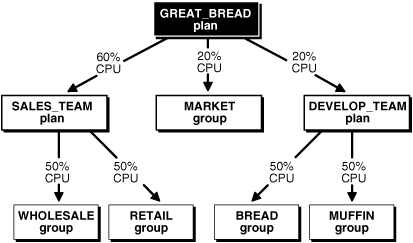
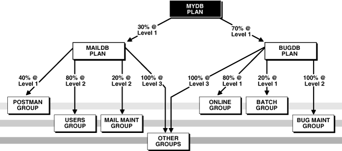
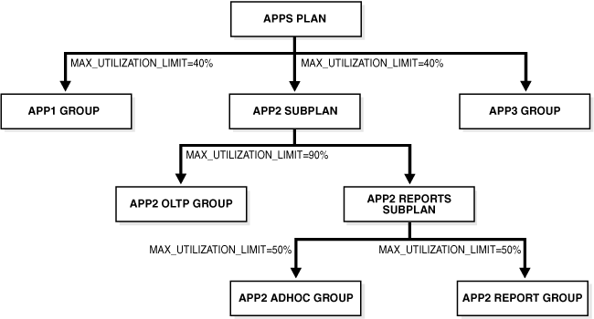

## 27 Managing Resources with Oracle Database Resource Manager

In this chapter:

## About Oracle Database Resource Manager

Oracle Database Resource Manager (the Resource Manager) enables you to manage multiple workloads within a database that are contending for system and database resources.

The following sections provide an overview of the Resource Manager:

- What Solutions Does the Resource Manager Provide for Workload Management?
- Elements of the Resource Manager
- The Types of Resources Managed by the Resource Manager
- About Resource Manager Administration Privileges

### What Solutions Does the Resource Manager Provide for Workload Management?

When database resource allocation decisions are left to the operating system, you may encounter the following problems with workload management:

- Excessive overhead
	Excessive overhead results from operating system context switching between Oracle Database server processes when the number of server processes is high.
- Inefficient scheduling
	The operating system deschedules database servers while they hold latches, which is inefficient.
- Inappropriate allocation of resources
	The operating system distributes resources equally among all active processes and cannot prioritize one task over another.
- Inability to manage database-specific resources, such as parallel execution servers and active sessions

The Resource Manager helps to overcome these problems by allowing the database more control over how hardware resources are allocated. In an environment with multiple concurrent user sessions that run jobs with differing priorities, all sessions should not be treated equally. The Resource Manager enables you to classify sessions into groups based on session attributes, and to then allocate resources to those groups in a way that optimizes hardware utilization for your application environment.

With the Resource Manager, you can:

- Guarantee certain sessions a minimum amount of CPU regardless of the load on the system and the number of users.
- Distribute available CPU by allocating percentages of CPU time to different users and applications. In a data warehouse, a higher percentage can be given to ROLAP (relational online analytical processing) applications than to batch jobs.
- Limit the degree of parallelism of any operation performed by members of a group of users.
- Manage the order of parallel statements in the parallel statement queue. Parallel statements from a critical application can be enqueued ahead of parallel statements from a low priority group of users.
- Limit the number of parallel servers that a group of users can use. This ensures that all the available parallel servers are not allocated to only one group of users.
- Create an active session pool. An active session pool consists of a specified maximum number of user sessions allowed to be concurrently active within a group of users. Additional sessions beyond the maximum are queued for execution, but you can specify a timeout period, after which queued jobs will terminate. The active session pool limits the total number of sessions actively competing for resources, thereby enabling active sessions to make faster progress.
- Manage runaway sessions or calls in the following ways:
	- By placing an absolute limit on the percentage of CPU that a group can consume
		- By detecting when a session or call consumes more than a specified amount of CPU or I/O, and then automatically either terminating the session or call, or switching it to a consumer group that is allocated a small amount of CPU, which would in effect mitigate the impact of the runaway session or call
- Prevent the execution of operations that the optimizer estimates will run for a longer time than a specified limit.
- Limit the amount of time that a session can be idle. This can be further defined to mean only sessions that are blocking other sessions.
- Allow a database to use different resource plans, based on changing workload requirements. You can dynamically change the resource plan, for example, from a daytime resource plan to a nighttime resource plan, without having to shut down and restart the instance. You can also schedule a resource plan change with Oracle Scheduler. See [Chapter 28, "Oracle Scheduler Concepts"](schedover.md) for more information.

### Elements of the Resource Manager

The elements of the Resource Manager are described in the following table.

| Element | Description |
| --- | --- |
| Resource consumer group | A group of sessions that are grouped together based on resource requirements. The Resource Manager allocates resources to resource consumer groups, not to individual sessions. |
| Resource plan | A container for directives that specify how resources are allocated to resource consumer groups. You specify how the database allocates resources by activating a specific resource plan. |
| Resource plan directive | Associates a resource consumer group with a particular plan and specifies how resources are to be allocated to that resource consumer group. |

You use the `DBMS_RESOURCE_MANAGER` PL/SQL package to create and maintain these elements. The elements are stored in tables in the data dictionary. You can view information about them with data dictionary views.

See Also:

"Resource Manager Data Dictionary Views"

#### About Resource Consumer Groups

A resource consumer group (consumer group) is a collection of user sessions that are grouped together based on their processing needs. When a session is created, it is automatically mapped to a consumer group based on mapping rules that you set up. As a database administrator (DBA), you can manually switch a session to a different consumer group. Similarly, an application can run a PL/SQL package procedure that switches its session to a particular consumer group.

Because the Resource Manager allocates resources (such as CPU) only to consumer groups, when a session becomes a member of a consumer group, its resource allocation is determined by the allocation for the consumer group.

There are special consumer groups that are always present in the data dictionary. They cannot be modified or deleted. They are:

- `SYS_GROUP`
	This is the initial consumer group for all sessions created by user accounts `SYS` or `SYSTEM`. This initial consumer group can be overridden by session-to–consumer group mapping rules.
- `OTHER_GROUPS`
	This consumer group contains all sessions that have not been assigned to a consumer group. Every resource plan must contain a directive to `OTHER_GROUPS`.

#### About Resource Plan Directives

The Resource Manager allocates resources to consumer groups according to the set of resource plan directives (directives) that belong to the currently active resource plan. There is a parent-child relationship between a resource plan and its resource plan directives. Each directive references one consumer group, and no two directives for the currently active plan can reference the same consumer group.

A directive has several ways in which it can limit resource allocation for a consumer group. For example, it can control how much CPU the consumer group gets as a percentage of total CPU, and it can limit the total number of sessions that can be active in the consumer group. See "The Types of Resources Managed by the Resource Manager" for more information.

#### About Resource Plans

In addition to the resource plans that are predefined for each Oracle database, you can create any number of resource plans. However, only one resource plan is active at a time. When a resource plan is active, each of its child resource plan directives controls resource allocation for a different consumer group. Each plan must include a directive that allocates resources to the consumer group named `OTHER_GROUPS`. `OTHER_GROUPS` applies to all sessions that belong to a consumer group that is not part of the currently active plan.

Note:

Although the term "resource plan" (or just "plan") denotes one element of the Resource Manager, in this chapter it is also used to refer to a complete resource plan schema, which includes the resource plan element itself, its resource plan directives, and the consumer groups that the directives reference. For example, when this chapter refers to the `DAYTIME` resource plan, it could mean either the resource plan element named `DAYTIME`, or the particular resource allocation schema that the `DAYTIME` resource plan and its directives define. Thus, for brevity, it is acceptable to say, "the `DAYTIME` plan favors interactive applications over batch applications."

#### Example: A Simple Resource Plan

Figure 27-1 shows a simple resource plan for an organization that runs online transaction processing (OLTP) applications and reporting applications simultaneously during the daytime. The currently active plan, `DAYTIME`, allocates CPU resources among three resource consumer groups. Specifically, `OLTP` is allotted 75% of the CPU time, `REPORTS` is allotted 15%, and `OTHER_GROUPS` receives the remaining 10%.

Figure 27-1 A Simple Resource Plan


> This is a text description of [Figure 27-1](dbrm.md). It illustrates the simple resource plan that is described in the preceding text.
>
> [Copyright © 2001, 2015, Oracle and/or its affiliates. All rights reserved.](https://docs.oracle.com/cd/E11882_01/dcommon/html/cpyr.htm)
  

Oracle Database provides a procedure (`CREATE_SIMPLE_PLAN`) that enables you to quickly create a simple resource plan. This procedure is discussed in "Creating a Simple Resource Plan".

Note:

The currently active resource plan does not enforce allocations until CPU usage is at 100%. If the CPU usage is below 100%, the database is not CPU-bound and hence there is no need to enforce allocations to ensure that all sessions get their designated resource allocation.

In addition, when allocations are enforced, unused allocation by any consumer group can be used by other consumer groups. In the previous example, if the `OLTP` group does not use all of its allocation, the Resource Manager permits the `REPORTS` group or `OTHER_GROUPS` group to use the unused allocation.

#### About Subplans

Instead of referencing a consumer group, a resource plan directive (directive) can reference another resource plan. In this case, the plan is referred to as a subplan. The subplan itself has directives that allocate resources to consumer groups and other subplans. The resource allocation scheme then works like this: The top resource plan (the currently active plan) divides resources among consumer groups and subplans. Each subplan allocates its portion of the total resource allocation among its consumer groups and subplans. You can create hierarchical plans with any number of subplans.

You create a resource subplan in the same way that you create a resource plan. To create a plan that is to be used only as a subplan, you use the `SUB_PLAN` argument in the package procedure `DBMS_RESOURCE_MANAGER.CREATE_PLAN`.

In any top level plan, you can reference a subplan only once. A subplan is not required to have a directive to `OTHER_GROUPS` and cannot be set as a resource plan.

#### Example: A Resource Plan with Subplans

In this example, the Great Bread Company allocates the CPU resource as shown in Figure 27-2. The figure illustrates a top plan (`GREAT_BREAD`) and all of its descendents. For simplicity, the requirement to include the `OTHER_GROUPS` consumer group is ignored, and resource plan directives are not shown, even though they are part of the plan. Rather, the CPU percentages that the directives allocate are shown along the connecting lines between plans, subplans, and consumer groups.

Figure 27-2 A Resource Plan With Subplans



> This is a text description of admin027.gif. It illustrates the Database Resource Manager plan with subplans that is described in the text following the image.
>
> End of image description.
>
> [Copyright © 2001, 2015, Oracle and/or its affiliates. All rights reserved.](https://docs.oracle.com/cd/E11882_01/dcommon/html/cpyr.htm)
  

The `GREAT_BREAD` plan allocates resources as follows:

- 20% of CPU resources to the consumer group `MARKET`
- 60% of CPU resources to subplan `SALES_TEAM`, which in turn divides its share equally between the `WHOLESALE` and `RETAIL` consumer groups
- 20% of CPU resources to subplan `DEVELOP_TEAM`, which in turn divides its resources equally between the `BREAD` and `MUFFIN` consumer groups

It is possible for a subplan or consumer group to have multiple parents. An example would be if the `MARKET` group were included in the `SALES_TEAM` subplan. However, a plan cannot contain any loops. For example, the `SALES_TEAM` subplan cannot have a directive that references the `GREAT_BREAD` plan.

See Also:

"Putting It All Together: Oracle Database Resource Manager Examples" for an example of a more complex resource plan.

### About Resource Manager Administration Privileges

You must have the system privilege `ADMINISTER_RESOURCE_MANAGER` to administer the Resource Manager. This privilege (with the `ADMIN` option) is granted to database administrators through the `DBA` role.

Being an administrator for the Resource Manager enables you to execute all of the procedures in the `DBMS_RESOURCE_MANAGER` PL/SQL package.

You may, as an administrator with the `ADMIN` option, choose to grant the administrative privilege to other users or roles. To do so, use the `DBMS_RESOURCE_MANAGER_PRIVS` PL/SQL package. The relevant package procedures are listed in the following table.

| Procedure | Description |
| --- | --- |
| `GRANT_SYSTEM_PRIVILEGE` | Grants the `ADMINISTER_RESOURCE_MANAGER` system privilege to a user or role. |
| `REVOKE_SYSTEM_PRIVILEGE` | Revokes the `ADMINISTER_RESOURCE_MANAGER` system privilege from a user or role. |

The following PL/SQL block grants the administrative privilege to user `HR`, but does not grant `HR` the `ADMIN` option. Therefore, `HR` can execute all of the procedures in the `DBMS_RESOURCE_MANAGER` package, but `HR` cannot use the `GRANT_SYSTEM_PRIVILEGE` procedure to grant the administrative privilege to others.

```
BEGIN
  DBMS_RESOURCE_MANAGER_PRIVS.GRANT_SYSTEM_PRIVILEGE(
   GRANTEE_NAME   => 'HR',
   PRIVILEGE_NAME => 'ADMINISTER_RESOURCE_MANAGER',
   ADMIN_OPTION   => FALSE);
END;
/
```

You can revoke this privilege using the `REVOKE_SYSTEM_PRVILEGE` procedure.

Note:

The `ADMINISTER_RESOURCE_MANAGER` system privilege can only be granted or revoked using the `DBMS_RESOURCE_MANAGER_PRIVS` package. It cannot be granted or revoked through the SQL `GRANT` or `REVOKE` statements.

See Also:

[Oracle Database PL/SQL Packages and Types Reference.](https://docs.oracle.com/cd/E11882_01/appdev.112/e40758/toc.htm) contains detailed information about the Resource Manager packages:
- `DBMS_RESOURCE_MANAGER`
- `DBMS_RESOURCE_MANAGER_PRIVS`

[Oracle Database Security Guide](https://docs.oracle.com/cd/E11882_01/network.112/e36292/authorization.htm#DBSEG99948) contains information about the `ADMIN` option.

## Assigning Sessions to Resource Consumer Groups

This section describes the automatic and manual methods that database administrators, users, and applications can use to assign sessions to resource consumer groups. When a session is assigned to a resource consumer group, Oracle Database Resource Manager (the Resource Manager) can manage resource allocation for it.

Note:

Sessions that are not assigned to a consumer group are placed in the consumer group `OTHER_GROUPS`.

This section includes the following topics:

- Overview of Assigning Sessions to Resource Consumer Groups
- Assigning an Initial Resource Consumer Group
- Specifying Session-to–Consumer Group Mapping Rules
- Switching Resource Consumer Groups
- Specifying Automatic Resource Consumer Group Switching
- Granting and Revoking the Switch Privilege

### Overview of Assigning Sessions to Resource Consumer Groups

Before you enable the Resource Manager, you must specify how user sessions are assigned to resource consumer groups. You do this by creating mapping rules that enable the Resource Manager to automatically assign each session to a consumer group upon session startup, based upon session attributes. After a session is assigned to its initial consumer group and is running, you can call a procedure to manually switch the session to a different consumer group. You would typically do this if the session is using excessive resources and must be moved to a consumer group that is more limited in its resource allocation. You can also grant the switch privilege to users and to applications so that they can switch their sessions from one consumer group to another.

The database can also automatically switch a session from one consumer group to another (typically lower priority) consumer group when there are changes in session attributes or when a session exceeds designated resource consumption limits.

### Assigning an Initial Resource Consumer Group

The initial consumer group of a session is determined by the mapping rules that you configure. For information on how to configure mapping rules, see "Specifying Session-to–Consumer Group Mapping Rules".

### Specifying Session-to–Consumer Group Mapping Rules

This section provides background information about session-to–consumer group mapping rules, and describes how to create and prioritize them. The following topics are covered:

- About Session-to–Consumer Group Mapping Rules
- Creating Consumer Group Mapping Rules
- Modifying and Deleting Consumer Group Mapping Rules
- Creating Mapping Rule Priorities

#### About Session-to–Consumer Group Mapping Rules

By creating session-to–consumer group mapping rules, you can:

- Specify the initial consumer group for a session based on session attributes.
- Enable the Resource Manager to dynamically switch a running session to another consumer group based on changing session attributes.

The mapping rules are based on session attributes such as the user name, the service that the session used to connect to the database, or the name of the client program.

To resolve conflicts among mapping rules, the Resource Manager orders the rules by priority. For example, suppose user `SCOTT` connects to the database with the `SALES` service. If one mapping rule states that user `SCOTT` starts in the `MED_PRIORITY` consumer group, and another states that sessions that connect with the `SALES` service start in the `HIGH_PRIORITY` consumer group, mapping rule priorities resolve this conflict.

There are two types of session attributes upon which mapping rules are based: login attributes and run-time attributes. The login attributes are meaningful only at session login time, when the Resource Manager determines the initial consumer group of the session. Run-time attributes apply any time during and after session login. You can reassign a logged in session to another consumer group by changing any of its run-time attributes.

You use the `SET_CONSUMER_GROUP_MAPPING` and `SET_CONSUMER_GROUP_MAPPING_PRI` procedures to configure the automatic assignment of sessions to consumer groups. You must use a pending area for these procedures. (You must create the pending area, run the procedures, optionally validate the pending area, and then submit the pending area. For examples of using the pending area, see "Creating a Complex Resource Plan".)

A session is automatically switched to a consumer group through mapping rules at distinct points in time:

- When the session first logs in, the mapping rules are evaluated to determine the initial group of the session.
- If a session attribute is dynamically changed to a new value (which is only possible for run-time attributes), then the mapping rules are reevaluated, and the session might be switched to another consumer group.

Predefined Consumer Group Mapping Rules

Each Oracle database comes with a set of predefined consumer group mapping rules:

- As described in "About Resource Consumer Groups", all sessions created by user accounts `SYS` or `SYSTEM` are initially mapped to the `SYS_GROUP` consumer group.
- Sessions performing a data load with Data Pump or performing backup or copy operations with RMAN are automatically mapped to the predefined consumer groups designated in Table 27-6.

You can use the `DBMS_RESOURCE_MANAGER`.`SET_CONSUMER_GROUP_MAPPING` procedure to modify or delete any of these predefined mapping rules.

#### Creating Consumer Group Mapping Rules

You use the `SET_CONSUMER_GROUP_MAPPING` procedure to map a session attribute/value pair to a consumer group. The parameters for this procedure are the following:

| Parameter | Description |
| --- | --- |
| `ATTRIBUTE` | The session attribute type, specified as a package constant |
| `VALUE` | The value of the attribute |
| `CONSUMER_GROUP` | The consumer group to map to for this attribute/value pair |

`ATTRIBUTE` can be one of the following:

| Attribute | Type | Description |
| --- | --- | --- |
| `ORACLE_USER` | Login | The Oracle Database user name |
| `SERVICE_NAME` | Login | The database service name used by the client to establish a connection |
| `CLIENT_OS_USER` | Login | The operating system user name of the client that is logging in |
| `CLIENT_PROGRAM` | Login | The name of the client program used to log in to the server |
| `CLIENT_MACHINE` | Login | The name of the computer from which the client is making the connection |
| `CLIENT_ID` | Login | The client identifier for the session  The client identifier session attribute is set by the `DBMS_SESSION.SET_IDENTIFIER` procedure. |
| `MODULE_NAME` | Run-time | The module name in the currently running application as set by the `DBMS_APPLICATION_INFO.SET_MODULE` procedure or the equivalent OCI attribute setting |
| `MODULE_NAME_ACTION` | Run-time | A combination of the current module and the action being performed as set by either of the following procedures or their equivalent OCI attribute setting: - `DBMS_APPLICATION_INFO.SET_MODULE` - `DBMS_APPLICATION_INFO.SET_ACTION`  The attribute is specified as the module name followed by a period (.), followed by the action name (`module_name.action_name`). |
| `SERVICE_MODULE` | Run-time | A combination of service and module names in this form: `service_name.module_name` |
| `SERVICE_MODULE_ACTION` | Run-time | A combination of service name, module name, and action name, in this form: `service_name.module_name.action_name` |
| `ORACLE_FUNCTION` | Run-time | An RMAN or Data Pump operation. Valid values are `DATALOAD`, `BACKUP`, and `COPY`. There are predefined mappings for each of these values. If your session is performing any of these functions, it is automatically mapped to a predefined consumer group. See Table 27-6 for details. |

For example, the following PL/SQL block causes user `SCOTT` to map to the `DEV_GROUP` consumer group every time that he logs in:

```
BEGIN
  DBMS_RESOURCE_MANAGER.SET_CONSUMER_GROUP_MAPPING  
     (DBMS_RESOURCE_MANAGER.ORACLE_USER, 'SCOTT', 'DEV_GROUP');
END;
/
```

Again, you must create a pending area before running the `SET_CONSUMER_GROUP_MAPPING` procedure.

You can use wildcards for the value of most attributes in the `value` parameter in the `SET_CONSUMER_GROUP_MAPPING` procedure. To specify values with wildcards, use the same semantics as the SQL `LIKE` operator. Specifically, wildcards use the following semantics:

- `%` for a multicharacter wildcard
- `_` for a single character wildcard
- `\` to escape the wildcards

Wildcards can only be used if the attribute is one of the following:

- `CLIENT_OS_USER`
- `CLIENT_PROGRAM`
- `CLIENT_MACHINE`
- `MODULE_NAME`
- `MODULE_NAME_ACTION`
- `SERVICE_MODULE`
- `SERVICE_MODULE_ACTION`

#### Modifying and Deleting Consumer Group Mapping Rules

To modify a consumer group mapping rule, run the `SET_CONSUMER_GROUP_MAPPING` procedure against the desired attribute/value pair, specifying a new consumer group. To delete a rule, run the `SET_CONSUMER_GROUP_MAPPING` procedure against the desired attribute/value pair and specify a `NULL` consumer group.

#### Creating Mapping Rule Priorities

To resolve conflicting mapping rules, you can establish a priority ordering of the session attributes from most important to least important. You use the `SET_CONSUMER_GROUP_MAPPING_PRI` procedure to set the priority of each attribute to a unique integer from 1 (most important) to 12 (least important). The following example illustrates this setting of priorities:

```
BEGIN
  DBMS_RESOURCE_MANAGER.SET_CONSUMER_GROUP_MAPPING_PRI(
    EXPLICIT => 1,
    SERVICE_MODULE_ACTION => 2,
    SERVICE_MODULE => 3,
    MODULE_NAME_ACTION => 4,
    MODULE_NAME => 5,
    SERVICE_NAME => 6,
    ORACLE_USER => 7,
    CLIENT_PROGRAM => 8,
    CLIENT_OS_USER => 9,
    CLIENT_MACHINE => 10,
    CLIENT_ID => 11);
END;
/
```

In this example, the priority of the database user name is set to 7 (less important), while the priority of the module name is set to 5 (more important).

Note:

`SET_CONSUMER_GROUP_MAPPING_PRI` requires that you include the pseudo-attribute `EXPLICIT` as an argument. It must be set to 1. It indicates that explicit consumer group switches have the highest priority. You explicitly switch consumer groups with these package procedures, which are described in detail in [Oracle Database PL/SQL Packages and Types Reference](https://docs.oracle.com/cd/E11882_01/appdev.112/e40758/toc.htm):
- `DBMS_SESSION.SWITCH_CURRENT_CONSUMER_GROUP`
- `DBMS_RESOURCE_MANAGER.SWITCH_CONSUMER_GROUP_FOR_SESS`
- `DBMS_RESOURCE_MANAGER.SWITCH_CONSUMER_GROUP_FOR_USER`

To illustrate how mapping rule priorities work, continuing with the previous example, assume that in addition to the mapping of user `SCOTT` to the `DEV_GROUP` consumer group, there is also a module name mapping rule as follows:

```
BEGIN
  DBMS_RESOURCE_MANAGER.SET_CONSUMER_GROUP_MAPPING
     (DBMS_RESOURCE_MANAGER.MODULE_NAME, 'EOD_REPORTS', 'LOW_PRIORITY');
END;
/
```

Now if the application in user `SCOTT` 's session sets its module name to `EOD_REPORTS`, the session is reassigned to the `LOW_PRIORITY` consumer group, because module name mapping has a higher priority than database user mapping.

You can query the view `DBA_RSRC_MAPPING_PRIORITY` to see the current priority ordering of session attributes.

To prevent unauthorized clients from setting their session attributes so that they map to higher priority consumer groups, user switch privileges for consumer groups are enforced. Thus, even though the attribute of a particular session matches a mapping pair, the mapping rule is ignored if the session does not have the switch privilege for the designated consumer group.

See Also:

- [Oracle Database PL/SQL Packages and Types Reference](https://docs.oracle.com/cd/E11882_01/appdev.112/e40758/d_appinf.htm#ARPLS003) for information about setting the module name with the `DBMS_APPLICATION_INFO.SET_MODULE` procedure
- "Granting and Revoking the Switch Privilege"

### Switching Resource Consumer Groups

This section describes ways to switch the resource consumer group of a session.

This section contains the following topics:

- Manually Switching Resource Consumer Groups
- Enabling Users or Applications to Manually Switch Consumer Groups

#### Manually Switching Resource Consumer Groups

The `DBMS_RESOURCE_MANAGER` PL/SQL package provides two procedures that enable you to change the resource consumer group of running sessions. Both of these procedures can also change the consumer group of any parallel execution server sessions associated with the coordinator session. The changes made by these procedures pertain to current sessions only; they are not persistent. They also do not change the initial consumer groups for users.

Instead of killing (terminating) a session of a user who is using excessive CPU, you can change that user's consumer group to one that is allocated fewer resources.

##### Switching a Single Session

The `SWITCH_CONSUMER_GROUP_FOR_SESS` procedure causes the specified session to immediately be moved into the specified resource consumer group. In effect, this procedure can raise or lower priority of the session.

The following PL/SQL block switches a specific session to a new consumer group. The session identifier (`SID`) is 17, the session serial number (`SERIAL#`) is 12345, and the new consumer group is the `HIGH_PRIORITY` consumer group.

```
BEGIN
  DBMS_RESOURCE_MANAGER.SWITCH_CONSUMER_GROUP_FOR_SESS ('17', '12345',
   'HIGH_PRIORITY');
END;
/
```

The `SID`, session serial number, and current resource consumer group for a session are viewable using the `V$SESSION` view.

See Also:

[Oracle Database Reference](https://docs.oracle.com/cd/E11882_01/server.112/e40402/dynviews_3016.htm#REFRN30223) for details about the `V$SESSION` view.

##### Switching All Sessions for a User

The `SWITCH_CONSUMER_GROUP_FOR_USER` procedure changes the resource consumer group for all sessions pertaining to the specified user name. The following PL/SQL block switches all sessions that belong to user `HR` to the `LOW_GROUP` consumer group:

```
BEGIN
  DBMS_RESOURCE_MANAGER.SWITCH_CONSUMER_GROUP_FOR_USER ('HR',
    'LOW_GROUP'); 
END;
/
```

#### Enabling Users or Applications to Manually Switch Consumer Groups

You can grant a user the switch privilege so that he can switch his current consumer group using the `SWITCH_CURRENT_CONSUMER_GROUP` procedure in the `DBMS_SESSION` package. A user can run this procedure from an interactive session, for example from SQL\*Plus, or an application can call this procedure to switch its session, effectively dynamically changing its priority.

The `SWITCH_CURRENT_CONSUMER_GROUP` procedure enables users to switch to only those consumer groups for which they have the switch privilege. If the caller is another procedure, then this procedure enables users to switch to a consumer group for which the owner of that procedure has switch privileges.

The parameters for this procedure are the following:

| Parameter | Description |
| --- | --- |
| `NEW_CONSUMER_GROUP` | The consumer group to which the user is switching. |
| `OLD_CONSUMER_GROUP` | Returns the name of the consumer group from which the user switched. Can be used to switch back later. |
| `INITIAL_GROUP_ON_ERROR` | Controls behavior if a switching error occurs.  If `TRUE`, in the event of an error, the user is switched to the initial consumer group.  If `FALSE`, raises an error. |

The following SQL\*Plus session illustrates switching to a new consumer group. By printing the value of the output parameter `old_group`, the example illustrates how the old consumer group name is saved.

```
SET serveroutput on
DECLARE
    old_group varchar2(30);
BEGIN
  DBMS_SESSION.SWITCH_CURRENT_CONSUMER_GROUP('BATCH_GROUP', old_group, FALSE);
  DBMS_OUTPUT.PUT_LINE('OLD GROUP = ' || old_group);
END;
/
```

The following line is output:

```
OLD GROUP = OLTP_GROUP
```

Note that the Resource Manager considers a switch to have taken place even if the `SWITCH_CURRENT_CONSUMER_GROUP` procedure is called to switch the session to the consumer group that it is already in.

Note:

The Resource Manager also works in environments where a generic database user name is used to log on to an application. The `DBMS_SESSION` package can be called to switch the consumer group assignment of a session at session startup, or as particular modules are called.

See Also:

[Oracle Database PL/SQL Packages and Types Reference](https://docs.oracle.com/cd/E11882_01/appdev.112/e40758/d_sessio.htm#ARPLS054) for additional examples and more information about the `DBMS_SESSION` package

### Specifying Automatic Resource Consumer Group Switching

You can configure the Resource Manager to automatically switch a session to another consumer group when a certain condition is met. Automatic switching can occur when:

- A session attribute changes, causing a new mapping rule to take effect.
- A session exceeds the CPU or I/O resource consumption limits set by its consumer group.

The following sections provide details:

- Specifying Automatic Switching with Mapping Rules
- Specifying Automatic Switching by Setting Resource Limits

#### Specifying Automatic Switching with Mapping Rules

If a session attribute changes while the session is running, then the session-to–consumer group mapping rules are reevaluated. If a new rule takes effect, then the session might be moved to a different consumer group. See "Specifying Session-to–Consumer Group Mapping Rules" for more information.

#### Specifying Automatic Switching by Setting Resource Limits

This section describes managing runaway sessions or calls that use CPU or I/O resources beyond a specified limit. A runaway session is a SQL query, while a runaway call is a PL/SQL call.

When you create a resource plan directive for a consumer group, you can specify limits for CPU and I/O resource consumption for sessions in that group. You can then specify the action that is to be taken if any single call within a session exceeds one of these limits. The possible actions are the following:

- The session is dynamically switched to a designated consumer group.
	The target consumer group is typically one that has lower resource allocations. The session's user must have switch privileges on the new consumer group, otherwise the switch cannot occur. See "Granting and Revoking the Switch Privilege" for more information.
- The session is killed (terminated).
- The session's current SQL statement is aborted.

The following are the resource plan directive attributes that are involved in this type of automatic session switching.

- `SWITCH_GROUP`
- `SWITCH_TIME`
- `SWITCH_ESTIMATE`
- `SWITCH_IO_MEGABYTES`
- `SWITCH_IO_REQS`
- `SWITCH_FOR_CALL`

See "Creating Resource Plan Directives" for descriptions of these attributes.

Switches occur for sessions that are running and consuming resources, not waiting for user input or waiting for CPU cycles. After a session is switched, it continues in the target consumer group until it becomes idle, at which point it is switched back to its original consumer group. However, if `SWITCH_FOR_CALL` is set to `TRUE`, then the Resource Manager does not wait until the session is idle to return it to its original resource consumer group. Instead, the session is returned when the current top-level call completes. A top-level call in PL/SQL is an entire PL/SQL block treated as one call. A top-level call in SQL is an individual SQL statement.

The Resource Manager views a session as idle if a certain amount of time passes between calls. This time interval is not configurable.

`SWITCH_FOR_CALL` is useful for three-tier applications where the middle tier server is using session pooling.

A switched session is allowed to continue running even if the active session pool for the new group is full. Under these conditions, a consumer group can have more sessions running than specified by its active session pool.

The following are examples of automatic switching based on resource limits:

Example 1

The following PL/SQL block creates a resource plan directive for the `OLTP` group that switches any session in that group to the `LOW_GROUP` consumer group if a call in the sessions exceeds 5 seconds of CPU time. This example prevents unexpectedly long queries from consuming too many resources. The switched-to consumer group is typically one with lower resource allocations.

```
BEGIN
  DBMS_RESOURCE_MANAGER.CREATE_PLAN_DIRECTIVE (
   PLAN             => 'DAYTIME',
   GROUP_OR_SUBPLAN => 'OLTP',
   COMMENT          => 'OLTP group',
   MGMT_P1          => 75,
   SWITCH_GROUP     => 'LOW_GROUP',
   SWITCH_TIME      => 5);
END;
/
```

Example 2

The following PL/SQL block creates a resource plan directive for the `OLTP` group that temporarily switches any session in that group to the `LOW_GROUP` consumer group if the session exceeds 10,000 I/O requests or exceeds 2,500 Megabytes of data transferred. The session is returned to its original group after the offending top call is complete.

```
BEGIN
  DBMS_RESOURCE_MANAGER.CREATE_PLAN_DIRECTIVE (
   PLAN                => 'DAYTIME',
   GROUP_OR_SUBPLAN    => 'OLTP',
   COMMENT             => 'OLTP group',
   MGMT_P1             => 75,
   SWITCH_GROUP        => 'LOW_GROUP',
   SWITCH_IO_REQS      => 10000,
   SWITCH_IO_MEGABYTES => 2500,
   SWITCH_FOR_CALL     => TRUE);
END;
/
```

Example 3

The following PL/SQL block creates a resource plan directive for the `REPORTING` group that kills (terminates) any session that exceeds 60 seconds of CPU time. This example prevents runaway queries from consuming too many resources.

```
BEGIN
  DBMS_RESOURCE_MANAGER.CREATE_PLAN_DIRECTIVE (
   PLAN             => 'DAYTIME',
   GROUP_OR_SUBPLAN => 'REPORTING',
   COMMENT          => 'Reporting group',
   MGMT_P1          => 75,
   SWITCH_GROUP     => 'KILL_SESSION',
   SWITCH_TIME      => 60);
END;
/
```

See Also:

"Creating Resource Plan Directives"

### Granting and Revoking the Switch Privilege

Using the `DBMS_RESOURCE_MANAGER_PRIVS` PL/SQL package, you can grant or revoke the switch privilege to a user, role, or `PUBLIC`. The switch privilege enables a user or application to switch a session to a specified resource consumer group. It also enables the database to automatically switch a session to a consumer group specified in a session-to–consumer group mapping rule or specified in the `SWITCH_GROUP` parameter of a resource plan directive. The package also enables you to revoke the switch privilege. The relevant package procedures are listed in the following table.

| Procedure | Description |
| --- | --- |
| `GRANT_SWITCH_CONSUMER_GROUP` | Grants permission to a user, role, or `PUBLIC` to switch to a specified resource consumer group. |
| `REVOKE_SWITCH_CONSUMER_GROUP` | Revokes permission for a user, role, or `PUBLIC` to switch to a specified resource consumer group. |

`OTHER_GROUPS` has switch privileges granted to `PUBLIC`. Therefore, all users are automatically granted the switch privilege for this consumer group.

#### Granting the Switch Privilege

The following example grants user `SCOTT` the privilege to switch to consumer group `OLTP`.

```
BEGIN
  DBMS_RESOURCE_MANAGER_PRIVS.GRANT_SWITCH_CONSUMER_GROUP (
   GRANTEE_NAME   => 'SCOTT',
   CONSUMER_GROUP => 'OLTP',
   GRANT_OPTION   =>  TRUE);
END;
/
```

User `SCOTT` is also granted permission to grant switch privileges for `OLTP` to others.

If you grant permission to a role to switch to a particular resource consumer group, then any user who is granted that role and has enabled that role can switch his session to that consumer group.

If you grant `PUBLIC` the permission to switch to a particular consumer group, then any user can switch to that group.

If the `GRANT_OPTION` argument is `TRUE`, then users granted switch privilege for the consumer group can also grant switch privileges for that consumer group to others.

#### Revoking Switch Privileges

The following example revokes user `SCOTT` 's privilege to switch to consumer group `OLTP`.

```
BEGIN
  DBMS_RESOURCE_MANAGER_PRIVS.REVOKE_SWITCH_CONSUMER_GROUP (
   REVOKEE_NAME   => 'SCOTT', 
   CONSUMER_GROUP => 'OLTP');
END;
/
```

If you revoke a user's switch privileges for a particular consumer group, any subsequent attempts by that user to switch to that consumer group, either manually or automatically through consumer group mapping rules, will fail. The user's session will then be automatically assigned to `OTHER_GROUPS`.

If you revoke from a role the switch privileges to a consumer group, any users who had switch privileges for the consumer group only through that role are no longer able to switch to that consumer group.

If you revoke switch privileges to a consumer group from `PUBLIC`, any users other than those who are explicitly assigned switch privileges either directly or through a role are no longer able to switch to that consumer group.

## The Types of Resources Managed by the Resource Manager

Resource plan directives specify how resources are allocated to resource consumer groups or subplans. Each directive can specify several different methods for allocating resources to its consumer group or subplan. The following sections summarize these resource allocation methods:

- CPU
- Degree of Parallelism Limit
- Parallel Target Percentage
- Parallel Queue Timeout
- Active Session Pool with Queuing
- Automatic Consumer Group Switching
- Canceling SQL and Terminating Sessions
- Execution Time Limit
- Undo Pool
- Idle Time Limit

### CPU

To manage CPU resources, Resource Manager allocates resources among consumer groups and redistributes CPU resources that were allocated but were not used. You can also set a limit on the amount of CPU resources that can be allocated to a particular consumer group.

Resource Manager provides the following resource plan directive attributes to control CPU resource allocation:

- Management Attributes
- Maximum Utilization Limit

Management Attributes

Management attributes enable you to specify how CPU resources are to be allocated among consumer groups and subplans. Multiple levels of CPU resource allocation (up to eight levels) provide a means of prioritizing CPU usage within a plan. Consumer groups and subplans at level 2 get resources that were not allocated at level 1 or that were allocated at level 1 but were not completely consumed by the consumer groups or subplans at level 1. Similarly, resource consumers at level 3 are allocated resources only when some allocation remains from levels 1 and 2. The same rules apply to levels 4 through 8. Multiple levels not only provide a way of prioritizing, but they provide a way of explicitly specifying how all primary and leftover resources are to be used.

Use the management attributes `MGMT_P` `n`, where n is an integer between 1 and 8, to specify multiple levels of CPU resource allocation. For example, use the `MGMT_P1` directive attribute to specify CPU resource allocation at level 1 and `MGMT_P2` directive attribute to specify resource allocation at level 2.

Use management attributes with parallel statement directive attributes, such as Degree of Parallelism Limit and Parallel Target Percentage, to control parallel statement queuing. When parallel statement queuing is used, management attributes are used to determine which consumer group is allowed to issue the next parallel statement. For example, if you set the `MGMT_P1` directive attribute for a consumer group to 80, that group has an 80% chance of issuing the next parallel statement.

See Also:

[Oracle Database VLDB and Partitioning Guide](https://docs.oracle.com/cd/E11882_01/server.112/e25523/toc.htm) for information about parallel statement queuing

Management attributes also enable you to specify CPU resource allocation for Exadata I/O.

See Also:

The Exadata documentation for information about using management attributes for Exadata I/O

Table 27-1 illustrates a simple resource plan with three levels.

Table 27-1 A Simple Three-Level Resource Plan

| Consumer Group | Level 1 CPU Allocation | Level 2 CPU Allocation | Level 3 CPU Allocation |
| --- | --- | --- | --- |
| `HIGH_GROUP` | 80% |  |  |
| `LOW_GROUP` |  | 50% |  |
| `MAINT_SUBPLAN` |  | 50% |  |
| `OTHER_GROUPS` |  |  | 100% |

High priority applications run within `HIGH_GROUP`, which is allocated 80% of CPU. Because `HIGH_GROUP` is at level one, it gets priority for CPU utilization, but only up to 80% of CPU. This leaves a remaining 20% of CPU to be shared 50-50 by `LOW_GROUP` and the `MAINT_SUPLAN` at level 2. Any unused allocation from levels 1 and 2 are then available to `OTHER_GROUPS` at level 3. Because `OTHER_GROUPS` has no sibling consumer groups or subplans at its level, 100% is specified.

Within a particular level, CPU allocations are not fixed. If there is not sufficient load in a particular consumer group or subplan, residual CPU can be allocated to remaining consumer groups or subplans. Thus, when there is only one level, unused allocation by any consumer group or subplan can be redistributed to other "sibling" consumer groups or subplans. If there are multiple levels, then the unused allocation is distributed to the consumer groups or subplans at the next level. If the last level has unused allocations, these allocations can be redistributed to all other levels in proportion to their designated allocations.

As an example of redistribution of unused allocations from one level to another, if during a particular period, `HIGH_GROUP` consumes only 25% of CPU, then 75% is available to be shared by `LOW_GROUP` and `MAINT_SUBPLAN`. Any unused portion of the 75% at level 2 is then made available to `OTHER_GROUPS` at level 3. However, if `OTHER_GROUPS` has no session activity at level 3, then the 75% at level 2 can be redistributed to all other consumer groups and subplans in the plan proportionally.

Maximum Utilization Limit

In the previous scenario, suppose that due to inactivity elsewhere, `LOW_GROUP` acquires 90% of CPU. Suppose that you do not want to allow `LOW_GROUP` to use 90% of the server because you do not want non-critical sessions to inundate the CPUs. The `MAX_UTILIZATION_LIMIT` attribute of resource plan directives can prevent this situation.

Use the `MAX_UTILIZATION_LIMIT` attribute to impose an absolute upper limit on CPU utilization for a resource consumer group. This absolute limit overrides any redistribution of CPU within a plan.

Setting the `MAX_UTILIZATION_LIMIT` attribute is optional. If you omit this attribute for a consumer group, there is no limit on the amount of CPU that the consumer group can use. Therefore, if all the other applications are idle, a consumer group that does not have `MAX_UTILIZATION_LIMIT` set can be allocated 100% of the CPU resources.

You can also use the `MAX_UTILIZATION_LIMIT` attribute as the sole means of limiting CPU utilization for consumer groups, without specifying level limits.

Table 27-2 shows a variation of the previous plan. In this plan, using `MAX_UTILIZATION_LIMIT`, CPU utilization is capped at 75% for `LOW_GROUP`, 50% for `MAINT_SUBPLAN`, and 75% for `OTHER_GROUPS`. (Note that the sum of all maximum utilization limits can exceed 100%. Each limit is applied independently.)

Table 27-2 A Three-Level Resource Plan with Maximum Utilization Limits

| Consumer Group | Level 1 CPU Allocation | Level 2 CPU Allocation | Level 3 CPU Allocation | Maximum Utilization Limit |
| --- | --- | --- | --- | --- |
| `HIGH_GROUP` | 80% |  |  |  |
| `LOW_GROUP` |  | 50% |  | 75% |
| `MAINT_SUBPLAN` |  | 50% |  | 50% |
| `OTHER_GROUPS` |  |  | 100% | 75% |

In the example described in Table 27-2, if `HIGH_GROUP` is using only 10% of the CPU at a given time, then the remaining 90% is available to `LOW_GROUP` and the consumer groups in `MAINT_SUBPLAN` at level 2. If `LOW_GROUP` uses only 20% of the CPU, then 70% can be allocated to `MAINT_SUBPLAN`. However, `MAINT_SUBPLAN` has a `MAX_UTILIZATION_LIMIT` of 50%. Therefore, even though more CPU resources are available, the server cannot allocate more than 50% of the CPU to the consumer groups that belong to the subplan `MAINT_SUBPLAN`.

You can set `MAX_UTILIZATION_LIMIT` for both a subplan and the consumer groups that the subplan contains. In such cases, the limit for a consumer group is computed using the limits specified for the subplan and that consumer group. For example, the `MAINT_SUBPLAN` contains the consumer groups `MAINT_GROUP1` and `MAINT_GROUP2`. `MAINT_GROUP1` has `MAX_UTILIZATION_LIMIT` set to 40%. However, the limit for `MAINT_SUBPLAN` is set to 50%. Therefore, the limit for consumer group `MAINT_GROUP1` is computed as 40% of 50%, or 20%. For an example of how to compute `MAX_UTILIZATION_LIMIT` for a consumer group when limits are specified for both the consumer group and the subplan to which the group belongs, see "Example 4 - Specifying a Maximum Utilization Limit for Consumer Groups and Subplans".

### Degree of Parallelism Limit

You can limit the maximum degree of parallelism for any operation within a consumer group. The degree of parallelism is the number of parallel execution servers that are associated with a single operation. Use the `PARALLEL_DEGREE_LIMIT_P1` directive attribute to specify the degree of parallelism for a consumer group.

See Also:

[Oracle Database VLDB and Partitioning Guide](https://docs.oracle.com/cd/E11882_01/server.112/e25523/toc.htm) for more information about degree of parallelism in producer/consumer operations

The degree of parallelism limit applies to one operation within a consumer group; it does not limit the total degree of parallelism across all operations within the consumer group. However, you can combine both the `PARALLEL_DEGREE_LIMIT_P1` and the `PARALLEL_TARGET_PERCENTAGE` directive attributes to achieve the desired control. For more information about the `PARALLEL_TARGET_PERCENTAGE` attribute, see "Parallel Target Percentage".

### Parallel Target Percentage

It is possible for a single consumer group to launch enough parallel statements to use all the available parallel servers. If this happens, when a high-priority parallel statement from a different consumer group is run, then no parallel servers are available to allocate to this group. You can avoid such a scenario by limiting the number of parallel servers that can be used by a particular consumer group.

Note:

This functionality is available starting with Oracle Database 11g Release 2 (11.2.0.2).

Use the `PARALLEL_TARGET_PERCENTAGE` directive attribute to specify the maximum percentage of the parallel server pool that a particular consumer group can use. The number of parallel servers used by a particular consumer group is counted as the sum of the parallel servers used by all sessions in that consumer group.

See Also:

[Oracle Database VLDB and Partitioning Guide](https://docs.oracle.com/cd/E11882_01/server.112/e25523/toc.htm) for information about parallel statement queuing

For example, assume that the total number of parallel servers is 32, as set by the `PARALLEL_SERVERS_TARGET` initialization parameter, and the `PARALLEL_TARGET_PERCENTAGE` directive attribute for the consumer group `MY_GROUP` is set to 50%. This consumer group can use a maximum of 50% of 32, or 16 parallel servers.

If your resource plan has management attributes (`MGMT_P1`, `MGMT_P2`, and so on), then a separate parallel statement queue is managed as a First In First Out (FIFO) queue for each management attribute.

If your resource plan does not have any management attributes, then a single parallel statement queue is managed as a FIFO queue.

In the case of an Oracle Real Application Clusters (Oracle RAC) environment, the target number of parallel servers is the sum of (`PARALLEL_TARGET_PERCENTAGE` \* `PARALLEL_SERVERS_TARGET` / 100) across all Oracle RAC instances. If a consumer group is using the number of parallel servers computed above or more, then it has exceeded its limit, and its parallel statements will be queued.

If a consumer group does not have any parallel statements running within an Oracle RAC database, then the first parallel statement is allowed to exceed the limit specified by `PARALLEL_TARGET_PERCENTAGE`.

Note:

In an Oracle Real Application Clusters (Oracle RAC) environment, the `PARALLEL_TARGET_PERCENTAGE` attribute applies to the entire cluster and not to a single instance.

#### Managing Parallel Statement Queuing Using Parallel Target Percentage

The `PARALLEL_TARGET_PERCENTAGE` attribute enables you to specify when parallel statements from a consumer group can be queued. Oracle Database maintains a separate parallel statement queue for each consumer group.

A parallel statement from a consumer group is not run and instead added to the parallel statement queue of that consumer group if the following conditions are met:

- `PARALLEL_DEGREE_POLICY` is set to `AUTO`.
	Setting this parameter to `AUTO` enables automatic degree of parallelism (Auto DOP), parallel statement queuing, and in-memory parallel execution.
	Note that parallel statements which have `PARALLEL_DEGREE_POLICY` set to `MANUAL` or `LIMITED` are executed immediately and not added to the parallel statement queue.
- The number of active parallel servers across all consumer groups exceeds the `PARALLEL_SERVERS_TARGET` initialization parameter setting. This condition applies regardless of whether you specify `PARALLEL_TARGET_PERCENTAGE`. If `PARALLEL_TARGET_PERCENTAGE` is not specified, then it defaults to 100%.
- The sum of the number of active parallel servers for the consumer group and the degree of parallelism of the parallel statement exceeds the target number of active parallel servers.
	The target number of active parallel servers is computed as follows:
	`PARALLEL_TARGET_PERCENTAGE` /100 \* `PARALLEL_SERVERS_TARGET`

### Parallel Queue Timeout

When you use parallel statement queuing, if the database does not have sufficient resources to execute a parallel statement, the statement is queued until the required resources become available. However, there is a chance that a parallel statement may be waiting in the parallel statement queue for longer than is desired. You can prevent such scenarios by specifying the maximum time a parallel statement can wait in the parallel statement queue.

Note:

This functionality is available starting with Oracle Database 11g Release 2 (11.2.0.2).

The `PARALLEL_QUEUE_TIMEOUT` directive attribute enables you to specify the maximum time, in seconds, that a parallel statement can wait in the parallel statement queue before it is timed out. The `PARALLEL_QUEUE_TIMEOUT` attribute can be set for each consumer group. This attribute is applicable even if you do not specify other management attributes (`MGMT_P1`, `MGMT_P2`, and so on) in your resource plan.

See Also:

[Oracle Database VLDB and Partitioning Guide](https://docs.oracle.com/cd/E11882_01/server.112/e25523/toc.htm) for more information about parallel statement queuing

Note:

Because the parallel statement queue is clusterwide, all directives related to the parallel statement queue are also clusterwide.

When a parallel statement is timed out, the statement execution ends with the following error message:

```
ORA-07454: queue timeout, n second(s), exceeded
```

If you want more per-workload management, then you must use the following directive attributes:

- `MGMT_P` `n`
	Management attributes control how a parallel statement is selected from the parallel statement queue for execution. You can prioritize the parallel statements of one consumer group over another by setting a higher value for the management attributes of that group.
- `PARALLEL_TARGET_PERCENTAGE`
- `PARALLEL_QUEUE_TIMEOUT`
- `PARALLEL_DEGREE_LIMIT_P1`

See Also:

"Example of Managing Parallel Statements Using Directive Attributes" for more information about the combined use of all the parallel server directive attributes

Although parallel server usage is monitored for all sessions, the parallel server directive attributes you set affect only sessions for which parallel statement queuing is enabled (`PARALLEL_DEGREE_POLICY` is set to `AUTO`). If a session has the `PARALLEL_DEGREE_POLICY` set to `MANUAL`, parallel statements from this session are not queued. However, any parallel servers used by such sessions are included in the count that is used to determine the limit for `PARALLEL_TARGET_PERCENTAGE`. Even if this limit is exceeded, parallel statements from this session are not queued.

### Active Session Pool with Queuing

You can control the maximum number of concurrently active sessions allowed within a consumer group. This maximum defines the active session pool. An active session is a session that is actively processing a transaction or SQL statement. Specifically, an active session is either in a transaction, holding a user enqueue, or has an open cursor and has not been idle for over 5 seconds. An active session is considered active even if it is blocked, for example waiting for an I/O request to complete. When the active session pool is full, a session that is trying to process a call is placed into a queue. When an active session completes, the first session in the queue can then be removed from the queue and scheduled for execution. You can also specify a period after which a session in the execution queue times out, causing the call to terminate with an error.

Active session limits should not be used for OLTP workloads. In addition, active session limits should not be used to implement connection pooling or parallel statement queuing.

To manage parallel statements, you must use parallel statement queuing with the `PARALLEL_TARGET_PERCENTAGE` attribute and management attributes (`MGMT_P1`, `MGMT_P2`, and so on).

### Automatic Consumer Group Switching

This method enables you to control resource allocation by specifying criteria that, if met, causes the automatic switching of a session to a specified consumer group. Typically, this method is used to switch a session from a high-priority consumer group—one that receives a high proportion of system resources—to a lower priority consumer group because that session exceeded the expected resource consumption for a typical session in the group.

See "Specifying Automatic Switching by Setting Resource Limits" for more information.

### Canceling SQL and Terminating Sessions

You can also specify directives to cancel long-running SQL queries or to terminate long-running sessions based on the amount of system resources consumed. See "Specifying Automatic Switching by Setting Resource Limits" for more information.

### Execution Time Limit

You can specify a maximum execution time allowed for an operation. If the database estimates that an operation will run longer than the specified maximum execution time, then the operation is terminated with an error. This error can be trapped and the operation rescheduled.

### Undo Pool

You can specify an undo pool for each consumer group. An undo pool controls the total amount of undo for uncommitted transactions that can be generated by a consumer group. When the total undo generated by a consumer group exceeds its undo limit, the current DML statement generating the undo is terminated. No other members of the consumer group can perform further data manipulation until undo space is freed from the pool.

### Idle Time Limit

You can specify an amount of time that a session can be idle, after which it is terminated. You can also specify a more stringent idle time limit that applies to sessions that are idle and blocking other sessions.

## Creating a Simple Resource Plan

You can quickly create a simple resource plan that is adequate for many situations using the `CREATE_SIMPLE_PLAN` procedure. This procedure enables you to both create consumer groups and allocate resources to them by executing a single procedure call. Using this procedure, you are not required to invoke the procedures that are described in succeeding sections for creating a pending area, creating each consumer group individually, specifying resource plan directives, and so on.

You specify the following arguments for the `CREATE_SIMPLE_PLAN` procedure:

| Parameter | Description |
| --- | --- |
| `SIMPLE_PLAN` | Name of the plan |
| `CONSUMER_GROUP1` | Consumer group name for first group |
| `GROUP1_PERCENT` | CPU resource allocated to this group |
| `CONSUMER_GROUP2` | Consumer group name for second group |
| `GROUP2_PERCENT` | CPU resource allocated to this group |
| `CONSUMER_GROUP3` | Consumer group name for third group |
| `GROUP3_PERCENT` | CPU resource allocated to this group |
| `CONSUMER_GROUP4` | Consumer group name for fourth group |
| `GROUP4_PERCENT` | CPU resource allocated to this group |
| `CONSUMER_GROUP5` | Consumer group name for fifth group |
| `GROUP5_PERCENT` | CPU resource allocated to this group |
| `CONSUMER_GROUP6` | Consumer group name for sixth group |
| `GROUP6_PERCENT` | CPU resource allocated to this group |
| `CONSUMER_GROUP7` | Consumer group name for seventh group |
| `GROUP7_PERCENT` | CPU resource allocated to this group |
| `CONSUMER_GROUP8` | Consumer group name for eighth group |
| `GROUP8_PERCENT` | CPU resource allocated to this group |

You can specify up to eight consumer groups with this procedure. The only resource allocation method supported is CPU. The plan uses the `EMPHASIS` CPU allocation policy (the default) and each consumer group uses the `ROUND_ROBIN` scheduling policy (also the default). Each consumer group specified in the plan is allocated its CPU percentage at level 2. Also implicitly included in the plan are `SYS_GROUP` (a system-defined group that is the initial consumer group for the users `SYS` and `SYSTEM`) and `OTHER_GROUPS`. The `SYS_GROUP` consumer group is allocated 100% of the CPU at level 1, and `OTHER_GROUPS` is allocated 100% of the CPU at level 3.

Example: Creating a Simple Plan with the CREATE\_SIMPLE\_PLAN Procedure

The following PL/SQL block creates a simple resource plan with two user-specified consumer groups:

```
BEGIN
  DBMS_RESOURCE_MANAGER.CREATE_SIMPLE_PLAN(SIMPLE_PLAN => 'SIMPLE_PLAN1',
   CONSUMER_GROUP1 => 'MYGROUP1', GROUP1_PERCENT => 80,
   CONSUMER_GROUP2 => 'MYGROUP2', GROUP2_PERCENT => 20);
END;
/
```

Executing the preceding statements creates the following plan:

| Consumer Group | Level 1 | Level 2 | Level 3 |
| --- | --- | --- | --- |
| `SYS_GROUP` | 100% | \- | \- |
| `MYGROUP1` | \- | 80% | \- |
| `MYGROUP2` | \- | 20% | \- |
| `OTHER_GROUPS` | \- | \- | 100% |

See Also:

- "Creating a Resource Plan" for more information on the `EMPHASIS` CPU allocation policy
- "Creating Resource Consumer Groups" for more information on the `ROUND_ROBIN` scheduling policy
- "Elements of the Resource Manager"

## Creating a Complex Resource Plan

When your situation calls for a more complex resource plan, you must create the plan, with its directives and consumer groups, in a staging area called the pending area, and then validate the plan before storing it in the data dictionary.

The following is a summary of the steps required to create a complex resource plan.

Note:

A complex resource plan is any resource plan that is not created with the `DBMS_RESOURCE_MANAGER.CREATE_SIMPLE_PLAN` procedure.

Step 1: Create a pending area.

Step 2: Create, modify, or delete consumer groups.

Step 3: Create the resource plan.

Step 4: Create resource plan directives.

Step 5: Validate the pending area.

Step 6: Submit the pending area.

You use procedures in the `DBMS_RESOURCE_MANAGER` PL/SQL package to complete these steps. The following sections provide details:

- About the Pending Area
- Creating a Pending Area
- Creating Resource Consumer Groups
- Creating a Resource Plan
- Creating Resource Plan Directives
- Validating the Pending Area
- Submitting the Pending Area
- Clearing the Pending Area

See Also:

- Predefined Consumer Group Mapping Rules
- [Oracle Database PL/SQL Packages and Types Reference](https://docs.oracle.com/cd/E11882_01/appdev.112/e40758/d_resmgr.htm#ARPLS050) for details on the `DBMS_RESOURCE_MANAGER` PL/SQL package.
- "Elements of the Resource Manager"

### About the Pending Area

The pending area is a staging area where you can create a new resource plan, update an existing plan, or delete a plan without affecting currently running applications. When you create a pending area, the database initializes it and then copies existing plans into the pending area so that they can be updated.

Tip:

After you create the pending area, if you list all plans by querying the `DBA_RSRC_PLANS` data dictionary view, you see two copies of each plan: one with the `PENDING` status, and one without. The plans with the `PENDING` status reflect any changes you made to the plans since creating the pending area. Pending changes can also be viewed for consumer groups using `DBA_RSRC_CONSUMER_GROUPS` and for resource plan directives using `DBA_RSRC_PLAN_DIRECTIVES`. See Resource Manager Data Dictionary Views for more information.

After you make changes in the pending area, you validate the pending area and then submit it. Upon submission, all pending changes are applied to the data dictionary, and the pending area is cleared and deactivated.

If you attempt to create, update, or delete a plan (or create, update, or delete consumer groups or resource plan directives) without first creating the pending area, you receive an error message.

Submitting the pending area does not activate any new plan that you create; it just stores new or updated plan information in the data dictionary. However, if you modify a plan that is currently active, the plan is reactivated with the new plan definition. See "Enabling Oracle Database Resource Manager and Switching Plans" for information about activating a resource plan.

When you create a pending area, no other users can create one until you submit or clear the pending area or log out.

### Creating a Pending Area

You create a pending area with the `CREATE_PENDING_AREA` procedure.

Example: Creating a pending area:

The following PL/SQL block creates and initializes a pending area:

```
BEGIN
  DBMS_RESOURCE_MANAGER.CREATE_PENDING_AREA();
END;
/
```

### Creating Resource Consumer Groups

You create a resource consumer group using the `CREATE_CONSUMER_GROUP` procedure. You can specify the following parameters:

| Parameter | Description |
| --- | --- |
| `CONSUMER_GROUP` | Name to assign to the consumer group. |
| `COMMENT` | Any comment. |
| `CPU_MTH` | Deprecated. Use `MGMT_MTH`. |
| `MGMT_MTH` | The resource allocation method for distributing CPU among sessions in the consumer group. The default is `'ROUND-ROBIN'`, which uses a round-robin scheduler to ensure that sessions are fairly executed. `'RUN-TO-COMPLETION'` specifies that long-running sessions are scheduled ahead of other sessions. This setting helps long-running sessions (such as batch processes) complete sooner. |

Example: Creating a Resource Consumer Group

The following PL/SQL block creates a consumer group called `OLTP` with the default (`ROUND-ROBIN`) method of allocating resources to sessions in the group:

```
BEGIN
  DBMS_RESOURCE_MANAGER.CREATE_CONSUMER_GROUP (
   CONSUMER_GROUP => 'OLTP',
   COMMENT        => 'OLTP applications');
END;
/
```

See Also:

- "Updating a Consumer Group"
- "Deleting a Consumer Group"

### Creating a Resource Plan

You create a resource plan with the `CREATE_PLAN` procedure. You can specify the parameters shown in the following table. The first two parameters are required. The remainder are optional.

| Parameter | Description |
| --- | --- |
| `PLAN` | Name to assign to the plan. |
| `COMMENT` | Any descriptive comment. |
| `CPU_MTH` | Deprecated. Use `MGMT_MTH`. |
| `ACTIVE_SESS_POOL_MTH` | Active session pool resource allocation method. `ACTIVE_SESS_POOL_ABSOLUTE` is the default and only method available. |
| `PARALLEL_DEGREE_LIMIT_MTH` | Resource allocation method for specifying a limit on the degree of parallelism of any operation. `PARALLEL_DEGREE_LIMIT_ABSOLUTE` is the default and only method available. |
| `QUEUEING_MTH` | Queuing resource allocation method. Controls the order in which queued inactive sessions are removed from the queue and added to the active session pool. `FIFO_TIMEOUT` is the default and only method available. |
| `MGMT_MTH` | Resource allocation method for specifying how much CPU each consumer group or subplan gets. `'EMPHASIS'`, the default method, is for single-level or multilevel plans that use percentages to specify how CPU is distributed among consumer groups. `'RATIO'` is for single-level plans that use ratios to specify how CPU is distributed. |
| `SUB_PLAN` | If `TRUE`, the plan cannot be used as the top plan; it can be used as a subplan only. Default is `FALSE`. |

Example: Creating a Resource Plan

The following PL/SQL block creates a resource plan named `DAYTIME`:

```
BEGIN
  DBMS_RESOURCE_MANAGER.CREATE_PLAN(
   PLAN    => 'DAYTIME',
   COMMENT => 'More resources for OLTP applications');
END;
/
```

#### About the RATIO CPU Allocation Method

The `RATIO` method is an alternate CPU allocation method intended for simple plans that have only a single level of CPU allocation. Instead of percentages, you specify numbers corresponding to the ratio of CPU that you want to give to each consumer group. To use the `RATIO` method, you set the `MGMT_MTH` argument for the `CREATE_PLAN` procedure to ' `RATIO` '. See "Creating Resource Plan Directives" for an example of a plan that uses this method.

See Also:

- "Updating a Plan"
- "Deleting a Plan"

### Creating Resource Plan Directives

You use the `CREATE_PLAN_DIRECTIVE` procedure to create resource plan directives. Each directive belongs to a plan or subplan and allocates resources to either a consumer group or subplan.

Note:

The set of directives for a resource plan and its subplans can name a particular subplan only once.

You can specify directives for a particular consumer group in a top plan and its subplans. However, Oracle recommends that the set of directives for a resource plan and its subplans name a particular consumer group only once.

You can specify the following parameters:

| Parameter | Description |
| --- | --- |
| `PLAN` | Name of the resource plan to which the directive belongs. |
| `GROUP_OR_SUBPLAN` | Name of the consumer group or subplan to which to allocate resources. |
| `COMMENT` | Any comment. |
| `CPU_P1` | Deprecated. Use `MGMT_P1`. |
| `CPU_P2` | Deprecated. Use `MGMT_P2`. |
| `CPU_P3` | Deprecated. Use `MGMT_P3`. |
| `CPU_P4` | Deprecated. Use `MGMT_P4`. |
| `CPU_P5` | Deprecated. Use `MGMT_P5`. |
| `CPU_P6` | Deprecated. Use `MGMT_P6`. |
| `CPU_P7` | Deprecated. Use `MGMT_P7`. |
| `CPU_P8` | Deprecated. Use `MGMT_P8`. |
| `ACTIVE_SESS_POOL_P1` | Specifies the maximum number of concurrently active sessions for a consumer group. Other sessions await execution in an inactive session queue. Default is `UNLIMITED`. |
| `QUEUEING_P1` | Specifies time (in seconds) after which a session in an inactive session queue (waiting for execution) times out and the call is aborted. Default is `UNLIMITED`. |
| `PARALLEL_DEGREE_LIMIT_P1` | Specifies a limit on the degree of parallelism for any operation. Default is `UNLIMITED`. |
| `SWITCH_GROUP` | Specifies the consumer group to which a session is switched if switch criteria are met. If the group name is ' `CANCEL_SQL` ', then the current call is canceled when switch criteria are met. If the group name is ' `KILL_SESSION` ', then the session is killed when switch criteria are met. Default is `NULL`.  If the group name is ' `CANCEL_SQL` ', the `SWITCH_FOR_CALL` parameter is always set to `TRUE`, overriding the user-specified setting. |
| `SWITCH_TIME` | Specifies the time (in CPU seconds) that a call can execute before an action is taken. Default is `UNLIMITED`. The action is specified by `SWITCH_GROUP`. |
| `SWITCH_ESTIMATE` | If `TRUE`, the database estimates the execution time of each call, and if estimated execution time exceeds `SWITCH_TIME`, the session is switched to the `SWITCH_GROUP` before beginning the call. Default is `FALSE`.  The execution time estimate is obtained from the optimizer. The accuracy of the estimate is dependent on many factors, especially the quality of the optimizer statistics. In general, you should expect statistics to be no more accurate than ± 10 minutes. |
| `MAX_EST_EXEC_TIME` | Specifies the maximum execution time (in CPU seconds) allowed for a call. If the optimizer estimates that a call will take longer than `MAX_EST_EXEC_TIME`, the call is not allowed to proceed and `ORA-07455` is issued. If the optimizer does not provide an estimate, this directive has no effect. Default is `UNLIMITED`.  The accuracy of the estimate is dependent on many factors, especially the quality of the optimizer statistics. |
| `UNDO_POOL` | Sets a maximum in kilobytes (K) on the total amount of undo for uncommitted transactions that can be generated by a consumer group. Default is `UNLIMITED`. |
| `MAX_IDLE_TIME` | Indicates the maximum session idle time, in seconds. Default is `NULL`, which implies unlimited. |
| `MAX_IDLE_BLOCKER_TIME` | Indicates the maximum session idle time of a blocking session, in seconds. Default is `NULL`, which implies unlimited. |
| `SWITCH_TIME_IN_CALL` | Deprecated. Use `SWITCH_FOR_CALL`. |
| `MGMT_P1` | For a plan with the `MGMT_MTH` parameter set to `EMPHASIS`, specifies the CPU percentage to allocate at the first level. For `MGMT_MTH` set to `RATIO`, specifies the weight of CPU usage. Default is `NULL` for all `MGMT_P` `n` parameters. |
| `MGMT_P2` | For `EMPHASIS`, specifies CPU percentage to allocate at the second level. Not applicable for `RATIO`. |
| `MGMT_P3` | For `EMPHASIS`, specifies CPU percentage to allocate at the third level. Not applicable for `RATIO`. |
| `MGMT_P4` | For `EMPHASIS`, specifies CPU percentage to allocate at the fourth level. Not applicable for `RATIO`. |
| `MGMT_P5` | For `EMPHASIS`, specifies CPU percentage to allocate at the fifth level. Not applicable for `RATIO`. |
| `MGMT_P6` | For `EMPHASIS`, specifies CPU percentage to allocate at the sixth level. Not applicable for `RATIO`. |
| `MGMT_P7` | For `EMPHASIS`, specifies CPU percentage to allocate at the seventh level. Not applicable for `RATIO`. |
| `MGMT_P8` | For `EMPHASIS`, specifies CPU percentage to allocate at the eighth level. Not applicable for `RATIO`. |
| `SWITCH_IO_MEGABYTES` | Specifies the number of megabytes of I/O that a session can transfer (read and write) before an action is taken. Default is `UNLIMITED`. The action is specified by `SWITCH_GROUP`. |
| `SWITCH_IO_REQS` | Specifies the number of I/O requests that a session can execute before an action is taken. Default is `UNLIMITED`. The action is specified by `SWITCH_GROUP`. |
| `SWITCH_FOR_CALL` | If `TRUE`, a session that was automatically switched to another consumer group (according to `SWITCH_TIME`, `SWITCH_IO_MEGABYTES`, or `SWITCH_IO_REQS`) is returned to its original consumer group when the top level call completes. Default is `NULL`. |
| `MAX_UTILIZATION_LIMIT` | Absolute maximum CPU utilization percentage permitted for the consumer group. This value overrides any level allocations for CPU (`MGMT_P1` through `MGMT_P8`), and also imposes a limit on total CPU utilization when unused allocations are redistributed. You can specify this attribute and leave `MGMT_P1` through `MGMT_P8` `NULL`. |
| `PARALLEL_TARGET_PERCENTAGE` | Specifies the maximum percentage of the parallel server pool that a particular consumer group can use. The number of parallel servers used by a particular consumer group is counted as the sum of the parallel servers used by all sessions in that consumer group. |
| `PARALLEL_QUEUE_TIMEOUT` | Specifies the maximum time, in seconds, that a parallel statement can wait in the parallel statement queue before it is timed out. |

Example 1:

The following PL/SQL block creates a resource plan directive for plan `DAYTIME`. (It assumes that the `DAYTIME` plan and `OLTP` consumer group are already created in the pending area.)

```
BEGIN
  DBMS_RESOURCE_MANAGER.CREATE_PLAN_DIRECTIVE (
   PLAN             => 'DAYTIME',
   GROUP_OR_SUBPLAN => 'OLTP',
   COMMENT          => 'OLTP group',
   MGMT_P1          => 75);
END;
/
```

This directive assigns 75% of CPU resources to the `OLTP` consumer group at level 1.

To complete the plan shown in Figure 27-1, you would create the `REPORTING` consumer group, and then execute the following PL/SQL block:

```
BEGIN
  DBMS_RESOURCE_MANAGER.CREATE_PLAN_DIRECTIVE (
   PLAN                     => 'DAYTIME', 
   GROUP_OR_SUBPLAN         => 'REPORTING',
   COMMENT                  => 'Reporting group',
   MGMT_P1                  => 15,
   PARALLEL_DEGREE_LIMIT_P1 => 8,
   ACTIVE_SESS_POOL_P1      => 4);

  DBMS_RESOURCE_MANAGER.CREATE_PLAN_DIRECTIVE (
   PLAN                     => 'DAYTIME', 
   GROUP_OR_SUBPLAN         => 'OTHER_GROUPS',
   COMMENT                  => 'This one is required',
   MGMT_P1                  => 10);
END;
/
```

In this plan, consumer group `REPORTING` has a maximum degree of parallelism of 8 for any operation, while none of the other consumer groups are limited in their degree of parallelism. In addition, the `REPORTING` group has a maximum of 4 concurrently active sessions.

Example 2:

This example uses the `RATIO` method to allocate CPU, which uses ratios instead of percentages. Suppose your application suite offers three service levels to clients: Gold, Silver, and Bronze. You create three consumer groups named `GOLD_CG`, `SILVER_CG`, and `BRONZE_CG`, and you create the following resource plan:

```
BEGIN
  DBMS_RESOURCE_MANAGER.CREATE_PLAN
   (PLAN             => 'SERVICE_LEVEL_PLAN',
    MGMT_MTH         => 'RATIO', 
    COMMENT          => 'Plan that supports three service levels');

  DBMS_RESOURCE_MANAGER.CREATE_PLAN_DIRECTIVE
   (PLAN             => 'SERVICE_LEVEL_PLAN',
    GROUP_OR_SUBPLAN => 'GOLD_CG', 
    COMMENT          => 'Gold service level customers',
    MGMT_P1          => 10);
  DBMS_RESOURCE_MANAGER.CREATE_PLAN_DIRECTIVE
   (PLAN             => 'SERVICE_LEVEL_PLAN',
    GROUP_OR_SUBPLAN => 'SILVER_CG', 
    COMMENT          => 'Silver service level customers',  
    MGMT_P1          => 5);
  DBMS_RESOURCE_MANAGER.CREATE_PLAN_DIRECTIVE
   (PLAN             => 'SERVICE_LEVEL_PLAN',
    GROUP_OR_SUBPLAN => 'BRONZE_CG', 
    COMMENT          => 'Bronze service level customers',
    MGMT_P1          => 2);
  DBMS_RESOURCE_MANAGER.CREATE_PLAN_DIRECTIVE
    (PLAN            => 'SERVICE_LEVEL_PLAN', 
    GROUP_OR_SUBPLAN => 'OTHER_GROUPS',
    COMMENT          => 'Lowest priority sessions',
    MGMT_P1          => 1);
END;
/
```

The ratio of CPU allocation is 10:5:2:1 for the `GOLD_CG`, `SILVER_CG`, `BRONZE_CG`, and `OTHER_GROUPS` consumer groups, respectively.

If sessions exist only in the `GOLD_CG` and `SILVER_CG` consumer groups, then the ratio of CPU allocation is 10:5 between the two groups.

#### How Resource Plan Directives Interact

You may have occasion to reference the same consumer group from the top plan and any number of subplans. This results in multiple resource plan directives referring to the same consumer group. Although this is allowed, Oracle strongly recommends that you avoid referencing the same consumer group from a top plan and any of its subplans.

When multiple resource plan directives refer to the same consumer group, the following rules apply:

- The parallel degree limit for the consumer group will be the minimum of all the incoming values.
- The active session pool for the consumer group will be the sum of all the incoming values and the queue timeout will be the minimum of all incoming timeout values.
- The undo pool for the consumer group will be the sum of all the incoming values.
- If there is more than one `SWITCH_TIME`, `SWITCH_IO_MEGABYTES`, or `SWITCH_IO_REQS`, Oracle Database Resource Manager (the Resource Manager) chooses the most restrictive of all incoming values. Specifically:
	- `SWITCH_TIME` = `min` (all incoming `SWITCH_TIME` values)
		- `SWITCH_IO_MEGABYTES` = `min` (all incoming `SWITCH_IO_MEGABYTES` values)
		- `SWITCH_IO_REQS` = `min` (all incoming `SWITCH_IO_REQS` values)
		- `SWITCH_ESTIMATE = TRUE` overrides `SWITCH_ESTIMATE = FALSE`
		Note:
		If both plan directives specify the same switch time, but different switch groups, then the choice about which group to switch to is statically but arbitrarily decided by the Resource Manager.
- `SWITCH_FOR_CALL` is `TRUE` if any of the incoming values are `TRUE`.
- The maximum estimated execution time will be the most restrictive of all incoming values. Specifically:
	`MAX_EST_EXEC_TIME` = `min` (all incoming `MAX_EST_EXEC_TIME` values)
- The maximum idle time is the minimum of all incoming values.
- The maximum idle blocker time is the minimum of all incoming values.

See Also:

- "Updating a Resource Plan Directive"
- "Deleting a Resource Plan Directive"

### Validating the Pending Area

At any time when you are making changes in the pending area, you can call `VALIDATE_PENDING_AREA` to ensure that the pending area is valid so far.

The following rules must be adhered to, and are checked by the validate procedure:

- No plan can contain any loops. A loop occurs when a subplan contains a directive that references a plan that is above the subplan in the plan hierarchy. For example, a subplan cannot reference the top plan.
- All plans and resource consumer groups referred to by plan directives must exist.
- All plans must have plan directives that point to either plans or resource consumer groups.
- All percentages in any given level must not add up to greater than 100.
- A plan that is currently being used as a top plan by an active instance cannot be deleted.
- The following parameters can appear only in plan directives that refer to resource consumer groups, not other resource plans:
	- `PARALLEL_DEGREE_LIMIT_P1`
		- `ACTIVE_SESS_POOL_P1`
		- `QUEUEING_P1`
		- `SWITCH_GROUP`
		- `SWITCH_TIME`
		- `SWITCH_ESTIMATE`
		- `SWITCH_IO_REQS`
		- `SWITCH_IO_MEGABYTES`
		- `MAX_EST_EXEC_TIME`
		- `UNDO_POOL`
		- `MAX_IDLE_TIME`
		- `MAX_IDLE_BLOCKER_TIME`
		- `SWITCH_FOR_CALL`
		- `MAX_UTILIZATION_LIMIT`
- There can be no more than 28 resource consumer groups in any active plan. Also, at most, a plan can have 28 children.
- Plans and resource consumer groups cannot have the same name.
- There must be a plan directive for `OTHER_GROUPS` somewhere in any active plan. This ensures that a session that is not part of any of the consumer groups included in the currently active plan is allocated resources (as specified by the directive for `OTHER_GROUPS`).

`VALIDATE_PENDING_AREA` raises an error if any of the preceding rules are violated. You can then make changes to fix any problems and call the procedure again.

It is possible to create "orphan" consumer groups that have no plan directives referring to them. This allows the creation of consumer groups that will not currently be used, but might be part of some plan to be implemented in the future.

Example: Validating the Pending Area:

The following PL/SQL block validates the pending area.

```
BEGIN
  DBMS_RESOURCE_MANAGER.VALIDATE_PENDING_AREA();
END;
/
```

See Also:

"About the Pending Area"

### Submitting the Pending Area

After you have validated your changes, call the `SUBMIT_PENDING_AREA` procedure to make your changes active.

The submit procedure also performs validation, so you do not necessarily need to make separate calls to the validate procedure. However, if you are making major changes to plans, debugging problems is often easier if you incrementally validate your changes. No changes are submitted (made active) until validation is successful on all of the changes in the pending area.

The `SUBMIT_PENDING_AREA` procedure clears (deactivates) the pending area after successfully validating and committing the changes.

Note:

A call to `SUBMIT_PENDING_AREA` might fail even if `VALIDATE_PENDING_AREA` succeeds. This can happen if, for example, a plan being deleted is loaded by an instance after a call to `VALIDATE_PENDING_AREA`, but before a call to `SUBMIT_PENDING_AREA`.

Example: Submitting the Pending Area:

The following PL/SQL block submits the pending area:

```
BEGIN
  DBMS_RESOURCE_MANAGER.SUBMIT_PENDING_AREA();
END;
/
```

See Also:

"About the Pending Area"

### Clearing the Pending Area

There is also a procedure for clearing the pending area at any time. This PL/SQL block causes all of your changes to be cleared from the pending area and deactivates the pending area:

```
BEGIN
  DBMS_RESOURCE_MANAGER.CLEAR_PENDING_AREA();
END;
/
```

After calling `CLEAR_PENDING_AREA`, you must call the `CREATE_PENDING_AREA` procedure before you can again attempt to make changes.

See Also:

"About the Pending Area"

## Enabling Oracle Database Resource Manager and Switching Plans

You enable Oracle Database Resource Manager (the Resource Manager) by setting the `RESOURCE_MANAGER_PLAN` initialization parameter. This parameter specifies the top plan, identifying the plan to be used for the current instance. If no plan is specified with this parameter, the Resource Manager is not enabled.

By default the Resource Manager is not enabled, except during preconfigured maintenance windows, described later in this section.

The following statement in a text initialization parameter file activates the Resource Manager upon database startup and sets the top plan as `mydb_plan`.

```
RESOURCE_MANAGER_PLAN = mydb_plan
```

You can also activate or deactivate the Resource Manager, or change the current top plan, using the `DBMS_RESOURCE_MANAGER.SWITCH_PLAN` package procedure or the `ALTER SYSTEM` statement.

The following SQL statement sets the top plan to `mydb_plan`, and activates the Resource Manager if it is not already active:

```
ALTER SYSTEM SET RESOURCE_MANAGER_PLAN = 'mydb_plan';
```

An error message is returned if the specified plan does not exist in the data dictionary.

Automatic Enabling of the Resource Manager by Oracle Scheduler Windows

The Resource Manager automatically activates if an Oracle Scheduler window that specifies a resource plan opens. When the Scheduler window closes, the resource plan associated with the window is disabled, and the resource plan that was running before the Scheduler window opened is reenabled. (If no resource plan was enabled before the window opened, then the Resource Manager is disabled.) In an Oracle Real Application Clusters environment, a Scheduler window applies to all instances, so the window's resource plan is enabled on every instance.

Note that by default a set of automated maintenance tasks run during maintenance windows, which are predefined Scheduler windows that are members of the `MAINTENANCE_WINDOW_GROUP` window group and which specify the `DEFAULT_MAINTENANCE_PLAN` resource plan. Thus, the Resource Manager activates by default during maintenance windows. You can modify these maintenance windows to use a different resource plan, if desired.

Note:

If you change the plan associated with maintenance windows, then ensure that you include the subplan `ORA$AUTOTASK_SUB_PLAN` and the consumer group `ORA$DIAGNOSTICS` in the new plan.

See Also:

- ["Windows"](schedover.md)
- [Chapter 26, "Managing Automated Database Maintenance Tasks"](tasks.md)

Disabling Plan Switches by Oracle Scheduler Windows

In some cases, the automatic change of Resource Manager plans at Scheduler window boundaries may be undesirable. For example, if you have an important task to finish, and if you set the Resource Manager plan to give your task priority, then you expect that the plan will remain the same until you change it. However, because a Scheduler window could activate after you have set your plan, the Resource Manager plan might change while your task is running.

To prevent this situation, you can set the `RESOURCE_MANAGER_PLAN` initialization parameter to the name of the plan that you want for the system and prepend " `FORCE:`" to the name, as shown in the following SQL statement:

```
ALTER SYSTEM SET RESOURCE_MANAGER_PLAN = 'FORCE:mydb_plan';
```

Using the prefix `FORCE:` indicates that the current resource plan can be changed only when the database administrator changes the value of the `RESOURCE_MANAGER_PLAN` initialization parameter. This restriction can be lifted by rerunning the command without preceding the plan name with " `FORCE:`".

The `DBMS_RESOURCE_MANAGER.SWITCH_PLAN` package procedure has a similar capability.

See Also:

[Oracle Database PL/SQL Packages and Types Reference](https://docs.oracle.com/cd/E11882_01/appdev.112/e40758/d_resmgr.htm#ARPLS050) for more information on `DBMS_RESOURCE_MANAGER.SWITCH_PLAN`.

Disabling the Resource Manager

To disable the Resource Manager, complete the following steps:

1. Issue the following SQL statement:
	```
	ALTER SYSTEM SET RESOURCE_MANAGER_PLAN = '';
	```
2. Disassociate the Resource Manager from all Oracle Scheduler windows.
	To do so, for any Scheduler window that references a resource plan in its `resource_plan` attribute, use the `DBMS_SCHEDULER.SET_ATTRIBUTE` procedure to set `resource_plan` to the empty string (''). Qualify the window name with the `SYS` schema name if you are not logged in as user `SYS`. You can view Scheduler windows with the `DBA_SCHEDULER_WINDOWS` data dictionary view. See ["Altering Windows"](scheduse.md) and [Oracle Database PL/SQL Packages and Types Reference](https://docs.oracle.com/cd/E11882_01/appdev.112/e40758/d_sched.htm#ARPLS72235) for more information.
	Note:
	By default, all maintenance windows reference the `DEFAULT_MAINTENANCE_PLAN` resource plan. To completely disable the Resource Manager, you must alter all maintenance windows to remove this plan. However, use caution, because resource consumption by automated maintenance tasks will no longer be regulated, which may adversely affect the performance of your other sessions. See [Chapter 26, "Managing Automated Database Maintenance Tasks"](tasks.md) for more information on maintenance windows.

## Putting It All Together: Oracle Database Resource Manager Examples

This section provides some examples of resource plans. The following examples are presented:

- Multilevel Plan Example
- Examples of Using the Maximum Utilization Limit Attribute
- Example of Using Several Resource Allocation Methods
- Example of Managing Parallel Statements Using Directive Attributes
- An Oracle-Supplied Mixed Workload Plan

### Multilevel Plan Example

The following PL/SQL block creates a multilevel plan as illustrated in Figure 27-3. Default resource allocation method settings are used for all plans and resource consumer groups.

```
BEGIN
DBMS_RESOURCE_MANAGER.CREATE_PENDING_AREA();
DBMS_RESOURCE_MANAGER.CREATE_PLAN(PLAN => 'bugdb_plan', 
   COMMENT => 'Resource plan/method for bug users sessions');
DBMS_RESOURCE_MANAGER.CREATE_PLAN(PLAN => 'maildb_plan', 
   COMMENT => 'Resource plan/method for mail users sessions');
DBMS_RESOURCE_MANAGER.CREATE_PLAN(PLAN => 'mydb_plan', 
   COMMENT => 'Resource plan/method for bug and mail users sessions');
DBMS_RESOURCE_MANAGER.CREATE_CONSUMER_GROUP(CONSUMER_GROUP => 'Online_group', 
   COMMENT => 'Resource consumer group/method for online bug users sessions');
DBMS_RESOURCE_MANAGER.CREATE_CONSUMER_GROUP(CONSUMER_GROUP => 'Batch_group', 
   COMMENT => 'Resource consumer group/method for batch job bug users sessions');
DBMS_RESOURCE_MANAGER.CREATE_CONSUMER_GROUP(CONSUMER_GROUP => 'Bug_Maint_group',
   COMMENT => 'Resource consumer group/method for users sessions for bug db maint');
DBMS_RESOURCE_MANAGER.CREATE_CONSUMER_GROUP(CONSUMER_GROUP => 'Users_group', 
   COMMENT => 'Resource consumer group/method for mail users sessions');
DBMS_RESOURCE_MANAGER.CREATE_CONSUMER_GROUP(CONSUMER_GROUP => 'Postman_group',
   COMMENT => 'Resource consumer group/method for mail postman');
DBMS_RESOURCE_MANAGER.CREATE_CONSUMER_GROUP(CONSUMER_GROUP => 'Mail_Maint_group', 
   COMMENT => 'Resource consumer group/method for users sessions for mail db maint');
DBMS_RESOURCE_MANAGER.CREATE_PLAN_DIRECTIVE(PLAN => 'bugdb_plan',
   GROUP_OR_SUBPLAN => 'Online_group',
   COMMENT => 'online bug users sessions at level 1', MGMT_P1 => 80, MGMT_P2=> 0);
DBMS_RESOURCE_MANAGER.CREATE_PLAN_DIRECTIVE(PLAN => 'bugdb_plan', 
   GROUP_OR_SUBPLAN => 'Batch_group', 
   COMMENT => 'batch bug users sessions at level 1', MGMT_P1 => 20, MGMT_P2 => 0,
   PARALLEL_DEGREE_LIMIT_P1 => 8);
DBMS_RESOURCE_MANAGER.CREATE_PLAN_DIRECTIVE(PLAN => 'bugdb_plan', 
   GROUP_OR_SUBPLAN => 'Bug_Maint_group',
   COMMENT => 'bug maintenance users sessions at level 2', MGMT_P1 => 0, MGMT_P2 => 100);
DBMS_RESOURCE_MANAGER.CREATE_PLAN_DIRECTIVE(PLAN => 'bugdb_plan', 
   GROUP_OR_SUBPLAN => 'OTHER_GROUPS', 
   COMMENT => 'all other users sessions at level 3', MGMT_P1 => 0, MGMT_P2 => 0,
   MGMT_P3 => 100);
DBMS_RESOURCE_MANAGER.CREATE_PLAN_DIRECTIVE(PLAN => 'maildb_plan', 
   GROUP_OR_SUBPLAN => 'Postman_group',
   COMMENT => 'mail postman at level 1', MGMT_P1 => 40, MGMT_P2 => 0);
DBMS_RESOURCE_MANAGER.CREATE_PLAN_DIRECTIVE(PLAN => 'maildb_plan',
   GROUP_OR_SUBPLAN => 'Users_group',
   COMMENT => 'mail users sessions at level 2', MGMT_P1 => 0, MGMT_P2 => 80);
DBMS_RESOURCE_MANAGER.CREATE_PLAN_DIRECTIVE(PLAN => 'maildb_plan',
   GROUP_OR_SUBPLAN => 'Mail_Maint_group',
   COMMENT => 'mail maintenance users sessions at level 2', MGMT_P1 => 0, MGMT_P2 => 20);
DBMS_RESOURCE_MANAGER.CREATE_PLAN_DIRECTIVE(PLAN => 'maildb_plan',
   GROUP_OR_SUBPLAN => 'OTHER_GROUPS', 
   COMMENT => 'all other users sessions at level 3', MGMT_P1 => 0, MGMT_P2 => 0,
   MGMT_P3 => 100);
DBMS_RESOURCE_MANAGER.CREATE_PLAN_DIRECTIVE(PLAN => 'mydb_plan', 
   GROUP_OR_SUBPLAN => 'maildb_plan', 
   COMMENT=> 'all mail users sessions at level 1', MGMT_P1 => 30);
DBMS_RESOURCE_MANAGER.CREATE_PLAN_DIRECTIVE(PLAN => 'mydb_plan', 
   GROUP_OR_SUBPLAN => 'bugdb_plan', 
   COMMENT => 'all bug users sessions at level 1', MGMT_P1 => 70);
DBMS_RESOURCE_MANAGER.VALIDATE_PENDING_AREA();
DBMS_RESOURCE_MANAGER.SUBMIT_PENDING_AREA();
END;
/
```

The preceding call to `VALIDATE_PENDING_AREA` is optional because the validation is implicitly performed in `SUBMIT_PENDING_AREA`.

Figure 27-3 Multilevel Plan Schema



> This is a text description of admin057.gif. It illustrates the multilevel schema created by the example in the preceding text. There are three plans. MYDB\_PLAN is the top level plan. MAILDB\_PLAN and BUGDB\_PLAN are subplans of MYDB\_PLAN. MAILDB\_PLAN receives 30 percent of the CPU at level 1, and BUGDB\_PLAN receives 70 percent at level 1.There are three groups (and the mandatory OTHER\_GROUPS) that consume resources in MAILDB\_PLAN. MAIL\_POSTMAN\_GROUP receives 40% of the CPU at level 1, MAIL\_USERS\_GROUP receives 80% of the CPU at level 2, and MAIL\_MAINTENANCE\_GROUP receives 20 percent of the CPU at level 2. OTHER\_GROUPS receives 100 percent of the CPU at level 3.There are also three groups (and the mandatory OTHER\_GROUPS) that consume resources in the BUGDB\_PLAN. The BUG\_ONLINE\_GROUP receives 80 percent of the resources at level 1, the BUG\_BATCH\_GROUP receives 20 percent of the resources at level 1, and the BUG\_MAINTENANCE\_GROUP receives 100 percent of the resources at level 2. OTHER\_GROUPS receives 100 percent of the CPU at level 3.End of image description.
  

In this plan schema, CPU resources are allocated as follows:

- Under `mydb_plan`, 30% of CPU is allocated to the `maildb_plan` subplan, and 70% is allocated to the `bugdb_plan` subplan. Both subplans are at level 1. Because `mydb_plan` itself has no levels below level 1, any resource allocations that are unused by either subplan at level 1 can be used by its sibling subplan. Thus, if `maildb_plan` uses only 20% of CPU, then 80% of CPU is available to `bugdb_plan`.
- `maildb_plan` and `bugdb_plan` define allocations at levels 1, 2, and 3. The levels in these subplans are independent of levels in their parent plan, `mydb_plan`. That is, all plans and subplans in a plan schema have their own level 1, level 2, level 3, and so on.
- Of the 30% of CPU allocated to `maildb_plan`, 40% of that amount (effectively 12% of total CPU) is allocated to `Postman_group` at level 1. Because `Postman_group` has no siblings at level 1, there is an implied 60% remaining at level 1. This 60% is then shared by `Users_group` and `Mail_Maint_group` at level 2, at 80% and 20%, respectively. In addition to this 60%, `Users_group` and `Mail_Maint_group` can also use any of the 40% not used by `Postman_group` at level 1.
- CPU resources not used by either `Users_group` or `Mail_Maint_group` at level 2 are allocated to `OTHER_GROUPS`, because in multilevel plans, unused resources are reallocated to consumer groups or subplans at the next lower level, not to siblings at the same level. Thus, if `Users_group` uses only 70% instead of 80%, the remaining 10% cannot be used by `Mail_Maint_group`. That 10% is available only to `OTHER_GROUPS` at level 3.
- The 70% of CPU allocated to the `bugdb_plan` subplan is allocated to its consumer groups in a similar fashion. If either `Online_group` or `Batch_group` does not use its full allocation, the remainder may be used by `Bug_Maint_group`. If `Bug_Maint_group` does not use all of that allocation, the remainder goes to `OTHER_GROUPS`.

### Examples of Using the Maximum Utilization Limit Attribute

You can use the `MAX_UTILIZATION_LIMIT` directive attribute to limit the CPU utilization for applications. One of the most common scenarios in which this attribute can be used is for database consolidation.

During database consolidation, you may need to be able to do the following:

- Manage the performance impact that one application can have on another.
	One method of managing this performance impact is to create a consumer group for each application and allocate resources to each consumer group.
- Limit the utilization of each application.
	Typically, in addition to allocating a specific percentage of the CPU resources to each consumer group, you may need to limit the maximum CPU utilization for each group. This limit prevents a consumer group from using all of the CPU resources when all the other consumer groups are idle.
	In some cases, you may want all application users to experience consistent performance regardless of the workload from other applications. This can be achieved by specifying a maximum utilization limit for each consumer group in a resource plan.

The following examples demonstrate how to use the `MAX_UTILIZATION_LIMIT` resource plan directive attribute to:

- Restrict total database CPU utilization
- Quarantine runaway queries
- Limit CPU usage for applications
- Limit CPU utilization during maintenance windows

Example 1 - Restricting Overall Database CPU Utilization

In this example, regardless of database load, system workload from Oracle Database never exceeds 90% of CPU, leaving 10% of CPU for other applications sharing the server.

```
BEGIN
  DBMS_RESOURCE_MANAGER.CREATE_PENDING_AREA();

  DBMS_RESOURCE_MANAGER.CREATE_PLAN(
    PLAN    => 'MAXCAP_PLAN',
    COMMENT => 'Limit overall database CPU');
   
  DBMS_RESOURCE_MANAGER.CREATE_PLAN_DIRECTIVE(
    PLAN              => 'MAXCAP_PLAN',
    GROUP_OR_SUBPLAN  => 'OTHER_GROUPS',
    COMMENT           => 'This group is mandatory',
    MAX_UTILIZATION_LIMIT => 90);

  DBMS_RESOURCE_MANAGER.VALIDATE_PENDING_AREA();
  DBMS_RESOURCE_MANAGER.SUBMIT_PENDING_AREA();
END;
/
```

Because there is no plan directive other than the one for `OTHER_GROUPS`, all sessions are mapped to `OTHER_GROUPS`.

Example 2 - Quarantining Runaway Queries

In this example, runaway queries are switched to a consumer group with a maximum utilization limit of 20%, limiting the amount of resources that they can consume until you can intervene. A runaway query is characterized here as one that takes more than 10 minutes of CPU time. Assume that session mapping rules start all sessions in `START_GROUP`.

```
BEGIN
  DBMS_RESOURCE_MANAGER.CREATE_PENDING_AREA();

  DBMS_RESOURCE_MANAGER.CREATE_CONSUMER_GROUP (
     CONSUMER_GROUP => 'START_GROUP',
     COMMENT        => 'Sessions start here');
   
  DBMS_RESOURCE_MANAGER.CREATE_CONSUMER_GROUP (
     CONSUMER_GROUP => 'QUARANTINE_GROUP',
     COMMENT        => 'Sessions switched here to quarantine them');
 
  DBMS_RESOURCE_MANAGER.CREATE_PLAN(
    PLAN    => 'Quarantine_plan',
    COMMENT => 'Quarantine runaway queries');
 
  DBMS_RESOURCE_MANAGER.CREATE_PLAN_DIRECTIVE(
    PLAN                  => 'Quarantine_plan',
    GROUP_OR_SUBPLAN      => 'START_GROUP',
    COMMENT               => 'Max CPU 10 minutes before switch',
    MGMT_P1               => 75,
    switch_group          => 'QUARANTINE_GROUP',
    switch_time           => 600);
  
  DBMS_RESOURCE_MANAGER.CREATE_PLAN_DIRECTIVE(
    PLAN                  => 'Quarantine_plan',
    GROUP_OR_SUBPLAN      => 'OTHER_GROUPS',
    COMMENT               => 'Mandatory',
    MGMT_P1               => 25);
  
  DBMS_RESOURCE_MANAGER.CREATE_PLAN_DIRECTIVE(
    PLAN                  => 'Quarantine_plan',
    GROUP_OR_SUBPLAN      => 'QUARANTINE_GROUP',
    COMMENT               => 'Limited CPU',
    MGMT_P2               => 100,
    MAX_UTILIZATION_LIMIT => 20);

  DBMS_RESOURCE_MANAGER.VALIDATE_PENDING_AREA();
  DBMS_RESOURCE_MANAGER.SUBMIT_PENDING_AREA();
END;
/
```

Caution:

Although you could set the maximum utilization limit to zero for `QUARANTINE_GROUP`, thus completely quarantining runaway queries, it is recommended that you avoid doing this. If the runaway query is holding any resources—PGA memory, locks, and so on—required by any other session, then a zero allocation setting could lead to a deadlock.

Example 3 - LImiting CPU for Applications

In this example, assume that mapping rules map application sessions into one of four application groups. Each application group is allocated a maximum utilization limit of 30%. This limits CPU utilization of any one application to 30%. The sum of the `MAX_UTILIZATION_LIMIT` values exceeds 100%, which is permissible and acceptable in a situation where all applications are not active simultaneously.

```
BEGIN
  DBMS_RESOURCE_MANAGER.CREATE_PENDING_AREA();
   
  DBMS_RESOURCE_MANAGER.CREATE_CONSUMER_GROUP (
     CONSUMER_GROUP => 'APP1_GROUP',
     COMMENT        => 'Apps group 1');
  DBMS_RESOURCE_MANAGER.CREATE_CONSUMER_GROUP (
     CONSUMER_GROUP => 'APP2_GROUP',
     COMMENT        => 'Apps group 2');
  DBMS_RESOURCE_MANAGER.CREATE_CONSUMER_GROUP (
     CONSUMER_GROUP => 'APP3_GROUP',
     COMMENT        => 'Apps group 3');
  DBMS_RESOURCE_MANAGER.CREATE_CONSUMER_GROUP (
     CONSUMER_GROUP => 'APP4_GROUP',
     COMMENT        => 'Apps group 4');
 
  DBMS_RESOURCE_MANAGER.CREATE_PLAN(
    PLAN    => 'apps_plan',
    COMMENT => 'Application consolidation');
 
  DBMS_RESOURCE_MANAGER.CREATE_PLAN_DIRECTIVE (
    PLAN                  => 'apps_plan',
    GROUP_OR_SUBPLAN      => 'APP1_GROUP',
    COMMENT               => 'Apps group 1',
    MAX_UTILIZATION_LIMIT => 30);
  DBMS_RESOURCE_MANAGER.CREATE_PLAN_DIRECTIVE (
    PLAN                  => 'apps_plan',
    GROUP_OR_SUBPLAN      => 'APP2_GROUP',
    COMMENT               => 'Apps group 2',
    MAX_UTILIZATION_LIMIT => 30);
  DBMS_RESOURCE_MANAGER.CREATE_PLAN_DIRECTIVE (
    PLAN                  => 'apps_plan',
    GROUP_OR_SUBPLAN      => 'APP3_GROUP',
    COMMENT               => 'Apps group 3',
    MAX_UTILIZATION_LIMIT => 30);
  DBMS_RESOURCE_MANAGER.CREATE_PLAN_DIRECTIVE (
    PLAN                  => 'apps_plan',
    GROUP_OR_SUBPLAN      => 'APP4_GROUP',
    COMMENT               => 'Apps group 4',
    MAX_UTILIZATION_LIMIT => 30);
  DBMS_RESOURCE_MANAGER.CREATE_PLAN_DIRECTIVE (
    PLAN                  => 'apps_plan',
    GROUP_OR_SUBPLAN      => 'OTHER_GROUPS',
    COMMENT               => 'Mandatory',
    MAX_UTILIZATION_LIMIT => 20);
 
  DBMS_RESOURCE_MANAGER.VALIDATE_PENDING_AREA();
  DBMS_RESOURCE_MANAGER.SUBMIT_PENDING_AREA();
END;
/
```

If all four application groups can fully use the CPU allocated to them (30% in this case), then the minimum CPU that is allocated to each application group is computed as a ratio of the application group's limit to the total of the limits of all application groups. In this example, all four application groups are allocated a maximum utilization limit of 30%. Therefore, when all four groups fully use their limits, the CPU allocation to each group is 30/(30+30+30+30) = 25%.

Example 4 - Specifying a Maximum Utilization Limit for Consumer Groups and Subplans

The following example describes how the maximum utilization limit is computed for scenarios, such as the one in Figure 27-4, where you set `MAX_UTILIZATION_LIMIT` for a subplan and for consumer groups within the subplan. For simplicity, the requirement to include the `OTHER_GROUPS` consumer group is ignored, and resource plan directives are not shown, even though they are part of the plan.

Figure 27-4 Resource Plan with Maximum Utilization for Subplan and Consumer Groups



> This is a text description of max\_util\_limit\_ex.gif. It illustrates the multilevel schema created by the example in the following text.
>
> The resource plan APPS\_PLAN is the top level plan. At the next lower level are the following: consumer group APP1\_GROUP, subplan APP2\_SUBPLAN, and consumer group APP3\_GROUP. The MAX\_UTILIZATION\_LIMIT attribute is set to 40% for both APP1\_GROUP and APP2\_SUBPLAN.
>
> At the next lower level, the subplan APP2\_SUBPLAN further contains resource allocations for the consumer group APP2\_OLTP\_GROUP and the subplan APP2\_REPORTS\_SUBPLAN.The MAX\_UTILIZATION\_LIMIT attribute for APP2\_OLTP\_GROUP is set to 90%.
>
> At the next lower level, the APP2\_REPORTS\_SUBPLAN contains the consumer groups APP2\_ADHOC\_GROUP and APP2\_REPORT\_GROUP. The MAX\_UTILIZATION\_LIMIT attribute for both these groups is set to 50%.
  

The following PL/SQL block creates the plan described in Figure 27-4.

```
BEGIN
  DBMS_RESOURCE_MANAGER.CREATE_PENDING_AREA();
    DBMS_RESOURCE_MANAGER.CREATE_CONSUMER_GROUP (
     CONSUMER_GROUP => 'APP1_GROUP',
     COMMENT        => 'Group for application #1');
  DBMS_RESOURCE_MANAGER.CREATE_CONSUMER_GROUP (
     CONSUMER_GROUP => 'APP2_OLTP_GROUP',
     COMMENT        => 'Group for OLTP activity in application #2');
  DBMS_RESOURCE_MANAGER.CREATE_CONSUMER_GROUP (
     CONSUMER_GROUP => 'APP2_ADHOC_GROUP',
     COMMENT        => 'Group for ad-hoc queries in application #2');
  DBMS_RESOURCE_MANAGER.CREATE_CONSUMER_GROUP (
     CONSUMER_GROUP => 'APP2_REPORT_GROUP',
     COMMENT        => 'Group for reports in application #2');
   DBMS_RESOURCE_MANAGER.CREATE_PLAN(
    PLAN    => 'APPS_PLAN',
    COMMENT => 'Plan for managing 3 applications');
  DBMS_RESOURCE_MANAGER.CREATE_PLAN(
    PLAN    => 'APP2_SUBPLAN',
    COMMENT => 'Subplan for managing application #2',
    SUB_PLAN => TRUE);
  DBMS_RESOURCE_MANAGER.CREATE_PLAN(
    PLAN    => 'APP2_REPORTS_SUBPLAN',
    COMMENT => 'Subplan for managing reports in application #2',
    SUB_PLAN => TRUE);

  DBMS_RESOURCE_MANAGER.CREATE_PLAN_DIRECTIVE (
    PLAN                  => 'APPS_PLAN',
    GROUP_OR_SUBPLAN      => 'APP1_GROUP',
    COMMENT               => 'Limit CPU for application #1 to 40%',
    MAX_UTILIZATION_LIMIT => 40);
  DBMS_RESOURCE_MANAGER.CREATE_PLAN_DIRECTIVE (
    PLAN                  => 'APPS_PLAN',
    GROUP_OR_SUBPLAN      => 'APP2_SUBPLAN',
    COMMENT               => 'Limit CPU for application #2 to 40%',
    MAX_UTILIZATION_LIMIT => 40);
  DBMS_RESOURCE_MANAGER.CREATE_PLAN_DIRECTIVE (
    PLAN                  => 'APP2_SUBPLAN',
    GROUP_OR_SUBPLAN      => 'APP2_OLTP_GROUP',
    COMMENT               => 'Limit CPU for OLTP to 90% of application #2',
    MAX_UTILIZATION_LIMIT => 90);
  DBMS_RESOURCE_MANAGER.CREATE_PLAN_DIRECTIVE (
    PLAN                  => 'APP2_SUBPLAN',
    GROUP_OR_SUBPLAN      => 'APP2_REPORTS_SUBPLAN',
    COMMENT               => 'Subplan for ad-hoc and normal reports for application #2');
  DBMS_RESOURCE_MANAGER.CREATE_PLAN_DIRECTIVE (
    PLAN                  => 'APP2_REPORTS_SUBPLAN',
    GROUP_OR_SUBPLAN      => 'APP2_ADHOC_GROUP',
    COMMENT               => 'Limit CPU for ad-hoc queries to 50% of application #2 reports',
    MAX_UTILIZATION_LIMIT => 50);
  DBMS_RESOURCE_MANAGER.CREATE_PLAN_DIRECTIVE (
    PLAN                  => 'APP2_REPORTS_SUBPLAN',
    GROUP_OR_SUBPLAN      => 'APP2_REPORT_GROUP',
    COMMENT               => 'Limit CPU for reports to 50% of application #2 reports',
    MAX_UTILIZATION_LIMIT => 50);
  DBMS_RESOURCE_MANAGER.CREATE_PLAN_DIRECTIVE (
    PLAN                  => 'APPS_PLAN',
    GROUP_OR_SUBPLAN      => 'OTHER_GROUPS',
    COMMENT               => 'No directives for default users');
   DBMS_RESOURCE_MANAGER.VALIDATE_PENDING_AREA();
  DBMS_RESOURCE_MANAGER.SUBMIT_PENDING_AREA();
END;
/
```

In this example, the maximum CPU utilization for the consumer group `APP1_GROUP` and subplan `APP2_SUBPLAN` is set to 40%. The limit for the consumer groups `APP2_ADHOC_GROUP` and `APP2_REPORT_GROUP` is set to 50%.

Because there is no limit specified for the subplan `APP2_REPORTS_SUBPLAN`, it inherits the limit of its parent subplan `APP2_SUBPLAN`, which is 40%. The absolute limit for the consumer group `APP2_REPORT_GROUP` is computed as 50% of its parent subplan, which is 50% of 40%, or 20%.

Similarly, because the consumer group `APP2_ADHOC_GROUP` is contained in the subplan `APP2_REPORTS_SUBPLAN`, its limit is computed as a percentage of its parent subplan. The maximum utilization limit for the consumer group `APP2_ADHOC_GROUP` is 50% of 40%, or 20%.

The maximum CPU utilization for the consumer group `APP2_OLTP_GROUP` is set to 90%. The parent subplan of `APP2_OLTP_GROUP`, `APP2_SUBPLAN`, has a limit of 40%. Therefore, the absolute limit for the group `APP2_OLTP_GROUP` is 90% of 40%, or 36%.

### Example of Using Several Resource Allocation Methods

The example presented here could represent a plan for a database supporting a packaged ERP (Enterprise Resource Planning) or CRM (Customer Relationship Management) application. The work in such an environment can be highly varied. There may be a mix of short transactions and quick queries, in combination with longer running batch jobs that include large parallel queries. The goal is to give good response time to OLTP (Online Transaction Processing), while allowing batch jobs to run in parallel.

The plan is summarized in the following table.

| Group | CPU Resource Allocation % | Active Session Pool Parameters | Automatic Consumer Group Switching | Maximum Estimated Execution Time | Undo Pool |
| --- | --- | --- | --- | --- | --- |
| `oltp` | Level 1: 80% |  | Switch to group: `batch`  Switch time: 3 secs |  | 200K |
| `batch` | Level 2: 100% | Pool size: 5  Timeout: 600 secs | \-- | 3600 secs | \-- |
| `OTHER_GROUPS` | Level 3: 100% | \-- | \-- |  | \-- |

By assigning only 80% of the CPU to `oltp` at level 1, `batch` is guaranteed to get at least 20%, plus any of `oltp` 's unused CPU resources. `OTHER_GROUPS`, however, is not guaranteed any CPU resources. It gets CPU resources only if `batch` cannot consume all of its allocation. A similar-looking plan would give `oltp` 80% and `batch` 20%, both at level 1, and `OTHER_GROUPS` 100% at level 2. With this plan, `oltp` 's unused CPU allocation would be given to `OTHER_GROUPS`, not `batch`.

The following statements create the preceding plan, which is named `erp_plan`:

```
BEGIN
DBMS_RESOURCE_MANAGER.CREATE_PENDING_AREA();
DBMS_RESOURCE_MANAGER.CREATE_PLAN(PLAN => 'erp_plan', 
  COMMENT => 'Resource plan/method for ERP Database');
DBMS_RESOURCE_MANAGER.CREATE_CONSUMER_GROUP(CONSUMER_GROUP => 'oltp', 
  COMMENT => 'Resource consumer group/method for OLTP jobs');
DBMS_RESOURCE_MANAGER.CREATE_CONSUMER_GROUP(CONSUMER_GROUP => 'batch', 
  COMMENT => 'Resource consumer group/method for BATCH jobs');
DBMS_RESOURCE_MANAGER.CREATE_PLAN_DIRECTIVE(PLAN => 'erp_plan', 
  GROUP_OR_SUBPLAN => 'oltp', COMMENT => 'OLTP sessions', MGMT_P1 => 80, 
  SWITCH_GROUP => 'batch', SWITCH_TIME => 3, UNDO_POOL => 200);
DBMS_RESOURCE_MANAGER.CREATE_PLAN_DIRECTIVE(PLAN => 'erp_plan', 
  GROUP_OR_SUBPLAN => 'batch', COMMENT => 'BATCH sessions', MGMT_P2 => 100, 
  ACTIVE_SESS_POOL_P1 => 5, QUEUEING_P1 => 600, MAX_EST_EXEC_TIME => 3600);
DBMS_RESOURCE_MANAGER.CREATE_PLAN_DIRECTIVE(PLAN => 'erp_plan', 
  GROUP_OR_SUBPLAN => 'OTHER_GROUPS', COMMENT => 'mandatory', MGMT_P3 => 100);
DBMS_RESOURCE_MANAGER.VALIDATE_PENDING_AREA();
DBMS_RESOURCE_MANAGER.SUBMIT_PENDING_AREA();
END;
/
```

### Example of Managing Parallel Statements Using Directive Attributes

A typical data warehousing environment consists of different types of users with varying resource requirements. Users with common processing needs are grouped into a consumer group. The consumer group `URGENT_GROUP` consists of users who run reports that provide important information to top management. This group generates a large number of parallel queries. Users from the consumer group `ETL_GROUP` import data from source systems and perform extract, transform, and load (ETL) operations. The group `OTHER_GROUPS` contains users who execute ad-hoc queries. You must manage the requirements of these diverse groups of users while optimizing performance.

You can use the following directive attributes to manage and optimize the execution of parallel statements:

- `MGMT_P` n
- `PARALLEL_TARGET_PERCENTAGE`
- `PARALLEL_QUEUE_TIMEOUT`
- `PARALLEL_DEGREE_LIMIT_P1`

Table 27-3 describes the resource allocations of the plan `DW_PLAN`, which can be used to manage the needs of the data warehouse users. This plan contains the consumer groups `URGENT_GROUP`, `ETL_GROUP`, and `OTHER_GROUPS`. This example demonstrates the use of directive attributes in ensuring that one application or consumer group does not use all the available parallel servers.

Table 27-3 Resource Plan with Parallel Statement Directives

| Consumer Group | Level 1 CPU Allocation | Level 2 CPU Allocation | Level 3 CPU Allocation | PARALLEL\_DEGREE\_LIMIT\_P1 | PARALLEL\_TARGET\_PERCENTAGE | PARALLEL\_QUEUE\_TIMEOUT |
| --- | --- | --- | --- | --- | --- | --- |
| `URGENT_GROUP` | 100% |  |  | 12 |  |  |
| `ETL_GROUP` |  | 100% |  | 8 | 50% |  |
| `OTHER_GROUPS` |  |  | 100% | 2 | 50% | 360 |

In this example, the parameter `PARALLEL_SERVERS_TARGET` is set to 64, which means that the number of parallel servers available is 64. The total number of parallel servers that can be used for parallel statement execution before `URGENT_GROUP` sessions with `PARALLEL_DEGREE_POLICY` set to `AUTO` are added to the parallel statement queue is equal to 64. Because the `PARALLEL_TARGET_PERCENTAGE` attribute of `ETL_GROUP` and `OTHER_GROUPS` is 50%, the maximum number of parallel servers that can be used by these groups is 50% of 64, or 32 parallel servers each.

Note that parallel statements from a consumer group will only be queued if the `PARALLEL_DEGREE_POLICY` parameter is set to `AUTO` and the total number of active servers for the consumer group is higher than `PARALLEL_SERVERS_TARGET`. If `PARALLEL_DEGREE_POLICY` is set to `MANUAL` or `LIMITED`, then the statements are run provided there are enough parallel servers available. The parallel servers used by such a statement will count toward the total number of parallel servers used by the consumer group. However, the parallel statement will not be added to the parallel statement queue.

Tip:

For low-priority applications, it is a common practice to set low values for `PARALLEL_DEGREE_LIMIT_P1` and `PARALLEL_TARGET_PERCENTAGE`.

Because `URGENT_GROUPS` has 100% of the allocation at level 1, its parallel statements will always be dequeued ahead of the other consumer groups from the parallel statement queue. Although `URGENT_GROUPS` has no `PARALLEL_TARGET_PERCENTAGE` directive attribute, a statement issued by a session in this group might still be queued if there are not enough available parallel servers to run it.

The degree of parallelism, represented by `PARALLEL_DEGREE_LIMIT_P1`, is set to 12 for `URGENT_GROUP`. Therefore, each parallel statement from `URGENT_GROUP` can use a maximum of 12 parallel servers. Similarly, each parallel statement from the `ETL_GROUP` can use a maximum of 8 parallel servers and each parallel statement from the `OTHER_GROUPS` can use 2 parallel servers.

Suppose, at a given time, the only parallel statements are from the `ETL_GROUP`, and they are using 26 out of the 32 parallel servers available to this group. Sessions from this consumer group have `PARALLEL_DEGREE_POLICY` set to `AUTO`. If another parallel statement with the `PARALLEL_DEGREE_LIMIT_P1` attribute set to 8 is launched from `ETL_GROUP`, then this query cannot be run immediately because the available parallel servers in the `ETL_GROUP` is 32-26=6 parallel servers. The new parallel statement is queued until the number of parallel servers it requires is available in `ETL_GROUP`.

While the parallel statements in `ETL_GROUP` are being executed, suppose a parallel statement is launched from `OTHER_GROUPS`. This group still has 32 parallel servers available and so the parallel statement is executed.

The `PARALLEL_QUEUE_TIMEOUT` attribute for `OTHER_GROUPS` is set to 360. Therefore, any parallel statement from this group can remain in the parallel server queue for 360 seconds only. After this time, the parallel statement is removed from the queue and the error `ORA-07454` is returned.

### An Oracle-Supplied Mixed Workload Plan

Oracle Database includes a predefined resource plan, `MIXED_WORKLOAD_PLAN`, that prioritizes interactive operations over batch operations, and includes the required subplans and consumer groups recommended by Oracle. `MIXED_WORKLOAD_PLAN` is defined as follows:

<table><thead><tr><th rowspan="2">Group or Subplan</th><th colspan="5">CPU Resource Allocation</th></tr><tr><th headers="r1c1-t64 r1c1-t64">Level 1</th><th headers="r1c1-t64 r2c1-t64 r1c2-t64">Level 2</th><th headers="r1c1-t64 r2c1-t64 r1c2-t64">Level 3</th><th headers="r1c1-t64 r2c1-t64 r1c2-t64">Automatic Consumer Group Switching</th><th headers="r1c1-t64 r2c1-t64 r1c2-t64">Max Degree of Parallelism</th></tr></thead><tbody><tr><td headers="r1c1-t64 r2c1-t64"><code>BATCH_GROUP</code></td><td headers="r3c1-t64 r1c2-t64 r2c2-t64"></td><td headers="r3c1-t64 r1c2-t64 r2c3-t64"></td><td headers="r3c1-t64 r1c2-t64 r2c4-t64">100%</td><td headers="r3c1-t64 r1c2-t64 r2c5-t64"></td><td headers="r3c1-t64 r1c2-t64"></td></tr><tr><td headers="r1c1-t64 r2c1-t64"><code>INTERACTIVE_GROUP</code></td><td headers="r4c1-t64 r1c2-t64 r2c2-t64"></td><td headers="r4c1-t64 r1c2-t64 r2c3-t64">85%</td><td headers="r4c1-t64 r1c2-t64 r2c4-t64"></td><td headers="r4c1-t64 r1c2-t64 r2c5-t64">Switch to group: <code>BATCH_GROUP</code><p>Switch time: 60 seconds</p><p>Switch for call: <code>TRUE</code></p></td><td headers="r4c1-t64 r1c2-t64">1</td></tr><tr><td headers="r1c1-t64 r2c1-t64"><code>ORA$AUTOTASK_SUB_PLAN</code></td><td headers="r5c1-t64 r1c2-t64 r2c2-t64"></td><td headers="r5c1-t64 r1c2-t64 r2c3-t64">5%</td><td headers="r5c1-t64 r1c2-t64 r2c4-t64"></td><td headers="r5c1-t64 r1c2-t64 r2c5-t64"></td><td headers="r5c1-t64 r1c2-t64"></td></tr><tr><td headers="r1c1-t64 r2c1-t64"><code>ORA$DIAGNOSTICS</code></td><td headers="r6c1-t64 r1c2-t64 r2c2-t64"></td><td headers="r6c1-t64 r1c2-t64 r2c3-t64">5%</td><td headers="r6c1-t64 r1c2-t64 r2c4-t64"></td><td headers="r6c1-t64 r1c2-t64 r2c5-t64"></td><td headers="r6c1-t64 r1c2-t64"></td></tr><tr><td headers="r1c1-t64 r2c1-t64"><code>OTHER_GROUPS</code></td><td headers="r7c1-t64 r1c2-t64 r2c2-t64"></td><td headers="r7c1-t64 r1c2-t64 r2c3-t64">5%</td><td headers="r7c1-t64 r1c2-t64 r2c4-t64"></td><td headers="r7c1-t64 r1c2-t64 r2c5-t64"></td><td headers="r7c1-t64 r1c2-t64"></td></tr><tr><td headers="r1c1-t64 r2c1-t64"><code>SYS_GROUP</code></td><td headers="r8c1-t64 r1c2-t64 r2c2-t64">100%</td><td headers="r8c1-t64 r1c2-t64 r2c3-t64"></td><td headers="r8c1-t64 r1c2-t64 r2c4-t64"></td><td headers="r8c1-t64 r1c2-t64 r2c5-t64"></td><td headers="r8c1-t64 r1c2-t64"></td></tr></tbody></table>

In this plan, because `INTERACTIVE_GROUP` is intended for short transactions, any call that consumes more than 60 seconds of CPU time is automatically switched to `BATCH_GROUP`, which is intended for longer batch operations.

You can use this predefined plan if it is appropriate for your environment. (You can modify the plan, or delete it if you do not intend to use it.) Note that there is nothing special about the names `BATCH_GROUP` and `INTERACTIVE_GROUP`. The names reflect only the intended purposes of the groups, and it is up to you to map application sessions to these groups and adjust CPU resource allocation percentages accordingly so that you achieve proper resource management for your interactive and batch applications. For example, to ensure that your interactive applications run under the `INTERACTIVE_GROUP` consumer group, you must map your interactive applications' user sessions to this consumer group based on user name, service name, program name, module name, or action, as described in "Specifying Session-to–Consumer Group Mapping Rules". You must map your batch applications to the `BATCH_GROUP` in the same way. Finally, you must enable this plan as described in "Enabling Oracle Database Resource Manager and Switching Plans".

See Table 27-4 and Table 27-5 for explanations of the other resource consumer groups and subplans in this plan.

## Managing Multiple Database Instances on a Single Server

Oracle Database provides a method for managing CPU allocations on a multi-CPU server running multiple database instances. This method is called instance caging. Instance caging and Oracle Database Resource Manager (the Resource Manager) work together to support desired levels of service across multiple instances.

This section contains:

- About Instance Caging
- Enabling Instance Caging

### About Instance Caging

You might decide to run multiple Oracle database instances on a single multi-CPU server. A typical reason to do so would be server consolidation—using available hardware resources more efficiently. When running multiple instances on a single server, the instances compete for CPU. One resource-intensive database instance could significantly degrade the performance of the other instances. For example, on a 16-CPU system with four database instances, the operating system might be running one database instance on the majority of the CPUs during a period of heavy load for that instance. This could degrade performance in the other three instances. CPU allocation decisions such as this are made solely by the operating system; the user generally has no control over them.

A simple way to limit CPU consumption for each database instance is to use instance caging. Instance caging is a method that uses an initialization parameter to limit the number of CPUs that an instance can use simultaneously. In the previous example, if you use instance caging to limit the number of CPUs to four for each of the four instances, there is less likelihood that one instance can interfere with the others. When constrained to four CPUs, an instance might become CPU-bound. This is when the Resource Manager begins to do its work to allocate CPU among the various database sessions according to the resource plan that you set for the instance. Thus, instance caging and the Resource Manager together provide a simple, effective way to manage multiple instances on a single server.

There are two typical approaches to instance caging for a server:

- Over-provisioning—You would use this approach for non-critical databases such as development and test systems, or low-load non-critical production systems. In this approach, the sum of the CPU limits for each instance exceeds the actual number of CPUs on the system. For example, on a 4-CPU system with four database instances, you might limit each instance to three CPUs. When a server is over-provisioned in this way, the instances can impact each other's performance. However, instance caging limits the impact and helps provide somewhat predictable performance. However, if one of the instances has a period of high load, the CPUs are available to handle it. This is a reasonable approach for non-critical systems, because one or more of the instances may frequently be idle or at a very low load.
- Partitioning—This approach is for critical production systems, where you want to prevent instances from interfering with each other. You allocate CPUs such that the sum of all allocations is equal to the number of CPUs on the server. For example, on a 16-server system, you might allocate 8 CPUs to the first instance, 4 CPUs to the second, and 2 each to the remaining two instances. By dedicating CPU resources to each database instance, the load on one instance cannot affect another's, and each instance performs predictably.

Using Instance Caging with Maximum Utilization Limit

If you enable instance caging and set a maximum utilization limit in your resource plan, then the absolute limit is computed as a percentage of the allocated CPU resources.

For example, if you enable instance caging and set the `CPU_COUNT` to 4, and a consumer group has a maximum utilization limit of 50%, then the consumer group can use a maximum of 50% of 4 CPUs, which is 2 CPUs.

### Enabling Instance Caging

To enable instance caging, do the following for each instance on the server:

1. Enable the Resource Manager by assigning a resource plan, and ensure that the resource plan has CPU directives, using the `MGMT_P1` through `MGMT_P8` parameters.
	See "Enabling Oracle Database Resource Manager and Switching Plans" for instructions.
2. Set the `cpu_count` initialization parameter.
	This is a dynamic parameter, and can be set with the following statement:
	```
	ALTER SYSTEM SET CPU_COUNT = 4;
	```

## Maintaining Consumer Groups, Plans, and Directives

This section provides instructions for maintaining consumer groups, resource plans, and resource plan directives for Oracle Database Resource Manager (the Resource Manager). You perform maintenance tasks using the `DBMS_RESOURCE_MANAGER` PL/SQL package. The following topics are covered:

- Updating a Consumer Group
- Deleting a Consumer Group
- Updating a Plan
- Deleting a Plan
- Updating a Resource Plan Directive
- Deleting a Resource Plan Directive

See Also:

- Predefined Consumer Group Mapping Rules
- [Oracle Database PL/SQL Packages and Types Reference](https://docs.oracle.com/cd/E11882_01/appdev.112/e40758/d_resmgr.htm#ARPLS050) for details on the `DBMS_RESOURCE_MANAGER` PL/SQL package.

### Updating a Consumer Group

You use the `UPDATE_CONSUMER_GROUP` procedure to update consumer group information. The pending area must be created first, and then submitted after the consumer group is updated. If you do not specify the arguments for the `UPDATE_CONSUMER_GROUP` procedure, then they remain unchanged in the data dictionary.

### Deleting a Consumer Group

The `DELETE_CONSUMER_GROUP` procedure deletes the specified consumer group. The pending area must be created first, and then submitted after the consumer group is deleted. Upon deletion of a consumer group, all users having the deleted group as their initial consumer group are assigned the `OTHER_GROUPS` as their initial consumer group. All currently running sessions belonging to a deleted consumer group are assigned to a new consumer group, based on the consumer group mapping rules. If no consumer group is found for a session through mapping, the session is switched to the `OTHER_GROUPS`.

You cannot delete a consumer group if it is referenced by a resource plan directive.

### Updating a Plan

You use the `UPDATE_PLAN` procedure to update plan information. The pending area must be created first, and then submitted after the plan is updated. If you do not specify the arguments for the `UPDATE_PLAN` procedure, they remain unchanged in the data dictionary. The following PL/SQL block updates the `COMMENT` parameter.

```
BEGIN
  DBMS_RESOURCE_MANAGER.UPDATE_PLAN(
   PLAN => 'DAYTIME',
   NEW_COMMENT => '50% more resources for OLTP applications');
END;
/
```

### Deleting a Plan

The `DELETE_PLAN` procedure deletes the specified plan as well as all the plan directives associated with it. The pending area must be created first, and then submitted after the plan is deleted.

The following PL/SQL block deletes the `great_bread` plan and its directives.

```
BEGIN
  DBMS_RESOURCE_MANAGER.DELETE_PLAN(PLAN => 'great_bread');
END;
/
```

The resource consumer groups referenced by the deleted directives are not deleted, but they are no longer associated with the `great_bread` plan.

The `DELETE_PLAN_CASCADE` procedure deletes the specified plan as well as all its descendants: plan directives and those subplans and resource consumer groups that are not marked by the database as mandatory. If `DELETE_PLAN_CASCADE` encounters an error, then it rolls back, leaving the plan unchanged.

You cannot delete the currently active plan.

### Updating a Resource Plan Directive

Use the `UPDATE_PLAN_DIRECTIVE` procedure to update plan directives. The pending area must be created first, and then submitted after the resource plan directive is updated. If you do not specify an argument for the `UPDATE_PLAN_DIRECTIVE` procedure, then its corresponding parameter in the directive remains unchanged.

The following example adds a comment to a directive:

```
BEGIN
  DBMS_RESOURCE_MANAGER.CLEAR_PENDING_AREA();
  DBMS_RESOURCE_MANAGER.CREATE_PENDING_AREA();
  DBMS_RESOURCE_MANAGER.UPDATE_PLAN_DIRECTIVE(
         PLAN             => 'SIMPLE_PLAN1',
         GROUP_OR_SUBPLAN => 'MYGROUP1',
         NEW_COMMENT      => 'Higher priority'
        );
  DBMS_RESOURCE_MANAGER.SUBMIT_PENDING_AREA();
END;
/
```

To clear (nullify) a comment, pass a null string (`''`). To clear (zero or nullify) any numeric directive parameter, set its new value to -1:

```
BEGIN
  DBMS_RESOURCE_MANAGER.CLEAR_PENDING_AREA();
  DBMS_RESOURCE_MANAGER.CREATE_PENDING_AREA();
  DBMS_RESOURCE_MANAGER.UPDATE_PLAN_DIRECTIVE(
         PLAN                  => 'SIMPLE_PLAN1',
         GROUP_OR_SUBPLAN      => 'MYGROUP1',
         NEW_MAX_EST_EXEC_TIME => -1
        );
  DBMS_RESOURCE_MANAGER.SUBMIT_PENDING_AREA();
END;
/
```

### Deleting a Resource Plan Directive

To delete a resource plan directive, use the `DELETE_PLAN_DIRECTIVE` procedure. The pending area must be created first, and then submitted after the resource plan directive is deleted.

## Viewing Database Resource Manager Configuration and Status

You can use several static data dictionary views and dynamic performance views to view the current configuration and status of Oracle Database Resource Manager (the Resource Manager). This section provides the following examples:

- Viewing Consumer Groups Granted to Users or Roles
- Viewing Plan Information
- Viewing Current Consumer Groups for Sessions
- Viewing the Currently Active Plans

See Also:

[Oracle Database Reference](https://docs.oracle.com/cd/E11882_01/server.112/e40402/toc.htm) for details on all static data dictionary views and dynamic performance views

### Viewing Consumer Groups Granted to Users or Roles

The `DBA_RSRC_CONSUMER_GROUP_PRIVS` view displays the consumer groups granted to users or roles. Specifically, it displays the groups to which a user or role is allowed to belong or be switched. For example, in the view shown below, user `SCOTT` always starts in the `SALES` consumer group, can switch to the `MARKETING` group through a specific grant, and can switch to the `DEFAULT_CONSUMER_GROUP` (`OTHER_GROUPS`) and `LOW_GROUP` groups because they are granted to `PUBLIC`. `SCOTT` also can grant the `SALES` group but not the `MARKETING` group to other users.

```
SELECT * FROM dba_rsrc_consumer_group_privs;

GRANTEE            GRANTED_GROUP                  GRANT_OPTION INITIAL_GROUP
------------------ ------------------------------ ------------ -------------
PUBLIC             DEFAULT_CONSUMER_GROUP         YES          YES
PUBLIC             LOW_GROUP                      NO           NO
SCOTT              MARKETING                      NO           NO
SCOTT              SALES                          YES          YES
SYSTEM             SYS_GROUP                      NO           YES
```

`SCOTT` was granted the ability to switch to these groups using the `DBMS_RESOURCE_MANAGER_PRIVS` package.

### Viewing Plan Information

This example uses the `DBA_RSRC_PLANS` view to display all of the resource plans defined in the database. All plans have a `NULL` status, meaning that they are not in the pending area.

Note:

Plans in the pending area have a status of `PENDING`. Plans in the pending area are being edited.

```
SELECT plan,status,comments FROM dba_rsrc_plans;

PLAN                        STATUS   COMMENTS
--------------------------- -------- ----------------------------------------
DSS_PLAN                             Example plan for DSS workloads that prio...
ETL_CRITICAL_PLAN                    Example plan for DSS workloads that prio...
MIXED_WORKLOAD_PLAN                  Example plan for a mixed workload that p...
ORA$AUTOTASK_SUB_PLAN                Default sub-plan for automated maintenan...
DEFAULT_MAINTENANCE_PLAN             Default plan for maintenance windows tha...
DEFAULT_PLAN                         Default, basic, pre-defined plan that pr...
INTERNAL_QUIESCE                     Plan for quiescing the database.  This p...
INTERNAL_PLAN                        Internally-used plan for disabling the r...
ORA$AUTOTASK_HIGH_SUB_PLAN           Default sub-plan for high-priority, auto...
```

### Viewing Current Consumer Groups for Sessions

You can use the `V$SESSION` view to display the consumer groups that are currently assigned to sessions.

```
SELECT sid,serial#,username,resource_consumer_group FROM v$session;

SID    SERIAL#  USERNAME                  RESOURCE_CONSUMER_GROUP
-----  -------  ------------------------  --------------------------------
   11       136 SYS                       SYS_GROUP
   13     16570 SCOTT                     SALES
   ...
```

### Viewing the Currently Active Plans

This example sets `mydb_plan`, as created by the example shown earlier in "Multilevel Plan Example", as the top level plan. It then queries the `V$RSRC_PLAN` view to display the currently active plans. The view displays the current top level plan and all of its descendent subplans.

```
ALTER SYSTEM SET RESOURCE_MANAGER_PLAN = mydb_plan;

System altered.

SELECT name, is_top_plan FROM v$rsrc_plan;

NAME             IS_TOP_PLAN
----------------------------
MYDB_PLAN        TRUE
MAILDB_PLAN      FALSE
BUGDB_PLAN       FALSE
```

## Monitoring Oracle Database Resource Manager

Use the following dynamic performance views to help you monitor the results of your Oracle Database Resource Manager settings:

- V$RSRC\_PLAN
- V$RSRC\_CONSUMER\_GROUP
- V$RSRC\_SESSION\_INFO
- V$RSRC\_PLAN\_HISTORY
- V$RSRC\_CONS\_GROUP\_HISTORY
- V$RSRCMGRMETRIC
- V$RSRCMGRMETRIC\_HISTORY

These views provide:

- Current status information
- History of resource plan activations
- Current and historical statistics on resource consumption and CPU waits by both resource consumer group and session

In addition, historical statistics are available through the `DBA_HIST_RSRC_PLAN` and `DBA_HIST_RSRC_CONSUMER_GROUP` views, which contain Automatic Workload Repository (AWR) snapshots of the `V$RSRC_PLAN_HISTORY` and `V$RSRC_CONS_GROUP_HISTORY`, respectively.

For assistance with tuning, the views `V$RSRCMGRMETRIC` and `V$RSRCMGRMETRIC_HISTORY` show how much time was spent waiting for CPU and how much CPU was consumed per minute for every consumer group for the past hour. These metrics can be viewed graphically with Enterprise Manager, on the Resource Manager Statistics page.

V$RSRC\_PLAN This view displays the currently active resource plan and its subplans.

```
SELECT name, is_top_plan FROM v$rsrc_plan;
 
NAME                             IS_TOP_PLAN
-------------------------------- -----------
DEFAULT_PLAN                     TRUE
ORA$AUTOTASK_SUB_PLAN            FALSE
ORA$AUTOTASK_HIGH_SUB_PLAN       FALSE
```

The plan for which `IS_TOP_PLAN` is `TRUE` is the currently active (top) plan, and the other plans are subplans of either the top plan or of other subplans in the list.

This view also contains other information, including the following:

- The `INSTANCE_CAGING` column shows whether instance caging is enabled.
- The `CPU_MANAGED` column shows whether CPU is being managed.
- The `PARALLEL_EXECUTION_MANAGED` column shows whether parallel statement queuing is enabled.

See Also:

[Oracle Database Reference](https://docs.oracle.com/cd/E11882_01/server.112/e40402/dynviews_2159.htm#REFRN30216)

V$RSRC\_CONSUMER\_GROUP Use the `V$RSRC_CONSUMER_GROUP` view to monitor resources consumed, including CPU, I/O, and parallel servers. It can also be used to monitor statistics related to CPU resource management, runaway query management, parallel statement queuing, and so on. All of the statistics are cumulative from the time when the plan was activated.

```
SELECT name, active_sessions, queue_length,
  consumed_cpu_time, cpu_waits, cpu_wait_time
  FROM v$rsrc_consumer_group;

NAME               ACTIVE_SESSIONS QUEUE_LENGTH CONSUMED_CPU_TIME  CPU_WAITS CPU_WAIT_TIME
------------------ --------------- ------------ ----------------- ---------- -------------
OLTP_ORDER_ENTRY                 1            0             29690        467          6709
OTHER_GROUPS                     0            0           5982366       4089         60425
SYS_GROUP                        1            0           2420704        914         19540
DSS_QUERIES                      4            2           4594660       3004         55700
```

In the preceding query results, the `DSS_QUERIES` consumer group has four sessions in its active session pool and two more sessions queued for activation.

A key measure in this view is `CPU_WAIT_TIME`. This indicates the total time that sessions in the consumer group waited for CPU because of resource management. Not included in this measure are waits due to latch or enqueue contention, I/O waits, and so on.

See Also:

[Oracle Database Reference](https://docs.oracle.com/cd/E11882_01/server.112/e40402/dynviews_2157.htm#REFRN30214)

V$RSRC\_SESSION\_INFO Use this view to monitor the status of one or more sessions. The view shows how the session has been affected by the Resource Manager. It provides information such as:

- The consumer group that the session currently belongs to.
- The consumer group that the session originally belonged to.
- The session attribute that was used to map the session to the consumer group.
- Session state (`RUNNING`, `WAIT_FOR_CPU`, `QUEUED`, and so on).
- Current and cumulative statistics for metrics, such as CPU consumed, wait times, and queued time. Current statistics reflect statistics for the session since it joined its current consumer group. Cumulative statistics reflect statistics for the session in all consumer groups to which it has belonged since it was created.
```
SELECT se.sid sess_id, co.name consumer_group, 
 se.state, se.consumed_cpu_time cpu_time, se.cpu_wait_time, se.queued_time
 FROM v$rsrc_session_info se, v$rsrc_consumer_group co
 WHERE se.current_consumer_group_id = co.id;

SESS_ID CONSUMER_GROUP     STATE     CPU_TIME CPU_WAIT_TIME QUEUED_TIME
------- ------------------ -------- --------- ------------- -----------
    113 OLTP_ORDER_ENTRY   WAITING     137947         28846           0
    135 OTHER_GROUPS       IDLE        785669         11126           0
    124 OTHER_GROUPS       WAITING      50401         14326           0
    114 SYS_GROUP          RUNNING        495             0           0
    102 SYS_GROUP          IDLE         88054            80           0
    147 DSS_QUERIES        WAITING     460910        512154           0
```

`CPU_WAIT_TIME` in this view has the same meaning as in the `V$RSRC_CONSUMER_GROUP` view, but applied to an individual session.

You can join this view with the `V$SESSION` view for more information about a session.

See Also:

[Oracle Database Reference](https://docs.oracle.com/cd/E11882_01/server.112/e40402/dynviews_2162.htm#REFRN30404)

V$RSRC\_PLAN\_HISTORY This view shows when resource plans were enabled or disabled on the instance. Each resource plan activation or deactivation is assigned a sequence number. For each entry in the view, the `V$RSRC_CONS_GROUP_HISTORY` view has a corresponding entry for each consumer group in the plan that shows the cumulative statistics for the consumer group. The two views are joined by the `SEQUENCE#` column in each.

```
SELECT sequence# seq, name plan_name,
to_char(start_time, 'DD-MON-YY HH24:MM') start_time,
to_char(end_time, 'DD-MON-YY HH24:MM') end_time, window_name
FROM v$rsrc_plan_history;

 SEQ PLAN_NAME                  START_TIME      END_TIME        WINDOW_NAME
---- -------------------------- --------------- --------------- ----------------
   1                            29-MAY-07 23:05 29-MAY-07 23:05
   2 DEFAULT_MAINTENANCE_PLAN   29-MAY-07 23:05 30-MAY-07 02:05 TUESDAY_WINDOW
   3                            30-MAY-07 02:05 30-MAY-07 22:05
   4 DEFAULT_MAINTENANCE_PLAN   30-MAY-07 22:05 31-MAY-07 02:05 WEDNESDAY_WINDOW
   5                            31-MAY-07 02:05 31-MAY-07 22:05
   6 DEFAULT_MAINTENANCE_PLAN   31-MAY-07 22:05                 THURSDAY_WINDOW
```

A null value under `PLAN_NAME` indicates that no plan was active.

AWR snapshots of this view are stored in the `DBA_HIST_RSRC_PLAN` view.

See Also:

[Oracle Database Reference](https://docs.oracle.com/cd/E11882_01/server.112/e40402/dynviews_2161.htm#REFRN30403)

V$RSRC\_CONS\_GROUP\_HISTORY This view helps you understand how resources were shared among the consumer groups over time. The `sequence#` column corresponds to the column of the same name in the `V$RSRC_PLAN_HISTORY` view. Therefore, you can determine the plan that was active for each row of consumer group statistics.

```
SELECT sequence# seq, name, cpu_wait_time, cpu_waits,
consumed_cpu_time FROM v$rsrc_cons_group_history;
 
 SEQ NAME                      CPU_WAIT_TIME  CPU_WAITS CONSUMED_CPU_TIME
---- ------------------------- ------------- ---------- -----------------
   2 SYS_GROUP                         18133        691          33364431
   2 OTHER_GROUPS                      51252        825         181058333
   2 ORA$AUTOTASK_MEDIUM_GROUP            21          5           4019709
   2 ORA$AUTOTASK_URGENT_GROUP            35          1            198760
   2 ORA$AUTOTASK_STATS_GROUP              0          0                 0
   2 ORA$AUTOTASK_SPACE_GROUP              0          0                 0
   2 ORA$AUTOTASK_SQL_GROUP                0          0                 0
   2 ORA$AUTOTASK_HEALTH_GROUP             0          0                 0
   2 ORA$DIAGNOSTICS                       0          0           1072678
   4 SYS_GROUP                         40344         85          42519265
   4 OTHER_GROUPS                     123295       1040         371481422
   4 ORA$AUTOTASK_MEDIUM_GROUP             1          4           7433002
   4 ORA$AUTOTASK_URGENT_GROUP         22959        158          19964703
   4 ORA$AUTOTASK_STATS_GROUP              0          0                 0
      .
      .
   6 ORA$DIAGNOSTICS                       0          0                 0
```

AWR snapshots of this view are stored in the `DBA_HIST_RSRC_CONSUMER_GROUP` view. Use `DBA_HIST_RSRC_CONSUMER_GROUP` with `DBA_HIST_RSRC_PLAN` to determine the plan that was active for each historical set of consumer group statistics.

See Also:

- [Oracle Database Reference](https://docs.oracle.com/cd/E11882_01/server.112/e40402/dynviews_2156.htm#REFRN30402)
- [Oracle Database Performance Tuning Guide](https://docs.oracle.com/cd/E11882_01/server.112/e41573/autostat.htm#PFGRF027) for information about the AWR.

V$RSRCMGRMETRIC This view enables you to track CPU metrics in milliseconds, in terms of number of sessions, or in terms of utilization for the past one minute. It provides real-time metrics for each consumer group and is very useful in scenarios where you are running workloads and want to continuously monitor CPU resource utilization.

Use this view to compare the maximum possible CPU utilization and average CPU utilization percentage for consumer groups with other consumer group settings such as CPU time used, time waiting for CPU, average number of sessions that are consuming CPU, and number of sessions that are waiting for CPU allocation. For example, you can view the amount of CPU resources a consumer group used and how long it waited for resource allocation. Or, you can view how many sessions from each consumer group are executed against the total number of active sessions.

To track CPU consumption in terms of CPU utilization, use the `CPU_UTILIZATION_LIMIT` and `AVG_CPU_UTILIZATION` columns. `AVG_CPU_UTILIZATION` lists the average percentage of the server's CPU that is consumed by a consumer group. `CPU_UTILIZATION_LIMIT` represents the maximum percentage of the server's CPU that a consumer group can use. This limit is set using the `MAX_UTILIZATION_LIMIT` directive attribute.

```
SELECT consumer_group_name, cpu_utilization_limit,
avg_cpu_utilization FROM v$rsrcmgrmetric;
```

Use the `CPU_CONSUMED_TIME` and `CPU_TIME_WAIT` columns to track CPU consumption and throttling in milliseconds. The column `NUM_CPUS` represents the number of CPUs that Resource Manager is managing.

```
SELECT consumer_group_name, cpu_consumed_time,
cpu_wait_time, num_cpus FROM v$rsrcmgrmetric;
```

To track the CPU consumption and throttling in terms of number of sessions, use the `RUNNING_SESSIONS_LIMIT`, `AVG_RUNNING_SESSIONS`, and `AVG_WAITING_SESSIONS` columns. `RUNNING_SESSIONS_LIMIT` lists the maximum number of sessions, from a particular consumer group, that can be running at any time. This limit is defined by the `MAX_UTILIZATION_LIMIT` directive attribute that you set either for the consumer group or for a subplan that contains the consumer group. For each consumer group, `AVG_RUNNING_SESSIONS` lists the average number of sessions that are consuming CPU and `AVG_WAITING_SESSIONS` lists the average number of sessions that are waiting for CPU.

```
SELECT sequence#, consumer_group_name, running_sessions_limit,
avg_running_sessions, avg_waiting_sessions FROM v$rsrcmgrmetric;
```

See Also:

[Oracle Database Reference](https://docs.oracle.com/cd/E11882_01/server.112/e40402/dynviews_2163.htm#REFRN30482)

V$RSRCMGRMETRIC\_HISTORY

The columns in the `V$RSRCMGRMETRIC_HISTORY` are the same view as V$RSRCMGRMETRIC. The only difference between these views is that V$RSRCMGRMETRIC contains metrics for the past one minute only, whereas V$ `RSRCMGRMETRIC_HISTORY` contains metrics for the last 60 minutes.

See Also:

[Oracle Database Reference](https://docs.oracle.com/cd/E11882_01/server.112/e40402/dynviews_2164.htm#REFRN30483)

## Interacting with Operating-System Resource Control

Many operating systems provide tools for resource management. These tools often contain "workload manager" or "resource manager" in their names, and are intended to allow multiple applications to share the resources of a single server, using an administrator-defined policy. Examples are Hewlett Packard's Process Resource Manager or Solaris Containers, Zones, and Resource Pools.

### Guidelines for Using Operating-System Resource Control

If you choose to use operating-system resource control with Oracle Database, then you must use it judiciously, according to the following guidelines:

- If you have multiple instances on a node, and you want to distribute resources among them, then each instance should be assigned to a dedicated operating-system resource manager group or managed entity. To run multiple instances in the managed entity, use instance caging to manage how the CPU resources within the managed entity should be distributed among the instances. When Oracle Database Resource Manager is managing CPU resources, it expects a fixed amount of CPU resources for the instance. Without instance caging, it expects the available CPU resources to be equal to the number of CPUs in the managed entity. With instance caging, it expects the available CPU resources to be equal to the value of the `CPU_COUNT` initialization parameter. If there are less CPU resources than expected, then the Oracle Database Resource Manager is not as effective at enforcing the resource allocations in the resource plan. See "Managing Multiple Database Instances on a Single Server" for information about instance caging.
- The dedicated entity running all the instance's processes must run at one priority (or resource consumption) level.
- The CPU resources assigned to the dedicated entity cannot be changed more frequently than once every few minutes.
	If the operating-system resource manager is rapidly changing the CPU resources allocated to an Oracle instance, then the Oracle Database Resource Manager might not manage CPU resources effectively. In particular, if the CPU resources allocated to the Oracle instance changes more frequently than every couple of minutes, then these changes might not be observed by Oracle because it only checks for such changes every couple of minutes. In these cases, Oracle Database Resource Manager can over-schedule processes if it concludes that more CPU resources are available than there actually are, and it can under-schedule processes if it concludes that less CPU resources are available than there actually are. If it over-schedules processes, then the `MAX_UTILIZATION_LIMIT` directives might be exceeded, and the CPU directives might not be accurately enforced. If it under-schedules processes, then the Oracle instance might not fully use the server's resources.
- Process priority management must not be enabled.
- Management of individual database processes at different priority levels (for example, using the `nice` command on UNIX platforms) is not supported. Severe consequences, including instance crashes, can result. Similar undesirable results are possible if operating-system resource control is permitted to manage the memory to which an Oracle Database instance is pinned.

## Oracle Database Resource Manager Reference

The following sections provide reference information for Oracle Database Resource Manager (the Resource Manager):

- Predefined Resource Plans and Consumer Groups
- Predefined Consumer Group Mapping Rules
- Resource Manager Data Dictionary Views

### Predefined Resource Plans and Consumer Groups

Table 27-4 lists the resource plans and Table 27-5 lists the resource consumer groups that are predefined in each Oracle database. You can verify these by querying the views `DBA_RSRC_PLANS` and `DBA_RSRC_CONSUMER_GROUPS`.

The following query displays the CPU allocations in the example plan `DSS_PLAN`:

```
SELECT group_or_subplan, mgmt_p1, mgmt_p2, mgmt_p3, mgmt_p4 
   FROM dba_rsrc_plan_directives WHERE plan = 'DSS_PLAN';
 
GROUP_OR_SUBPLAN                  MGMT_P1    MGMT_P2    MGMT_P3    MGMT_P4
------------------------------ ---------- ---------- ---------- ----------
SYS_GROUP                              75          0          0          0
DSS_CRITICAL_GROUP                      0         75          0          0
DSS_GROUP                               0          0         75          0
ETL_GROUP                               0          0          0         45
BATCH_GROUP                             0          0          0         45
ORA$DIAGNOSTICS                         0          5          0          0
ORA$AUTOTASK_SUB_PLAN                   0          5          0          0
OTHER_GROUPS                            0          0          0         10
```

Table 27-4 Predefined Resource Plans

| Resource Plan | Description |
| --- | --- |
| `DEFAULT_MAINTENANCE_PLAN` | Default plan for maintenance windows. See ["About Resource Allocations for Automated Maintenance Tasks"](tasks.md) for details of this plan. Because maintenance windows are regular Oracle Scheduler windows, you can change the resource plan associated with them, if desired. If you do change a maintenance window resource plan, ensure that you include the subplan `ORA$AUTOTASK_SUB_PLAN` and the consumer group `ORA$DIAGNOSTICS` in the new plan. |
| `DEFAULT_PLAN` | Basic default plan that prioritizes `SYS_GROUP` operations and allocates minimal resources for automated maintenance and diagnostics operations. |
| `DSS_PLAN` | Example plan for a data warehouse that prioritizes critical DSS queries over non-critical DSS queries and ETL operations. |
| `ETL_CRITICAL_PLAN` | Example plan for a data warehouse that prioritizes ETL operations over DSS queries. |
| `INTERNAL_PLAN` | For disabling the resource manager. For internal use only. |
| `INTERNAL_QUIESCE` | For quiescing the database. This plan cannot be activated directly. To activate, use the `QUIESCE` command. |
| `MIXED_WORKLOAD_PLAN` | Example plan for a mixed workload that prioritizes interactive operations over batch operations. See "An Oracle-Supplied Mixed Workload Plan" for details. |

Table 27-5 Predefined Resource Consumer Groups

| Resource Consumer Group | Description |
| --- | --- |
| `BATCH_GROUP` | Consumer group for batch operations. Referenced by the example plan `MIXED_WORKLOAD_PLAN`. |
| `DSS_CRITICAL_GROUP` | Consumer group for critical DSS queries. Referenced by the example plans `DSS_PLAN` and `ETL_CRITICAL_PLAN`. |
| `DSS_GROUP` | Consumer group for non-critical DSS queries. Referenced by the example plans `DSS_PLAN` and `ETL_CRITICAL_PLAN`. |
| `ETL_GROUP` | Consumer group for ETL jobs. Referenced by the example plans `DSS_PLAN` and `ETL_CRITICAL_PLAN`. |
| `INTERACTIVE_GROUP` | Consumer group for interactive, OLTP operations. Referenced by the example plan `MIXED_WORKLOAD_PLAN`. |
| `LOW_GROUP` | Consumer group for low-priority sessions. |
| `ORA$DIAGNOSTICS` | Consumer group used by database processes that create diagnostic dumps when critical errors occur. |
| `ORA$AUTOTASK_HEALTH_GROUP` | Reserved for future use. Included in `ORA$AUTOTASK_HIGH_SUB_PLAN`. |
| `ORA$AUTOTASK_MEDIUM_GROUP` | Consumer group for medium-priority maintenance tasks. |
| `ORA$AUTOTASK_SPACE_GROUP` | Consumer group for Automatic Segment Advisor maintenance task. Included in `ORA$AUTOTASK_HIGH_SUB_PLAN`. |
| `ORA$AUTOTASK_SQL_GROUP` | Consumer group for Automatic SQL Tuning Advisor maintenance task. Included in `ORA$AUTOTASK_HIGH_SUB_PLAN`. |
| `ORA$AUTOTASK_STATS_GROUP` | Consumer group for optimizer statistics gathering maintenance task. Included in `ORA$AUTOTASK_HIGH_SUB_PLAN`. |
| `ORA$AUTOTASK_URGENT_GROUP` | Consumer group for urgent maintenance tasks. |
| `OTHER_GROUPS` | Default consumer group for all sessions that do not have an explicit initial consumer group, are not mapped to a consumer group with session-to–consumer group mapping rules, or are mapped to a consumer group that is not in the currently active resource plan.  `OTHER_GROUPS` must have a resource plan directive specified in every plan. It cannot be assigned explicitly to sessions through mapping rules. |
| `SYS_GROUP` | Consumer group for system administrators. It is the initial consumer group for all sessions created by user accounts `SYS` or `SYSTEM`. This initial consumer group can be overridden by session-to–consumer group mapping rules. |

### Predefined Consumer Group Mapping Rules

Table 27-6 summarizes the consumer group mapping rules that are predefined in Oracle Database. You can verify these rules by querying the view `DBA_RSRC_GROUP_MAPPINGS`. You can use the `DBMS_RESOURCE_MANAGER`.`SET_CONSUMER_GROUP_MAPPING` procedure to modify or delete any of these mapping rules.

Table 27-6 Predefined Consumer Group Mapping Rules

| Attribute | Value | Mapped Consumer Group | Notes |
| --- | --- | --- | --- |
| `ORACLE_USER` | `SYS` | `SYS_GROUP` |  |
| `ORACLE_USER` | `SYSTEM` | `SYS_GROUP` |  |
| `ORACLE_FUNCTION` | `BACKUP` | `BATCH_GROUP` | The session is running a backup operation with RMAN. The session is automatically switched to `BATCH_GROUP` when the operation begins. |
| `ORACLE_FUNCTION` | `COPY` | `BATCH_GROUP` | The session is running a copy operation with RMAN. The session is automatically switched to `BATCH_GROUP` when the operation begins. |
| `ORACLE_FUNCTION` | `DATALOAD` | `ETL_GROUP` | The session is performing a data load operation with Data Pump. The session is automatically switched to `ETL_GROUP` when the operation begins. |

See Also:

"Specifying Session-to–Consumer Group Mapping Rules"

### Resource Manager Data Dictionary Views

Table 27-7 lists views that are associated with the Resource Manager.

Table 27-7 Resource Manager Data Dictionary Views

| View | Description |
| --- | --- |
| `DBA_RSRC_CONSUMER_GROUP_PRIVS`  `USER_RSRC_CONSUMER_GROUP_PRIVS` | `DBA` view lists all resource consumer groups and the users and roles to which they have been granted. `USER` view lists all resource consumer groups granted to the user. |
| `DBA_RSRC_CONSUMER_GROUPS` | Lists all resource consumer groups that exist in the database. |
| `DBA_RSRC_MANAGER_SYSTEM_PRIVS`  `USER_RSRC_MANAGER_SYSTEM_PRIVS` | `DBA` view lists all users and roles that have been granted Resource Manager system privileges. `USER` view lists all the users that are granted system privileges for the `DBMS_RESOURCE_MANAGER` package. |
| `DBA_RSRC_PLAN_DIRECTIVES` | Lists all resource plan directives that exist in the database. |
| `DBA_RSRC_PLANS` | Lists all resource plans that exist in the database. |
| `DBA_RSRC_GROUP_MAPPINGS` | Lists all of the various mapping pairs for all of the session attributes. |
| `DBA_RSRC_MAPPING_PRIORITY` | Lists the current mapping priority of each attribute. |
| `DBA_HIST_RSRC_PLAN` | Displays historical information about resource plan activation. This view contains AWR snapshots of `V$RSRC_PLAN_HISTORY`. |
| `DBA_HIST_RSRC_CONSUMER_GROUP` | Displays historical statistical information about consumer groups. This view contains AWR snapshots of `V$RSRC_CONS_GROUP_HISTORY`. |
| `DBA_USERS`  `USER_USERS` | `DBA` view contains information about all users of the database. It contains the initial resource consumer group for each user. `USER` view contains information about the current user. It contains the current user's initial resource consumer group. |
| `V$RSRC_CONS_GROUP_HISTORY` | For each entry in the view `V$RSRC_PLAN_HISTORY`, contains an entry for each consumer group in the plan showing the cumulative statistics for the consumer group. |
| `V$RSRC_CONSUMER_GROUP` | Displays information about active resource consumer groups. This view can be used for tuning. |
| `V$RSRCMGRMETRIC` | Displays a history of resources consumed and cumulative CPU wait time (due to resource management) per consumer group for the past minute. |
| `V$RSRCMGRMETRIC_HISTORY` | Displays a history of resources consumed and cumulative CPU wait time (due to resource management) per consumer group for the past hour on a minute-by-minute basis. If a new resource plan is enabled, the history is cleared. |
| `V$RSRC_PLAN` | Displays the names of all currently active resource plans. |
| `V$RSRC_PLAN_HISTORY` | Shows when Resource Manager plans were enabled or disabled on the instance. It helps you understand how resources were shared among the consumer groups over time. |
| `V$RSRC_SESSION_INFO` | Displays Resource Manager statistics for each session. Shows how the session has been affected by the Resource Manager. Can be used for tuning. |
| `V$SESSION` | Lists session information for each current session. Specifically, lists the name of the resource consumer group of each current session. |

See Also:

[Oracle Database Reference](https://docs.oracle.com/cd/E11882_01/server.112/e40402/toc.htm) for detailed information about the contents of each of these views