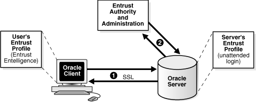

## F Entrust-Enabled Secure Sockets Layer Authentication

Entrust Authority (formerly known as Entrust/PKI) is a suite of PKI products provided by Entrust, Inc., that provides certificate generation, certificate revocation, and key and certificate management. Oracle Advanced Security is integrated with Entrust Authority so both Entrust and Oracle users can enhance their Oracle environment security.

This appendix contains the following topics:

## F.1 Benefits of Entrust-Enabled Oracle Advanced Security

Entrust-enabled Oracle Advanced Security provides:

- Enhanced X.509-Based Authentication and Single Sign-On
- Integration with Entrust Authority Key Management
- Integration with Entrust Authority Certificate Revocation
	Note:
	Oracle Advanced Security has been certified as Entrust-Ready by Entrust, Inc., as of Release 8.1.7.
	See Also:
	`http://www.entrust.com` for more information

### F.1.1 Enhanced X.509-Based Authentication and Single Sign-On

Entrust-enabled Oracle Advanced Security supports the use of Entrust credentials for [X.509](asogls.md) -based authentication and single sign-on. Instead of using an Oracle wallet to hold user PKI credentials, Oracle Advanced Security can access PKI credentials that are created by Entrust Authority and held in an Entrust profile (a`.epf` file). Users who have deployed Entrust software within their enterprise are able to use it for authentication and single sign-on to Oracle Database.

### F.1.2 Integration with Entrust Authority Key Management

Entrust-enabled Oracle Advanced Security uses the extensive key management and rollover functionality provided by Entrust Authority, which shields users from the complexity of a PKI deployment. For example, users are automatically notified when their certificates are expiring, and certificates are reissued according to preferences that administrators can configure.

### F.1.3 Integration with Entrust Authority Certificate Revocation

Entrust provides a certificate authority component, which natively checks certificate revocation status and enables the revocation of certificates.

Users using Entrust credentials for authentication to Oracle are assured that the revocation status of the certificate is checked, and connections are prevented if the certificate is revoked.

## F.2 Required System Components for Entrust-Enabled Oracle Advanced Security

To implement Entrust-enabled Oracle Advanced Security, the following system components are required:

- Entrust Authority for Oracle
- Entrust Authority Server Login Feature
- Entrust Authority IPSec Negotiator Toolkit
	Note:
	In the following sections, the term [client](asogls.md) refers to a client connecting to an Oracle database, and the term [server](asogls.md) refers to the host on which the Oracle database resides.

Contact your Entrust representative to get these components.

Note:

Oracle Advanced Security supports Entrust Authority Security Manager, Entrust Authority Server Login Feature, and Entrust Authority IPSec Negotiator Toolkit versions 6.0 and later.

Contact your Entrust representative for the latest product classification and naming details.

### F.2.1 Entrust Authority for Oracle

Entrust Authority for Oracle requires a database for storing information about Entrust users and the infrastructure, and a Lightweight Directory Access Protocol (LDAP)-compliant directory for information such as user names, public certificates, and certificate revocation lists.

Entrust Authority for Oracle comprises the following software components:

- Entrust Authority Security Manager
- Entrust Authority Self-Administration Server
- Entrust Entelligence Desktop Manager

#### F.2.1.1 Entrust Authority Security Manager

Entrust Authority Security Manager is the centerpiece of Entrust's PKI technology. It performs core certificate authority, certificate, and user management functions, such as creating users and user profiles containing the user's credentials.

Note:

Oracle only supports the use of Entrust-enabled Oracle Advanced Security with versions of Entrust Authority Security Manager that run on Oracle Database.

See Also:

[Chapter 13, "Configuring Secure Sockets Layer Authentication"](asossl.md), for information about certificate authorities.

Entrust Authority Security Manager supports unattended login, also called Server Login, which eliminates the need for a [Database Administrator](asogls.md) (DBA) to repeatedly enter a password for the Entrust profile on the server. With unattended login, the DBA need only enter a password once to open the Entrust profile for the server to authenticate itself to multiple incoming connections.

#### F.2.1.2 Entrust Authority Self-Administration Server

Entrust Authority Self-Administration Server is the administrator's secure interface to Entrust Authority Security Manager.

#### F.2.1.3 Entrust Entelligence Desktop Manager

Entrust Entelligence Desktop Manager provides support for user key management and single sign-on functionality on both clients and server by enabling Oracle Database server process access to incoming SSL connections.

Note:

Do not install Entrust Entelligence Desktop Manager on the server computer because it uses unattended login credentials files with`.ual` extensions.

Refer to "Configuring Entrust on the Server" for information about creating`.ual` files.

### F.2.3 Entrust Authority IPSec Negotiator Toolkit

The Entrust Authority IPSec Negotiator Toolkit is required on both clients and servers for integrating the Oracle Advanced Security SSL stack with Entrust Authority, enabling SSL authentication to use Entrust profiles.

Contact your Entrust representative to get Entrust Authority IPSec Negotiator Toolkit.

## F.3 Entrust Authentication Process

Figure F-1 illustrates the following Entrust authentication process:

1. The Entrust user on the Oracle client establishes a secure connection with the server using SSL and Entrust credentials.
2. The Oracle SSL adapter on the server communicates with the Entrust Authority to check the certificate revocation status of the Entrust user.
	Note:
	Figure F-1 does not include client and server profiles creation, which is presumed.

Figure F-1 Entrust Authentication Process



> This is a text description of asoag025.gif, which illustrates the Entrust authentication process as follows:
>
> 1. The Entrust user on the Oracle client establishes a secure connection with the server using SSL and Entrust credentials, stored in the user's Entrust profile (Entrust Entelligence).
> 2. The Oracle SSL adapter on the Oracle server communicates with the Entrust Authority to check the certificate revocation status of the Entrust user. The Oracle server must also have credentials, which are stored in the server's Entrust profile (unattended login).
  

See Also:

["How Secure Sockets Layer Works in an Oracle Environment: The SSL Handshake"](asossl.md)

## F.4 Enabling Entrust Authentication

This section describes the following tasks, which are required to configure Entrust-enabled Oracle Advanced Security SSL authentication:

- Creating Entrust Profiles
- Installing Oracle Advanced Security and Related Products for Entrust-Enabled SSL
- Configuring SSL on the Client and Server for Entrust-Enabled SSL
- Configuring Entrust on the Client
- Configuring Entrust on the Server
- Creating Entrust-Enabled Database Users
- Logging Into the Database Using Entrust-Enabled SSL

### F.4.1 Creating Entrust Profiles

This section describes how to create Entrust profiles, which can be created by either administrators or users. On UNIX platforms, administrators create the Entrust profiles for all clients. On Windows platforms, users can create their own Entrust profiles.

#### F.4.1.1 Administrator-Created Entrust Profiles

Administrators create Entrust profiles as follows:

1. The Entrust administrator adds the Entrust user using the Entrust Authority Self-Administration Server.
	See Also:
	The Entrust administration documentation for information about creating Entrust Users
2. The administrator enters the user's name and password.
3. The Entrust Authority creates the profile, or`.epf` file.
4. The administrator securely sends all profile-related files to the user. The preset password can be changed by the user.

#### F.4.1.2 User-Created Entrust Profiles

Entrust users create their own Entrust profiles as follows:

1. The Entrust administrator adds the Entrust user using the Entrust Authority Self-Administration Server. In the New User dialog box, the Create Profile option should be deselected.
	See also The Entrust administration documentation for information about creating Entrust profiles.
2. The user receives a secure e-mail notification from the administrator that contains a reference number, authorization code, and expiration date.
3. The user navigates to the Create Entrust Profiles screen in Entrust Entelligence Desktop Manager as follows:
	Start, Programs, Entrust, Entrust Profiles, Create Entrust Profiles
4. The user enters the reference number, authorization code, and expiration date provided in the e-mail notification, creating a profile, or`.epf` file, and the Entrust initialization file.

### F.4.3 Configuring SSL on the Client and Server for Entrust-Enabled SSL

Configure SSL on the client and server.

See Also:

[Chapter 13, "Configuring Secure Sockets Layer Authentication"](asossl.md), for information about configuring SSL on the client and server and skip the section that describes the Oracle wallet location.

### F.4.4 Configuring Entrust on the Client

The steps for configuring Entrust on the client vary according to the type of platform:

- Configuring Entrust on a UNIX Client
- Configuring Entrust on a Windows Client

#### F.4.4.1 Configuring Entrust on a UNIX Client

If the client resides on a non-Windows platform, perform the following steps:

1. Set the `JAVA_HOME` variable to the JDK or JRE location.
	For example:
	```
	>setenv JAVA_HOME $ORACLE_HOME/JRE
	```
2. Set `WALLET_LOCATION` in the `sqlnet.ora` file.
	For example:
	```
	WALLET_LOCATION=
	```
```
(SOURCE=
```
```
(METHOD=entr)
(METHOD_DATA = 
    (PROFILE=profile_location)
    (INIFILE=initialization_file_location)
)
```
```
)
```

#### F.4.4.2 Configuring Entrust on a Windows Client

If the client resides on a Windows platform, ensure that the Entrust Entelligence Desktop Manager component is installed on the client and perform the following steps to set up the Entrust credentials.

1. Set the `WALLET_LOCATION` parameter in the `sqlnet.ora` file.
	For example:
	```
	WALLET_LOCATION=
	(SOURCE=
	(METHOD=entr)
	(METHOD_DATA= 
	    (INIFILE=initialization_file_location)
	)
	)
	```
	where `initialization_file_location` is the path to the`.ini` file.
2. Select the Entrust icon on the system tray to open the Entrust\_Login dialog box.
3. Log on to Entrust by entering the profile name and password.

### F.4.5 Configuring Entrust on the Server

The steps for configuring Entrust on the server vary according to the type of platform:

- Configuring Entrust on a UNIX Server
- Configuring Entrust on a Windows Server

#### F.4.5.1 Configuring Entrust on a UNIX Server

If the server is a UNIX platform, ensure that the Entrust/Server Login Toolkit component is installed on the server and perform the following steps:

See Also:

"Required System Components for Entrust-Enabled Oracle Advanced Security" for information about downloading the Entrust Server Login toolkit.

1. Stop the Oracle database instance.
2. Set the `WALLET_LOCATION` parameter in the `sqlnet.ora` and `listener.ora` files to specify the paths to the server's profile and the Entrust initialization file:
	```
	WALLET_LOCATION =
	  (SOURCE =
	      (METHOD = ENTR)
	      (METHOD_DATA = 
	          (PROFILE = profile_location)
	          (INIFILE = initialization_file_location)
	      )
	  )
	```
3. Set the `CLASSPATH` environment variable to include the following paths:
	```
	$ORACLE_HOME/JRE/lib/rt.jar
	$ORACLE_HOME/JRE/lib/i18n.jar
	$ORACLE_HOME/jlib/ewt*.jar
	$ORACLE_HOME/jlib/help*.jar
	$ORACLE_HOME/jlib/share*.jar
	$ORACLE_HOME/jlib/swingall*.jar
	$ORACLE_HOME/network/jlib/netentrust.jar
	```
4. Enter the `etbinder` command to create unattended login credentials, or`.ual` files by using the following steps:
	1. Set the `PATH` environment variable to include the path to the `etbinder` command, which is located in the `/bin` directory where the Server Login Toolkit is installed.
		2. Set the `LD_LIBRARY_PATH` to include the path to the Entrust libraries.
		3. Set the `SSL_ENTRUST_INI` environment variable to include the full path to the Entrust initialization file.
		4. Enter the command as follows:
		```
		etbinder
		```
		5. When prompted to enter the location of the profile file, enter the full path name, including the name of the file. Then, when prompted, type in the password.
		A message displays indicating that the credentials file (`filename``.ual`) has been created.
		Note:
		Ensure that the listener has a TCPS listening endpoint, then start the listener.
5. Start the Oracle database instance.

#### F.4.5.2 Configuring Entrust on a Windows Server

If the server is on a Windows platform, perform the following steps:

See Also:

"Required System Components for Entrust-Enabled Oracle Advanced Security" for information about downloading Entrust Entelligence Desktop Manager.

1. Stop the Oracle database instance.
2. Set the `WALLET_LOCATION` parameter in the `sqlnet.ora` and `listener.ora` files to specify the paths to the server's profile and the Entrust initialization file:
	```
	WALLET_LOCATION =
	(SOURCE =
	(METHOD = ENTR)
	(METHOD_DATA = 
	    (PROFILE = profile_location)
	    (INIFILE = initialization_file_location)
	)
	)
	```
3. Run the Entrust binder command to create unattended login credentials, which are files with a`.ual` extension. Ensure that the owner of the`.ual` file is the same as the owner of the Oracle service.
	To run the binder command Select
	Start, Programs, Entrust Toolkit, Server Login, Entrust Binder
	Enter the path to the profile, the password, and the path to the Entrust initialization file. A message informs you that you have successfully created a credential file.
4. Start the Oracle database instance.
	Note:
	For all Windows environments, Oracle recommends that you do not install Entrust Entelligence Desktop Manager on the server computer.

### F.4.6 Creating Entrust-Enabled Database Users

Create global users in the database based on the [distinguished name (DN)](asogls.md) of each Entrust user.

For example:

```
SQL> create user jdoe identified globally as 'cn=jdoe,o=oracle,c=us';
```

where `"cn=jdoe, o=oracle, c=us"` is the Entrust distinguished name of the user.

### F.4.7 Logging Into the Database Using Entrust-Enabled SSL

1. Use SQL\*Plus to connect to the Oracle instance as follows:
	```
	sqlplus /@net_service_name
	```
	where `net_service_name` is the service name of the Oracle instance.
	The Entrust\_Login dialog box is displayed.
2. Enter the path to the profile and the password.
3. If you did not specify a value for the `WALLET_LOCATION` parameter, you are prompted to enter the path to the Entrust initialization file.
	Note:
	Oracle recommends that the initialization file be specified in the `WALLET_LOCATION` parameter file.

## F.5 Issues and Restrictions that Apply to Entrust-Enabled SSL

An application must be specifically modified to work with Entrust. If a product is designated as Entrust-ready, then it has been integrated with Entrust by using an Entrust toolkit.

For example, Oracle has modified its SSL libraries to access an Entrust profile instead of an Oracle wallet.

In addition, the following restrictions apply:

- The use of Entrust components for digital signatures in applications based on Oracle is not supported.
- The Entrust-enabled Oracle Advanced Security integration is only supported with versions of Entrust Authority Release 6.0 and later running on Oracle Database.
- The use of earlier releases of Entrust Authority with Entrust-enabled Oracle Advanced Security is not supported.
- Interoperability between Entrust and non-Entrust PKIs is not supported.
- Entrust has certified Oracle Internet Directory version 2.1.1 for Release 8.1.7 and subsequent releases.

## F.6 Troubleshooting Entrust In Oracle Advanced Security

This section describes how to diagnose errors returned from Entrust to Oracle Advanced Security users.

Note:

Entrust returns the following generic error message to Oracle Advanced Security users:

`ORA-28890 "Entrust Login Failed"`

This troubleshooting section describes how to get more details about the underlying error, and how to diagnose the problem.

### F.6.1 Error Messages Returned When Running Entrust on Any Platform

You may encounter the following error messages regardless of what platform you are running Entrust on.

ORA-28890 Entrust Login Failed

Cause: SQL\*Plus login on an Entrust-enabled Oracle client errors out with this generic error message. This error can be caused by a number of problems, including the following causes:
- Entrust /Authority is not online
- Invalid Entrust profile password specified
- Invalid path to the Entrust profile specified
- Invalid Entrust initialization file specified
- Entrust Server Login program has not executed on the server

Action: To get more detail on the Entrust error, turn on tracing for SQL\*Plus and the trace output should indicate the Entrust failure code. Enable tracing by specifying the following parameters in the `sqlnet.ora` file:

On the client:

- `TRACE_LEVEL_CLIENT=16`
- `TRACE_DIRECTORY_CLIENT=` `valid_client_directory_name`
- `TRACE_FILE_CLIENT=client`
- `TRACE_UNIQUE_CLIENT=ON`

On the server:

- `TRACE_LEVEL_SERVER=16`
- `TRACE_DIRECTORY_SERVER=` `valid_server_directory name`
- `TRACE_FILE_SERVER=server`
- `TRACE_UNIQUE_SERVER=ON`

Search for and locate the string `IKMP` in the generated trace file. Adjacent to this string, error messages are listed that provide details about the problem you are encountering. This detailed error code information is returned by the Entrust API.

Note:

The following are examples of valid client directory names for setting the `TRACE_DIRECTORY_CLIENT` or `TRACE_DIRECTORY_SERVER` parameters in the `sqlnet.ora` file:
- (UNIX) `/tmp`
- (Windows) `C:\TEMP`

ORA-28890 Entrust Login Failed (GUI does not display on the client)

Cause: The `WALLET_LOCATION` parameter does not specify the Entrust initialization file location in the client side `sqlnet.ora` file.

Action: Ensure that the location of the Entrust initialization file is specified in the `WALLET_LOCATION` parameter in the `sqlnet.ora` file on the client.

### F.6.2 Error Messages Returned When Running Entrust on Windows Platforms

You may encounter the following error messages if you are running Entrust on a Windows platform.

The software authentication failed. (error code - 162).

Cause: Due to a known FIPS mode incompatibility, Entrust logins may fail and return this error message.

Action: Contact Entrust support to resolve this issue.

Algorithm self-test failed. (error code - 176).

Cause: Due to a known symbol conflict between Entrust and Oracle libraries, Entrust login may fail and return this error message.

Action: Contact Entrust support to resolve this issue.

TNS-12560: TNS protocol adapter error TNS-00558> Entrust Login Failed ORACLE SERVER (host\_name)

This error may occur in the `listener.log` file on the server when you attempt to log in to Entrust.

If you configure the client by making the following recommended changes:
- Remove the`.ual` file
- De-install the Server Login
- Specify the Entrust initialization file location in the `SSL_ENTRUST_INI_FILE` parameter in the client `sqlnet.ora` file

then the server may not be able to authenticate the client when you enter the following command:

```
sqlplus/@net_service_name
```

Perform the following tasks to enable tracing on the server:
1. Select Control Panel, then Services.
2. In the Services dialog box, double click OracleTNSListener and change the Log On As from the System Account to the account that is currently logged in. This enables the server process to read the`.ual` file. Click OK to make the change and you are returned to the Services dialog box.
	In the Services dialog box, make the same changes for OracleService.
3. Make the following changes to the `listener.ora` file:
	- Specify only `TCPS` as the `PROTOCOL` in the listener `ADDRESS`. For example, change all of the `PROTOCOL` definitions to `TCPS` as follows:
		```
		listener_name=
		   (DESCRIPTION=
		      (ADDRESS=(PROTOCOL=TCPS) (KEY=extproc0))
		      (ADDRESS=(PROTOCOL=TCPS) (HOST=sales-pc) (PORT=1521)))
		```
		Bringing up the listener only using `TCPS` will show whether there is a problem accessing the Entrust profile when you turn on tracing.
		- Set the `SSL_CLIENT_AUTHENTICATION` parameter to `FALSE` as follows:
		```
		SSL_CLIENT_AUTHENTICATION=FALSE
		```
		- Turn on tracing by setting the following parameters:
		```
		TRACE_LEVEL_LISTENER=16
		TRACE_DIRECTORY_LISTENER=C:\temp
		```
		The trace file is created in the `C:\temp` directory.
4. Make the following changes to the `sqlnet.ora` file to turn on tracing:
	```
	TRACE_LEVEL_SERVER=16
	TRACE_DIRECTORY_SERVER=C:\temp
	```
	The trace file is created in the `C:\temp` directory.
5. Ensure that Entrust Entelligence Desktop Manager is not installed on the server.

Search for and locate the string `fail` or `ntz*` function calls. Adjacent to these, error messages are listed that provide details about the problem you are encountering.

### F.6.3 General Checklist for Running Entrust on Any Platform

The following items apply to all platforms:

1. Confirm that the Entrust Authority is online.
2. Confirm that the`.ual` file is generated. These files are created for unattended login credentials.
	Note:
	Oracle recommends that you generate an unattended login credential file (`.ual` file) for the server only. If you generate a`.ual` file for the server only, then when users attempt to log in, they are presented a GUI that prompts them for their password and their Entrust profile name. After users supply this information, the connection request is forwarded to the Entrust server, which looks up the revocation file and the`.ual` file to determine the permissions for granting the request.
3. Confirm that the Entrust initialization file contains the following entry in the first section that specifies the Entrust Settings:
	```
	IdentityLibrary=location
	```
	The full path to the location of the `libidapi.so` file should be specified in the `IdentityLibrary` parameter. This parameter setting enables generating a`.ual` file on the server.
4. Ensure that all Entrust toolkits, including the Entrust IPSEC Negotiator toolkit and the Server Login toolkit, are the same version so they are compatible.
5. Ensure that you have specified TCP/IP with SSL in the `SQLNET.AUTHENTICATION_SERVICES` parameter in the `sqlnet.ora` file as shown in the following example:
	```
	SQLNET.AUTHENTICATION_SERVICES=(tcps, authentication_type1, authentication_   type2)
	```

#### F.6.3.1 Checklist for Entrust Installations on Windows

The following checklist items apply only to Entrust installations on the Windows platform.

1. Ensure that you are logged into Entrust Entelligence Desktop Manager and retry.
2. Select Windows, then Control Panel, and click Services to confirm that the Entrust Login Interface service has started and is running.
3. Confirm that the Entrust initialization file location is specified in the `SSL_ENTRUST_INI_FILE` parameter of the `sqlnet.ora` file. However, if you select not to specify the location there, then the Entrust initialization file must reside in `c:\WINNT`.
4. Ensure that you are not running Entrust Entelligence Desktop Manager if your database is running on a Microsoft platform. If this is the case, then only the`.ual` file, which enables unattended login, is required.
	See Also:
	Step 4 of "Configuring Entrust on a Windows Server" for information about creating a`.ual` file with the Entrust binder command.
5. Confirm that Entrust Authority, as specified in the Entrust Initialization file, is accessible and running.
6. Confirm that the profile password is correctly entered.
7. If an Oracle database server fails to log in to Entrust, confirm that the unattended login credential file (`.ual`) is generated using a valid password. Also, confirm that the versions for Entrust Server Login toolkit and Entrust IPSEC Negotiator toolkit match (that is, that the IPSec Toolkit 6.0 works with Server Login Toolkit 6.0).
8. Ensure that the Entrust initialization file has the following entry in the first section, Entrust Settings:
	```
	IdentityLibrary = location
	```
	where `location` is the location of `libidapi.so`, including the file name.