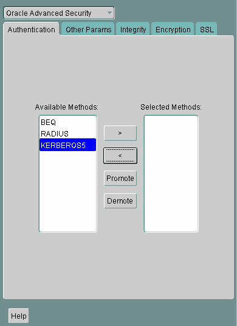

## 15 Configuring Multiple Authentication Methods and Disabling Oracle Advanced Security

This chapter describes how to configure multiple authentication methods under Oracle Advanced Security, and how to use conventional user name and password authentication, even if you have configured another authentication method. This also chapter describes how to configure your network so that Oracle clients can use a specific authentication method and Oracle servers can accept any method specified.

This chapter contains the following topics:

## 15.1 Connecting with User Name and Password

To connect to an Oracle database server using a user name and password when an Oracle Advanced Security authentication method has been configured, disable the external authentication (Refer to "Disabling Oracle Advanced Security Authentication" ).

With the external authentication disabled, a user can connect to a database using the following format:

```
% sqlplus username@net_service_name
Enter password: password
```

For example:

```
% sqlplus hr@emp
Enter password: password
```

Note:

You can configure multiple authentication methods, including both externally authenticated users and password authenticated users, on a single database.

## 15.2 Disabling Oracle Advanced Security Authentication

Use Oracle Net Manager to disable authentication methods (Refer to ["Starting Oracle Net Manager"](asotools.md)):

1. Navigate to the Oracle Advanced Security profile. Refer to ["Navigating to the Oracle Advanced Security Profile"](asotools.md). The Oracle Advanced Security tabbed window is displayed as shown in Figure 15-1.

Figure 15-1 Oracle Advanced Security Authentication Window



> This is a text description of auth0001.gif, which is an image of the Authentication tab in the Oracle Advanced Security profile region of Oracle Net Manager. Use this window to disable Oracle Advanced Security.
>
> To disable Oracle Advanced Security, choose all Selected Methods of authentication in the list on the right of the window. Then click the left arrow to remove all authenticaton types from the Selected Methods.
  

1. Click the Authentication tab.
2. Sequentially move all authentication methods from the Selected Method list to the Available Methods list by selecting a method and choosing the left arrow \[<\].
3. Select File, then Save Network Configuration.
	The `sqlnet.ora` file is updated with the following entry:
	```
	SQLNET.AUTHENTICATION_SERVICES = (NONE)
	```

## 15.3 Configuring Multiple Authentication Methods

Many networks use more than one authentication method on a single security server. Accordingly, Oracle Advanced Security lets you configure your network so that Oracle clients can use a specific authentication method, and Oracle database servers can accept any method specified.

You can set up multiple authentication methods on both client and server systems either by using Oracle Net Manager, or by using any text editor to modify the `sqlnet.ora` file.

Use Oracle Net Manager to add authentication methods to both clients and servers (Refer to ["Starting Oracle Net Manager"](asotools.md))

Following steps describe how to configure Multiple authentication Methods.

1. Navigate to the Oracle Advanced Security profile. Refer to ["Navigating to the Oracle Advanced Security Profile"](asotools.md). The Oracle Advanced Security tabbed window is displayed as shown in Figure 15-1.
2. Click the Authentication tab.
3. Select a method listed in the Available Methods list.
4. Sequentially move selected methods to the Selected Methods list by clicking the right arrow (>).
5. Arrange the selected methods in order of desired use. To do this, select a method in the Selected Methods list, and select Promote or Demote to position it in the list.
6. Select File, then Save Network Configuration.
	The `sqlnet.ora` file is updated with the following entry, listing the selected authentication methods:
	```
	SQLNET.AUTHENTICATION_SERVICES = (KERBEROS5, RADIUS)
	```

Note:

SecurID functionality is available through RADIUS; RADIUS support is built into the RSA ACE/Server.

See Also:

[Chapter 11, "Configuring RADIUS Authentication"](asoradus.md) for more information

## 15.4 Configuring Oracle Database for External Authentication

This section describes the parameters you must set to configure Oracle Database for network authentication, using the following tasks:

- Setting the SQLNET.AUTHENTICATION\_SERVICES Parameter in sqlnet.ora
- Setting OS\_AUTHENT\_PREFIX to a Null Value
	See Also:
	- The corresponding chapter in this guide for information about configuring a particular authentication method
	- [Appendix B, "Authentication Parameters"](asoappb.md)

### 15.4.1 Setting the SQLNET.AUTHENTICATION\_SERVICES Parameter in sqlnet.ora

The following parameter must be set in the `sqlnet.ora` file for all clients and servers to enable each to use a supported authentication method:

```
SQLNET.AUTHENTICATION_SERVICES=(oracle_authentication_method)
```

For example, for all clients and servers using Kerberos authentication, the `sqlnet.ora` parameter must be set as follows:

```
SQLNET.AUTHENTICATION_SERVICES=(KERBEROS5)
```

### 15.4.2 Setting OS\_AUTHENT\_PREFIX to a Null Value

Authentication service-based user names can be long, and Oracle user names are limited to 30 characters. Oracle strongly recommends that you enter a null value for the `OS_AUTHENT_PREFIX` parameter in the initialization file used for the database instance as follows:

```
OS_AUTHENT_PREFIX=""
```

Note:

The default value for `OS_AUTHENT_PREFIX` is `OPS$`; however, you can set it to any string.

Attention:

If a database already has the `OS_AUTHENT_PREFIX` set to a value other than `NULL` (" "), do not change it, because it can inhibit previously created, externally identified users from connecting to the Oracle server.

To create a user, launch SQL\*Plus and enter the following:

```
SQL> CREATE USER os_authent_prefix username IDENTIFIED EXTERNALLY;
```

When `OS_AUTHENT_PREFIX` is set to a null value (" "), enter the following to create the user king:

```
SQL> CREATE USER king IDENTIFIED EXTERNALLY;
```

The advantage of creating a user in this way is that the administrator no longer needs to maintain different user names for externally identified users. This is true for all supported authentication methods.