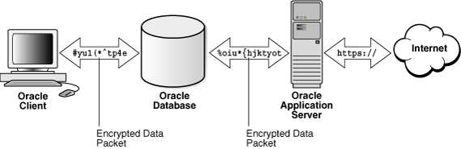
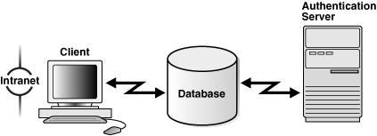
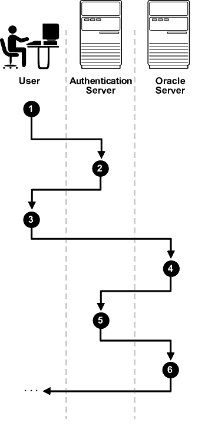
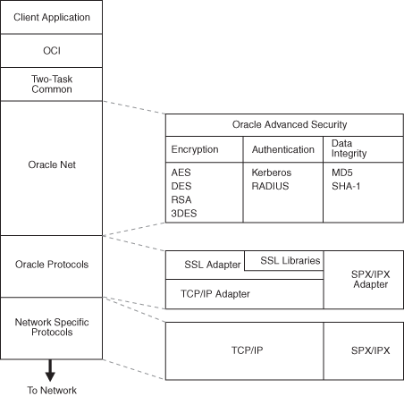
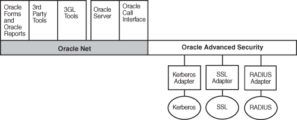

## 1 Introduction to Oracle Advanced Security

This chapter introduces Oracle Advanced Security, summarizes the security risks it addresses, and describes its features. These features are available to database and related products that interface with Oracle Net Services, including Oracle Database, Oracle Application Server, and Oracle Identity Management infrastructure.

This chapter contains the following topics:

## 1.1 Security Challenges in an Enterprise Environment

To increase efficiency and lower costs, companies adopt strategies to automate business processes. One such strategy is to conduct more business on the Web, but that requires greater computing power, translating to higher IT costs. In response to rising IT costs, more and more businesses are considering enterprise [grid computing](asogls.md) architecture where inexpensive computers act as one powerful system. While such strategies improve the bottom line, they introduce risks, which are associated with securing data, in rest and motion, and managing an ever increasing number of user identities.

This section examines the security challenges of today's enterprise computing environments in the following topics:

- Security in Enterprise Grid Computing Environments
- Security in an Intranet or Internet Environment
- Common Security Threats

### 1.1.1 Security in Enterprise Grid Computing Environments

Grid computing is a computing architecture that coordinates large numbers of servers and storage to act as a single large computer. It provides flexibility, lower costs, and IT investment protection because inexpensive, off-the-shelf components can be added to the grid as business needs change. While providing significant benefits, grid computing environments present unique security requirements because their computing resources are distributed and often heterogeneous. The following sections discuss these requirements:

Distributed Environment Security Requirements

Enterprise grid computing pools distributed business computing resources to cost effectively harness the power of clustered servers and storage. A distributed environment requires secure network connections. Even more critical in grid environments, it is necessary to have a uniform definition of "who is the user" and "what is the user allowed to do." Without such uniform definitions, administrators frequently must assign, manage, and revoke authorizations for every user on different software applications to protect employee, customer, and partner information. This is expensive because it takes time, which drives up costs. Consequently, the cost savings gained with grid computing are lost.

Heterogeneous Environment Security Requirements

Because grid computing environments often grow as business needs change, computing resources are added over time, resulting in diverse collections of hardware and software. Such heterogeneous environments require support for different types of authentication mechanisms which adhere to industry standards. Without strict adherence to industry standards, integrating heterogeneous components becomes costly and time consuming. Once again the benefits of grid computing are squandered when the appropriate infrastructure is not present.

### 1.1.2 Security in an Intranet or Internet Environment

Oracle databases power the largest and most popular Web sites on the Internet. In record numbers, organizations throughout the world are deploying distributed databases and client/server applications based on Oracle Database and Oracle Net Services. This proliferation of distributed computing is matched by an increase in the amount of information that organizations place on computers. Employee and financial records, customer orders, product information, and other sensitive data have moved from filing cabinets to file structures. The volume of sensitive information on the Web has thus increased the value of data that can be compromised.

### 1.1.3 Common Security Threats

The increased volume of data in distributed, heterogeneous environments exposes users to a variety of security threats, including the following:

- Eavesdropping and Data Theft
- Data Tampering
- Falsifying User Identities
- Password-Related Threats

#### 1.1.3.1 Eavesdropping and Data Theft

Over the Internet and in wide area network environments, both public carriers and private networks route portions of their network through insecure land lines, vulnerable microwave and satellite links, or a number of servers— exposing valuable data to interested third parties. In local area network environments within a building or campus, the potential exists for insiders with access to the physical wiring to view data not intended for them, and network [sniffer](asogls.md) s can be installed to eavesdrop on network traffic.

#### 1.1.3.2 Data Tampering

Distributed environments bring with them the possibility that a malicious third party can compromise integrity by tampering with data as it moves between sites.

#### 1.1.3.3 Falsifying User Identities

In a distributed environment, it is more feasible for a user to falsify an identity to gain access to sensitive information. How can you be sure that user Pat connecting to Server A from Client B really is user Pat?

Moreover, in distributed environments, malefactors can hijack connections. How can you be sure that Client B and Server A are what they claim to be? A transaction that should go from the Personnel system on Server A to the Payroll system on Server B could be intercepted in transit and re-routed to a terminal masquerading as Server B.

#### 1.1.3.4 Password-Related Threats

In large systems, users typically must remember multiple passwords for the different applications and services that they use. For example, a developer can have access to a development application on a workstation, a PC for sending e-mail, and several computers or intranet sites for testing, reporting bugs, and managing configurations.

Users typically respond to the problem of managing multiple passwords in several ways:

- They may select easy-to-guess passwords, such as a name, a fictional character, or a word found in a dictionary. All of these passwords are vulnerable to [dictionary attack](asogls.md) s.
- They may also choose to standardize passwords so that they are the same on all systems or Web sites. This results in a potentially large exposure in the event of a compromised password. They can also use passwords with slight variations that can be easily derived from known passwords.
- Users with complex passwords may write them down where an attacker can easily find them, or they may just forget them, requiring costly administration and support efforts.

All of these strategies compromise password secrecy and service availability. Moreover, administration of multiple user accounts and passwords is complex, time-consuming, and expensive.

## 1.2 Solving Security Challenges with Oracle Advanced Security

To solve enterprise computing security problems, Oracle Advanced Security provides industry standards-based data privacy, integrity, authentication, single sign-on, and access authorization in a variety of ways. For example, you can configure either Oracle Net native encryption or Secure Sockets Layer (SSL) for data privacy. Oracle Advanced Security also provides the choice of several strong authentication methods, including Kerberos, smart cards, and digital certificates.

Oracle Advanced Security provides the following security features:

- Data Encryption
- Strong Authentication

### 1.2.1 Data Encryption

Sensitive information that is stored in your database or that travels over enterprise networks and the Internet can be protected by encryption algorithms. An encryption algorithm transforms information into a form that cannot be deciphered without a decryption key.

Figure 1-1 shows how encryption works to ensure the security of a transaction sent over the network. For example, if a manager approves a bonus, this data should be encrypted when sent over the network to avoid eavesdropping. If all communication between the client, the database, and the application server is encrypted, then when the manager sends the bonus amount to the database, it is protected.

Figure 1-1 Encryption

> This is a text description of asoag037.gif, an image which depicts an encrypted standard client connection to an Oracle database, and an encrypted connection between the Oracle database and Oracle Application Server. The application server is connected to the Internet. It shows encrypted data packets being transmitted over the connection between the client and the database, and over the connection between the database and the application server. The connection between the application server and the Internet is protected with HTTPS, which is the Hypertext Transfer Protocol over Secure Sockets Layer (SSL).
  

This section discusses the following topics:

- Supported Encryption Algorithms
- Data Integrity
- Federal Information Processing Standard

#### 1.2.1.1 Supported Encryption Algorithms

Oracle Advanced Security provides the following encryption algorithms to protect the privacy of network data transmissions:

- Triple-DES Encryption
- Advanced Encryption Standard

Selecting the network encryption algorithm is a user configuration option, providing varying levels of security and performance for different types of data transfers.

Prior versions of Oracle Advanced Security provided three editions: Domestic, Upgrade, and Export, each with different key lengths. Oracle Advanced Security 11g Release 2 (11.2) contains a complete complement of the available encryption algorithms and key lengths, previously only available in the Domestic edition. Users deploying prior versions of the product can obtain the Domestic edition for a specific product release.

Note:

The U.S. government has relaxed its export guidelines for encryption products. Accordingly, Oracle can ship Oracle Advanced Security with its strongest encryption features to all of its customers.

##### 1.2.1.1.1 Triple-DES Encryption

Oracle Advanced Security also supports Triple-DES encryption (3DES), which encrypts message data with three passes of the DES algorithm. 3DES provides a high degree of message security, but with a performance penalty. The magnitude of penalty depends on the speed of the processor performing the encryption. 3DES typically takes three times as long to encrypt a data block as compared with the standard DES algorithm.

3DES is available in two-key and three-key versions, with effective key lengths of 112-bits and 168-bits, respectively. Both versions operate in outer [Cipher Block Chaining (CBC)](asogls.md) mode.

##### 1.2.1.1.2 Advanced Encryption Standard

Approved by the National Institute of Standards and Technology (NIST) in Federal Information Processing Standards (FIPS) Publication 197, Advanced Encryption Standard (AES) is a cryptographic algorithm standard developed to replace DES. AES is a symmetric block cipher that can process data blocks of 128 bits, using cipher keys with lengths of 128, 192, and 256 bits, which are referred to as AES-128, AES-192, and AES-256, respectively. All three versions operate in outer-CBC mode.

#### 1.2.1.2 Data Integrity

To ensure the [integrity](asogls.md) of data packets during transmission, Oracle Advanced Security can generate a cryptographically secure message digest using the SHA-1 hashing algorithm and include it with each message sent across a network.

Data integrity algorithms add little overhead and protect against the following attacks:

- Data modification
- Deleted packets
- Replay attacks
	Note:
	SHA-1 produces a larger message digest than the previously supported MD5, making it more secure against brute-force collision and inversion attacks.
	See Also:
	[Chapter 9, "Configuring Network Data Encryption and Integrity for Oracle Servers and Clients"](asoconfg.md), for information about SHA-1

#### 1.2.1.3 Federal Information Processing Standard

Oracle Advanced Security Release 8.1.6 has been validated under U.S. Federal Information Processing Standard 140-1 (FIPS) at the Level 2 security level. This provides independent confirmation that Oracle Advanced Security conforms to federal government standards.

The cryptographic libraries for SSL included in Oracle Database 10g have been validated under FIPS 140-2 at the Level 2 security level. Both FIPS 140-1 and FIPS 140-2 related configuration settings are described in [Appendix D, "Oracle Advanced Security FIPS 140 Settings"](asoappe.md).

### 1.2.2 Strong Authentication

Authentication is used to prove the identity of the user. Authenticating user identity is imperative in distributed environments, without which there can be little confidence in network security. Passwords are the most common means of authentication. Oracle Advanced Security enables strong authentication with Oracle authentication adapters that support various third-party authentication services, including SSL with digital certificates.

Figure 1-2 shows user authentication with an Oracle database instance configured to use a third-party authentication server. Having a central facility to authenticate all members of the network (clients to servers, servers to servers, users to both clients and servers) is one effective way to address the threat of network nodes falsifying their identities.

Figure 1-2 Strong Authentication with Oracle Authentication Adapters

> This is a text description of asoag035.gif, an image which depicts a client connection to an Oracle database that uses a third-party authentication server. It shows the client sending a request to an Oracle database. The Oracle database then sends a request to a third-party authentication server to authenticate the client.
  

This section contains the following topics:

- Centralized Authentication and Single Sign-On
- Supported Authentication Methods

#### 1.2.2.1 Centralized Authentication and Single Sign-On

Centralized authentication also provides the benefit of [single sign-on (SSO)](asogls.md) for users. Single sign-on enables users to access multiple accounts and applications with a single password. A user only needs to login once and can then automatically connect to any other service without having to giving user name and password again. Single sign-on eliminates the need for the user to remember and administer multiple passwords, reducing the time spent logging into multiple services.

##### 1.2.2.1.1 How Centralized Network Authentication Works

Figure 1-3 shows how a centralized network authentication service typically operates.

Figure 1-3 How a Network Authentication Service Authenticates a User

> This is a text description of asoag012.gif, an image which depicts how a network authentication service authenticates a user as follows:
>
> 1. First, the user (client) requests authentication services from an authentication server. The user proves his or her identity by providing a token or password.
> 2. After authenticating the user, the authentication server passes a ticket or credentials back to the client.
> 3. The client can now take these credentials and pass them to the Oracle server while asking for a service, such as connection to a database.
> 4. The Oracle server sends the credentials to the authentication server to verify their validity.
> 5. The authentication server either accepts or rejects the credentials and sends a notification to the Oracle server.
> 6. If the authentication server accepts the credentials, then the Oracle server performs the requested task for the user. If the credentials are not accepted, the requested service is denied.
  

The following steps describe how centralized Network Authentication Process works.

1. A user (client) requests authentication services and provides identifying information, such as a token or password.
2. The authentication server validates the user's identity and passes a ticket or credentials back to the client, which may include an expiration time.
3. The client passes these credentials to the Oracle server concurrent with a service request, such as connection to a database.
4. The server sends the credentials back to the authentication server for authentication.
5. The authentication server checks the credentials and notifies the Oracle server.
6. If the credentials were accepted by the authentication server, then the Oracle server authenticates the user. If the authentication server rejected the credentials, then authentication fails, and the service request is denied.

#### 1.2.2.2 Supported Authentication Methods

Oracle Advanced Security supports the following industry-standard authentication methods:

- Kerberos
- Remote Authentication Dial-In User Service (RADIUS):
- Secure Sockets Layer (with digital certificates)
- Entrust/PKI

##### 1.2.2.2.1 Kerberos

Oracle Advanced Security support for Kerberos provides the benefits of single sign-on and centralized authentication of Oracle users. Kerberos is a trusted third-party authentication system that relies on shared secrets. It presumes that the third party is secure, and provides single sign-on capabilities, centralized password storage, database link authentication, and enhanced PC security. It does this through a Kerberos authentication server. Refer to [Chapter 12, "Configuring Kerberos Authentication"](asokerb.md) for information about configuring and using this adapter.

Note:

Oracle authentication for Kerberos provides database link authentication (also called proxy authentication). Kerberos is also an authentication method that is supported with Enterprise User Security.

##### 1.2.2.2.2 Remote Authentication Dial-In User Service (RADIUS):

RADIUS is a client/server security protocol that is most widely known for enabling remote authentication and access. Oracle Advanced Security uses this standard in a client/server network environment to enable use of any authentication method that supports the RADIUS protocol. RADIUS can be used with a variety of authentication mechanisms, including token cards and smart cards.

See Also:

[Chapter 11, "Configuring RADIUS Authentication"](asoradus.md) for information about configuring and using RADIUS

- Smart Cards
	A RADIUS-compliant smart card is a credit card-like hardware device which has memory and a processor. It is read by a smart card reader located at the client workstation.
- Token Cards
	Token cards (Secure ID or RADIUS-compliant) can improve ease of use through several different mechanisms. Some token cards dynamically display one-time passwords that are synchronized with an authentication service. The server can verify the password provided by the token card at any given time by contacting the authentication service. Other token cards have a keypad and operate on a challenge-response basis. In this case, the server offers a challenge (a number) that the user enters into a token card. The token card provides a response (another number cryptographically derived from the challenge) that the user enters and sends to the server.
	You can use SecurID tokens through the RADIUS adapter.

##### 1.2.2.2.3 Secure Sockets Layer

Secure Sockets Layer (SSL) is an industry standard protocol for securing network connections. SSL provides [authentication](asogls.md), data [encryption](asogls.md), and data [integrity](asogls.md).

The SSL protocol is the foundation of a [public key infrastructure (PKI)](asogls.md). For authentication, SSL uses digital certificates that comply with the X.509v3 standard and a [public and private key pair](asogls.md).

Oracle Advanced Security SSL can be used to secure communications between any client and any server. You can configure SSL to provide authentication for the server only, the client only, or both client and server. You can also configure SSL features in combination with other authentication methods supported by Oracle Advanced Security (database user names and passwords, RADIUS, and Kerberos).

To support your PKI implementation, Oracle Advanced Security includes the following features in addition to SSL:

- Oracle wallets, where you can store PKI credentials
- Oracle Wallet Manager, which you can use to manage your Oracle wallets
- Certificate validation with certificate revocation lists (CRLs)
- Hardware security module support
	See Also:
	- [Chapter 13, "Configuring Secure Sockets Layer Authentication"](asossl.md) for conceptual, configuration, and usage information about SSL, certificate validation, and hardware security modules
	- [Chapter 14, "Using Oracle Wallet Manager"](asowalet.md) for information about using this tool to manage Oracle wallets
	- [Chapter 15, "Configuring Multiple Authentication Methods and Disabling Oracle Advanced Security"](asoauth.md) for information about configuring SSL in combination with other authentication methods

##### 1.2.2.2.4 Entrust/PKI

Oracle Advanced Security supports the public key infrastructure provided by the Entrust/PKI software from Entrust Technologies, Inc. Entrust-enabled Oracle Advanced Security lets Entrust users incorporate Entrust single sign-on into their Oracle applications, and it lets Oracle users incorporate Entrust-based single sign-on into Oracle applications.

See Also:

[Appendix F, "Entrust-Enabled Secure Sockets Layer Authentication"](asoappg.md) for more information about this feature

## 1.3 Oracle Advanced Security Architecture

Oracle Advanced Security complements an Oracle server or client installation with advanced security features. Figure 1-4 shows the Oracle Advanced Security architecture within an Oracle networking environment.

Figure 1-4 Oracle Advanced Security in an Oracle Networking Environment

> This is a text description of asoag015.gif, an image which depicts how Oracle Advanced Security operates at the session layer on top of SSL, which uses TCP/IP at the transport layer. On top of the stack is the database application layer making calls into the Oracle call interface (OCI) and two-task common. The OCI then uses Oracle Net services for communicating with the database server over the network.
>
> Oracle Net is an abstraction layer where Oracle Advanced Security supports various encryption, authentication, and integrity adapters. Below the Oracle Net layer, the Oracle protocols layer and the network specific protocols layer are situated. This is where the SSL adapter is located, which uses TCP/IP.
  

Oracle Advanced Security supports authentication through adapters that are similar to the existing Oracle protocol adapters. As shown in Figure 1-5, authentication adapters integrate the Oracle Net interface, and allow existing applications to take advantage of new authentication systems transparently, without any changes to the application.

Figure 1-5 Oracle Net Services with Authentication Adapters

> This is a text description of asoag005.gif, an image which depicts how authentication adapters integrate below the Oracle Net interface. This allows existing applications to take advantage of new authentication systems transparently, without any changes to the application. The Oracle Net layer, which contains Oracle Advanced Security is shown in the image. Various Oracle and non-Oracle software applications are layered on top of Oracle Net, including Oracle Forms, Oracle Reports, third-party tools, 3GL tools, Oracle servers, and Oracle Call Interface. To show that the Oracle Advanced Security authentication adapters reside below the Oracle Net layer, the following authentication adapters are shown hanging off the Oracle Advanced Security section of the Oracle Net network layer: Kerberos adapter, SSL adapter, and the RADIUS adapter.
  

See Also:

[Oracle Database Net Services Administrator's Guide](https://docs.oracle.com/cd/E11882_01/network.112/e41945/toc.htm) for more information about stack communications in an Oracle networking environment

## 1.4 System Requirements

Oracle Advanced Security 11g Release 2 (11.2) requires Oracle Net 11g Release 2 (11.2) and supports Oracle Database Enterprise Edition. Table 1-1 lists additional system requirements.

Note:

Oracle Advanced Security is not available with Oracle Database Standard Edition.

Table 1-1 Authentication Methods and System Requirements

| Authentication Method | System Requirements |
| --- | --- |
| Kerberos | - MIT Kerberos Version 5, release 1.1 or above. - The Kerberos authentication server must be installed on a physically secure system. |
| RADIUS | - A RADIUS server that is compliant with the standards in the Internet Engineering Task Force (IETF) RFC #2138, Remote Authentication Dial In User Service (RADIUS) and RFC #2139 RADIUS Accounting. - To enable challenge-response authentication, you must run RADIUS on an operating system that supports the Java Native Interface as specified in release 1.1 of the Java Development Kit from JavaSoft. |
| SSL | - A wallet that is compatible with the Oracle Wallet Manager 10g release. Wallets created in earlier releases of the Oracle Wallet Manager are not forward compatible. |
| Entrust/PKI | - Entrust IPSEC Negotiator Toolkit Release 6.0 - Entrust/PKI 6.0 |

## 1.5 Oracle Advanced Security Restrictions

Oracle Applications support Oracle Advanced Security encryption and data integrity. However, because Oracle Advanced Security requires Oracle Net Services to transmit data securely, Oracle Advanced Security external authentication features are not supported by some parts of Oracle Financial, Human Resource, and Manufacturing Applications when they are running on Microsoft Windows. The portions of these products that use Oracle Display Manager (ODM) do not take advantage of Oracle Advanced Security, because ODM does not use Oracle Net Services.