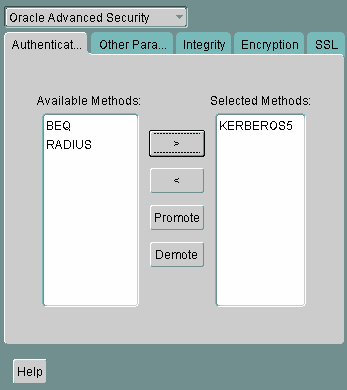
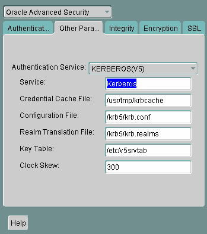

## 12 Configuring Kerberos Authentication

This chapter describes how to configure Oracle Advanced Security for Oracle Database for use with Kerberos authentication, and how to configure Kerberos to authenticate Oracle database users. This chapter contains the following sections:

See Also:

[Oracle Database Enterprise User Security Administrator's Guide](https://docs.oracle.com/cd/E11882_01/network.112/e10744/appa.htm#DBIMI200) for information on migrating Kerberos users to Kerberos-authenticated enterprise users

## 12.1 Enabling Kerberos Authentication

This section contains:

- Step 1: Install Kerberos
- Step 2: Configure a Service Principal for an Oracle Database Server
- Step 3: Extract a Service Key Table from Kerberos
- Step 4: Install an Oracle Database Server and an Oracle Client
- Step 5: Install Oracle Net Services and Oracle Advanced Security
- Step 6: Configure Oracle Net Services and Oracle Database
- Step 7: Configure Kerberos Authentication
- Step 8: Create a Kerberos User
- Step 9: Create an Externally Authenticated Oracle User
- Step 10: Get an Initial Ticket for the Kerberos/Oracle User

### 12.1.1 Step 1: Install Kerberos

Install Kerberos on the system that functions as the authentication server.

See Also:

Your Kerberos version 5 source distribution for notes about building and installing Kerberos

Note:

After upgrading from a 32-bit version of Oracle Database, the first use of the Kerberos authentication adapter causes an error message: `ORA-01637: Packet receive failed`.

Workaround: After upgrading to the 64-bit version of the database and before using Kerberos external authentication method, check for a file named `/usr/tmp/oracle_service_name.RC` on your computer, and remove it.

### 12.1.2 Step 2: Configure a Service Principal for an Oracle Database Server

To enable the Oracle database server to validate the identity of clients that authenticate themselves using Kerberos, you must create a [service principal](asogls.md) for Oracle Database.

The name of the principal should have the following format:

```
kservice/kinstance@REALM
```

Each of the fields in the service principal specify the following values:

| Service Principal Field | Description |
| --- | --- |
| `kservice` | A case-sensitive string that represents the Oracle service. This can be the same as the database service name. |
| `kinstance` | Typically the fully qualified DNS name of the system on which Oracle Database is running. |
| `REALM` | The name of the Kerberos realm with which the service principal is registered. `REALM` must always be uppercase and is typically the DNS domain name. |

Note:

The utility names in this section are executable programs. However, the Kerberos user name `krbuser` and the realm `EXAMPLE.COM` are examples only.

For example, suppose `kservice` is `oracle`, the fully qualified name of the system on which Oracle Database is running is `dbserver.example.com` and the realm is `EXAMPLE.COM`. The principal name then is:

```
oracle/dbserver.example.com@EXAMPLE.COM
```

It is a convention to use the DNS domain name as the name of the realm. To create the [service principal](asogls.md), run `kadmin.local`. On UNIX, run this command as the root user, by using the following syntax:

```
# cd /kerberos-install-directory/sbin
# ./kadmin.local
```

To add a [principal](asogls.md) named `oracle/dbserver.example.com@EXAMPLE.COM` to the list of server principals known by Kerberos, enter the following:

```
kadmin.local:addprinc -randkey oracle/dbserver.example.com@EXAMPLE.COM
```

### 12.1.3 Step 3: Extract a Service Key Table from Kerberos

Extract the [service key table](asogls.md) from Kerberos and copy it to the Oracle database server/Kerberos client system.

For example, use the following steps to extract a service key table for `dbserver.example.com`:

1. Enter the following to extract the service key table:
	```
	kadmin.local:  ktadd -k /tmp/keytab oracle/dbserver.example.com
	Entry for principal oracle/dbserver.example.com with kvno 2, encryption DES-CBC-CRC added to the keytab WRFILE: 'WRFILE:/tmp/keytab
	kadmin.local:  exit
	oklist -k -t /tmp/keytab
	```
2. After the service key table has been extracted, verify that the new entries are in the table in addition to the old ones. If they are not, or you need to add more, use `kadmin.local` to append to them.
	If you do not enter a realm when using `ktadd`, it uses the default realm of the Kerberos server. `kadmin.local` is connected to the Kerberos server running on the `localhost`.
3. If the Kerberos service key table is on the same system as the Kerberos client, you can move it. If the service key table is on a different system from the Kerberos client, you must transfer the file with a program such as FTP. If using FTP, transfer the file in binary mode.
	The following example shows how to move the service key table on a UNIX platform:
	```
	# mv /tmp/keytab /etc/v5srvtab
	```
	The default name of the service file is `/etc/v5srvtab`.
4. Verify that the owner of the Oracle database server executable can read the service key table (`/etc/v5srvtab` in the previous example). To do so, set the file owner to the Oracle user, or make the file readable by the group to which Oracle belongs.
	Caution:
	Do not make the file readable to all users. This can cause a security breach.

### 12.1.4 Step 4: Install an Oracle Database Server and an Oracle Client

Install the Oracle database server and client software.

See Also:

Oracle Database operating system-specific installation documentation

### 12.1.5 Step 5: Install Oracle Net Services and Oracle Advanced Security

Install Oracle Net Services and Oracle Advanced Security on the Oracle database server and Oracle client systems.

See Also:

Oracle Database operating system-specific installation documentation

### 12.1.6 Step 6: Configure Oracle Net Services and Oracle Database

Configure Oracle Net Services on the Oracle database server and client.

See Also:

- Oracle Database operating system-specific installation documentation
- [Oracle Database Net Services Administrator's Guide](https://docs.oracle.com/cd/E11882_01/network.112/e41945/toc.htm).

### 12.1.7 Step 7: Configure Kerberos Authentication

Perform these tasks to set required parameters in the Oracle database server and client `sqlnet.ora` files.

This section contains:

- Step 7A: Configure Kerberos on the Client and on the Database Server
- Step 7B: Set the Initialization Parameters
- Step 7C: Set sqlnet.ora Parameters (Optional)

#### 12.1.7.1 Step 7A: Configure Kerberos on the Client and on the Database Server

To configure Kerberos authentication service parameters on the client and on the database server:

1. Start Oracle Net Manager.
	- (UNIX) From `$ORACLE_HOME` `/bin`, enter the following command at the command line:
		```
		netmgr
		```
		- (Windows) Select Start, Programs, Oracle - HOME\_NAME, Configuration and Migration Tools, then Net Manager.
2. Expand Oracle Net Configuration, and from Local, select Profile.
3. From the Naming list, select Network Security.
	The Network Security tabbed window appears.
4. Select the Authentication tab.
	

> This is a text description of kerb0001.gif, which is an image of the Authentication tab in the Oracle Advanced Security profile region of Oracle Net Manager. Use this window to configure your client or server to use Kerberos authentication.
>
> You can choose Kerberos from the Available Methods list of authentication types. Then click a right arrow and the adjacent Selected Methods list is populated with the Kerberos authentication type. To remove Kerberos from the Selected Methods list, you can click a left arrow and it moves back to the Available Methods list.

5. From the Available Methods list, select KERBEROS5.
6. Move KERBEROS5 to the Selected Methods list by clicking the right arrow (>).
7. Arrange the selected methods in order of use. To do this, select a method in the Selected Methods list, then click Promote or Demote to position it in the list. For example, if you want `KERBEROS5` to be the first service used, move it to the top of the list.
8. Select the Other Params tab.
9. From the Authentication Service list, select KERBEROS(V5).
	

> This is a text description of kerb0002.gif, which is an image of the Other Params tab in the Oracle Advanced Security profile region of Oracle Net Manager. Use this window to finish configuring your client or server to use Kerberos authentication.
>
> This window contains the following fields:
>
> - Authentication Service (choose Kerberos from this list)
> - Service (enter Kerberos)
> - Credential Cache File (enter the path to this file)
> - Configuration File (enter the path to this file)
> - Realm Translation file (enter the path to this file)
> - Key Table (enter the path to this file)
> - Clock Skew (how many seconds can pass before the Kerberos credential is considered expired)
>
> Click the Help button at the bottom of this window to access the online help.
  
	  
	The Service field defines the name of the service Oracle Database uses to obtain a Kerberos [service ticket](asogls.md). When you provide the value for this field, the other fields are enabled.
10. Optionally enter values for the following fields:
	- Credential Cache File
		- Configuration File
		- Realm Translation File
		- Key Table
		- Clock Skew
	See the Oracle Net Manager online Help, and "Step 7C: Set sqlnet.ora Parameters (Optional)", for more information about the fields and the parameters they configure.
11. From the File menu, select Save Network Configuration.
	The `sqlnet.ora` file is updated with the following entries:
	```
	SQLNET.AUTHENTICATION_SERVICES=(KERBEROS5)
	SQLNET.AUTHENTICATION_KERBEROS5_SERVICE=kservice
	```

#### 12.1.7.2 Step 7B: Set the Initialization Parameters

As Kerberos user names can be long, and Oracle user names are limited to 30 characters, Oracle recommends that you set the value of `OS_AUTHENT_PREFIX` to null in the initialization parameter file.

```
OS_AUTHENT_PREFIX=""
```

Setting this parameter to null overrides the default value of `OPS$`.

Note:

Oracle Database 11g Release 2 (11.2) enables you to create external database users that have Kerberos user names of more than 30 characters. See "Step 9: Create an Externally Authenticated Oracle User" for more information.

#### 12.1.7.3 Step 7C: Set sqlnet.ora Parameters (Optional)

In addition to the required parameters, you can optionally set the following parameters in the `sqlnet.ora` file on the client and the Oracle database server:

| Attribute | Description |
| --- | --- |
| Parameter: | `SQLNET.KERBEROS5_CC_NAME=` `pathname_to_credentials_cache_file` |
| Description: | Specifies the complete path name to the Kerberos credentials cache (CC) file. The default value is operating system-dependent. For UNIX, it is `/tmp/krb5cc_` `userid`.  You can use the following formats to specify a value for `SQLNET.KERBEROS5_CC_NAME`:  - `SQLNET.KERBEROS5_CC_NAME=` `complete_path_to_cc_file` 	For example: 	`SQLNET.KERBEROS5_CC_NAME=/tmp/kcache` 	`SQLNET.KERBEROS5_CC_NAME=D:\tmp\kcache` - `SQLNET.KERBEROS5_CC_NAME=FILE:``complete_path_to_cc_file` 	For example: 	`SQLNET.KERBEROS5_CC_NAME=FILE:/tmp/kcache` - `SQLNET.KERBEROS5_CC_NAME=OSMSFT:` 	Use this value if you are running Windows and using a Microsoft KDC.  You can also set this parameter by using the `KRB5CCNAME` environment variable, but the value set in the `sqlnet.ora` file takes precedence over the value set in `KRB5CCNAME`. |
| Example: | `SQLNET.KERBEROS5_CC_NAME=/usr/tmp/krbcache` |
| Parameter: | `SQLNET.KERBEROS5_CLOCKSKEW=` `number_of_seconds_accepted_as_network_delay` |
| Description: | This parameter specifies how many seconds can pass before a Kerberos credential is considered out-of-date. It is used when a credential is actually received by either a client or a database server. An Oracle database server also uses it to decide if a credential needs to be stored to protect against a replay attack. The default is 300 seconds. |
| Example: | `SQLNET.KERBEROS5_CLOCKSKEW=1200` |
| Parameter: | `SQLNET.KERBEROS5_CONF=` `pathname_to_Kerberos_   configuration_file` |
| Description: | This parameter specifies the complete path name to the `Kerberos` configuration file. The configuration file contains the realm for the default KDC (key distribution center) and maps realms to KDC hosts. The default is operating system-dependent. For UNIX, it is `/krb5/krb.conf`. |
| Example: | `SQLNET.KERBEROS5_CONF=/krb/krb.conf` |
| Parameter: | `SQLNET.KERBEROS5_CONF_MIT=[TRUE\|FALSE]` |
| Description: | This parameter specifies whether the new MIT Kerberos configuration format is used. If the value is set to `TRUE`, it will parse the file according to the new configuration format rules. When the value is set to `FALSE`, the default (non-MIT) configuration is used. The default is `FALSE`. |
| Example: | `SQLNET.KERBEROS5_CONF_MIT=False` |
| Parameter: | `SQLNET.KERBEROS5_KEYTAB=   ` `pathname_to_Kerberos_principal/key_table` |
| Description: | This parameter specifies the complete path name to the Kerberos principal/secret key mapping file. It is used by the Oracle database server to extract its key and decrypt the incoming authentication information from the client. The default is operating system-dependent. For UNIX, it is `/etc/v5srvtab`. |
| Example: | `SQLNET.KERBEROS5_KEYTAB=/etc/v5srvtab` |
| Parameter: | `SQLNET.KERBEROS5_REALMS=   ` `pathname_to_Kerberos_realm_translation_file` |
| Description: | This parameter specifies the complete path name to the Kerberos realm translation file. The translation file provides a mapping from a host name or domain name to a realm. The default is operating system-dependent. For UNIX, it is `/etc/krb.realms`. |
| Example: | `SQLNET.KERBEROS5_REALMS=/krb5/krb.realms` |

Support for Credential Cache Type 4 Format

Oracle Database now supports and recognizes the credential cache type 4 format. This feature is useful for those environments that use newer versions of MIT Kerberos 5 (1.3.x and above) utilities.

To use this feature, you need to set the following parameter in the `sqlnet.ora` file:

```
SQLNET.KERBEROS5_CONF_MIT = TRUE
```

Your Kerberos configuration file (`krb5.conf`) should have the following settings:

```
...
[libdefaults]
...
kdc_timesync = 1
ccache_type = 4
```

### 12.1.8 Step 8: Create a Kerberos User

To create Oracle users that Kerberos can authenticate, perform this task on the Kerberos authentication server where the administration tools are installed. The realm must already exist.

Note:

The utility names in this section are executable programs. However, the Kerberos user name `krbuser` and realm `EXAMPLE.COM` are examples only. They can vary among systems.

Run `/krb5/admin/kadmin.local` as root to create a new Kerberos user, such as `krbuser`.

The following example is UNIX-specific:

```
# ./kadmin.local
kadmin.local: addprinc krbuser
Enter password for principal: "krbuser@EXAMPLE.COM": (password does not display)
Re-enter password for principal: "krbuser@EXAMPLE.COM": (password does not display)
kadmin.local: exit
```

### 12.1.9 Step 9: Create an Externally Authenticated Oracle User

Run SQL\*Plus on the Oracle database server to create the Oracle user that corresponds to the Kerberos user. In the following example, `OS_AUTHENT_PREFIX` is set to null (`""`). The Oracle user name is in uppercase enclosed in double quotation marks as shown in the following example:

```
SQL> CONNECT / AS SYSDBA;
SQL> CREATE USER "KRBUSER@EXAMPLE.COM" IDENTIFIED EXTERNALLY; 
SQL> GRANT CREATE SESSION TO "KRBUSER@EXAMPLE.COM";
```

If the user's Kerberos principal name is longer than 30 characters, and up to 1024 characters, then create the user as follows:

```
SQL> CREATE USER db_user_name IDENTIFIED EXTERNALLY AS 'kerberos_principal_name'
```

For example:

```
SQL> CREATE USER KRBUSER IDENTIFIED EXTERNALLY AS 'KerberosUser@EXAMPLE.COM';
```

Note:

The database administrator should ensure that two database users are not identified externally by the same Kerberos principal name.

### 12.1.10 Step 10: Get an Initial Ticket for the Kerberos/Oracle User

Before you can connect to the database, you must ask the Key Distribution Center (KDC) for an [initial ticket](asogls.md). To do so, run the following on the client:

```
% okinit username
```

If, when making a database connection, a reference such as the following follows a database link, you must use the forwardable flag (`-f`) option:

```
sqlplus /@oracle
```

Executing `okinit -f` enables credentials that can be used across database links. Run the following commands on the Oracle client:

```
% okinit -f
Password for krbuser@EXAMPLE.COM:password
```

## 12.2 Utilities for the Kerberos Authentication Adapter

Three utilities are shipped with the Oracle Kerberos authentication adapter. These utilities are intended for use on an Oracle client with Oracle Kerberos authentication support installed. Use the following utilities for these specified tasks:

- Obtaining the Initial Ticket with the okinit Utility
- Displaying Credentials with the oklist Utility
- Removing Credentials from the Cache File with the okdstry Utility

### 12.2.1 Obtaining the Initial Ticket with the okinit Utility

The `okinit` utility obtains and caches Kerberos tickets. This utility is typically used to obtain the ticket-granting ticket, using a password entered by the user to decrypt the credential from the key distribution center (KDC). The ticket-granting ticket is then stored in the user's credential cache.

The options available with `okinit` are listed in Table 12-1:

Table 12-1 Options for the okinit Utility

| Option | Description |
| --- | --- |
| `-f` | Ask for a forwardable ticket-granting ticket. This option is necessary to follow database links. |
| `-l` | Specify the lifetime of the ticket-granting ticket and all subsequent tickets. By default, the ticket-granting ticket is good for eight (8) hours, but shorter or longer-lived credentials may be desired. Note that the KDC can ignore this option or put site-configured limits on what can be specified. The lifetime value is a string that consists of a number qualified by `w` (weeks), `d` (days), `h` (hours), `m` (minutes), or `s` (seconds), as in the following example:  ``` okinit -l 2wld6h20m30s ```  The example requests a ticket-granting ticket that has a life time of 2 weeks, 1 day, 6 hours, 20 minutes, and 30 seconds. |
| `-c` | Specify an alternative credential cache. For UNIX, the default is `/tmp/krb5cc_` uid. You can also specify the alternate credential cache by using the `SQLNET.KERBEROS5_CC_NAME` parameter in the `sqlnet.ora` file. |
| `-e` | Specifies a number representing the Kerberos encryption type to use.  This option can be used to request a particular Kerberos encryption type key for the session. If you specify more than one encryption type, then the KDC chooses the common and strongest encryption type from the list.  The following values are allowed:  - 16 for `DES3-CBC-SHA1` - 18 for `AES256-CTS`  The following example requests for the `DES-CBC-CRC` and `DES3-CBC-SHA1` encryption types:  ``` okinit -e 1 -e 16 krbuser@REALM ```  Note that you can repeat the option to request multiple encryption types. |
| `-?` | List command line options. |

### 12.2.2 Displaying Credentials with the oklist Utility

Run the `oklist` utility to display the list of tickets held. Available `oklist` options are listed in Table 12-2:

Table 12-2 Options for the oklist Utility

| Option | Description |
| --- | --- |
| `-f` | Show flags with credentials. Relevant flags are:  - `I`, credential is a ticket-granting ticket - `F`, credential is forwardable - `f`, credential is forwarded. |
| `-c` | Specify an alternative credential cache. In UNIX, the default is `/tmp/krb5cc_` `uid`. The alternate credential cache can also be specified by using the `SQLNET.KERBEROS5_CC_NAME` parameter in the `sqlnet.ora` file. |
| `-k` | List the entries in the service table (default `/etc/v5srvtab`) on UNIX. The alternate service table can also be specified by using the `SQLNET.KERBEROS5_KEYTAB` parameter in the `sqlnet.ora` file. |

The show flag option (`-f`) displays additional information, as shown in the following example:

```
% oklist -f
27-Jul-1999 21:57:51   28-Jul-1999 05:58:14
krbtgt/EXAMPLE.COM@EXAMPLE.COM
Flags: FI
```

### 12.2.3 Removing Credentials from the Cache File with the okdstry Utility

Use the `okdstry` utility to remove credentials from the credentials cache file:

```
$ okdstry -f
```

where the `-f` command option lets you specify an alternative credential cache. For UNIX, the default is `/tmp/krb5cc_` `uid`. You can also specify the alternate credential cache by using the `SQLNET.KRB5_CC_NAME` parameter in the `sqlnet.ora` file.

### 12.2.4 Connecting to an Oracle Database Server Authenticated by Kerberos

You can now connect to an Oracle database server without using a user name or password. Enter a command similar to the following:

```
$ sqlplus /@net_service_name
```

where `net_service_name` is an Oracle Net Services service name. For example:

```
$ sqlplus /@oracle_dbname
```

See Also:

[Chapter 1, "Introduction to Oracle Advanced Security"](asointro.md) and [Oracle Database Heterogeneous Connectivity User's Guide](https://docs.oracle.com/cd/E11882_01/server.112/e11050/toc.htm) for information about external authentication

## 12.3 Configuring Interoperability with a Windows 2000 Domain Controller KDC

Oracle Advanced Security, which complies with MIT Kerberos, can interoperate with tickets that are issued by a Kerberos Key Distribution Center (KDC) on a Windows 2000 domain controller to enable Kerberos authentication with an Oracle database. To configure Kerberos authentication that uses a Windows 2000 domain controller KDC, perform the following tasks:

- Step 1: Configure Oracle Kerberos Client for a Windows 2000 Domain Controller KDC
- Step 2: Configure a Windows 2000 Domain Controller KDC for the Oracle Client
- Step 3: Configure Oracle Database for a Windows 2000 Domain Controller KDC
- Step 4: Obtain an Initial Ticket for the Kerberos/Oracle User

### 12.3.1 Step 1: Configure Oracle Kerberos Client for a Windows 2000 Domain Controller KDC

You must perform the following steps must on the Oracle Kerberos client.

#### 12.3.1.1 Step 1A: Create the Client Kerberos Configuration Files

Create the following Kerberos client configuration files that refer to the Windows 2000 domain controller as the Kerberos KDC. In the examples that follow, the Windows 2000 domain controller is running on a node named `sales3854.us.example.com`.

- `krb.conf` file
	For example:
	```
	SALES3854.US.EXAMPLE.COM
	SALES3854.US.EXAMPLE.COM sales3854.us.example.com admin server
	```
- `krb5.conf` file
	For example:
	```
	[libdefaults]
	default_realm=SALES.US.EXAMPLE.COM
	[realms]
	SALES.US.EXAMPLE.COM= {
	```
```
kdc=sales3854.us.example.com:88
}
```
```
[domain_realm]
.us.example.com=SALES.US.EXAMPLE.COM
```
- `krb5.realms` file
	For example:
	```
	us.example.com SALES.US.EXAMPLE.COM
	```

#### 12.3.1.2 Step 2A: Specify the Oracle Configuration Parameters in the sqlnet.ora File

Configuring an Oracle client to interoperate with a Windows 2000 domain controller KDC uses the same `sqlnet.ora` file parameters that are listed in "Step 7A: Configure Kerberos on the Client and on the Database Server".

Set the following parameters in the `sqlnet.ora` file on the client:

```
SQLNET.KERBEROS5_CONF=pathname_to_Kerberos_configuration_file
SQLNET.KERBEROS5_CONF_MIT=TRUE
SQLNET.AUTHENTICATION_KERBEROS5_SERVICE=Kerberos_service_name
SQLNET.AUTHENTICATION_SERVICES=(BEQ,KERBEROS5)
```

Note:

Ensure that the `SQLNET.KERBEROS5_CONF_MIT` parameter is set to `TRUE` because the Windows 2000 operating system is designed to interoperate only with security services that are based on MIT Kerberos version 5.

#### 12.3.1.3 Step 3A: Specify the Listening Port Number

The Windows 2000 domain controller KDC listens on UDP/TCP port 88. Ensure that the system file entry for `kerberos5` is set to UDP/TCP port 88 as follows:

For the UNIX environment, ensure that the first `kerberos5` entry in the `/etc/services` file is set to 88.

### 12.3.2 Step 2: Configure a Windows 2000 Domain Controller KDC for the Oracle Client

The following steps must be performed on the Windows 2000 domain controller.

See Also:

Microsoft documentation for information about how to create users in Active Directory.

#### 12.3.2.1 Step 2A: Create the User

Create a new user for the Oracle client in Microsoft Active Directory.

#### 12.3.2.2 Step 2B: Create the Oracle Database Principal

1. Create a new user for the Oracle database in Microsoft Active Directory.
	For example, if the Oracle database runs on the host `sales3854.us.example.com`, then use Active Directory to create a user with the user name `sales3854.us.example.com` and the password `oracle`.
	Do not create a user as `host/hostname.dns.com`, such as `oracle/sales3854.us.example.com`, in Active Directory. Microsoft's KDC does not support multipart names like an MIT KDC does. An MIT KDC allows multipart names to be used for service principals because it treats all principals as user names. However, Microsoft's KDC does not.
2. Use the `Ktpass` command line utility to extract the keytab file with the following syntax:
	```
	Ktpass -princ service/hostname@NT-DNS-REALM-NAME -mapuser account -pass password -out keytab.file
	```
	Using the database user created in the previous step, the following is an example of `Ktpass` usage:
	```
	C:> Ktpass -princ oracle/sales3854.us.example.com@SALES.US.COM -mapuser sales3854 -pass oracle -out C:\temp\v5srvtab
	```
	This utility is part of the Windows 2000 Support Tools and can be found on the Windows 2000 distribution media in the `\support\reskit\netmgmt\security` folder.
3. Copy the extracted keytab file to the host computer where the Oracle database is installed.
	For example, the keytab that was created in the previous step can be copied to `/krb5/v5svrtab`.
	See Also:
	Detailed information about Windows 2000 interoperability with Kerberos 5 that is available at the following URL:
	```
	http://technet.microsoft.com/hi-in/windowsserver/2000/bb735396(en-us).aspx
	```

### 12.3.3 Step 3: Configure Oracle Database for a Windows 2000 Domain Controller KDC

The following steps must be performed on the host computer where the Oracle database is installed.

#### 12.3.3.1 Step 3A: Set Configuration Parameters in the sqlnet.ora File

Specify values for the following parameters in the `sqlnet.ora` file for the database server:

```
SQLNET.KERBEROS5_CONF=pathname_to_Kerberos_configuration_file
SQLNET.KERBEROS5_KEYTAB=pathname_to_Kerberos_principal/key_table
SQLNET.KERBEROS5_CONF_MIT=TRUE
SQLNET.AUTHENTICATION_KERBEROS5_SERVICE=Kerberos_service_name
SQLNET.AUTHENTICATION_SERVICES=(BEQ,KERBEROS5)
```

Note:

Ensure that the `SQLNET.KERBEROS5_CONF_MIT` parameter is set to `TRUE` because the Windows 2000 operating system is designed to interoperate only with security services that are based on MIT Kerberos version 5.

#### 12.3.3.2 Step 3B: Create an Externally Authenticated Oracle User

Follow the task information for "Step 9: Create an Externally Authenticated Oracle User" to create an externally authenticated Oracle user. Ensure that the username is created in all uppercase characters. For example, `ORAKRB@SALES.US.EXAMPLE.COM`.

See Also:

"Step 7: Configure Kerberos Authentication" for information about using Oracle Net Manager to set the `sqlnet.ora` file parameters.

### 12.3.4 Step 4: Obtain an Initial Ticket for the Kerberos/Oracle User

Before a client can connect to the database, the client must request an [initial ticket](asogls.md). To request an initial ticket, follow the task information for "Step 10: Get an Initial Ticket for the Kerberos/Oracle User".

Note:

The user does not need to explicitly request for an initial ticket, using the `okinit` command, when using the Windows native cache.

If the Oracle client is running on Windows 2000 or later, the Kerberos ticket is automatically retrieved when the user logs in to Windows.

See Also:

Microsoft documentation for details on the `Kerbtray.exe` utility, which can be used to display Kerberos ticket information for a system

## 12.4 Configuring Kerberos Authentication Fallback Behavior

After you have configured Kerberos authentication for Oracle clients to use Kerberos authentication to authenticate to an Oracle database, there are cases where you may want to fall back to password-based authentication. An example would be if you have fixed user database links in the Oracle database.

To enable Kerberos authentication to fall back to password-based authentication, set the `SQLNET.FALLBACK_AUTHENTICATION` parameter to `TRUE` in the `sqlnet.ora` files on both the client and the server. The default of this parameter is `FALSE` and this means that by default, the connection fails when Kerberos authentication fails.

See Also:

[Oracle Database Net Services Reference](https://docs.oracle.com/cd/E11882_01/network.112/e10835/sqlnet.htm#NETRF2043)

## 12.5 Troubleshooting the Oracle Kerberos Authentication Configuration

This section lists some common configuration problems and explains how to resolve them.

- If you cannot get your ticket-granting ticket using `okinit`:
	- Ensure that the default realm is correct by examining the `krb.conf` file.
		- Ensure that the KDC is running on the host specified for the realm.
		- Ensure that the KDC has an entry for the user principal and that the passwords match.
		- Ensure that the `krb.conf` and `krb.realms` files are readable by Oracle.
		- Ensure that the `TNS_ADMIN` environment variable is pointing to the directory containing the `sqlnet.ora` configuration file.
- If you have an initial ticket but still cannot connect:
	- After trying to connect, check for a service ticket.
		- Check that the `sqlnet.ora` file on the database server side has a service name that corresponds to a service known by Kerberos.
		- Check that the clocks on all systems involved are set to times that are within a few minutes of each other or change the `SQLNET.KERBEROS5_CLOCKSKEW` parameter in the `sqlnet.ora` file.
- If you have a service ticket and you still cannot connect:
	- Check the clocks on the client and database server.
		- Check that the `v5srvtab` file exists in the correct location and is readable by Oracle. Remember to set the `sqlnet.ora` parameters.
		- Check that the `v5srvtab` file has been generated for the service named in the `sqlnet.ora` file on the database server side.
- If everything seems to work fine, but then you issue another query and it fails:
	- Check that the initial ticket is forwardable. You must have obtained the initial ticket by running the `okinit` utility.
		- Check the expiration date on the credentials. If the credentials have expired, then close the connection and run `okinit` to get a new initial ticket.