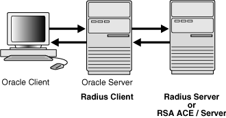
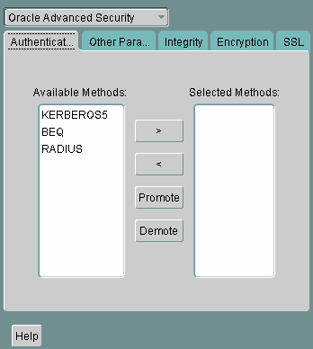
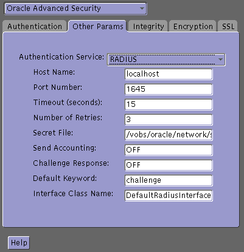

## 11 Configuring RADIUS Authentication

This chapter describes how to configure an Oracle Database server for use with RADIUS (Remote Authentication Dial-In User Service). It contains the following topics:

## 11.1 About RADIUS

RADIUS is a client/server security protocol widely used to enable remote authentication and access. Oracle Advanced Security uses this industry standard in a client/server network environment.

You can enable the network to use any authentication method that supports the RADIUS standard, including token cards and smart cards, by installing and configuring the RADIUS protocol. Moreover, when you use RADIUS, you can change the authentication method without modifying either the Oracle client or the Oracle database server.

From the user's perspective, the entire authentication process is transparent. When the user seeks access to an Oracle database server, the Oracle database server, acting as the RADIUS client, notifies the RADIUS server. The RADIUS server:

- Looks up the user's security information
- Passes authentication and authorization information between the appropriate authentication server or servers and the Oracle database server
- Grants the user access to the Oracle database server
- Logs session information, including when, how often, and for how long the user was connected to the Oracle database server
	Note:
	Oracle Advanced Security does not support RADIUS authentication over database links.

The Oracle/RADIUS environment is displayed in Figure 11-1:

Figure 11-1 RADIUS in an Oracle Environment



> This is a text description of asoag003.gif, an image which shows the Oracle/RADIUS environment. From left to right, there are three entities depicted in this image: An Oracle client, an Oracle server (which also is the RADIUS client), and the RADIUS server (or RSA ACE/Server). There are arrows between all three entities pointing in both directions to show that there is two-way communication between them.
  

The Oracle database server acts as the RADIUS client, passing information between the Oracle client and the RADIUS server. Similarly, the RADIUS server passes information between the Oracle database server and the appropriate authentication servers. The authentication components are listed in Table 11-1:

Table 11-1 RADIUS Authentication Components

| Component | Stored Information |
| --- | --- |
| Oracle client | Configuration setting for communicating through RADIUS. |
| Oracle database server/RADIUS client | Configuration settings for passing information between the Oracle client and the RADIUS server.  The secret key file. |
| RADIUS server | Authentication and authorization information for all users.  Each client's name or IP address.  Each client's shared secret.  Unlimited number of menu files enabling users already authenticated to select different login options without reconnecting. |
| Authentication server or servers | User authentication information such as pass codes and PINs, depending on the authentication method in use.  Note: The RADIUS server can also be the authentication server. |

A RADIUS server vendor is often the authentication server vendor as well. In this case authentication can be processed on the RADIUS server. For example, the RSA ACE/Server is both a RADIUS server and an authentication server. It thus authenticates the user's pass code.

See Also:

[Oracle Database Net Services Administrator's Guide,](https://docs.oracle.com/cd/E11882_01/network.112/e41945/toc.htm) for information about the `sqlnet.ora` file

## 11.2 RADIUS Authentication Modes

User authentication can take place in the following ways:

- Synchronous Authentication Mode
- Challenge-Response (Asynchronous) Authentication Mode

### 11.2.1 Synchronous Authentication Mode

In the synchronous mode, RADIUS lets you use various authentication methods, including passwords and SecurID token cards. Figure 11-2 shows the sequence in which synchronous authentication occurs:

Figure 11-2 Synchronous Authentication Sequence


> This is a text description of asoag010.gif, an image which depicts the synchronous authentication sequence as follows:
>
> 1. A user logs in by entering a connect string, passcode, or other value, and the client machine passes this data to the Oracle database server.
> 2. The Oracle database server, acting as the RADIUS client, passes the data from the Oracle client to the RADIUS server.
> 3. The RADIUS server passes the data to the appropriate authentication server for validation.
> 4. The authentication server sends back to the RADIUS server either an access accept or an access reject message.
> 	Note: If the RADIUS server is the authentication server, the two preceeding steps are combined.
> 5. The RADIUS server passes this response to the Oracle database server/RADIUS client.
> 6. The Oracle database server/RADIUS client passes the response to the Oracle client.
  

The following steps describe the Synchronous Authentication Sequence:

1. A user logs in by entering a connect string, pass code, or other value. The client system passes this data to the Oracle database server.
2. The Oracle database server, acting as the RADIUS client, passes the data from the Oracle client to the RADIUS server.
3. The RADIUS server passes the data to the appropriate authentication server, such as Smart Card or SecurID ACE for validation.
4. The authentication server sends either an Access Accept or an Access Reject message back to the RADIUS server.
5. The RADIUS server passes this response to the Oracle database server/RADIUS client.
6. The Oracle database server/RADIUS client passes the response back to the Oracle client.

Example: Synchronous Authentication with SecurID Token Cards

With SecurID authentication, each user has a token card that displays a dynamic number that changes every sixty seconds. To gain access to the Oracle database server/RADIUS client, the user enters a valid pass code that includes both a personal identification number (PIN) and the dynamic number currently displayed on the user's SecurID card. The Oracle database server passes this authentication information from the Oracle client to the RADIUS server, which in this case is the authentication server for validation. Once the authentication server (RSA ACE/Server) validates the user, it sends an accept packet to the Oracle database server, which, in turn, passes it to the Oracle client. The user is now authenticated and able to access the appropriate tables and applications.

See Also:

- [Chapter 1, "Introduction to Oracle Advanced Security"](asointro.md)
- ["Token Cards"](asointro.md)
- Documentation provided by RSA Security, Inc.

### 11.2.2 Challenge-Response (Asynchronous) Authentication Mode

When the system uses the asynchronous mode, the user does not need to enter a user name and password at the SQL\*Plus CONNECT string. Instead, a graphical user interface asks the user for this information later in the process.

Figure 11-3 shows the sequence in which challenge-response (asynchronous) authentication occurs.

Note:

If the RADIUS server is the authentication server, Steps 3, 4, and 5, and Steps 9, 10, and 11 in Figure 11-3 are combined.

Figure 11-3 Asynchronous Authentication Sequence


> This is a text description of asoag011.gif, an image which depicts a challenge-response, or asynchronous authentication sequence as follows:
>
> 1. A user seeks a connection to the Oracle database server, and the client machine passes the data to the Oracle database server.
> 2. The Oracle database server, acting as the RADIUS client, passes the data from the Oracle client to the RADIUS server.
> 3. The RADIUS server passes the data to the appropriate authentication server for validation.
> 4. The authentication server sends a challenge to the RADIUS server.
> 5. The RADIUS server sends the challenge to the Oracle database server/RADIUS client (the three preceeding steps are combined if the RADIUS server is the authentication server).
> 6. The Oracle database server/RADIUS client sends the challenge to the Oracle client where a graphical interface presents it to the user.
> 7. The user provides a response to the challenge by various means which the Oracle client passes to the Oracle database server/RADIUS client.
> 8. The Oracle database server/RADIUS client sends the user's response to the RADIUS server.
> 9. The RADIUS server passes it to the appropriate authentication server for validation.
> 10. The authentication server sends back to the RADIUS server either an access accept or an access reject message.
> 11. The RADIUS server passes the response to the Oracle database server/RADIUS client. (The three preceeding steps are combined if the RADIUS server is the authentication server.)
> 12. The Oracle database server/RADIUS client passes it on to the Oracle client.
  

The following steps describe the Asynchronous Authentication Sequence:

1. A user initiates a connection to an Oracle database server. The client system passes the data to the Oracle database server.
2. The Oracle database server, acting as the RADIUS client, passes the data from the Oracle client to the RADIUS server.
3. The RADIUS server passes the data to the appropriate authentication server, such as a Smart Card, SecurID ACE, or token card server.
4. The authentication server sends a challenge, such as a random number, to the RADIUS server.
5. The RADIUS server passes the challenge to the Oracle database server/RADIUS client.
6. The Oracle database server/RADIUS client, in turn, passes it to the Oracle client. A graphical user interface presents the challenge to the user.
7. The user provides a response to the challenge. To formulate a response, the user can, for example, enter the received challenge into the token card. The token card provides a dynamic password that is entered into the graphical user interface. The Oracle client passes the user's response to the Oracle database server/RADIUS client.
8. The Oracle database server/RADIUS client sends the user's response to the RADIUS server.
9. The RADIUS server passes the user's response to the appropriate authentication server for validation.
10. The authentication server sends either an Access Accept or an Access Reject message back to the RADIUS server.
11. The RADIUS server passes the response to the Oracle database server/RADIUS client.
12. The Oracle database server/RADIUS client passes the response to the Oracle client.

Example: Asynchronous Authentication with Smart Cards

With smart card authentication, the user logs in by inserting the smart card into a smart card reader that reads the smart card. The smart card is a plastic card, like a credit card, with an embedded integrated circuit for storing information.

The Oracle client sends the login information contained in the smart card to the authentication server by way of the Oracle database server/RADIUS client and the RADIUS server. The authentication server sends back a challenge to the Oracle client, by way of the RADIUS server and the Oracle database server, prompting the user for authentication information. The information could be, for example, a PIN as well as additional authentication information contained on the smart card.

The Oracle client sends the user's response to the authentication server by way of the Oracle database server and the RADIUS server. If the user has entered a valid number, the authentication server sends an accept packet back to the Oracle client by way of the RADIUS server and the Oracle database server. The user is now authenticated and authorized to access the appropriate tables and applications. If the user has entered incorrect information, the authentication server sends back a message rejecting user's access.

Example: Asynchronous Authentication with ActivCard Tokens

One particular ActivCard token is a hand-held device with a keypad and which displays a dynamic password. When the user seeks access to an Oracle database server by entering a password, the information is passed to the appropriate authentication server by way of the Oracle database server/RADIUS client and the RADIUS server. The authentication server sends back a challenge to the client, by way of the RADIUS server and the Oracle database server. The user types that challenge into the token, and the token displays a number for the user to send in response.

The Oracle client then sends the user's response to the authentication server by way of the Oracle database server and the RADIUS server. If the user has typed a valid number, the authentication server sends an accept packet back to the Oracle client by way of the RADIUS server and the Oracle database server. The user is now authenticated and authorized to access the appropriate tables and applications. If the user has entered an incorrect response, the authentication server sends back a message rejecting the user's access.

## 11.3 Enabling RADIUS Authentication, Authorization, and Accounting

This section contains:

- Step 1: Install RADIUS on the Oracle Database Server and on the Oracle Client
- Step 2: Configure RADIUS Authentication
- Step 3: Create a User and Grant Access
- Step 4: Configure External RADIUS Authorization (optional)
- Step 5: Configure RADIUS Accounting
- Step 6: Add the RADIUS Client Name to the RADIUS Server Database
- Step 7: Configure the Authentication Server for Use with RADIUS.
- Step 8: Configure the RADIUS Server for Use with the Authentication Server
- Step 9: Configure Mapping Roles

### 11.3.1 Step 1: Install RADIUS on the Oracle Database Server and on the Oracle Client

RADIUS is installed with Oracle Advanced Security during a typical installation of Oracle Database.

See Also:

Oracle Database operating system-specific installation documentation, for information about installing Oracle Advanced Security and the RADIUS adapter

### 11.3.2 Step 2: Configure RADIUS Authentication

This section contains:

- Step 2A: Configure RADIUS on the Oracle Client
- Step 2B: Configure RADIUS on the Oracle Database Server
- Step 2C: Configure Additional RADIUS Features

#### 11.3.2.1 Step 2A: Configure RADIUS on the Oracle Client

1. Start Oracle Net Manager.
	- (UNIX) From `$ORACLE_HOME` `/bin`, enter the following command at the command line:
		```
		netmgr
		```
		- (Windows) Select Start, Programs, Oracle - HOME\_NAME, Configuration and Migration Tools, then Net Manager.
2. Expand Oracle Net Configuration, and from Local, select Profile.
3. From the Naming list, select Network Security.
	The Network Security tabbed window appears.
4. Select the Authentication tab. (It should be selected by default.) 

> This is a text description of radu0001.gif, which is an image of the Authentication tab in the Oracle Advanced Security profile region of Oracle Net Manager. Use this window to configure your client to use RADIUS authentication.
>
> You can choose RADIUS from the Available Methods list of authentication types. Then click a right arrow and the adjacent Selected Methods list is populated with the RADIUS authentication type. To remove RADIUS from the Selected Methods list, you can click a left arrow and it moves back to the Available Methods list.

5. From the Available Methods list, select RADIUS.
6. Select the right-arrow (>) to move RADIUS to the Selected Methods list. Move any other methods you want to use in the same way.
7. Arrange the selected methods in order of required usage by selecting a method in the Selected Methods list, and clicking Promote or Demote to position it in the list.
	For example, put RADIUS at the top of the list for it to be the first service used.
8. From the File menu, select Save Network Configuration.
	The `sqlnet.ora` file is updated with the following entry:
	```
	SQLNET.AUTHENTICATION_SERVICES=(RADIUS)
	```

#### 11.3.2.2 Step 2B: Configure RADIUS on the Oracle Database Server

This section contains:

- Step 2B(1): Create the RADIUS Secret Key File on the Oracle Database Server
- Step 2B(2): Configure RADIUS Parameters on the Server (sqlnet.ora File)
- Step 2B(3): Set Oracle Database Server Initialization Parameters

Step 2B(1): Create the RADIUS Secret Key File on the Oracle Database Server

1. Obtain the RADIUS secret key from the RADIUS server.
	For each RADIUS client, the administrator of the RADIUS server creates a shared secret key, which must be less than or equal to 16 characters.
2. On the Oracle database server, create a directory:
	- (UNIX) `$ORACLE_HOME` `/network/security`
		- (Windows) `ORACLE_BASE` `\` `ORACLE_HOME` `\network\security`
3. Create the file `radius.key` to hold the shared secret copied from the RADIUS server. Place the file in the directory you created in Step 2.
4. Copy the shared secret key and paste it (and nothing else) into the `radius.key` file created on the Oracle database server.
5. For security purposes, change the file permission of `radius.key` to read only, accessible only by the Oracle owner.
	Oracle relies on the file system to keep this file secret.
	See Also:
	The RADIUS server administration documentation, for information about obtaining the secret key

Step 2B(2): Configure RADIUS Parameters on the Server (sqlnet.ora File)

1. Start Oracle Net Manager.
	- (UNIX) From `$ORACLE_HOME` `/bin`, enter the following command at the command line:
		```
		netmgr
		```
		- (Windows) Select Start, Programs, Oracle - HOME\_NAME, Configuration and Migration Tools, then Net Manager.
2. Expand Oracle Net Configuration, and from Local, select Profile.
3. From the Naming list, select Network Security.
	The Network Security tabbed window appears.
4. Select the Authentication tab.
5. From the Available Methods list, select RADIUS.
6. Move RADIUS to the Selected Methods list by choosing the right-arrow (>).
7. To arrange the selected methods in order of desired use, select a method in the Selected Methods list, and select Promote or Demote to position it in the list.
	For example, if you want RADIUS to be the first service used, put it at the top of the list.
8. Select the Other Params tab.
9. From the Authentication Service list, select RADIUS.
10. In the Host Name field, accept the localhost as the default primary RADIUS server, or enter another host name.
	

> This is a text description of radu0002.gif, which is an image of the Other Params tab in the Oracle Advanced Security profile region of Oracle Net Manager. Use this window to finish configuring your server to use RADIUS authentication.
>
> This window contains the following fields:
>
> - Authentication Service (choose RADIUS from this list)
> - Host Name
> - Port Number
> - Timeout (in seconds)
> - Number of Retries
> - Secret File (path to the radius.key file)
> - Send Accounting (set to ON or OFF)
> - Challenge Response (set to ON or OFF)
> - Default Keyword
> - Interface Class Name
>
> Click the Help button at the bottom of this window to access the online help.

11. Ensure that the default value of the Secret File field is valid.
12. From the File menu, select Save Network Configuration.
	The `sqlnet.ora` file is updated with the following entries:
	```
	SQLNET.AUTHENTICATION_SERVICES=RADIUS
	SQLNET.RADIUS_AUTHENTICATION=RADIUS_server_{hostname|IP_address}
	```
	Note:
	The `IP_address` can either be an Internet Protocol Version 4 (IPv4) or Internet Protocol Version 6 (IPv6) address. The RADIUS adapter supports both IPv4 and IPv6 based servers.

Step 2B(3): Set Oracle Database Server Initialization Parameters

1. Add the following setting to the `init.ora` initialization file.
	```
	OS_AUTHENT_PREFIX=""
	```
	By default, the `init.ora` file is located in the `ORACLE_HOME` `/dbs` directory (or the same location of the data files) on Linux and UNIX systems, and in the `ORACLE_HOME` `\database` directory on Windows.
2. Restart the database.
	For example:
	```
	SQL> SHUTDOWN
	SQL> STARTUP
	```

See Also:

[Oracle Database Reference](https://docs.oracle.com/cd/E11882_01/server.112/e40402/toc.htm) and the [Oracle Database Administrator's Guide](https://docs.oracle.com/cd/E11882_01/server.112/e25494/toc.htm) for information about setting initialization parameters on an Oracle Database server

#### 11.3.2.3 Step 2C: Configure Additional RADIUS Features

This section contains:

- Step 2C(1): Change Default Settings
- Step 2C(2): Configure Challenge-Response
- Step 2C(3): Set Parameters for an Alternate RADIUS Server

Step 2C(1): Change Default Settings

1. Start Oracle Net Manager.
	- (UNIX) From `$ORACLE_HOME` `/bin`, enter the following command at the command line:
		```
		netmgr
		```
		- (Windows) Select Start, Programs, Oracle - HOME\_NAME, Configuration and Migration Tools, then Net Manager.
2. Expand Oracle Net Configuration, and from Local, select Profile.
3. From the Naming list, select Network Security.
	The Network Security tabbed window appears.
4. Click the Other Params tab.
5. From the Authentication Service list, select RADIUS.
6. Change the default setting for any of the following fields:
	- Port Number: Specifies the listening port of the primary RADIUS server. The default value is 1645.
		- Timeout (seconds): Specifies the time the Oracle database server waits for a response from the primary RADIUS server. The default is 15 seconds.
		- Number of Retries: Specifies the number of times the Oracle database server resends messages to the primary RADIUS server. The default is three retries. For instructions on configuring RADIUS accounting, see Step 5: Configure RADIUS Accounting.
		- Secret File: Specifies the location of the secret key on the Oracle database server. The field specifies the location of the secret key file, not the secret key itself. For information about specifying the secret key, see Step 2B(1): Create the RADIUS Secret Key File on the Oracle Database Server.
7. From the File menu, select Save Network Configuration.
	The `sqlnet.ora` file is updated with the following entries:
	```
	SQLNET.RADIUS_AUTHENTICATION_PORT=(PORT)
	SQLNET.RADIUS_AUTHENTICATION_TIMEOUT=
	(NUMBER OF SECONDS TO WAIT FOR response)
	SQLNET.RADIUS_AUTHENTICATION_RETRIES=
	(NUMBER OF TIMES TO RE-SEND TO RADIUS server)
	SQLNET.RADIUS_SECRET=(path/radius.key)
	```

Step 2C(2): Configure Challenge-Response

The challenge-response (asynchronous) mode presents the user with a graphical interface requesting first a password, then additional information (for example, a dynamic password that the user obtains from a token card). With the RADIUS adapter, this interface is Java-based to provide optimal platform independence.

Note:

Third party vendors of authentication devices must customize this graphical user interface to fit their particular device. For example, a smart card vendor would customize the Java interface so that the Oracle client reads data, such as a dynamic password, from the smart card. When the smart card receives a challenge, it responds by prompting the user for more information, such as a PIN.

See Also:

[Appendix C, "Integrating Authentication Devices Using RADIUS"](asoappc.md), for information about how to customize the challenge-response user interface

To configure challenge-response:

1. If you are using JDK 1.1.7 or JRE 1.1.7, then set the `JAVA_HOME` environment variable to the JRE or JDK location on the system where the Oracle client is run:
	- On UNIX, enter this command at the prompt:
		```
		% setenv JAVA_HOME /usr/local/packages/jre1.1.7B
		```
		- On Windows, select Start, Settings, Control Panel, System, Environment, and set the `JAVA_HOME` variable as follows:
		```
		c:\java\jre1.1.7B
		```
	This step is not required for any other JDK/JRE version.
2. Start Oracle Net Manager.
	- (UNIX) From `$ORACLE_HOME` `/bin`, enter the following command at the command line:
		```
		netmgr
		```
		- (Windows) Select Start, Programs, Oracle - HOME\_NAME, Configuration and Migration Tools, then Net Manager.
3. Expand Oracle Net Configuration, and from Local, select Profile.
4. From the Naming list, select Network Security.
	The Network Security tabbed window appears.
5. From the Authentication Service list, select RADIUS.
6. In the Challenge Response field, enter ON to enable challenge-response.
7. In the Default Keyword field, accept the default value of the challenge or enter a keyword for requesting a challenge from the RADIUS server.
	The keyword feature is provided by Oracle and supported by some, but not all, RADIUS servers. You can use this feature only if your RADIUS server supports it.
	By setting a keyword, you let the user avoid using a password to verify identity. If the user does not enter a password, the keyword you set here is passed to the RADIUS server which responds with a challenge requesting, for example, a driver's license number or birth date. If the user does enter a password, the RADIUS server may or may not respond with a challenge, depending upon the configuration of the RADIUS server.
8. In the Interface Class Name field, accept the default value of DefaultRadiusInterface or enter the name of the class you have created to handle the challenge-response conversation.
	If other than the default RADIUS interface is used, then you also must edit the `sqlnet.ora` file to enter `SQLNET.RADIUS_CLASSPATH=(location)`, where `location` is the complete path name of the jar file. It defaults to  
	`$` `ORACLE_HOME/network/jlib/netradius.jar:` `$` `ORACLE_HOME/JRE/lib/vt.jar`
9. From the File menu, select Save Network Configuration.
	The `sqlnet.ora` file is updated with the following entries:
	```
	SQLNET.RADIUS_CHALLENGE_RESPONSE=([ON | OFF])
	SQLNET.RADIUS_CHALLENGE_KEYWORD=(KEYWORD)
	SQLNET.RADIUS_AUTHENTICATION_INTERFACE=(name of interface including the package name delimited by "/" for ".")
	```

Step 2C(3): Set Parameters for an Alternate RADIUS Server

If you are using an alternate RADIUS server, set these parameters in the `sqlnet.ora` file using any text editor.

```
SQLNET.RADIUS_ALTERNATE=(hostname or ip address of alternate radius server)
SQLNET.RADIUS_ALTERNATE_PORT=(1812)
SQLNET.RADIUS_ALTERNATE_TIMEOUT=(number of seconds to wait for response)
SQLNET.RADIUS_ALTERNATE_RETRIES=(number of times to re-send to radius server)
```

### 11.3.3 Step 3: Create a User and Grant Access

1. Start SQL\*Plus and execute these commands to create and grant access to a user identified externally on the Oracle database server.
	```
	SQL> CONNECT system@database_name;
	SQL> Enter password: 
	SQL> CREATE USER username IDENTIFIED EXTERNALLY;
	SQL> GRANT CREATE SESSION TO USER username;
	SQL> EXIT
	```
	If you are using Windows, then you can use the Security Manager tool in Oracle Enterprise Manager.
2. Enter the same `username` in the RADIUS server's users file.

See Also:

- [Oracle Database Administrator's Guide](https://docs.oracle.com/cd/E11882_01/server.112/e25494/toc.htm)
- [Oracle Database Heterogeneous Connectivity User's Guide](https://docs.oracle.com/cd/E11882_01/server.112/e11050/toc.htm)
- Administration documentation for the RADIUS server

### 11.3.4 Step 4: Configure External RADIUS Authorization (optional)

If you require external RADIUS authorization for RADIUS users who connect to an Oracle database, then you must perform the following steps to configure the Oracle server, the Oracle client, and the RADIUS server:

- Step 4A: Configure the Oracle Server (RADIUS Client)
- Step 4B: Configure the Oracle Client Where Users Log In
- Step 4C: Configure the RADIUS Server

#### 11.3.4.1 Step 4A: Configure the Oracle Server (RADIUS Client)

1. Add the `OS_ROLE` parameter to the `init.ora` file and set this parameter to `TRUE` as follows:
	```
	OS_ROLE=TRUE
	```
2. Restart the database so that the system can read the change to the `init.ora` file.
	For example:
	```
	SQL> SHUTDOWN 
	SQL> STARTUP
	```
3. Set the RADIUS challenge-response mode to `ON` for the server if you have not already done so by following the steps listed in "Step 2C(2): Configure Challenge-Response".
4. Add externally identified users and roles.

#### 11.3.4.2 Step 4B: Configure the Oracle Client Where Users Log In

Set the RADIUS challenge-response mode to `ON` for the client if you have not already done so by following the steps listed in "Step 2C(2): Configure Challenge-Response".

#### 11.3.4.3 Step 4C: Configure the RADIUS Server

1. Add the following attributes to the RADIUS server attribute configuration file:
	| ATTRIBUTE NAME | CODE | TYPE |
	| --- | --- | --- |
	| `VENDOR_SPECIFIC` | 26 | Integer |
	| `ORACLE_ROLE` | 1 | String |
2. Assign a Vendor ID for Oracle in the RADIUS server attribute configuration file that includes the SMI Network Management Private Enterprise Code of `111`.
	For example, enter the following in the RADIUS server attribute configuration file:
	`VALUE     VENDOR_SPECIFIC     ORACLE     111`
3. Using the following syntax, add the `ORACLE_ROLE` attribute to the user profile of the users who will use external RADIUS authorization:
	`ORA_` `databaseSID` `_` `rolename` `[_[A]|[D]]`
	where:
	- `ORA` designates that this role is used for Oracle purposes
		- `databaseSID` is the Oracle system identifier that is configured in the database server's `init.ora` file
		- `rolename` is the name of role as it is defined in the data dictionary.
		- `A` is an optional character that indicates the user has administrator's privileges for this role
		- `D` is an optional character that indicates this role is to be enabled by default
	Ensure that RADIUS groups which map to Oracle roles adhere to the `ORACLE_ROLE` syntax.
	For example:
	```
	USERNAME     USERPASSWD="user_password",
	             SERVICE_TYPE=login_user,
	             VENDOR_SPECIFIC=ORACLE,
	             ORACLE_ROLE=ORA_ora920_sysdba
	```
	See Also:
	The RADIUS server administration documentation for information about configuring the server.

### 11.3.5 Step 5: Configure RADIUS Accounting

RADIUS accounting logs information about access to the Oracle database server and stores it in a file on the RADIUS accounting server. Use this feature only if both the RADIUS server and authentication server support it.

This section contains:

- Step 5A: Set RADIUS Accounting on the Oracle Database Server
- Step 5B: Configure the RADIUS Accounting Server

#### 11.3.5.1 Step 5A: Set RADIUS Accounting on the Oracle Database Server

1. Start Oracle Net Manager.
	- (UNIX) From `$ORACLE_HOME` `/bin`, enter the following command at the command line:
		```
		netmgr
		```
		- (Windows) Select Start, Programs, Oracle - HOME\_NAME, Configuration and Migration Tools, then Net Manager.
2. Expand Oracle Net Configuration, and from Local, select Profile.
3. From the Naming list, select Network Security.
	The Network Security tabbed window appears.
4. Select the Other Params tab.
5. From the Authentication Service list, select RADIUS.
6. In the Send Accounting field, enter ON to enable accounting or OFF to disable accounting.
7. From the File menu, select Save Network Configuration.
	The `sqlnet.ora` file is updated with the following entry:
	```
	SQLNET.RADIUS_SEND_ACCOUNTING= ON
	```

#### 11.3.5.2 Step 5B: Configure the RADIUS Accounting Server

RADIUS Accounting Server consists of an accounting server residing on either the same host as the RADIUS authentication server or on a separate host.

See Also:

Administration documentation for the RADIUS server, for information about configuring RADIUS accounting

### 11.3.6 Step 6: Add the RADIUS Client Name to the RADIUS Server Database

You can use virtually any RADIUS server that complies with the standards in the Internet Engineering Task Force (IETF) RFC #2138, Remote Authentication Dial In User Service (RADIUS) and RFC #2139 RADIUS Accounting. Because RADIUS servers vary, consult the documentation for your particular RADIUS server for any unique interoperability requirements.

To add the RADIUS client name to a Livingston RADIUS server:

1. Open the clients file, which can be found at `/etc/raddb/clients`. The following text and table appear:
	```
	@ (#) clients 1.1 2/21/96 Copyright 1991 Livingston Enterprises Inc
	This file contains a list of clients which are allowed to make authentication requests and their encryption key. The first field is a valid hostname. The second field (separated by blanks or tabs) is the encryption key.
	Client Name                     Key
	```
2. In the `CLIENT NAME` column, enter the host name or IP address of the host on which the Oracle database server is running. In the `KEY` column, type the shared secret.
	The value you enter in the `CLIENT NAME` column, whether it is the client's name or IP address, depends on the RADIUS server.
3. Save and close the clients file.
	See Also:
	Administration documentation for the RADIUS server

### 11.3.7 Step 7: Configure the Authentication Server for Use with RADIUS

Refer to the authentication server documentation for instructions about configuring the authentication servers.

See Also:

["Related Documentation"](preface.md), which contains a list of possible resources.

### 11.3.8 Step 8: Configure the RADIUS Server for Use with the Authentication Server

Refer to the RADIUS server documentation for instructions about configuring the RADIUS server for use with the authentication server.

### 11.3.9 Step 9: Configure Mapping Roles

If the RADIUS server supports vendor type attributes, you can manage roles by storing them in the RADIUS server. The Oracle database server downloads the roles when there is a `CONNECT` request using RADIUS.

To use this feature, configure roles on both the Oracle database server and the RADIUS server.

To configure roles on the Oracle database server:

1. Use a text editor to set the `OS_ROLES` parameter in the initialization parameters file on the Oracle database server.
	By default, the `init.ora` file is located in the `ORACLE_HOME` `/dbs` directory (or the same location of the data files) on Linux and UNIX systems, and in the `ORACLE_HOME` `\database` directory on Windows.
2. Stop and restart the Oracle database server.
	For example:
	```
	SQL> SHUTDOWN
	SQL> STARTUP
	```
3. Create each role that the RADIUS server will manage on the Oracle database server with the value `IDENTIFIED EXTERNALLY`.
	To configure roles on the RADIUS server, use the following syntax:
	```
	ORA_DatabaseName.DatabaseDomainName_RoleName
	```
	In this specification:
	- `DatabaseName` is the name of the Oracle database server for which the role is being created. This is the same as the value of the DB\_NAME initialization parameter.
		- `DatabaseDomainName` is the name of the domain to which the Oracle database server belongs. The value is the same as the value of the `DB_DOMAIN` initialization parameter.
		- `RoleName` is name of the role created in the Oracle database server.
	For example:
	```
	ORA_USERDB.US.EXAMPLE.COM_MANAGER
	```
4. Configure RADIUS challenge-response mode.

## 11.4 Using RADIUS to Log In to a Database

If you are using the synchronous authentication mode, launch SQL\*Plus and enter the following command at the prompt:

```
CONNECT username@database_alias
Enter password: password
```

Note:

You can log in with this command only when challenge-response is not turned to `ON`.

If you are using the challenge-response mode, launch SQL\*Plus and, at the prompt, enter the command that follows:

```
CONNECT /@database_alias
```

Note:

- You can log in with this command only when challenge-response is turned to `ON`.
- The challenge-response mode can be configured for all login cases.

## 11.5 RSA ACE/Server Configuration Checklist

If you are using an RSA ACE/Server as a RADIUS server, check the following items before making your initial connection:

- Ensure that the host agent in the RSA ACE/Server is set up to send a node secret. In version 5.0, this is done by leaving the SENT Node secret box unchecked. If the RSA ACE/Server fails to send a node secret to the agent, then a node verification failure message will be written to the RSA ACE/Server log.
- If you are using RSA SecurID tokens, then ensure that the token is synchronized with the RSA ACE/Server.
	See Also:
	RSA ACE/Server documentation for specific information about troubleshooting.