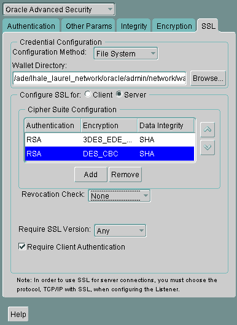
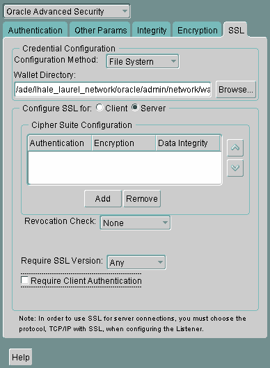
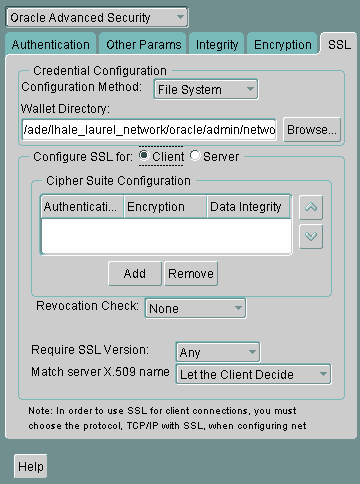
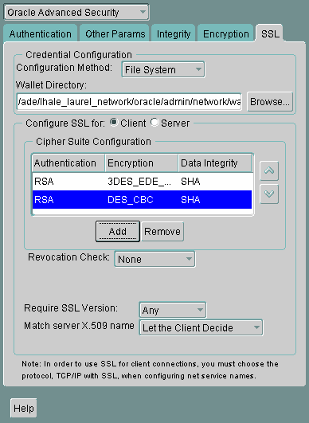
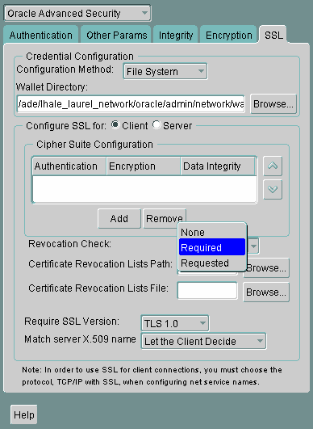

## 13 Configuring Secure Sockets Layer Authentication

This chapter describes how to configure and use the Secure Sockets Layer (SSL) and Transport Layer Security (TLS) protocols which are supported by Oracle Advanced Security. It contains the following topics:

## 13.1 Secure Sockets Layer and Transport Layer Security

[Secure Sockets Layer (SSL)](asogls.md) is an industry standard protocol originally designed by Netscape Communications Corporation for securing network connections. SSL uses RSA public key cryptography in conjunction with symmetric key cryptography to provide authentication, encryption, and data integrity.

This section contains:

- The Difference Between Secure Sockets Layer and Transport Layer Security
- How Oracle Database Uses Secure Sockets Layer for Authentication
- How Secure Sockets Layer Works in an Oracle Environment: The SSL Handshake

### 13.1.1 The Difference Between Secure Sockets Layer and Transport Layer Security

Although SSL was primarily developed by Netscape Communications Corporation, the Internet Engineering Task Force (IETF) took over development of it, and renamed it Transport Layer Security (TLS). Essentially, TLS is an incremental improvement to SSL version 3.0.

If you want to use TLS Version 1.1 or 1.2, then you can download one of the following patches from My Oracle Support:

- Linux systems: Patch 19207156: MES BUNDLE ON TOP OF RDBMS 11.2.0.4.2 DBPSU (requires April 2014 PSU
- Microsoft Windows systems: Patch 19651773: WINDOWS DB BUNDLE PATCH 11.2.0.4.10

See Also:

- `https://support.oracle.com`
- The TLS Protocol Version 1.0 \[RFC 2246\] at the IETF Web site, which can be found at:
	```
	http://www.ietf.org
	```

Note:

To simplify discussion, this chapter uses the term SSL where either SSL or TLS may be appropriate because SSL is the most widely recognized term. However, where distinctions occur between how you use or configure these protocols, this chapter specifies what is appropriate for either SSL or TLS.

### 13.1.2 How Oracle Database Uses Secure Sockets Layer for Authentication

Oracle Advanced Security supports authentication by using digital certificates over SSL in addition to the native encryption and data integrity capabilities of these protocols.

By using Oracle Advanced Security SSL functionality to secure communications between clients and servers, you can

- Use SSL to encrypt the connection between clients and servers
- Authenticate any client or server, such as Oracle Application Server 10g, to any Oracle database server that is configured to communicate over SSL

You can use SSL features by themselves or in combination with other authentication methods supported by Oracle Advanced Security. For example, you can use the encryption provided by SSL in combination with the authentication provided by Kerberos. SSL supports any of the following authentication modes:

- Only the server authenticates itself to the client
- Both client and server authenticate themselves to each other
- Neither the client nor the server authenticates itself to the other, thus using the SSL encryption feature by itself
	See Also:
	- The SSL Protocol, version 3.0, published by the Internet Engineering Task Force, for a more detailed discussion of SSL
	- [Chapter 1, "Introduction to Oracle Advanced Security"](asointro.md), for more information about authentication methods

### 13.1.3 How Secure Sockets Layer Works in an Oracle Environment: The SSL Handshake

When a network connection over SSL is initiated, the client and server perform an SSL handshake that includes the following steps:

- The client and server establish which [cipher suite](asogls.md) s to use. This includes which encryption algorithms are used for data transfers.
- The server sends its certificate to the client, and the client verifies that the server's certificate was signed by a trusted CA. This step verifies the identity of the server.
- Similarly, if client authentication is required, the client sends its own certificate to the server, and the server verifies that the client's certificate was signed by a trusted CA.
- The client and server exchange key information using public key cryptography. Based on this information, each generates a [session key](asogls.md). All subsequent communications between the client and the server is encrypted and decrypted by using this session key and the negotiated cipher suite.

The authentication process consists of the following steps:

1. On a client, the user initiates an Oracle Net connection to the server by using SSL.
2. SSL performs the handshake between the client and the server.
3. If the handshake is successful, the server verifies that the user has the appropriate [authorization](asogls.md) to access the database.

## 13.2 Public Key Infrastructure in an Oracle Environment

This section contains:

- About Public Key Infrastructure in an Oracle Environment
- About Public Key Cryptography
- Public Key Infrastructure Components in an Oracle Environment

### 13.2.1 About Public Key Infrastructure in an Oracle Environment

A public key infrastructure (PKI) is a substrate of network components that provide a security underpinning, based on trust assertions, for an entire organization. A PKI exists so that disparate network entities can access its security services, which use public-key cryptography on an as-needed basis. Oracle provides a complete PKI that is based on RSA Security, Inc., Public-Key Cryptography Standards, and which interoperates with Oracle servers and clients.

### 13.2.2 About Public Key Cryptography

Traditional private-key or symmetric-key cryptography requires a single, secret key that is shared by two or more parties to a secure communication. This key is used to both encrypt and decrypt secure messages sent between the parties, requiring prior, secure distribution of the key to each party. The problem with this method is that it is difficult to securely transmit and store the key.

Public-key cryptography provides a solution to this problem, by employing [public and private key pair](asogls.md) s and a secure method for key distribution. The freely available [public key](asogls.md) is used to encrypt messages that can only be decrypted by the holder of the associated [private key](asogls.md). The private key is securely stored, together with other security credentials, in an encrypted container called a [wallet](asogls.md).

Public-key algorithms can guarantee the secrecy of a message, but they do not necessarily guarantee secure communications because they do not verify the identities of the communicating parties. To establish secure communications, it is important to verify that the public key used to encrypt a message does in fact belong to the target recipient. Otherwise, a third party can potentially eavesdrop on the communication and intercept public key requests, substituting its own public key for a legitimate key (the [man-in-the-middle](asogls.md) attack).

In order to avoid such an attack, it is necessary to verify the owner of the public key, a process called [authentication](asogls.md). Authentication can be accomplished through a [certificate authority](asogls.md) (CA), which is a third party that is trusted by both of the communicating parties.

The CA issues public key certificates that contain an entity's name, public key, and certain other security credentials. Such credentials typically include the CA name, the CA signature, and the certificate effective dates (From Date, To Date).

The CA uses its private key to encrypt a message, while the public key is used to decrypt it, thus verifying that the message was encrypted by the CA. The CA public key is well known and does not have to be authenticated each time it is accessed. Such CA public keys are stored in wallets.

### 13.2.3 Public Key Infrastructure Components in an Oracle Environment

Public key infrastructure (PKI) components in an Oracle environment include the following:

- Certificate Authority
- Certificates
- Certificate Revocation Lists
- Wallets
- Hardware Security Modules

#### 13.2.3.1 Certificate Authority

A certificate authority (CA) is a trusted third party that certifies the identity of entities, such as users, databases, administrators, clients, and servers. When an entity requests certification, the CA verifies its identity and grants a certificate, which is signed with the CA's private key.

Different CAs may have different identification requirements when issuing certificates. Some CAs may verify a requester's identity with a driver's license, some may verify identity with the requester's fingerprints, while others may require that requesters have their certificate request form notarized.

The CA publishes its own certificate, which includes its public key. Each network entity has a list of trusted CA certificates. Before communicating, network entities exchange certificates and check that each other's certificate is signed by one of the CAs on their respective trusted CA certificate lists.

Network entities can obtain their certificates from the same or different CAs. By default, Oracle Advanced Security automatically installs trusted certificates from VeriSign, RSA, Entrust, and GTE CyberTrust when you create a new wallet.

Oracle Application Server Certificate Authority, part of Oracle Identity Management Infrastructure, is a new Oracle PKI component available in Oracle Application Server 10g (9.0.4).

See Also:

"Wallets"

#### 13.2.3.2 Certificates

A certificate is created when an entity's public key is signed by a trusted certificate authority (CA). A certificate ensures that an entity's identification information is correct and that the public key actually belongs to that entity.

A certificate contains the entity's name, public key, and an expiration date, as well as a serial number and [certificate chain](asogls.md) information. It can also contain information about the privileges associated with the certificate.

When a network entity receives a certificate, it verifies that it is a [trusted certificate](asogls.md), that is, one that has been issued and signed by a [trusted certificate authority](asogls.md). A certificate remains valid until it expires or until it is revoked.

#### 13.2.3.3 Certificate Revocation Lists

Typically, when a CA signs a certificate binding a public key pair to a user identity, the certificate is valid for a specified period of time. However, certain events, such as user name changes or compromised private keys, can render a certificate invalid before the validity period expires. When this happens, the CA revokes the certificate and adds its serial number to a Certificate Revocation List (CRL). The CA periodically publishes CRLs to alert the user population when it is no longer acceptable to use a particular public key to verify its associated user identity.

When servers or clients receive user certificates in an Oracle environment, they can validate the certificate by checking its expiration date, signature, and revocation status. Certificate revocation status is checked by validating it against published CRLs. If certificate revocation status checking is turned on, then the server searches for the appropriate CRL depending on how this feature has been configured. The server searches for CRLs in the following locations:

1. Oracle Internet Directory
2. [CRL Distribution Point](asogls.md), a location specified in the CRL Distribution Point (CRL DP) X.509, version 3, certificate extension when the certificate is issued.
	See Also:
	"Certificate Validation with Certificate Revocation Lists" for information about configuring and managing this PKI component

Note:

To use CRLs with other Oracle products, refer to the specific product documentation. This implementation of certificate validation with CRLs is only available in the Oracle Database 11g Release 2 (11.2) SSL adapter.

#### 13.2.3.4 Wallets

A wallet is a container that is used to store authentication and signing credentials, including private keys, certificates, and trusted certificates needed by SSL. In an Oracle environment, every entity that communicates over SSL must have a wallet containing an X.509 version 3 certificate, private key, and list of trusted certificates, with the exception of Diffie-Hellman.

Security administrators use Oracle Wallet Manager to manage security credentials on the server. Wallet owners use it to manage security credentials on clients. Specifically, you use Oracle Wallet Manager to do the following:

- Generate a public-private key pair and create a certificate request
- Store a user certificate that matches with the private key
- Configure trusted certificates
	Note:
	Installation of Oracle Advanced Security 11g Release 2 (11.2) also installs Oracle Wallet Manager release 10.1.

#### 13.2.3.5 Hardware Security Modules

Oracle Advanced Security uses these devices for the following functions:

- Store cryptographic information, such as private keys
- Perform cryptographic operations to off load RSA operations from the server, freeing the CPU to respond to other transactions

Cryptographic information can be stored on two types of hardware devices:

- (Server-side) Hardware boxes where keys are stored in the box, but managed by using tokens.
- (Client-side) Smart card readers, which support storing private keys on tokens.

An Oracle environment supports hardware devices using APIs that conform to the RSA Security, Inc., Public-Key Cryptography Standards (PKCS) #11 specification.

Note:

Currently, SafeNET and nCipher devices are certified with Oracle Advanced Security

See Also:

"Configuring Your System to Use Hardware Security Modules" for details configuration details.

## 13.3 Secure Sockets Layer Combined with Other Authentication Methods

You can configure Oracle Advanced Security to use SSL concurrently with database user names and passwords, RADIUS, and Kerberos, which are discussed in the following sections:

- Architecture: Oracle Advanced Security and Secure Sockets Layer
- How Secure Sockets Layer Works with Other Authentication Methods
	See Also:
	[Appendix A, "Data Encryption and Integrity Parameters"](asoappa.md) for information about how to configure SSL with other supported authentication methods, including an example of a `sqlnet.ora` file with multiple authentication methods specified.

### 13.3.1 Architecture: Oracle Advanced Security and Secure Sockets Layer

[Figure 1-4](asointro.md), which displays the Oracle Advanced Security implementation architecture, shows that Oracle Advanced Security operates at the [session layer](asogls.md) on top of SSL and uses TCP/IP at the [transport layer](asogls.md). This separation of functionality lets you employ SSL concurrently with other supported protocols.

See Also:

[Oracle Database Net Services Administrator's Guide](https://docs.oracle.com/cd/E11882_01/network.112/e41945/toc.htm) for information about stack communications in an Oracle networking environment

### 13.3.2 How Secure Sockets Layer Works with Other Authentication Methods

Figure 13-1 illustrates a configuration in which SSL is used in combination with another authentication method supported by Oracle Advanced Security.

Figure 13-1 SSL in Relation to Other Authentication Methods


> This is a text description of asoag018.gif, an image which shows the steps to authenticate clients when SSL is used with other authentication methods as follows:
>
> 1. A client seeks to connect to an Oracle server.
> 2. SSL performs a handshake during which the server authenticates itself to the client and both the client and server establish which cipher suite to use.
> 3. Once the SSL handshake is successfully completed, the user seeks access to the database.
> 4. The Oracle server authenticates the user with the authentication server using a non-SSL authentication method such as Kerberos or RADIUS.
> 5. Upon validation by the authentication server, the Oracle server grants access and authorization to the user. Then the user can access the database securely by using SSL.
  

In this example, SSL is used to establish the initial handshake (server authentication), and an alternative authentication method is used to authenticate the client

1. The client seeks to connect to the Oracle database server.
2. SSL performs a handshake during which the server authenticates itself to the client and both the client and server establish which cipher suite to use.
3. Once the SSL handshake is successfully completed, the user seeks access to the database.
4. The Oracle database server authenticates the user with the authentication server using a non-SSL authentication method such as Kerberos or RADIUS.
5. Upon validation by the authentication server, the Oracle database server grants access and authorization to the user, and then the user can access the database securely by using SSL.
	See Also:
	"How Secure Sockets Layer Works in an Oracle Environment: The SSL Handshake"

## 13.4 Secure Sockets Layer and Firewalls

Oracle Advanced Security supports two types of firewalls:

- Application proxy-based firewalls, such as Network Associates Gauntlet, or Axent Raptor.
- Stateful packet inspection firewalls, such as Check Point Firewall-1, or Cisco PIX Firewall.

When you enable SSL, stateful inspection firewalls behave like application proxy firewalls because they do not decrypt encrypted packets.

Firewalls do not inspect encrypted traffic. When a firewall encounters data addressed to an SSL port on an intranet server, it checks the target IP address against its access rules and lets the SSL packet pass through to permitted SSL ports, rejecting all others.

With the Oracle Net Firewall Proxy kit, a product offered by some firewall vendors, firewall applications can provide specific support for database network traffic. If the proxy kit is implemented in the firewall, then the following processing takes place:

- The Net Proxy (a component of the Oracle Net Firewall Proxy kit) determines where to route its traffic.
- The database listener requires access to a [certificate](asogls.md) in order to participate in the SSL handshake. The listener inspects the SSL packet and identifies the target database, returning the port on which the target database listens to the client. This port must be designated as an SSL port.
- The client communicates on this server-designated port in all subsequent connections.

## 13.5 Secure Sockets Layer Usage Issues

Consider the following issues when using SSL:

- SSL use enables secure communication with other Oracle products, such as Oracle Internet Directory.
- Because SSL supports both authentication and encryption, the client/server connection is somewhat slower than the standard Oracle Net TCP/IP transport (using native encryption).
- Each SSL authentication mode requires configuration settings.
- Multi-threaded clients currently cannot use SSL.

Note:

If you configure SSL encryption, you must disable non-SSL encryption. To disable such encryption, refer to ["Disabling Oracle Advanced Security Authentication"](asoauth.md).

See Also:

- "Configuring Your System to Use Hardware Security Modules" for information about improving SSL performance with hardware accelerators
- "Enabling Secure Sockets Layer"

## 13.6 Enabling Secure Sockets Layer

This section contains:

- Step 1: Install Oracle Advanced Security and Related Products
- Step 2: Configure Secure Sockets Layer on the Server
- Step 3: Configure Secure Sockets Layer on the Client
- Step 4: Log on to the Database Instance

### 13.6.2 Step 2: Configure Secure Sockets Layer on the Server

During installation, Oracle sets defaults on both the Oracle database server and on the Oracle client for all SSL parameters except the location of the Oracle wallet. To configure SSL on the server, perform these steps:

- Step 2A: Confirm Wallet Creation on the Server
- Step 2B: Specify the Database Wallet Location on the Server
- Step 2C: Set the Secure Sockets Layer Cipher Suites on the Server (Optional)
- Step 2D: Set the Required SSL Version on the Server (Optional)
- Step 2E: Set SSL Client Authentication on the Server (Optional)
- Step 2F: Set SSL as an Authentication Service on the Server (Optional)
- Step 2G: Create a Listening Endpoint that Uses TCP/IP with SSL on the Server
	See Also:
	[Appendix B, "Authentication Parameters"](asoappb.md) for the dynamic parameter names

#### 13.6.2.1 Step 2A: Confirm Wallet Creation on the Server

Before proceeding to the next step, you must confirm that a wallet has been created. To confirm that your wallet is ready, open it by using Oracle Wallet Manager. The wallet should contain a certificate with a status of `Ready` and auto login turned on. If auto login is not on, then select it from the Wallet menu and save the wallet again. This turns auto login on.

#### 13.6.2.2 Step 2B: Specify the Database Wallet Location on the Server

1. Start Oracle Net Manager.
	- (UNIX) From `$ORACLE_HOME` `/bin`, enter the following command at the command line:
		```
		netmgr
		```
		- (Windows) Select Start, Programs, Oracle - HOME\_NAME, Configuration and Migration Tools, then Net Manager.
2. Expand Oracle Net Configuration, and from Local, select Profile.
3. From the Naming list, select Network Security.
	The Network Security tabbed window appears.
4. Click the SSL tab and select Configure SSL for: Server.
5. In the Wallet Directory box, enter the directory in which the Oracle wallet is located or click Browse to find it by searching the file system.
	Note that if you are configuring the database-to-directory SSL connection for Enterprise User Security, then Database Configuration Assistant automatically creates a database wallet while registering the database with the directory. You must use that wallet to store the database PKI credentials for SSL-authenticated Enterprise User Security.
	Important:
	- Use Oracle Wallet Manager to create the wallet. Refer to ["Creating a New Wallet"](asowalet.md).
		- Use Oracle Net Manager to set the wallet location in the `sqlnet.ora` file.
	Ensure that you enter the same wallet location when you create it and when you set the location in the `sqlnet.ora` file.
6. From the File menu, select Save Network Configuration.
	The `sqlnet.ora` and `listener.ora` files are updated with the following entries:
	```
	wallet_location = 
	 (SOURCE=
	  (METHOD=File)
	  (METHOD_DATA=
	   (DIRECTORY=wallet_location)))
	```

Note:

The listener uses the wallet defined in the `listener.ora` file. It can use any database wallet. When SSL is configured for a server using Net Manager, the wallet location is entered into the `listener.ora` and the `sqlnet.ora` files. The `listener.ora` file is not relevant to the Oracle client.

To change the listener wallet location so that the listener has its own wallet, you can edit `listener.ora` to enter the new location.

#### 13.6.2.3 Step 2C: Set the Secure Sockets Layer Cipher Suites on the Server (Optional)

This section contains:

- About the Secure Sockets Layer Cipher Suites
- Supported Secure Sockets Layer Cipher Suites
- Specifying Secure Sockets Cipher Suites for the Database Server

About the Secure Sockets Layer Cipher Suites

A cipher suite is a set of authentication, encryption, and data integrity algorithms used for exchanging messages between network entities. During an SSL handshake, two entities negotiate to see which cipher suite they will use when transmitting messages back and forth.

When you install Oracle Advanced Security, the SSL cipher suites listed in Table 13-1 are set for you by default and negotiated in the order they are listed. You can override the default order by setting the `SSL_CIPHER_SUITES` parameter. For example, if you use Oracle Net Manager to add the cipher suite `SSL_RSA_WITH_3DES_EDE_CBC_SHA`, all other cipher suites in the default setting are ignored.

You can prioritize the cipher suites. When the client negotiates with servers regarding which cipher suite to use, it follows the prioritization you set. When you prioritize the cipher suites, consider the following:

- Compatibility. Server and client must be configured to use compatible cipher suites for a successful connection.
- Cipher priority and strength. Prioritize cipher suites starting with the strongest and moving to the weakest to ensure the highest level of security possible.
- The level of security you want to use. For example, triple-DES encryption is stronger than DES
- The impact on performance. For example, triple-DES encryption is slower than DES.
	Notes:
	Regarding Diffie-Hellman anonymous authentication:
	1. If you set the server to employ this cipher suite, then you must also set the same cipher suite on the client. Otherwise, the connection fails.
	2. If you use a cipher suite employing Diffie-Hellman anonymous, then you must set the `SSL_CLIENT_AUTHENTICATION` parameter to `FALSE`. For more information, refer to "Step 2E: Set SSL Client Authentication on the Server (Optional)".

Supported Secure Sockets Layer Cipher Suites

Table 13-1 lists the SSL cipher suites supported in the current release of Oracle Advanced Security. These cipher suites are set by default when you install Oracle Advanced Security. The following table also lists the authentication, encryption, and data integrity types each cipher suite uses.

Table 13-1 SSL Cipher Suites

| Cipher Suites | Authentication | Encryption | Data Integrity |
| --- | --- | --- | --- |
| SSL\_RSA\_WITH\_3DES\_EDE\_CBC\_SHA | RSA | 3DES EDE CBC | SHA-1 |
| SSL\_RSA\_WITH\_AES\_128\_CBC\_SHA <sup>Foot 1</sup> | RSA | AES 128 CBC | SHA-1 |
| SSL\_RSA\_WITH\_AES\_256\_CBC\_SHA <sup>Footref 1</sup> | RSA | AES 256 CBC | SHA-1 |

<sup>Footnote 1</sup> AES ciphers work with Transport Layer Security (TLS 1.0) only

Specifying Secure Sockets Cipher Suites for the Database Server

1. Start Oracle Net Manager.
	- (UNIX) From `$ORACLE_HOME` `/bin`, enter the following command at the command line:
		```
		netmgr
		```
		- (Windows) Select Start, Programs, Oracle - HOME\_NAME, Configuration and Migration Tools, then Net Manager.
2. Expand Oracle Net Configuration, and from Local, select Profile.
3. From the Naming list, select Network Security.
	The Network Security tabbed window appears.
4. Select the SSL tab and then select Configure SSL for: Server.
5. In the Cipher Suite Configuration area, click Add.
	A dialog box displays available cipher suites. To see the US domestic cipher suites, click the Show US Domestic Cipher Suits check box.
6. Select a suite and click OK.
	The Cipher Suite Configuration list is updated:
	

> This is a text description of ssl0004.gif, which is an image of the SSL tab in the Oracle Advanced Security profile region of Oracle Net Manager when Configure SSL for the server is selected.
>
> This window has the following fields which you can use to configure SSL on your server:
>
> - Configure SSL for: (choose Server)
> - Wallet Directory (enter the path to the wallet directory--you can choose Browse if you need to browse the file system)
> - Cipher Suite Configuration (select a cipher suite and then click an up or down arrow at the right to change the precedence of when it is applied)
> - Add or Remove (under the Cipher Suite Configuration list, there are an Add and a Remove button that you can use to add or remove a cipher suite)
> - Revocation Check (where you can set whether certificate revocation status checking is performed)
> - Require SSL Version (choose an SSL version from the list--the default is ANY)
> - Require Client Authentication (a check box)
>
> Click the Help button at the bottom right corner of the window to access online help.

7. Use the up and down arrows to prioritize the cipher suites.
8. From the File menu, select Save Network Configuration.
	The `sqlnet.ora` file is updated with the following entry:
	```
	SSL_CIPHER_SUITES= (SSL_cipher_suite1 [,SSL_cipher_suite2])
	```

#### 13.6.2.4 Step 2D: Set the Required SSL Version on the Server (Optional)

You can set the `SSL_VERSION` parameter in the `sqlnet.ora` or the `listener.ora` file. This parameter defines the version of SSL that must run on the systems with which the server communicates. You can require these systems to use any valid version. The default setting for this parameter in `sqlnet.ora` is `undetermined`, which is set by selecting Any from the list in the SSL tab of the Oracle Advanced Security window.

To set the SSL version for the server:

1. In the Require SSL Version list, the default is Any. Accept this default or select the SSL version you want to use.
2. Select File, Save Network Configuration.
	If you chose Any, then the `sqlnet.ora` file is updated with the following entry:
	```
	SSL_VERSION=UNDETERMINED
	```
	Note:
	SSL 2.0 is not supported on the server side.

See Also:

[Oracle Database Net Services Reference](https://docs.oracle.com/cd/E11882_01/network.112/e10835/sqlnet.htm#NETRF235) for a full list of `SSL_VERSION` values

#### 13.6.2.5 Step 2E: Set SSL Client Authentication on the Server (Optional)

The `SSL_CLIENT_AUTHENTICATION` parameter in the `sqlnet.ora` file controls whether the client is authenticated using SSL. The default value is `TRUE`.

You must set this parameter to `FALSE` if you are using a cipher suite that contains Diffie-Hellman anonymous authentication (`DH_anon`). Also, you can set this parameter to `FALSE` for the client to authenticate itself to the server by using any of the non-SSL authentication methods supported by Oracle Advanced Security, such as Kerberos or RADIUS.

Note:

There is a known bug in which an OCI client requires a wallet even when using a cipher suite with DH\_ANON, which does not authenticate the client.

To set `SSL_CLIENT_AUTHENTICATION` to `FALSE` on the server:

1. In the SSL page Oracle Net Manager, deselect Require Client Authentication.
	

> This is a text description of ssl0005.gif, which is an image of the SSL tab in the Oracle Advanced Security profile region of Oracle Net Manager when Configure SSL for the server is selected.
>
> You can use the Require Client Authentication check box at the bottom of this window to enable or disable client authentication for the server. Before you check or uncheck this box, ensure that you select Configure SSL for Server at the top of the window.
>
> Click the Help button at the bottom right corner of the window to access online help.

2. From the File menu, select Save Network Configuration.
	The `sqlnet.ora` file is updated with the following entry:
	```
	SSL_CLIENT_AUTHENTICATION=FALSE
	```

See Also:

[Oracle Database Net Services Reference](https://docs.oracle.com/cd/E11882_01/network.112/e10835/sqlnet.htm#NETRF233) for a full list of `SSL_CLIENT_AUTHENTICATION` values

#### 13.6.2.6 Step 2F: Set SSL as an Authentication Service on the Server (Optional)

The `SQLNET.AUTHENTICATION_SERVICES` parameter in the `sqlnet.ora` file sets the SSL authentication service.

Set this parameter if you want to use SSL authentication in conjunction with another authentication method supported by Oracle Advanced Security. For example, use this parameter if you want the server to authenticate itself to the client by using SSL and the client to authenticate itself to the server by using Kerberos.

To set the `SQLNET.AUTHENTICATION_SERVICES` parameter on the server, add TCP/IP with SSL (TCPS) to this parameter in the `sqlnet.ora` file by using a text editor. For example, if you want to use SSL authentication in conjunction with RADIUS authentication, set this parameter as follows:

```
SQLNET.AUTHENTICATION_SERVICES = (TCPS, radius)
```

If you do not want to use SSL authentication in conjunction with another authentication method, then do not set this parameter.

See Also:

[Oracle Database Net Services Reference](http://www.oracle.com/pls/topic/lookup?ctx=db112&id=NETRF198) for a full list of AUTHENTICATION\_SERVICES values

#### 13.6.2.7 Step 2G: Create a Listening Endpoint that Uses TCP/IP with SSL on the Server

Configure the listener with a TCP/IP with SSL listening endpoint in the `listener.ora` file. Oracle recommends using port number 2484 for typical Oracle Net clients.

See Also:

- [Oracle Database Net Services Administrator's Guide](https://docs.oracle.com/cd/E11882_01/network.112/e41945/toc.htm) for detailed information about configuring the `listener.ora` file
- "Certificate Validation with Certificate Revocation Lists" for information about configuring your system to validate certificates with certificate revocation lists

### 13.6.3 Step 3: Configure Secure Sockets Layer on the Client

To configure SSL on the client:

- Step 3A: Confirm Client Wallet Creation
- Step 3B: Configure the Server DNs and Use TCP/IP with SSL on the Client
- Step 3C: Specify Required Client SSL Configuration (Wallet Location)
- Step 3D: Set the Client Secure Sockets Layer Cipher Suites (Optional)
- Step 3E: Set the Required SSL Version on the Client (Optional)
- Step 3F: Set SSL as an Authentication Service on the Client (Optional)
	Step 3G: Specify the Certificate to Use for Authentication on the Client (Optional)
	See Also:
	[Appendix B, "Authentication Parameters"](asoappb.md) for the dynamic parameter names

#### 13.6.3.1 Step 3A: Confirm Client Wallet Creation

Before proceeding to the next step, you must confirm that a wallet has been created on the client and that the client has a valid certificate.

Note:

Oracle recommends that you use Oracle Wallet Manager to remove the [trusted certificate](asogls.md) in your Oracle wallet associated with each [certificate authority](asogls.md) that you do not use.

See Also:

- [Chapter 14, "Using Oracle Wallet Manager"](asowalet.md), for general information about wallets
- ["Opening an Existing Wallet"](asowalet.md), for information about opening an existing wallet
- ["Creating a New Wallet"](asowalet.md), for information about creating a new wallet

#### 13.6.3.2 Step 3B: Configure the Server DNs and Use TCP/IP with SSL on the Client

This section contains:

- About Configuring the Server DNS and Using TCP/IP with SSL on the Client
- Configuring the Server DNS and Using TCP/IP with SSL on the Client

About Configuring the Server DNS and Using TCP/IP with SSL on the Client

Next, you are ready to configure the Oracle Net Service name to include the server DNs and to use TCP/IP with SSL on the client. You must specify the server's [distinguished name (DN)](asogls.md) and `TCPS` as the protocol in the client network configuration files to enable server DN matching and TCP/IP with SSL connections. Server DN matching prevents the database server from faking its identity to the client during connections by matching the server's global database name against the DN from the server certificate.

You must manually edit the client network configuration files, `tnsnames.ora` and `listener.ora`, to specify the server's DN and the TCP/IP with SSL protocol. The `tnsnames.ora` file can be located on the client or in the LDAP directory. If it is located on the client, then it typically resides in the same directory as the `listener.ora` file. Depending on the operating system, these files reside in the following directory locations:

- (UNIX) `$ORACLE_HOME` `/network/admin/`
- (Windows) `ORACLE_BASE` `\` `ORACLE_HOME` `\network\admin\`

Configuring the Server DNS and Using TCP/IP with SSL on the Client

1. In the client `tnsnames.ora` file, add the `SSL_SERVER_CERT_DN` parameter and specify the database server's DN as follows:
	```
	(SECURITY=
	(SSL_SERVER_CERT_DN="cn=finance,cn=OracleContext,c=us,o=acme"))
	```
	The client uses this information to obtain the list of DNs it expects for each of the servers, enforcing the server's DN to match its service name. Example 13-1 shows an entry for the `Finance` database in the `tnsnames.ora` file.
	Alternatively, the administrator can ensure that the common name (CN) portion of the server's DN matches the service name.
2. In the client `tnsnames.ora` file, enter `tcps` as the PROTOCOL in the `ADDRESS` parameter. This specifies that the client will use TCP/IP with SSL to connect to the database that is identified in the `SERVICE_NAME` parameter. Example 13-1 also shows an entry that specifies TCP/IP with SSL as the connecting protocol in the `tnsnames.ora` file.
3. In the `listener.ora` file, enter `tcps` as the `PROTOCOL` in the `ADDRESS` parameter. Example 13-2 shows an entry that specifies TCP/IP with SSL as the protocol.

Example 13-1 Sample tnsnames.ora File with Server Certificate DN and TCP/IP with SSL Specified

```
finance=
(DESCRIPTION=
```
```
(ADDRESS_LIST=
```
```
(ADDRESS= (PROTOCOL = tcps) (HOST = finance_server) (PORT = 1575)))
```
```
(CONNECT_DATA=
```
```
(SERVICE_NAME= Finance.us.example.com))
```
```
(SECURITY=
```
```
(SSL_SERVER_CERT_DN="cn=finance,cn=OracleContext,c=us,o=acme"))
```

Example 13-2 Sample listener.ora File with TCP/IP with SSL Specified as the Protocol

```
LISTENER=
```
```
(DESCRIPTION_LIST=
```
```
(DESCRIPTION=
```
```
(ADDRESS= (PROTOCOL = tcps) (HOST = finance_server) (PORT = 1575))))
```

#### 13.6.3.3 Step 3C: Specify Required Client SSL Configuration (Wallet Location)

1. Start Oracle Net Manager.
	- (UNIX) From `$ORACLE_HOME` `/bin`, enter the following command at the command line:
		```
		netmgr
		```
		- (Windows) Select Start, Programs, Oracle - HOME\_NAME, Configuration and Migration Tools, then Net Manager.
2. Expand Oracle Net Configuration, and from Local, select Profile.
3. From the Naming list, select Network Security.
	The Network Security tabbed window appears.
4. Select the SSL tab.
5. Select Configure SSL for: Client.
	

> This is a text description of ssl0001.gif, which is an image of the SSL tab in the Oracle Advanced Security profile region of Oracle Net Manager when Configure SSL for the client is selected.
>
> This window has the following fields which you can use to configure SSL on your client:
>
> - Wallet Configuration Method (by default this is set to File System)
> - Wallet Directory (enter the path to the wallet directory--you can choose Browse if you need to browse the file system)
> - Configure SSL for: (choose Client)
> - Cipher Suite Configuration (select a cipher suite and then click an up or down arrow at the right to change the precedence of when it is applied)
> - Add or Remove (under the Cipher Suite Configuration list, there are an Add and a Remove button that you can use to add or remove a cipher suite)
> - Revocation Check (choose whether to configure certificate validation)
> - Require SSL Version (choose an SSL version from the list--the default is ANY)
> - Match server X.509 name (choose Yes or No from the list--refer to the surrounding text for information about this field)
>
> Click the Help button at the bottom right corner of the window to access online help.

6. In the Wallet Directory box, enter the directory in which the Oracle wallet is located, or click Browse to find it by searching the file system.
7. From the Match server X.509 name list, select one of the following options:
	- Yes: Requires that the server's [distinguished name (DN)](asogls.md) match its service name. SSL ensures that the certificate is from the server and connections succeed only if there is a match.
		This check can be made only when RSA ciphers are selected, which is the default setting.
		- No (default): SSL checks for a match between the DN and the service name, but does not enforce it. Connections succeed regardless of the outcome but an error is logged if the match fails.
		- Let Client Decide: Enables the default.
		The following alert is displayed when you select No:
		```
		Security Alert
		Not enforcing the server X.509 name match allows a server to potentially fake its identity. Oracle recommends selecting YES for this option so that connections are refused when there is a mismatch.
		```
8. From the File menu, select Save Network Configuration.
	The `sqlnet.ora` file on the client is updated with the following entries:
	```
	SSL_CLIENT_AUTHENTICATION =TRUE
	wallet_location = 
	 (SOURCE=
	  (METHOD=File)
	  (METHOD_DATA=
	   (DIRECTORY=wallet_location)))
	SSL_SERVER_DN_MATCH=(ON/OFF)
	```

See Also:

For information about the server match parameters:

- ["SSL X.509 Server Match Parameters"](asoappb.md)

For information about using Oracle Net Manager to configure TCP/IP with SSL:

- [Oracle Database Net Services Administrator's Guide](https://docs.oracle.com/cd/E11882_01/network.112/e41945/toc.htm)
- [Oracle Database Net Services Reference](https://docs.oracle.com/cd/E11882_01/network.112/e10835/protocoladd.htm#NETRF004)

#### 13.6.3.4 Step 3D: Set the Client Secure Sockets Layer Cipher Suites (Optional)

This section contains:

- About Setting the Client Secure Sockets Layer Cipher Suites
- Setting the Client Secure Sockets Layer Cipher Suites

About Setting the Client Secure Sockets Layer Cipher Suites

A cipher suite is a set of authentication, encryption, and data integrity algorithms used for exchanging messages between network entities. During an SSL handshake, two entities negotiate to see which cipher suite they will use when transmitting messages back and forth.

When you install Oracle Advanced Security, the SSL cipher suites listed in Table 13-1 are set for you by default. This table lists them in the order they are tried when two entities are negotiating a connection. You can override the default by setting the `SSL_CIPHER_SUITES` parameter. For example, if you use Oracle Net Manager to add the cipher suite `SSL_RSA_WITH_3DES_EDE_CBC_SHA`, all other cipher suites in the default setting are ignored.

You can prioritize the cipher suites. When the client negotiates with servers regarding which cipher suite to use, it follows the prioritization you set. When you prioritize the cipher suites, consider the following:

- The level of security you want to use. For example, triple-DES encryption is stronger than DES.
- The impact on performance. For example, triple-DES encryption is slower than DES. Refer to "Configuring Your System to Use Hardware Security Modules" for information about using SSL hardware accelerators with Oracle Advanced Security.
- Administrative requirements. The cipher suites selected for a client must be compatible with those required by the server. For example, in the case of an Oracle Call Interface (OCI) user, the server requires the client to authenticate itself. You cannot, in this case, use a cipher suite employing Diffie-Hellman anonymous authentication, which disallows the exchange of certificates.

You typically prioritize cipher suites starting with the strongest and moving to the weakest.

Table 13-1 lists the SSL cipher suites that are supported in the current release of Oracle Advanced Security. These cipher suites are set by default when you install Oracle Advanced Security. The table also lists the authentication, encryption, and data integrity types each cipher suite uses.

Note:

If the `SSL_CLIENT_AUTHENTICATION` parameter is set to `true` in the `sqlnet.ora` file, then disable all cipher suites that use Diffie-Hellman anonymous authentication. Otherwise, the connection fails.

Setting the Client Secure Sockets Layer Cipher Suites

1. Start Oracle Net Manager.
	- (UNIX) From `$ORACLE_HOME` `/bin`, enter the following command at the command line:
		```
		netmgr
		```
		- (Windows) Select Start, Programs, Oracle - HOME\_NAME, Configuration and Migration Tools, then Net Manager.
2. Expand Oracle Net Configuration, and from Local, select Profile.
3. From the Naming list, select Network Security.
	The Network Security tabbed window appears.
4. Select the SSL tab.
5. In the Cipher Suite Configuration region, click Add.
	A dialog box displays available cipher suites.
6. Select a suite and click OK.
	The Cipher Suite Configuration list is updated as follows:
	

> This is a text description of ssl0003.gif, which is an image of the SSL tab in the Oracle Advanced Security profile region of Oracle Net Manager.
>
> This window has a Cipher Suite Configuraton region where you can prioritize the cipher suites by clicking an up or a down arrow on the right side of the cipher suite list. Click a cipher suite to select it, then click the up or the down arrow to determine which cipher suite is applied first.
>
> Click the Help button at the bottom right corner of the window to access online help.

7. Use the up and down arrows to prioritize the cipher suites.
8. Select File, Save Network Configuration.
	The `sqlnet.ora` file is updated with the following entry:
	```
	SSL_CIPHER_SUITES= (SSL_cipher_suite1 [,SSL_cipher_suite2])
	```

#### 13.6.3.5 Step 3E: Set the Required SSL Version on the Client (Optional)

You can set the `SSL_VERSION` parameter in the `sqlnet.ora` file. This parameter defines the version of SSL that must run on the systems with which the client communicates. You can require these systems to use any valid version. The default setting for this parameter in `sqlnet.ora` is `undetermined`, which is set by selecting Any from the list in the SSL tab of the Oracle Advanced Security window. When Any is selected, TLS 1.0 is tried first, then SSL 3.0, and SSL 2.0 are tried in that order. Ensure that the client SSL version is compatible with the version the server uses.

To set the required SSL version for the client:

1. In the Require SSL Version list, the default setting is Any. Accept this default or select the SSL version you want to configure.
2. Select File, Save Network Configuration.
	The `sqlnet.ora` file is updated. If you selected Any, then it is updated with the following entry:
	```
	SSL_VERSION=UNDETERMINED
	```

See Also:

[Oracle Database Net Services Reference](https://docs.oracle.com/cd/E11882_01/network.112/e10835/sqlnet.htm#NETRF235) for a full list of `SSL_VERSION` values

#### 13.6.3.6 Step 3F: Set SSL as an Authentication Service on the Client (Optional)

The `SQLNET.AUTHENTICATION_SERVICES` parameter in the `sqlnet.ora` file sets the SSL authentication service. Typically, the `sqlnet.ora` file is located in the same directory as the other network configuration files. Depending on the platform, the `sqlnet.ora` file is in the following directory location:

- (UNIX) `$ORACLE_HOME` `/network/admin`
- (Windows) `ORACLE_BASE` `\` `ORACLE_HOME` `\network\admin\`

Set the `SQLNET.AUTHENTICATION_SERVICES` parameter if you want to use SSL authentication in conjunction with another authentication method supported by Oracle Database. For example, use this parameter if you want the server to authenticate itself to the client by using SSL and the client to authenticate itself to the server by using RADIUS.

To set the client `SQLNET.AUTHENTICATION_SERVICES` parameter, add TCP/IP with SSL (`TCPS`) to this parameter in the `sqlnet.ora` file by using a text editor. For example, if you want to use SSL authentication in conjunction with RADIUS authentication, then set this parameter as follows:

```
SQLNET.AUTHENTICATION_SERVICES = (TCPS, radius)
```

If you do not want to use SSL authentication in conjunction with another authentication method, then do not set this parameter.

See Also:

[Oracle Database Net Services Reference](http://www.oracle.com/pls/topic/lookup?ctx=db112&id=NETRF198) for a full list of `AUTHENTICATION_SERVICES` values

#### 13.6.3.7 Step 3G: Specify the Certificate to Use for Authentication on the Client (Optional)

The `SQLNET.SSL_EXTENDED_KEY_USAGE` parameter in the `sqlnet.ora` file specifies which certificate to use in authenticating to the database server. Typically, the `sqlnet.ora` file is located in the same directory as the other network configuration files. Depending on the platform, the `sqlnet.ora` file is in one of the following directory locations:

- (UNIX) `$ORACLE_HOME` `/network/admin`
- (Windows) `ORACLE_BASE` `\` `ORACLE_HOME` `\network\admin\`

Set the `SQLNET.SSL_EXTENDED_KEY_USAGE` parameter if you have multiple certificates in the security module, but there is only one certificate with extended key usage field of `client authentication`, and this certificate is exactly the one you want to use to authenticate to the database. For example, use this parameter if you have multiple certificates in a smart card, only one of which has an extended key usage field of `client authentication`, and you want to use this certificate `C` to authenticate to the database. By setting this parameter on a Windows client to `client authentication`, the MSCAPI certificate selection box will not appear, and the certificate `C` is automatically used for the SSL authentication of the client to the server.

To set the client `SQLNET.SSL_EXTENDED_KEY_USAGE` parameter, edit the `sqlnet.ora` file to have the following line:

```
SQLNET.SSL_EXTENDED_KEY_USAGE = "client authentication"
```

If you do not want to use the certificate filtering, then remove the `SQLNET.SSL_EXTENDED_KEY_USAGE` parameter setting from the `sqlnet.ora` file.

See Also:

[Oracle Database Net Services Reference](https://docs.oracle.com/cd/E11882_01/network.112/e10835/sqlnet.htm#NETRF2009) for a full list of `SSL_EXTENDED_KEY_USAGE` values

### 13.6.4 Step 4: Log on to the Database Instance

If you are using SSL authentication for the client (`SSL_CLIENT_AUTHENTICATION=true` in the `sqlnet.ora` file), then launch SQL\*Plus and enter the following:

```
CONNECT/@net_service_name
```

If you are not using SSL authentication (`SSL_CLIENT_AUTHENTICATION=false` in the `sqlnet.ora` file), then launch SQL\*Plus and enter the following:

```
CONNECT username@net_service_name
Enter password: password
```

See Also:

"Certificate Validation with Certificate Revocation Lists" for information about configuring the client for certificate validation with certificate revocation lists

## 13.7 Troubleshooting Secure Sockets Layer

The following section lists the most common errors you may receive while using the Oracle Advanced Security SSL adapter.

It may be necessary to enable Oracle Net tracing to determine the cause of an error. For information about setting tracing parameters to enable Oracle Net tracing, refer to [Oracle Database Net Services Administrator's Guide](https://docs.oracle.com/cd/E11882_01/network.112/e41945/toc.htm).

ORA-28759: Failure to Open File

Cause: The system could not open the specified file. Typically, this error occurs because the wallet cannot be found.

Action: Check the following:
- Ensure that the correct wallet location is specified in the `sqlnet.ora` file. This should be the same directory location where you saved the wallet.
- Enable Oracle Net tracing to determine the name of the file that cannot be opened and the reason.
- Ensure that auto login was enabled when you saved the wallet. Refer to ["Using Auto Login"](asowalet.md)

ORA-28786: Decryption of Encrypted Private Key Failure

Cause: An incorrect password was used to decrypt an encrypted private key. Frequently, this happens because an [auto login wallet](asogls.md) is not being used.

Action: Use Oracle Wallet Manager to turn the auto login feature on for the wallet. Then save the wallet again. Refer to, ["Using Auto Login"](asowalet.md).

If the auto login feature is not being used, then enter the correct password.

ORA-28858: SSL Protocol Error

Cause: This is a generic error that can occur during SSL handshake negotiation between two processes.

Action: Enable Oracle Net tracing and attempt the connection again to produce trace output. Then contact Oracle customer support with the trace output.

ORA-28859 SSL Negotiation Failure

Cause: An error occurred during the negotiation between two processes as part of the SSL protocol. This error can occur when two sides of the connection do not support a common cipher suite.

Action: Check the following:
- Use Oracle Net Manager to ensure that the SSL versions on both the client and the server match, or are compatible. For example, if the server accepts only SSL 3.0 and the client accepts only TLS 1.0, then the SSL connection will fail.
- Use Oracle Net Manager to check what cipher suites are configured on the client and the server, and ensure that compatible cipher suites are set on both.
	If the error still persists, then enable Oracle Net tracing and attempt the connection again. Contact Oracle customer support with the trace output.
	See Also:
	"Step 3D: Set the Client Secure Sockets Layer Cipher Suites (Optional)" for details about setting compatible cipher suites on the client and the server
	Note:
	If you do not configure any cipher suites, then all available cipher suites are enabled.

ORA-28862: SSL Connection Failed

Cause: This error occurred because the peer closed the connection.

Action: Check the following:
- Ensure that the correct wallet location is specified in the `sqlnet.ora` file so the system can find the wallet.
- Use Oracle Net Manager to ensure that cipher suites are set correctly in the `sqlnet.ora` file. Sometimes this error occurs because the `sqlnet.ora` has been manually edited and the cipher suite names are misspelled. Ensure that case sensitive string matching is used with cipher suite names.
- Use Oracle Net Manager to ensure that the SSL versions on both the client and the server match or are compatible. Sometimes this error occurs because the SSL version specified on the server and client do not match. For example, if the server accepts only SSL 3.0 and the client accepts only TLS 1.0, then the SSL connection will fail.
- For more diagnostic information, enable Oracle Net tracing on the peer.

ORA-28865: SSL Connection Closed

Cause: The SSL connection closed because of an error in the underlying transport layer, or because the peer process quit unexpectedly.

Action: Check the following:
- Use Oracle Net Manager to ensure that the SSL versions on both the client and the server match, or are compatible. Sometimes this error occurs because the SSL version specified on the server and client do not match. For example, if the server accepts only SSL 3.0 and the client accepts only TLS 1.0, then the SSL connection will fail.
- If you are using a Diffie-Hellman anonymous cipher suite and the `SSL_CLIENT_AUTHENTICATION` parameter is set to `true` in the server's `listener.ora` file, then the client does not pass its certificate to the server. When the server does not receive the client's certificate, it (the server) cannot authenticate the client so the connection is closed. To resolve this use another cipher suite, or set this `listener.ora` parameter to false.
- Enable Oracle Net tracing and check the trace output for network errors.
- For details, refer to Actions listed for "ORA-28862: SSL Connection Failed"

ORA-28868: Peer Certificate Chain Check Failed

Cause: When the peer presented the [certificate chain](asogls.md), it was checked and that check failed. This failure can be caused by a number of problems, including:
- One of the certificates in the chain has expired.
- A certificate authority for one of the certificates in the chain is not recognized as a [trust point](asogls.md).
- The signature in one of the certificates cannot be verified.

Action: Refer to, ["Opening an Existing Wallet"](asowalet.md) to use Oracle Wallet Manager to open your wallet and check the following:
- Ensure that all of the certificates installed in your wallet are current (not expired).
- Ensure that a certificate authority's certificate from your peer's certificate chain is added as a [trusted certificate](asogls.md) in your wallet. Refer to, ["Importing a Trusted Certificate"](asowalet.md) to use Oracle Wallet Manager to import a trusted certificate.

ORA-28885: No certificate with the required key usage found.

Cause: Your certificate was not created with the appropriate X.509 version 3 key usage extension.

Action: Use Oracle Wallet Manager to check the certificate's key usage. Refer to, [Table 14-1, "KeyUsage Values"](asowalet.md).

ORA-29024: Certificate Validation Failure

Cause: The certificate sent by the other side could not be validated. This may occur if the certificate has expired, has been revoked, or is invalid for any other reason.

Action: Check the following:
- Check the certificate to determine whether it is valid. If necessary, get a new certificate, inform the sender that her certificate has failed, or resend.
- Check to ensure that the server's wallet has the appropriate [trust point](asogls.md) s to validate the client's certificate. If it does not, then use Oracle Wallet Manager to import the appropriate trust point into the wallet. Refer to, ["Importing a Trusted Certificate"](asowalet.md) for details.
- Ensure that the certificate has not been revoked and that certificate revocation list (CRL) checking is turned on. For details, refer to "Configuring Certificate Validation with Certificate Revocation Lists"

ORA-29223: Cannot Create Certificate Chain

Cause: A [certificate chain](asogls.md) cannot be created with the existing [trust point](asogls.md) s for the certificate being installed. Typically, this error is returned when the peer does not give the complete chain and you do not have the appropriate trust points to complete it.

Action: Use Oracle Wallet Manager to install the trust points that are required to complete the chain. Refer to,["Importing a Trusted Certificate"](asowalet.md)

## 13.8 Certificate Validation with Certificate Revocation Lists

This section contains:

- About Certificate Validation with Certificate Revocation Lists
- What CRLs Should You Use?
- How CRL Checking Works
- Configuring Certificate Validation with Certificate Revocation Lists
- Certificate Revocation List Management
- Troubleshooting Certificate Validation

### 13.8.1 About Certificate Validation with Certificate Revocation Lists

The process of determining whether a given certificate can be used in a given context is referred to as certificate validation. Certificate validation includes determining that

- A trusted [certificate authority](asogls.md) (CA) has digitally signed the certificate
- The certificate's digital signature corresponds to the independently-calculated hash value of the certificate itself and the certificate signer's (CA's) public key
- The certificate has not expired
- The certificate has not been revoked

The SSL network layer automatically performs the first three validation checks, but you must configure certificate revocation list (CRL) checking to ensure that certificates have not been revoked. CRLs are signed data structures that contain a list of revoked certificates. They are usually issued and signed by the same entity who issued the original certificate. (See [certificate revocation lists](asogls.md).)

### 13.8.2 What CRLs Should You Use?

You should have CRLs for all of the trust points that you honor. The trust points are the trusted certificates from a third party identity that is qualified with a level of trust. Typically, the certificate authorities you trust are called trust points.

### 13.8.3 How CRL Checking Works

Certificate revocation status is checked against CRLs, which are located in file system directories, Oracle Internet Directory, or downloaded from the location specified in the [CRL Distribution Point](asogls.md) (CRL DP) extension on the certificate. Typically, CRL definitions are valid for a few days. If you store your CRLs on the local file system or in the directory, then you must update them regularly. If you use CRL DPs then CRLs are downloaded each time a certificate is used, so there is no need to regularly refresh the CRLs.

The server searches for CRLs in the following locations in the order listed. When the system finds a CRL that matches the certificate CA's DN, it stops searching.

1. Local file system
	The system checks the `sqlnet.ora` file for the `SSL_CRL_FILE` parameter first, followed by the `SSL_CRL_PATH` parameter. If these two parameters are not specified, then the system checks the wallet location for any CRLs.
	Note:
	Note: if you store CRLs on your local file system, then you must use the `orapki` utility to periodically update them. Fro more information, refer to "Renaming CRLs with a Hash Value for Certificate Validation"
2. Oracle Internet Directory
	If the server cannot locate the CRL on the local file system and directory connection information has been configured in an `ldap.ora` file, then the server searches in the directory. It searches the CRL subtree by using the CA's [distinguished name (DN)](asogls.md) and the DN of the CRL subtree.
	The server must have a properly configured `ldap.ora` file to search for CRLs in the directory. It cannot use the Domain Name System (DNS) discovery feature of Oracle Internet Directory. Also note that if you store CRLs in the directory, then you must use the `orapki` utility to periodically update them. For details, refer to "Uploading CRLs to Oracle Internet Directory"
3. CRL DP
	If the CA specifies a location in the CRL DP X.509, version 3, certificate extension when the certificate is issued, then the appropriate CRL that contains revocation information for that certificate is downloaded. Currently, Oracle Advanced Security supports downloading CRLs over HTTP and LDAP.
	Note:
	- For performance reasons, only user certificates are checked.
	- Oracle recommends that you store CRLs in the directory rather than the local file system.

### 13.8.4 Configuring Certificate Validation with Certificate Revocation Lists

This section contains:

- About Configuring Certificate Validation with Certificate Revocation Lists
- Enabling Certificate Revocation Status Checking for the Client or Server
- Disabling Certificate Revocation Status Checking

See Also:

"Troubleshooting Certificate Validation" for information about resolving certificate validation errors.

#### 13.8.4.1 About Configuring Certificate Validation with Certificate Revocation Lists

The `SSL_CERT_REVOCATION` parameter must be set to `REQUIRED` or `REQUESTED` in the `sqlnet.ora` file to enable certificate revocation status checking. By default this parameter is set to `NONE` indicating that certificate revocation status checking is turned off.

Note:

If you want to store CRLs on your local file system or in Oracle Internet Directory, then you must use the command line utility, `orapki`, to rename CRLs in your file system or upload them to the directory. Refer to, "Certificate Revocation List Management" for information about using `orapki`.

#### 13.8.4.2 Enabling Certificate Revocation Status Checking for the Client or Server

1. Start Oracle Net Manager.
	- (UNIX) From `$ORACLE_HOME` `/bin`, enter the following command at the command line:
		```
		netmgr
		```
		- (Windows) Select Start, Programs, Oracle - HOME\_NAME, Configuration and Migration Tools, then Net Manager.
2. Expand Oracle Net Configuration, and from Local, select Profile.
3. From the Naming list, select Network Security.
	The Network Security tabbed window appears.
4. Select the SSL tab.
5. Select one of the following options from the Revocation Check list:
	

> This is a text description of ssl0006.gif, which is an image of the SSL tab in the Oracle Advanced Security profile region of Oracle Net Manager when Configure SSL for the client is selected.
>
> This window has the following fields which you can use to configure SSL on your server:
>
> - Configure SSL for: (choose either Client or Server)
> - Wallet Directory (enter the path to the wallet directory--you can choose Browse if you need to browse the file system)
> - Cipher Suite Configuration (select a cipher suite and then click an up or down arrow at the right to change the precedence of when it is applied)
> - Add or Remove (under the Cipher Suite Configuration list, there are an Add and a Remove button that you can use to add or remove a cipher suite)
> - Revocation Check (where you can set whether certificate revocation status checking is performed by selecting from None, Required, or Requested from a drop-down list)
> - Certificate Revocation Lists Path (where you can enter a path to the directory where your CRLs are stored)
> - Certificate Revocation Lists File (where you can enter the path to a comprehensive CRL file)
> - Require SSL Version (choose an SSL version from the list--the default is ANY)
> - Match server X.509 name (choose whether you want your system to check the server's distinguished name)
>
> Click the Help button at the bottom left corner of the window to access online help.
  
	  
	- REQUIRED
		Requires certificate revocation status checking. The SSL connection is rejected if a certificate is revoked or no CRL is found. SSL connections are accepted only if it can be verified that the certificate has not been revoked.
		- REQUESTED
		Performs certificate revocation status checking if a CRL is available. The SSL connection is rejected if a certificate is revoked. SSL connections are accepted if no CRL is found or if the certificate has not been revoked.
		For performance reasons, only user certificates are checked for revocation.
6. (Optional) If CRLs are stored on your local file system, then set one or both of the following fields that specify where they are stored. These fields are available only when Revocation Check is set to REQUIRED or REQUESTED.
	- Certificate Revocation Lists Path:
		Enter the path to the directory where CRLs are stored or click Browse to find it by searching the file system. Specifying this path sets the `SSL_CRL_PATH` parameter in the `sqlnet.ora` file. If a path is not specified for this parameter, then the default is the wallet directory. Both DER-encoded (binary format) and [PEM](asogls.md) -encoded (BASE64) CRLs are supported.
		- Certificate Revocation Lists File:
		Enter the path to a comprehensive CRL file (where PEM-encoded (BASE64) CRLs are concatenated in order of preference in one file) or click Browse to find it by searching the file system. Specifying this file sets the `SSL_CRL_FILE` parameter in the `sqlnet.ora` file. If this parameter is set, then the file must be present in the specified location, or else the application will error out during startup.
		If you want to store CRLs in a local file system directory by setting the Certificate Revocation Lists Path, then you must use the `orapki` utility to rename them so the system can locate them. See "Renaming CRLs with a Hash Value for Certificate Validation" for more information.
7. (Optional) If CRLs are fetched from Oracle Internet Directory, then directory server and port information must be specified in an `ldap.ora` file.
	When configuring your `ldap.ora` file, you should specify only a non-SSL port for the directory. CRL download is done as part of the SSL protocol, and making an SSL connection within an SSL connection is not supported.
	Oracle Advanced Security CRL functionality will not work if the Oracle Internet Directory non-SSL port is disabled.
8. From the File menu, select Save Network Configuration.
	The `sqlnet.ora` file is updated.

#### 13.8.4.3 Disabling Certificate Revocation Status Checking

1. Start Oracle Net Manager.
	- (UNIX) From `$ORACLE_HOME` `/bin`, enter the following command at the command line:
		```
		netmgr
		```
		- (Windows) Select Start, Programs, Oracle - HOME\_NAME, Configuration and Migration Tools, then Net Manager.
2. Expand Oracle Net Configuration, and from Local, select Profile.
3. From the Naming list, select Network Security.
	The Network Security tabbed window appears.
4. Select the SSL tab.
5. Select NONE from the Revocation Check list.
6. From the File menu, select Save Network Configuration.
	The `sqlnet.ora` file is updated with the following entry:
	```
	SSL_CERT_REVOCATION=NONE
	```

### 13.8.5 Certificate Revocation List Management

This section contains:

- About Certificate Revocation Management
- Displaying orapki Help for Commands That Manage CRLs
- Renaming CRLs with a Hash Value for Certificate Validation
- Uploading CRLs to Oracle Internet Directory
- Listing CRLs Stored in Oracle Internet Directory
- Viewing CRLs in Oracle Internet Directory
- Deleting CRLs from Oracle Internet Directory

#### 13.8.5.1 About Certificate Revocation Management

Before you can enable certificate revocation status checking, you must ensure that the CRLs you receive from the CAs you use are in a form (renamed with a hash value) or in a location (uploaded to the directory) where your computer can use them. Oracle Advanced Security provides a command-line utility, `orapki`, that you can use to perform the tasks described in this section.

You can also use LDAP command-line tools to manage CRLs in Oracle Internet Directory.

Note:

CRLs must be updated at regular intervals (before they expire) for successful validation. You can automate this task by using `orapki` commands in a script.

#### 13.8.5.2 Displaying orapki Help for Commands That Manage CRLs

You can display all the `orapki` commands that are available for managing CRLs by entering the following at the command line:

```
orapki crl help
```

This command displays all available CRL management commands and their options.

Note:

Using the `-summary`, `-complete`, or `-wallet` command options is always optional. A command will still run if these command options are not specified.

#### 13.8.5.3 Renaming CRLs with a Hash Value for Certificate Validation

When the system validates a certificate, it must locate the CRL issued by the CA who created the certificate. The system locates the appropriate CRL by matching the issuer name in the certificate with the issuer name in the CRL.

When you specify a CRL storage location for the Certificate Revocation Lists Path field in Oracle Net Manager, which sets the `SSL_CRL_PATH` parameter in the `sqlnet.ora` file, use the `orapki` utility to rename CRLs with a hash value that represents the issuer's name. Creating the hash value enables the server to load the CRLs.

On UNIX operating systems, `orapki` creates a symbolic link to the CRL. On Windows operating systems, it creates a copy of the CRL file. In either case, the symbolic link or the copy created by `orapki` are named with a hash value of the issuer's name. Then when the system validates a certificate, the same hash function is used to calculate the link (or copy) name so the appropriate CRL can be loaded.

Depending on the operating system, enter one of the following commands to rename CRLs stored in the file system.

To rename CRLs stored in UNIX file systems:

```
orapki crl hash -crl crl_filename [-wallet wallet_location] -symlink crl_directory [-summary]
```

To rename CRLs stored in Windows file systems:

```
orapki crl hash -crl crl_filename [-wallet wallet_location] -copy crl_directory [-summary]
```

In this specification, `crl_filename` is the name of the CRL file, `wallet_location` is the location of a wallet that contains the certificate of the CA that issued the CRL, and `crl_directory` is the directory where the CRL is located.

Using `-wallet` and `-summary` are optional. Specifying `-wallet` causes the tool to verify the validity of the CRL against the CA's certificate prior to renaming the CRL. Specifying the `-summary` option causes the tool to display the CRL issuer's name.

#### 13.8.5.4 Uploading CRLs to Oracle Internet Directory

Publishing CRLs in the directory enables CRL validation throughout your enterprise, eliminating the need for individual applications to configure their own CRLs. All applications can use the CRLs stored in the directory where they can be centrally managed, greatly reducing the administrative overhead of CRL management and use.

The user who uploads CRLs to the directory by using `orapki` must be a member of the directory group `CRLAdmins` (`cn=CRLAdmins,cn=groups,%s_OracleContextDN%`). This is a privileged operation because these CRLs are accessible to the entire enterprise. Contact your directory administrator to get added to this administrative directory group.

To upload CRLs to the directory, enter the following at the command line:

```
orapki crl upload -crl crl_location -ldap hostname:ssl_port -user username [-wallet wallet_location] [-summary]
```

In this specification, `crl_location` is the file name or URL where the CRL is located, `hostname` and `ssl_port` (SSL port with no authentication) are for the system on which your directory is installed, `username` is the directory user who has permission to add CRLs to the CRL subtree, and `wallet_location` is the location of a wallet that contains the certificate of the CA that issued the CRL.

Using `-wallet` and `-summary` are optional. Specifying `-wallet` causes the tool to verify the validity of the CRL against the CA's certificate prior to uploading it to the directory. Specifying the `-summary` option causes the tool to print the CRL issuer's name and the LDAP entry where the CRL is stored in the directory.

The following example illustrates uploading a CRL with the `orapki` utility:

```
orapki crl upload -crl /home/user1/wallet/crldir/crl.txt -ldap host1.example.com:3533 -user cn=orcladmin
```

Note:

- The `orapki` utility will prompt you for the directory password when you perform this operation.
- Ensure that you specify the directory SSL port on which the Diffie-Hellman-based SSL server is running. This is the SSL port that does not perform authentication. Neither the server authentication nor the mutual authentication SSL ports are supported by the `orapki` utility.

#### 13.8.5.5 Listing CRLs Stored in Oracle Internet Directory

You can display a list of all CRLs stored in the directory with `orapki`, which is useful for browsing to locate a particular CRL to view or download to your local computer. This command displays the CA who issued the CRL (Issuer) and its location (DN) in the CRL subtree of your directory.

To list CRLs in Oracle Internet Directory, enter the following at the command line:

```
orapki crl list -ldap hostname:ssl_port
```

where the `hostname` and `ssl_port` are for the system on which your directory is installed. Note that this is the directory SSL port with no authentication as described in the preceding section.

#### 13.8.5.6 Viewing CRLs in Oracle Internet Directory

You can view specific CRLs that are stored in Oracle Internet Directory in a summarized format or you can request a complete listing of revoked certificates for the specified CRL. A summary listing provides the CRL issuer's name and its validity period. A complete listing provides a list of all revoked certificates contained in the CRL.

To view a summary listing of a CRL in Oracle Internet Directory, enter the following at the command line:

```
orapki crl display -crl crl_location [-wallet wallet_location] -summary
```

where `crl_location` is the location of the CRL in the directory. It is convenient to paste the CRL location from the list that displays when you use the `orapki crl list` command. Refer to, "Listing CRLs Stored in Oracle Internet Directory".

To view a list of all revoked certificates contained in a specified CRL, which is stored in Oracle Internet Directory, enter the following at the command line:

```
orapki crl display -crl crl_location [-wallet wallet_location] -complete
```

For example, the following `orapki` command:

```
orapki crl display -crl $T_WORK/pki/wlt_crl/nzcrl.txt -wallet $T_WORK/pki/wlt_crl -complete
```

produces the following output, which lists the CRL issuer's DN, its publication date, date of its next update, and the revoked certificates it contains:

```
issuer = CN=root,C=us, thisUpdate = Sun Nov 16 10:56:58 PST 2003, nextUpdate = Mon Sep 30 11:56:58 PDT 2013, revokedCertificates = {(serialNo = 153328337133459399575438325845117876415, revocationDate - Sun Nov 16 10:56:58 PST 2003)}
CRL is valid
```

Using the `-wallet` option causes the `orapki crl display` command to validate the CRL against the CA's certificate.

Depending on the size of your CRL, choosing the `-complete` option may take a long time to display.

You can also use Oracle Directory Manager, a graphical user interface tool that is provided with Oracle Internet Directory, to view CRLs in the directory. CRLs are stored in the following directory location:

```
cn=CRLValidation,cn=Validation,cn=PKI,cn=Products,cn=OracleContext
```

#### 13.8.5.7 Deleting CRLs from Oracle Internet Directory

The user who deletes CRLs from the directory by using `orapki` must be a member of the directory group `CRLAdmins`. Refer to "Uploading CRLs to Oracle Internet Directory" for information about this directory administrative group.

To delete CRLs from the directory, enter the following at the command line:

```
orapki crl delete -issuer issuer_name -ldap host:ssl_port -user username [-summary]
```

where `issuer_name` is the name of the CA who issued the CRL, the `hostname` and `ssl_port` are for the system on which your directory is installed, and `username` is the directory user who has permission to delete CRLs from the CRL subtree. Ensure that this must be a directory SSL port with no authentication. Refer to, "Uploading CRLs to Oracle Internet Directory" for more information about this port.

Using the `-summary` option causes the tool to print the CRL LDAP entry that was deleted.

For example, the following `orapki` command:

```
orapki crl delete -issuer "CN=root,C=us" -ldap machine1:3500 -user cn=orcladmin -summary
```

produces the following output, which lists the location of the deleted CRL in the directory:

```
Deleted CRL at cn=root cd45860c.rN,cn=CRLValidation,cn=Validation,cn=PKI,cn=Products,cn=OracleContext
```

### 13.8.6 Troubleshooting Certificate Validation

To determine whether certificates are being validated against CRLs, you can enable Oracle Net tracing. When a revoked certificate is validated by using CRLs, then you will see the following entries in the Oracle Net tracing file without error messages logged between `entry` and `exit`:

```
nzcrlVCS_VerifyCRLSignature: entry
nzcrlVCS_VerifyCRLSignature: exit

nzcrlVCD_VerifyCRLDate: entry
nzcrlVCD_VerifyCRLDate: exit

nzcrlCCS_CheckCertStatus: entry
nzcrlCCS_CheckCertStatus: Certificate is listed in CRL
nzcrlCCS_CheckCertStatus: exit
```

Note:

Note that when certificate validation fails, the peer in the SSL handshake sees an `ORA-29024: Certificate Validation Failure`. If this message displays, refer to "ORA-29024: Certificate Validation Failure" for information about how to resolve the error.

See Also:

[Oracle Database Net Services Administrator's Guide](https://docs.oracle.com/cd/E11882_01/network.112/e41945/trouble.htm#NETAG016) for information about setting tracing parameters to enable Oracle Net tracing

#### 13.8.6.1 Oracle Net Tracing File Error Messages Associated with Certificate Validation

The following trace messages, relevant to certificate validation, may be logged between the `entry` and `exit` entries in the Oracle Net tracing file. Oracle SSL looks for CRLs in multiple locations, so there may be multiple errors in the trace.

Check the following list of possible error messages for information about how to resolve them.

CRL signature verification failed with RSA status

Cause: The CRL signature cannot be verified.

Action: Ensure that the downloaded CRL is issued by the peer's CA and that the CRL was not corrupted when it was downloaded. Note that the `orapki` utility verifies the CRL before renaming it with a hash value or before uploading it to the directory.

See Also:

"Certificate Revocation List Management" for information about using `orapki` for CRL management

CRL date verification failed with RSA status

Cause: The current time is later than the time listed in the next update field. You should not see this error if CRL DP is used. The systems searches for the CRL in the following order:
1. File system
2. Oracle Internet Directory
3. CRL DP

The first CRL found in this search may not be the latest.

Action: Update the CRL with the most recent copy.

CRL could not be found

Cause: The CRL could not be found at the configured locations. This will return error ORA-29024 if the configuration specifies that certificate validation is require.

Action: Ensure that the CRL locations specified in the configuration are correct by performing the following steps:
1. Use Oracle Net Manager to check if the correct CRL location is configured. Refer to "Configuring Certificate Validation with Certificate Revocation Lists"
2. If necessary, use the `orapki` utility to configure CRLs for system use as follows:
	- For CRLs stored on your local file system, refer to "Renaming CRLs with a Hash Value for Certificate Validation"
		- CRLs stored in the directory, refer to "Uploading CRLs to Oracle Internet Directory"

Oracle Internet Directory host name or port number not set

Cause: Oracle Internet Directory connection information is not set. Note that this is not a fatal error. The search continues with CRL DP.

Action: If you want to store the CRLs in Oracle Internet Directory, then use Oracle Net Configuration Assistant to create and configure an `ldap.ora` file for your Oracle home.

Fetch CRL from CRL DP: No CRLs found

Cause: The CRL could not be fetched by using the CRL Distribution Point (CRL DP). This happens if the certificate does not have a location specified in its CRL DP extension, or if the URL specified in the CRL DP extension is incorrect.

Action: Ensure that your certificate authority publishes the CRL to the URL that is specified in the certificate's CRL DP extension.

Manually download the CRL. Then depending on whether you want to store it on your local file system or in Oracle Internet Directory, perform the following steps:

If you want to store the CRL on your local file system:

1. Use Oracle Net Manager to specify the path to the CRL directory or file. Refer to "Configuring Certificate Validation with Certificate Revocation Lists"
2. Use the `orapki` utility to configure the CRL for system use. Refer to "Renaming CRLs with a Hash Value for Certificate Validation"

If you want to store the CRL in Oracle Internet Directory:

1. Use Oracle Net Configuration Assistant to create and configure an `ldap.ora` file with directory connection information.
2. Use the `orapki` utility to upload the CRL to the directory. Refer to "Uploading CRLs to Oracle Internet Directory"

## 13.9 Configuring Your System to Use Hardware Security Modules

This section contains:

- About Configuring Your System to Use Hardware Security Modules
- Guidelines for Using Hardware Security Modules with Oracle Advanced Security
- Configuring Your System to Use nCipher Hardware Security Modules
- Configuring Your System to Use SafeNET Hardware Security Modules
- Troubleshooting Using Hardware Security Modules

### 13.9.1 About Configuring Your System to Use Hardware Security Modules

Oracle Advanced Security supports hardware security modules that use APIs which conform to the RSA Security, Inc., PKCS #11 specification. Typically, these hardware devices are used to securely store and manage private keys in tokens or smart cards, or to accelerate cryptographic processing.

### 13.9.2 Guidelines for Using Hardware Security Modules with Oracle Advanced Security

The following general guidelines apply if you are using a hardware security module with Oracle Advanced Security:

1. Contact your hardware device vendor to obtain the necessary hardware, software, and PKCS #11 libraries.
2. Install the hardware, software, and libraries where appropriate for the hardware security module you are using.
3. Test your hardware security module installation to ensure that it is operating correctly. Refer to your device documentation for instructions.
4. Create a wallet of the type `PKCS11` by using Oracle Wallet Manager and specify the absolute path to the PKCS #11 library (including the library name) if you wish to store the private key in the token. Oracle `PKCS11` wallets contain information that points to the token for private key access.

You can use the wallet containing PKCS #11 information just as you would use any Oracle wallet, except the private keys are stored on the hardware device and the cryptographic operations are performed on the device as well.

See Also:

["Creating a Wallet to Store Hardware Security Module Credentials"](asowalet.md)

### 13.9.3 Configuring Your System to Use nCipher Hardware Security Modules

This section contains:

- About Configuring Your System to Use nCipher Hardware Security Modules
- Oracle Components Required To Use an nCipher Hardware Security Module
- About Installing an nCipher Hardware Security Module

#### 13.9.3.1 About Configuring Your System to Use nCipher Hardware Security Modules

Hardware security modules made by nCipher Corporation are certified to operate with Oracle Advanced Security. These modules provide a secure way to store keys and off-load cryptographic processing. Primarily, these devices provide the following benefits:

- Off-load cryptographic processing that frees your server to respond to other requests
- Secure private key storage on the device
- Allow key administration through the use of smart cards
	Note:
	You must contact your nCipher representative to obtain certified hardware and software to use with Oracle Advanced Security.

#### 13.9.3.2 Oracle Components Required To Use an nCipher Hardware Security Module

To use an nCipher hardware security module, you need the following components:

- nCipher Hardware Security Module
- Supporting nCipher PKCS #11 library
	The following platform-specific PKCS#11 library is required:
	- `libcknfast.so` library for UNIX 32-Bit
		- `libcknfast-64.so` library for UNIX 64-Bit
		- `cknfast.dll` library for Windows
		Note:
		You must contact your nCipher representative to have the hardware security module or the secure accelerator installed, and to acquire the necessary library.
		These tasks must be performed before you can use an nCipher hardware security module with Oracle Advanced Security.

#### 13.9.3.3 About Installing an nCipher Hardware Security Module

To use the secure accelerator, you must provide the absolute path to the directory that contains the nCipher PKCS #11 library (including the library name) when you create the wallet by using Oracle Wallet Manager. This enables the library to be loaded at runtime. Typically, the nCipher card is installed at the following locations:

- `/opt/nfast` for UNIX
- `C:\nfast` for Windows

The nCipher PKCS #11 library is located at the following location for typical installations:

- `/opt/nfast/toolkits/pkcs11/libcknfast.so` for UNIX 32-Bit
- `/opt/nfast/toolkits/pkcs11/libcknfast-64.so` for UNIX 64-Bit
- `C:\nfast\toolkits\pkcs11\cknfast.dll` for Windows
	Note:
	Use the 32-bit library version when using the 32-bit release of Oracle Database and use the 64-bit library version when using the 64-bit release of Oracle Database. For example, use the 64-bit nCipher PKCS #11 library for the Oracle Database for Solaris Operating System (SPARC 64-bit).

### 13.9.4 Configuring Your System to Use SafeNET Hardware Security Modules

This section contains:

- About Configuring Your System to Use SafeNet Hardware Security Modules
- Oracle Components for the SafeNET Luna SA Hardware Security Module
- About Installing a SafeNET Hardware Security Module

#### 13.9.4.1 About Configuring Your System to Use SafeNet Hardware Security Modules

Hardware security modules made by SafeNET Incorporated are certified to operate with Oracle Advanced Security. These modules provide a secure way to store keys and off-load cryptographic processing. Primarily, these devices provide the following benefits:

- Off-load of cryptographic processing to free your server to respond to more requests
- Secure private key storage on the device
	Note:
	You must contact your SafeNET representative to obtain certified hardware and software to use with Oracle Advanced Security.

#### 13.9.4.2 Oracle Components for the SafeNET Luna SA Hardware Security Module

To use a SafeNET Luna SA hardware security module, you must have the following components

- SafeNET Luna SA Hardware Security Module
- Supporting SafeNET Luna SA PKCS #11 library
	The following platform-specific PKCS#11 library is required:
	- `libCryptoki2.so` library for UNIX
		- `cryptoki.dll` library for Windows

Note:

You must contact your SafeNET representative to have the hardware security module or the secure accelerator installed, and to acquire the necessary library.

These tasks must be performed before you can use a SafeNET hardware security module with Oracle Advanced Security.

#### 13.9.4.3 About Installing a SafeNET Hardware Security Module

To use the secure accelerator, you must provide the absolute path to the directory that contains the SafeNET PKCS #11 library (including the library name) when you create the wallet using Oracle Wallet Manager. This enables the library to be loaded at runtime. Typically, the SafeNET Luna SA client is installed at the following location:

- `/usr/lunasa` for UNIX
- `C:\Program Files\LunaSA` for Windows

The SafeNET Luna SA PKCS #11 library is located at the following location for typical installations:

- `/usr/lunasa/lib/libCryptoki2.so` for UNIX
- `C:\Program Files\LunaSA\cryptoki2.dll` for Windows

### 13.9.5 Troubleshooting Using Hardware Security Modules

This section contains:

- Errors in the Oracle Net Trace Files
- Error Messages Associated with Using Hardware Security Modules

#### 13.9.5.1 Errors in the Oracle Net Trace Files

To detect whether the module is being used, you can turn on Oracle Net tracing. If the wallet contains PKCS #11 information and the private key on the module is being used, then you will see the following entries in the Oracle Net tracing file without error messages logged between `entry` and `exit`:

```
nzpkcs11_Init: entry
nzpkcs11CP_ChangeProviders: entry
nzpkcs11CP_ChangeProviders: exit
nzpkcs11GPK_GetPrivateKey: entry
nzpkcs11GPK_GetPrivateKey: exit
nzpkcs11_Init: exit
...
nzpkcs11_Decrypt: entry
nzpkcs11_Decrypt: exit

nzpkcs11_Sign: entry
nzpkcs11_Sign: exit
```

See Also:

[Oracle Database Net Services Administrator's Guide](https://docs.oracle.com/cd/E11882_01/network.112/e41945/trouble.htm#NETAG016) for information about setting tracing parameters to enable Oracle Net tracing

#### 13.9.5.2 Error Messages Associated with Using Hardware Security Modules

The following errors are associated with using PKCS #11 hardware security modules:

ORA-43000: PKCS11: library not found

Cause: The system cannot locate the PKCS #11 library at the location specified when the wallet was created. This happens only when the library is moved after the wallet is created.

Action: Copy the PKCS #11 library back to its original location where it was when the wallet was created.

ORA-43001: PKCS11: token not found

Cause: The smart card that was used to create the wallet is not present in the hardware security module slot.

Action: Ensure that the smart card that was used when the wallet was created is present in the hardware security module slot.

ORA-43002: PKCS11: passphrase is wrong

Cause: This can occur when an incorrect password is specified at wallet creation, or the PKCS #11 device password is changed after the wallet is created and not updated in the wallet by using Oracle Wallet Manager.

Action: Depending on the cause, take one of the following actions:

If you see this error during wallet creation, then check to ensure that you have the correct password and reenter it.

If the password changed after wallet creation, then use Oracle Wallet Manager to open the wallet and enter a new password.

See Also:

["Creating a Wallet to Store Hardware Security Module Credentials"](asowalet.md)

Note:

The nCipher log file is in the directory where the module is installed at the following location:

`/log/logfile`

See Also:

nCipher and SafeNET documentation for more information about troubleshooting nCipher and SafeNET devices

## 13.10 Configuring SSL in an Oracle Real Application Clusters Environment

You can configure Secure Sockets Layer for use with an Oracle Real Application Clusters (Oracle RAC) environment.

This section contains:

- Step 1: Configure the TCPS Protocol Endpoints
- Step 2: Update the Local Listener Parameter on Each Oracle RAC Node
- Step 3: Create SSL Certificates and Wallets for the Cluster and for the Clients
- Step 4: Copy the Wallet to Each Cluster Node and Create an Obfuscated Wallet
- Step 5: Define Wallet Locations in the listener.ora and sqlnet.ora Files
- Step 6: Restart the Database Instances and Listeners
- Step 7: Test the Configuration from a Cluster Node
- Step 8: Test the Configuration from a Remote Client

### 13.10.1 Step 1: Configure the TCPS Protocol Endpoints

In an Oracle RAC environment, clients access one of three scan listeners and are then routed to database listeners. To support Secure Sockets Layer, all the listeners must have TCPS protocol endpoints. The following procedure adds the TCPS endpoints to the database node listeners and scan listeners.

1. Check the listener resources to ensure that there is support for the TCP endpoints.
	For example:
	```
	crsctl stat res -p |grep ENDPOINTS
	```
	Output similar to the following appears:
	```
	ENDPOINTS=TCP:1521 <= database listener
	ENDPOINTS=TCP:1521 <= listener_scan1
	ENDPOINTS=TCP:1521 <= listener_scan2
	ENDPOINTS=TCP:1521 <= listener_scan3
	```
2. Add the TCPS endpoints to the database listeners.
	Specify a port number that is different from the TCP port number, and is not currently used, for the TCPS value. For example:
	```
	srvctl modify listener -p "TCP:1521/TCPS:1523";
	```
3. Restart the listener.
	```
	srvctl stop listener
	srvctl start listener
	```
4. Check the listener configuration.
	```
	srvctl config listener
	```
	Output similar to the following appears:
	```
	Name: LISTENER
	Network: 1, Owner: oracle
	Home: CRS_home
	End points: TCP:1521/TCPS:1523
	```
5. Check the listener status.
	```
	lsnrctl status
	Listening Endpoints Summary...
	(DESCRIPTION=(ADDRESS=(PROTOCOL=ipc)(KEY=LISTENER)))
	(DESCRIPTION=(ADDRESS=(PROTOCOL=tcps)(HOST=10.141.155.188)(PORT=1523)))
	(DESCRIPTION=(ADDRESS=(PROTOCOL=tcp)(HOST=10.141.155.183)(PORT=1521)))
	(DESCRIPTION=(ADDRESS=(PROTOCOL=tcp)(HOST=10.141.155.188)(PORT=1521)))
	```
6. Check the listener resources again.
	```
	crsctl stat res -p |grep ENDPOINTS
	ENDPOINTS=TCP:1521 TCPS:1523 <= database listener
	ENDPOINTS=TCP:1521 <= listener_scan1
	ENDPOINTS=TCP:1521 <= listener_scan2
	ENDPOINTS=TCP:1521 <= listener_scan3
	```
	The first `ENDPOINTS` line, which contains the `TCPS` flag, shows that the configuration has been successful. In the next step, you add this TCPS to the scan listener.
7. Add the TCPS endpoints for the scan listeners.
	```
	srvctl stop scan_listener
	srvctl stop scan
	srvctl modify scan_listener -p TCP:1521/TCPS:1523
	```
	Alternatively, you can use commands similar to the following:
	```
	srvctl remove scan_listener -f
	srvctl add scan_listener -l LISTENER -p TCP:1521/TCPS:1523
	srvctl start scan
	srvctl start scan_listener
	```
8. Check the scan listener configuration.
	First, find all the listeners that have been configured so far.
	```
	srvctl config scan_listener
	SCAN Listener LISTENER_SCAN1 exists. Port: TCP:1521/TCPS:1523
	SCAN Listener LISTENER_SCAN2 exists. Port: TCP:1521/TCPS:1523
	SCAN Listener LISTENER_SCAN3 exists. Port: TCP:1521/TCPS:1523
	```
	Then check each individual listener. The following command checks scan listener 3.
	```
	lsnrctl status listener_scan3
	Listening Endpoints Summary...
	(DESCRIPTION=(ADDRESS=(PROTOCOL=ipc)(KEY=LISTENER_SCAN3)))
	(DESCRIPTION=(ADDRESS=(PROTOCOL=tcp)(HOST=10.141.155.186)(PORT=1521))) 
	(DESCRIPTION=(ADDRESS=(PROTOCOL=tcps)(HOST=10.141.155.186)(PORT=1523)))
	```
9. Check the listener resources to ensure that you have configured them all.
	```
	crsctl stat res -p |grep ENDPOINTS
	```
	The following output shows that they have all been configured, because each line has the `TCPS` flag.
	```
	ENDPOINTS=TCP:1521 TCPS:1523 <= database listener
	ENDPOINTS=TCP:1521 TCPS:1523 <= listener_scan1
	ENDPOINTS=TCP:1521 TCPS:1523 <= listener_scan2
	ENDPOINTS=TCP:1521 TCPS:1523 <= listener_scan3
	```

### 13.10.2 Step 2: Update the Local Listener Parameter on Each Oracle RAC Node

PMON must send the endpoint values that are stored in the local listener to the scan listeners so that they can create the approprirate service handlers. In this next procedure, you will add the TCPS endpoints for the database node listeners that you had created in Step 1: Configure the TCPS Protocol Endpoints to the local listener startup parameter on each Oracle RAC node. The local listener IP address is unique to each node. When you issue the `ALTER SYSTEM` statement, you must state the local instance SID value (for example, `sid = 'instance'`).

1. Select a node and identify the local listener endpoints.
	```
	lsnrctl status |grep PORT
	```
	Output similar to the following appears. You can identify the TCPS protocol endpoint by the `PROTOCOL` value.
	```
	Connecting to (ADDRESS=(PROTOCOL=tcp)(HOST=)(PORT=1521))
	(DESCRIPTION=(ADDRESS=(PROTOCOL=tcps)(HOST=10.141.155.188)(PORT=1523))) <= new TCPS endpoint
	(DESCRIPTION=(ADDRESS=(PROTOCOL=tcp)(HOST=10.141.155.183)(PORT=1521)))
	(DESCRIPTION=(ADDRESS=(PROTOCOL=tcp)(HOST=10.141.155.188)(PORT=1521)))
	```
2. Log into the database instance with the `SYSDBA` administrative privilege.
	```
	sqlplus / as sysdba
	```
3. Check the value of the local listener.
	```
	SHOW PARAMETER LOCAL_LISTENER
	```
	Output similar to the following appears:
	```
	NAME TYPE VALUE
	------------------------------------ ----------- ------------------------------
	local_listener string (DESCRIPTION=(ADDRESS_LIST=(ADDRESS=(PROTOCOL=TCP)(HOST=10.141.155.188)(PORT=1521))))
	```
4. Add the TCPS endpoint that you identified in Step 1 to the `local_listener` value. Ensure that you also set the SID to the local nodes instance name. Set the scope to memory so that changes can be verified before updating the spfile.
	For example:
	```
	ALTER SYSTEM SET local_listener='(DESCRIPTION=(ADDRESS_LIST=(ADDRESS=(PROTOCOL=TCP)(HOST=10.141.155.188)(PORT=1521))(ADDRESS=(PROTOCOL=TCPS)(HOST=10.141.155.188)(PORT=1523))))' scope=memory sid='NETRAC1';
	```
5. Check the value of the local listener again.
	```
	SHOW PARAMETER LOCAL_LISTENER
	```
	Output similar to the following should appear:
	```
	NAME TYPE VALUE
	------------------------------------ ----------- ------------------------------
	local_listener string (DESCRIPTION=(ADDRESS_LIST=(ADDRESS=(PROTOCOL=TCP)(HOST=10.141.155.188)(PORT=1521))(ADDRESS=(PROTOCOL=TCPS)(HOST=10.141.155.188)(PORT=1523))))
	```
	If the Oracle RAC cluster uses COST to restrict instance registration, then all local and node listener COST value lists must include TCPS. Without a TCPS rule, the scan listener TCPS handlers go into a blocked state. For more information, see Doc ID: 1537743.1 "Scan Listener TCPS Service Handlers are Blocked after Implementing COST on an SSL Cluster" on My Oracle Support (formerly OracleMetaLink) at
	`https://support.oracle.com`
6. Write the changes to the spfile by running an ALTER SYSTEM statement similar to the following:
	```
	ALTER SYSTEM SET LOCAL_LISTENER='(DESCRIPTION=(ADDRESS_LIST=(ADDRESS=(PROTOCOL=TCP)(HOST=10.141.155.188)(PORT=1521))(ADDRESS=(PROTOCOL=TCPS)(HOST=10.141.155.188)(PORT=1523))))' scope=both sid='NETRAC1';
	```
7. Repeat these steps to update the remaining nodes until all nodes are properly registering their TCPS endpoints with the scan listeners.

### 13.10.3 Step 3: Create SSL Certificates and Wallets for the Cluster and for the Clients

The choice and usage of a Certificate Authority (CA) for certificate signing depends on your site's policies. To make a successful SSL connection, the server and connecting clients must have unique SSL certifcates that are signed by the same trusted Certificate Authority. You should create the certificate requests for the cluster and for a test client that will connect to the database over SSL. Have these requests signed by the CA, and then build wallets using the signed user certificates and trusted root certificate. Note that the cluster and client wallets have unique identities but share the same trusted certificate. This is the proper wallet setup for an SSL connection.

This section contains:

- Creating the SSL Certificate for Each Cluster and for the Test Client
- Signing Each User Certificate

#### 13.10.3.1 Creating the SSL Certificate for Each Cluster and for the Test Client

1. Create a directory to be used as the CA home. Restrict access of the CA home to the user or group of users that can authorize and sign digital certificates.
	For example:
	```
	cd $ORACLE_BASE
	mkdir CA; chmod 700 CA; cd CA;
	pwd
	/home/app/oracle/CA
	export CA_HOME=/home/app/oracle/CA
	```
2. In the CA home, use `orapki` to create the Certificate Authority wallet.
	```
	orapki wallet create -wallet $CA_HOME
	Enter password: CA_password
	Enter password again: CA_password
	```
	The `orapki` utility creates a default wallet that is populated with several well known trusted certificates. You do not need these certificates for this procedure, so you can remove them as follows:
	```
	orapki wallet remove -trusted_cert_all -wallet $CA_HOME -pwd [CA_password]
	```
3. Create a self signed (root) certificate for the CA wallet.
	For example:
	```
	orapki wallet add -wallet $CA_HOME -self_signed -dn "CN=Oracle test CA,O=Oracle,C=US" -keysize 1024 -validity 3650 -pwd [CA_password]
	```
	In this specification:
	- `dn` refers to the distinguished name, which can be any valid x509 formated name (for example, `-dn CN=Widget Corp.,C=US`).
		- `keysize` sets the bit size of the key. The following values are valid: `512`, `1024`, or `2048`.
		- `validity`, which is mandatory, specifies the number of days, starting from the current date, that this certificate will be valid.
4. Extract the root CA certificate from the wallet.
	This root certificate will be used as the trusted CA certificate in user or application wallets and can be distributed or published for users that are building PKCS12 wallets.
	For example:
	```
	orapki wallet export -wallet $CA_HOME -dn "CN=Oracle test CA,O=Oracle,C=US" -cert testCAroot.cer -pwd [CA_password]
	```
	At this stage, the `$CA_HOME` now contains an `ewallet.p12` (the PKCS12 wallet) and a `testCAroot.cer base64` certificate.
	```
	ls -al
	total 16
	drwx------  2 psmith psmith 4096 Aug 23 15:15 .
	drwxrwxr-x 11 psmith psmith 4096 Aug 23 13:54 ..
	-rw-------  1 psmith psmith 2560 Aug 23 15:13 ewallet.p12
	-rw-------  1 psmith psmith  706 Aug 23 15:15 testCAroot.cer
	```
5. Ensure that the wallet was successfully created.
	For example:
	```
	orapki wallet display -wallet $CA_HOME -summary
	Enter wallet password: CA_password
	 
	Requested Certificates:
	User Certificates:
	Subject:        CN=Oracle test CA,O=Oracle,C=US
	Trusted Certificates:
	Subject:        CN=Oracle test CA,O=Oracle,C=US
	```
6. Back up the wallet and password.

#### 13.10.3.2 Signing Each User Certificate

Using the CA wallet, the `orapki` utility can be used to sign digital certificate requests and provide authorized digital user certificates for different entities and processes in test environments. Repeat this process for each entity in the test environment that participates in PKI functionality. A valid wallet consists of a root CA certificate and the signed user certificate.

1. Create a user wallet in a directory or location outside of the CA home.
	For example:
	```
	cd ~
	mkdir user_wallet; cd user_wallet
	pwd
	/home/user_wallet
	export MY_WALLET=/home/user_wallet
	orapki wallet create -wallet $MY_WALLET
	Enter password: user_password
	Enter password again: user_password
	```
	The `orapki` utility creates a wallet with several well known trusted certificates already installed. You do not need these certificates for this procedure, so you can remove them as follows:
	```
	orapki wallet remove -trusted_cert_all -wallet $MY_WALLET -pwd [user_password]
	```
2. Create a user identity (user DN) and then a certificate request.
	For example:
	```
	orapki wallet add -wallet $USER_WALLET -dn "CN=testuser" -keysize 1024 -pwd [user_password]
	orapki wallet export -wallet $USER_WALLET -dn "CN=testuser" -request $USER_WALLET/testuser.req -pwd [user_password]
	ls
	ewallet.p12 testuser.req
	```
	At this stage, the `testuser` request can now be signed by the CA. Access to the CA home wallet and CA wallet password are needed for this step. After `testuser.req` is signed, then the output file `testuser.cer` is created.
3. Create the signed certificate.
	For example:
	```
	orapki cert create -wallet $CA_HOME -request $MY_WALLET/testuser.req -cert $USER_WALLET/testuser.cer -validity 3650 -pwd [CA_password]
	ls
	ewallet.p12  testuser.cer  testuser.req
	```
4. Import the root certificate (`testCAroot.cer`) and the signed user certificate (`testuser.cer`) into the user wallet.
	The following example retrieves the root certificate from the `$CA_HOME`. Alternative, you can copy the certificate to the user's wallet directory and then import it locally.
	```
	orapki wallet add -wallet $USER_WALLET -trusted_cert -cert $CA_HOME/testCAroot.cer -pwd [user_password]
	 
	orapki wallet add -wallet $USER_WALLET -user_cert -cert $USER_WALLET/testuser.cer -pwd [user_password]
	```
5. Check the completed wallet.
	For example:
	```
	orapki wallet display -wallet $MY_WALLET -summary -pwd [user_password]
	 
	Requested Certificates:
	User Certificates:
	Subject:        CN=testuser
	Trusted Certificates:
	Subject:        CN=Oracle test CA,O=Oracle,C=US
	```

### 13.10.4 Step 4: Copy the Wallet to Each Cluster Node and Create an Obfuscated Wallet

1. After you create the cluster wallet in Step 3: Create SSL Certificates and Wallets for the Cluster and for the Clients, copy the wallet to each node of the cluster.
	There is no specific rule to wallet placement except that the wallet location should be accessable by both the database (PMON) and by the scan and local listeners which are normally running out of the Grid Infrastructure home.
	This procedure assumes that you have copied the wallet to the following directory:
	```
	/u01/app/oracle/product/11.2.0.4/db_1/network/admin/wallet
	```
2. Create the `cwallet.sso` file.
	For example:
	```
	orapki wallet create -wallet /u01/app/oracle/product/11.2.0.4/db_1/network/admin/wallet -auto_login
	Enter password: password
	```
	The `cwallet.sso` is an obfuscated mirror copy of the `ewallet.p12` and is the file that is accessed by PMON and listeners. If you create the `cwallet.sso` on the cluster, then you can copy it along with the `ewallet.p12` file to the wallet directory on each node. You can also create the `cwallet.sso` wallet in each node separately if `ewallet.p12` is already in place.
3. Ensure that the two wallets are in place.
	For example:
	```
	ls -al
	 
	drwxr-xr-x. 2 oracle oracle 4096 Feb 7 11:12 .
	drwxr-xr-x. 5 oracle oracle 4096 Feb 15 11:00 ..
	-rw-------. 1 oracle oracle 2549 Feb 15 16:13 cwallet.sso
	-rw-------. 1 oracle oracle 2472 Feb 7 11:11 ewallet.p12
	```

### 13.10.5 Step 5: Define Wallet Locations in the listener.ora and sqlnet.ora Files

Both PMON and the listener processes of each node must be able to access the wallets. Each node's `sqlnet.ora` and `listener.ora` files must have the wallet locations defined.

1. Edit the `$GRID_HOME/network/admin/listener.ora` file and add the following settings:
	```
	SSL_CLIENT_AUTHENTICATION = FALSE
	 
	WALLET_LOCATION =
	(SOURCE =
	(METHOD = FILE)
	(METHOD_DATA =
	(DIRECTORY = /u01/app/oracle/product/11.2.0.4/db_1/network/admin/wallet)
	)
	)
	```
	This example uses the wallet directory described in "Step 4: Copy the Wallet to Each Cluster Node and Create an Obfuscated Wallet". Listeners in a cluster normally run out of the Grid Infrastructure home directory.
2. Edit the database `$ORACLE_HOME/network/admin/sqlnet.ora` file and add the following settings:
	```
	SQLNET.AUTHENTICATION_SERVICES= (BEQ, TCPS)
	 
	SSL_VERSION = 0
	 
	SSL_CLIENT_AUTHENTICATION = FALSE
	 
	WALLET_LOCATION =
	(SOURCE =
	(METHOD = FILE)
	(METHOD_DATA =
	(DIRECTORY = /u01/app/oracle/product/11.2.0.4/db_1/network/admin/wallet)
	)
	)
	```
	This example uses the wallet directory described in "Step 4: Copy the Wallet to Each Cluster Node and Create an Obfuscated Wallet". Instances in a cluster normally run out of the database home directory.
3. Repeat this procedure for each node.

### 13.10.6 Step 6: Restart the Database Instances and Listeners

With the wallets in place and `.ora` files edited, you must restart the PMON and listener processes so that they can recognize the new wallet settings. With the restart the instances will also use the local\_listener values that you added in "Step 2: Update the Local Listener Parameter on Each Oracle RAC Node". Ensure that the scan listeners have the proper TCPS handlers, and if necessary, correct any discrepancies.

Restart commands are as follows:

```
srvctl stop listener
srvctl start listener
 
srvctl stop scan_listener
srvctl start scan_listener
 
srvctl stop database -d netrac
srvctl start database -d netrac
```

### 13.10.7 Step 7: Test the Configuration from a Cluster Node

With the cluster environment configured for SSL the simplest way to quickly test it is to make an SSL connection on one of the cluster nodes.

1. Log in to the computer that has one of the cluster nodes.
2. In the `tnsnames.ora` file for this node, create a connect descriptor that uses the scan listener TCPS endpoint.
	For example:
	```
	NETRACSSL =
	(DESCRIPTION =
	(ADDRESS = (PROTOCOL = TCPS)(HOST = net-scan)(PORT = 1523))
	(CONNECT_DATA =
	(SERVER = DEDICATED)
	(SERVICE_NAME = NETRAC.us.example.com)
	)
	)
	```
3. Use SQL\*Plus to connect to this database instance using the TCPS connect descriptor.
	For example:
	```
	sqlplus psmith@netracssl
	Enter password: password
	```

### 13.10.8 Step 8: Test the Configuration from a Remote Client

1. On the computer that is used for the remote client, create a wallet directory location.
2. Add this location information to the sqlnet.ora file for the remote client.
	For example:
	```
	WALLET_LOCATION =
	(SOURCE =
	(METHOD = FILE)
	(METHOD_DATA =
	(DIRECTORY = C:\app\oracle\product\11.2.0.4\dbhome_1\NETWORK\ADMIN\wallet)
	)
	)
	```
3. Move the wallet that you created in "Step 3: Create SSL Certificates and Wallets for the Cluster and for the Clients" to the remote client wallet directory.
4. On the remote client, create the `cwallet.sso`.
	For example:
	```
	orapki wallet create -wallet . -auto_login
	Enter wallet password: password
	```
5. Check the wallet directory to ensure that the two files are there.
	For example:
	```
	cd $ORACLE_HOME/network/admin/wallet
	ls
	cwallet.sso
	ewallet.p12
	```
6. In the `listener.ora` file, create a connect descriptor that uses the scan listener TCPS endpoint.
	For example:
	```
	NETRACSSL =
	(DESCRIPTION =
	(ADDRESS = (PROTOCOL = TCPS)(HOST = net-scan)(PORT = 1523))
	(CONNECT_DATA =
	(SERVER = DEDICATED)
	(SERVICE_NAME = NETRAC.us.example.com)
	)
	)
	```
7. Use SQL\*Plus to connect to this database instance using the TCPS connect descriptor.
	For example:
	```
	sqlplus psmith@netracssl
	Enter password: password
	```