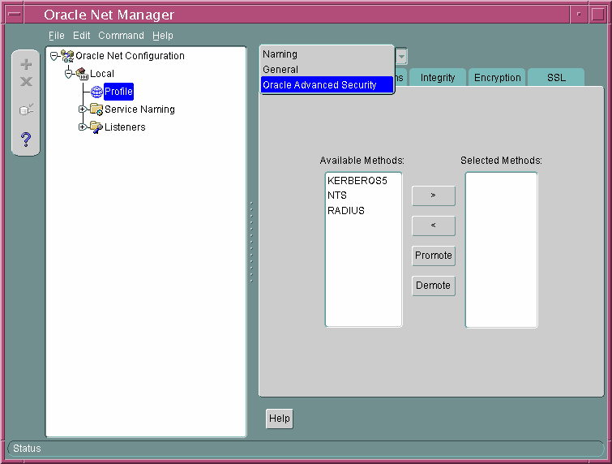
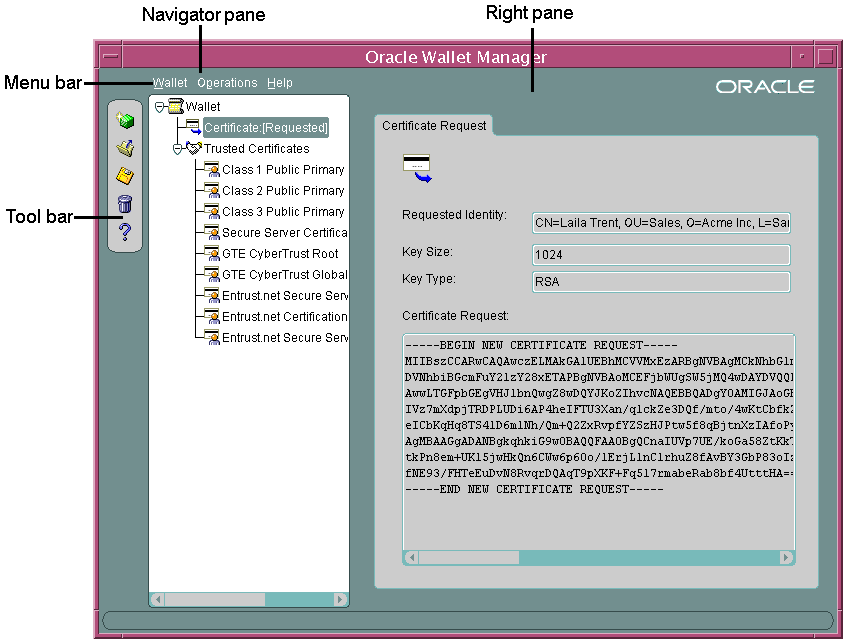
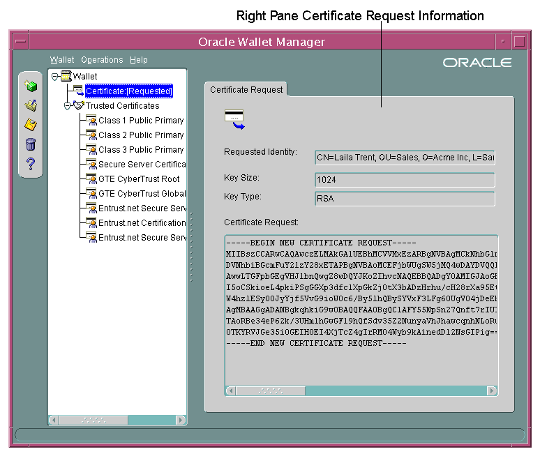

## 2 Configuration and Administration Tools Overview

Configuring advanced security features for an Oracle database instance includes configuring encryption, integrity (checksumming), and strong authentication methods for Oracle Net Services. Strong authentication method configuration can include third-party software, as is the case for Kerberos or RADIUS, or it may entail configuring and managing a public key infrastructure for using digital certificates with Secure Sockets Layer (SSL).

Such diverse advanced security features require a diverse set of tools with which to configure and administer them. This chapter introduces the tools used to configure and administer advanced security features for an Oracle database in the following topics:

## 2.1 Network Encryption and Strong Authentication Configuration Tools

Oracle Net Services can be configured to encrypt data using standard encryption algorithms, and for strong authentication methods, such as Kerberos, RADIUS, and SSL. The following sections introduce the Oracle tools you can use to configure these advanced security features for an Oracle Database:

- Oracle Net Manager
- Oracle Advanced Security Kerberos Adapter Command-Line Utilities

### 2.1.1 Oracle Net Manager

Oracle Net Manager is a graphical user interface tool, primarily used to configure Oracle Net Services for an Oracle home on a local client or server host.

Although you can use Oracle Net Manager to configure Oracle Net Services, such as naming, listeners, and general network settings, it also enables you to configure the following Oracle Advanced Security features, which use the Oracle Net protocol:

- Strong authentication (Kerberos, RADIUS, and Secure Sockets Layer)
- Network encryption (Triple-DES and AES)
- Checksumming for data integrity (SHA-1)

This section introduces you to the features of Oracle Net Manager that are used to configure Oracle Advanced Security. It contains the following topics:

- Starting Oracle Net Manager
- Navigating to the Oracle Advanced Security Profile
	See Also:
	- "Duties of a Security Administrator/DBA" for information about the tasks you can perform with this tool that configure advanced security features
	- [Oracle Database Net Services Administrator's Guide](https://docs.oracle.com/cd/E11882_01/network.112/e41945/toc.htm) and Oracle Net Manager online Help for complete documentation of this tool

#### 2.1.1.1 Starting Oracle Net Manager

You can start Oracle Net Manager by using Oracle Enterprise Manager Console or as a standalone application. However, you must use the standalone application to access the Oracle Advanced Security Profile where you can configure Oracle Advanced Security features.

To start Oracle Net Manager as a standalone application:

- (UNIX) From `$ORACLE_HOME` `/bin`, enter the following at the command line:
	```
	netmgr
	```
- (Windows) Select Start, Programs, Oracle - HOME\_NAME, Configuration and Migration Tools, Net Manager

#### 2.1.1.2 Navigating to the Oracle Advanced Security Profile

The Oracle Net Manager interface window contains two panes: the navigator pane and the right pane.The interface displays various property sheets that enable you to configure network components. When you select a network object in the navigator pane, its associated property sheets displays in the right pane. To configure Oracle Advanced Security features, select the Profile object in the navigator pane, and then select Oracle Advanced Security from the list in the right pane, as shown in Figure 2-1.

Figure 2-1 Oracle Advanced Security Profile in Oracle Net Manager



> This is a text description of ntmgrpro.gif, which is an image of the Oracle Advanced Security profile screen in Oracle Net Manager. This image is described in the surrounding text.
>
> [Copyright © 1996, 2016, Oracle and/or its affiliates. All rights reserved.](https://docs.oracle.com/cd/E11882_01/dcommon/html/cpyr.htm)
  

#### 2.1.1.3 Oracle Advanced Security Profile Property Sheets

The Oracle Advanced Security Profile contains the following property sheets:

- Authentication Property Sheet
- Other Params Property Sheet
- Integrity Property Sheet
- Encryption Property Sheet
- SSL Property Sheet

##### 2.1.1.3.1 Authentication Property Sheet

Use this property sheet to select a strong authentication method, such as Kerberos Version 5 (KERBEROS5), Windows native authentication (NTS), or RADIUS.

##### 2.1.1.3.2 Other Params Property Sheet

Use this property sheet to set other parameters for the authentication method you selected on the Authentication property sheet.

##### 2.1.1.3.3 Integrity Property Sheet

Use this property sheet to enable checksumming on the client or the server and to select an encryption algorithm for generating secure message digests.

##### 2.1.1.3.4 Encryption Property Sheet

Use this property sheet to select one or more [cipher suite](asogls.md) s to encrypt client or server connections with native encryption algorithms.

##### 2.1.1.3.5 SSL Property Sheet

Use this property sheet to configure Secure Sockets Layer (SSL), including the [wallet](asogls.md) location and [cipher suite](asogls.md), on a client or server.

### 2.1.2 Oracle Advanced Security Kerberos Adapter Command-Line Utilities

The Oracle Advanced Security Kerberos adapter provides three command-line utilities that enable you to obtain, cache, display, and remove Kerberos credentials. The following table briefly describes these utilities:

| Utility Name | Description |
| --- | --- |
| `okinit` | Obtains Kerberos tickets from the key distribution center ([KDC](asogls.md)) and caches them in the user's credential cache |
| `oklist` | Displays a list of Kerberos tickets in the specified credential cache |
| `okdstry` | Removes Kerberos credentials from the specified credential cache |

See Also:

["Utilities for the Kerberos Authentication Adapter"](asokerb.md) for complete descriptions of these utilities, their syntax, and available options

Note:

The Cybersafe adapter is not supported beginning with this release. You should use Oracle's Kerberos adapter in its place. Kerberos authentication with the Cybersafe KDC (Trust Broker) continues to be supported when using the Kerberos adapter.

## 2.2 Public Key Infrastructure Credentials Management Tools

The security provided by a public key infrastructure (PKI) depends on how effectively you store, manage, and validate your PKI credentials. The following Oracle tools are used to manage certificates, wallets, and certificate revocation lists so your PKI credentials can be stored securely and your certificate validation mechanisms kept current:

- Oracle Wallet Manager
- orapki Utility

### 2.2.1 Oracle Wallet Manager

Oracle Wallet Manager is an application that wallet owners and security administrators use to manage and edit the security credentials in their Oracle wallets. A wallet is a password-protected container that is used to store authentication and signing credentials, including private keys, certificates, and trusted certificates needed by SSL. You can use Oracle Wallet Manager to perform the following tasks:

- Create [public and private key pair](asogls.md) s
- Store and manage user credentials
- Generate certificate requests
- Store and manage [certificate authority](asogls.md) certificates ([root key certificate](asogls.md) and [certificate chain](asogls.md))
- Upload and download wallets to and from an LDAP directory
- Create wallets to store hardware security module credentials

The following topics introduce the Oracle Wallet Manager user interface:

- Starting Oracle Wallet Manager
- Navigating the Oracle Wallet Manager User Interface
- Toolbar
- Menus
	See Also:
	[Chapter 14, "Using Oracle Wallet Manager"](asowalet.md) for detailed information about using this application

#### 2.2.1.1 Starting Oracle Wallet Manager

To start Oracle Wallet Manager:

- (UNIX) From `$ORACLE_HOME` `/bin`, enter the following at the command line:
	```
	owm
	```
- (Windows) Select Start, Programs, Oracle HOME\_NAME, Integrated Management Tools, Wallet Manager

#### 2.2.1.2 Navigating the Oracle Wallet Manager User Interface

The Oracle Wallet Manager interface includes two panes, a toolbar, and various menu items as shown in Figure 2-2.

Figure 2-2 Oracle Wallet Manager User Interface



> This is a text description of owmntrfc.gif, which is an image of the main page in Oracle Wallet Manager. This image shows which parts of the page are the Tool Bar, the Menu Bar, the Navigator Pane, and the Right Pane. Each area is described in the surrounding text.
>
> [Copyright © 1996, 2016, Oracle and/or its affiliates. All rights reserved.](https://docs.oracle.com/cd/E11882_01/dcommon/html/cpyr.htm)
  

##### 2.2.1.2.1 Navigator Pane

The navigator pane provides a graphical navigation tree view of the certificate requests and certificates stored in the Oracle home where Oracle Wallet Manager is installed. You can use the navigator pane to view, modify, add, or delete certificates and certificate requests.

The navigator pane functions the same way as it does in other Oracle graphical user interface tools, enabling you to

- Expand and contract wallet objects so that you can manage the user and trusted certificates they contain.
- Right-click a wallet, certificate, or certificate request to perform operations on it such as add, remove, import, or export.

When you expand a wallet, you see a nested list of user and trusted certificates. When you select a wallet or certificate in the navigator pane, details about your selection display in the adjacent right pane of Oracle Wallet Manager. Table 2-1 lists the main objects that display in the navigator pane.

Table 2-1 Oracle Wallet Manager Navigator Pane Objects

| Object | Description |
| --- | --- |
| Wallet | Password-protected container that is used to store authentication and signing credentials |
| Certificate Request <sup>Foot 1</sup> | A [PKCS #10](asogls.md) -encoded message containing the requester's [distinguished name (DN)](asogls.md), a public key, the key size, and key type. |
| Certificate <sup>Footref 1</sup> | An [X.509](asogls.md) data structure containing the entity's DN, public key, and is signed by a trusted identity ([certificate authority](asogls.md)). |
| Trusted Certificates <sup>Footref 1</sup> | Sometimes called a root key certificate, is a certificate from a third party identity that is qualified with a level of trust. |

<sup>Footnote 1</sup> These objects display only after you create a wallet, generate a certificate request, and import a certificate into the wallet.

##### 2.2.1.2.2 Right Pane

The right pane displays information about an object that is selected in the navigator pane. The right pane is read-only.

Figure 2-3 shows what is displayed in the right pane when a certificate request object is selected in the navigator pane. Information about the request and the requester's identity display in the Requested Identity, Key Size, and Key Type fields. The PKCS #10-encoded certificate request displays in the Certificate Request text box. To request a certificate from a certificate authority, you can copy this request into an e-mail or export it into a file.

Note:

Figure 2-3 shows a certificate request for a user. A certificate can also be requested for a server in which case the CN attribute will contain the name of the server in place of the user name.

Figure 2-3 Certificate Request Information Displayed in Oracle Wallet Manager Right Pane



> This is a text description of owmrtpan.gif, which is an image of the right pane in Oracle Wallet Manager. Specifically, this image shows a Certificate Request in the right pane. It is described in the surrounding text.
>
> [Copyright © 1996, 2016, Oracle and/or its affiliates. All rights reserved.](https://docs.oracle.com/cd/E11882_01/dcommon/html/cpyr.htm)
  

#### 2.2.1.3 Toolbar

The toolbar contains buttons that enable you to manage your wallets. Move the mouse cursor over a toolbar button to display a description of the button's function. The toolbar buttons are listed and described in Table 2-2.

Table 2-2 Oracle Wallet Manager Toolbar Buttons

| Toolbar Button | Description |
| --- | --- |
| New | Creates a new wallet |
| Open Wallet | Enables you to browse your file system to locate and open an existing wallet |
| Save Wallet | Saves the currently open wallet |
| Delete Wallet | Deletes the wallet that is currently selected in the navigator pane |
| Help | Opens the Oracle Wallet Manager online Help |

#### 2.2.1.4 Menus

You use Oracle Wallet Manager menus to manage your wallets and the credentials they contain. The following sections describe the options that are available under each menu.

##### 2.2.1.4.1 Wallet Menu

Table 2-3 describes the contents of the Wallet menu.

Table 2-3 Oracle Wallet Manager Wallet Menu Options

| Option | Description |
| --- | --- |
| New | Creates a new wallet |
| Open | Opens an existing wallet |
| Close | Closes the currently open wallet |
| Upload Into The Directory Service | Uploads a wallet to a specified LDAP directory server.  You must supply a directory password, host name, and port information. |
| Download From The Directory Service | Downloads a wallet from a specified LDAP directory server. You must supply a directory password, host name, and port information. |
| Save | Saves the currently open wallet in the current working directory |
| Save As | Enables you to browse your file system to choose a directory location in which to save the currently open wallet |
| Save In System Default | Saves the currently open wallet in the system default location:  - (UNIX) `/etc/ORACLE/WALLETS/` `username` - (Windows) `%USERPROFILE%` `\ORACLE\WALLETS` |
| Delete | Deletes the wallet in the current working directory.  You must supply the wallet password. |
| Change Password | Changes the password for the currently open wallet. You must supply the old password before you can create a new one. |
| Auto Login | Sets the auto login feature for the currently open wallet. |
| Exit | Exits the Oracle Wallet Manager application |

##### 2.2.1.4.2 Operations Menu

Table 2-4 describes the contents of the Operations menu.

Table 2-4 Oracle Wallet Manager Operations Menu Options

| Option | Description |
| --- | --- |
| Add Certificate Request | Generates a certificate request for the currently open wallet that you can use to request a certificate from a [certificate authority](asogls.md) (CA) |
| Import User Certificate | Imports the user certificate issued to you from the CA. You must import the issuing CA's certificate as a trusted certificate before you can import the user certificate. |
| Import Trusted Certificate | Imports the CA's trusted certificate |
| Remove Certificate Request | Deletes the certificate request in the currently open wallet. You must remove the associated user certificate before you can delete a certificate request. |
| Remove User Certificate | Deletes the user certificate from the currently open wallet. |
| Remove Trusted Certificate | Removes the trusted certificate that is selected in the navigator pane from the currently open wallet. You must remove all user certificates that the trusted certificate signs before you can remove it. |
| Export User Certificate | Exports the user certificate in the currently open wallet to save in a file system directory |
| Export Certificate Request | Exports the certificate request in the currently open wallet to save in a file |
| Export Trusted Certificate | Exports the trusted certificate that is selected in the navigator pane to save in another location in your file system |
| Export All Trusted Certificates | Exports all trusted certificates in the currently open wallet to save in another location in your file system |
| Export Wallet | Exports the currently open wallet to save as a text file |

##### 2.2.1.4.3 Help Menu

Table 2-5 describes the contents of the Help menu.

Table 2-5 Oracle Wallet Manager Help Menu Options

| Option | Description |
| --- | --- |
| Contents | Opens Oracle Wallet Manager online Help |
| Search for Help on | Opens Oracle Wallet Manager online Help and displays the Search tab |
| About Oracle Wallet Manager | Opens a window that displays the Oracle Wallet Manager version number and copyright information |

### 2.2.2 orapki Utility

The orapki utility is a command line tool that you can use to manage certificate revocation lists ([CRL](asogls.md) s), create and manage Oracle wallets, and to create signed certificates for testing purposes.

The basic syntax for this utility is as follows:

```
orapki module command -option_1 argument ... -option_n argument
```

For example, the following command lists all CRLs in the CRL subtree in an instance of Oracle Internet Directory that is installed on `machine1.us.example.com` and that uses port 389:

```
orapki crl list -ldap machine1.us.example.com:389
```

See Also:

- ["Certificate Revocation List Management"](asossl.md) for information about how to use `orapki` to manage CRLs in the directory
- [Appendix E, "orapki Utility"](asoappf.md) for reference information on all available `orapki` commands

## 2.3 Duties of a Security Administrator/DBA

Most of the tasks of a security administrator involve ensuring that the connections to and from Oracle databases are secure. Table 2-6 lists the primary tasks of security administrators, the tools used to perform the tasks, and links to where the tasks are documented.

Table 2-6 Common Security Administrator/DBA Configuration and Administrative Tasks

| Task | Tools Used | See Also |
| --- | --- | --- |
| Configure encrypted Oracle Net connections between database servers and clients | Oracle Net Manager | ["Configuring Encryption on the Client and the Server"](asoconfg.md) |
| Configure checksumming on Oracle Net connections between database servers and clients | Oracle Net Manager | ["Configuring Integrity on the Client and the Server"](asoconfg.md) |
| Configure database clients to accept RADIUS authentication | Oracle Net | ["Step 2A: Configure RADIUS on the Oracle Client"](asoradus.md) |
| Configure a database to accept RADIUS authentication | Oracle Net | ["Step 2B: Configure RADIUS on the Oracle Database Server"](asoradus.md) |
| Create a RADIUS user and grant them access to a database session | SQL\*Plus | ["Step 3: Create a User and Grant Access"](asoradus.md) |
| Configure Kerberos authentication on a database client and server | Oracle Net Manager | ["Step 7: Configure Kerberos Authentication"](asokerb.md) |
| Create a Kerberos database user | - `kadmin.local` - Oracle Net Manager | - ["Step 8: Create a Kerberos User"](asokerb.md) - ["Step 9: Create an Externally Authenticated Oracle User"](asokerb.md) |
| Manage Kerberos credentials in the credential cache | - `okinit` - `oklist` - `okdstry` | - ["Obtaining the Initial Ticket with the okinit Utility"](asokerb.md) - ["Displaying Credentials with the oklist Utility"](asokerb.md) - ["Removing Credentials from the Cache File with the okdstry Utility"](asokerb.md) |
| Create a wallet for a database client or server | - Oracle Wallet Manager | ["Creating a New Wallet"](asowalet.md) |
| Request a user certificate from a [certificate authority](asogls.md) (CA) for SSL authentication | - Oracle Wallet Manager | - ["Adding a Certificate Request"](asowalet.md) - ["Importing the User Certificate into the Wallet"](asowalet.md) |
| Import a user certificate and its associated trusted certificate (CA certificate) into a wallet | - Oracle Wallet Manager |  |
| Configuring SSL connections for a database client | - Oracle Net Manager | ["Step 3: Configure Secure Sockets Layer on the Client"](asossl.md) |
| Configuring SSL connections for a database server | - Oracle Net Manager | ["Step 2: Configure Secure Sockets Layer on the Server"](asossl.md) |
| Enabling certificate validation with [certificate revocation lists](asogls.md) | - Oracle Net Manager | - ["Configuring Certificate Validation with Certificate Revocation Lists"](asossl.md) |