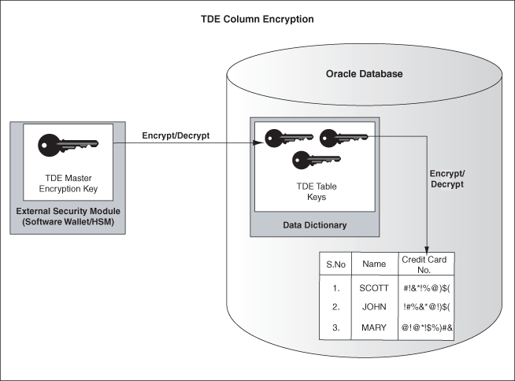
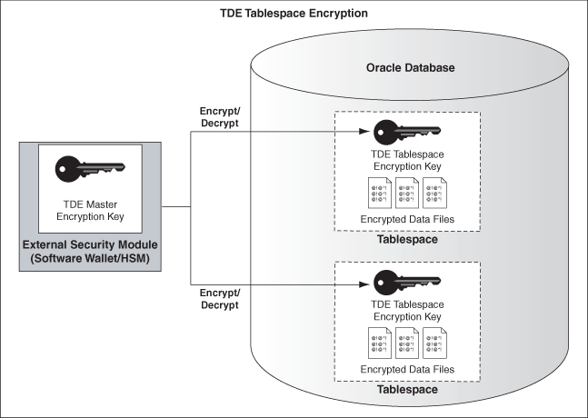

## 8 Securing Stored Data Using Transparent Data Encryption

Transparent Data Encryption(TDE) enables you to encrypt sensitive data, such as credit card numbers, stored in tables and tablespaces. Encrypted data is transparently decrypted for a database user or application that has access to data. TDE helps protect data stored on media in the event that the storage media or data file gets stolen.

This chapter is divided into the following topics:

## 8.1 About Transparent Data Encryption

Oracle Database uses authentication, authorization, and auditing mechanisms to secure data in the database, but not in the operating system data files where data is stored. To protect these data files, Oracle Database provides Transparent Data Encryption (TDE). TDE encrypts sensitive data stored in data files. To prevent unauthorized decryption, TDE stores the encryption keys in a security module external to the database.

Database users and applications do not need to manage key storage or create auxiliary tables, views, and triggers. An application that processes sensitive data can use TDE to provide strong data encryption with little or no change to the application.

Use TDE to protect confidential data, such as credit card and social security numbers, stored in table columns. You can also use TDE to encrypt entire tablespaces.

This section contains the following topics:

- Benefits of Using Transparent Data Encryption
- Types of Transparent Data Encryption

### 8.1.1 Benefits of Using Transparent Data Encryption

Transparent Data Encryption (TDE) has the following advantages:

- As a security administrator, you can be sure that sensitive data is safe in case the storage media or data file gets stolen.
- Implementing TDE helps you address security-related regulatory compliance issues.
- You do not need to create triggers or views to decrypt data for the authorized user or application. Data from tables is transparently decrypted for the database user and application.
- Database users and applications need not be aware of the fact that the data they are accessing is stored in encrypted form. Data is transparently decrypted for the database users and applications.
- Applications need not be modified to handle encrypted data. Data encryption and decryption is managed by the database.
- Key management operations are automated. The user or application does not need to manage encryption keys.

### 8.1.2 Types of Transparent Data Encryption

Transparent Data Encryption (TDE) column encryption enables you to encrypt sensitive data stored in select table columns. TDE tablespace encryption enables you to encrypt all data stored in a tablespace.

Both TDE column encryption and TDE tablespace encryption use a two-tiered, key-based architecture. Even if the encrypted data is retrieved, it cannot be understood until authorized decryption occurs, which is automatic for users authorized to access the table.

The following sections discuss TDE column encryption and TDE tablespace encryption:

- TDE Column Encryption
- TDE Tablespace Encryption

#### 8.1.2.1 TDE Column Encryption

TDE column encryption is used to protect confidential data, such as credit card and social security numbers, stored in table columns. TDE column encryption uses the two-tiered, key-based architecture to transparently encrypt and decrypt sensitive table columns. The TDE master encryption key is stored in an external security module, which can be an Oracle wallet or Hardware Security Module (HSM). This master encryption key is used to encrypt the table key, which in turn is used to encrypt and decrypt data in the table column.

Figure 8-1 shows an overview of the TDE column encryption process.

Figure 8-1 TDE Column Encryption Overview



> This illustration is described in the text.
>
> [Copyright © 1996, 2016, Oracle and/or its affiliates. All rights reserved.](https://docs.oracle.com/cd/E11882_01/dcommon/html/cpyr.htm)
  

As shown in Figure 8-1, the master encryption key is stored in an external security module that is outside the database and accessible only to the security administrator. For this external security module, Oracle uses an Oracle wallet or Hardware Security Module (HSM), as described in this chapter. Storing the master encryption key in this way prevents its unauthorized use.

Using an external security module (wallet/HSM) separates ordinary program functions from encryption operations, making it possible to divide duties between database administrators and security administrators. Security is enhanced because the wallet password can be unknown to the database administrator, requiring the security administrator to provide the password.

When a table contains encrypted columns, a single table key is used regardless of the number of encrypted columns. The table keys for all tables are encrypted with the database server master encryption key and stored in a dictionary table in the database. No keys are stored in the clear.

#### 8.1.2.2 TDE Tablespace Encryption

TDE tablespace encryption enables you to encrypt an entire tablespace. All objects created in the encrypted tablespace are automatically encrypted. TDE tablespace encryption is useful if you want to secure sensitive data in tables. You do not need to perform a granular analysis of each table column to determine the columns that need encryption.

In addition, TDE tablespace encryption takes advantage of bulk encryption and caching to provide enhanced performance. While the actual performance impact on applications can vary, the performance overhead is roughly estimated to be in between 5% and 8%.

TDE tablespace encryption is a good alternative to TDE column encryption if your tables contain sensitive data in multiple columns, or if you want to protect the entire table and not just individual columns.

TDE tablespace encryption encrypts all data that is stored in an encrypted tablespace and its corresponding redo data. This includes internal large objects (`LOB` s) such as `BLOB` s and `CLOB` s. TDE tablespace encryption does not encrypt data that is stored outside the tablespace. For example, `BFILE` data is not encrypted as it is stored outside the database. If you create a table with a `BFILE` column in an encrypted tablespace, then this particular column will not be encrypted. However, SecureFile LOBs are supported from Oracle Database 11g Release 1 (11.1).

All data in an encrypted tablespace is stored in encrypted format on the disk. Data is transparently decrypted for an authorized user having the necessary privileges to view or modify the data. A database user or application does not need to know if the data in a particular table is encrypted on the disk. In the event that the data files on a disk or backup media gets stolen, the data is not compromised.

TDE tablespace encryption uses the two-tiered, key-based architecture to transparently encrypt (and decrypt) tablespaces. The TDE master key is stored in an external security module (Oracle Wallet or HSM). This TDE master key is used to encrypt the TDE tablespace encryption key, which in turn is used to encrypt and decrypt data in the tablespace.

Figure 8-2 shows an overview of the TDE tablespace encryption process.

Figure 8-2 TDE Tablespace Encryption



Note:

The encrypted data is protected during operations like `JOIN` and `SORT`. This means that the data is safe when it is moved to temporary tablespaces. Data in undo and redo logs is also protected.

TDE tablespace encryption also allows index range scans on data in encrypted tablespaces. This is not possible with TDE column encryption.

Oracle Database 11g Release 2 (11.2) implements the following enhancements to TDE tablespace encryption:

- A unified master encryption key is used for both TDE column encryption and TDE tablespace encryption.
- You can reset the unified master encryption key. This provides enhanced security and helps meet security and compliance requirements.

## 8.2 Using Transparent Data Encryption

The following sections discuss using Transparent Data Encryption (TDE):

- Enabling Transparent Data Encryption
- Setting and Resetting the Master Encryption Key
- Opening and Closing the Encrypted Wallet
- Encrypting Columns in Tables
- Encrypting Entire Tablespaces
- Using Hardware Security Modules with TDE
- Using Transparent Data Encryption with Oracle RAC

### 8.2.1 Enabling Transparent Data Encryption

TDE column encryption was first introduced in Oracle Database 10g release 2 (10.2). To use this feature, you must be running Oracle Database 10g release 2 (10.2) or higher.

TDE tablespace encryption was introduced in Oracle Database 11g release 1 (11.1). To use this feature, you must be running Oracle Database 11g release 1 (11.1) or higher.

Note:

Oracle Database 11g Release 1 (11.1) and higher versions ensure greater security by protecting data in temporary tablespaces during operations such as `JOIN` and `SORT`. The data in temporary tablespaces stays encrypted during these operations.

To start using TDE, the security administrator must create a wallet and set a master key. The wallet can be the default database wallet shared with other Oracle Database components, or a separate wallet specifically used by TDE. Oracle strongly recommends that you use a separate wallet to store the master encryption key.

#### 8.2.1.1 Specifying a Wallet Location for Transparent Data Encryption

If you wish to use a wallet specifically for TDE, then you must specify a wallet location in the `sqlnet.ora` file by using the `ENCRYPTION_WALLET_LOCATION` parameter. Oracle recommends that you use the `ENCRYPTION_WALLET_LOCATION` parameter to specify a wallet location for TDE.

See Also:

["Sample sqlnet.ora File"](asoappa.md) for an example of the syntax used to set this parameter

### 8.2.2 Setting and Resetting the Master Encryption Key

The master encryption key is stored in an external security module, and it is used to protect the table keys and tablespace encryption keys. By default, the master encryption key is a random key generated by Transparent Data Encryption (TDE). It can also be an existing key pair from a PKI certificate designated for encryption. To use TDE with PKI key pairs, the issuing certificate authority must be able to issue X.509v3 certificates with the key usage field marked for encryption.

Note:

PKI-based encryption does not work with TDE tablespace encryption or hardware security modules. To know more about hardware security modules, refer to "Using Hardware Security Modules with TDE".

Neither key type is more secure, but if you have already deployed PKI within your organization, then you can leverage such PKI services as key escrow and recovery. However, encryption using current PKI algorithms requires significantly more system resources than symmetric key encryption. Using a PKI key pair as a master encryption key may result in greater performance degradation when accessing encrypted columns in the database.

Use the `ALTER SYSTEM` command to set or reset (`rekey`) the master encryption key. The following sections discuss setting and resetting the master encryption key.

#### 8.2.2.1 Setting the Master Encryption Key

Before you can encrypt or decrypt database columns or tablespaces, you must generate a master encryption key. Oracle Database 11g Release 2 (11.2) uses the same master encryption key for both TDE column encryption and TDE tablespace encryption.

To set the master encryption key, use the following command:

```
SQL> ALTER SYSTEM SET ENCRYPTION KEY ["certificate_ID"] IDENTIFIED BY "password"
```

where

- `certificate_ID` is an optional string containing the unique identifier of a certificate stored in the Oracle wallet. Use this parameter if you intend to use your PKI private key as your master encryption key. This parameter has no default setting. Enclose the certificate\_ID in double quotation marks (" ").
	You can search for a `certificate_ID` by querying the `V$WALLET` fixed view when the wallet is open. Only certificates that can be used as master encryption keys by TDE are shown.
- `password` is the mandatory wallet password for the security module, with no default setting. It is case sensitive. Enclose the password string in double quotation marks (" ").

The wallet location specified by the `ENCRYPTION_WALLET_LOCATION` parameter, in the `sqlnet.ora` parameter file, is used to create the master encryption key. If the `ENCRYPTION_WALLET_LOCATION` parameter is not present in the `sqlnet.ora` file, then the `WALLET_LOCATION` value is used. A new wallet is created if one does not exist already.

If no wallet location is specified in the `sqlnet.ora` file, then the default database wallet location is used. The default database wallet location is `ORACLE_BASE` `/admin/` `DB_UNIQUE_NAME` `/wallet` or `ORACLE_HOME` `/admin/` `DB_UNIQUE_NAME` `/wallet.` Here, `DB_UNIQUE_NAME` is the unique name of the database specified in the initialization parameter file.

If an existing auto login wallet is present at the expected wallet location, then a new wallet is not created.

#### 8.2.2.2 Resetting the Master Encryption Key

Reset/Regenerate the master encryption key only if it has been compromised or as per the security policies of the organization. You should back up the wallet before resetting the master encryption key.

Frequent master encryption key regeneration does not necessarily enhance system security. Security modules can store a large number of keys. However, this number is not unlimited. Frequent master encryption key regeneration can exhaust all available storage space.

To reset the master encryption key, use the SQL syntax as shown in "Setting the Master Encryption Key".

Note:

If you are resetting the master encryption key for a wallet that has auto login enabled, then you must ensure that both the auto login wallet, identified by the `.sso` file, and the encryption wallet, identified by the `.p12` file, are present before issuing the command to reset the master encryption key.

The `ALTER SYSTEM SET ENCRYPTION KEY` command is a data definition language (DDL) command requiring the `ALTER SYSTEM` privilege, and it automatically commits any pending transactions. Example 8-1 shows a sample usage of this command.

Example 8-1 Setting or Resetting the Master Encryption Key To Use a PKI-Based Private Key

```
SQL> ALTER SYSTEM SET ENCRYPTION KEY "j23lm781098dhb345sm" IDENTIFIED BY "password";
```

Here, `j23lm781098dhb345sm` is the certificate ID and `password` is the wallet password.

For PKI-based keys, [certificate revocation lists](asogls.md) are not enforced as enforcing certificate revocation may lead to losing access to all encrypted information in the database. However, you cannot use the same certificate to create the master key again.

### 8.2.3 Opening and Closing the Encrypted Wallet

The database must load the master encryption key into memory before it can encrypt or decrypt columns/tablespaces. Opening the wallet allows the database to access the master encryption key. Use the following `ALTER SYSTEM` command to explicitly open the wallet:

```
SQL> ALTER SYSTEM SET ENCRYPTION WALLET OPEN IDENTIFIED BY "password"
```

where `password` is the password to open the wallet. Enclose the password string in double quotation marks (" ").

Note:

The password to open the wallet is the password that you specify for creating the master encryption key. This is discussed under "Setting the Master Encryption Key".

Once the wallet has been opened, it remains open until you shut down the database instance, or close it explicitly by issuing the following command:

```
SQL> ALTER SYSTEM SET ENCRYPTION WALLET CLOSE IDENTIFIED BY "password"
```

Closing the wallet disables all encryption and decryption operations. Any attempt to encrypt/decrypt data or access encrypted data results in the following error:

```
ORA-28365: wallet is not open
```

Each time you restart a database instance, you must issue the `ALTER SYSTEM SET ENCRYPTION WALLET OPEN IDENTIFIED BY` `"password"` command to reenable encryption and decryption operations.

Note:

Auto login wallets are opened automatically and do not need to be opened explicitly.

In case an auto login wallet needs to be closed, it can be closed with the following command:

```
SQL> ALTER SYSTEM SET ENCRYPTION WALLET CLOSE
```

No password is required to close an auto login wallet.

If the user does not have the `ALTER SYSTEM` privilege, or the wallet is unavailable, or an incorrect password is given, then the command returns an error and exits. If the wallet is already open, the command returns an error and takes no action. Example 8-2 shows an example of each usage case.

Example 8-2 Opening the External Security Module Wallet with ALTER SYSTEM

```
SQL> --Successfully opening the wallet
SQL> ALTER SYSTEM SET ENCRYPTION WALLET OPEN IDENTIFIED BY "U83j10LLt8v";
Wallet opened.

SQL> --Trying to open a wallet that is already open 
SQL> ALTER SYSTEM SET ENCRYPTION WALLET OPEN IDENTIFIED BY "U83j10LLt8v";
ERROR at line 1:
ORA-28354: wallet already open 

SQL> --Trying to open the wallet with an incorrect password
SQL> ALTER SYSTEM SET ENCRYPTION WALLET OPEN IDENTIFIED BY "U93j10LLt8v";
ERROR at line 1:
ORA-28353: failed to open wallet
```

### 8.2.4 Encrypting Columns in Tables

The following sections discuss using TDE column encryption:

- Creating Tables with Encrypted Columns
- Encrypting Columns in Existing Tables
- Creating an Index on an Encrypted Column
- Adding or Removing Salt from an Encrypted Column
- Changing the Encryption Key or Algorithm for Tables with Encrypted Columns
- Data Types That Can Be Encrypted with TDE Column Encryption
- Restrictions on Using TDE Column Encryption

#### 8.2.4.1 Creating Tables with Encrypted Columns

To create relational tables with encrypted columns, specify the SQL `ENCRYPT` clause when you define database columns with the `CREATE TABLE` statement.

This section contains the following topics:

- Creating a Table with an Encrypted Column
- Creating a Table with an Encrypted Column Using a Nondefault Algorithm and No Salt
- Using the NOMAC Parameter to Save Disk Space and Improve Performance
- Creating an Encrypted Column in an External Table

##### 8.2.4.1.1 Creating a Table with an Encrypted Column

By default, TDE uses the `AES` encryption algorithm with a 192-bit key length (`AES192`). If you encrypt a table column without specifying an algorithm, the column is encrypted using the `AES192` algorithm.

TDE adds [salt](asogls.md) to cleartext before encrypting it. This makes it harder for attackers to steal data through a brute force attack. TDE also adds a Message Authentication Code (MAC) to the data for integrity checking. The `SHA-1` integrity algorithm is used by default.

Note:

If there are multiple encrypted columns in a table, then all of these columns must use the same pair of encryption and integrity algorithms.

Salt is specified at the column level. This means that an encrypted column in a table can choose not to use salt irrespective of whether other encrypted columns in the table use salt or not.

Example 8-3 creates a new table with an encrypted column. The column is encrypted using the default encryption algorithm (`AES192`). Salt and MAC are added by default.

Example 8-3 Creating a New Table with an Encrypted Column Using the Default Algorithm (AES192)

```
CREATE TABLE employee (
     first_name VARCHAR2(128),
     last_name VARCHAR2(128),
     empID NUMBER,
     salary NUMBER(6) ENCRYPT
);
```

##### 8.2.4.1.2 Creating a Table with an Encrypted Column Using a Nondefault Algorithm and No Salt

By default, TDE adds [salt](asogls.md) to cleartext before encrypting it. This makes it harder for attackers to steal data through a brute force attack. However, if you plan to index the encrypted column, you must use `NO SALT`.

TDE also enables you to specify a nondefault encryption algorithm. You can choose from one of the following algorithms:

- `3DES168`
- `AES128`
- `AES192` (default)
- `AES256`

Example 8-4 shows how to specify the `NO SALT` parameter with the SQL `ENCRYPT` clause (`empID NUMBER ENCRYPT NO SALT`). It also shows the syntax for specifying a different encryption algorithm (`salary NUMBER(6) ENCRYPT USING '3DES168'`). Note that the string which specifies the algorithm must be enclosed in single quotation marks (' ').

The `empID` and `salary` columns will both use the `3DES168` encryption algorithm. This is because all encrypted columns in a table must use the same encryption algorithm. The `salary` column will use salt by default. The `empID` column will not use salt as the `NO SALT` option has been specified for it.

Example 8-4 Creating a New Table with an Encrypted Column Using 3DES168 and NO SALT

```
CREATE TABLE employee (
     first_name VARCHAR2(128),
     last_name VARCHAR2(128),
     empID NUMBER ENCRYPT NO SALT,
     salary NUMBER(6) ENCRYPT USING '3DES168'
);
```

##### 8.2.4.1.3 Using the NOMAC Parameter to Save Disk Space and Improve Performance

The `NOMAC` parameter enables you to skip the integrity check performed by TDE. This saves 20 bytes of disk space per encrypted value. If the number of rows and encrypted columns in the table is large, then this adds up to a significant amount of disk space.

The `NOMAC` parameter also reduces the performance overheads associated with TDE. Using the `NOMAC` parameter causes the integrity check to be skipped during encryption and decryption operations. This saves processing cycles and leads to faster performance.

Note:

TDE uses the `SHA-1` integrity algorithm by default. All encrypted columns in a table must use the same integrity algorithm. If you already have a table column using the `SHA-1` algorithm, then you cannot use the `NOMAC` parameter to encrypt another column in the same table.

You can change the integrity algorithm used by all encrypted columns in a table using the `ALTER TABLE....REKEY...` command. See Example 8-6 for an example.

Example 8-5 creates a table with an encrypted column. The `empID` column is encrypted using the `NOMAC` parameter.

Example 8-5 Using the NOMAC parameter in a CREATE TABLE statement

```
CREATE TABLE employee (
     first_name VARCHAR2(128),
     last_name VARCHAR2(128),
     empID NUMBER ENCRYPT 'NOMAC' NO SALT ,
     salary NUMBER(6)
);
```

Example 8-6 shows how to change the integrity algorithm for encrypted columns in a table. The encryption algorithm is set to `3DES168` and the integrity algorithm is set to `SHA-1`. The second `ALTER TABLE` statement sets the integrity algorithm to `NOMAC`.

Example 8-6 Changing the Integrity Algorithm for a Table

```
SQL> ALTER TABLE EMPLOYEE REKEY USING '3DES168' 'SHA-1';

Table altered.
SQL> ALTER TABLE EMPLOYEE REKEY USING '3DES168' 'NOMAC';

Table altered.
```

##### 8.2.4.1.4 Creating an Encrypted Column in an External Table

The external table feature enables you to access data in external sources as if the data were in a database table. External tables can be updated using the `ORACLE_DATAPUMP` access driver.

See Also:

[Oracle Database Concepts](https://docs.oracle.com/cd/E11882_01/server.112/e40540/toc.htm) for discussions on Schema Objects and Tables.

To encrypt specific columns in an external table, use the `ENCRYPT` clause when defining those columns. A system generated key is used to encrypt the columns. For example, the following definition encrypts the `ssn` column using the `3DES168` algorithm:

```
CREATE TABLE emp_ext (
    first_name,
    ....
    ssn ENCRYPT USING '3DES168',
    ....
...
...
```

If you plan to move your external table to a new location, then you cannot use a randomly generated key to encrypt the columns. This is because the randomly generated key will not be available at the new location.

For such scenarios, you should specify a password while encrypting the columns. After you move the data, you can use the same password to regenerate the key required to access encrypted column data at the new location.

Table partition exchange also requires a password-based table key.

Example 8-7 creates an external table using a password to create the table key.

Example 8-7 Creating a New External Table with a Password-Generated Table Key

```
CREATE TABLE emp_ext (
     first_name,
     last_name,
     empID,
     salary,
     ssn ENCRYPT IDENTIFIED BY "xIcf3T9u"
)  ORGANIZATION EXTERNAL
   (
    TYPE ORACLE_DATAPUMP
    DEFAULT DIRECTORY "D_DIR"
    LOCATION('emp_ext.dat')
    )
    REJECT LIMIT UNLIMITED
AS SELECT * FROM EMPLOYEE;
```

See Also:

[Oracle Database SQL Language Reference](https://docs.oracle.com/cd/E11882_01/server.112/e41084/toc.htm) about `CREATE TABLE`, `ENCRYPT`, and the rules for passwords.

#### 8.2.4.2 Encrypting Columns in Existing Tables

To add an encrypted column to an existing table, or to encrypt or decrypt an existing column, you use the `ALTER TABLE` SQL command with the `ADD` or `MODIFY` clause.

This section contains the following topics:

- Adding an Encrypted Column to an Existing Table
- Encrypting an Unencrypted Column
- Disabling Encryption on a Column

##### 8.2.4.2.1 Adding an Encrypted Column to an Existing Table

To add an encrypted column to an existing table, you use the `ALTER TABLE ADD` command, specifying the new column with the `ENCRYPT` clause. Example 8-8 adds an encrypted column, `ssn`, to an existing table, called `employee`.

Example 8-8 Adding an Encrypted Column to an Existing Table

```
SQL> ALTER TABLE employee ADD (ssn VARCHAR2(11) ENCRYPT);
```

The ssn column is encrypted with the default `AES192` algorithm. Salt and MAC are added by default.

You can choose to encrypt the column using a different algorithm. You can also specify `NO SALT`, if you wish to index the column.

##### 8.2.4.2.2 Encrypting an Unencrypted Column

To encrypt an unencrypted column, use the `ALTER TABLE MODIFY` command, specifying the unencrypted column with the `ENCRYPT` clause. Example 8-9 encrypts the `first_name` column in the `employee` table.

Example 8-9 Encrypting an Unencrypted Column

```
SQL> ALTER TABLE employee MODIFY (first_name ENCRYPT);
```

The `first_name` column is encrypted with the default `AES192` algorithm. Salt is added to the data, by default.

You can choose to encrypt the column using a different algorithm. You can also specify `NO SALT`, if you wish to index the column. You can also choose to skip integrity checks by using the `NOMAC` parameter. Example 8-10 encrypts the `first_name` column in the employee table using the `NOMAC` parameter.

Example 8-10 Using the NOMAC parameter in an ALTER TABLE statement

```
SQL> ALTER TABLE employee MODIFY (first_name ENCRYPT 'NOMAC');
```

##### 8.2.4.2.3 Disabling Encryption on a Column

You may want to disable encryption for reasons of compatibility or performance. To disable column encryption, use the `ALTER TABLE MODIFY` command with the `DECRYPT` clause. Example 8-11 decrypts the `first_name` column in the `employee` table.

Example 8-11 Turning Off Column Encryption

```
SQL> ALTER TABLE employee MODIFY (first_name DECRYPT);
```

#### 8.2.4.3 Creating an Index on an Encrypted Column

To create an index on an encrypted column, you use the standard `CREATE INDEX` command. The column being indexed must have been encrypted without salt. Example 8-12 shows how to create an index on a column that has been encrypted without salt.

Example 8-12 Creating Index on a Column Encrypted Without Salt

```
CREATE TABLE employee (
   first_name VARCHAR2(128),
   last_name VARCHAR2(128),
   empID NUMBER ENCRYPT NO SALT,
   salary NUMBER(6) ENCRYPT USING '3DES168'
);
CREATE INDEX employee_idx on employee (empID);
```

Note:

You cannot create an index on a column that has been encrypted with salt. If you try to do this, an error (`ORA-28338`) is raised.

#### 8.2.4.4 Adding or Removing Salt from an Encrypted Column

Salt is a way to strengthen the security of encrypted data. It is a random string added to the data before it is encrypted. This ensures that the same plaintext data does not always translate to the same encrypted text. Salt removes the one common method attackers use to steal data, namely, matching patterns of encrypted text. Adding salt requires an additional 16 bytes of storage, per encrypted data value.

To add or remove salt from encrypted columns, use the `ALTER TABLE MODIFY` command. Example 8-13 encrypts the `first_name` column using salt. If the `first_name` column was encrypted without salt earlier, then this command reencrypts it using salt.

Example 8-13 Adding Salt to an Encrypted Column

```
SQL> ALTER TABLE employee MODIFY (first_name ENCRYPT SALT);
```

Example 8-14 removes salt from the `first_name` column. If you need to index a column that was encrypted using salt, then you can use this command to remove the salt before indexing.

Example 8-14 Removing Salt from an Encrypted Column

```
SQL> ALTER TABLE employee MODIFY (first_name ENCRYPT NO SALT);
```

#### 8.2.4.5 Changing the Encryption Key or Algorithm for Tables with Encrypted Columns

Each table can have only one table key for its columns. You can regenerate the table key with the `ALTER TABLE` command. You can also choose to use a different encryption algorithm for the new table key.

Example 8-15 regenerates the table key for the `employee` table.

Example 8-15 Changing the Encryption Key on Tables Containing Encrypted Columns

```
SQL> ALTER TABLE employee REKEY;
```

Example 8-16 regenerates the table key for the `employee` table using the `3DES168` algorithm.

Example 8-16 Changing the Encryption Key and Algorithm on Tables Containing Encrypted Columns

```
SQL> ALTER TABLE employee REKEY USING '3DES168';
```

#### 8.2.4.6 Data Types That Can Be Encrypted with TDE Column Encryption

The following data types can be encrypted using this feature:

- `BINARY_DOUBLE`
- `BINARY_FLOAT`
- `CHAR`
- `DATE`
- `INTERVAL DAY TO SECOND`
- `INTERVAL YEAR TO MONTH`
- `LOB` s (Internal `LOB` s and `SECUREFILE LOB` s Only)
- `NCHAR`
- `NUMBER`
- `NVARCHAR2`
- `RAW`
- `TIMESTAMP` (includes `TIMESTAMP WITH TIME ZONE` and `TIMESTAMP WITH LOCAL TIME ZONE`)
- `VARCHAR2`

You cannot encrypt a column if the encrypted column size becomes greater than the size allowed by the data type of the column. Table 8-1 shows the maximum allowable sizes for various data types.

Table 8-1 Maximum Allowable Size for Data Types

| Data Type | Maximum Size |
| --- | --- |
| `CHAR` | 1932 bytes |
| `VARCHAR2` | 3932 bytes |
| `NVARCHAR2` | 1966 bytes |
| `NCHAR` | 966 bytes |

Note:

TDE tablespace encryption does not have these data type restrictions.

#### 8.2.4.7 Restrictions on Using TDE Column Encryption

TDE column encryption encrypts and decrypts data at the SQL layer. Oracle Database utilities and features that bypass the SQL layer cannot leverage the services provided by TDE column encryption. Do not use TDE column encryption with the following database features:

- Index types other than B-tree
- Range scan search through an index
- External large objects (`BFILE`)
- Synchronous Change Data Capture
- Transportable Tablespaces
- Original import/export utilities

In addition, you cannot use TDE column encryption to encrypt columns used in foreign key constraints.

Note:

Oracle Database 10g release 2 (10.2) TDE did not support large object (`LOB`) data types such as `BLOB` and `CLOB`. Oracle Database 11g TDE supports internal large object data types such as `BLOB` and `CLOB`. However, you cannot encrypt external `LOB` s (`BFILE`).

Applications that need to use these unsupported features can use the `DBMS_CRYPTO` package for their encryption needs.

See Also:

["DBMS\_CRYPTO"](https://docs.oracle.com/cd/E11882_01/appdev.112/e40758/d_crypto.htm#ARPLS664) in Oracle Database PL/SQL Packages and Types Reference

TDE protects data stored on disk/media. It does not protect data in transit. Use Oracle Advanced Security network encryption solutions discussed in [Chapter 2, "Configuration and Administration Tools Overview"](asotools.md) to encrypt data over the network.

### 8.2.5 Encrypting Entire Tablespaces

In order to use TDE tablespace encryption, you must be running Oracle Database 11g release 1 (11.1) or higher. If you have upgraded from an earlier release, the compatibility for the database must have been set to 11.0.0 or higher.

To use the enhanced tablespace encryption features in Oracle Database 11g Release 2 (11.2), the compatibility for the database must be set to 11.2 or higher.

Note:

Advancing the database compatibility, using the `COMPATIBLE` initialization parameter, is an irreversible change.

The following steps discuss using TDE tablespace encryption:

- Setting the Tablespace Master Encryption Key
- Opening the Oracle Wallet
- Creating an Encrypted Tablespace
- Restrictions on Using TDE Tablespace Encryption

#### 8.2.5.1 Setting the Tablespace Master Encryption Key

Before you can encrypt or decrypt tablespaces, you must generate or set a master encryption key. The tablespace master encryption key is stored in an external security module and is used to encrypt the TDE tablespace encryption keys.

Check to ensure that the `ENCRYPTION_WALLET_LOCATION` (or `WALLET_LOCATION`) parameter in the `sqlnet.ora` file points to the correct software wallet location. For example:

```
ENCRYPTION_WALLET_LOCATION=
  (SOURCE=(METHOD=FILE)(METHOD_DATA=
   (DIRECTORY=/app/wallet)))
```

Oracle Database 11g Release 2 (11.2) uses the same master encryption key for both TDE column encryption and TDE tablespace encryption. When you issue the `ALTER SYSTEM SET ENCRYPTION KEY` command, a unified master encryption key is created for both TDE column encryption and TDE tablespace encryption. Creating a master encryption key is discussed under "Setting the Master Encryption Key".

If you were already using TDE in Oracle Database 10g release 2 (10.2), and have upgraded the database to 11g Release 2 (11.2), then you must reissue the `ALTER SYSTEM SET ENCRYPTION KEY` command to create a unified master encryption key.

If you were already using TDE tablespace encryption in Oracle Database 11g release 1 (11.1), and have upgraded the database to 11g release 2 (11.2), then you have separate master encryption keys for TDE column encryption and TDE tablespace encryption. You must create a unified master encryption key by reissuing the `ALTER SYSTEM SET ENCRYPTION KEY` command.

##### 8.2.5.1.1 Resetting the Tablespace Master Encryption Key

Oracle Database 11g Release 2 (11.2) uses a unified master encryption key for both TDE column encryption and TDE tablespace encryption. When you reset (`rekey`) the master encryption key for TDE column encryption, the master encryption key for TDE tablespace encryption also gets reset.

The `ALTER SYSTEM SET ENCRYPTION KEY` command resets the tablespace master encryption key. Resetting the master encryption key is discussed under "Setting and Resetting the Master Encryption Key".

#### 8.2.5.2 Opening the Oracle Wallet

Before you can create an encrypted tablespace, the Oracle wallet containing the tablespace master encryption key must be open. The wallet must also be open before you can access data in an encrypted tablespace. Opening the Oracle wallet has been discussed under "Opening and Closing the Encrypted Wallet".

Note:

The security administrator needs to open the Oracle wallet after starting the Oracle instance. A restart of the Oracle instance requires the security administrator to open the wallet again.

The security administrator also needs to open the wallet before performing database recovery operations. This is because background processes may require access to encrypted redo and undo logs. When performing database recovery, the wallet must be opened before opening the database. This is illustrated in the following statements:

```
SQL> STARTUP MOUNT;
SQL> ALTER SYSTEM SET ENCRYPTION WALLET OPEN IDENTIFIED BY "password";
SQL> ALTER DATABASE OPEN;
```

You can also choose to use auto login wallets, if your environment does not require the extra security provided by a wallet that needs to be explicitly opened.

#### 8.2.5.3 Creating an Encrypted Tablespace

The `CREATE TABLESPACE` command enables you to create an encrypted tablespace. The `permanent_tablespace_clause` enables you to choose the encryption algorithm and the key length for encryption. The `ENCRYPT` keyword in the storage\_clause encrypts the tablespace. The following syntax illustrates this:

```
CREATE
   [ BIGFILE | SMALLFILE ]
   { permanent_tablespace_clause
   | temporary_tablespace_clause
   | undo_tablespace_clause
   } ;
```

Where,

```
permanent_tablespace_clause=
TABLESPACE tablespace
.........
ENCRYPTION [USING algorithm]
.........
storage_clause
.........
```

Where,

```
storage_clause=
.........
[ENCRYPT]
.........
```

Here:

`algorithm` can have one of the following values:

- `3DES168`
- `AES128`
- `AES192`
- `AES256`

The key lengths are included in the names of the algorithms themselves. If no encryption algorithm is specified, the default encryption algorithm is used. The default encryption algorithm is `AES128`.

Note:

- The `ENCRYPTION` keyword in the `permanent_tablespace_clause` is used to specify the encryption algorithm. The `ENCRYPT` keyword in the `storage_clause` actually encrypts the tablespace.
- For security reasons, a tablespace cannot be encrypted with the `NO SALT` option.

See Also:

[Oracle Database SQL Reference Guide](https://docs.oracle.com/cd/E11882_01/server.112/e41084/toc.htm) for the `CREATE TABLESPACE` command syntax.

Example 8-17 creates a tablespace called `securespace`. The tablespace is encrypted using the `3DES` algorithm. The key length is 168 bits.

Example 8-17 Creating an Encrypted Tablespace

```
CREATE TABLESPACE securespace
DATAFILE '/home/user/oradata/secure01.dbf'
SIZE 150M
ENCRYPTION USING '3DES168'
DEFAULT STORAGE(ENCRYPT);
```

Example 8-18 creates a tablespace called `securespace2`. As no encryption algorithm is specified, the default encryption algorithm (`AES128`) is used. The key length is 128 bits.

Example 8-18 Creating an Encrypted Tablespace

```
CREATE TABLESPACE securespace2
DATAFILE '/home/user/oradata/secure01.dbf'
SIZE 150M
ENCRYPTION
DEFAULT STORAGE(ENCRYPT);
```

The following data dictionary views maintain information about the encryption status of a tablespace. You can query these views to verify that a tablespace has been encrypted:

- `DBA_TABLESPACES`: The `ENCRYPTED` column indicates whether a tablespace is encrypted
- `USER_TABLESPACES`: The `ENCRYPTED` column indicates whether a tablespace is encrypted

See Also:

[Oracle Database Reference](https://docs.oracle.com/cd/E11882_01/server.112/e40402/toc.htm) for a full description of these data dictionary views.

You cannot encrypt an existing tablespace. However, you can import data into an encrypted tablespace using the Oracle Data Pump utility. You can also use SQL commands like `CREATE TABLE...AS SELECT...`or `ALTER TABLE...MOVE...` to move data into an encrypted tablespace. The `CREATE TABLE...AS SELECT...` command enables you to create a table from an existing table. The `ALTER TABLE...MOVE...` command enables you to move a table into the encrypted tablespace.

See Also:

[Oracle Database SQL Language Reference](https://docs.oracle.com/cd/E11882_01/server.112/e41084/toc.htm) for more details on the `CREATE TABLE` and `ALTER TABLE` commands.

#### 8.2.5.4 Restrictions on Using TDE Tablespace Encryption

TDE tablespace encryption encrypts/decrypts data during read/write operations, as opposed to TDE column encryption, which encrypts/decrypts data at the SQL layer. This means that most restrictions that apply to TDE column encryption, such as data type restrictions and index type restrictions, are not applicable to TDE tablespace encryption.

The following list includes the restrictions that apply to TDE tablespace encryption:

- External Large Objects (`BFILE` s) cannot be encrypted using TDE tablespace encryption. This is because these files reside outside the database.
- To perform import and export operations, use Oracle Data Pump.

### 8.2.6 Using Hardware Security Modules with TDE

A hardware security module (HSM) is a physical device that provides secure storage for encryption keys. It also provides secure computational space (memory) to perform encryption and decryption operations. HSM is a more secure alternative to the Oracle wallet.

TDE can use HSM to provide enhanced security for sensitive data. An HSM is used to store the master encryption key used for TDE. The key is secure from unauthorized access attempts as the HSM is a physical device and not an operating system file. All encryption and decryption operations that use the master encryption key are performed inside the HSM. This means that the master encryption key is never exposed in insecure memory.

Using HSM involves an initial setup of the HSM device. You also need to configure TDE to use HSM. Once the initial setup is done, HSM can be used just like an Oracle software wallet. The following steps discuss configuring and using hardware security modules:

1. Set the ENCRYPTION\_WALLET\_LOCATION Parameter in the sqlnet.ora File
2. Copy the PKCS#11 Library to Its Correct Path
3. Set Up the HSM
4. Generate a Master Encryption Key for HSM-Based Encryption
5. Reconfigure the Software Wallet (Optional)
6. Ensure that the HSM Is Accessible
7. Encrypt and Decrypt Data

#### 8.2.6.1 Set the ENCRYPTION\_WALLET\_LOCATION Parameter in the sqlnet.ora File

The `ENCRYPTION_WALLET_LOCATION` parameter specifies the location of the Oracle wallet. You need to change this parameter to reflect the fact that an HSM is to be used in place of the software wallet.

Use the following steps to set the `ENCRYPTION_WALLET_LOCATION` parameter:

1. Open the `sqlnet.ora` file. This file is located in the `$ORACLE_HOME/network/admin` directory.
2. Add the `ENCRYPTION_WALLET_LOCATION` parameter to the `sqlnet.ora` file, as follows:
	```
	ENCRYPTION_WALLET_LOCATION=(SOURCE=(METHOD=HSM))
	```
	If the `ENCRYPTION_WALLET_LOCATION` parameter is already present in the `sqlnet.ora` file, then change the `METHOD` value to `HSM`:
	```
	ENCRYPTION_WALLET_LOCATION=
	  (SOURCE=(METHOD=HSM)(METHOD_DATA=
	    (DIRECTORY=/app/wallet)))
	```
	Note:
	If a `DIRECTORY` value is present in the `ENCRYPTION_WALLET_LOCATION` parameter, then make sure that you do not delete it. Although HSM does not require a `DIRECTORY` value, the value is used to locate your old software wallet when migrating to HSM-based transparent data encryption. Also, the `DIRECTORY` value might be required by tools, such as Recovery Manager (RMAN), to locate the software wallet.
3. Save and close the file.

#### 8.2.6.2 Copy the PKCS#11 Library to Its Correct Path

Your HSM vendor supplies you with an associated PKCS#11 library. You should copy this library to the specified directory structure to ensure that the database is able to find this library. Use the following directory structures for UNIX and Windows respectively:

```
/opt/oracle/extapi/[32,64]/hsm/{VENDOR}/{VERSION}/libapiname.ext 

%SYSTEM_DRIVE%\oracle\extapi\[32,64]\hsm\{VENDOR}\{VERSION}\libapiname.ext
```

Here:

`[32,64]` specifies whether the supplied binary is 32-bits or 64-bits

`VENDOR` stands for the name of the vendor supplying the library

`VERSION` refers to the version of the library. This should preferably be in a format, `number.number.number`

`apiname` requires no special format. However, the `apiname` must be prefixed with the word `lib`, as illustrated in the syntax.

`.ext` needs to be replaced by the extension of the library file. This extension is `.so` on Unix.

Note:

Only one PKCS#11 library is supported at a time. If you wish to use an HSM from a new vendor, then you should replace the PKCS#11 library from the earlier vendor with the library from the new vendor.

#### 8.2.6.3 Set Up the HSM

Your HSM vendor should have provided you the instructions to set up the HSM interface. Use your HSM management interface and the instructions provided by your vendor to set up the HSM. Create the user account and password that would be used by the database to interact with the HSM.

Note:

The HSM is set up by the HSM administrator or the security administrator responsible for managing TDE.

#### 8.2.6.4 Generate a Master Encryption Key for HSM-Based Encryption

To start using HSM-based encryption, you need to create a master encryption key that will be stored inside the HSM. The master encryption key is used to encrypt or decrypt table keys inside the HSM.

Use the following command to create the master encryption key:

```
SQL> ALTER SYSTEM SET ENCRYPTION KEY IDENTIFIED BY "user_Id:password" [MIGRATE USING "wallet_password"]
```

Here:

`user_Id` is the user Id created for the database using the HSM management interface

`password` is the password created for the user Id using the HSM management interface. Enclose the `user_Id:password` string in double quotation marks (" ").

`wallet_password` is the password required to open an existing Oracle wallet on the file system. Enclose the `wallet_password` string in double quotation marks (" ").

Note:

The `user_Id` and `password` are not created automatically. You must set these up using the HSM management interface before issuing the `ALTER SYSTEM SET ENCRYPTION KEY` command. This is different from the procedure used for an Oracle wallet. An Oracle wallet requires no prior setup before issuing the `ALTER SYSTEM SET ENCRYPTION KEY` command.

If you are already using transparent data encryption and not using HSM, then you need to use the `MIGRATE USING` `wallet_password` clause in the preceding command. This decrypts the existing table keys and reencrypts them with the newly created, HSM-based, master encryption key.

Note:

If the database contains columns encrypted with a public key, then the columns are decrypted and reencrypted with an AES symmetric key generated by HSM-based transparent data encryption.

#### 8.2.6.5 Reconfigure the Software Wallet (Optional)

This step is applicable if you have exported encrypted data or created encrypted backups using the software wallet. Tools like Oracle Data Pump and Recovery Manager require access to the old software wallet to perform decryption and encryption operations on data exported or backed up using the software wallet.

You can use either of the following approaches to reconfigure the software wallet:

- Change the wallet password to the HSM `userId:password` string. Here:
	`user_Id` is the user Id created for the database using the HSM management interface
	`password` is the password created for the user Id using the HSM management interface. Enclose the `user_Id:password` string in double quotation marks (" ").
	Use Oracle Wallet Manager or the `orapki` command-line utility to change the password for the software wallet. SQL\*Plus cannot be used to change the wallet password.
	See Also:
	["Changing the Password"](asowalet.md) for more details on changing the wallet password
- You can alternatively choose to use an auto login wallet. The auto login wallet is identified by a file with the `.sso` extension. Use an auto login wallet only if your environment does not require the extra security provided by a wallet that needs to be explicitly opened.
	You can also choose to create a local auto login wallet. Local auto login wallets cannot be moved to another computer. They must be used on the host on which they are created.
	See Also:
	- ["Using Auto Login"](asowalet.md) for information about enabling auto login using Oracle Wallet Manager
	- ["Creating, Viewing, and Modifying Wallets with orapki"](asoappf.md) for information about enabling auto login and local auto login using the orapki command-line utility

#### 8.2.6.6 Ensure that the HSM Is Accessible

The security administrator must make sure that the HSM is accessible to the database before any encryption or decryption can be performed. This is analogous to opening the Oracle wallet. Use the following command to make the HSM accessible:

```
SQL> ALTER SYSTEM SET ENCRYPTION WALLET OPEN IDENTIFIED BY "user_Id:password"
```

Here:

`user_Id` is the user Id created for the database using the HSM management interface

`password` is the password created for the user Id using the HSM management interface

Enclose the `user_Id:password` string in double quotation marks (" ")

Note:

Access to the HSM needs to reenabled every time the database instance is restarted.

The security administrator can disable access to the HSM using the `ALTER SYSTEM SET ENCRYPTION WALLET CLOSE` `IDENTIFIED BY "` `user_Id``:``password` `"` command. This disables all encryption and decryption operations in the HSM. A database user or application cannot perform any operation involving encrypted data until the wallet has been reopened. For example, the following operations will fail if the HSM is not accessible:

- `SELECT` data from an encrypted column
- `INSERT` data into on an encrypted column
- `CREATE` a table with encrypted column(s)
- `ALTER` the encryption properties of a column
- `CREATE` an encrypted tablespace

#### 8.2.6.7 Encrypt and Decrypt Data

HSM use is transparent to the end user. The commands to create a table with encrypted columns, access encrypted data, or decrypt data are the same regardless of whether the master encryption key resides in an Oracle wallet or HSM.

### 8.2.7 Using Transparent Data Encryption with Oracle RAC

Oracle Database 11g Release 2 (11.2) enables Oracle Real Application Clusters (Oracle RAC) nodes to share the wallet. This eliminates the need to manually copy and synchronize the wallet across all nodes. Oracle recommends that you create the wallet on a shared file system. This allows all instances to access the same shared wallet.

Any wallet operation, like opening or closing the wallet, performed on any one Oracle RAC instance is applicable for all other Oracle RAC instances. This means that when you open and close the wallet for one instance, then it opens and closes for all Oracle RAC instances.

When using a shared file system, you need to ensure that the `ENCRYPTION_WALLET_LOCATION` or `WALLET_LOCATION` parameter for all Oracle RAC instances point to the same shared wallet location. The security administrator also needs to ensure security of the shared wallet by assigning appropriate directory permissions.

A master key rekey performed on one instance is applicable for all instances. When a new Oracle RAC node comes up, it is aware of the current wallet open or close status.

#### 8.2.7.1 Using a Non-Shared File System to Store the Wallet

If you are not using a shared file system to store the wallet, then you need to copy the wallet to all nodes after a master key rekey. If you need to reset the master encryption key for the database, then use the following steps:

1. Reset the master encryption key on the first Oracle RAC node. Use the following command: See "Setting and Resetting the Master Encryption Key" for more information.
2. Copy the wallet with the new master encryption key from the first node to all other nodes.
3. Close and reopen the wallet on any one node. Use the following commands:
	```
	SQL> ALTER SYSTEM SET ENCRYPTION WALLET CLOSE IDENTIFIED BY "password";
	SQL> ALTER SYSTEM SET ENCRYPTION WALLET OPEN IDENTIFIED BY "password";
	```
	Note:
	Any wallet operation, like opening or closing the wallet, performed on any one Oracle RAC instance is applicable for all other Oracle RAC instances. This is true even if you are not using a shared file system.
	All Oracle RAC nodes are now configured to use the new master encryption key.

## 8.3 Managing Transparent Data Encryption

This section contains these topics:

- Oracle Wallet Management
- Backup and Recovery of Master Encryption Keys
- Export and Import of Tables with Encrypted Columns
- Performance and Storage Overheads
- Security Considerations
- Using Transparent Data Encryption in a Multi-Database Environment
- Replication in Distributed Environments
- Compression and Data Deduplication of Encrypted Data
- Transparent Data Encryption with OCI
- Transparent Data Encryption in a Multi-Database Environment
- Transparent Data Encryption Data Dictionary Views

### 8.3.1 Oracle Wallet Management

Transparent Data Encryption (TDE) stores the master encryption key in an Oracle wallet. The wallet can also be an auto login wallet that allows access to encrypted data without requiring a security administrator to explicitly open the wallet.

#### 8.3.1.1 Specifying a Separate Wallet for Transparent Data Encryption

When determining which wallet to use, TDE first attempts to use the wallet specified by the parameter `ENCRYPTION_WALLET_LOCATION`. If the parameter is not set, then it attempts to use the wallet specified by the parameter `WALLET_LOCATION`. If this fails as well, then TDE looks for a wallet at the default database location.

Oracle strongly recommends that you use a separate wallet for storing master encryption keys used by TDE. To designate a separate wallet, set the `ENCRYPTION_WALLET_LOCATION` parameter in the `sqlnet.ora` file to point to the wallet used exclusively by TDE.

See Also:

["Sample sqlnet.ora File"](asoappa.md) for an example of the syntax used to set this parameter

#### 8.3.1.3 Creating Wallets

When you create the master encryption key using the `ALTER SYSTEM SET ENCRYPTION KEY IDENTIFIED BY` " `password` " command, TDE checks to see if a wallet exists in the default or specified location. If no wallet exists, then a wallet is created automatically.

In addition to the SQL command, you can also use Oracle Wallet Manager to create wallets. Oracle Wallet Manager is a full-featured tool that allows you to create wallets and to view and modify their content.

You can also use the `orapki` command like utility to create wallets.

See Also:

- [Chapter 14, "Using Oracle Wallet Manager"](asowalet.md) for more information about Oracle Wallet Manager
- ["Creating, Viewing, and Modifying Wallets with orapki"](asoappf.md)

### 8.3.2 Backup and Recovery of Master Encryption Keys

This section contains the following topics:

- Backup and Recovery of Oracle Wallet
- Backup and Recovery of PKI Key Pair

#### 8.3.2.1 Backup and Recovery of Oracle Wallet

You cannot access any encrypted data without the master encryption key. As the master encryption key is stored in the Oracle wallet, the wallet should be periodically backed up in a secure location. You must back up a copy of the wallet whenever a new master encryption key is set.

The Oracle wallet should not be backed up with the encrypted data. The wallet should be backed up separately. This is especially true when using the auto login wallet, which does not require a password to open. In case the backup tape gets lost, a malicious user should not be able to get both the encrypted data and the wallet.

Recovery Manager (RMAN) does not back up the wallet as part of the database backup. When using a media manager like Oracle Secure Backup (OSB) with RMAN, OSB automatically excludes auto-open wallets (the `cwallet.sso` files). However, encryption wallets (the `ewallet.p12` files) are not excluded automatically. It is a good practice to add the following exclude dataset statement to your OSB configuration:

```
exclude name *.p12
```

This instructs OSB to exclude the encryption wallet from the backup set.

If you lose the wallet that stores the master encryption key, you can restore access to encrypted data by copying the backed-up version of the wallet to the appropriate location. If the restored wallet was archived after the last time that the master encryption key was reset, then no additional action needs to be taken.

If the restored wallet does not contain the most recent master encryption key, then you can recover old data up to the point when the master encryption key was reset by rolling back the state of the database to that point in time. All modifications to encrypted columns after the master encryption key was reset are lost.

#### 8.3.2.2 Backup and Recovery of PKI Key Pair

TDE column encryption supports the use of PKI asymmetric key pairs as master encryption keys. This enables it to leverage existing key backup, escrow, and recovery facilities from leading certificate authority vendors.

In current key escrow or recovery systems, the certificate authority with key recovery capabilities typically stores a version of the private key, or a piece of information that helps recover the private key. If the private key is lost, the user can recover the original key and certificate by contacting the certificate authority and initiating a key recovery process.

Typically, the key recovery process is automated and requires the user to present certain authenticating credentials to the certificate authority. TDE puts no restrictions on the key recovery process other than that the recovered key and its associated certificate be a PKCS#12 file that can be imported into an Oracle wallet. This requirement is consistent with the key recovery mechanisms of leading certificate authorities.

After obtaining the PKCS#12 file with the original certificate and private key, you need to create a new empty wallet in the same location as the previous wallet. To do this, you can use Oracle Wallet Manager. You can then import the PKCS#12 file into the wallet by using the same utility. You should choose a strong password to protect the wallet.

After the wallet has been created and the correct certificates imported, log onto the database and execute the following command at the SQL prompt to complete the recovery process:

```
SQL> ALTER SYSTEM SET ENCRYPTION KEY "certificate_id" IDENTIFIED BY "wallet_password"
```

To retrieve the `certificate_id` of the certificate in the wallet, query the `V$WALLET` fixed view after the wallet has been opened.

### 8.3.3 Export and Import of Tables with Encrypted Columns

The following points are important when exporting tables containing encrypted columns:

- Sensitive data should remain unintelligible during transport
- Authorized users should be able to decrypt the data after it is imported at the destination

You can use the Oracle Data Pump utility to export and import tables containing encrypted columns. Oracle Data Pump makes use of the `ENCRYPTION` parameter to enable encryption of data in dump file sets. The `ENCRYPTION` parameter allows the following values:

- `ENCRYPTED_COLUMNS_ONLY`: Encrypted columns are written to the dump file set in encrypted format
- `DATA_ONLY`: All data is written to the dump file set in encrypted format
- `METADATA_ONLY`: All metadata is written to the dump file set in encrypted format
- `ALL`: All data and metadata is written to the dump file set in encrypted format
- `NONE`: Encryption is not used for dump file sets

The following steps discuss exporting and importing tables with encrypted columns using `ENCRYPTION=ENCRYPTED_COLUMNS_ONLY`:

1. You should ensure that the encryption wallet is open, before attempting to export tables containing encrypted columns. This is because the encrypted columns need to be decrypted using the table keys, which in turn requires access to the master encryption key. The columns are reencrypted using a password, before they are exported.
2. Use the `ENCRYPTION_PASSWORD` parameter to specify a password that is used to encrypt column data in the export dump file set. The following example exports the `employee_data` table:
	```
	expdp hr TABLES=employee_data DIRECTORY=dpump_dir
	DUMPFILE=dpcd2be1.dmp ENCRYPTION=ENCRYPTED_COLUMNS_ONLY
	ENCRYPTION_PASSWORD=PWD2encrypt
	Password: password_for_hr
	```
3. When importing data into the target database, you need to specify the same password. The password is used to decrypt the data. Data is reencrypted with the new table keys generated in the target database. The target database must have the wallet open to access the master encryption key. The following example imports the employee\_data table:
	```
	impdp hr TABLES=employee_data DIRECTORY=dpump_dir DUMPFILE=dpcd2be1.dmp ENCRYPTION_PASSWORD=PWD2encrypt
	Password: password_for_hr
	```

Oracle Data Pump functionality has been enhanced in Oracle Database 11g Release 2 (11.2). You can encrypt entire dump sets, as opposed to encrypting just transparent data encryption columns. The `ENCRYPTION_MODE` parameter enables you to specify the encryption mode.

`ENCRYPTION_MODE=DUAL` encrypts the dump set using the master key stored in the wallet and the password provided. The following example uses dual encryption mode:

```
expdp hr DIRECTORY=dpump_dir1 DUMPFILE=hr_enc.dmp
ENCRYPTION=all ENCRYPTION_PASSWORD=PWD2encrypt
ENCRYPTION_ALGORITHM=AES256 ENCRYPTION_MODE=dual

Password: password_for_hr
```

While importing, you can use either the password or the wallet master key to decrypt the data. If the password is not supplied, then the master key in the wallet is used to decrypt the data. The wallet must be present, and open, at the target database. The open wallet is also required to reencrypt column encryption data at the target database.

You can use `ENCRYPTION_MODE=TRANSPARENT` to transparently encrypt the dump file set with the master encryption key stored in the wallet. A password is not required in this case. The wallet must be present, and open, at the target database, for successful decryption during import. The open wallet is also required to reencrypt column encryption data at the target database.

See Also:

- ["Overview of Data Pump"](https://docs.oracle.com/cd/E11882_01/server.112/e22490/dp_overview.htm#SUTIL100), ["Data Pump Export",](https://docs.oracle.com/cd/E11882_01/server.112/e22490/dp_export.htm#SUTIL200) and ["Data Pump Import"](https://docs.oracle.com/cd/E11882_01/server.112/e22490/dp_import.htm#SUTIL300) in the [Oracle Database Utilities Guide](https://docs.oracle.com/cd/E11882_01/server.112/e22490/toc.htm) for details on using Oracle Data Pump and the associated encryption parameters.
- "Creating an Encrypted Column in an External Table"

### 8.3.4 Performance and Storage Overheads

The overhead associated with Transparent Data Encryption (TDE) can be categorized into the following:

- Performance Overheads
- Storage Overheads

#### 8.3.4.1 Performance Overheads

TDE tablespace encryption has small associated overheads. While the actual performance impact on applications can vary, it is roughly estimated to be in between 5% and 8%.

TDE column encryption affects performance only when data is retrieved from or inserted into an encrypted column. No reduction in performance occurs for operations involving unencrypted columns, even if these columns are in a table containing encrypted columns.

Accessing data in encrypted columns involves small overheads. The overhead associated with encrypting or decrypting a common attribute, such as credit card number, is estimated to be around 5%. This means that a `SELECT` operation (involves decryption) or an `INSERT` operation (involves encryption) would take roughly 5% more time than what it takes with clear text data.

The total performance overhead depends on the number of encrypted columns and their frequency of access. The columns most appropriate for encryption are those containing the most sensitive data.

See Also:

"Using the NOMAC Parameter to Save Disk Space and Improve Performance"

Enabling encryption on an existing table results in a full table update like any other `ALTER TABLE` operation that modifies table characteristics. Administrators should keep in mind the potential performance and redo log impact on the database server before enabling encryption on a large existing table.

A table can temporarily become inaccessible for write operations while encryption is being enabled, table keys are being rekeyed, or the encryption algorithm is being changed. You can use online table redefinition to ensure that the table is available for write operations during such procedures.

See Also:

["Redefining Tables Online"](https://docs.oracle.com/cd/E11882_01/server.112/e25494/tables.htm#ADMIN01514) in Oracle Database Administrator's Guide

If TDE column encryption is being enabled on a very large table, then the redo log size might need to be increased to accommodate the operation.

It has also been observed that encrypting an indexed column takes more time than encrypting a column without indexes. If you need to encrypt a column that has an index built on it, you can try dropping the index, encrypting the column with `NO SALT`, and then re-creating the index.

If you index an encrypted column, then the index is created on the encrypted values. When you query for a value in the encrypted column, Oracle transparently encrypts the value used in the SQL query. It then performs an index lookup using the encrypted value.

Note:

If you need to perform range scans over indexed, encrypted, columns, then you should use TDE tablespace encryption in place of TDE column encryption.

#### 8.3.4.2 Storage Overheads

TDE tablespace encryption has no storage overheads. However, TDE column encryption has some associated storage overheads. Encrypted column data needs more storage space than clear text data. In addition, TDE pads out encrypted values to multiples of 16 bytes. This means that if a credit card number requires 9 bytes for storage, then an encrypted credit card value will require an additional 7 bytes.

Each encrypted value is also associated with a 20-byte integrity check. This is not applicable if you have encrypted columns using the `NOMAC` parameter. Also, if data has been encrypted with salt, then each encrypted value requires an additional 16 bytes of storage.

The maximum storage overhead for each encrypted value is 52 bytes.

See Also:

"Using the NOMAC Parameter to Save Disk Space and Improve Performance"

### 8.3.5 Security Considerations

Security considerations for Transparent Data Encryption (TDE) operate within the broader arena of total system security. As a security administrator, you must identify the levels of risk to be addressed and the degrees of sensitivity of data maintained by the site. Costs and benefits must be evaluated for the alternative methods of achieving acceptable protections. In many cases, it makes sense to have separate security administrators, a separate wallet for TDE, and protected backup procedures for encrypted data. Having a separate wallet for TDE permits auto-login for other Oracle components but preserves password protection for the TDE wallet.

Additional security considerations apply to normal database and network operations when using TDE. Encrypted column data stays encrypted in the data files, undo logs, redo logs, and the buffer cache of the system global area (SGA). However, data is decrypted during expression evaluation, making it possible for decrypted data to appear in the swap file on the disk. Privileged operating system users can potentially view this data.

Column values encrypted using TDE are stored in the data files in encrypted form. However, these data files may still contain some clear-text fragments, called ghost copies, left over by past data operations on the table. This is similar to finding data on the disk after a file has been deleted by the operating system.

Old clear-text fragments may be present for some time until the database overwrites the blocks containing such values. If privileged operating system users bypass the access controls of the database, they might be able to directly access these values in the data file holding the tablespace. You can use the following procedure to minimize this risk:

1. Create a new tablespace in a new data file. You can use the `CREATE TABLESPACE` statement.
2. Move the table containing encrypted columns to the new tablespace. You can use the `ALTER TABLE.....MOVE` statement. Repeat this step for all objects in the original tablespace.
3. Drop the original tablespace. You can use the `DROP TABLESPACE` `tablespace` `INCLUDING CONTENTS KEEP DATAFILES` statement. Oracle recommends that you securely delete data files using platform specific utilities.
4. Use platform and file system specific utilities to securely delete the old data file. Examples of such utilities include `shred` (on Linux) and `sdelete` (on Windows).

### 8.3.6 Using Transparent Data Encryption in a Multi-Database Environment

If there are multiple Oracle databases installed on the same server (for example, databases sharing the same Oracle binary but using different data files), then each database must access its own Transparent Data Encryption wallet. Wallets are not designed to be shared between databases. By design, there must be one wallet per database. You cannot use the same wallet for more than one database.

To configure the `sqlnet.ora` file for a multi-database environment, use one of the following options:

1. If the databases share the same Oracle home, then keep the `sqlnet.ora` file in the default location, which is in the `ORACLE_HOME` `/network/admin` directory.
	In this case, it is ideal to use the default location. Ensure that the `sqlnet.ora` file has no `WALLET_LOCATION` or `ENCRYPTION_WALLET_LOCATION` entries. Transparent Data Encryption accesses the wallet from the default `sqlnet.ora` location if these two entries are not in the `sqlnet.ora` file.
2. If Option 1 is not feasible for your site, then you can specify the wallet location based on an environment variable setting, such as `ORACLE_SID`. For example:
	```
	ENCRYPTION_WALLET_LOCATION =
	 (SOURCE =
	  (METHOD = FILE)
	   (METHOD_DATA =
	    (DIRECTORY = /home/oracle/wallet/$ORACLE_SID)
	```
3. If Options 1 and 2 are not feasible, then use separate `sqlnet.ora` files, one for each database. Ensure that you have correctly set the `TNS_ADMIN` environment variable to point to the correct database configuration. See SQL\*Plus User's Guide and Reference for more information and examples of setting the `TNS_ADMIN` variable.

Caution:

Using a wallet from another database can cause partial or complete data loss.

### 8.3.7 Replication in Distributed Environments

Oracle Data Guard supports Transparent Data Encryption (TDE). If the primary database uses TDE, then each standby database in a Data Guard configuration must have a copy of the encryption wallet from the primary database. If you reset the master encryption key in the primary database, then the wallet containing the master encryption key needs to be copied to each standby database.

Encrypted data in log files remains encrypted when data is transferred to the standby database. Encrypted data also stays encrypted during transit.

See Also:

[Appendix C](https://docs.oracle.com/cd/E11882_01/server.112/e41134/data_support.htm#SBYDB00305) in the [Oracle Data Guard Concepts and Administration Guide](https://docs.oracle.com/cd/E11882_01/server.112/e41134/toc.htm) for more information about the use of TDE with logical standby databases

TDE works with SQL\*Loader direct path loads. The data loaded into encrypted columns is transparently encrypted during the direct path load.

Materialized views work with TDE tablespace encryption. You can create both materialized views and materialized view logs in encrypted tablespaces.

Materialized views also work with TDE column encryption. However, materialized view logs cannot contain encrypted columns.

See Also:

["Materialized View Concepts and Architecture"](https://docs.oracle.com/cd/E11882_01/server.112/e10706/repmview.htm#REPLN003) in the [Oracle Database Advanced Replication Guide](https://docs.oracle.com/cd/E11882_01/server.112/e10706/toc.htm) for more information on materialized views

### 8.3.8 Compression and Data Deduplication of Encrypted Data

With tablespace encryption, Oracle Database compresses tables and indexes before encrypting the tablespace. This ensures that you receive the maximum space and performance benefits from compression, while also receiving the security of encryption at rest. In the `CREATE TABLESPACE` SQL statement, include both the `COMPRESS` and `ENCRYPT` clauses.

With column encryption, Oracle Database compresses the data after it encrypts the column. This means that compression will have minimal effectiveness on encrypted columns. There is one notable exception: if the column is a SecureFiles LOB, and the encryption is implemented with SecureFiles LOB Encryption, and the compression (and possibly deduplication) are implemented with SecureFiles LOB Compression & Deduplication, then compression is performed before encryption. Similar to the `CREATE TABLESPACE` statement for tablespace encryption, include both the `COMPRESS` and `ENCRYPT` clauses.

See Also:

- [Oracle Database Backup and Recovery User's Guide](https://docs.oracle.com/cd/E11882_01/backup.112/e10642/rcmconfa.htm#BRADV187) for more information about the Advanced Compression Option
- [Oracle Database SecureFiles and Large Objects Developer's Guide](https://docs.oracle.com/cd/E11882_01/appdev.112/e18294/adlob_smart.htm#ADLOB45162) for information about SecureFiles LOB storage

### 8.3.9 Transparent Data Encryption with OCI

Row shipping cannot be used, because the key to make the row usable is not available at the receipt-point.

### 8.3.10 Transparent Data Encryption in a Multi-Database Environment

If there are multiple Oracle databases installed on the same server (for example, databases sharing the same Oracle binary but using different data files), then each database must access its own Transparent Data Encryption keystore. Wallets are not designed to be shared between databases. By design, there must be one wallet per database. You cannot use the same wallet for more than one database.

To configure the `sqlnet.ora` file for a multi-database environment, use one of the following options:

1. If the databases share the same Oracle home, then keep the `sqlnet.ora` file in the default location, which is in the `ORACLE_HOME` `/network/admin` directory.
	In this case, it is ideal to use the default location. Ensure that the `sqlnet.ora` file has no `WALLET_LOCATION` or `ENCRYPTION_WALLET_LOCATION` entries. Transparent Data Encryption accesses the wallet from the default `sqlnet.ora` location if these two entries are not in the `sqlnet.ora` file.
2. If Option 1 is not feasible for your site, then you can specify the wallet location based on an environment variable setting, such as `ORACLE_SID`. For example:
	```
	ENCRYPTION_WALLET_LOCATION =
	 (SOURCE =
	  (METHOD = FILE)
	   (METHOD_DATA =
	    (DIRECTORY = /home/oracle/wallet/$ORACLE_SID)
	```
3. If Options 1 and 2 are not feasible, then use separate `sqlnet.ora` files, one for each database. Ensure that the `TNS_ADMIN` environment variable is correctly set to point to the correct database configuration. See [SQL\*Plus User's Guide and Reference](https://docs.oracle.com/cd/E11882_01/server.112/e16604/qstart.htm#SQPUG004) for more information and examples of setting the `TNS_ADMIN` variable.

Caution:

Using a keystore from another database can cause partial or complete data loss.

### 8.3.11 Transparent Data Encryption Data Dictionary Views

The following data dictionary views maintain information about encryption details, tablespaces, and wallet details:

- `ALL_ENCRYPTED_COLUMNS`
	The `ALL_ENCRYPTED_COLUMNS` view displays encryption information about encrypted columns in the tables accessible to the current user. Table 8-2 lists the information included in this view:
	Table 8-2 Description of the ALL\_ENCRYPTED\_COLUMNS Data Dictionary View
	| Column | Datatype | NULL | Description |
	| --- | --- | --- | --- |
	| `OWNER` | `VARCHAR2(30)` | `NOT NULL` | Owner of the table |
	| `TABLE_NAME` | `VARCHAR2(30)` | `NOT NULL` | Name of the table |
	| `COLUMN_NAME` | `VARCHAR2(30)` | `NOT NULL` | Name of the column |
	| `ENCRYPTION_ALG` | `VARCHAR2(29)` |  | Encryption algorithm used to protect secrecy of data in this table:  - `3 Key Triple DES 168 bits key` - `AES 128 bits key` - `AES 192 bits key` - `AES 256 bits key` |
	| `SALT` | `VARCHAR2(3)` |  | Indicates whether the column is encrypted with SALT (`YES`) or not (`NO`) |
	| `INTEGRITY_ALG` | `VARCHAR2(12)` |  | Integrity algorithm used for the table:  - `SHA-1` - `NOMAC` |
- `DBA_ENCRYPTED_COLUMNS`
	The `DBA_ENCRYPTED_COLUMNS` view displays encryption information for all encrypted columns in the database. The view details are the same as the `ALL_ENCRYPTED_COLUMNS` view.
- `USER_ENCRYPTED_COLUMNS`
	The `USER_ENCRYPTED_COLUMNS` view displays encryption information for encrypted table columns in the user's schema. The view details are the same as the `ALL_ENCRYPTED_COLUMNS` view, except for the `OWNER` column. The `OWNER` column is not included, as data from only tables owned by the user are displayed.
- `V$ENCRYPTED_TABLESPACES`
	The `V$ENCRYPTED_TABLESPACES` view displays information about the tablespaces that are encrypted. Table 8-3 lists the information included in this view:
	Table 8-3 Description of the V$ENCRYPTED\_TABLESPACES View
	| Column | Datatype | Description |
	| --- | --- | --- |
	| `TS#` | `NUMBER` | Tablespace number |
	| `ENCRYPTIONALG` | `VARCHAR2(7)` | Encryption algorithm:  - `NONE` - `3DES168` - `AES128` - `AES192` - `AES256` |
	| `ENCRYPTEDTS` | `VARCHAR2(3)` | Indicates whether the tablespace is encrypted (`YES`) or not (`NO`) |
- `V$WALLET`
	The `V$WALLET` view displays metadata information for a PKI certificate, which may be used as a master key for TDE. Table 8-4 summarizes the information included in this view.
	Table 8-4 Description of the V$WALLET View
	| Column | Datatype | Description |
	| --- | --- | --- |
	| `CERT_ID` | `VARCHAR2(52)` | A unique certificate identifier value used to specify a particular PKI certificate for use as the master key |
	| `DN` | `VARCHAR2(255)` | Distinguished name of a particular PKI certificate |
	| `SERIAL_NUM` | `VARCHAR2(40)` | Unique serial number assigned to a certificate by the issuer or signer |
	| `ISSUER` | `VARCHAR2(255)` | Distinguished name of the Certificate Authority or issuer that issued and signed the certificate |
	| `KEYSIZE` | `NUMBER` | Size of the PKI key associated with the certificate |
	| `STATUS` | `VARCHAR2(16)` | Current status of the certificate:  - `UNUSED` - `IN USE` - `USED`  This column allows the user to identify whether a certificate is currently in use or has already been used for transparent database encryption. |
- `V$ENCRYPTION_WALLET`
	`V$ENCRYPTION_WALLET` displays information on the status of the wallet and the wallet location for TDE. Table 8-5 summarizes the information included in this view.
	Table 8-5 Description of the V$ENCRYPTION\_WALLET View
	| Column | Datatype | Description |
	| --- | --- | --- |
	| `WRL_TYPE` | `VARCHAR2(20)` | Type of the wallet resource locator (for example, `FILE`) |
	| `WRL_PARAMETER` | `VARCHAR2(4000)` | Parameter of the wallet resource locator (for example, absolute filename if `WRL_TYPE` = `FILE`) |
	| `STATUS` | `VARCHAR2(9)` | Status of the wallet:  - `OPEN` - `CLOSED` - `UNDEFINED` - `OPEN_NO_MASTER_KEY` |

See Also:

[Oracle Database Reference](https://docs.oracle.com/cd/E11882_01/server.112/e40402/toc.htm) for a full description of these data dictionary views.

## 8.4 Example: Getting Started with TDE Column Encryption and TDE Tablespace Encryption

This section uses a tutorial approach to help you get started with TDE column encryption and TDE tablespace encryption. We illustrate the following tasks using sample scenarios:

- Prepare the Database for Transparent Data Encryption
- Create a Table with an Encrypted Column
- Create an Index on an Encrypted Column
- Alter a Table to Encrypt an Existing Column
- Create an Encrypted Tablespace
- Create a Table in an Encrypted Tablespace

### 8.4.1 Prepare the Database for Transparent Data Encryption

In order to start using Transparent Data Encryption (TDE), let us first prepare the database by specifying an Oracle wallet location and setting the master encryption key. The following steps prepare the database to use TDE:

1. Specify an Oracle Wallet Location in the sqlnet.ora File
2. Create the Master Encryption Key
3. Open the Oracle Wallet

#### 8.4.1.1 Specify an Oracle Wallet Location in the sqlnet.ora File

Open the `sqlnet.ora` file located in `$ORACLE_HOME/network/admin`. Enter the following line at the end of the file:

```
ENCRYPTION_WALLET_LOCATION=
  (SOURCE=(METHOD=FILE)(METHOD_DATA=
   (DIRECTORY=/app/wallet)))
```

Save the changes and close the file.

Note:

You can choose any directory for the encrypted wallet, but the path should not point to the standard obfuscated wallet (`cwallet.sso`) created during the database installation.

#### 8.4.1.2 Create the Master Encryption Key

Next, we need to create the master encryption key, which is used to encrypt the table keys. Enter the following commands to create the master encryption key:

```
SQL> ALTER SYSTEM SET ENCRYPTION KEY IDENTIFIED BY "Easy2rem";
```

The preceding command achieves the following:

- If no encrypted wallet is present in the directory specified, an encrypted wallet is created (`ewallet.p12`), the wallet is opened, and the master encryption key for TDE is created/re-created.
- If an encrypted wallet is present in the directory specified, the wallet is opened, and the master encryption key for TDE is created/re-created.

Note:

- The master encryption key should only be created once, unless you want to reencrypt your data with a new encryption key.
- Only users with the `ALTER SYSTEM` privilege can create a master encryption key or open the wallet.

#### 8.4.1.3 Open the Oracle Wallet

Every time the database is shut down, the Oracle wallet is closed. You can also explicitly close the wallet.

You need to make sure that the Oracle wallet is open before you can perform any encryption or decryption operation. Use the following command to open the wallet containing the master encryption key:

```
SQL> ALTER SYSTEM SET ENCRYPTION WALLET OPEN IDENTIFIED BY "Easy2rem";
```

Note:

The password used with the preceding command is the same that you used to create the master encryption key. This becomes the password to open the wallet and make the master encryption key accessible.

### 8.4.2 Create a Table with an Encrypted Column

We can now create tables with encrypted columns. Let us create a table called `cust_payment_info`. This table contains a column called `credit_card_number`. The `credit_card_number` column contains sensitive data, which we would like to encrypt. Use the following command to create the table:

```
CREATE TABLE cust_payment_info 
  (first_name VARCHAR2(11), 
  last_name VARCHAR2(10), 
  order_number NUMBER(5), 
  credit_card_number VARCHAR2(16) ENCRYPT NO SALT,
  active_card VARCHAR2(3));
```

The table is created in the default tablespace of the user that issues this command. The `credit_card_number` column is encrypted without SALT. All data entered for the `credit_card_number` column would be encrypted on disk. Any user with access to the `credit_card_number` data can view the decrypted data. A database user or application need not be aware if the contents of a particular column are encrypted on the disk.

You can now enter data into the table. The following example adds some sample data to the `cust_payment_info` table:

```
INSERT INTO cust_payment_info VALUES
  ('Jon', 'Oldfield', 10001, '5446959708812985','YES');
INSERT INTO cust_payment_info VALUES
  ('Chris', 'White', 10002, '5122358046082560','YES'); 
INSERT INTO cust_payment_info VALUES
  ('Alan', 'Squire', 10003, '5595968943757920','YES');
INSERT INTO cust_payment_info VALUES
  ('Mike', 'Anderson', 10004, '4929889576357400','YES');
INSERT INTO cust_payment_info VALUES
  ('Annie', 'Schmidt', 10005, '4556988708236902','YES');
INSERT INTO cust_payment_info VALUES
  ('Elliott', 'Meyer', 10006, '374366599711820','YES');
INSERT INTO cust_payment_info VALUES
  ('Celine', 'Smith', 10007, '4716898533036','YES');
INSERT INTO cust_payment_info VALUES
  ('Steve', 'Haslam', 10008, '340975900376858','YES');
INSERT INTO cust_payment_info VALUES
  ('Albert', 'Einstein', 10009, '310654305412389','YES');
```

All data entered into the `credit_card_number` column is stored on the disk in encrypted form.

### 8.4.3 Create an Index on an Encrypted Column

You can create an index on an encrypted column if it has been encrypted without salt. Let us create an index on the `credit_card_number` column. The following command creates an index on the `credit_card_number` column:

```
CREATE INDEX cust_payment_info_idx ON cust_payment_info (credit_card_number);
```

### 8.4.4 Alter a Table to Encrypt an Existing Column

You can use the `ALTER TABLE` command to alter an existing table. Let us alter a table called `employees` with no encrypted columns. The following command describes the employees table:

```
SQL> DESC employees
 Name                                      Null?    Type
 ----------------------------------------- -------- ----------------------------
 FIRSTNAME                                          VARCHAR2(11)
 LASTNAME                                           VARCHAR2(10)
 EMP_SSN                                            VARCHAR2(9)
 DEPT                                               VARCHAR2(20)
```

The following command encrypts the `emp_ssn` column in the employees table:

```
SQL> ALTER TABLE employees MODIFY (emp_ssn ENCRYPT);
```

The following command describes the altered `employees` table:

```
SQL> DESC employees
 Name                                      Null?    Type
 ----------------------------------------- -------- ----------------------------
 FIRSTNAME                                          VARCHAR2(11)
 LASTNAME                                           VARCHAR2(10)
 EMP_SSN                                            VARCHAR2(9) ENCRYPT
 DEPT                                               VARCHAR2(20)
```

All existing data in the `emp_ssn` column will now be encrypted on the disk. Data would be transparently decrypted for users, who otherwise have access to the data.

### 8.4.5 Create an Encrypted Tablespace

TDE tablespace encryption enables you to encrypt an entire tablespace. All data stored in the tablespace is encrypted by default. Thus, if you create any table in an encrypted tablespace, it is encrypted by default. You do not need to perform a granular analysis of each table column to determine the columns that need encryption.

Let us create an encrypted tablespace to store encrypted tables. The following command creates an encrypted tablespace called `securespace`:

```
SQL> CREATE TABLESPACE securespace
  2  DATAFILE '/home/oracle/oracle3/product/11.1.0/db_1/secure01.dbf'
  3  SIZE 150M
  4  ENCRYPTION
  5  DEFAULT STORAGE(ENCRYPT);
Tablespace created.
```

### 8.4.6 Create a Table in an Encrypted Tablespace

If we create a table in an encrypted tablespace, then all data in the table is stored in encrypted form on the disk. The following command creates a table called, `customer_info_payment` in an encrypted tablespace called, `securespace`.

```
SQL> CREATE TABLE customer_payment_info
  2  (first_name VARCHAR2(11),
  3  last_name VARCHAR2(10),
  4  order_number NUMBER(5),
  5  credit_card_number VARCHAR2(16),
  6  active_card VARCHAR2(3))TABLESPACE securespace;
Table created.
```

## 8.5 Troubleshooting Transparent Data Encryption

This section lists common error messages that you may encounter while configuring and using Transparent Data Encryption (TDE). It also lists the common causes of these error messages and possible solutions for them.

ORA-28330: encryption is not allowed for this data type

Cause: Data type was not supported for column encryption.

Action: None

ORA-28331: encrypted column size too long for its data type

Cause: column was encrypted and for VARCHAR2, the length specified was > 3932; for CHAR, the length specified was > 1932; for NVARCHAR2, the length specified was > 1966; for NCHAR, the length specified was > 966;

Action: Reduce the column size.

ORA-28332: cannot have more than one password for the encryption key

Cause: More than one password was specified in the user command.

Action: None

ORA-28333: column is not encrypted

Cause: An attempt was made to rekey or decrypt an unencrypted column.

Action: None

ORA-28334: column is already encrypted

Cause: An attempt was made to encrypt an encrypted column.

Action: None

ORA-28335: referenced or referencing FK constraint column cannot be encrypted

Cause: encrypted columns were involved in the referential constraint

Action: None

ORA-28336: cannot encrypt SYS owned objects

Cause: An attempt was made to encrypt columns in a table owned by SYS.

Action: None

ORA-28337: the specified index may not be defined on an encrypted column

Cause: Index column was either a functional, domain, or join index.

Action: None

ORA-28338: cannot encrypt indexed column(s) with salt

Cause: An attempt was made to encrypt index column with salt.

Action: Alter the table and specify column encrypting without salt.

ORA-28339: missing or invalid encryption algorithm

Cause: Encryption algorithm was missing or invalid in the user command.

Action: Must specify a valid algorithm.

ORA-28340: a different encryption algorithm has been chosen for the table

Cause: Existing encrypted columns were associated with a different algorithm.

Action: No need to specify an algorithm, or specify the same one for the existing encrypted columns.

ORA-28341: cannot encrypt constraint column(s) with salt

Cause: An attempt was made to encrypt constraint columns with salt.

Action: Encrypt the constraint columns without salt.

ORA-28342: integrity check fails on column key

Cause: Encryption metadata may have been improperly altered.

Action: None

ORA-28343: fails to encrypt data

Cause: data or encryption metadata may have been improperly altered or the security module may not have been properly setup

Action: None

ORA-28344: fails to decrypt data

Cause: data or encryption metadata may have been improperly altered or the security module may not have been properly setup

Action: None

ORA-28345: cannot downgrade because there exists encrypted column

Cause: An attempt was made to downgrade when there was an encrypted column in the system.

Action: Decrypt these columns before attempting to downgrade.

ORA-28346: an encrypted column cannot serve as a partitioning column

Cause: An attempt was made to encrypt a partitioning key column or create partitioning index with encrypted columns.

Action: The column must be decrypted.

ORA-28347: encryption properties mismatch

Cause: An attempt was made to issue an ALTER TABLE EXCHANGE PARTITION | SUBPARTITION command, but encryption properties were mismatched.

Action: Make sure encryption algorithms and columns keys are identical. The corresponding columns must be encrypted on both tables with the same salt and non-salt flavor.

ORA-28348: index defined on the specified column cannot be encrypted

Cause: An attempt was made to encrypt a column which is in a functional index, domain index, or join index.

Action: drop the index

ORA-28349: cannot encrypt the specified column recorded in the materialized view log

Cause: An attempt was made to encrypt a column which is already recorded in the materialized view log.

Action: drop the materialized view log

ORA-28350: cannot encrypt the specified column recorded in CDC synchronized change table

Cause: An attempt was made to encrypt a column which is already recorded in CDC synchronized change table.

Action: drop the synchronized change table

ORA-28351: cannot encrypt the column of a cluster key

Cause: An attempt was made to encrypt a column of the cluster key. A column of the cluster key in a clustered table cannot be encrypted.

Action: None

ORA-28353: failed to open wallet

Cause: The database was unable to open the security module wallet due to an incorrect wallet path or password It is also possible that a wallet has not been created.

Action: Execute the command again using the correct wallet password or verifying a wallet exists in the specified directory. If necessary, create a new wallet and initialize it.

ORA-28354: wallet already open

Cause: The security module wallet has already been opened.

Action: None

ORA-28356: invalid open wallet syntax

Cause: The command to open the wallet contained improper spelling or syntax.

Action: If attempting to open the wallet, verify the spelling and syntax and execute the command again.

ORA-28357: password required to open the wallet

Cause: A password was not provided when executing the open wallet command.

Action: Retry the command with a valid password.

ORA-28358: improper set key syntax

Cause: The command to set the master key contained improper spelling or syntax.

Action: If attempting to set the master key for Transparent Database Encryption, verify the spelling and syntax and execute the command again.

ORA-28359: invalid certificate identifier

Cause: The certificate specified did not exist in the wallet.

Action: Query the V$WALLET fixed view to find the proper certificate identifier for certificate to be used.

ORA-28361: master key not yet set

Cause: The master key for the instance was not set.

Action: Execute the ALTER SYSTEM SET KEY command to set a master key for the database instance.

ORA-28362: master key not found

Cause: The required master key required could not be located. This may be caused by the use of an invalid or incorrect wallet.

Action: Check wallet location parameters to see if they specify the correct wallet. Also, verify that an SSO wallet is not being used when an encrypted wallet is intended.

ORA-28363: buffer provided not large enough for output

Cause: A provided output buffer is too small to contain the output.

Action: Check the size of the output buffer to make sure it is initialized to the proper size.

ORA-28364: invalid wallet operation

Cause: The command to operate the wallet contained improper spelling or syntax.

Action: Verify the spelling and syntax and execute the command again.

ORA-28365: wallet is not open

Cause: The security module wallet has not been opened.

Action: Open the wallet.

ORA-28366: invalid database encryption operation

Cause: The command for database encryption contained improper spelling or syntax.

Action: Verify the spelling and syntax and execute the command again.

ORA-28367: wallet does not exist

Cause: The Oracle wallet has not been created or the wallet location parameters in sqlnet.ora specifies an invalid wallet path.

Action: Verify that the WALLET\_LOCATION or the ENCRYPTION\_WALLET\_LOCATION parameter is correct and that a valid wallet exists in the path specified.

ORA-28368: cannot auto-create wallet

Cause: The database failed to auto create an Oracle wallet. The Oracle process may not have proper file permissions or a wallet may already exist.

Action: Confirm that proper directory permissions are granted to the Oracle user and that neither an encrypted or obfuscated wallet exists in the specified wallet location and try again.

ORA-28369: cannot add files to encryption-ready tablespace when offline

Cause: You attempted to add files to an encryption-ready tablespace when all the files in the tablespace were offline.

Action: Bring the tablespace online and try again

ORA-28370: ENCRYPT storage option not allowed

Cause: You attempted to specify the ENCRYPT storage option. This option may only be specified during CREATE TABLESPACE.

Action: Remove this option and retry the statement.

ORA-28371: ENCRYPTION clause and/or ENCRYPT storage option not allowed

Cause: You attempted to specify the ENCRYPTION clause or ENCRYPT storage option for creating TEMP or UNDO tablespaces.

Action: Remove these options and retry the statement.

ORA-28372: missing ENCRYPT storage option for encrypted tablespace

Cause: You attempted to specify ENCRYPTION property for CREATE TABLESPACE without specifying ENCRYPT storage option to encrypt the tablespace.

Action: Add ENCRYPT storage option and retry the statement.

ORA-28373: missing ENCRYPTION clause for encrypted tablespace

Cause: You attempted to specify storage option ENCRYPT in CREATE TABLESPACE without specifying ENCRYPTION property to encrypt the tablespace.

Action: Add ENCRYPTION clause and retry the statement.

ORA-28374: typed master key not found in wallet

Cause: You attempted to access encrypted tablespace or redo logs with a typed master key not existing in the wallet.

Action: Copy the correct Oracle Wallet from the instance where the tablespace was created.

ORA-28375: cannot perform cross-endianism conversion on encrypted tablespace

Cause: You attempted to perform cross-endianism conversion on encrypted tablespace.

Action: Cross-endianism conversion on encrypted tablespace is not supported.

ORA-28376: cannot find PKCS11 library

Cause: The HSM vendor's library cannot be found.

Action: Place the HSM vendor's library in the following directory structure: For Unix like system: /opt/oracle/extapi/\[32,64\]/hsm/{VENDOR}/{VERSION}/lib\<apiname>.\<ext> For Windows systems: %SYSTEM\_DRIVE%\\oracle\\extapi\\\[32,64\]\\hsm\\{VENDOR}\\{VERSION}\\lib<apin// ame>.\<ext> \[32, 64\] - refers to 32bit or 64bit binary. {VENDOR} - The name of the vendor supplying the library. {VERSION} - Version of the library, preferably in num#.num#.num# for// mat.

ORA-28377: No need to migrate from wallet to HSM

Cause: There are either no encrypted columns or all column keys are already encrypted with the HSM master key.

Action: No action required.

ORA-28378: Wallet not open after setting the Master Key

Cause: The Master Key has been set or reset. However, wallet could not be reopened successfully.

Action: Reopen the wallet.

## 8.6 Transparent Data Encryption Reference Information

This section includes the following topics:

- Supported Encryption and Integrity Algorithms
- Quick Reference: Transparent Data Encryption SQL Commands

### 8.6.1 Supported Encryption and Integrity Algorithms

By default, Transparent Data Encryption (TDE) uses the Advanced Encryption Standard with a 192-bit length cipher key (AES192). In addition, [salt](asogls.md) is added by default to cleartext before encryption unless specified otherwise. Note that salt cannot be added to indexed columns that you want to encrypt. For indexed columns, choose the `NO SALT` parameter for the SQL `ENCRYPT` clause.

You can change encryption algorithms and encryption keys on existing encrypted columns by setting a different algorithm with the SQL `ENCRYPT` clause.

See Also:

- Example 8-4 for the correct syntax when choosing the `NO SALT` parameter for the SQL `ENCRYPT` clause
- "Changing the Encryption Key or Algorithm for Tables with Encrypted Columns" for syntax examples when setting a different algorithm with the SQL `ENCRYPT` clause

Table 8-6 lists the supported encryption algorithms.

Table 8-6 Supported Encryption Algorithms for Transparent Data Encryption

| Algorithm | Key Size | Parameter Name |
| --- | --- | --- |
| Triple DES (Data Encryption Standard) | 168 bits | `3DES168` |
| AES (Advanced Encryption Standard) | 128 bits | `AES128` |
| AES | 192 bits (default) | `AES192` |
| AES | 256 bits | `AES256` |

For integrity protection, the `SHA-1` hashing algorithm is used.

### 8.6.2 Quick Reference: Transparent Data Encryption SQL Commands

Table 8-7 provides a summary of the SQL commands you can use to implement and manage transparent data encryption.

Table 8-7 Transparent Data Encryption SQL Commands Quick Reference

| Task | SQL Command |
| --- | --- |
| Add encrypted column to existing table | `ALTER TABLE` `table_name` `ADD (``column_name` `datatype` `ENCRYPT);` |
| Create table and encrypt column | `CREATE TABLE` `table_name` `(``column_name datatype` `ENCRYPT);` |
| Encrypt unencrypted existing column | `ALTER TABLE` `table_name` `MODIFY (``column_name` `ENCRYPT);` |
| Master encryption key: set or reset | `ALTER SYSTEM SET ENCRYPTION KEY IDENTIFIED BY "` `password"``;` |
| Master encryption key: set or reset to use PKI certificate | `ALTER SYSTEM SET ENCRYPTION KEY "` `certificate_ID` `" IDENTIFIED BY` " `password"``;` |
| Wallet: open to access master encryption key | `ALTER SYSTEM SET ENCRYPTION WALLET OPEN IDENTIFIED BY "` `password"``;` |