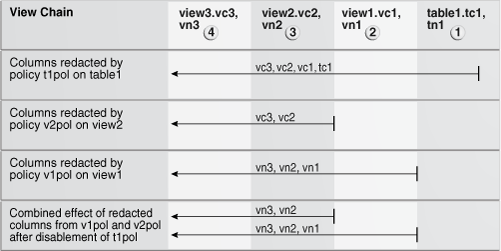

## 5 Configuring Oracle Data Redaction Policies

An Oracle Data Redaction policy defines how to redact data in a column based on the table column type and the type of redaction you want to use. You can enable and disable policies as necessary.

This section contains the following topics:

## 5.1 About Oracle Data Redaction Policies

An Oracle Data Redaction policy defines the conditions in which redaction must occur for a table or view.

A Data Redaction policy has the following characteristics:

- The Data Redaction policy defines the following: What kind of redaction to perform, how the redaction should occur, and when the redaction takes place. Oracle Database performs the redaction at execution time, just before the data is returned to the application.
- A Data Redaction policy can fully redact values, partially redact values, or randomly redact values. In addition, you can define a Data Redaction policy to not redact any data at all, for when you want to test your policies in a test environment.
- A Data Redaction policy can be defined with a policy expression which allows for different application users to be presented with either redacted data or actual data, based on whether the policy expression returns `TRUE` or `FALSE`. Redaction takes place when the boolean result of evaluating the policy expression is `TRUE`. For security reasons, the functions and operators that can be used in the policy expression are limited to `SYS_CONTEXT` and a few others. User-created functions are not allowed. Policy expressions can make use of the `SYS_SESSION_ROLES` namespace with the `SYS_CONTEXT` function to check for enabled roles.

Table 5-1 lists the procedures in the `DBMS_REDACT` package.

Table 5-1 DBMS\_REDACT Procedures

| Procedure | Description |
| --- | --- |
| `DBMS_REDACT.ADD_POLICY` | Adds a Data Redaction policy to a table or view |
| `DBMS_REDACT.ALTER_POLICY` | Modifies a Data Redaction policy |
| `DBMS_REDACT.UPDATE_FULL_REDACTION_VALUES` | Globally updates the full redaction value for a given data type. You must restart the database instance before the updated values can be used. |
| `DBMS_REDACT.ENABLE_POLICY` | Enables a Data Redaction policy |
| `DBMS_REDACT.DISABLE_POLICY` | Disables a Data Redaction policy |
| `DBMS_REDACT.DROP_POLICY` | Drops a Data Redaction policy |

See Also:

[Oracle Database PL/SQL Packages and Types Reference](https://docs.oracle.com/cd/E11882_01/appdev.112/e40758/d_redact.htm#ARPLS73800) for detailed information about the `DBMS_REDACT` PL/SQL package

## 5.2 Who Can Create Oracle Data Redaction Policies?

To create redaction policies, you must have the `EXECUTE` privilege on the `DBMS_REDACT` PL/SQL package. You do not need any privileges to access the underlying tables or views that will be protected by the policy.

## 5.3 Planning the Creation of an Oracle Data Redaction Policy

Before you create an Oracle Data Redaction policy, it is important to plan the data redaction process that best suits your data.

1. Ensure that you have been granted the `EXECUTE` privilege on the `DBMS_REDACT` PL/SQL package.
2. Determine the data type of the table or view column that you want to redact.
3. Ensure that this column is not used in an Oracle Virtual Private Database (VPD) row filtering condition. That is, it must not be part of the VPD predicate generated by the VPD policy function.
4. Decide on the type of redaction that you want to perform: full, random, partial, regular expressions, or none.
5. Decide which users to apply the Data Redaction policy to.
6. Based on this information, create the Data Redaction policy by using the `DBMS_REDACT.ADD_POLICY` procedure.
7. Configure the policy to have additional columns to be redacted, as described in "Redacting Multiple Columns".

After you create the Data Redaction policy, it is automatically enabled and ready to redact data.

## 5.4 General Syntax of the DBMS\_REDACT.ADD\_POLICY Procedure

To create a Data Redaction policy, use the `DBMS_REDACT.ADD_POLICY` procedure. The complete syntax is as follows:

```
DBMS_REDACT.ADD_POLICY (
DBMS_REDACT.ADD_POLICY (
 object_schema               IN VARCHAR2 := NULL,
 object_name                 IN VARCHAR2 := NULL,
 policy_name                 IN VARCHAR2, 
 policy_description          IN VARCHAR2 := NULL,
 column_name                 IN VARCHAR2 := NULL,
 column_description          IN VARCHAR2 := NULL,
 function_type               IN BINARY_INTEGER := DBMS_REDACT.FULL,
 function_parameters         IN VARCHAR2 := NULL,
 expression                  IN VARCHAR2,
 enable                      IN BOOLEAN := TRUE,
 regexp_pattern              IN VARCHAR2 := NULL,
 regexp_replace_string       IN VARCHAR2 := NULL,
 regexp_position             IN BINARY_INTEGER :=1,
 regexp_occurrence           IN BINARY_INTEGER :=0,
 regexp_match_parameter      IN VARCHAR2 := NULL);
```

In this specification:

- `object_schema`: Specifies the schema of the object on which the Data Redaction policy will be applied. If you omit this setting (or enter `NULL`), then Oracle Database uses the current user's name. Be aware that the meaning of "current user" here can change, depending on where you invoke the `DBMS_REDACT.ADD_POLICY` procedure.
	For example, suppose user `mpike` grants user `fbrown` the `EXECUTE` privilege on a definer's rights PL/SQL package called `mpike.protect_data` in `mpike` 's schema. From within this package, `mpike` has coded a procedure called `protect_cust_data`, which invokes the `DBMS_REDACT.ADD_POLICY` procedure. User `mpike` has set the `object_schema` parameter to `NULL`.
	When `fbrown` invokes the `protect_cust_data` procedure in the `mpike.protect_data` package, Oracle Database attempts to define the Data Redaction policy around the object `cust_data` in the `mpike` schema, not the `cust_data` object in the schema that belongs to `fbrown`.
- `object_name`: Specifies the name of the table or view to which the Data Redaction policy applies.
- `policy_name`: Specifies the name of the policy to be created. Ensure that this name is unique in the database instance. You can find a list of existing Data Redaction policies by querying the `POLICY_NAME` column of the `REDACTION_POLICIES` data dictionary view.
- `policy_description`: Specifies a brief description of the purpose of the policy.
- `column_name`: Specifies the column whose data you want to redact. Note the following:
	- You can apply the Data Redaction policy to multiple columns. If you want to apply the Data Redaction policy to multiple columns, then after you use `DBMS_REDACT.ADD_POLICY` to create the policy, run the `DBMS_REDACT.ALTER_POLICY` procedure as many times as necessary to add each of the remaining required columns to the policy. See "Altering an Oracle Data Redaction Policy".
		- Only one policy can be defined on a table or view. You can, however, create a new view on the table, and by defining a second redaction policy on this new view, you can choose to redact the columns in a different way when a query is issued against this new view. When deciding how to redact a given column, Oracle Database uses the policy of the earliest view in a view chain. See "Example: How Oracle Data Redaction Affects Tables and Views" for more information about using Data Redaction policies with views.
		- If you do not specify a column (for example, by entering NULL), then no columns are redacted by the policy. This enables you to create your policies so that they are in place, and then later on, you can add the column specification when you are ready.
		- Do not use a column that is currently used in an Oracle Virtual Private Database (VPD) row filtering condition. In other words, the column should not be part of the VPD predicate generated by the VPD policy function. See ["Oracle Data Redaction and Oracle Virtual Private Database"](redaction_other.md) for more information about using Data Redaction with VPD.s
		- You cannot define a Data Redaction policy on a virtual column. In addition, you cannot define a Data Redaction policy on a column that is involved in the SQL expression of any virtual column.
- `column_description`: Specifies a brief description of the column that you are redacting.
- `function_type`: Specifies a function that sets the type of redaction. See the following sections for more information:
	- "Syntax for Creating a Full Redaction Policy"
		- "Syntax for Creating a Partial Redaction Policy"
		- "Syntax for Creating a Regular Expression-Based Redaction Policy"
		- "Syntax for Creating a Random Redaction Policy"
		- "Syntax for Creating a Policy with No Redaction"
	If you omit the `function_type` parameter, then the default redaction `function_type` setting is `DBMS_REDACT.FULL`.
- `function_parameters`: Specifies how the column redaction should appear for partial redaction. See "Syntax for Creating a Partial Redaction Policy".
- `expression`: Specifies a Boolean SQL expression to determine how the policy is applied. Redaction takes place only if this policy expression evaluates to `TRUE`. See "Using Expressions to Define Conditions for Data Redaction Policies".
- `enable`: When set to `TRUE`, enables the policy upon creation. When set to `FALSE`, it creates the policy as a disabled policy. The default is `TRUE`. After you create the policy, you can disable or enable it. See the following sections:
	- "Disabling an Oracle Data Redaction Policy"
		- "Enabling an Oracle Data Redaction Policy"
- `regexp_pattern`, `regexp_replace_string`, `regexp_position`, `regexp_position`, `regexp_occurrence`, `regexp_match_parameter`: Enable you to use regular expressions to redact data, either fully or partially. If the `regexp_pattern` does not match anything in the [actual data](asogls.md), then full redaction will take place, so be careful when specifying the `regexp_pattern`. Ensure that all of the values in the column conform to the semantics of the regular expression you are using. See "Syntax for Creating a Regular Expression-Based Redaction Policy" for more information.

## 5.5 Using Expressions to Define Conditions for Data Redaction Policies

When you create any Oracle Data Redaction policy, you must use the `expression` parameter in the `DBMS_REDACT.ADD_POLICY` procedure to specify the conditions in which the policy applies.

This section contains:

- About Using Expressions in Data Redaction Policies
- Applying the Redaction Policy Based on User Environment
- Applying the Redaction Policy Based on Database Role
- Applying the Redaction Policy Based on Oracle Application Express Session States
- Applying the Redaction Policy with No Filtering

### 5.5.1 About Using Expressions in Data Redaction Policies

The `expression` parameter of the `DBMS_REDACT.ADD_POLICY` procedure defines a Boolean expression that must evaluate to `TRUE` before the redaction can table place.

This expression must be based on one of the following functions:

- `SYS_CONTEXT`, using a specified namespace. The default namespace for `SYS_CONTEXT` is `USERENV`, which includes values such as `SESSION_USER` and `CLIENT_IDENTIFIER`. (See [Oracle Database SQL Language Reference](https://docs.oracle.com/cd/E11882_01/server.112/e41084/functions184.htm#SQLRF06117) for detailed information about this function.) Another namespace that you can use is the `SYS_SESSION_ROLES` namespace, which contains attributes for each role.
- The following Oracle Application Express functions:
	- `V`, which is a wrapper for the `APEX_UTIL.GET_SESSION_STATE` function
		- `NV`, which is a wrapper for the `APEX_UTIL.GET_NUMERIC_SESSION_STATE` function
	See [Oracle Application Express API Reference](https://docs.oracle.com/cd/E11882_01/appdev.112/e12510/apex_util.htm#AEAPI101) for more information about these `APEX_UTIL` package functions.
- The `OLS_LABEL_DOMINATES` function, described in [Oracle Label Security Administrator's Guide](http://www.oracle.com/pls/topic/lookup?ctx=db112&id=OLSAG4147), which is a wrapper for the `LBACSYS.OLS_LABEL_DOMINATES` function.

Follow these guidelines when you write the expression:

- Use only the following operators: `=`, `!=`, `>`, `<`, `>=`, `<=`
- Because the expression must evaluate to `TRUE` for redaction, be careful when making comparisons with `NULL`. Remember that in SQL the value `NULL` is undefined, so comparisons with `NULL` tend to return `FALSE`.
- Do not use user-created functions in the `expression` parameter; this is not permitted.

Remember that for user `SYS` and users who have the `EXEMPT REDACTION POLICY` privilege, all of the Data Redaction policies are bypassed, so the results of their queries are not redacted. See for more information about users who are exempted from Data Redaction policies.

Remember that for user `SYS` and users who have the `EXEMPT REDACTION POLICY` privilege, all of the Data Redaction policies are bypassed, so the results of their queries are not redacted. See "Exempting Users from Oracle Data Redaction Policies" for more information about users who are exempted from Data Redaction policies.

### 5.5.2 Applying the Redaction Policy Based on User Environment

To apply a Data Redaction policy based on the user's environment (such as the session user name or client identifier), you can use the `USERENV` namespace of the `SYS_CONTEXT` function in the `DBMS_REDACT.ADD_POLICY` `expression` parameter.

Example 5-1 shows how to apply the policy only to the session user name `psmith`.

Example 5-1 Filtering Users by Session User Name

```
expression  => 'SYS_CONTEXT(''USERENV'',''SESSION_USER'') = ''PSMITH'''
```

See Also:

[Oracle Database SQL Language Reference](https://docs.oracle.com/cd/E11882_01/server.112/e41084/functions184.htm#SQLRF06117) for information about more namespaces that you can use with the `SYS_CONTEXT` function

### 5.5.3 Applying the Redaction Policy Based on Database Role

To apply a Data Redaction policy based on database roles, you can use the `SYS_SESSION_ROLES` namespace in the `SYS_CONTEXT` function, which contains attributes for each role. The value of the attribute is `TRUE` if the specified role is enabled for the querying application user; the value is `FALSE` if the role is not enabled.

For example, suppose you wanted only supervisors to be allowed to see the [actual data](asogls.md). Example 5-2 shows how to use the `DBMS_REDACT.ADD_POLICY` `expression` parameter to set the policy to show the actual data to any application user who has the `supervisor` role enabled, but redact the data for all of the other application users.

Example 5-2 Applying a Data Redaction Policy by Database Role

```
expression  => 'SYS_CONTEXT(''SYS_SESSION_ROLES'',''SUPERVISOR'') = ''FALSE'''
```

### 5.5.4 Applying the Redaction Policy Based on Oracle Application Express Session States

To apply a Data Redaction policy based on an Oracle Application Express (APEX) session state, you can use either of the following public Application Express APIs in the `DBMS_REDACT.ADD_POLICY` `expression` parameter:

- `V`, which is a synonym for the `APEX_UTIL.GET_SESSION_STATE` function
- `NV`, which is a synonym for the `APEX_UTIL.GET_NUMERIC_SESSION_STATE` function

You can, for example, use these functions to redact data based on a job or a privilege role that is stored in a session state in an APEX application.

Example 5-3 shows how to set the `DBMS_REDACT.ADD_POLICY` `expression` parameter if you wanted redaction to take place when the application item called `G_JOB` has the value `CLERK`.

Example 5-3 Filtering Users by Oracle Application Express Session State

```
expression => 'V'(''G_JOB'') = ''CLERK'''
```

If you want redaction to take place when the querying user is not within the context of an APEX application (when the query is issued from outside the APEX framework, for example directly through SQL\*Plus), then use an `IS NULL` clause as follows. This policy expression causes actual data to be shown to user `mavis` only when her query comes from within an APEX application. Otherwise, the query result is redacted.

```
expression => 'V(''APP_USER'') != ''mavis@example.com'' or V(''APP_USER'') is null'
```

See Also:

[Oracle Application Express API Reference](https://docs.oracle.com/cd/E11882_01/appdev.112/e12510/apex_util.htm#AEAPI101)

### 5.5.5 Applying the Redaction Policy with No Filtering

You can apply the policy irrespective of the context to any user, with no filtering. However, be aware that user `SYS` and users who have the `EXEMPT REDACTION POLICY` privilege are always except from Oracle Data Redaction policies. To apply the policy to users who are not `SYS` or have been granted the `EXEMPT REDACTION POLICY` privilege, write the `DBMS_REDACT.ADD_POLICY` `expression` parameter to evaluate to `TRUE`, as shown Example 5-4.

Example 5-4 Applying the Redaction Policy with No Filtering

```
expression  => '1=1'
```

See Also:

"Exempting Users from Oracle Data Redaction Policies"

## 5.6 Creating a Full Redaction Policy and Altering the Default Full Redaction Value

This section contains:

- Creating a Full Redaction Policy
- Altering the Default Full Data Redaction Value

### 5.6.1 Creating a Full Redaction Policy

This section contains:

- About Creating Full Data Redaction Policies
- Syntax for Creating a Full Redaction Policy
- Examples of Full Data Redaction Policies

#### 5.6.1.1 About Creating Full Data Redaction Policies

A full data redaction policy redacts all the contents of a data column. To set the redaction policy to be full, you must set the function\_type parameter to `DBMS_REDACT.FULL`. By default, `NUMBER` data type columns are replaced with zero (`0`) and character data type columns are replaced with a single space ( ). You can modify this default by using the `DBMS_REDACT.UPDATE_FULL_REDACTION_VALUES` procedure.

See Also:

"Altering the Default Full Data Redaction Value" if you want to modify the default full redaction value

#### 5.6.1.2 Syntax for Creating a Full Redaction Policy

The fields used for creating a full data redaction policy are as follows:

```
DBMS_REDACT.ADD_POLICY (
   object_schema           IN VARCHAR2 := NULL, 
   object_name             IN VARCHAR2,
   column_name             IN VARCHAR2 := NULL,
   policy_name             IN VARCHAR2,
   function_type           IN BINARY_INTEGER := NULL,
   expression              IN VARCHAR2,
   enable                  IN BOOLEAN := TRUE);
```

In this specification:

- `object_schema`, `object_name`, `column_name`, `policy_name`, `expression`, `enable`: See "General Syntax of the DBMS\_REDACT.ADD\_POLICY Procedure".
- `function_type`: Specifies the function used to set the type of redaction. Enter `DBMS_REDACT.FULL`.
	If you omit the `function_type` parameter, then the default redaction `function_type` setting is `DBMS_REDACT.FULL`.
	Remember that the data type of the column determines which `function_type` settings that you are permitted to use. See ["Comparison of Full, Partial, and Random Redaction Based on Data Types"](redaction_features.md).

#### 5.6.1.3 Examples of Full Data Redaction Policies

Example 5-5 shows how to use full redaction for all the values in the `HR.EMPLOYEES` table `COMMISSION_PCT` column. The expression parameter applies the policy to any user querying the table, except for users who have been granted the `EXEMPT REDACTION POLICY` system privilege. (See "Exempting Users from Oracle Data Redaction Policies" for more information about the `EXEMPT REDACTION POLICY` system privilege.)

Example 5-5 Full Data Redaction Policy

```
BEGIN
 DBMS_REDACT.ADD_POLICY(
   object_schema    => 'hr', 
   object_name      => 'employees', 
   column_name      => 'commission_pct',
   policy_name      => 'redact_com_pct', 
   function_type    => DBMS_REDACT.FULL,
   expression       => '1=1');
END;
/
```

Query and redacted result:

```
SELECT COMMISSION_PCT FROM HR.EMPLOYEES;

COMMISSION_PCT
--------------
0
0
0
```

Example 5-6 shows how to redact fully the user IDs of the `user_id` column in the `mavis.cust_info` table. The `user_id` column is of the `VARCHAR2` data type. The output is a blank string. The `expression` setting enables users who have the `MGR` role to view the user IDs.

Example 5-6 Fully Redacted Data Redaction Character Values

```
BEGIN
 DBMS_REDACT.ADD_POLICY(
   object_schema   => 'mavis', 
   object_name     => 'cust_info', 
   column_name     => 'user_id',
   policy_name     => 'redact_cust_user_ids', 
   function_type   => DBMS_REDACT.FULL,
   expression      => 'SYS_CONTEXT(''SYS_SESSION_ROLES'',''MGR'') = ''FALSE''');
END;
/
```

Query and redacted result:

```
SELECT user_id FROM mavis.cust_info;

USER_ID
------------
0
0
0
```

### 5.6.2 Altering the Default Full Data Redaction Value

To alter the default full data redaction value, you use the `DBMS_REDACT.UPDATE_FULL_REDACTION_VALUES` procedure to modify this value.

This section contains:

- About Altering the Default Full Data Redaction Value
- Altering the Default Full Data Redaction Value for Non-LOB Data Type Columns
- Altering the Default Full Data Redaction Value for LOB Data Type Columns

#### 5.6.2.1 About Altering the Default Full Data Redaction Value

You can alter the default displayed values for Data Redaction policies that use full data redaction. If you want to change any of the default full redaction values for any of the data types to another value, then you can use the method that applies to that data type, as shown in the following list:

- If the data type of the column is a non-LOB data type (`BINARY_FLOAT`, `BINARY_DOUBLE`, `CHAR`, `VARCHAR2`, `NCHAR`, `NVARCHAR2`, `DATE`, `TIMESTAMP`, or `TIMESTAMP WITH TIME ZONE`), then you must use the `DBMS_REDACT.UPDATE_FULL_REDACTION_VALUES` procedure, as described in "Altering the Default Full Data Redaction Value for Non-LOB Data Type Columns".
- If the data type of the column is a LOB data type (`BLOB`, CLOB, or `NCLOB`), then you must run the `UPDATE` statement, as described in "Altering the Default Full Data Redaction Value for LOB Data Type Columns".

After you modify a value, you must restart the database for it to take effect. You can find the current values by querying the `REDACTION_VALUES_FOR_TYPE_FULL` data dictionary view.

Be aware that this change affects all Data Redaction policies in the database that use full data redaction. Before you alter the default full data redaction value, examine the affect that this change would have on existing full Data Redaction policies.

#### 5.6.2.2 Altering the Default Full Data Redaction Value for Non-LOB Data Type Columns

To alter the default full data redaction value for non-LOB data type columns, use the `DBMS_REDACT.UPDATE_FULL_REDACTION_VALUES` procedure.

1. Log in to the database instance as a user who has been granted the `EXECUTE` privilege on the `DBMS_REDACT` PL/SQL package.
2. (Optional) Check the value that you want to change.
	For example, to check the current value for columns that use the `NUMBER` data type:
	```
	SELECT NUMBER_VALUE FROM REDACTION_VALUES_FOR_TYPE_FULL;
	NUMBER_VALUE
	------------
	           0
	```
3. Run the `DBMS_REDACT.UPDATE_FULL_REDACTION_VALUES` procedure to modify the value.
	Use the following syntax:
	```
	EXEC DBMS_REDACT.UPDATE_FULL_REDACTION_VALUES (datatype_value => new_value);
	```
	For example, to modify a `NUMBER` column to use `7` as the default:
	```
	EXEC DBMS_REDACT.UPDATE_FULL_REDACTION_VALUES (number_val => 7);
	```
	For other data types, replace `datatype_value` with the following settings, and `new_value` with the value that you want to use:
	|  | Data Type | new\_value Setting |
	| --- | --- | --- |
	|  | `BINARY_FLOAT` | `binfloat_val` |
	|  | `BINARY_DOUBLE` | `bindouble_val` |
	|  | `CHAR` | `char_val` |
	|  | `VARCHAR2` | `varchar_val` |
	|  | `NCHAR` | `nchar_val` |
	|  | `NVARCHAR2` | `nvarchar_val` |
	|  | `DATE` | `date_val` |
	|  | `TIMESTAMP` | `ts_val` |
	|  | `TIMESTAMP WITH TIME ZONE` | `tswtz_val` |
4. Restart the database instance.
	For example:
	```
	SHUTDOWN IMMEDIATE
	STARTUP
	```

See Also:

- [Oracle Database PL/SQL Packages and Types Reference](https://docs.oracle.com/cd/E11882_01/appdev.112/e40758/d_redact.htm#ARPLS74761) for more information about the `DBMS_REDACT.UPDATE_FULL_REDACTION_VALUES` procedure
- [Oracle Database Reference](https://docs.oracle.com/cd/E11882_01/server.112/e40402/statviews_5163.htm#REFRN29164) for more information about the `REDACTION_VALUES_FOR_TYPE_FULL` view

#### 5.6.2.3 Altering the Default Full Data Redaction Value for LOB Data Type Columns

To alter the default full data redaction value for LOB data type columns:

1. Log in to the database instance as a user who has privileges to update the `RADM_FPTM_LOB$` data dictionary table.
2. (Optional) Check the value that you want to change by querying the `REDACTION_VALUES_FOR_TYPE_FULL` data dictionary view.
3. Update the LOB value.
	- For the `BLOB` data type, initialize a variable (for example, `blob_val`) with the new full Data Redaction value for the `BLOB` data type. Then run an `UPDATE` statement on the `BLOBVAL` column of the `RADM_FPTM_LOB$` table to set the new default value for full redaction of columns of the `BLOB` data type.
		```
		DECLARE
		  blob_val BLOB;
		BEGIN
		  DBMS_LOB.CREATETEMPORARY(blob_val, TRUE);
		 
		  DBMS_LOB.WRITE(blob_val, 8, 1,  UTL_RAW.CAST_TO_RAW('newvalue'));
		 
		  UPDATE RADM_FPTM_LOB$ SET BLOBCOL = BLOB_VAL WHERE FPVER = 1;
		 
		  DBMS_LOB.FREETEMPORARY(blob_val);
		END;
		/
		```
		- For the `CLOB` data type, initialize a variable (for example, `clob_val`) with the new full Data Redaction value for the `CLOB` data type. Then run an `UPDATE` statement on the `CLOBVAL` column of the `RADM_FPTM_LOB$` table to set the new default value for full redaction of columns of the `CLOB` data type.
		```
		DECLARE
		  clob_val CLOB;
		BEGIN
		  DBMS_LOB.CREATETEMPORARY(clob_val, TRUE);
		 
		  DBMS_LOB.WRITE(clob_val, 8, 1, 'newvalue');
		 
		  UPDATE RADM_FPTM_LOB$ SET CLOBCOL = CLOB_VAL WHERE FPVER = 1;
		 
		  DBMS_LOB.FREETEMPORARY(clob_val);
		END;
		/
		```
		- For the `NCLOB` data type, initialize a variable (for example, `nclob_val`) with the new full Data Redaction value for the `NCLOB` data type. Then run an `UPDATE` statement on the `NCLOBVAL` column of the `RADM_FPTM_LOB$` table to set the new default value for full redaction of columns of the `NCLOB` data type.
		```
		DECLARE
		  nclob_val NCLOB;
		BEGIN
		  DBMS_LOB.CREATETEMPORARY(nclob_val, TRUE);
		 
		  DBMS_LOB.WRITE(nclob_val, 8, 1, N'newvalue');
		 
		  UPDATE RADM_FPTM_LOB$ SET NCLOBCOL = NCLOB_VAL WHERE FPVER = 1;
		 
		  DBMS_LOB.FREETEMPORARY(nclob_val);
		END;
		/
		```
4. Restart the database instance.
	For example:
	```
	SHUTDOWN IMMEDIATE
	STARTUP
	```

See Also:

[Oracle Database Reference](https://docs.oracle.com/cd/E11882_01/server.112/e40402/statviews_5163.htm#REFRN29164) for more information about the `REDACTION_VALUES_FOR_TYPE_FULL` view

## 5.7 Creating a Partial Redaction Policy

This section contains:

- About Creating Partial Redaction Policies
- Syntax for Creating a Partial Redaction Policy
- Creating Partial Redaction Policies Using Fixed Character Shortcuts
- Creating Partial Redaction Policies Using Character Data Types
- Creating Partial Redaction Policies Using Number Data Types
- Creating Partial Redaction Policies Using Date-Time Data Types

### 5.7.1 About Creating Partial Redaction Policies

In partial data redaction, only a portion of the data, such as the first five digits of an identification number, are redacted. For example, you can redact most of a credit card number with asterisks (\*), except for the last 4 digits. You can create policies for columns that use character, number, or date-time data types. For policies that redact character data types, you can use fixed character redaction shortcuts.

### 5.7.2 Syntax for Creating a Partial Redaction Policy

The `DBMS_REDACT.ADD_POLICY` fields for creating a partial redaction policy are as follows:

```
DBMS_REDACT.ADD_POLICY (
   object_schema           IN VARCHAR2 := NULL, 
   object_name             IN VARCHAR2,
   column_name             IN VARCHAR2 := NULL,
   policy_name             IN VARCHAR2,
   function_type           IN BINARY_INTEGER := NULL,
   function_parameters     IN VARCHAR2 := NULL,
   expression              IN VARCHAR2,
   enable                  IN BOOLEAN := TRUE);
```

In this specification:

- `object_schema`, `object_name`, `column_name`, `policy_name`, `expression`, `enable`: See "General Syntax of the DBMS\_REDACT.ADD\_POLICY Procedure"
- `function_type`: Specifies the function used to set the type of redaction. Enter `DBMS_REDACT.PARTIAL`.
- `function_parameters`: The parameters that you set here depend on the data type of the column specified for the `column_name` parameter. See the following sections for details:
	- "Creating Partial Redaction Policies Using Fixed Character Shortcuts"
		- "Creating Partial Redaction Policies Using Character Data Types"
		- "Creating Partial Redaction Policies Using Number Data Types"
		- "Creating Partial Redaction Policies Using Date-Time Data Types"

### 5.7.3 Creating Partial Redaction Policies Using Fixed Character Shortcuts

The `DBMS_REDACT.ADD_POLICY` `function_parameters` parameter enables you to use fixed character shortcuts.

This section contains:

- Settings for Fixed Character Shortcuts
- Example of a Partial Redaction Policy Using a Fixed Character Shortcut

#### 5.7.3.1 Settings for Fixed Character Shortcuts

Table 5-2 describes `DBMS_REDACT.ADD_POLICY` `function_parameters` parameter shortcuts that you can use for commonly redacted Social Security numbers, postal codes, and credit cards that use either the `VARCHAR2` or `NUMBER` data types for their columns.

Table 5-2 Partial Fixed Character Redaction Shortcuts

| Shortcut | Description |
| --- | --- |
| `DBMS_REDACT.REDACT_US_SSN_F5` | Redacts the first 5 numbers of Social Security numbers when the column is a `VARCHAR2` data type. For example, the number `987-65-4320` becomes `XXX-XX-4320`. |
| `DBMS_REDACT.REDACT_US_SSN_L4` | Redacts the last 4 numbers of Social Security numbers when the column is a `VARCHAR2` data type. For example, the number `987-65-4320` becomes `987-65-XXXX`. |
| `DBMS_REDACT.REDACT_US_SSN_ENTIRE` | Redacts the entire Social Security number when the column is a `VARCHAR2` data type. For example, the number `987-65-4320` becomes `XXX-XX-XXXX`. |
| `DBMS_REDACT.REDACT_NUM_US_SSN_F5` | Redacts the first 5 numbers of Social Security numbers when the column is a `NUMBER` data type. For example, the number `987654320` becomes `XXXXX4320`. |
| `DBMS_REDACT.REDACT_NUM_US_SSN_L4` | Redacts the last 4 numbers of Social Security numbers when the column is a `NUMBER` data type. For example, the number `987654320` becomes `98765XXXX`. |
| `DBMS_REDACT.REDACT_NUM_US_SSN_ENTIRE` | Redacts the entire Social Security number when the column is a `NUMBER` data type. For example, the number `987654320` becomes `XXXXXXXXX`. |
| `DBMS_REDACT.REDACT_ZIP_CODE` | Redacts a 5-digit postal code when the column is a `VARCHAR2` data type. For example, `95476` becomes `XXXXX`. |
| `DBMS_REDACT.REDACT_NUM_ZIP_CODE` | Redacts a 5-digit postal code when the column is a `NUMBER` data type. For example, `95476` becomes `XXXXX`. |
| `DBMS_REDACT.REDACT_DATE_MILLENNIUM` | Redacts dates that are in the `DD-MON-YY` format to `01-JAN-00` (January 1, 2000). |
| `DBMS_REDACT.REDACT_DATE_EPOCH` | Redacts all dates to `01-JAN-70`. |
| `DBMS_REDACT.REDACT_CCN16_F12` | Redacts a 16-digit credit card number, leaving the last 4 digits displayed. For example, `5105 1051 0510 5100` becomes `****-****-****-5100`. |

See Also:

"General Syntax of the DBMS\_REDACT.ADD\_POLICY Procedure" for information about other `DBMS_REDACT.ADD_POLICY` parameters

#### 5.7.3.2 Example of a Partial Redaction Policy Using a Fixed Character Shortcut

Example 5-7 shows how Social Security numbers in a `VARCHAR2` data type column and can be redacted using the `REDACT_US_SSN_F5` shortcut.

Example 5-7 Partially Redacted Character Values

```
BEGIN
 DBMS_REDACT.ADD_POLICY(
   object_schema       => 'mavis', 
   object_name         => 'cust_info', 
   column_name         => 'ssn',
   policy_name         => 'redact_cust_ssns3', 
   function_type       => DBMS_REDACT.PARTIAL,
   function_parameters => DBMS_REDACT.REDACT_US_SSN_F5,
   expression          => '1=1',
   policy_description  => 'Partially redacts 1st 5 digits in SS numbers',
   column_description  => 'ssn contains Social Security numbers');
END;
/
```

Query and redacted result:

```
SELECT ssn FROM mavis.cust_info;

SSN
-------
XXX-XX-4320
XXX-XX-4323
XXX-XX-4325
XXX-XX-4329
```

### 5.7.4 Creating Partial Redaction Policies Using Character Data Types

The `DBMS_REDACT.ADD_POLICY` `function_parameters` parameter enables you to redact character data types.

This section contains:

- Settings for Character Data Types
- Example of a Partial Redaction Policy Using Character a Data Type

#### 5.7.4.1 Settings for Character Data Types

When you set the `DBMS_REDACT.ADD_POLICY` `function_parameters` parameter to define partial redaction of character data types, enter values for the following settings in the order shown. Separate each value with a comma.

Note:

Be aware that you must use a fixed width character set for the partial redaction. In other words, each character redacted must be replaced by another of equal byte length. If you want to use a variable-length character set (for example, UTF-8), then you must use a regular expression-based redaction. See "Syntax for Creating a Regular Expression-Based Redaction Policy" for more information.

The settings are as follows:

1. Input format: Defines how the data is currently formatted. Enter `V` for each character that potentially can be redacted, such as all of the digits in a credit card number. Enter `F` for each character that you want to format using a formatting character, such as hyphens or blank spaces in the credit card number. Ensure that each character has a corresponding `V` or `F` value. (The input format values are not case-sensitive.)
2. Output format: Defines how the displayed data should be formatted. Enter `V` for each character to be potentially redacted. Replace each `F` character in the input format with the character that you want to use for the displayed output, such as a hyphen. (The output format values are not case-sensitive.)
3. Mask character: Specifies the character to be used for the redaction. Enter a single character to use for the redaction, such as an asterisk (\*).
4. Starting digit position: Specifies the starting `V` digit position for the redaction.
5. Ending digit position: Specifies the ending `V` digit position for the redaction. Do not include the `F` positions when you decide on the ending position value.

For example, the following setting redacts the first 12 `V` digits of the credit card number `5105 1051 0510 5100`, and replaces the `F` positions (which are blank spaces) with hyphens to format it in a style normally used for credit card numbers, resulting in `****-****-****-4320`.

```
function_parameters  => 'VVVVFVVVVFVVVVFVVVV,VVVV-VVVV-VVVV-VVVV,*,1,12',
```

See Also:

"General Syntax of the DBMS\_REDACT.ADD\_POLICY Procedure" for information about other `DBMS_REDACT.ADD_POLICY` parameters

#### 5.7.4.2 Example of a Partial Redaction Policy Using Character a Data Type

Example 5-8 shows how to redact Social Security numbers that are in a `VARCHAR2` data type column and to preserve the character hyphens in the Social Security number.

Example 5-8 Partially Redacted Data Redaction Character Values

```
BEGIN
 DBMS_REDACT.ADD_POLICY(
   object_schema       => 'mavis', 
   object_name         => 'cust_info', 
   column_name         => 'ssn',
   policy_name         => 'redact_cust_ssns2', 
   function_type       => DBMS_REDACT.PARTIAL,
   function_parameters => 'VVVFVVFVVVV,VVV-VV-VVVV,*,1,5',
   expression          => '1=1',
   policy_description  => 'Partially redacts Social Security numbers',
   column_description  => 'ssn contains character Social Security numbers');
END;
/
```

Query and redacted result:

```
SELECT ssn FROM mavis.cust_info;

SSN
-----------
***-**-4320
***-**-4323
***-**-4325
***-**-4329
```

### 5.7.5 Creating Partial Redaction Policies Using Number Data Types

The `DBMS_REDACT.ADD_POLICY` `function_parameters` parameter enables you to redact number data types.

This section contains:

- Settings for Number Data Types
- Example of a Partial Redaction Policy Using a Number Data Type

#### 5.7.5.1 Settings for Number Data Types

For partial redaction of number data types, enter values for the following settings for the `function_parameters` parameter of the `DBMS_REDACT.ADD_POLICY` procedure, in the order shown.

1. Mask character: Specifies the character to display. Enter a number from 0 to 9.
2. Starting digit position: Specifies the starting digit position for the redaction, such as `1` for the first digit.
3. Ending digit position: Specifies the ending digit position for the redaction.

For example, the following setting redacts the first five digits of the Social Security number `987654321`, resulting in `999994321`.

```
function_parameters  => '9,1,5',
```

See Also:

"General Syntax of the DBMS\_REDACT.ADD\_POLICY Procedure" for information about other `DBMS_REDACT.ADD_POLICY` parameters

#### 5.7.5.2 Example of a Partial Redaction Policy Using a Number Data Type

Example 5-9 shows how to partially redact a set of Social Security numbers in the `mavis.cust_info` table, for any application user who logs in. (Hence, the `expression` parameter evaluates to `TRUE`.) In this scenario, the Social Security numbers are in a column of the data type `NUMBER`. In other words, the `ssn` column contains numbers only, not other characters such as hyphens or blank spaces.

Example 5-9 Partially Redacted Data Redaction Numeric Values

```
BEGIN
 DBMS_REDACT.ADD_POLICY(
   object_schema       => 'mavis', 
   object_name         => 'cust_info', 
   column_name         => 'ssn',
   policy_name         => 'redact_cust_ssns1', 
   function_type       => DBMS_REDACT.PARTIAL,
   function_parameters => '7,1,5',
   expression          => '1=1',
   policy_description  => 'Partially redacts Social Security numbers',
   column_description  => 'ssn contains numeric Social Security numbers');
END;
/
```

Query and redacted result:

```
SELECT ssn FROM mavis.cust_info;

SSN
---------
777774320
777774323
777774325
777774329
```

### 5.7.6 Creating Partial Redaction Policies Using Date-Time Data Types

The `DBMS_REDACT.ADD_POLICY` `function_parameters` parameter enables you to redact date-time data types.

This section contains:

- Settings for Date-Time Data Types
- Example of a Partial Redaction Policy Using Date-Time Data Type

#### 5.7.6.1 Settings for Date-Time Data Types

For partial redaction of date-time data types, enter values for the following `DBMS_REDACT.ADD_POLICY` `function_parameters` parameter settings, in the order shown:

1. m: Redacts the month. To redact with a month name, append `1` – `12` to lowercase `m`. For example, `m5` displays as `MAY`. To omit redaction, enter an uppercase `M`.
2. d: Redacts the day of the month. To redact with a day of the month, append `1` – `31` to a lowercase `d`. For example, `d7` displays as `07`. If you enter a higher number than the days of the month (for example, `31` for the month of February), then the last day of the month is displayed (for example, `28`). To omit redaction, enter an uppercase `D`.
3. y: Redacts the year. To redact with a year, append `1` – `9999` to a lowercase `y`. For example, `y1984` displays as `84`. To omit redaction, enter an uppercase `Y`.
4. h: Redacts the hour. To redact with an hour, append `0` – `23` to a lowercase `h`. For example, `h20` displays as `20`. To omit redaction, enter an uppercase `H`.
5. m: Redacts the minute. To redact with a minute, append `0` – `59` to a lowercase `m`. For example, `m30` displays as `30`. To omit redaction, enter an uppercase `M`.
6. s: Redacts the second. To redact with a second, append `0` – `59` to a lowercase `s`. For example, `s45` displays as `45`. To omit redaction, enter an uppercase `S`.

See Also:

"General Syntax of the DBMS\_REDACT.ADD\_POLICY Procedure" for information about other `DBMS_REDACT.ADD_POLICY` parameters

#### 5.7.6.2 Example of a Partial Redaction Policy Using Date-Time Data Type

Example 5-10 shows how to partially redact a date. This example redacts the birth year of customers; replacing it with `13`, but retaining the remaining values.

Example 5-10 Partially Redacted Data Redaction Using Date-Time Values

```
BEGIN
 DBMS_REDACT.ADD_POLICY(
   object_schema       => 'mavis', 
   object_name         => 'cust_info', 
   column_name         => 'birth_date',
   policy_name         => 'redact_cust_bdate', 
   function_type       => DBMS_REDACT.PARTIAL,
   function_parameters => 'mdy2013HMS',
   expression          => '1=1',
   policy_description  => 'Replaces birth year with 2013',
   column_description  => 'birth_date contains customer's birthdate');
END;
/
```

Query and redacted result:

```
SELECT birth_date FROM mavis.cust_info;

BIRTH_DATE
07-DEC-13 09.45.40.000000 AM
12-OCT-13 04.23.29.000000 AM
```

## 5.8 Creating a Regular Expression-Based Redaction Policy

This section contains:

- About Creating Regular Expression-Based Redaction Policies
- Syntax for Creating a Regular Expression-Based Redaction Policy
- Creating Regular Expression-Based Redaction Policies Using Shortcuts
- Creating Custom Regular Expression Redaction Policies

### 5.8.1 About Creating Regular Expression-Based Redaction Policies

Regular expression-based redaction enables you to search for patterns of data to redact. For example, you can use regular expressions to redact email addresses, which can have varying character lengths. It is designed for use with character data only. You can use shortcuts for the search and replace operation, or you can create custom patterns.

You cannot use regular expressions to redact a subset of the values in a column. The `REGEXP_PATTERN` (regular expression pattern) must match all of the values in order for the `REGEXP_REPLACE_STRING` setting to take effect, and the `REGEXP_REPLACE_STRING` must change the value.

For rows where the `REGEXP_PATTERN` fails to match, Data Redaction performs `DBMS_REDACT.FULL` redaction. This mitigates the risk of a mistake in the `REGEXP_PATTERN` which causes the regular expression to fail to match all of the values in the column, from showing the actual data for those rows which it failed to match.

In addition, if no change to the value occurs as a result of the `REGEXP_REPLACE_STRING` setting during regular expression replacement operation, Data Redaction performs `DBMS_REDACT.FULL` redaction.

### 5.8.2 Syntax for Creating a Regular Expression-Based Redaction Policy

The `DBMS_REDACT.ADD_POLICY` fields for creating a regular expression-based data redaction policy are as follows:

```
DBMS_REDACT.ADD_POLICY (
   object_schema           IN VARCHAR2 := NULL, 
   object_name             IN VARCHAR2,
   column_name             IN VARCHAR2 := NULL,
   policy_name             IN VARCHAR2,
   function_type           IN BINARY_INTEGER := NULL,
   expression              IN VARCHAR2,
   enable                  IN BOOLEAN := TRUE,
   regexp_pattern          IN VARCHAR2 := NULL,
   regexp_replace_string   IN VARCHAR2 := NULL,
   regexp_position         IN BINARY_INTEGER := 1,
   regexp_occurrence       IN BINARY_INTEGER := 0,
   regexp_match_parameter  IN VARCHAR2 := NULL);
```

In this specification:

- `object_schema`, `object_name`, `column_name`, `policy_name`, `expression`, `enable`: See "General Syntax of the DBMS\_REDACT.ADD\_POLICY Procedure".
- `function_type`: Specifies the function used to set the type of redaction. Enter `DBMS_REDACT.REGEXP`.
	Note the following:
	- When you set the `function_type` parameter to `DBMS_REDACT.REGEXP`, omit the `function_parameters` parameter.
		- Specify the regular expressions— `regexp_pattern`, `regexp_replace`, `regexp_position`, `regexp_occurrence`, and `regexp_match_parameter` —in much the same way that you specify the `pattern`, `replace`, `position`, `occurrence`, and `match_parameter` arguments to the `REGEXP_REPLACE` SQL function. See [Oracle Database SQL Language Reference](https://docs.oracle.com/cd/E11882_01/server.112/e41084/functions149.htm#SQLRF06302) for information about the `REGEXP_REPLACE` SQL function.
- `regexp_pattern`: Describes the search pattern for data that must be matched. If it finds a match, then Oracle Database replaces the data as specified by the `regexp_replace_string` setting. See the following sections for more information:
	- "Creating Regular Expression-Based Redaction Policies Using Shortcuts"
		- "Creating Custom Regular Expression Redaction Policies"
- `regexp_replace_string`: Specifies how you want to replace the data to be redacted. See the following sections for more information:
	- "Creating Regular Expression-Based Redaction Policies Using Shortcuts"
		- "Creating Custom Regular Expression Redaction Policies"
- `regexp_position`: Specifies the starting position for the string search. The value that you enter must be a positive integer indicating the character of the `column_name` data where Oracle Database should begin the search. The default is `1` or the `RE_BEGINNING` shortcut, meaning that Oracle Database begins the search at the first character of the `column_name` data.
- `regexp_occurrence`: Specifies how to perform the search and replace operation. The value that you enter must be a nonnegative integer indicating the occurrence of the replace operation:
	- If you specify `0` or the `RE_ALL` shortcut, then Oracle Database replaces all of the occurrences of the match.
		- If you specify the `RE_FIRST` shortcut, then Oracle Database replaces the first occurrence of the match.
		- If you specify a positive integer `n`, then Oracle Database replaces the `n` th occurrence of the first match.
	If the occurrence is greater than 1, then the database searches for the second occurrence beginning with the first character following the first occurrence of pattern, and so forth.
- `regexp_match_parameter`: Specifies a text literal that lets you change the default matching behavior of the function. The behavior of this parameter is the same for this function as for the `REGEXP_REPLACE` SQL function. See [Oracle Database SQL Language Reference](https://docs.oracle.com/cd/E11882_01/server.112/e41084/functions149.htm#SQLRF06302) for detailed information.
	To filter the search so that it is not case sensitive, specify the `RE_MATCH_CASE_INSENSITIVE` shortcut.

### 5.8.3 Creating Regular Expression-Based Redaction Policies Using Shortcuts

You can use shortcuts for both the `regexp_pattern` and `regexp_replace_string` parameters in the `DBMS_REDACT.ADD_POLICY` procedure.

This section contains:

- Regular Expression Shortcuts
- Example of a Regular Expression Redaction Policy Using Shortcuts

#### 5.8.3.1 Regular Expression Shortcuts

Table 5-3 describes the shortcuts that you can use with the `regexp_pattern` parameter in the `DBMS_REDACT.ADD_POLICY` procedure.

Table 5-3 Shortcuts for the regexp\_pattern Parameter

| Shortcut | Description |
| --- | --- |
| `DBMS_REDACT.RE_PATTERN_ANY_DIGIT` | Matches any digit. The `DBMS_REDACT.RE_PATTERN_ANY_DIGIT` is commonly used with the following values of the `regexp_replace_string` parameter:  ``` regexp_replace_string => DBMS_REDACT.RE_REDACT_WITH_SINGLE_X, ```  This setting replaces any matched digit with the `X` character.  The following setting replaces any matched digit with the `1` character.  ``` regexp_replace_string => DBMS_REDACT.RE_REDACT_WITH_SINGLE_1, ``` |
| `DBMS_REDACT.RE_PATTERN_CC_L6_T4` | Searches for the middle digits of any credit card that has 6 leading digits and 4 trailing digits with the characters specified by the `regexp_replace_string` parameter.  The appropriate `regexp_replace_string` setting to use with this shortcut is `DBMS_REDACT.RE_REDACT_CC_MIDDLE_DIGITS`, which finds any credit card that could have 6 leading and 4 trailing digits left as [actual data](asogls.md). It then redacts the middle digits. |
| `DBMS_REDACT.RE_PATTERN_US_PHONE` | Searches for any U.S. telephone number with the characters specified by the `regexp_replace_string` parameter.  The appropriate `regexp_replace_string` setting to use with this shortcut is `DBMS_REDACT.RE_REDACT_US_PHONE_L7`, which finds United States phone numbers and then redacts the last 7 digits. |
| `DBMS_REDACT.RE_PATTERN_EMAIL_ADDRESS` | Searches for any email address with the characters specified by the `regexp_replace_string` parameter.  The appropriate `regexp_replace_string` settings that you can use with this shortcut are as follows:  `RE_REDACT_EMAIL_NAME`, which finds any email address and redacts the email user name  `RE_REDACT_EMAIL_DOMAIN`, which finds any email address and redacts the email domain  `RE_REDACT_EMAIL_ENTIRE`, which finds any email address and redacts the entire email address |
| `DBMS_REDACT.RE_PATTERN_IP_ADDRESS` | Searches for an IP address with the characters specified by the `regexp_replace_string` parameter.  The appropriate `regexp_replace_string` setting to use with this shortcut is `DBMS_REDACT.RE_REDACT_IP_L3`, which replaces the last section of the dotted decimal string representation of an IP address with the characters `999` to indicate that it was redacted. |

Table 5-4 describes shortcuts that you can use with the `regexp_replace_string` parameter in the `DBMS_REDACT.ADD_POLICY` procedure.

Table 5-4 Shortcuts for the regexp\_replace\_string Parameter

| Shortcut | Description |
| --- | --- |
| `DBMS_REDACT.RE_REDACT_WITH_SINGLE_X` | Replaces the data with a single `X` character for each of the [actual data](asogls.md) characters. For example, the credit card number `5105 1051 0510 5100` could be replaced with `XXXX XXXX XXXX XXXX`. |
| `DBMS_REDACT.RE_REDACT_WITH_SINGLE_1` | Replaces the data with a single `1` digit for each of the [actual data](asogls.md) digits. For example, the credit card number `5105 1051 0510 5100` could be replaced with `1111 1111 1111 1111`. |
| `DBMS_REDACT.RE_REDACT_CC_MIDDLE_DIGITS` | Redacts the middle digits in credit card numbers, as specified by setting the `regexp_pattern` parameter with the `RE_PATTERN_CC_L6_T4` shortcut. The redaction replaces each redacted character with an `X`. For example, the credit card number `5105 1051 0510 5100` could be replaced with `5105 10XX XXXX 5100`. |
| `DBMS_REDACT.RE_REDACT_PHONE_L7` | Redacts the last 7 digits of U.S. telephone numbers, as specified by setting the `regexp_pattern` parameter with the `RE_PATTERN_US_PHONE` shortcut. The redaction replaces each redacted character with an `X`. This setting only applies to hyphenated phone numbers, not phone numbers with spaces. For example, the telephone number `415-555-0100` could be replaced with `415-XXX-XXXX`. |
| `DBMS_REDACT.RE_REDACT_EMAIL_NAME` | Redacts the email name as specified by setting the `regexp_pattern` parameter with the `RE_PATTERN_EMAIL_ADDRESS` shortcut. The redaction replaces the email user name with four `x` characters. For example, the email address `psmith@example.com` could be replaced with `xxxx@example.com`. |
| `DBMS_REDACT.RE_REDACT_EMAIL_DOMAIN` | Redacts the email domain name as specified by setting the `regexp_pattern` parameter with the `RE_PATTERN_EMAIL_ADDRESS` shortcut. The redaction replaces the domain with five `x` characters. For example, the email address `psmith@example.com` could be replaced with `psmith@xxxxx.com`. |
| `DBMS_REDACT.RE_REDACT_IP_L3` | Redacts the last three digits of the IP address as specified by setting the `regexp_pattern` parameter with the `RE_PATTERN_IP_ADDRESS` shortcut. For example, the IP address `192.0.2.254` could be replaced with `192.0.2.999`, which is an invalid IP address. |

#### 5.8.3.2 Example of a Regular Expression Redaction Policy Using Shortcuts

Example 5-11 shows how to use regular expression shortcuts to redact credit card numbers.

Example 5-11 Regular Expression Data Redaction Character Values

```
BEGIN
 DBMS_REDACT.ADD_POLICY(
   object_schema          => 'mavis', 
   object_name            => 'cust_info', 
   column_name            => 'cc_num',
   policy_name            => 'redact_cust_cc_nums', 
   function_type          => DBMS_REDACT.REGEXP,
   function_parameters    => NULL,
   expression             => '1=1',
   regexp_pattern         => DBMS_REDACT.RE_PATTERN_CC_L6_T4,
   regexp_replace_string  => DBMS_REDACT.RE_REDACT_CC_MIDDLE_DIGITS,
   regexp_position        => DBMS_REDACT.RE_BEGINNING,
   regexp_occurrence      => DBMS_REDACT.RE_FIRST,
   regexp_match_parameter => DBMS_REDACT.RE_MATCH_CASE_INSENSITIVE,
   policy_description     => 'Regular expressions to redact credit card numbers',
   column_description     => 'cc_num contains customer credit card numbers');
END;
/
```

Query and redacted result:

```
SELECT cc_num FROM mavis.cust_info;

CC_NUM
-------
401288XXXXXX1881
411111XXXXXX1111
555555XXXXXX1111
511111XXXXXX1118
```

### 5.8.4 Creating Custom Regular Expression Redaction Policies

You can customize regular expressions in Data Redaction policies.

This section contains:

- Settings for Custom Regular Expressions
- Example of a Custom Regular Expression Redaction Policy

#### 5.8.4.1 Settings for Custom Regular Expressions

To create custom regular expression redaction policies, you use the following parameters in the `DBMS_REDACT.ADD_POLICY` procedure:

- `regexp_pattern`: This pattern is usually a text literal and can be of any of the data types `CHAR`, `VARCHAR2`, `NCHAR`, or `NVARCHAR2`. The pattern can contain up to 512 bytes. For further information about writing the regular expression for the `regexp_pattern` parameter, see the description of the `pattern` argument of the `REGEXP_REPLACE` SQL function in [Oracle Database SQL Language Reference](https://docs.oracle.com/cd/E11882_01/server.112/e41084/ap_posix.htm#SQLRF020), because the support that Data Redaction provides for regular expression matching is similar to that of the `REGEXP_REPLACE` SQL function.
- `regexp_replace_string`: This data can be of any of the data types `CHAR`, `VARCHAR2`, `NCHAR`, or `NVARCHAR2`. The `regexp_replace_string` can contain up to 500 back references to subexpressions in the form `\` `n`, where `n` is a number from 1 to 9. If you want to include a backslash (\\) in the `regexp_replace_string` setting, then you must precede it with the escape character, which is also a backslash. For example, to literally replace the matched pattern with `\2` (rather than replace it with the second matched subexpression of the matched pattern), you enter `\\2` in the `regexp_replace_string` setting. For more information, see [Oracle Database SQL Language Reference](https://docs.oracle.com/cd/E11882_01/server.112/e41084/ap_posix001.htm#SQLRF55541).

See Also:

"General Syntax of the DBMS\_REDACT.ADD\_POLICY Procedure" for information about other `DBMS_REDACT.ADD_POLICY` parameters

#### 5.8.4.2 Example of a Custom Regular Expression Redaction Policy

Example 5-12 shows how to use regular expressions to redact the `emp_id` column data. In this example, taken together, the `regexp_pattern` and `regexp_replace_string` parameters do the following: first, find the pattern of 9 digits. For reference, break them into three groups that contain the first 3, the next 2, and then the last 4 digits. Then, replace all 9 digits with `XXXXX` concatenated with the third group (the last 4 digits) as found in the original pattern.

Example 5-12 Partially Redacted Data Redaction Using Regular Expressions

```
BEGIN
 DBMS_REDACT.ADD_POLICY(
   object_schema          => 'mavis', 
   object_name            => 'cust_info', 
   column_name            => 'emp_id',
   policy_name            => 'redact_cust_ids', 
   function_type          => DBMS_REDACT.REGEXP,
   expression             => '1=1',
   regexp_pattern         => '(\d\d\d)(\d\d)(\d\d\d\d)',
   regexp_replace_string  => 'XXXXX\3',
   regexp_position        => 1,
   regexp_occurrence      => 0,
   regexp_match_parameter => 'i',
   policy_description     => 'Redacts customer IDs using regular expression',
   column_description     => 'emp_id contains employee ID numbers');
END;
/
```

Query and redacted result:

```
SELECT emp_id FROM mavis.cust_info;

EMP_ID
------------
XXXXX1234
XXXXX5678
```

## 5.9 Creating a Random Redaction Policy

This section contains:

- About Creating Random Redaction Policies
- Syntax for Creating a Random Redaction Policy
- Example of a Random Redaction Policy

### 5.9.1 About Creating Random Redaction Policies

A random redaction policy presents the redacted data to the querying application user as randomly generated values each time it is displayed, depending on the data type of the column. Be aware that LOB columns are not supported.

### 5.9.2 Syntax for Creating a Random Redaction Policy

The `DBMS_REDACT.ADD_POLICY` fields for creating a random redaction policy are as follows:

```
DBMS_REDACT.ADD_POLICY (
   object_schema           IN VARCHAR2 := NULL, 
   object_name             IN VARCHAR2,
   column_name             IN VARCHAR2 := NULL,
   policy_name             IN VARCHAR2,
   function_type           IN BINARY_INTEGER := NULL,
   expression              IN VARCHAR2,
   enable                  IN BOOLEAN := TRUE);
```

In this specification:

- `object_schema`, `object_name`, `column_name`, `policy_name`, `expression`, `enable`: See "General Syntax of the DBMS\_REDACT.ADD\_POLICY Procedure".
- `function_type`: Specifies the function used to set the type of redaction. Enter `DBMS_REDACT.RANDOM`.
	If you omit the `function_type` parameter, then the default redaction `function_type` setting is `DBMS_REDACT.FULL`.
	Remember that the data type of the column determines which `function_type` settings that you are permitted to use. See ["Comparison of Full, Partial, and Random Redaction Based on Data Types"](redaction_features.md).

### 5.9.3 Example of a Random Redaction Policy

Example 5-13 shows how to generate random values. Each time you run the `SELECT` statement, the output will be different.

Example 5-13 Randomly Redacted Data Redaction Values

```
BEGIN
 DBMS_REDACT.ADD_POLICY(
   object_schema   => 'mavis', 
   object_name     => 'cust_info', 
   column_name     => 'login_username',
   policy_name     => 'redact_cust_rand_username', 
   function_type   => DBMS_REDACT.RANDOM,
   expression      => 'SYS_CONTEXT(''USERENV'',''SESSION_USER'') = ''APP_USER''');
END;
/
```

Query and redacted result:

```
SELECT login_username FROM mavis.cust_info;

LOGIN_USERNAME
----------
NCG{\pTVcK
```

## 5.10 Creating a Policy That Uses No Redaction

This section contains:

- [About Creating Policies That Use No Redaction
- Syntax for Creating a Policy with No Redaction
- Example of Performing No Redaction

### 5.10.1 About Creating Policies That Use No Redaction

The None redaction type option enables you to test the internal operation of your redaction policies, with no effect on the results of queries against tables with policies defined on them. You can use this option to test the redaction policy definitions before applying them to a production environment. Be aware that LOB columns are not supported.

### 5.10.2 Syntax for Creating a Policy with No Redaction

The `DBMS_REDACT.ADD_POLICY` fields for creating a policy with no redaction are as follows:

```
DBMS_REDACT.ADD_POLICY (
   object_schema           IN VARCHAR2 := NULL, 
   object_name             IN VARCHAR2,
   column_name             IN VARCHAR2 := NULL,
   policy_name             IN VARCHAR2,
   function_type           IN BINARY_INTEGER := NULL,
   expression              IN VARCHAR2,
   enable                  IN BOOLEAN := TRUE);
```

In this specification:

- `object_schema`, `object_name`, `column_name`, `policy_name`, `expression`, `enable`: See "General Syntax of the DBMS\_REDACT.ADD\_POLICY Procedure".
- `function_type`: Specifies the functions used to set the type of data redaction. Enter `DBMS_REDACT.NONE`.
	If you omit the `function_type` parameter, then the default redaction `function_type` setting is `DBMS_REDACT.FULL`.

### 5.10.3 Example of Performing No Redaction

Example 5-14 shows how to create a Data Redaction policy that does not redact any of the displayed values.

Example 5-14 No Redacted Data Redaction Values

```
BEGIN
 DBMS_REDACT.ADD_POLICY(
   object_schema    => 'mavis', 
   object_name      => 'cust_info', 
   column_name      => 'user_name',
   policy_name      => 'redact_cust_no_vals', 
   function_type    => DBMS_REDACT.NONE,
   expression       => '1=1');
END;
/
```

Query and redacted result:

```
SELECT user_name FROM mavis.cust_info;

USER_NAME
----------
IDA NEAU
```

## 5.11 Exempting Users from Oracle Data Redaction Policies

You can exempt users from having Oracle Data Redaction policies applied to the data they access. To do so, grant the users the `EXEMPT REDACTION POLICY` system privilege. Grant this privilege to trusted users only.

In addition to users who were granted this privilege, user `SYS` is also exempt from all Data Redaction policies. The person who creates the Data Redaction policy is by default not exempt from it, unless this person is user `SYS` or has the `EXEMPT REDACTION POLICY` system privilege.

Note the following:

- Users who have the `INSERT` privilege on a table can insert values into a redacted column, regardless of whether a Data Redaction policy exists on the table. Data Redaction only affects SQL `SELECT` statements (that is, queries) issued by a user, and has no effect on any other SQL issued by a user, including `INSERT`, `UPDATE`, or `DELETE` statements. (See the next bullet for exceptions to this rule.)
- Users cannot perform a `CREATE TABLE AS SELECT` where any of the columns being selected (source columns) is protected by a Data Redaction policy (and similarly, any DML operation where the source is a redacted column), unless the user was granted the `EXEMPT REDACTION POLICY` system privilege.
- The `EXEMPT REDACTION POLICY` system privilege is included in the `DBA` role, but this privilege must be granted explicitly to users because it is not included in the `WITH ADMIN OPTION` for `DBA` role grants. Users who were granted the `DBA` role are exempt from redaction policies because the `DBA` role contains the `EXP_FULL_DATABASE` role, which is granted the `EXEMPT REDACTION POLICY` system privilege.

See Also:

["Restricting Administrative Access to Oracle Data Redaction Policies"](redaction_guidelines.md)

## 5.12 Altering an Oracle Data Redaction Policy

You can use the `DBMS_REDACT.ALTER_POLICY` procedure to modify Oracle Data Redaction policies. In addition to changing current settings, this procedure enables you to add columns to a policy, if you want to redact more than one column in a database table.

This section contains the following topics:

- About Altering an Oracle Data Redaction Policy
- Syntax for the DBMS\_REDACT.ALTER\_POLICY Procedure
- Parameters Required for Various DBMS\_REDACT.ALTER\_POLICY Actions
- Example of Altering an Oracle Data Redaction Policy

### 5.12.1 About Altering an Oracle Data Redaction Policy

To alter a Data Redaction policy, use the `DBMS_REDACT.ALTER_POLICY` procedure. If the policy is already enabled, then you do not need to disable it first, and after you alter the policy, it remains enabled.

You can find the names of existing Data Redaction policies by querying the `POLICY_NAME` column of the `REDACTION_POLICIES` data dictionary view, and information about the columns, functions, and parameters specified in a policy by querying the `REDACTION_COLUMNS` view. To find the current value for policies that use full data redaction, you can query the `REDACTION_VALUES_FOR_TYPE_FULL` data dictionary view.

The `action` parameter specifies the type of modification that you want to perform. At a minimum, you must include the `object_name` and `policy_name` parameters when you run this procedure.

### 5.12.2 Syntax for the DBMS\_REDACT.ALTER\_POLICY Procedure

The syntax for the `DBMS_REDACT.ALTER_POLICY` procedure is as follows:

```
DBMS_REDACT.ALTER_POLICY (
   object_schema          IN VARCHAR2 := NULL, 
   object_name            IN VARCHAR2 := NULL, 
   policy_name            IN VARCHAR2, 
   action                 IN BINARY_INTEGER := DBMS_REDACT.ADD_COLUMN,
   column_name            IN VARCHAR2 := NULL,
   function_type          IN BINARY_INTEGER := DBMS_REDACT.FULL,
   function_parameters    IN VARCHAR2 := NULL,
   expression             IN VARCHAR2 := NULL,
   regexp_pattern         IN VARCHAR2 := NULL,
   regexp_replace_string  IN VARCHAR2 := NULL,
   regexp_position        IN BINARY_INTEGER := NULL,
   regexp_occurrence      IN BINARY_INTEGER := NULL,
   regexp_match_parameter IN VARCHAR2 := NULL,
   policy_description     IN VARCHAR2 := NULL,
   column_description     IN VARCHAR2 := NULL);
```

In this specification:

- `action`: Enter one of the following values to define the kind of action to use:
	- `DBMS_REDACT.MODIFY_COLUMN` if you plan to change the `column_name` value.
		- `DBMS_REDACT.ADD_COLUMN` if you plan to add a new column (in addition to columns that are already protected by the policy) for redaction. This setting is the default for the `action` parameter.
		- `DBMS_REDACT.DROP_COLUMN` if you want to remove redaction from a column.
		- `DBMS_REDACT.MODIFY_EXPRESSION` if you plan to change the `expression` value. Each policy can have only one policy expression. In other words, when you modify the policy expression, you are replacing the existing policy expression with a new policy expression.
		- `DBMS_REDACT.SET_POLICY_DESCRIPTION` if you want to change the description of the policy.
		- `DBMS_REDACT.SET_COLUMN_DESCRIPTION` if you want to change the description of the column.

See Also:

- "Parameters Required for Various DBMS\_REDACT.ALTER\_POLICY Actions"
- "General Syntax of the DBMS\_REDACT.ADD\_POLICY Procedure" for information about the remaining parameters

### 5.12.3 Parameters Required for Various DBMS\_REDACT.ALTER\_POLICY Actions

Table 5-5 shows the combinations of parameters that you must use to perform various `DBMS_REDACT.ALTER_POLICY` actions.

Table 5-5 Parameters Required for Various DBMS\_REDACT.ALTER\_POLICY Actions

| Desired Alteration | Parameters to Set |
| --- | --- |
| Add or modify a column | - `action` (`DBMS_REDACT.MODIFY_COLUMN`) - `column_name` - `function_type` - `function_parameters` (if necessary) - `regexp` \* (if necessary) |
| Change the policy expression | - `action` (`DBMS_REDACT.MODIFY_EXPRESSION`) - `expression` |
| Change the description of the policy | - `action` (`DBMS_REDACT.SET_POLICY_DESCRIPTION`) - `policy_description` |
| Change the description of the column | - `action` (`DBMS_REDACT.SET_COLUMN_DESCRIPTION`) - `column_description` |
| Drop a column | - `action` (`DBMS_REDACT.DROP_COLUMN`) - `column_name` |

### 5.12.4 Example of Altering an Oracle Data Redaction Policy

The exercise in this section shows how to modify a Data Redaction policy so that multiple columns are redacted. It also shows how to change the `expression` setting for the policy. To accomplish this, you must run the `DBMS_REDACT.ALTER_POLICY` procedure in stages.

1. Create the policy.
	```
	BEGIN
	 DBMS_REDACT.ADD_POLICY(
	   object_schema   => 'hr', 
	   object_name     => 'employees', 
	   column_name     => 'email',
	   policy_name     => 'hr_employees_pol', 
	   function_type   => DBMS_REDACT.FULL,
	   expression      => '1=1');
	END;
	/
	```
	At this point, when application users (including `HR`) query the `email` column, the email addresses are redacted to show a single space.
	```
	CONNECT HR
	Enter password: password
	SELECT EMAIL FROM HR.EMPLOYEES;
	EMAIL
	------
	```
2. Alter this policy to redact the `hire_date` column to show `01-JAN-70.`
	```
	BEGIN
	 DBMS_REDACT.ALTER_POLICY(
	   object_schema       => 'hr', 
	   object_name         => 'employees', 
	   policy_name         => 'hr_employees_pol', 
	   action              => DBMS_REDACT.ADD_COLUMN,
	   column_name         => 'hire_date',
	   function_type       => DBMS_REDACT.PARTIAL,
	   function_parameters => DBMS_REDACT.REDACT_DATE_EPOCH);
	END;
	/
	```
	To redact the `hire_date` column, you must change the `function_type` parameter to use partial redaction, and you must include the `function_parameters` parameter to specify the `DBMS_REDACT.REDACT_DATE_EPOCH` shortcut. The `expression` parameter is omitted because for this particular alteration, it does not need to change. The `email` column is still redacted, so a query shows the following:
	```
	SELECT EMAIL, HIRE_DATE FROM HR.EMPLOYEES;
	EMAIL   HIRE_DATE
	------  ----------
	        01-JAN-70
	```
3. Change the `expression` parameter so that user `HR` is the only user who can see the [actual data](asogls.md) for the `EMAIL` and `HIRE_DATE` columns.
	```
	BEGIN
	 DBMS_REDACT.ALTER_POLICY(
	   object_schema   => 'hr', 
	   object_name     => 'employees', 
	   policy_name     => 'hr_employees_pol', 
	   action          => DBMS_REDACT.MODIFY_EXPRESSION,
	   expression      => 'SYS_CONTEXT(''USERENV'',''SESSION_USER'') != ''HR''');
	END;
	/
	```
	To change the `expression` setting, you set the `action` parameter to `DBMS_REDACT.MODIFY_EXPRESSION`, and then enter the new expression in the `expression` parameter. At this stage, when user `HR` queries the `EMAIL` and `HIRE_DATE` columns, he or she can see the actual data.
	```
	SELECT EMAIL, HIRE_DATE FROM HR.EMPLOYEES;
	EMAIL   HIRE_DATE
	------  ----------
	SKING   17-JUN-03
	...
	```
4. To drop the policy, enter the following procedure.
	```
	BEGIN
	  DBMS_REDACT.DROP_POLICY (
	    object_schema  => 'hr',
	    object_name    => 'employees',
	    policy_name    => 'hr_employees_pol');
	END;
	/
	```

## 5.13 Redacting Multiple Columns

You can redact more than one column in a Data Redaction policy. To do so, create the policy for the first column that you want to redact. Afterward, use the `DBMS_REDACT.ALTER_POLICY` procedure to add the next column. As necessary, set the `action`, `column_name`, `function_type`, and `function_parameters` (or the parameters that begin with `regexp_`) parameters to define the redaction for the new column, but do not change the `object_schema`, `object_name`, `policy_name`, or `expression` parameters. Each redacted column continues to have the same redaction parameters that were used to create it.

Example 5-15 shows how to add a column to an existing Data Redaction policy. In this example, the `action` parameter specifies that a new column must be added, using `DBMS_REDACT.ADD_COLUMN`. The name of the new column, `card_num`, is set by the `column_name` parameter.

Example 5-15 Adding a Column to a Data Redaction Policy

```
BEGIN
 DBMS_REDACT.ALTER_POLICY(
  object_schema       => 'mavis', 
  object_name         => 'cust_info', 
  policy_name         => 'redact_cust_user_ids', 
  action              => DBMS_REDACT.ADD_COLUMN,
  column_name         => 'card_num',
  function_type       => DBMS_REDACT.FULL,
  function_parameters => '',
  expression          => 'SYS_CONTEXT(''SYS_SESSION_ROLES'',''ADM'') = ''TRUE''');
END;
/
```

## 5.14 Disabling and Enabling an Oracle Data Redaction Policy

After you create a Data Redaction policy, you can disable it and then reenable it as necessary.

This section contains:

- Disabling an Oracle Data Redaction Policy
- Enabling an Oracle Data Redaction Policy

### 5.14.1 Disabling an Oracle Data Redaction Policy

To disable a Data Redaction policy, use the `DBMS_REDACT.DISABLE_POLICY` procedure. You can find the names of existing Data Redaction policies and whether they are enabled by querying the `POLICY_NAME` and `ENABLE` columns of the `REDACTION_POLICIES` view. However, as long as the policy still exists, you cannot create another policy for that table or view, even if the original policy is disabled. In other words, if you want to create a different policy on the same table column, then you must drop the first policy before you can create and use the new policy.

The syntax is as follows:

```
DBMS_REDACT.DISABLE_POLICY (
   object_schema       IN VARCHAR2 DEFAULT NULL, 
   object_name         IN VARCHAR2, 
   policy_name         IN VARCHAR2);
```

In this specification:

- `object_schema`: Specifies the schema of the object on which the Data Redaction policy will be applied. If you omit this setting (or enter `NULL`), then Oracle Database uses the name of the current schema.
- `object_name`: Specifies the name of the table or view to be used for the Data Redaction policy.
- `policy_name`: Specifies the name of the policy to be disabled.

Example 5-16 shows how to disable a Data Redaction policy.

Example 5-16 Disabling a Data Redaction Policy

```
BEGIN
  DBMS_REDACT.DISABLE_POLICY (
    object_schema  => 'mavis',
    object_name    => 'cust_info',
    policy_name    => 'redact_cust_user_ids');
END;
/
```

### 5.14.2 Enabling an Oracle Data Redaction Policy

To enable a Data Redaction policy, use the `DBMS_REDACT.ENABLE_POLICY` procedure. Remember that immediately after you create a new policy, you do not need to enable it; the creation process handles that for you. To find the names of existing Data Redaction policies and whether they are enabled, query the `POLICY_NAME` and `ENABLE` columns of the `REDACTION_POLICIES` view. After you run the procedure, the enablement takes effect immediately.

The syntax is as follows:

```
DBMS_REDACT.ENABLE_POLICY (
   object_schema       IN VARCHAR2 DEFAULT NULL, 
   object_name         IN VARCHAR2, 
   policy_name         IN VARCHAR2);
```

In this specification:

- `object_schema`: Specifies the schema of the object on which the Data Redaction policy will be applied. If you omit this setting (or enter `NULL`), then Oracle Database uses the name of the current schema.
- `object_name`: Specifies the name of the table or view to be used for the Data Redaction policy.
- `policy_name`: Specifies the name of the policy to be enabled.

Example 5-17 shows how to enable a Data Redaction policy.

Example 5-17 Enabling a Data Redaction Policy

```
BEGIN
  DBMS_REDACT.ENABLE_POLICY (
    object_schema  => 'mavis',
    object_name    => 'cust_info',
    policy_name    => 'redact_cust_user_ids');
END;
/
```

## 5.15 Dropping an Oracle Data Redaction Policy

To drop a Data Redaction policy, use the `DBMS_REDACT.DROP_POLICY` procedure. To find the names of existing Data Redaction policies, query the `POLICY_NAME` column of the `REDACTION_POLICIES` view. The policy can be either enabled or disabled when you drop it. After you run the procedure, the drop takes effect immediately.

When you drop a table or view that is associated with an Oracle Data Redaction policy, the policy is automatically dropped. As a best practice, drop the policy first, and then drop the table or view afterward. See ["Dropping Policies When the Recycle Bin Is Enabled"](redaction_guidelines.md) for more information.

The syntax for dropping a Data Redaction policy is as follows:

```
DBMS_REDACT.DROP_POLICY (
   object_schema       IN VARCHAR2 DEFAULT NULL, 
   object_name         IN VARCHAR2, 
   policy_name         IN VARCHAR2);
```

In this specification:

- `object_schema`: Specifies the schema of the object to which the Data Redaction policy applies. If you omit this setting (or enter `NULL`), then Oracle Database uses the name of the current schema.
- `object_name`: Specifies the name of the table or view to be used for the Data Redaction policy.
- `policy_name`: Specifies the name of the policy to be dropped.

Example 5-18 shows how to drop a Data Redaction policy.

Example 5-18 Dropping a Data Redaction Policy

```
BEGIN
  DBMS_REDACT.DROP_POLICY (
    object_schema  => 'mavis',
    object_name    => 'cust_info',
    policy_name    => 'redact_cust_user_ids');
END;
/
```

## 5.16 Example: How Oracle Data Redaction Affects Tables and Views

Oracle Data Redaction policies apply to their target table or view and to any views that are created on this target, including materialized views. (See ["Creating Policies on Materialized Views"](redaction_guidelines.md) for restrictions on creating Data Redaction policies on materialized views.) If you create a view chain (that is, a view based on another view), then the Data Redaction policy also applies throughout this view chain. The policies remain in effect all of the way up through this view chain, but if another policy is created for one of these views, then for the columns affected in the subsequent views, this new policy takes precedence.

To understand how this concept works, try the following example:

1. Create and populate the following table:
	```
	CREATE TABLE TABLE1 (TC1 VARCHAR2(20), TN1 NUMBER(10));
	INSERT INTO TABLE1 VALUES ('5111-1111-1111-1118', 987654329);
	```
2. Create the following views, which will constitute the view chain for table `table1`:
	```
	CREATE VIEW view1 (vc1, vn1) AS SELECT tc1, tn1 FROM table1;
	CREATE VIEW view2 (vc2, vn2) AS SELECT vc1, vn1 FROM view1;
	CREATE VIEW view3 (vc3, vn3) AS SELECT vc2, vn2 FROM view2;
	```
3. Create the following policy on the `table1` table, which changes the display of the `tc1` column to random values.
	```
	BEGIN
	 DBMS_REDACT.ADD_POLICY(
	   object_schema    => 'NULL', 
	   object_name      => 'table1', 
	   column_name      => 'tc1',
	   policy_name      => 't1pol', 
	   function_type    => DBMS_REDACT.RANDOM,
	   expression       => '1=1');
	END;
	/
	```
4. Query `table1.tc1`, `view1.vc1`, `view2.vc2`, and `view3.vc3`, and you will see that they all produce random output, based on the `t1pol` Data Redaction policy.
	For example:
	```
	SELECT vc3 FROM view3;
	VC3
	-----------------------
	M,v]3(z+U4~e;0#3]<'
	```
5. Create the following policy on `view2`, which changes the output of column `vc2` to display no output at all (that is, a blank space).
	```
	BEGIN
	 DBMS_REDACT.ADD_POLICY(
	   object_schema    => 'NULL', 
	   object_name      => 'view2', 
	   column_name      => 'vc2',
	   policy_name      => 'v2pol', 
	   function_type    => DBMS_REDACT.FULL,
	   expression       => '1=1');
	END;
	/
	```
6. Query views `view2` and `view3`.
	```
	SELECT vc2 FROM view2;
	SELECT vc3 FROM view3;
	```
	Both queries produce the same output (a blank space), which illustrates how for these views, policy `v2pol` overrides the base table policy, `t1pol`.
7. Query table `table1` and view `view1`.
	```
	SELECT tc1 FROM table1;
	SELECT vc1 FROM view1;
	```
	Because `table1` and `view1` are lower in the chain, they are not affected by policy `v2pol1`. The output for both remains as random values.
8. Create the following policy on `view1`, which redacts the first 5 digits of the numeric values in column `vn1` to `9`.
	```
	BEGIN
	 DBMS_REDACT.ADD_POLICY(
	   object_schema       => 'NULL', 
	   object_name         => 'view1', 
	   column_name         => 'vn1',
	   policy_name         => 'v1pol', 
	   function_type       => DBMS_REDACT.PARTIAL,
	   function_parameters => '9,1,5',
	   expression          => '1=1');
	END;
	/
	```
9. Query view `view1`:
	```
	SELECT vc1, vn1 FROM view1;
	VC1                                   VN1
	------------------------------------- ----------------
	:'F6\`B<dB/N>hJDlJ7V                   999994329
	```
	Here, view `view1` is using two policies. Policy `t1pol` (on table `table1`) continues to redact column `vc1`, and policy `v1pol` (on view `view1`) redacts column `vn1`.
10. Query view `view2`:
	```
	SELECT vc2, vn2 FROM view2;
	VC2                                   VN2
	------------------------------------- ----------------
	                                      999994329
	```
	View `view2` also uses two policies: the blank space for its column `vc2` is generated by policy `v2pol`, and the partial numeric redaction for `vn2` comes from policy `v1pol` for view `view1`.
11. Query view `view3`:
	```
	SELECT vc3, vn3 FROM view3;
	VC3                                   VN3
	------------------------------------- ----------------
	                                      999994329
	```
	Because view `view3` has no direct policies, it uses the policy settings from both `view1` and `view2`. Hence, the output is the same as the output for `view2`.
12. Disable the policy.
	If you disable a policy, then the output for all of the views along the view chain that are affected by the policy is also changed.
	For example, disable the policy `t1pol`, which was created for table `table1`:
	```
	EXEC DBMS_REDACT.DISABLE_POLICY (NULL, 'TABLE1', 'T1POL');
	```
	Now query `view1` again:
	```
	SELECT vc1, vn1 FROM view1;
	VC1                                   VN1
	------------------------------------- ----------------
	5111-1111-1111-1118                   999994329
	```
	Column `vc1` shows the values from the base table `table1`. Column `vn1` still shows the redacted values from policy `v2pol`.
13. To remove the components of this exercise:
	```
	EXEC DBMS_REDACT.DROP_POLICY (NULL, 'table1', 't1pol');
	EXEC DBMS_REDACT.DROP_POLICY (NULL, 'view1', 'v1pol');
	EXEC DBMS_REDACT.DROP_POLICY (NULL, 'view2', 'v2pol');
	DROP TABLE table1;
	DROP VIEW view1;
	DROP VIEW view2;
	DROP VIEW view3;
	```

Figure 5-1 shows how these policies affect the chain of views described in the previous example.

Figure 5-1 How Oracle Data Redaction Policies Work in a Chain of Views



> Image redaction.png summarizes how the policies described in this section work in a chain of views.
>
> - For columns redacted by policy t1pol on table1, all four (table1.tc1, tn1; view1.vc1, vn1; view2.vc2, vn2; view3.vc3, vn3) apply.
> - For columns redacted by policy v2pol on view2, view2.vc2, vn2 and view3.vc3, vn3 apply.
> - For columns redacted by policy v1pol on view 1, the views view1.vc1, vn1; view2.vc2, vn2; and view3.vc3, vn3 apply.
> - For the combined effect of redacted columns from v1pol and v2pol after t1pol is disabled, first the view2.vc2, vn2and view3.vc3, vn3 views apply, and then all three views (view1.vc1, vn1; view2.vc2, vn2; view3.vc3, vn3) apply.
  

See Also:

["Dropping Policies When the Recycle Bin Is Enabled"](redaction_guidelines.md) for information about how Oracle Data Redaction policies are affected when you drop their associated tables or views when the recycle bin is enabled

## 5.17 Example: Using SQL Expressions to Build Reports with Redacted Values

You can use SQL expressions to build reports that are based on columns that have Oracle Data Redaction policies defined on them. The values used in the SQL expression will be redacted. This redaction occurs in such a way that the redaction takes place before the SQL expression is evaluated: the result value that is displayed in the report is the end result of the evaluated SQL expression over the redacted values, rather than the redacted result of the SQL expression as a whole.

For example, suppose you create the following Data Redaction policy for the `HR.EMPLOYEES` table, which will replace the first 4 digits of the value from the `SALARY` column with the number `9` and the first digit of the value from the `COMMISSION_PCT` column with a `9`.

```
BEGIN
 DBMS_REDACT.ADD_POLICY(
   object_schema          => 'HR', 
   object_name            => 'EMPLOYEES', 
   column_name            => 'SALARY',
   column_description     => 'emp_sal_comm shows employee salary and commission',
   policy_name            => 'redact_emp_sal_comm', 
   policy_description     => 'Partially redacts the emp_sal_comm column',
   function_type          => DBMS_REDACT.PARTIAL,
   function_parameters    => '9,1,4',
   expression             => '1=1');
END;
/
BEGIN
 DBMS_REDACT.ALTER_POLICY(
   object_schema          => 'HR',
   object_name            => 'EMPLOYEES',
   policy_name            => 'redact_emp_sal_comm',
   action                 => DBMS_REDACT.ADD_COLUMN,
   column_name            => 'COMMISSION_PCT',
   function_type          => DBMS_REDACT.PARTIAL,
   function_parameters    => '9,1,1',
   expression             => '1=1');
END;
/
```

Log in to the `HR` schema and then run the following report, which uses the SQL expression `(SALARY + COMMISSION_PCT)` to combine the employees' salaries and commissions:

```
SELECT (SALARY + COMMISSION_PCT) total_emp_compensation
FROM EMPLOYEES
WHERE DEPARTMENT_ID = 80;

TOTAL_EMP_COMPENSATION
----------------------
                9999.9
               9999.95
              99990.95
...
```

You can use a variety of SQL expressions for the report, including concatenation. For example:

```
SELECT 'Employee ID '          || EMPLOYEE_ID ||
       ' has a salary of '     || SALARY || 
       ' and a commission of ' || COMMISSION_PCT || '.' detailed_emp_compensation
FROM EMPLOYEES
WHERE DEPARTMENT_ID = 80
ORDER BY EMPLOYEE_ID;

DETAILED_EMP_COMPENSATION
-------------------------------------------------------------
Employee ID 150 has a salary of 99990 and a commission of .9.
Employee ID 151 has a salary of 9999 and a commission of .95.
Employee ID 152 has a salary of 9999 and a commission of .95.
...
```

## 5.18 Finding Information About Oracle Data Redaction Policies

Table 5-6 lists data dictionary views that provide information about Data Redaction policies. Before you can query these views, you must be granted the `SELECT_CATALOG_ROLE` role.

Table 5-6 Data Redaction Views

| View | Description |
| --- | --- |
| `REDACTION_COLUMNS` | Describes all of the redacted columns in the database, giving the owner of the table or view within which the column resides, the object name, the column name, the type of redaction function, the parameters to the redaction function (if any), and a description of the redaction policy |
| `REDACTION_POLICIES` | Describes all of the data redaction policies in the database. It includes information about the object owner, object name, policy name, policy expression, whether the policy is enabled, and a description of the Data Redaction policy. |
| `REDACTION_VALUES_FOR_TYPE_FULL` | Shows the current redaction values for Data Redaction policies that use full redaction |