## 9 Administering Oracle ASM with Oracle Enterprise Manager

This chapter describes how to administer Oracle Automatic Storage Management (Oracle ASM) by using Oracle Enterprise Manager to provision and manage data file storage. This chapter contains the following topics:

## Oracle Automatic Storage Management Home Page

All Oracle ASM administration tasks begin with the Oracle Automatic Storage Management Home page in Oracle Enterprise Manager, shown in Figure 9-1. The Oracle Automatic Storage Management Home page displays:

- The status of the Oracle ASM instance.
- A chart that shows the used and free space of each disk group and disk group internal usage.
- A list of databases that are serviced by the Oracle ASM instance.
- A list of Oracle Automatic Storage Management Cluster File System (Oracle ACFS) file systems that are serviced by the Oracle ASM instance.
- A list of other non-Oracle ACFS volumes.
- A list of alerts for the Oracle ASM instance and the host computer.
- Links to the Oracle ASM Performance, Disk Groups, Configuration, Users, and Oracle ACFS pages.

Figure 9-1 Oracle Automatic Storage Management Home Page

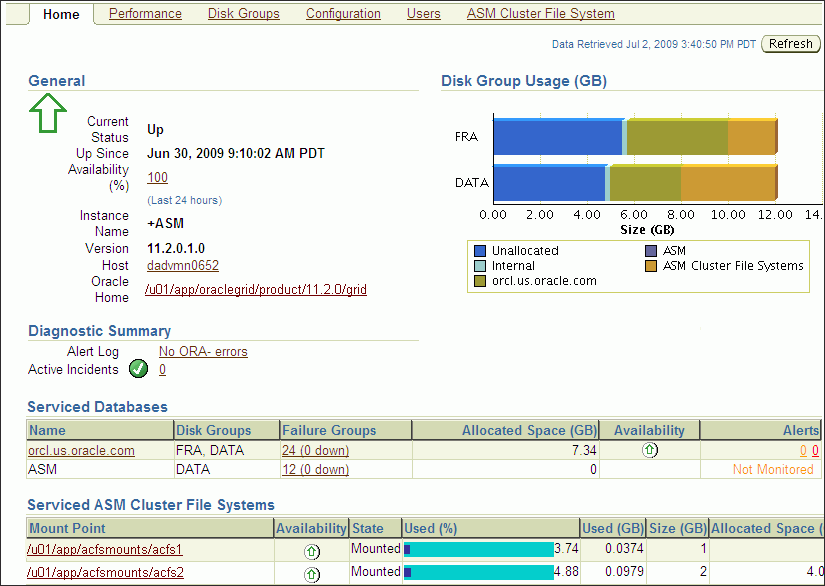

> This screenshot shows the Oracle Automatic Storage Management Home page in Oracle Enterprise Manager.
>
> At the top of page are links to other Oracle ASM pages: Performance, Disk Groups, Configuration, Users, and ASM Cluster File System.
>
> On the left-hand side of the page is the General section, which includes information on instance name, instance status, version, Oracle home location, and more. Next to the label Version is the value of the current version that you are using.
>
> On the right-hand side of the page is a horizontal bar graph, with one bar for each disk group, showing how space is distributed in each disk group: Unallocated, Internal, `database`, ASM, or ASM Cluster File Systems.
>
> On the bottom half of the page, there are sections for listing the Diagnostic Summary, Serviced Databases, Serviced ASM Cluster File Systems, and more (not shown).
>
> There is a Refresh button on the upper right side of the page.
  

### Accessing the Oracle ASM Home Page in Single-Instance Oracle Databases

To access the Oracle Automatic Storage Management Home page on a single-instance system:

1. Access the Database Home page by logging in as any database user.
	See Also:
	[Oracle Database 2 Day DBA](https://docs.oracle.com/cd/E11882_01/server.112/e10897/em_manage.htm#ADMQS031) for more information
2. Under the heading labeled General on the left side of the Database Instance Home page, click the link next to the last entry in the General column labeled Oracle ASM.
3. If prompted for Oracle ASM login credentials, then enter the user `SYS`, provide the `SYS` password that was set for the Oracle ASM instance upon installation, and connect as `SYSASM`. Oracle Enterprise Manager displays the Oracle Automatic Storage Management Home page similar to the page in Figure 9-1.
	See Also:
	["Authentication for Accessing Oracle ASM Instances"](asminst.md) for more information about authentication

### Accessing the Oracle ASM Home Page in Oracle RAC Databases

To access the Oracle Automatic Storage Management Home page in an Oracle Real Application Clusters (Oracle RAC) environment:

1. Log in to Oracle Enterprise Manager Database Control on any node that is running Oracle Management Service (OMS).
	OMS is automatically started on the node on which Database Configuration Assistant (DBCA) was originally run to create the cluster database. Depending on your configuration, OMS might also be running on other nodes.
	See Also:
	[Oracle Database 2 Day + Real Application Clusters Guide](https://docs.oracle.com/cd/E11882_01/rac.112/e17264/adminrac.htm#TDPRC189) for more information
2. On the Cluster Database page, under the Instances heading, click a link to access an Oracle ASM instance.

## Configuring Oracle ASM Initialization Parameters with Oracle Enterprise Manager

You can configure Oracle ASM with the Oracle Enterprise Manager Configuration Parameters page similar to the screen shown in Figure 9-2.

Figure 9-2 Oracle Automatic Storage Management Configuration Parameters Page

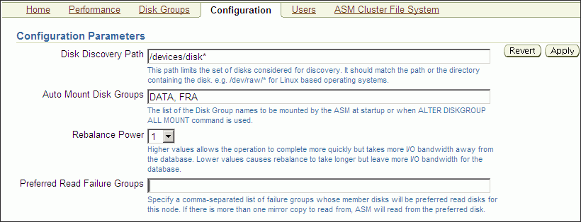

> This screenshot shows the Automatic Storage Management Configuration Parameters page in Oracle Enterprise Manager.
>
> The configuration parameters on this page are:
>
> - Disk Discovery Path
> - Auto Mount Disk Groups
> - Rebalance Power
> - Preferred Read Failure Groups
>
> There are Revert and Apply buttons on the upper right side of the page.
>
> Copyright © 2007, 2011, Oracle and/or its affiliates. All rights reserved.  
> [Legal Notices](https://docs.oracle.com/cd/E11882_01/dcommon/html/cpyr.htm)
  

To configure the Oracle ASM instance:

1. Access the Oracle Automatic Storage Management Home page.
	See "Oracle Automatic Storage Management Home Page" for instructions.
2. Click the Configuration link at the top of the page to view the Configuration Parameters page.
3. Update the configuration options on the page as follows:
	- Disk Discovery Path (`ASM_DISKSTRING` initialization parameter)
		Enter a string value. See ["ASM\_DISKSTRING"](asminst.md).
		- Auto Mount Disk Groups (`ASM_DISKGROUPS` initialization parameter)
		Enter a string value. See ["ASM\_DISKGROUPS"](asminst.md).
		- Rebalance Power (`ASM_POWER_LIMIT` initialization parameter)
		Enter an integer value. See ["ASM\_POWER\_LIMIT"](asminst.md).
		- Preferred Read Failure Groups (Only in Oracle RAC environments) (`ASM_PREFERRED_READ_FAILURE_GROUPS` initialization parameter)
		Enter a comma-delimited string of values in which each string represents a failure group. This parameter is generally used only for clustered Oracle ASM instances. See ["ASM\_PREFERRED\_READ\_FAILURE\_GROUPS"](asminst.md).
4. Click Apply to save your changes or click Revert to discard any changes made on the page.

## Managing Oracle ASM Users with Oracle Enterprise Manager

You can manage Oracle ASM users with the Oracle Enterprise Manager Users page, shown in Figure 9-3. Access this page by clicking the Users tab that is near the top center of the Oracle Automatic Storage Management Home page.

Figure 9-3 Oracle Automatic Storage Management Users Page

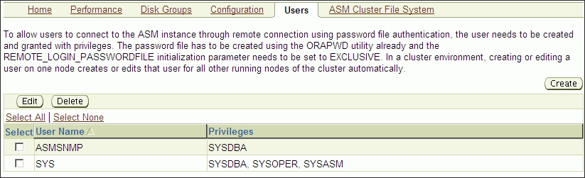

> This screenshot shows the Automatic Storage Management Users page in Oracle Enterprise Manager.
>
> On this page is a list of the ASM users, showing the name and privileges granted to the user. For example, this page shows the user `SYS` with `SYSDBA`, `SYSOPER`, and `SYSASM` privileges. Also, this page shows the user `ASMSNMP` with the `SYSDBA` privilege.
>
> You can Create, Edit, and Delete users on this page using the appropriate button.
  

To manage Oracle ASM users:

1. Access the Oracle Automatic Storage Management Home page.
	See "Oracle Automatic Storage Management Home Page" for instructions.
2. Click the Users link at the top to view the Users property page.
	Note that `ASMSNMP` is a less privileged user that is primarily used by Oracle Enterprise Manager to monitor Oracle ASM instances. This account is granted the `SYSDBA` privilege. `ASMSNMP` is created by Oracle ASM Configuration Assistant (ASMCA) when an Oracle ASM instance is created. For information about creating an Oracle ASM instance with ASMCA, see ["Creating Oracle ASM Instances with Oracle ASM Configuration Assistant"](asmca.md).
	See Also:
	- [Oracle Grid Infrastructure Installation Guide](http://www.oracle.com/pls/topic/lookup?ctx=db112&id=GINST) for information about installing Oracle ASM
	- [Oracle Database Installation Guide](http://www.oracle.com/pls/topic/lookup?ctx=db112&id=GINST) for information about reviewing database accounts and passwords
3. Click Create to add a new Oracle ASM user. When you add users, Oracle Enterprise Manager displays a Create User page in which you must enter user login credentials that include the user name, password, and password confirmation. You can also grant privileges to the new user by selecting privileges in the Available Privileges column and clicking the right arrow buttons to move privileges to the Granted Privileges column, or move the privilege by double clicking it. The available privileges include SYSDBA, SYSOPER, and SYSASM. Click OK to create the user, Cancel to cancel the procedure, or Show SQL to view the SQL that Oracle Enterprise Manager uses to create the user.
4. To edit a user's properties, select the box in the Select column of the user to edit, then click Edit. On the Edit User page, modify the password if needed. You can also alter the privileges that are assigned to the user by selecting the privilege and using the right and left arrow buttons to move the privilege from the Granted Privileges column to the Available Privileges column and vice versa. You can also move the privilege by double clicking it. Click OK to edit the user properties, Revert to cancel the procedure, or Show SQL to view the SQL that Oracle Enterprise Manager uses to edit the user's properties.
5. To delete an Oracle ASM user, select the box in the Select column for the user to delete, then click Delete. On the confirmation dialog, click Yes to delete the user or No to stop the user deletion procedure.

See Also:

["Authentication for Accessing Oracle ASM Instances"](asminst.md) for more information about user authentication

## Managing Disk Groups with Oracle Enterprise Manager

This section describes how to manage disk groups under the following topics:

- Creating Disk Groups
- Adding Disks to Disk Groups
- Dropping Disks from Disk Groups
- Bringing Disks Online and Offline
- Dropping Disk Groups
- Monitoring Disk Group Usage
- Mounting and Dismounting Disk Groups
- Administering Advanced Disk Group Properties

### Creating Disk Groups

You can create additional Oracle ASM disk groups to:

- Have disk groups with different redundancy levels (normal, high, or external), depending on availability requirements and storage system capabilities.
- Separate different classes of storage, such as SCSI drives and SATA drives, into different disk groups. Disks in a disk group should have similar size and performance characteristics.
- Store the fast recovery area in a separate disk group from the database.

To create a disk group:

1. Access the Oracle Automatic Storage Management Home page.
	See "Oracle Automatic Storage Management Home Page" for instructions.
2. Click the Disk Groups link at the top of the page to display the Disk Groups property page.
3. If you are not logged in, then the Log In page appears and you should log in as the `SYS` user, connecting as `SYSASM`. Provide the `SYS` password for the Oracle ASM instance. This password was set up when the Oracle ASM instance was created.
4. Click Create and Oracle Enterprise Manager displays a Create Disk Group page similar to the page in Figure 9-4. The Create Disk Group page displays a list of Oracle ASM disks that are available to be added to a disk group. This includes disks with a header status of `CANDIDATE`, `PROVISIONED`, or `FORMER`, and so on.
	Figure 9-4 Oracle Automatic Storage Management Create Disk Group Page
	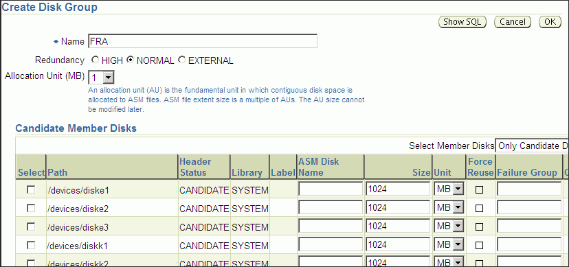

> This is a screenshot of the Automatic Storage Management Create Disk Group page in Oracle Enterprise Manager.
>
> This screenshot includes fields and options that enable you to define a disk group. At the top of the page, you must enter the name of the disk group. Optionally, select the redundancy for the disk group and the allocation unit size.
>
> In the middle of the page is the Member Disks section. For each disk, the following fields are included:
>
> - Select checkbox
> - Path name of the disk
> - Header Status, such as CANDIDATE or FORMER
> - Label
> - ASM Disk Name
> - Size
> - Size Unit, such as MB or GB
> - Force Reuse checkbox
> - By Failure Group
>
> The Select checkbox to the left of each disk enables you to include the disk in the disk group being created. In this screenshot, only CANDIDATE disks are displayed. You can use the Select Member Disks drop down list to display other disks, such as all the discovered disks.
>
> The Disk Compatibility section of the page (not shown) enables you to specify:
>
> - Database Compatibility
> - ASM Compatibility
> - ASM Volume Compatibility
>
> At the upper right-hand corner of the page are the Show SQL, Cancel, and OK buttons.

5. To display not only disks that are available to be added to a disk group, but all Oracle ASM disks, including disks that belong to a disk group (header status = `MEMBER`), select All Disks from the Select Member Disks list.
	The page is re-displayed with the complete list of Oracle ASM disks that were discovered by the Oracle ASM instance.
6. Enter the disk name, select a redundancy type (high, normal, or external), and optionally, you can enter a failure group name.
7. Select disks as follows:
	- Select the box to the left of each disk to be included in the new disk group.
		- Optionally, you can enter a disk name, the size of the disk for Oracle ASM to use, and the failure group name.
		- To force the inclusion of a disk in the disk group, select the Force Usage box for that disk.
		Caution:
		Selecting the Force Usage box causes the disk to be added to the new disk group even if the disk belongs to another disk group and has valid database data. The existing data is then lost. You must be certain that you are selecting a disk that can legitimately be added to the disk group. See ["Creating Disk Groups"](asmdiskgrps.md) for a discussion of the `FORCE` option.
8. Specify a Disk Compatibility value for the disk group to enable your system to use the latest Oracle ASM features. See "Configuring Disk Group Compatibility Attributes".
	Note:
	You cannot reverse setting a disk compatibility value.
	For information about disk group compatibility attributes, see ["Disk Group Compatibility"](asmdiskgrps.md).
9. Click OK to create the disk group or click Cancel to stop the disk group creation operation. You can also click Show SQL to show the SQL statements that the disk group creation operation uses.
	See Also:
	See ["Creating Disk Groups"](asmdiskgrps.md) for more information about creating disk groups and the `V$ASM_DISK` view in [Oracle Database Reference](https://docs.oracle.com/cd/E11882_01/server.112/e40402/dynviews_1024.htm#REFRN30170) for information about the various header statuses of Oracle ASM disks

### Adding Disks to Disk Groups

You can add disks to a disk group to increase the storage space in a disk group. If you add multiple disks in a single operation, then Oracle ASM rebalances the disk group to evenly distribute the data on all disks, including the newly added disks.

You can control the power of a rebalance operation with the setting of the Rebalance Power. The higher the number, the faster the rebalance operation completes. Lower numbers cause rebalancing to take longer, but consume fewer processing and I/O resources. This leaves these resources available for the database. The default value of `1` minimizes disruption to the database.

A value of `0` blocks the rebalance operation. Manual or automatic rebalance can then occur later. You might want to postpone rebalancing until there are fewer demands on the database, or when you have completed all of your disk group changes.

For information about controlling rebalance operations, refer to ["Manually Rebalancing Disk Groups"](asmdiskgrps.md) and ["Tuning Rebalance Operations"](asmdiskgrps.md). For information about rebalance power settings and the `ASM_POWER_LIMIT` initialization parameter, refer to ["ASM\_POWER\_LIMIT"](asminst.md).

To add one or more disks to a disk group:

1. Access the Oracle Automatic Storage Management Home page.
	For instructions, refer to "Oracle Automatic Storage Management Home Page"
2. Click the Disk Groups link to display the Disk Groups property page.
3. If the Oracle ASM Login page appears, then log in as the `SYS` user, connecting as `SYSASM`. Provide the `SYS` password for the Oracle ASM instance. This password was set up when the Oracle ASM instance was created.
4. Click a link in the Name column to select the disk group to which you want to add disks. The Disk Group page similar to the page in Figure 9-7 appears, displaying a list of disks that are in the disk group.
5. Click Add and Oracle Enterprise Manager displays the Add Disks page. This page displays a list of Oracle ASM disks that are available to be added to the disk group. This includes disks with the header status of `CANDIDATE`, `PROVISIONED`, or `FORMER`, and so on.
	Figure 9-5 Oracle Automatic Storage Management Add Disks Page
	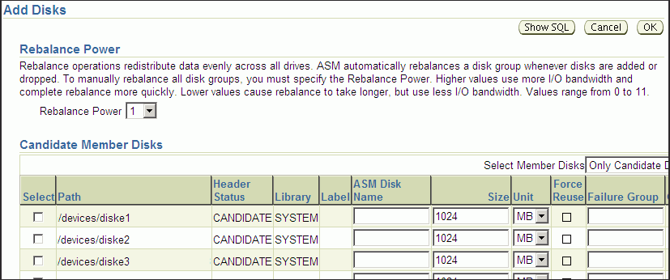

> This is a screenshot of the Automatic Storage Management Add Disks page in Oracle Enterprise Manager.
>
> The Rebalance Power section is at the top of the page. This section contains a definition of rebalance power, followed by a Rebalance Power list that enables you to choose a number from 1 to 11. The number 1 is currently displayed.
>
> The Member Disks section is at the bottom of the page. This section contains a list (table) of disks that are available to be added. Each row in the list contains the following fields (columns):
>
> - Select checkbox
> - Path name of the disk
> - Header Status, such as CANDIDATE or FORMER
> - Label
> - ASM Disk Name
> - Size
> - Size Unit, such as MB or GB
> - Force Reuse checkbox
> - By Failure Group
>
> You can determine what is displayed in the list with the Select Member Disks pull down list. The current option in the list is Only Candidate Disks.
>
> At the upper right-hand corner of the page are the Show SQL, Cancel, and OK buttons.

6. To display not only disks that are available to be added to a disk group, but all of the Oracle ASM disks, including disks that belong to a disk group (header status = `MEMBER`), select All Disks from the Select Member Disks drop-down list on the right hand side of the page. Oracle Enterprise Manager re-displays the page with the complete list of Oracle ASM disks that were discovered by the Oracle ASM instance.
7. Optionally change the rebalance power by selecting a value from the Rebalance Power list.
8. Select disks as follows:
	- Check the box to the left of each disk to be added to the disk group.
		- To force the inclusion of a disk in the disk group, select the Force Reuse box in the right-most column.
		Caution:
		The Force Reuse box causes the disk to be added to the disk group even if the disk belongs to another disk group and has valid database data. The existing data is then lost. You must be certain that you are selecting a disk that can legitimately be added to the disk group. Refer to ["Adding Disks to a Disk Group"](asmdiskgrps.md) for an example of the `FORCE` option.
		- Optionally enter an Oracle ASM disk name for each disk. Oracle ASM provides a name if you do not.
9. Click OK to add the selected disks.

See Also:

["Altering Disk Groups"](asmdiskgrps.md) for more information about modifying disk group properties

### Bringing Disks Online and Offline

Perform the following procedures to bring a disk online or offline:

1. Access the Oracle Automatic Storage Management Home page.
	See "Oracle Automatic Storage Management Home Page" for instructions.
2. Click the Disk Groups link at the top of the page to view the Disk Groups page. Oracle Enterprise Manager displays a page similar to the one shown in Figure 9-6.
	Figure 9-6 Oracle Automatic Storage Management Disk Groups List Page
	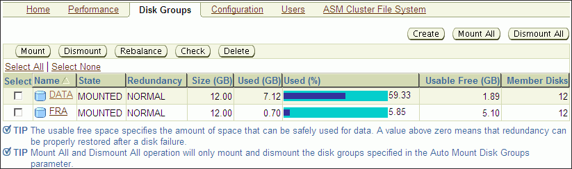

> This screenshot shows the Oracle Enterprise Manager Automatic Storage Management Disk Groups List page.
>
> This page contains a list of disk groups showing the Name, State, Redundancy, Size (GB), Used (GB), Used (%), Usable Free (GB), and Member Disks for each disk group.
>
> For each disk group in the list, there is a Select field. When a disk group is selected, you can click on the Mount, Dismount, Rebalance, Check, or Delete button.
>
> On the upper right side of the page are Create, Mount All, and Dismount All buttons that can be selected when none of the disk groups are selected.

3. Click the name of a disk in the Name column and Oracle Enterprise Manager displays the General page for the disk group to modify. The General page that you see should be similar to the one shown in Figure 9-7.
	Figure 9-7 Oracle Automatic Storage Management Disk Group General Page
	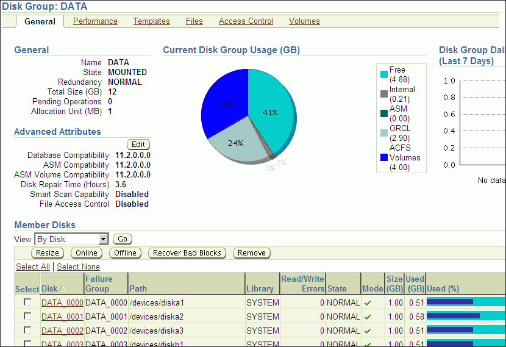

> This screenshot shows the Oracle Enterprise Manager Automatic Storage Management Disk Group general information page.
>
> This screenshot shows the disk group information for a disk group called DATA.
>
> On the upper left side of the page the following information is listed under General:
>
> - Name
> - State
> - Redundancy
> - Total Size (GB)
> - Pending Operations
> - Allocation Unit
>
> On the left side of the page, immediately below the General information, the following information is listed under Advanced Attributes:
>
> - Database Compatibility
> - ASM Compatibility
> - ASM Volume Compatibility
> - Disk Repair Time
> - Smart Scan Capability
> - File Access Control
>
> In the upper center of the screen is a pie chart showing Current Disk Group Usage (GB) in the following categories:
>
> - Free
> - Internal
> - ASM
> - Database instance by name (ORCL)
> - ACFS Volume
>
> On the upper right of the screen is a bar chart showing Disk Group Daily Space Usage History (Last 7 Days).
>
> At the bottom of the page is a list of Member Disks in the disk group. The list shows the following information:
>
> - Disk name
> - Failure Group name
> - Path
> - Library
> - Read/Write Errors
> - State
> - Mode
> - Size (GB)
> - Used (GB)
> - Used (%)
>
> You can sort the list with the options in the View pull down list.
>
> For each disk in the list, there is a Select field. When a disk is selected, you can click on the Resize, Online, Offline, Recover Bad Blocks, or Remove button that is located above the list. There is also an Add button for adding disks to the disk group.

4. To bring a disk online, select the disk to bring online and click Online. If you bring a disk online, then Oracle ASM performs the following:
	- Oracle ASM performs the online operation on the selected disks. You can select one or more or disks, or all of the disks to bring online. If you select all of the disks, then Oracle uses the `ALL` keyword for this operation. Otherwise, only the selected disks are affected by the online operation.
		- During the online process, Oracle Enterprise Manager first places a disk into online mode to accommodate write operations. Then Oracle Enterprise Manager resynchronizes stale data on the disk with the current data until the disk is fully online for read operations; this is the Oracle ASM fast mirror resync feature.
		- You can also choose the By Failure Group view to perform this operation on a selected disk group. In this case, Oracle uses the SQL for `disks` `in` `failure` `group`.
		- You can also select a disk that is online, but Oracle Enterprise Manager ignores that selection and only brings disks online that were previously offline.
		- Click Yes on the Oracle Enterprise Manager Confirmation dialog to begin bringing the disk online or click No to cancel the operation. You can also click Show SQL to review the SQL that Oracle Enterprise Manager uses for the online operation.
5. To take a disk offline, select the disk to take offline and click Offline. If you bring a disk offline, then Oracle ASM performs the following:
	- Depending on how much data is stale, the operation may require additional time to complete. You can monitor the operation's progress using the Pending Operations link from the Disk Group Home page.
		- The value that you set for Rebalance Power using `ASM_POWER_LIMIT` must be a whole number. The text on the page describes how the value of Rebalance Power affects the fast mirror resync operation. If the `ASM_POWER_LIMIT` is set to `0`, then Oracle ASM does not perform automatic rebalance. For information about rebalance power settings and the `ASM_POWER_LIMIT` initialization parameter, refer to ["ASM\_POWER\_LIMIT"](asminst.md).
		- By default, the Rebalance Power value uses the value of the `ASM_POWER_LIMIT` initialization parameter.
		- Oracle Enterprise Manager displays an Offline Confirmation page and the text on this page explains that after Oracle Enterprise Manager takes the selected disks offline, the Oracle ASM instance waits for the time interval that is specified by the value that you have set for the `DISK_REPAIR_TIME` initialization parameter before Oracle ASM drops the disks. During the disk repair time period, you can repair the disks and then place them back online. For each disk that you successfully place online, the pending drop operation is canceled and a resynchronization operation begins.
		- If you have set `DISK_REPAIR_TIME` to a large value, for example, greater than one day, then this increases the possibility of data loss. This is because the files in the disk group are protected with a lower degree of redundancy during this period.
		Click Yes on the Oracle Enterprise Manager Conformation dialog to begin the offline processing or click No to stop the operation. You can also click Show SQL to see the SQL that Oracle Enterprise Manager uses for the offline operation.

### Dropping Disks from Disk Groups

When you drop a disk from a disk group, Oracle ASM rebalances the disk group by moving all of the file extents from the dropped disk to other disks in the disk group. Oracle ASM then releases the disk and you can then add the disk to another disk group or use it for other purposes. You can drop one or more disks in a single operation. You can also optionally set rebalance power for the drop operation. The following is a list of possible reasons for dropping a disk:

- A disk is starting to fail and you must replace it
- To upgrade a disk
- To reallocate the disk to a different disk group or reallocate the disk to a different storage system

Note:

Dropping disks from a disk group only logically deletes the disks from the disk group. It does not delete the disk contents. However, the contents are lost when you add the disk to a new disk group.

To drop one or more disks from a disk group:

1. Access the Oracle Automatic Storage Management Home page.
	See "Oracle Automatic Storage Management Home Page" for instructions.
2. Click the Disk Groups link to display the Disk Groups property page.
3. If the Oracle Automatic Storage Management Login page appears, log in as the `SYS` user, connecting as `SYSASM`. Provide the `SYS` password for the Oracle ASM instance. This password was set up when the Oracle ASM instance was created.
4. Click a link in the Name column to select the disk group that contains the disks to be dropped.
	The Disk Group page appears.
5. Under the Member Disks heading, in the Select column, select the boxes for the disks that you plan to drop, and then click Remove.
	A confirmation page appears.
6. To change the rebalance power, or to set the `FORCE` option for dropping disks, do the following:
	1. Click Show Advanced Options.
		2. Optionally select the Force option or select a rebalance power in the Rebalance Power list.
	Note:
	You might need the `FORCE` option if Oracle ASM cannot read from or write to the disk. See ["Dropping Disks from Disk Groups"](asmdiskgrps.md) for a discussion of the `FORCE` option.
7. Click Yes to drop the disks.
	The Disk Group page returns, and displays a state of `DROPPING` for each disk being dropped.
8. Refresh the page until the dropped disks no longer appear in the disk group.

Caution:

You cannot reuse or disconnect the dropped disks until the drop and rebalance operations are complete. Operations are complete when the dropped disks no longer appear in the disk group.See ["Dropping Disks from Disk Groups"](asmdiskgrps.md) for more information, and for other caveats for dropping disks.

### Dropping Disk Groups

When you drop a disk group, you delete the disk group optionally with all of its files. You cannot drop a disk group if any of its database files are open. Oracle ASM deletes all of the disk group contents only if you specify the including contents option. After dropping a disk group, you can add its member disks to other disk groups or use them for other purposes.

One reason to drop a disk group is to change the redundancy level (normal, high, or external). Because you cannot change the redundancy of a disk group, you must drop the disk group and then re-create it with the proper redundancy. In this case, you must back up or move disk group data before you drop the disk group.

To drop a disk group:

1. Access the Oracle ASM Home page.
	See Also:
	"Oracle Automatic Storage Management Home Page" for instructions about how to access the Oracle Automatic Storage Management Home page
2. Click the Disk Group tab to display the Disk Groups page.
3. If the Oracle ASM Login page appears, log in as the `SYS` user, connecting as `SYSASM`. Provide the `SYS` password for the Oracle ASM instance. This password was set up when the Oracle ASM instance was created.
4. Click the box in the Select column to select a disk group that you plan to drop.
5. Click Delete and the confirmation page appears.
6. To delete the disk group even if it still contains files, click Show Advanced Options and ensure that the Including Contents option is selected. If the disk group contains files and the Including Contents option is not selected, then you cannot drop the disk group.
7. To delete a disk group that belongs to a disk group that you cannot mount, use the `FORCE` option in the Advanced Options confirmation dialog. The `FORCE` option applies to the `DISMOUNTED` disk group only. This option enables you to delete a disk header and mark it as `FORMER`.
	Caution:
	Use extreme care when using the `FORCE` option because the Oracle ASM instance does not verify whether the disk group is used by any other Oracle ASM instance before Oracle ASM deletes the disk group.
8. On the confirmation page, click Yes.
	See Also:
	["Dropping Disk Groups"](asmdiskgrps.md) for more information about dropping disks

### Monitoring Disk Group Usage

Perform the following procedures to monitor disk group usage:

To view Oracle ASM disk group usage and free space:

1. Access the Oracle Automatic Storage Management Home page.
	See Also:
	"Oracle Automatic Storage Management Home Page" for instructions about how to access the home page
2. Click the Disk Groups link to view the Disk Groups property page.
3. If the Oracle ASM Login page appears, then log in as the `SYS` user, connecting as `SYSASM`. Provide the `SYS` password that was set up for Oracle ASM when the Oracle ASM instance was created.

The Disk Group list page, similar to the page shown in Figure 9-6, displays all of the disk groups and their space usage information.

The Usable Free column displays the space in megabytes that is available in the disk group. The values in this column consider the redundancy level of the disk group, and exclude the space that the disk group reserves for restoring full redundancy for all files in the disk group after a disk failure.

### Mounting and Dismounting Disk Groups

Use the `FORCE` option to mount a disk group when there are missing disks or missing failure groups. The `FORCE` option corrects configuration errors, such as incorrect values for `ASM_DISKSTRING`, without incurring unnecessary rebalance operations. Disk groups mounted with the `FORCE` option have one or more disks offline if the disks were not available at the time of the mount. You must take corrective action to restore those devices before the time set with the `DISK_REPAIR_TIME` value expires. Failing to restore and put those disks back online within the disk repair time frame results in Oracle ASM automatically removing the disks from the disk group. This would then require a rebalance operation to restore redundancy for all of the files in the disk group. Perform the following procedures to mount a disk with the `FORCE` option:

1. From the Oracle ASM home page click the Disk Groups tab.
2. Select the disk group that has a disk that you must repair and click Dismount. Click OK on the Dismount confirmation dialog. The State column of the Disk Group home page should show the Status as `DISMOUNTED`.
3. Perform any needed repairs to the disk in the disk group.
4. Click the box in the Select column next to the disk that you plan to force mount, then click Mount.
5. On the Disk Mount Confirmation dialog, click the Show Advanced Options link.
6. On the Mount Force Confirmation dialog as shown in Figure 9-8, select the Force option and click Yes. You can also click No to cancel the mount force operation and Show SQL to review the SQL that Oracle Enterprise Manager uses to perform the mount force operation.

Figure 9-8 Mount Force Confirmation Dialog

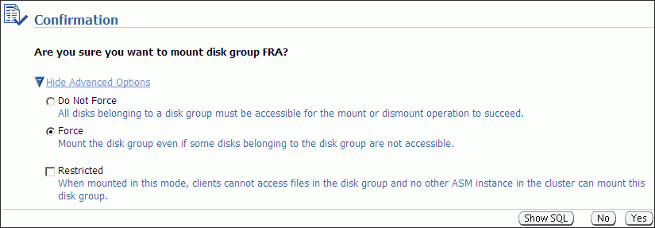

> This screenshot is the Mount Force Confirmation Dialog in Oracle Enterprise Manager.
>
> On this page you can select the following options when mounting a disk group:
>
> - Do Not Force
> - Force
>
> There is also a check box you can enable to Restrict access to the disk group.
>
> On the right side of the page are Show SQL, No, and Yes buttons.
  

### Administering Advanced Disk Group Properties

This section explains how to administer advanced disk group properties.

Perform the following steps to change the values for disk group attributes that can be altered after the disk group has been created.

1. On the Automatic Storage Disk Group List page, click a disk group name and Oracle Enterprise Manager displays the Disk Group Home page.
2. Click Edit under the Advanced Attributes section.

The topics contained in this section are:

- Configuring Disk Group Compatibility Attributes
- Configuring Disk Repair Time
- Configuring Smart Scan Compatibility
- Configuring File Access Control

Figure 9-9 shows the advanced attributes that can be altered for an existing disk group. This screenshot only shows the top portion of the Edit Advanced Attributes for Disk Group Page.

Figure 9-9 Oracle Automatic Storage Management Edit Advanced Attributes for Disk Group Page

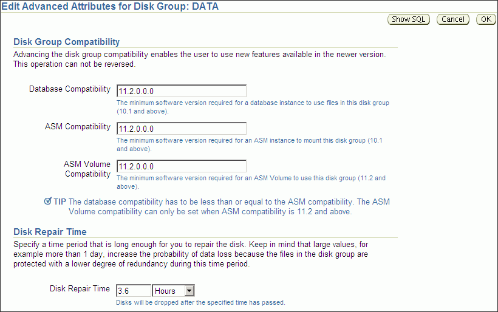

> This is a screenshot of the Automatic Storage Management Edit Advanced Attributes for Disk Group page in Oracle Enterprise Manager.
>
> This screenshot includes fields and options that configure a disk group.
>
> The Disk Group Compatibility section of the page enables you to specify:
>
> - Database Compatibility
> - ASM Compatibility
> - ASM Volume Compatibility
>
> The Disk Repair Time section of the page enables you to specify the time interval for disk repair before a disk is dropped.
>
> The Smart Scan Capability section of the page (not shown) enables you to enable or disable smart scan capability.
>
> The File Access Control section of the page (not shown) enables you to enable file access control and specify the access masking on the files.
>
> At the upper right-hand corner of the page are the Show SQL, Cancel, and OK buttons.
  

#### Configuring Disk Group Compatibility Attributes

Specify a Disk Compatibility value for the disk group to enable your system to use the latest Oracle ASM features.

Note:

You cannot reverse setting a disk compatibility value.
- ASM Compatibility
	Specify the value that is the minimum software version required for an Oracle ASM instance to mount this disk group.
- Database Compatibility
	Specify a value that must be less than or equal to the Oracle ASM compatibility. This is the minimum software version that is required for a database instance to use the files in the disk group. If the database compatibility value that you use is greater than the Oracle ASM compatibility, then Oracle Enterprise Manager displays an error.
	Note:
	You cannot modify the database compatibility for an Oracle ASM cluster that is in a rolling migration state.
- ASM Volume
	Specify a value that is 11.2 or greater to use the Oracle ASM Dynamic Volume Manager (Oracle ADVM) functionality. The ASM disk group compatibility must be set to 11.2 or greater to enable Oracle ADVM. Also, the Oracle ADVM volume drivers must be loaded in the supported environment.

For information about disk group compatibility attributes, see ["Disk Group Compatibility"](asmdiskgrps.md).

#### Configuring Disk Repair Time

Specify a time period that is long enough for you to repair a disk in the disk group.

For information about disk group repair time, see ["Oracle ASM Fast Mirror Resync"](asmdiskgrps.md).

#### Configuring Smart Scan Compatibility

Specify to disable or enable smart scan compatibility for the disk group.

This attribute is only applicable to Oracle Exadata storage.

See Also:

Oracle Exadata documentation for information about the `CELL.SMART_SCAN_CAPABLE` attribute

#### Configuring File Access Control

Specify to disable or enable Oracle ASM File Access Control. If Oracle ASM File Access Control is enabled, then specify the default permissions for newly created files in the disk group.

For information about Oracle ASM File Access Control, see ["Managing Oracle ASM File Access Control for Disk Groups"](asmdiskgrps.md).

## Managing Oracle ASM File Access Control with Oracle Enterprise Manager

You can manage Oracle ASM File Access Control with Oracle Enterprise Manager Integration for Oracle ASM File Access Control, shown in Figure 9-10.

Figure 9-10 Oracle Automatic Storage Management Disk Group Access Control Home Page

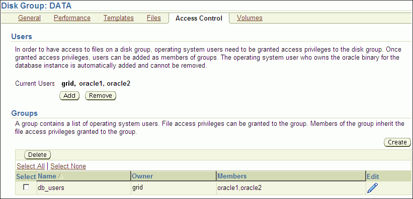

> This screenshot shows the Automatic Storage Management File Access Control Home page in Oracle Enterprise Manager.
>
> The upper section of the page shows the current users for the disk group DATA. You can add and remove users with the appropriate button.
>
> The lower section of the page shows the user groups for the disk group DATA. You can create and delete users with the appropriate button
  

To manage Oracle ASM File Access Control:

1. Access the Oracle Automatic Storage Management Home page.
	See "Oracle Automatic Storage Management Home Page" for instructions.
2. Click the Disk Groups link to display the Disk Groups property page.
3. Click a link in the Name column to select a disk group.
4. Click the Access Control tab to display the Access Control page.
	On this page, you can add or remove users from a user group and create or delete user groups.

Figure 9-11 shows the Create Group page for Oracle ASM File Access Control.

Figure 9-11 Oracle Automatic Storage Management Create Group Page

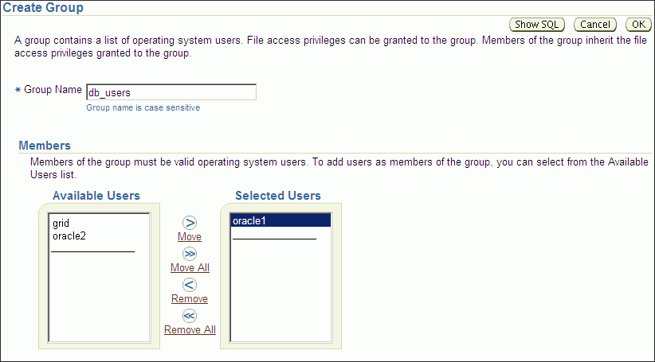

> This screenshot shows the Automatic Storage Management Create Group page in Oracle Enterprise Manager.
>
> On this page, you must enter a name for the new user group.
>
> In the Members section, add available users to the selected users list for the new user group. You also can remove any selected user that you choose not to include in the user group.
  

Figure 9-12 shows the Edit Group page for Oracle ASM File Access Control.

Figure 9-12 Oracle Automatic Storage Management Edit Group Page

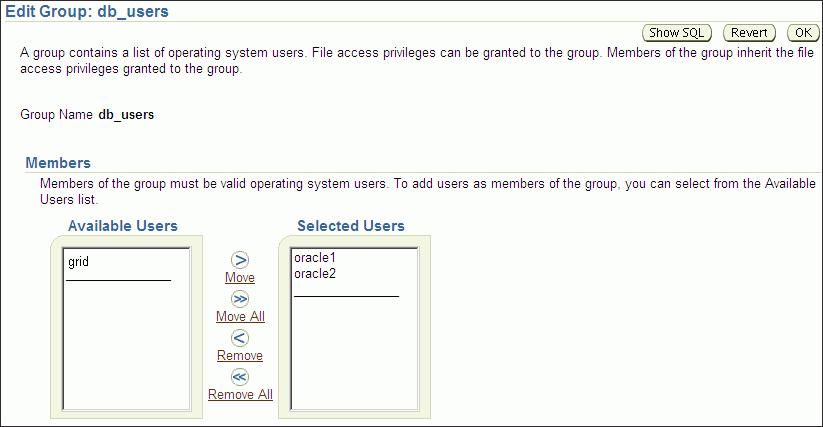

> This screenshot shows the Automatic Storage Management Edit Group page in Oracle Enterprise Manager.
>
> In the Members section, add available users to the selected users list for the new user group. You also can remove any selected user that you choose not to include in the user group.
>
> Copyright © 2007, 2011, Oracle and/or its affiliates. All rights reserved.  
> [Legal Notices](https://docs.oracle.com/cd/E11882_01/dcommon/html/cpyr.htm)
  

For more information about Oracle ASM File Access Control, see ["Managing Oracle ASM File Access Control for Disk Groups"](asmdiskgrps.md).

## Managing Directories, Files, and Aliases with Oracle Enterprise Manager

You can manage directories, files, and aliases with the Files tab of the Oracle Enterprise Manager Disk Group page, shown in Figure 9-13.

Figure 9-13 Oracle Automatic Storage Management Files Tab

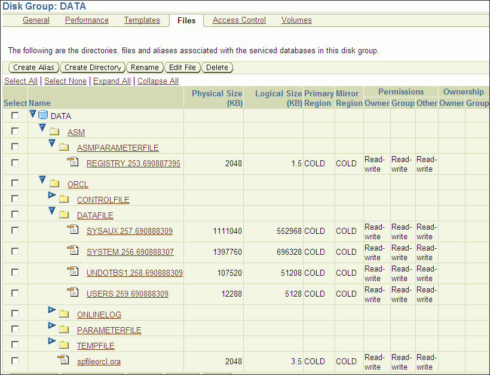

> This screenshot shows the Automatic Storage Management Files page in Oracle Enterprise Manager.
>
> On the page is a list of the template folders for a disk group. Each template folder can be expanded to show the ASM files in each template.
>
> Each row contains the following:
>
> - Physical Size
> - Logical Size
> - Primary Region (HOT or COLD)
> - Mirror Region (HOT or COLD)
> - Permissions
> - Ownership
>
> You can use the Create Alias, Create Directory, Rename, Edit File, and Delete buttons to manage files and directories on the page.
  

To manage Oracle ASM files:

1. Access the Oracle Automatic Storage Management Home page.
	See "Oracle Automatic Storage Management Home Page" for instructions.
2. Click the Disk Groups link to display the Disk Groups property page.
3. Click a link in the Name column to select a disk group.
4. Click the Files tab to display the Files page.
5. Click the + to expand a database folder to view template folders.
6. Click the + to expand a templates folder to view individual files.
7. You can select a file with the Select box, then click Rename to rename the file, click Edit to change the properties of a file, or click Delete to remove a file.
	You can click the name of a file to display the properties page.
	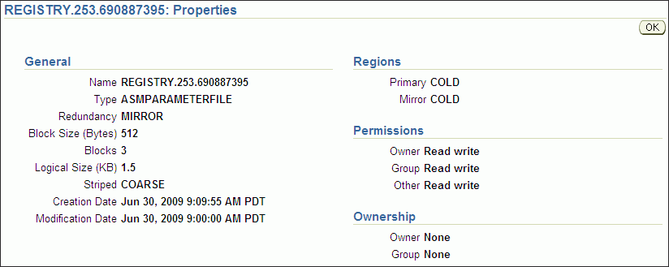

> This screenshot shows the Automatic Storage Management File Properties page in Oracle Enterprise Manager.
>
> The page show information about the properties of the selected file in the General, Regions, Permissions, and Ownership categories.
>
> On the right side of the page are OK buttons.
>
> Copyright © 2007, 2011, Oracle and/or its affiliates. All rights reserved.  
> [Legal Notices](https://docs.oracle.com/cd/E11882_01/dcommon/html/cpyr.htm)


For more information about managing Oracle ASM files, directories, and aliases, see [Chapter 7, "Administering Oracle ASM Files, Directories, and Templates"](asmfiles.md).

## Managing Disk Group Templates with Oracle Enterprise Manager

You can manage disk group templates with the Templates tab of the Disk Group page, shown in Figure 9-14.

Figure 9-14 Oracle Automatic Storage Management Templates Page

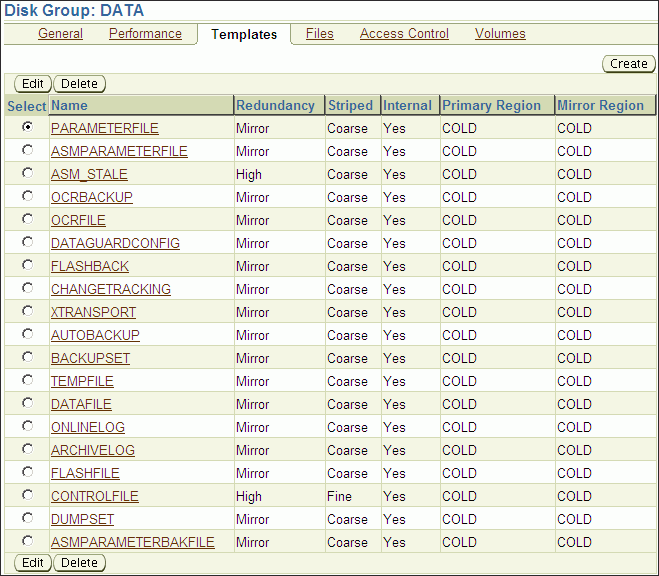

> This screenshot shows the Automatic Storage Management Templates page in Oracle Enterprise Manager.
>
> On the page is a list of the templates for a disk group. Each template is a row in the list and each row contains the following:
>
> - Select button
> - Name of the template
> - Redundancy level
> - Striped granularity
> - Internal indicator (Yes or No)
> - Primary Region
> - Mirror Region
>
> You can use the Create, Edit, and Delete buttons to manage templates on the page.
  

To manage Oracle ASM templates:

1. Access the Oracle Automatic Storage Management Home page.
	See "Oracle Automatic Storage Management Home Page" for instructions.
2. Click the Disk Groups link to display the Disk Groups property page.
3. Click a link in the Name column to select a disk group.
4. Click the Templates tab to display the Templates page.
5. You can click Create to add a new template, click Edit to change a page, or click Delete to remove a template.
	If you click Create, then the Create Template page displays and you can enter a name in the Template Name field. You can also specify a redundancy level, striped granularity, and extent regions (hot or cold).
	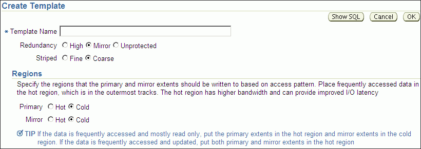

> This screenshot shows the Automatic Storage Management Create Template page in Oracle Enterprise Manager.
>
> On the page, you can provide the following:
>
> - Template Name (required)
> - Redundancy (High, Mirrored, or Unprotected levels) option buttons
> - Striped (Fine or Coarse granularity) option buttons
> - Extent Regions
>
> On the right side of the page are Show SQL, Cancel, and OK buttons.


For more information about disk group templates, see ["Managing Disk Group Templates"](asmfiles.md). For information about hot and cold disk regions, see ["Intelligent Data Placement"](asmdiskgrps.md).

## Monitoring Oracle ASM Performance with Oracle Enterprise Manager

This section describes how to perform the following performance-related Oracle ASM administrative tasks:

- Monitoring General Oracle ASM Performance
- Checking Disk Group Integrity

### Monitoring General Oracle ASM Performance

You can monitor Oracle ASM performance with the Oracle Enterprise Manager Performance page, shown in Figure 9-15.

Figure 9-15 Oracle Automatic Storage Management Performance Page

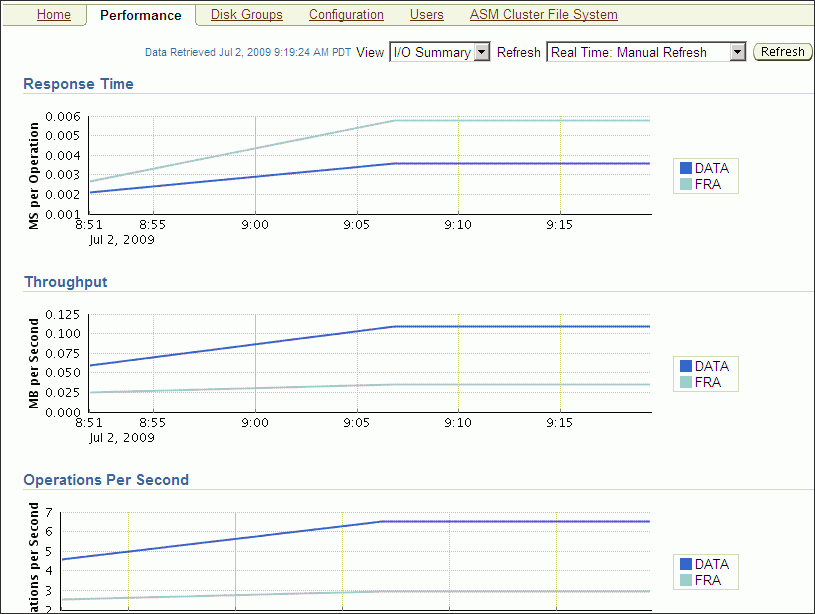

> This screenshot shows the Automatic Storage Management Performance page in Oracle Enterprise Manager.
>
> In this screenshot, there are line graphs showing Response Time, Throughput, and Operations Per Second for the Oracle ASM instance. The lines in the graphs are identified by disk group.
>
> - The graph for Response Time uses MS per Operation as the vertical component.
> - The graph for Throughput uses MB per Second as the vertical component.
> - The graph for Operations Per Second uses Operations Per Second as the vertical component.
>
> The are View and Refresh options in pull down lists.
>
> There is a Refresh button for manually refreshing the page.
  

To monitor Oracle ASM performance:

1. Access the Oracle Automatic Storage Management Home page.
	See Also:
	"Oracle Automatic Storage Management Home Page" for more information about accessing the home page
2. Click the Performance link to view the Performance property page.
3. Determine the view and refresh rate of the performance graphs with the View and Refresh options. Click Refresh to manually refresh the graphs. The refresh option has the following two intervals:
	- Manual refresh: manual, 15 second interval, 30 second interval
		- Historical data: Last 24 hours, last 7 days, last 31 days
	See Also:
	["Performance and Scalability Considerations for Disk Groups"](asmdiskgrps.md)

### Checking Disk Group Integrity

When you check the integrity of Oracle ASM disk groups, Oracle Enterprise Manager performs consistency checks on all of the disk group metadata. If Oracle ASM detects errors, then Oracle ASM stores information about errors in the alert log. To check disk groups, perform the following steps:

1. From the Disk Groups Administration page click Check and Oracle ASM displays a confirmation dialog for the check disk group operation.
	Figure 9-16 Oracle Automatic Storage Management Check Diskgroup Confirmation Dialog
	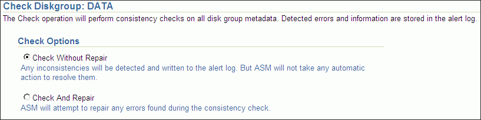

> This screenshot shows Automatic Storage Management Check Diskgroup confirmation dialog in Oracle Enterprise Manager.
>
> On this page you can select the following Check Options for a disk group:
>
> - Check Without Repair
> - Check and Repair
>
> On the upper right side of the page are Show SQL, Schedule Job, Cancel, and OK buttons (not shown).

2. Select Check Without Repair to record information about disk group inconsistencies in the alert log. In this operation, Oracle ASM does not resolve the errors. Select Check And Repair to attempt to repair errors that Oracle Enterprise Manager identifies during the disk group consistency check.
3. Click Yes to start the disk group check operation or No to cancel it. You can also select Show SQL to review the SQL statements that the disk group check operation uses. Click OK to run the check operation as a command. To schedule a job, click Schedule Job. Optionally, you can modify or reenter the job name and description. Also provide host credentials and enter the scheduling options by selecting Immediately or Later and modifying the date and time as needed. Click OK to schedule the job or Cancel to terminate the job creation process.

## Backing Up Oracle ASM Files with Oracle Enterprise Manager

Oracle recommends that you use RMAN to back up files managed by Oracle ASM. The procedures for using RMAN are documented in [Oracle Database 2 Day DBA](https://docs.oracle.com/cd/E11882_01/server.112/e10897/backrest.htm#ADMQS009).

You can also back up your Oracle ASM managed files by performing a files related operation using the following procedures:

1. Create an alias.
2. Create a director.
3. Delete the alias and directory.
4. Rename the alias and directory.

For information about migrating data with RMAN, see [Chapter 8, "Performing Oracle ASM Data Migration with RMAN"](asm_rman.md).

See Also:

For additional information about RMAN, refer to the [Oracle Database Backup and Recovery User's Guide](https://docs.oracle.com/cd/E11882_01/backup.112/e10642/rcmintro.htm#BRADV8001).

## Performing Bad Block Recovery with Oracle Enterprise Manager

The procedures that you use in Oracle Enterprise Manager to perform bad block recovery correspond to the steps that you could manually perform with the `remap` command using the Oracle ASM Command utility (ASMCMD). Use the following procedures to perform bad block recovery:

1. Go to the Oracle Automatic Storage Management home page.
2. Click the Disk Groups link at the top of the page.
3. If you are not logged in, then the Log In page appears and you should log in as the SYS user, connecting as SYSASM. Provide the SYS password for the Oracle ASM instance. This password was set up when the Oracle ASM instance was created.
4. Click a disk group name and Oracle Enterprise Manager displays the disk group home page for that disk group.
5. Click a box in the Select column to the left of a disk in which to recover bad blocks, then click Recover Bad Blocks.

Note:

You can only recover bad blocks for disk groups that you have configured with normal or high redundancy; you cannot use this feature for disk groups that you have configured with external redundancy.

## Migrating to Oracle ASM with Oracle Enterprise Manager

This section explains how to use Oracle Enterprise Manager to migrate your database storage to use Oracle ASM.

Perform the following steps to migrate to Oracle ASM:

1. At the top of the Oracle Enterprise Manager Database Instance Home Page, click the link labeled Server. Oracle Enterprise Manager displays Database Server Page.
2. On the top left-hand side of the Database Server Page under the Storage heading, click the link labeled Migrate to Oracle ASM.
3. If prompted for Oracle ASM login credentials, then enter the user `SYS`, provide the SYS password that was set for the Oracle ASM instance during installation, and connect as SYSDBA. Oracle Enterprise Manager displays the Migrate Database To Oracle ASM: Migration Options Page.
	For more information about authentication, see ["Authentication for Accessing Oracle ASM Instances"](asminst.md).
4. On the Migrate Database To ASM: Migration Options Page, which is the first step in a four-step process, verify the information about the files that you plan to migrate to Oracle ASM. If the target database is in `ARCHIVELOG` mode, then you could perform online or offline migration by selecting the corresponding option. Otherwise, using offline migration is the default. If you perform an online migration, then you can suspend the migration by selecting the check box next to Suspend Migration Job Before Switching Database To ASM.
	Additionally, you can enter an e-mail address to which Oracle Enterprise Manager sends a message to notify you about the suspension. By default on this page, the Recovery-related Files option is selected. Deselect this option if you do not want to use it. Also verify the entry for the initialization parameter file. Lastly, the Parallelize File Copy Operations option is selected by default. Deselect this if you do not want Oracle Enterprise Manager to perform copy operations in parallel. Click Next when you complete your selections on this page and Oracle Enterprise Manager displays the Migrate Database To ASM: Disk Group Options page.
5. On the Disk Group Options page under Database Area, verify the location where Oracle ASM should create data files, temporary files, redo log files, and control files. Also verify the fast recovery area where Oracle ASM should create the recovery-related files such as archived redo log files, backup files, and so on. Also under fast recovery area, the option for Setup fast recovery area without Migrating Recovery-related Files is selected by default. If needed, change the selection to migrate the files. Click Next when you complete your selections on the Disk Group Options page.
6. If you chose to use a fast recovery area and Oracle Enterprise Manager displays a warning that the available space on the disk group is less than the specified fast recovery area size for the migration, then you can either continue by clicking Yes, or click No to stop the operation and modify your storage.
7. When you continue, Oracle Enterprise Manager displays the Schedule page on which you can specify a job name and a date and time for the migration job to begin. Click Next when you have configured your desired settings.
8. Oracle Enterprise Manager displays the Review page on which you can review all of your selections before beginning your migration operation. To expand the tablespace details and review them, click the plus (+) sign next to Tablespaces and Files To Be Migrated. Click Back to modify any of your selections or Submit Job to begin the migration. Click Cancel to cancel the operation.
	Caution:
	If your migration job fails, then do not start your database until you complete a recovery operation. Otherwise, you may corrupt your database.
9. After you submit your job, Oracle Enterprise Manager should display a confirmation dialog indicating that the migration job was successful. Click View Status on the confirmation dialog to examine the progress of your migration job.

After the migration job has completed, the Oracle ASM links on the Oracle Enterprise Manager page may not display immediately. You can wait for the links to display after a subsequent refresh, or restart the Oracle Enterprise Manager agent as follows:

```
$ emctl stop dbconsole
$ emctl start dbconsole
```

## Oracle ASM Support Workbench

Oracle Enterprise Manager provides Oracle ASM Support Workbench to monitor Oracle ASM alerts and incidents.

To access Support Workbench for Oracle ASM:

1. Click the Software and Support tab on the database home page.
2. Click Support Workbench under the Support section on the Software and Support page.
3. Click Support Workbench(ASM\_instance\_name) under the Related Links section on the Support Workbench page.

Figure 9-17 shows the Oracle ASM Support Workbench page with the Problems tab displayed. You can view information about current and past problems in this tab. On this page, you have options to view additional details and create a package that you can send to Oracle Support Services.

Figure 9-17 Oracle Automatic Storage Management Support Workbench Problems

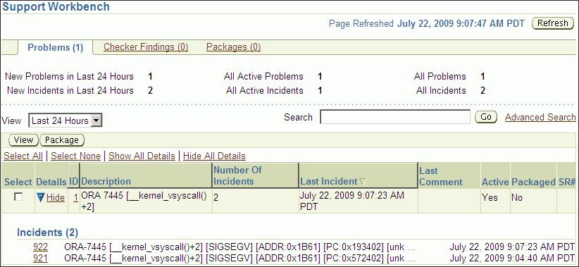

> This screenshot shows the Oracle ASM Support Workbench Problems page in Oracle Enterprise Manager.
>
> The Problems page lists the problems and the number of incidents for each of the listed problems for the Oracle ASM instance.
>
> For each problem in the list, the ID, Description, Number of Incidents, Date of Last Incident, Last Comment, and Package activity is displayed.
>
> There are View and Package buttons to view details or create a package of a selected problem.
  

To create a package, select an incident and click Package on the Support Workbench Problems page. Support Workbench guides you through the packaging process.

Figure 9-18 shows step one the Oracle ASM Support Workbench Create New Package wizard.

Figure 9-18 Oracle Automatic Storage Management Support Workbench Create Package

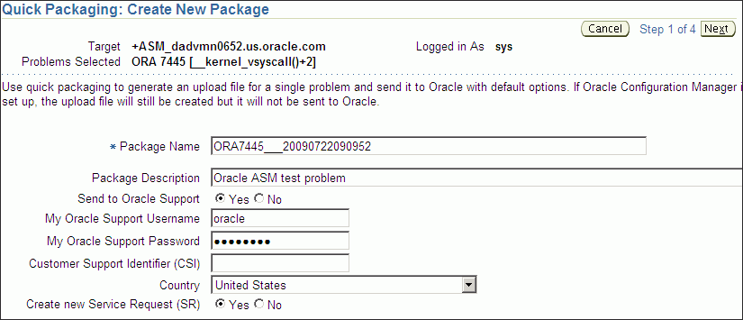

> This screenshot shows step one of the Oracle ASM Support Workbench Create Package wizard in Oracle Enterprise Manager.
>
> On this page of the wizard, you are required to provide a name for the package. You can optionally enter a package description, select whether to send the package to Oracle Support, or create a new service request.
>
> To send the package to Oracle support, you need to provide your My Oracle Support user name, password, and customer support identifier.
>
> There are Cancel and Next buttons to either cancel the wizard or proceed to the next page of the wizard.
  

Figure 9-19 shows the Oracle ASM Support Workbench page with the Packages tab displayed. On this tab, you can view and edit information about incident packages created for problems.

Figure 9-19 Oracle Automatic Storage Management Support Workbench Check Packages

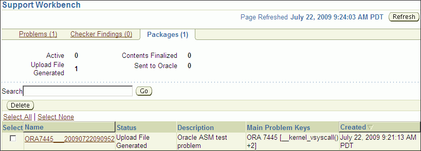

> This screenshot shows the Oracle ASM Support Workbench Packages page in Oracle Enterprise Manager.
>
> This page lists the packages that you have created for any problems. You can search for a specific package on the page.
>
> There is a Delete button to delete a package that you no longer need.
  

You can view additional details for a problem by selecting a problem on the Problems tab, and then clicking on View. The problem details page displays as shown in Figure 9-20.

Figure 9-20 Oracle Automatic Storage Management Support Workbench Problem Details

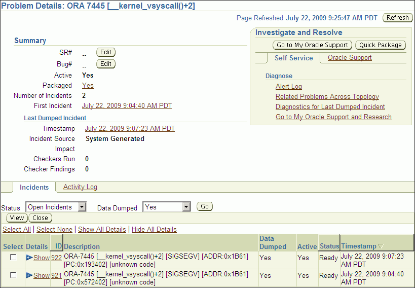

> This screenshot shows the Support Workbench Problem Details page in Oracle Enterprise Manager.
>
> The details page displays a summary of the problem and details of the incidents related to the problem.
>
> There are buttons to edit the service request or bug assigned to this problem. There are additional buttons to refresh the page, view incidents, or close incidents.
  

On the Problem Details page, you can access additional diagnostic tools. You can also use quick packaging to send an incident package to Oracle Support Services.

See Also:

- [Oracle Database Administrator's Guide](https://docs.oracle.com/cd/E11882_01/server.112/e25494/diag.htm#ADMIN12299) for information about viewing problems with Oracle Enterprise Manager Support Workbench
- [Oracle Database 2 Day DBA](https://docs.oracle.com/cd/E11882_01/server.112/e10897/problems.htm#ADMQS12115) for information about accessing the Oracle Enterprise Manager Support Workbench home page and viewing problems using Oracle Enterprise Manager Support Workbench

## Oracle by Example Series

Oracle by Example (OBE) has a series on the [Oracle Database 2 Day DBA](https://docs.oracle.com/cd/E11882_01/server.112/e10897/intro.htm#ADMQS001) book. This OBE steps you through Oracle Database tasks and includes annotated screen shots.

To view the Oracle Database OBE, point your browser to the following location:

`http://www.oracle.com/webfolder/technetwork/tutorials/obe/db/11g/r2/2day_dba/asm/asm.htm`