## 11 Oracle ASM Configuration Assistant

Oracle ASM Configuration Assistant (ASMCA) supports installing and configuring Oracle ASM instances, disk groups, volumes, and Oracle Automatic Storage Management Cluster File System (Oracle ACFS). In addition, you can use the ASMCA command-line interface as a non-GUI utility.

This chapter discusses the following topics:

- Oracle ASM Configuration Assistant GUI Tool
- Oracle ASM Configuration Assistant Command-Line Interface

## Oracle ASM Configuration Assistant GUI Tool

This section contains the following topics:

### Starting Oracle ASM Configuration Assistant

To start ASMCA, enter `asmca` at a command prompt inside the Oracle Grid Infrastructure home. For example:

`$` `asmca`

The GUI tool displays and attempts to connect to the Oracle ASM instance identified with the Oracle system identifier (SID) set to `+ASM`.

- If ASMCA detects an Oracle ASM instance that is not running, then ASMCA prompts whether you want to start the instance.
- If ASMCA detects an Oracle ASM instance from a previous release, then ASMCA prompts whether you want to upgrade the instance. Oracle recommends that you respond `No` this prompt.
	An Oracle ASM instance should be upgraded with Oracle Universal Installer (OUI). OUI automatically defaults to upgrade mode when it detects an Oracle ASM instance at a previous release level. See ["Upgrading an Oracle ASM Instance in an Oracle Restart Configuration with Oracle Universal Installer"](asminst.md).
	To continue the upgrade process with ASMCA, see "Upgrading an Oracle ASM Instance with Oracle ASM Configuration Assistant". If you need help with upgrading an Oracle ASM instance, contact Oracle Support Services.

To start the command-line ASMCA, see "Oracle ASM Configuration Assistant Command-Line Interface".

### Creating Oracle ASM Instances with Oracle ASM Configuration Assistant

Oracle ASM Configuration Assistant enables you to create an Oracle ASM instance if an Oracle ASM instance is not found on the host, as shown in Figure 11-1.

On the Create ASM page, you enter the `SYS` password for the administrator of the Oracle ASM instance and the password for the `ASMSNMP` user that can monitor this Oracle ASM instance. Note that `ASMSNMP` is a less privileged user that is primarily used by Oracle Enterprise Manager to monitor Oracle ASM instances.

See Also:

- [Oracle Grid Infrastructure Installation Guide](http://www.oracle.com/pls/topic/lookup?ctx=db112&id=GINST) for information about installing Oracle ASM
- [Oracle Database Installation Guide](http://www.oracle.com/pls/topic/lookup?ctx=db112&id=GINST) for information about reviewing database accounts and passwords

You can select the listener with which to register this Oracle ASM instance. Click ASM Parameters to update the initialization parameters for the Oracle ASM instance.

Figure 11-1 Oracle ASM Configuration Assistant Create ASM Page

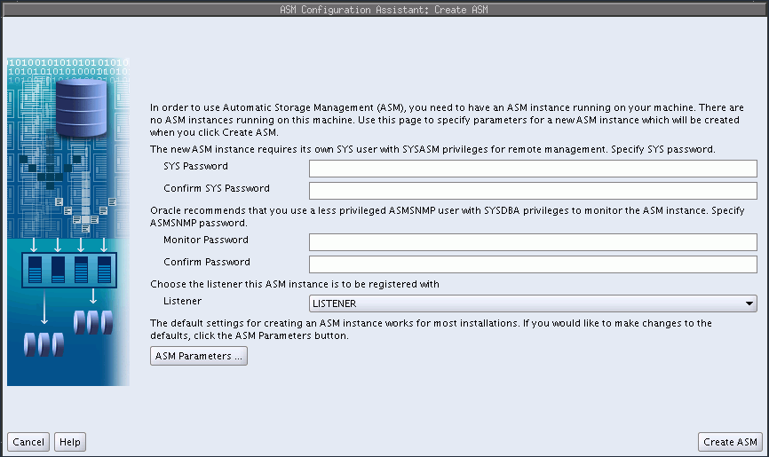

> This screenshot shows the Oracle ASM Configuration Assistant Create ASM page.
>
> On this page, you enter the SYS password for the administrator of the Oracle ASM instance and the ASMSNMP password for the user that can monitor this Oracle ASM instance.
>
> You can select the listener with which you want to register thisOracle ASM instance.
>
> Click ASM Parameters to update the initialization parameters for the Oracle ASM instance.
>
> Click Create ASM to create the new Oracle ASM instance.
  

When you can click ASM Parameters in the Create ASM page, you can update initialization parameters for an Oracle ASM instance on the Oracle ASM Configuration Assistant page, as shown in Figure 11-2.

For information about Oracle ASM instance initialization parameters, see ["Configuring Initialization Parameters for Oracle ASM Instances"](asminst.md).

Figure 11-2 Oracle ASM Configuration Assistant Create ASM Page

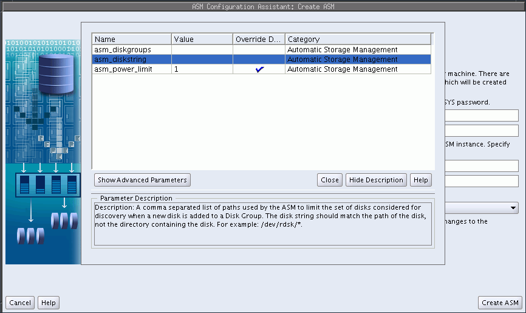

> This screenshot shows the Oracle ASM Configuration Assistant Create ASM page with the parameter configuration table displayed.
>
> The name, value, override, and category columns are displayed in the table.
>
> There are options to show additional advanced parameters, close the table, hide descriptions of parameters, and display help.
>
> Copyright © 2007, 2011, Oracle and/or its affiliates. All rights reserved.  
> [Legal Notices](https://docs.oracle.com/cd/E11882_01/dcommon/html/cpyr.htm)
  

### Upgrading an Oracle ASM Instance with Oracle ASM Configuration Assistant

Note:

- For information about performing an Oracle ASM Rolling Upgrade from 11.1.0.6 to 11.2.0.1, refer to Oracle Database Readme.
- For information about upgrading Oracle ASM from version 11.2.0.1 to 11.2.0.2, see ["Out of Place Upgrades"](asminst.md).

Oracle ASM Configuration Assistant also enables you to upgrade an existing Oracle ASM instance to the current software level. However, the recommended practice is to upgrade an Oracle ASM instance with Oracle Universal Installer (OUI). OUI automatically defaults to upgrade mode when it detects an Oracle ASM instance at a previous release level. See ["Upgrading an Oracle ASM Instance in an Oracle Restart Configuration with Oracle Universal Installer"](asminst.md).

If Oracle Clusterware has been upgraded, then there is no need to upgrade the Oracle ASM instance in that Oracle Grid Infrastructure home. Oracle ASM is usually upgraded as part of the Oracle Clusterware upgrade.

See Also:

- [Oracle Grid Infrastructure Installation Guide](http://www.oracle.com/pls/topic/lookup?ctx=db112&id=GINST) for information about installing and upgrading Oracle Grid Infrastructure
- Articles at [My Oracle Support](https://support.oracle.com/) (`https://support.oracle.com`) for information about upgrading Oracle ASM

The following procedure describes how to upgrade an Oracle ASM instance from 11g Release 1 (11.1) to 11g Release 2 (11.2). In this scenario:

- The Oracle ASM and Oracle Database instances 11g Release 1 (11.1) exist in separate homes.
- The Oracle Grid Infrastructure software 11g Release 2 (11.2) is installed in a separate home.
- The Oracle ASM instance 11g Release 2 (11.2) is set up as an Oracle Restart (single-instance) configuration.
1. Shut down the Oracle Enterprise Manager agent, Oracle Database instance, and the listener in the older database home.
	- Run `emctl` `stop` `dbconsole` to stop the Oracle Enterprise Manager agent.
		- Connect to the database instance with SQL\*Plus as a privileged user and run the `SHUTDOWN` command.
		- Run `lsnrctl` and enter the `STOP` command to stop the listener.
	See Also:
	- Oracle Enterprise Manager manuals and online help for information about starting and stopping the Oracle Enterprise Manager agent
	- [Oracle Database Administrator's Guide](https://docs.oracle.com/cd/E11882_01/server.112/e25494/start.htm#ADMIN004) for more information about starting up and shutting down Oracle instances
	- [Oracle Database Net Services Administrator's Guide](https://docs.oracle.com/cd/E11882_01/network.112/e41945/toc.htm) for information about configuring a listener
2. Run Oracle Universal Installer (OUI) and select the Install Oracle Grid Infrastructure Software Only option.
3. Complete the screens in the OUI installer and run the scripts as prompted by the OUI installer.
	For example, on Linux you must run the `root.sh` script as the `root` user.
	```
	# GRID_HOME/grid/perl/bin/root.sh
	```
	When you run the `root.sh` script on Linux, note the instructions in the output of that script. You must run different scripts as `root` to configure either a standalone (single-instance) or cluster configuration after OUI has completed.
	See Also:
	[Oracle Grid Infrastructure Installation Guide](http://www.oracle.com/pls/topic/lookup?ctx=db112&id=GINST) for information about installing and upgrading Oracle Grid Infrastructure
4. After the OUI has completed, perform the procedures that are described in the output of the `root.sh` script that you ran during the installation.
	For example, for a standalone (single-instance) configuration on Linux, run the following script as `root` to upgrade the necessary services, including Oracle Cluster Synchronization Services (CSS).
	```
	# GRID_HOME/grid/perl/bin/perl -I/GRID_HOME/perl/lib -I/GRID_HOME/crs/install 
	 GRID_HOME/crs/install/roothas.pl
	```
	For an upgrade, you must update the node list by running OUI as the installation user in the Oracle Grid Infrastructure home.
	```
	$ GRID_HOME/oui/bin/runInstaller -updateNodeList -silent -local CRS=false
	  ORACLE_HOME=ASM_11G_R1_HOME
	$ GRID_HOME/oui/bin/runInstaller -updateNodeList -silent -local CRS=true
	  ORACLE_HOME=GRID_HOME
	```
5. Ensure that the current Oracle Cluster Synchronization Services (CSS) are running in the home where the Oracle ASM instance is located. For example:
	On Linux run the `crsctl` `check` `css` command. If the CSS daemon is not running, run `localconfig` `add` as the root user.
	On Windows, you can use the `crsctl` and `localconfig` commands or the Windows Services GUI tool. To use Windows Services GUI tool, double-click the Services icon in the Windows Control Panel and locate the `OracleCSService` service. The status of `OracleCSService` should be `Started` and its startup type should be `Automatic`.
6. Run the Network Configuration Assistant (NETCA) to configure the listener.
	Start Network Configuration Assistant (NETCA) in the Oracle Grid Infrastructure home with `netca`. Follow the prompts in the wizard to add and configure the listener in the Oracle Grid Infrastructure home.
7. Run ASMCA from the Oracle Grid Infrastructure home to complete the upgrade.
	For information about starting ASMCA, see "Starting Oracle ASM Configuration Assistant". If the Oracle ASM instance has been shut down during the Oracle Grid Infrastructure configuration, start that instance when ASMCA prompts you to start that instance.
	When ASMCA detects an earlier version of Oracle ASM, the assistant automatically determines the location of that instance and the location of the Oracle Grid Infrastructure home, as shown in Figure 11-3.
	Enter a password for the `ASMSNMP` user. Note that `ASMSNMP` is a less privileged user that is primarily used by Oracle Enterprise Manager to monitor Oracle ASM instances.
	When you have completed the page, select Upgrade ASM to complete the upgrade. After the process has completed, you can exit from ASMCA.
	When upgrading an Oracle ASM instance to the current software level, ASMCA moves the Oracle ASM instance pre-11g Release 2 (11.2) to the Oracle Grid Infrastructure home and updates the appropriate environmental variables.
8. Ensure that the Oracle Database instance and Oracle Enterprise Manager agent are running in the Oracle Database 11g Release 1 (11.1) home.
	Start the following services if necessary.
	- Connect to the Oracle Database instance with SQL\*Plus as a privileged user and run the `STARTUP` command.
		- Restart the Oracle Enterprise Manager agent with `emctl` `start` `dbconsole`.

Note:

The procedure described in this section upgrades the Oracle ASM instance only. Oracle Database, and Oracle Enterprise Manager, will not have the latest features. To upgrade Oracle Database, see [Oracle Database Upgrade Guide](https://docs.oracle.com/cd/E11882_01/server.112/e23633/upgrade.htm#UPGRD003).

Figure 11-3 Oracle ASM Configuration Assistant Upgrade ASM Page

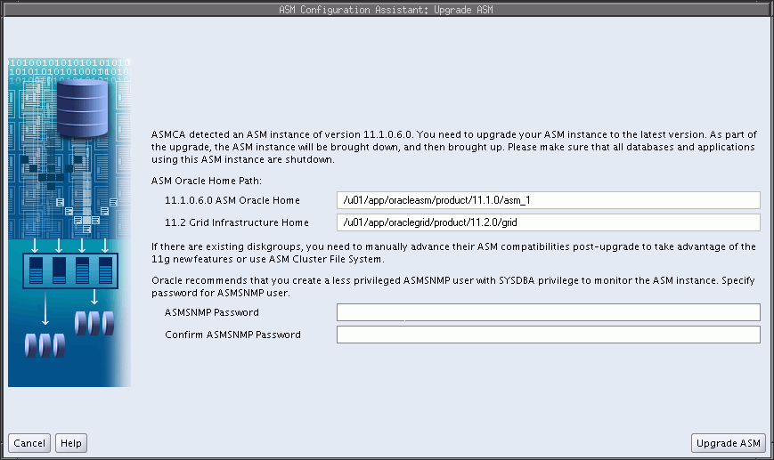

> This screenshot shows the Oracle ASM Configuration Assistant Upgrade ASM page.
>
> This page displays the existing home of the Oracle ASM instance and the Oracle Grid Infrastructure home where the Oracle ASM instance will be moved and upgraded.
>
> There are entry fields that enable you to set the password for the ASMSNMP user. The ASMSNMP user typically has less privileges than the administrative users.
>
> The Upgrade ASM button initiates the upgrade operation.
  

After upgrading an Oracle ASM instance, you can copy or move an Oracle ASM instance. After copying or moving the SPFILE, you must restart the instance with the SPFILE in the new location to use that SPFILE. For information, see ["Backing Up, Copying, and Moving an Oracle ASM Initialization Parameter File"](asminst.md).

See Also:

- [Oracle Database Upgrade Guide](https://docs.oracle.com/cd/E11882_01/server.112/e23633/upgrade.htm#UPGRD003) for information about upgrading Oracle Database
- [Oracle Grid Infrastructure Installation Guide](http://www.oracle.com/pls/topic/lookup?ctx=db112&id=GINST) for information about installing Oracle Grid Infrastructure and performing a rolling upgrade of Oracle ASM

### Managing Disk Groups with Oracle ASM Configuration Assistant

Oracle ASM Configuration Assistant enables you to configure or create Oracle ASM disk groups with the Configure ASM Disk Groups tab, as shown in Figure 11-4. The disk group tab displays selected details about the disk group, such as name, size, free space, usable space, redundancy level, and state of the disk group.

See Also:

[Oracle Database Reference](https://docs.oracle.com/cd/E11882_01/server.112/e40402/dynviews_1027.htm#REFRN30171) for descriptions of disk group information displayed in the `V$ASM_DISKGROUP` view

You can right click a selected disk group in the screen to display the configuration options menu. The menu options enable you to:

- Add disks to the disk group
- Edit the disk group attributes
- Manage templates for the disk group
- Create an Oracle ACFS file system on the disk group for a database home
- Dismount and mount the disk group
- Drop the disk group

Figure 11-4 Oracle ASM Configuration Assistant Configure Disk Groups Page

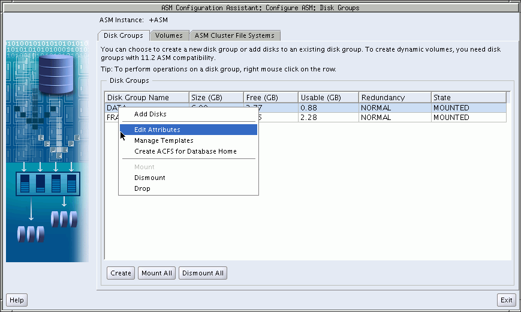

> This screenshot shows the Oracle ASM Configuration Assistant Configure Disk Groups page.
>
> The screenshot is described in the surrounding text.
>
> Copyright © 2007, 2011, Oracle and/or its affiliates. All rights reserved.  
> [Legal Notices](https://docs.oracle.com/cd/E11882_01/dcommon/html/cpyr.htm)
  

There are additional options for creating a disk group, mounting all disk groups, and dismounting all disk groups.

Oracle ASM Configuration Assistant enables you to create an Oracle ASM disk group by clicking Create on the Oracle ASM Configuration Assistant disk group page. The page for creating a disk group is shown in Figure 11-5.

Figure 11-5 Oracle ASM Configuration Assistant Create Disk Groups Page

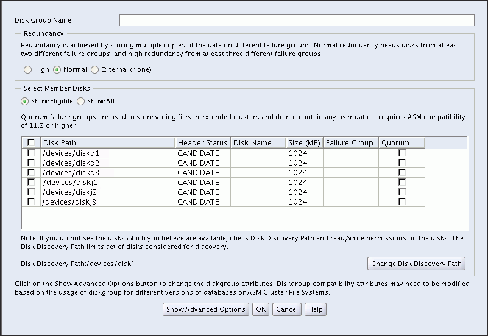

> This screenshot shows the Oracle ASM Configuration Assistant Create Disk Groups page.
>
> This screenshot is described in the surrounding text.
>
> Copyright © 2007, 2011, Oracle and/or its affiliates. All rights reserved.  
> [Legal Notices](https://docs.oracle.com/cd/E11882_01/dcommon/html/cpyr.htm)
  

On this page, you can enter a name for the disk group, select the redundancy level, change the disk discovery path to locate disks in a different directory, identify the disks to be in the disk group, enter a name for a failure group, and specify if the failure group is a quorum type. A quorum failure group is a special type of failure group and disks in these failure groups do not contain user data and a quorum failure group is not considered when determining redundancy requirements with respect to user storage. However, a quorum failure group counts when mounting a disk group. For information about quorum failure groups, see ["Oracle Cluster Registry and Voting Files in Oracle ASM Disk Groups"](asmdiskgrps.md).

The default disk group compatibility settings are `11.2` for Oracle ASM compatibility, `10.1` for database compatibility, and no value for Oracle ADVM compatibility. For information about disk group compatibility attributes, see ["Disk Group Compatibility"](asmdiskgrps.md). For information about disk discovery, see ["Oracle ASM Disk Discovery"](asmdiskgrps.md) and ["ASM\_DISKSTRING"](asminst.md).

You can choose to show advanced options when creating a disk group, as shown in Figure 11-6. The advanced options page enables you to set additional options, such as disk group compatibility settings and allocation unit (AU) size. When you are finished with the create disk group specifications, click OK.

Note:

The disk group compatibility settings can only be advanced. You cannot revert to a lower compatibility setting after you advance the disk group compatibility settings. See ["Overview of Disk Group Compatibility"](asmdiskgrps.md)

Figure 11-6 Oracle ASM Configuration Assistant Create Disk Groups Page - Advanced Options

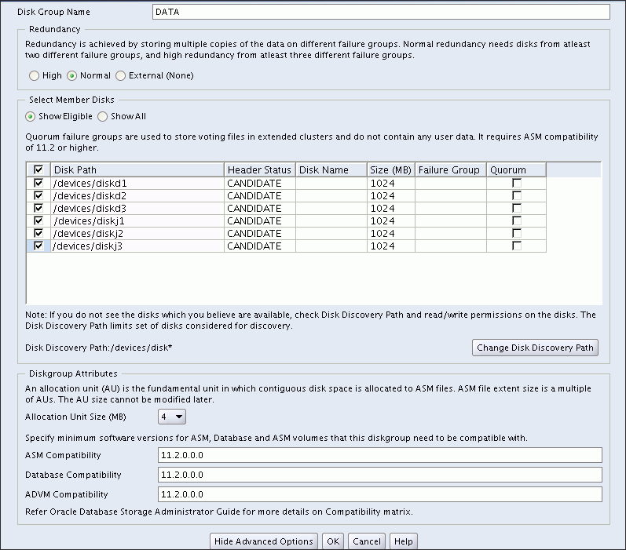

> This screenshot shows the Oracle ASM Configuration Assistant Create Disk Groups page with the advanced options displayed.
>
> This screenshot is described in the surrounding text.
>
> Copyright © 2007, 2011, Oracle and/or its affiliates. All rights reserved.  
> [Legal Notices](https://docs.oracle.com/cd/E11882_01/dcommon/html/cpyr.htm)
  

For more information about managing disk groups, see [Chapter 4, "Administering Oracle ASM Disk Groups"](asmdiskgrps.md).

### Managing Oracle ADVM Volumes with Oracle ASM Configuration Assistant

Oracle ASM Configuration Assistant enables you to create or configure an Oracle ADVM volume, as shown in Figure 11-7.

Right click a selected volume in the Oracle ASM Configuration Assistant screen to display the configuration options menu. The menu options include:

- Enable a disabled volume
- Disable an enabled volume
- Resize a volume that has not been mounted on an Oracle ACFS file system
- Delete a volume

There are options for creating a volume, enabling all volumes, and disabling all volumes.

Figure 11-7 Oracle ASM Configuration Assistant Configure ASM Volumes Page

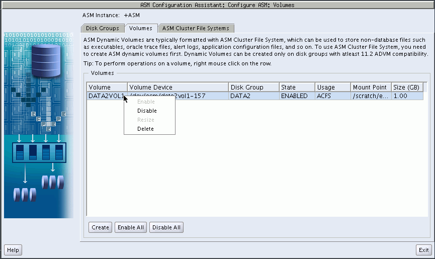

> This screenshot shows the Oracle ASM Configuration Assistant Configure Volumes page.
>
> This screenshot is described in the surrounding text.
>
> Copyright © 2007, 2011, Oracle and/or its affiliates. All rights reserved.  
> [Legal Notices](https://docs.oracle.com/cd/E11882_01/dcommon/html/cpyr.htm)
  

Oracle ASM Configuration Assistant enables you to create Oracle ADVM volumes, as shown in Figure 11-7.

Click Create to create a volume. You must provide a unique volume name for the existing Oracle ASM disk group that you select from the list. The volume name can be a maximum of 11 alphanumeric characters; dashes are not allowed. The first character must be alphabetic.

Specify the size for the volume. You can optionally choose to display advanced options for creating a volume which enables you to specify the redundancy level and striping characteristics.

If the number of stripe columns is set to 1, then striping is disabled and the stripe width is equal to the volume extent size. The volume extent size is 8 MB if the disk group allocation unit (AU) is less than or equal to 8 MB. If the AU size is greater than 8 MB, then the Oracle ADVM volume extent size is equivalent to the disk group AU size.

The compatibility parameters `COMPATIBLE.ASM` and `COMPATIBLE.ADVM` must be set to 11.2 or higher for the disk group to contain an Oracle ADVM volume. To use Oracle ACFS encryption, replication, security, or tagging, the disk group on which the volume is created for the file system must have compatibility attributes for `ASM` and `ADVM` set to `11.2.0.2`. See ["Disk Group Compatibility Attributes"](asmdiskgrps.md).

Before creating an Oracle ADVM volume on AIX, ensure that the necessary user authorizations have been created. For information, refer to ["Oracle ACFS Command-line Tools for the AIX Environment"](asmfs_util004.md).

Figure 11-8 Oracle ASM Configuration Assistant Create an ASM Volume Page

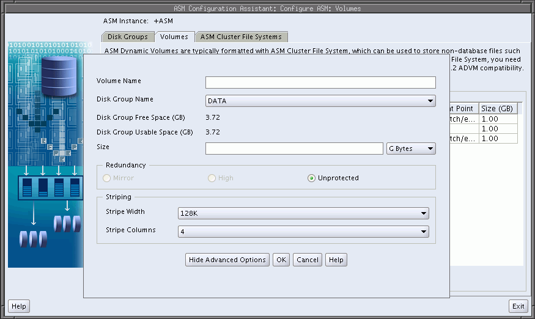

> This screenshot shows the Oracle ASM Configuration Assistant Create ASM Volume page.
>
> This screenshot is described in the surrounding text.
>
> Copyright © 2007, 2011, Oracle and/or its affiliates. All rights reserved.  
> [Legal Notices](https://docs.oracle.com/cd/E11882_01/dcommon/html/cpyr.htm)
  

For information about creating a volume with the ASMCMD `volcreate` command, refer to ["volcreate"](asm_util007.md). For an overview of Oracle ACFS, see [Chapter 5, "Introduction to Oracle ACFS"](asmfilesystem.md).

### Managing Oracle ACFS File Systems with Oracle ASM Configuration Assistant

Oracle ASM Configuration Assistant enables you to create or configure an Oracle ACFS file system, as shown in Figure 11-9.

To configure an existing file system, right click a selected file system in the Oracle ASM Configuration Assistant screen to display the configuration options menu.

The menu options include:

- Show mount command for the file system
- Show dismount command for the file system
- Register mount point for the file system
- Deregister mount point for the file system
- Resize the file system
- Delete the file system

Some commands require root privileges, such as mounting a file system. Oracle ASM Configuration Assistant generates the command for you to run manually as root or as a privileged user.

There are buttons for Create, Show Mount All, and Show Dismount All commands.

Figure 11-9 Oracle ASM Configuration Assistant Configure Oracle ACFS Page

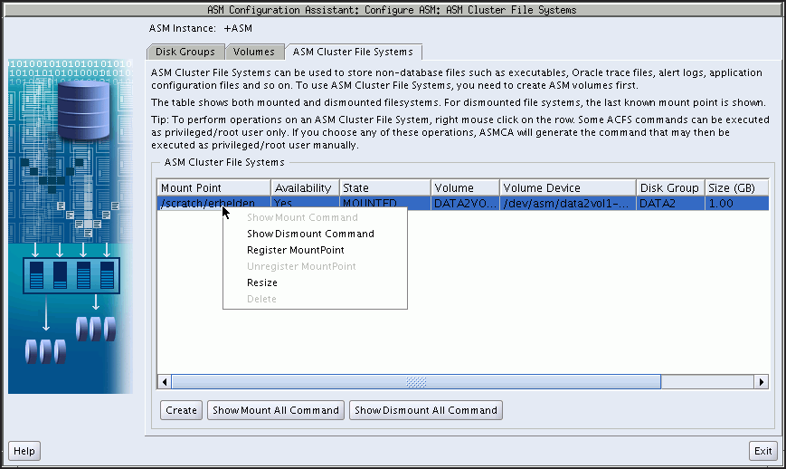

> This screenshot shows the Oracle ASM Configuration Assistant Configure File System page.
>
> This screenshot is described in the surrounding text.
>
> Copyright © 2007, 2011, Oracle and/or its affiliates. All rights reserved.  
> [Legal Notices](https://docs.oracle.com/cd/E11882_01/dcommon/html/cpyr.htm)
  

Oracle ASM Configuration Assistant enables you to create an Oracle ACFS file system, as shown in Figure 11-9.

Select Create, then select an existing Oracle ADVM volume from the list and determine the mount point field, show in Figure 11-10. The mount point must be an existing directory. The file system must be mounted to make it available. The mount command must be manually run as root or the Windows `Administrator` at an operating system prompt. For information about mounting an Oracle ACFS file system, see ["mount"](asmfs_util002.md) for Linux or ["acfsmountvol"](asmfs_util005.md) for Windows.

You can also choose to create an Oracle ACFS file system for an Oracle Database. For more information about creating a file system for a database home, see "Creating an Oracle ACFS File System for a Database Home".

Figure 11-10 Oracle ASM Configuration Assistant Create Oracle ACFS Page

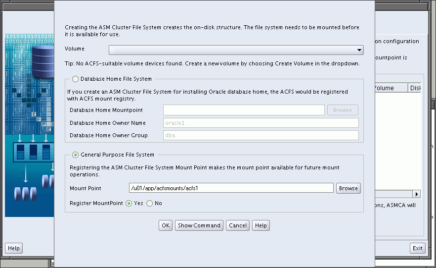

> This screenshot shows the Oracle ASM Configuration Assistant Create File System page.
>
> This screenshot is described in the surrounding text.
>
> Copyright © 2007, 2011, Oracle and/or its affiliates. All rights reserved.  
> [Legal Notices](https://docs.oracle.com/cd/E11882_01/dcommon/html/cpyr.htm)
  

For information about Oracle ACFS, see [Chapter 5, "Introduction to Oracle ACFS"](asmfilesystem.md). For a summary of the basic steps for creating an Oracle ACFS file system, see ["Basic Steps to Manage Oracle ACFS Systems"](asmfs_util001.md).

### Managing Security and Encryption for Oracle ACFS File Systems with Oracle ASM Configuration Assistant

Oracle ASM Configuration Assistant enables you to configure security and encryption for an Oracle ACFS file system, as shown in Figure 11-11.

Figure 11-11 Oracle ASM Configuration Assistant Configure Oracle ACFS Security and Encryption Page

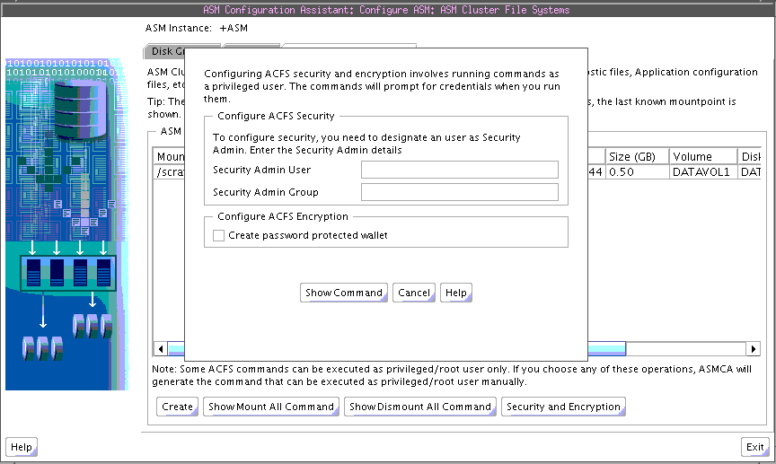

> This screenshot shows the Oracle ASM Configuration Assistant Configure Oracle ACFS Security page.
>
> This screenshot is described in the surrounding text.
>
> Copyright © 2007, 2011, Oracle and/or its affiliates. All rights reserved.  
> [Legal Notices](https://docs.oracle.com/cd/E11882_01/dcommon/html/cpyr.htm)
  

You must initialize the security system as the first step in configuring security for an Oracle ACFS file system. You must also initialize the encryption system as the first step in encrypting an Oracle ACFS file system. You do not have to use both Oracle ACFS security and encryption on the same file system. If you decide to use both security and encryption, then encryption must be initialized and set before enabling encryption on a security realm.

After you complete the entry fields in the dialog shown in Figure 11-11, click Show Command to display the commands you must run as a root or Administrator user at an operating system prompt. For example:

```
# /sbin/acfsutil sec init -u grid -g asmadmin
# /sbin/acfsutil encr init
```

For information about the `acfsutil` `sec` `init` and `acfsutil` `encr` `init` commands, refer to ["acfsutil sec init"](asmfs_util008.md) and ["acfsutil encr init"](asmfs_util009.md).

After security has been initialized, you can use the menu options to manage security and encryption for an Oracle ACFS file system, as shown in Figure 11-12. These menu options include:

- Enable Encryption
- Set Encryption
- Disable Encryption
- Prepare and Enable Security
- Disable Security
- Enable Security

Figure 11-12 Oracle ASM Configuration Assistant Oracle ACFS Security Menu Options

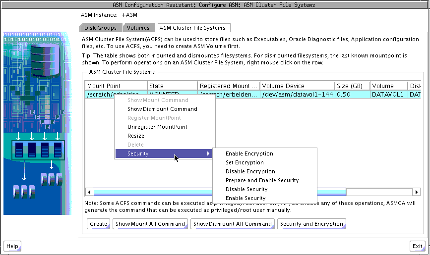

> This screenshot shows the Oracle ASM Configuration Assistant Oracle ACFS Security menu options.
>
> This screenshot is described in the surrounding text.
>
> Copyright © 2007, 2011, Oracle and/or its affiliates. All rights reserved.  
> [Legal Notices](https://docs.oracle.com/cd/E11882_01/dcommon/html/cpyr.htm)
  

For information about Oracle ACFS security, see ["Oracle ACFS Security"](asmfilesystem.md). For a summary of the basic steps for setting up security on an Oracle ACFS file system, see ["Securing Oracle ACFS File Systems"](asmfs_util001.md).

For information about Oracle ACFS encryption, see ["Oracle ACFS Encryption"](asmfilesystem.md). For a summary of the basic steps for setting up encryption on an Oracle ACFS file system, see ["Encrypting Oracle ACFS File Systems"](asmfs_util001.md).

For information about the `acfsutil` `encr` and `acfsutil` `sec` commands, see ["Oracle ACFS Command-Line Utilities for Multiple Environments"](asmfs_util010.md).

### Creating an Oracle ACFS File System for a Database Home

To create an Oracle ACFS file system for a database home, you can select the Create ACFS for Database Home from the disk group configuration options menu, as shown in Figure 11-4. The Create ACFS Hosted Database Home dialog displays as shown in Figure 11-13.

In this dialog, you must enter:

- Database Home Volume Name
	This is the name of the Oracle ADVM volume you want to create. For information about Oracle ADVM volumes, see ["About Oracle ACFS"](asmfilesystem.md).
- Database Home Mount Point
	This is the mount point for the file system where you want to install the database home. The file system that contains the database home should not be located under the Oracle Grid Infrastructure base (`ORACLE_BASE` for grid) directory. For information about mount points and database homes, see ["About Oracle ACFS and Oracle Database Homes"](asmfilesystem.md).
- Database Home Size in gigabytes (GB)
	The default is 6 GB and the minimum size allowed.
- Database Home Owner Name
	This is the operating system name of the user that installs the database and owns the software in the database home.
- Database Home Owner Group
	This is the operating system group of the owner of the database home.

The mount point must be an existing directory. The file system must be mounted to make it available. The mount command must be manually run as `root` or the Windows `Administrator` at an operating system prompt. For information about mounting an Oracle ACFS file system, see ["mount"](asmfs_util002.md) for Linux or ["acfsmountvol"](asmfs_util005.md) for Windows.

For information on the mount registry, see ["About the Oracle ACFS Mount Registry"](asmfilesystem.md).

Figure 11-13 Oracle ASM Configuration Assistant Create Oracle ACFS Hosted Database Home Page

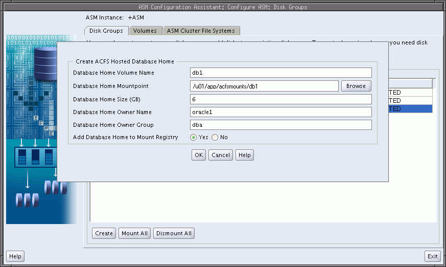

> This screenshot shows the Oracle ASM Configuration Assistant Create Oracle ACFS hosted Database Home page.
>
> This screenshot is described in the surrounding text.
>
> Copyright © 2007, 2011, Oracle and/or its affiliates. All rights reserved.  
> [Legal Notices](https://docs.oracle.com/cd/E11882_01/dcommon/html/cpyr.htm)
  

## Oracle ASM Configuration Assistant Command-Line Interface

The ASMCA command-line interface provides non-GUI support for configuring Oracle ASM disk groups, volumes, and Oracle ACFS.

- Running ASMCA Command-Line
- ASMCA Commands

### Running ASMCA Command-Line

The syntax for running the ASMCA command-line tool is:

  
`asmca` `-silent` `command_name` \[`options`\]  

Table 11-1 contains the options available with the `asmca` command-line tool.

Table 11-1 Options for the ASMCA command-line tool

| Option | Description |
| --- | --- |
| `-silent` | Specifies to run `asmca` in command-line mode. |
| `command_name` | Specifies the command to run. The command can be any of the following:  `-configureASM`  `-upgradeASM`  `-configureParameter`  `-deleteASM`  `-createDiskGroup`  `-addDisk`  `-createVolume`  `-createACFS`  See "ASMCA Commands". |
| `options` | Specifies the options to run for a command. The options vary by command. See the individual commands described in "ASMCA Commands" for the available options.  The following list describes the options that are common for multiple commands.  - `-help` 	Displays help for running ASMCA in silent mode. - `-asmsnmpPassword` `asmsnmp_password` 	The Oracle ASM monitor user (`ASMSNMP`) password. This is optional and only required when creating and migrating an Oracle ASM instance. - `-sysAsmPassword` `sysasm_password` 	The `SYSASM` password for Oracle ASM instance. This option is required. |

The following is an example of the `-help` option.

```
$ asmca -help
asmca [-silent] [-sysAsmPassword <SYS user password>] [-asmsnmpPassword <ASMSNMP password>] {<command> <options>}
Please refer to the manual for details.
You can enter one of the following commands:
...
```

### ASMCA Commands

This section describes the commands that can be run with ASMCA command-line.

- Configure an Oracle ASM Instance
- Upgrade an Oracle ASM Instance
- Configure Parameters for an Oracle ASM Instance
- Delete Oracle ASM Instances
- Create a Disk Group
- Add a Disk to a Disk Group
- Create a Volume
- Create an Oracle ACFS File System

#### Configure an Oracle ASM Instance

\- `configureASM` configures or creates an Oracle ASM instance.

Syntax

  
`asmca` `-silent`  
 `-configureASM`  
 \[`-sysAsmPassword` `sysasm_password` \]  
 \[ `-asmsnmpPassword` `asm_monitor_password` \]  
 \[ { `-param` `paramname` `=` `paramvalue`,... } \]  
 \[ { `-diskString` `discovery_path`  
 `-diskGroupName` `diskgroup`  
 `-diskList` `disk_list`  
 \[ `-redundancy` { `HIGH` | `NORMAL` | `EXTERNAL` } \] } \]  

Table 11-2 contains the options available with the - `configureASM` command.

Table 11-2 Options for the -configureASM command

| Option | Description |
| --- | --- |
| `-param` `paramname` `=` `paramvalue`,... | Specifies a list of initialization parameters with values for the Oracle ASM instance. |
| `-diskString` `discovery_path` | Specifies the Oracle ASM discovery string for locating disks. |
| `-diskGroupName` `diskgroup` | Specifies the name of the Oracle ASM disk group to create. |
| `-diskList` `disk_list` | Specifies a comma-delimited list of disk names to be added to the disk group. |
| `-redundancy` { `HIGH` \| `NORMAL` \| `EXTERNAL` } | Specifies the redundancy setting for the disk group. |

For additional options that are common to multiple commands, see Table 11-1.

Examples

To configure an Oracle ASM instance:

Example 11-1 Using asmca -silent -configureASM

```
asmca -silent
        -configureASM
          -diskString '/devices/disk*'
          –sysAsmPassword my_sysasm_password
          -asmsnmpPassword my_asmsnmp_passwd
```

#### Upgrade an Oracle ASM Instance

\- `upgradeASM` upgrades an Oracle ASM instance from a previous release to the current software release.

Upgrading an Oracle ASM instance with ASMCA only updates the Oracle ASM instance software and does not configure Oracle Clusterware or the listener.

An Oracle ASM instance should be upgraded with Oracle Universal Installer (OUI). OUI automatically defaults to upgrade mode when it detects an Oracle ASM instance at a previous release level. See ["Upgrading an Oracle ASM Instance in an Oracle Restart Configuration with Oracle Universal Installer"](asminst.md).

Syntax

  
`asmca` `-silent`  
 `-upgradeASM`  
 `-local` `-lastnode`  
 \[ `-asmsnmpPassword` `asmsnmp_password` \]  

The options available with the - `upgradeASM` command are common to multiple commands. For a description of those options, see Table 11-1.

Examples

To upgrade an Oracle ASM instance:

Example 11-2 Using asmca -silent -upgradeASM

```
asmca -silent
        -upgradeASM
          -asmsnmpPassword my_asmsnmp_passwd
```

#### Configure Parameters for an Oracle ASM Instance

`-configureParameter` modifies the parameters of an Oracle ASM instance.

Syntax

  
`asmca` `-silent`  
 `-configureParameter`  
 \[ { `-param` `paramname` `=` `paramvalue`,... } \]  
 \[`-sysAsmPassword` `sysasm_password` \]  

Table 11-3 contains the options available with the - `configureParameter` command.

Table 11-3 Options for the -configureParameter command

| Option | Description |
| --- | --- |
| `-param` `paramname` `=` `paramvalue`,... | Specifies a list of initialization parameters with values for the Oracle ASM instance. |

For additional options that are common to multiple commands, see Table 11-1.

Examples

To configure parameters for an Oracle ASM instance:

Example 11-3 Using asmca -silent -configureParameter

```
asmca -silent
        -configureParameter 
           (–param 
            asm_power_limit=3)
        –sysAsmPassword my_sysasm_password
```

#### Delete Oracle ASM Instances

`-deleteASM` deletes all the Oracle ASM instances that are present. The operation stops and an error is raised if there is a database using the Oracle ASM instance.

Syntax

  
`asmca` `-silent`  
 `-deleteASM`  
 \[`-sysAsmPassword` `sysasm_password` \]  
 \[ `-force` \]  
 \[ `-dropDiskGroups` \]  

Table 11-4 contains the options available with the - `deleteASM` command.

Table 11-4 Options for the -deleteASM command

| Option | Description |
| --- | --- |
| `-force` | Forces the deletion of an Oracle ASM instance. |
| `-dropDiskGroups` | Drops the disk groups on this instance. |

For additional options that are common to multiple commands, see Table 11-1.

Examples

To delete an Oracle ASM instance:

Example 11-4 Using asmca -silent -deleteASM

```
asmca -silent
        -deleteASM
          –sysAsmPassword my_sysasm_password
          -force
```

#### Create a Disk Group

\- `createDiskGroup` creates disk groups in an Oracle ASM instance.

Syntax

  
`asmca` `-silent`  
 `-createDiskGroup`  
 \[ `-diskString` `discovery_path` \]  
 { `-diskGroupName` `diskgroup`  
 { `-disk` `disk_path` \[`-diskName` `disk`\] |  
 `-diskList` `disk_list`  
 \[`-diskSize` `disk_size_MB`\]  
 \[`-failuregroup` `failure_group`\]  
 \[`-force` | `-noforce`\]  
 \[`-quorum` | `-noquorum`\] }  
 \[ `-redundancy` { `HIGH` | `NORMAL` | `EXTERNAL` } \] } \]  
 \[`-au_size` `value`\]  
 \[`-compatible.asm` `value` \]  
 \[`-compatible.rdbms` `value` \]  
 \[`-compatible.advm` `value` \] }  
 \[`-sysAsmPassword` `sysasm_password` \]  

Table 11-5 contains the options available with the - `createDiskGroup` command.

Table 11-5 Options for the -createDiskGroup command

| Option | Description |
| --- | --- |
| `-diskString` `discovery_path` | Specifies the Oracle ASM discovery string for locating disks. |
| `-diskGroupName` `diskgroup` | Specifies the name of the Oracle ASM disk group to create. |
| `-disk` `disk_path` | Specifies the full path of the disk device. |
| `-diskName` `disk` | Specifies a user-supplied disk name. |
| `-diskList` `disk_list` | Specifies a comma-delimited list of disk names to be added to the disk group. |
| `-diskSize` `disk_size_MB` | Specifies the size of the disk to use for Oracle ASM storage. |
| `-failuregroup` `failure_group` | Specifies the failure group name. |
| `-force` \| `-noforce` | Specifies where to force the use of the disk. |
| `-quorum` \| `-noquorum` | Specifies a quorum or standard failure group. |
| `-redundancy` { `HIGH` \| `NORMAL` \| `EXTERNAL` } | Specifies the redundancy setting for the Oracle ASM disk group. |
| `-au_size` | Specifies the allocation unit size (1,2,4,8,16,32,64) |
| `-compatible.asm` | Specifies the attribute setting. |
| `-compatible.rdbms` | Specifies the attribute setting. |
| `-compatible.advm` | Specifies the attribute setting. |

For additional options that are common to multiple commands, see Table 11-1.

The default disk group compatibility settings are `11.2` for Oracle ASM compatibility, `10.1` for database compatibility, and no value for Oracle ADVM compatibility. For information about disk group compatibility attributes, see ["Disk Group Compatibility"](asmdiskgrps.md).

Examples

To create disk groups in an Oracle ASM instance:

Example 11-5 Using asmca -silent -createDiskGroup

```
$ asmca -silent -createDiskGroup
       -diskGroupName mynewdg
           -disk '/devices/diske*'
           -disk '/devices/diskk*'
       -redundancy NORMAL
       -au_size 64
       -compatible.asm '11.2.0.0.0'
       -compatible.rdbms '11.2.0.0.0'
       -compatible.advm '11.2.0.0.0'

DiskGroup mynewdg created successfully.
```

#### Add a Disk to a Disk Group

\- `addDisk` add disks to an existing disk group in an Oracle ASM instance.

Syntax

  
`asmca` `-silent`  
 `-addDisk`  
 \[ `-diskString` `discovery_path` \]  
 { `-diskGroupName` `diskgroup`  
 { `-disk` `disk_path` \[`-diskName` `disk`\] |  
 `-diskList` `disk_list`  
 \[`-diskSize` `disk_size_MB`\]  
 \[`-failuregroup` `failure_group`\]  
 \[`-force` | `-noforce`\]  
 \[`-quorum` | `-noquorum`\] }  
 \[`-sysAsmPassword` `sysasm_password` \]  

Table 11-6 contains the options available with the - `addDisk` command.

Table 11-6 Options for the -addDisk command

| Option | Description |
| --- | --- |
| `-diskString` `discovery_path` | Specifies the Oracle ASM discovery string for locating disks. |
| `-diskGroupName` `diskgroup` | Specifies the name of the Oracle ASM disk group to update. |
| `-diskList` `disk_list` | Specifies a comma-delimited list of disk names to be added to the disk group. |
| `-diskSize` `disk_size_MB` | Specifies the size of the disk to use for Oracle ASM storage. |
| `-failuregroup` `failure_group` | Specifies the failure group name. |
| `-force` \| `-noforce` | Specifies where to force the use of the disk. |
| `-quorum` \| `-noquorum` | Specifies a quorum or standard failure group. |

For additional options that are common to multiple commands, see Table 11-1.

Examples

To add disks to an existing disk group:

Example 11-6 Using asmca -silent -addDisk

```
asmca -silent
        -addDisk
          -diskGroupName mynewdg 
             -disk '/devices/diskl1'
             -disk '/devices/diskl2'

Disks added successfully to diskgroup mynewdg.
```

#### Create a Volume

`-createVolume` creates Oracle ADVM volumes.

Syntax

  
`asmca` `-silent`  
 `-createVolume`  
 { `-volumeName` `volume_name`  
 `-volumeDiskGroup` `diskgroup`  
 `-volumeSizeGB` `size_GB`  
 \[ `-volumeRedundancy` { `INHERIT` | `HIGH` | `NORMAL` | `EXTERNAL` } \]... }  
 \[`-sysAsmPassword` `sysasm_password` \]  

Table 11-7 contains the options available with the - `createVolume` command.

Table 11-7 Options for the -createVolume command

| Option | Description |
| --- | --- |
| `-volumeName` `volume_name` | Specifies the name of the volume to create. |
| `-volumeDiskGroup` `diskgroup` | Specifies the name of the disk group where you want to create the volume. |
| `-volumeSizeGB` `size_GB` | Specifies the size of the volume in Gigabytes. |
| `-volumeRedundancy` { `INHERIT` \| `HIGH` \| `NORMAL` \| `EXTERNAL` } | Specifies the redundancy setting for the volume. |

For additional options that are common to multiple commands, see Table 11-1.

Examples

To create an Oracle ADVM volume:

Example 11-7 Using asmca -silent -createVolume

```
$ asmca -silent
        -createVolume
           -volumeName volume1 
           -volumeDiskGroup mynewdg 
           -volumeSizeGB 1 

Volume volume1 created successfully.
```

#### Create an Oracle ACFS File System

\- `createACFS` creates an Oracle Automatic Storage Management Cluster File System (Oracle ACFS).

This command does not mount the Oracle ACFS file system. For information about mounting an Oracle ACFS file system, see ["mount"](asmfs_util002.md) for Linux environments and ["acfsmountvol"](asmfs_util005.md) for Windows environments.

Syntax

  
`asmca` `-silent`  
 `-createACFS`  
 { `-acfsVolumeDevice` `volume_device` }  
 \[`-sysAsmPassword` `sysasm_password` \]  

Table 11-8 contains the options available with the - `createACFS` command.

Table 11-8 Options for the -createACFS command

| Option | Description |
| --- | --- |
| `-acfsVolumeDevice` `volume_device` | Specifies the name of the Oracle ADVM volume device. |

For additional options that are common to multiple commands, see Table 11-1.

Examples

To create an Oracle ACFS file system:

Example 11-8 Using asmca -silent -createACFS

```
$ asmca -silent
        -createACFS
           -acfsVolumeDevice /dev/asm/volume1-457

ACFS creation on /dev/asm/volume1-457 completed successfully. 
The ACFS should be mounted for use.
```