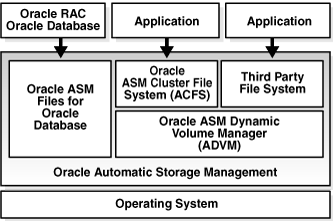

## 5 Introduction to Oracle ACFS

This chapter describes Oracle Automatic Storage Management Cluster File System (Oracle ACFS) concepts and provides an overview of Oracle ACFS features.

This chapter contains the following topics:

See Also:

- ["Views Containing Oracle ACFS Information"](asmviews.md) for information about using views to obtain Oracle ACFS information
- ["Managing Volumes in a Disk Group"](asmdiskgrps.md) for information about using SQL\*Plus to administer volumes
- [Chapter 10, "Administering Oracle ACFS with Oracle Enterprise Manager"](asmfs_em.md) for information about using Oracle Enterprise Manager to administer Oracle ACFS
- [Chapter 11, "Oracle ASM Configuration Assistant"](asmca.md) for information about using Oracle ASM Configuration Assistant to administer Oracle ACFS
- ["ASMCMD Volume Management Commands"](asm_util007.md) for information about volume management commands
- [Chapter 13, "Oracle ACFS Command-Line Tools"](asmfs_util.md) for information about Oracle ACFS operating system utilities

## Overview of Oracle ACFS

Oracle Automatic Storage Management Cluster File System (Oracle ACFS) is a multi-platform, scalable file system, and storage management technology that extends Oracle Automatic Storage Management (Oracle ASM) functionality to support customer files maintained outside of Oracle Database. Oracle ACFS supports many database and application files, including executables, database trace files, database alert logs, application reports, BFILEs, and configuration files. Other supported files are video, audio, text, images, engineering drawings, and other general-purpose application file data.

Notes:

- Oracle ASM is the preferred storage manager for all database files. It has been specifically designed and optimized to provide the best performance for database file types. For a list of file types supported by Oracle ASM, see [Table 7-1, "File types supported by Oracle ASM"](asmfiles.md).
- Oracle ACFS is the preferred file manager for non-database files. It is optimized for general purpose files.
- Oracle ACFS does not support any file type that can be directly stored in Oracle ASM, except where explicitly noted in the documentation.
	Not supported means Oracle Support Services does not take calls and development does not fix bugs associated with storing unsupported file types in Oracle ACFS.
- Starting with Oracle Automatic Storage Management 11g Release 2 (11.2.0.3), Oracle ACFS supports RMAN backups (`BACKUPSET` file type), archive logs (`ARCHIVELOG` file type), and Data Pump dumpsets (`DUMPSET` file type). Note that Oracle ACFS snapshots are not supported with these files.
- Oracle ACFS does not support files for the Oracle Grid Infrastructure home.
- Oracle ACFS does not support Oracle Cluster Registry (OCR) and voting files.
- Oracle ACFS functionality requires that the disk group compatibility attributes for `ASM` and `ADVM` be set to `11.2` or greater. For information about disk group compatibility, refer to ["Disk Group Compatibility"](asmdiskgrps.md).

An Oracle ACFS file system is a layer on Oracle ASM and is configured with Oracle ASM storage, as shown in Figure 5-1. Oracle ACFS leverages Oracle ASM functionality that enables:

- Oracle ACFS dynamic file system resizing
- Maximized performance through direct access to Oracle ASM disk group storage
- Balanced distribution of Oracle ACFS across Oracle ASM disk group storage for increased I/O parallelism
- Data reliability through Oracle ASM mirroring protection mechanisms

Figure 5-1 Oracle Automatic Storage Management Storage Layers



> This illustration shows the Oracle ASM storage layers.
>
> At the top are Oracle RAC, Oracle Database, and client applications.
>
> The middle layer is Oracle Automatic Storage Management, which includes Oracle ASM files for Oracle Database, Oracle Automatic Storage Management Cluster File System (Oracle ACFS) file systems, third-party file systems, and Oracle ASM Dynamic Volume Manager (Oracle ADVM).
>
> The layer at the bottom is the operating system.
  

Oracle ACFS establishes and maintains communication with the Oracle ASM instance to participate in Oracle ASM state transitions including Oracle ASM instance and disk group status updates and disk group rebalancing. Oracle Automatic Storage Management with Oracle ACFS and Oracle ASM Dynamic Volume Manager (Oracle ADVM) delivers support for all customer data and presents a common set of Oracle storage management tools and services across multiple vendor platforms and operating system environments on both Oracle Restart (single-node) and cluster configurations. For an overview of Oracle ADVM, see "Overview of Oracle ASM Dynamic Volume Manager".

Oracle ACFS is tightly coupled with Oracle Clusterware technology, participating directly in Clusterware cluster membership state transitions and in Oracle Clusterware resource-based high availability (HA) management. In addition, Oracle installation, configuration, verification, and management tools have been updated to support Oracle ACFS.

Oracle ACFS can be accessed and managed using native operating system file system tools and standard application programming interfaces (APIs). Oracle ACFS can be configured and managed using Oracle Enterprise Management tools. Oracle ACFS can be accessed using industry standard Network Attached Storage (NAS) File Access Protocols: Network File System (NFS) and Common Internet File System (CIFS).

In addition to sharing file data, Oracle ACFS provides additional storage management services including support for the Oracle Grid Infrastructure clusterwide mount registry, dynamic on-line file system resizing, and multiple space-efficient snapshots for each file system. For information about the mount registry, see "About the Oracle ACFS Mount Registry".

Oracle ACFS contributes to the overall Oracle storage management by providing:

- A general-purpose single-node (standalone) and cluster file system solution that is integrated with Oracle ASM, Oracle Clusterware, and Oracle Enterprise Management technologies
- A common set of file system features across multiple vendor platforms and operating systems, offering an alternative to native operating system or third-party file system solutions
- Single-node and clusterwide shared Oracle Database homes and application data
- Uniform, coherent shared file access and clusterwide naming of all customer application files maintained outside of the database

Oracle ACFS accommodates large storage capacities and large numbers of cluster nodes. It efficiently manages large numbers of file systems, files, and supports both small and large sized files with exabyte-capable file and file system capacities. Oracle ACFS provides optimized fast directory lookup for large directories with millions of files.

Oracle ACFS file systems are generally mounted on all Oracle Cluster Synchronization Services (CSS) cluster members. In the event of a member failure, another cluster member quickly recovers any outstanding metadata transactions on behalf of the failed member. Following recovery, access by other active cluster members and any remote client systems can resume.

See [Chapter 6, "Using Views to Display Information"](asmviews.md) and [Chapter 13, "Oracle ACFS Command-Line Tools"](asmfs_util.md).

## Understanding Oracle ACFS Concepts

This section describes concepts for the key Oracle ACFS components and contains the following topics:

- About Oracle ACFS
- About Oracle ACFS and Oracle Database Homes
- About Oracle ASM Dynamic Volume Manager
- About the Oracle ACFS Driver Model
- About the Oracle ACFS Mount Model and Namespace
- About the Oracle ACFS Mount Registry
- About Oracle ACFS Snapshots
- About Oracle ACFS and Backup and Restore
- About Oracle ACFS Integration with Oracle ASM
- About Oracle ACFS and External Tables on Windows

### About Oracle ACFS

Oracle ACFS is designed as a general-purpose, single-node and clusterwide file system that delivers support for customer file system application data maintained outside of Oracle Database. Users and applications can access and manage Oracle ACFS using native operating system file system application programming interfaces (APIs) and command-line interface (CLI) tools. Users can also manage Oracle ACFS with Oracle Enterprise Manager.

Oracle ACFS supports large files with 64-bit file and file system data structure sizes leading to exabyte capable file and file system capacities on 64 bit platforms. Variable extent-based storage allocation and high-performance directories contribute to fast performance and shared disk configurations that provide direct storage paths to Oracle ACFS file data from each cluster member. File system integrity and fast recovery is achieved with Oracle ACFS metadata checksums and journaling. Oracle ACFS is designed as a multi-node, shared file system model that delivers coherent, cached, direct storage paths to Oracle ACFS file data from each cluster member.

Oracle ACFS files systems are typically configured for clusterwide access. File systems, files, and directories are visible and accessible from all cluster members and can be referenced by users and applications using the same path names from any cluster member. This design enables simplified application deployments across cluster members and facilitates both multiple instance cluster applications and high availability (HA) failover of unmodified single-node applications.

Oracle ACFS presents single system file access semantics across cluster configurations. Applications and users on all cluster members are always presented with the same view of shared Oracle ACFS file data, supported by the Oracle ACFS clusterwide user and metadata cache coherency mechanism.

### About Oracle ACFS and Oracle Database Homes

You can use an Oracle ACFS file system for an Oracle Database home file system for Oracle 11g Release 2 (11.2) or greater. The file system can be configured as any Oracle Database home, including a shared or non-shared Oracle Database home in Oracle RAC cluster configurations.

After the Oracle ACFS file system is created, the Oracle ACFS-based database home mount point location can be selected as the Oracle Database Home location by browsing to and then choosing the directory during the Oracle Universal Installer (OUI) Database Software installation.

Note:

Oracle Database data files are not supported on Oracle ACFS. These data files should be placed in Oracle ASM disk groups.

When installing Oracle Software, there must be a separate Oracle base (`ORACLE_BASE`) associated with each operating system user. For example, there should be a separate Oracle base for a grid user and a database user.

See Also:

[Oracle Database Installation Guide](http://www.oracle.com/pls/topic/lookup?ctx=db112&id=GINST) for information about Optimal Flexible Architecture (OFA) recommendations for Oracle base and home directories

You can locate the Oracle Database base (`ORACLE_BASE` for database) directory and home (`ORACLE_HOME` for database) directory on an Oracle ACFS file system. The Oracle Database base (`ORACLE_BASE` for database) directory should not be the Oracle Grid Infrastructure base (`ORACLE_BASE` for grid) directory or should not be located under the Oracle Grid Infrastructure base directory (`ORACLE_BASE` for grid).

Note that the Oracle Grid Infrastructure base (`ORACLE_BASE` for grid) directory and home (`ORACLE_HOME` for grid) directory cannot be located on the Oracle ACFS file system because the Oracle ACFS file system cannot be created until Oracle Grid Infrastructure is installed.

One or more Oracle Database homes on Oracle ACFS can be created under the same mount point. Each Oracle Database home should be created using a separate Oracle ACFS file system located under the mount point.

After the installation of Grid Infrastructure Software and before the installation of the Oracle Database software with Oracle Universal Installer (OUI), you can create an Oracle ACFS file system to be configured for use as an Oracle Database Home.

You can also use the Oracle ASM Configuration Assistant (ASMCA) to create the Oracle file system or you can perform the general procedure for creating the file system. For information about using ASMCA, see ["Creating an Oracle ACFS File System for a Database Home"](asmca.md). For information about using Oracle ACFS commands to create a file system, see [Chapter 13, "Oracle ACFS Command-Line Tools"](asmfs_util.md).

Note:

When an Oracle ACFS file system contains an Oracle database home or an Oracle database uses the file system for any file storage, the file system must have an individual file system resource, rather than being listed in the Oracle ACFS mount registry. You must use Server Control Utility (SRVCTL) commands to administer that file system. For information about SRVCTL, see [Oracle Real Application Clusters Administration and Deployment Guide](https://docs.oracle.com/cd/E11882_01/rac.112/e41960/srvctladmin.htm#RACAD005).

In an Oracle Grid Infrastructure clusterware configuration, run `srvctl` `add` `filesystem` to enable a file system to be automounted when an Oracle Database home is installed on the Oracle ACFS file system. That file system should not be added to the Oracle ACFS mount registry. The database owner must be specified with the `-u` option to allow that owner to mount and dismount the file system. Root privilege is required when using `srvctl` `add` `filesystem` to add a file system on Linux.

The `srvctl` `start` `filesystem` command is used to manually mount the Oracle ACFS file system.

Oracle ACFS file systems can be also configured for use as application homes. However, Oracle ACFS file systems cannot be used for an Oracle base directory or an Oracle Grid Infrastructure home that contains the software for Oracle Clusterware, Oracle ASM, Oracle ACFS, and Oracle ADVM components.

To reduce contention on an Oracle ACFS file system in an Oracle RAC environment where the Oracle Database home is shared on Oracle ACFS, Oracle Database auditing operating system files should be configured as node specific. For a node-specific setup, you must ensure that the `AUDIT_FILE_DEST` initialization parameter in the configuration file of each database instance points to a unique location rather than one location for all the database instances.

For example, if you have a database with the Oracle name set to `TEST` and you want to ensure that the location of `AUDIT_FILE_DEST` initialization parameter for database instance `TEST1` points to a node specific location for that instance, you can run the following SQL statement on database instance `TEST1`:

```
SQL> ALTER SYSTEM SET AUDIT_FILE_DEST='$ORACLE_BASE/admin/TEST1/adump'
     SCOPE=SPFILE SID='TEST1';
```

For other database instances, such as `TEST2` or `TEST3`, you can run one of the following statements on the appropriate database instance:

```
SQL> ALTER SYSTEM SET AUDIT_FILE_DEST='$ORACLE_BASE/admin/TEST2/adump'
     SCOPE=SPFILE SID='TEST2';

SQL> ALTER SYSTEM SET AUDIT_FILE_DEST='$ORACLE_BASE/admin/TEST3/adump'
     SCOPE=SPFILE SID='TEST3';
```

In the previous examples, `ORACLE_BASE` has been set to `/u01/app/acfsmounts` and that value could have been used in place of the `ORACLE_BASE` variable.

See Also:

- [Oracle Database Installation Guide](http://www.oracle.com/pls/topic/lookup?ctx=db112&id=GINST) for your environment for information about the installation of Oracle Database software and storage options
- [Oracle Grid Infrastructure Installation Guide](http://www.oracle.com/pls/topic/lookup?ctx=db112&id=GINST) for your environment for information about the installation of Oracle Database software and storage options
- [Oracle Database Administrator's Guide](https://docs.oracle.com/cd/E11882_01/server.112/e25494/omf.htm#ADMIN003) for information about using Oracle Managed files
- [Oracle Database Reference](https://docs.oracle.com/cd/E11882_01/server.112/e40402/initparams014.htm#REFRN10004) for information about the `AUDIT_FILE_DEST` initialization parameter

### About Oracle ASM Dynamic Volume Manager

The Oracle ASM Dynamic Volume Manager (Oracle ADVM) provides volume management services and a standard disk device driver interface to clients. File systems and other disk-based applications send I/O requests to Oracle ADVM volume devices as they would to other storage devices on a vendor operating system.

For more information about Oracle ADVM, see "Overview of Oracle ASM Dynamic Volume Manager".

### About the Oracle ACFS Driver Model

An Oracle ACFS file system is installed as a dynamically loadable vendor operating system (OS) file system driver and tool set that is developed for each supported operating system platform. The driver is implemented as a Virtual File System (VFS) and processes all file and directory operations directed to a specific file system.

Note:

Errors encountered by the drivers are written to the native operating system console and system event loggers. See ["Understanding Oracle ACFS I/O Failure Console Messages"](asmfs_extra.md).

### About the Oracle ACFS Mount Model and Namespace

Oracle ACFS is designed as a hierarchical file system containing files and subdirectories organized into a tree-structured namespace with files at the leaf nodes. The namespace design is a single-file system naming model for both single-node and cluster configurations. This design enables each cluster member to present shared files to cluster applications using the same path names, simplifying multi-node application and user access, and overall file system administration. The Oracle ACFS mount model also accommodates node local mounts and cluster node subset mounts in cluster configurations to accommodate additional customer requirements.

With a primary focus upon the support of customer application files, Oracle ACFS is not for use as root file system of an operating system or boot storage. Otherwise, an Oracle ACFS file system may be mounted into the native operating system file system namespace using either the mount command line tool or an Oracle Enterprise Management tool.

### About the Oracle ACFS Mount Registry

The Oracle ACFS mount registry supports both Oracle Restart and Oracle Grid Infrastructure cluster configurations. File systems that are to be mounted persistently (across reboots) can be registered with the Oracle ACFS mount registry. In cluster configurations, registered Oracle ACFS file systems are automatically mounted by the mount registry, similar to a clusterwide mount table. However, in Oracle Restart configurations the automatic mounting of registered Oracle ACFS file systems is not supported. For more information, see ["Oracle ACFS and Oracle Restart"](asmfs_extra.md).

By default, an Oracle ACFS file system that is inserted into the cluster mount registry is automatically mounted on all cluster members, including cluster members that are added after the registry addition. However, the cluster mount registry also accommodates single-node and multi-node (subset of cluster nodes) file system registrations. The mount registry actions for each cluster member mount only registered file systems that have been designated for mounting on that member.

The Oracle ACFS registry resource actions are designed to automatically mount a file system only one time for each Oracle Grid Infrastructure initialization to avoid potential conflicts with administrative actions to dismount a given file system.

For information about registering an Oracle ACFS file system using the `acfsutil` command, see ["acfsutil registry"](asmfs_util010.md).

Note:

Do not register an Oracle ACFS file system that has had an individual file system Cluster Ready Services (CRS) resource added. For example, do not register a file system with `acfsutil` `registry` if the Oracle ACFS file system has been registered using `srvctl` `add` `filesystem`.

### About Oracle ACFS Snapshots

An Oracle ACFS snapshot is an online, read-only or read-write, point in time copy of an Oracle ACFS file system. The snapshot copy is space-efficient and uses Copy-On-Write functionality. Before an Oracle ACFS file extent is modified or deleted, its current value is copied to the snapshot to maintain the point-in-time view of the file system.

Oracle ACFS snapshots are immediately available for use after they are created. The snapshots are created in the `.ACFS/snaps/` directory of the file system. They are always online while the file system is mounted. Consequently, an Oracle ACFS snapshot can support the online recovery of files inadvertently modified or deleted from a file system. With up to a total of 63 read-only, read-write, or combination of read-only and read-write snapshot views supported for each file system, flexible online file recovery solutions spanning multiple views can be employed. An Oracle ACFS snapshot can also be used as the source of a file system backup, as it can be created on demand to deliver a current, consistent, online view of an active file system.

Oracle ACFS read-write snapshots enable fast creation of an snapshot image that can be both read and written without impacting the state of the Oracle ACFS file system hosting the snapshot images. The read-write snapshots can be used for:

- Testing of new versions of application software on production file data reflected in the read-write snapshot image without modifying the original production file system
- Running test scenarios on a real data set without modifying the original production file system

To use Oracle ACFS read-write snapshots, the disk group compatibility attribute for `ADVM` must be set to `11.2.0.3.0` or higher. If you create a read-write snapshot on an existing Oracle ACFS file system from a version earlier than 11.2.0.3.0, then the file system is updated to the 11.2.0.3.0 format. After a file system has been updated to a higher version, a file system cannot be returned to an earlier version.

Oracle ACFS snapshot storage is maintained within the file system, eliminating the management of separate storage pools for file systems and snapshots. Oracle ACFS file systems can be dynamically resized to accommodate additional file and snapshot storage requirements.

You cannot modify security or encryption metadata in read-only snapshots. After a snapshot of a file system is taken, you can only enable or disable security or encryption in a read-write snapshot. No other alteration is permitted on Oracle ACFS security or encryption metadata in a snapshot. If a file was not secured by a security realm in the snapshot, it cannot be realm secured by adding the corresponding file in the active file system to a security realm. If a file was not encrypted in the snapshot, that file cannot be encrypted by encrypting the corresponding file in the active file system.

A new file created in a realm-secured directory in a read-write snapshot inherits the realm security attributes of the parent directory. If the realm protecting the new file has encryption turned on, the file is encrypted with the encryption parameters set in the realm. If the realm protecting the new file has encryption turned off, the file is decrypted. Files and directories in a read-write snapshot cannot be added to or removed from any security realm.

Files in a read-write snapshot can be encrypted, decrypted, or rekeyed if the operation target is a path specified for a file or directory of the read-write snapshot. However, if an encryption, decryption, or rekey operation is specified at the file system level, then the operation does not process files and directories of snapshots in the `.ACFS/snaps/` directory.

For information about Oracle ACFS security, refer to "Oracle ACFS Security". For information about Oracle ACFS encryption, refer to "Oracle ACFS Encryption".

Oracle ACFS snapshots are administered with the `acfsutil` `snap` commands. For information about the `acfsutil` `snap` commands, refer to ["acfsutil snap create"](asmfs_util010.md), ["acfsutil snap delete"](asmfs_util010.md), and ["acfsutil snap info"](asmfs_util010.md).

You can also manage Oracle ACFS snapshots with Oracle Enterprise Manager. For information about using Oracle Enterprise Manager, see ["Managing Oracle ACFS Snapshots with Oracle Enterprise Manager"](asmfs_em.md).

Notes:

- The `link()` and `rename(`) system calls fail if an attempt is made to link or rename a file in the Oracle ACFS file system and a file in any associated read-write snapshot, or vice versa. Any tools which use the `link()` and `rename()` system calls, such as `ln` and `mv`, also fail in the same scenario.
- Oracle ACFS snapshots have not been optimized for use with database data files.

### About Oracle ACFS and Backup and Restore

Oracle ACFS runs on operating system platforms as a native file system technology supporting native operating system file system application programming interfaces (APIs). Consequently, backup applications that access files using the native operating system file system interfaces are able to access and backup Oracle ACFS file systems and other native operating system file systems. Oracle ACFS snapshots can be dynamically created and used to present a consistent, on-line view of an active file system to a backup application.

Backup applications that use interfaces other than the standard operating system interfaces (read or write) are not supported with Oracle ACFS. For example, Windows backup applications that depend upon the presence of reparse points or the Windows Volume Shadow Copy Service (VSS) are not supported.

### About Oracle ACFS Integration with Oracle ASM

Oracle ACFS is always configured with Oracle ASM storage and interfaces with Oracle ASM storage through a traditional device file. This device file is presented by the Oracle ASM Dynamic Volume Manager (Oracle ADVM) and is constructed using a dynamic volume file. The Oracle ADVM volume device file is created automatically following the creation of an Oracle ADVM volume. An Oracle ACFS file system is then bound to the Oracle ADVM device file during the file system creation. After an Oracle ACFS is configured and mounted, the file system inherits the Oracle ASM storage management features associated with an Oracle ADVM volume, including dynamic balanced distribution, mirroring and striping, and dynamic resizing.

The Oracle ACFS driver establishes communication with the Oracle ASM instance to receive Oracle ASM status information including Oracle ASM instance and disk group state transitions.

For information about Oracle ACFS and Oracle ASM operations, see "Oracle ACFS and Dismount or Shutdown Operations".

### About Oracle ACFS and External Tables on Windows

To access an external table stored on an Oracle ACFS file system on Windows, the external table must be created with the `DISABLE_DIRECTORY_LINK_CHECK` access parameter.

See Also:

- [Oracle Database Utilities](https://docs.oracle.com/cd/E11882_01/server.112/e22490/et_params.htm#SUTIL1399) for information about the `DISABLE_DIRECTORY_LINK_CHECK` access parameter
- [Oracle Database SQL Language Reference](https://docs.oracle.com/cd/E11882_01/server.112/e41084/statements_7002.htm#SQLRF54502) for information about creating external tables

## Understanding Oracle ACFS Administration

This section describes Oracle ACFS administration and contains the following topics:

- Oracle ACFS and File Access and Administration Security
- Oracle ACFS and Grid Infrastructure Installation
- Oracle ACFS and Grid Infrastructure Configuration
- Clusterware Resources and Oracle ACFS Administration
- Oracle ACFS and Dismount or Shutdown Operations
- Oracle ACFS Security
- Oracle ACFS Encryption
- Oracle ACFS Replication
- Oracle ACFS Tagging

### Oracle ACFS and File Access and Administration Security

Oracle ACFS supports both traditional UNIX-style file access control classes (user, group, other) for Linux and UNIX platforms and the Windows Security Model including file access control lists (ACLs) for Windows platforms. Most Oracle ACFS administrative actions are performed by users with either root or Oracle ASM administration privileges for Linux and UNIX platforms and by users with Windows Administrative privileges on Windows platforms. General Oracle ACFS information for file systems can be accessed by any system user.

In support of Oracle ACFS administration, Oracle recommends that the Oracle ASM administrator role is given to a root privileged user, as many common Oracle ACFS file system management tasks including mount, umount, fsck, driver load, and driver unload are root privileged operations. Other privileged Oracle ACFS file system operations that do not require root privileges can be performed by the Oracle ASM administrator. If the Oracle ASM administrator role is not given to a root privileged user, access to Oracle ACFS file systems can be restricted with the `norootsuid` and `nodev` mount options.

Additional fine grain access control is provided for Oracle ACFS file systems with the security infrastructure feature. For information about Oracle ACFS security infrastructure, refer to "Oracle ACFS Security". For information about Oracle ACFS encryption, refer to "Oracle ACFS Encryption".

For information about Oracle ASM privileges, see ["About Privileges for Oracle ASM"](asminst.md). For information about administering Oracle ACFS, see [Chapter 10, "Administering Oracle ACFS with Oracle Enterprise Manager"](asmfs_em.md) and [Chapter 13, "Oracle ACFS Command-Line Tools"](asmfs_util.md).

### Oracle ACFS and Grid Infrastructure Installation

Oracle Grid Infrastructure includes Oracle Clusterware, Oracle ASM, Oracle ACFS, Oracle ADVM, and driver resources software components, which are installed into the Grid Infrastructure Home using the Oracle Universal Installation (OUI) tool.

For information about Oracle ACFS and Oracle Clusterware resources, see "Clusterware Resources and Oracle ACFS Administration".

### Oracle ACFS and Grid Infrastructure Configuration

After a Grid Infrastructure installation and Oracle Clusterware is operational, you can use Oracle ASM Configuration Assistant (ASMCA) to start the Oracle ASM instance and create Oracle ASM disk groups, Oracle ADVM volumes, and Oracle ACFS file systems. Alternatively, Oracle ASM disk groups and Oracle ADVM volumes can be created using SQL\*Plus, ASMCMD command line tools, or Oracle Enterprise Manager. File systems can be created using operating system command-line tools or Oracle Enterprise Manager.

Oracle ACFS file systems are configured with Oracle ADVM based operating system storage devices that are created automatically following the creation of an Oracle ADVM dynamic volume file. After a volume file and its associated volume device file are created, a file system can be created and bound to that operating system storage device. Following creation, an Oracle ACFS file system can be mounted, after which it is accessible to authorized users and applications executing file and file system operations.

For an example of the specific actions required to create a file system, see ["Basic Steps to Manage Oracle ACFS Systems"](asmfs_util001.md). For information about managing Oracle ACFS file systems with ASMCA, see ["Managing Oracle ACFS File Systems with Oracle ASM Configuration Assistant"](asmca.md). For information about managing Oracle ACFS file systems with Oracle Enterprise Manager, see ["Managing Oracle ACFS with Oracle Enterprise Manager"](asmfs_em.md).

### Clusterware Resources and Oracle ACFS Administration

Oracle Clusterware resources support Oracle ACFS, Oracle Kernel Services Driver (OKS), Oracle ADVM startup, the Oracle ACFS cluster mount registry, and Oracle ACFS single file system startup, shutdown, and steady-state actions.

The following list summarizes Oracle ACFS resource-based management.

- The Oracle ACFS, Oracle Kernel Services (OKS), and Oracle ADVM drivers are dynamically loaded when the Oracle ASM instance is started.
	- Oracle ACFS
		This driver processes all Oracle ACFS file and directory operations.
		- Oracle ADVM
		This driver provides block device services for Oracle ASM volume files that are used by file systems for creating file systems.
		- Oracle Kernel Services Driver (OKS)
		This driver provides portable driver services for memory allocation, synchronization primitives, and distributed locking services to Oracle ACFS and Oracle ADVM.
	The drivers are managed as a single resource set.
	For information, see ["Oracle ACFS Drivers Resource Management"](asmfs_extra.md).
- Oracle ACFS file systems listed in the Oracle ACFS mount registry are automatically mounted during Grid Infrastructure initialization and as new mount registry entries are created.
	The registry resource is used to manage activation of the Oracle ACFS mount registry and to support the mount and dismount actions for Oracle ACFS file systems listed in the Oracle ACFS mount registry.
	For information, see ["Oracle ACFS Registry Resource Management"](asmfs_extra.md).
- Individual file systems are either manually mounted or dismounted using an Oracle ACFS or Oracle Clusterware command-line tool, or automatically mounted or dismounted based on a resource dependency action.
	For example, a file system hosting an Oracle Database home can be named in the dependency list of the associated Oracle Database resource such that issuing a start on the database resource results in mounting the dependent Oracle ACFS hosted database home file system.
	For information, see ["Oracle ACFS Individual File System Resource Management"](asmfs_extra.md).

### Oracle ACFS and Dismount or Shutdown Operations

It is important to dismount any active file system configured with an Oracle ADVM volume device file before an Oracle ASM instance is shutdown or a disk group is dismounted. After the file systems are dismounted, all open references to Oracle ASM files are removed and associated disk groups can be dismounted or the instance shut down.

If the Oracle ASM instance or disk group is forcibly shut down or fails while an associated Oracle ACFS is active, the file system is placed into an offline error state. If any file systems are currently mounted on Oracle ADVM volume files, the `SHUTDOWN` `ABORT` command should not be used to terminate the Oracle ASM instance without first dismounting those file systems. Otherwise, applications encounter I/O errors and Oracle ACFS user data and metadata being written at the time of the termination may not be flushed to storage before the Oracle ASM storage is fenced. If it is not possible to dismount the file system, then you should run two `sync` (1) commands to flush cached file system data and metadata to persistent storage before issuing the `SHUTDOWN` `ABORT` operation.

Any subsequent attempt to access an offline file system returns an error. Recovering a file system from that state requires dismounting and remounting the Oracle ACFS file system. Dismounting an active file system, even one that is offline, requires stopping all applications using the file system, including any shell references. For example, a previous change directory (`cd`) into a file system directory. The Linux `fuser` or `lsof` commands or Windows `handle` command list information about processes and open files.

For information about shutting down an Oracle ASM instance, see ["Shutting Down an Oracle ASM Instance"](asminst.md). For information about dismounting a disk group, see ["Mounting and Dismounting Disk Groups"](asmdiskgrps.md).

### Oracle ACFS Security

Oracle ACFS security provides realm-based security for Oracle ACFS file systems, enabling you to create realms to specify security policies for users and groups to determine access on file system objects. This security feature provides a finer-grained access control on top of the access control provided by the operating system. Oracle ACFS security can use the encryption feature to protect the contents of realm-secured files stored in Oracle ACFS file systems.

Oracle ACFS security uses realms, rules, rule sets, and command rules to enforce security policies.

- An Oracle ACFS security realm is a group of files or directories that are secured for access by a user or a group of users. Realms are defined with rule sets which contain groups of rules that apply fine grain access control. Oracle ACFS security realms can also be used as containers to enable encryption.
- Oracle ACFS security rules are Boolean expressions that evaluate to true or false based on a system parameter on which the rule is based.
- Oracle ACFS rule sets are collection of rules. Rule sets evaluate to `TRUE` or `FALSE` based on the evaluation of the rules a rule set contains.
- Oracle ACFS command rules are associations of the file system operation to a rule set. For example, the association of a file system create, delete, or rename operation to a rule set. Command rules are associated with an Oracle ACFS realm.

An existing operating system user must be designated as the first Oracle ACFS security administrator and an existing operating system group must be designated as the security administrator `admin` group. Security administrators must be members of the designated security group. Additional users can be designated as security administrators. An Oracle ACFS security administrator can manage encryption for an Oracle ACFS file system on a per-realm basis. An Oracle ACFS security administrator is authenticated for security operations with a security realm password, not the operating system password of the user.

The first security administrator is created during the initialization of Oracle ACFS security with the `acfsutil` `sec` `init` command which is run by the root user. When the first security administrator is created, the administrator is assigned a password that can be changed by the administrator. The security realm passwords for administrators are stored in a location created during the security initialization process. Each time a security administrator runs an `acfsutil` `sec` command, the administrator is prompted for the security password.

Auditing and diagnostic data are logged for Oracle ACFS security. The log files include information such as `acfsutil` commands that have been run, the use of security or system administrator privileges, and runtime failures such as realm check authorization failures. Logs are written to the following files:

- `mount_point` `/.Security` `/realm/logs/sec-` `host_name``.log`
	The directory is created with `acfsutil` `sec` `prepare` command and protected by Oracle ACFS security. Refer to ["acfsutil sec prepare"](asmfs_util008.md).
- `GRID_HOME` `/log/` `host_name` `/acfssec/acfssec.log`
	The messages that are logged to this file are for commands that are not associated with a specific file system, such as `acfsutil` `sec` `init`. The directory is created during installation and is owned by the root user.

When an active log file grows to a pre-defined maximum size (10 MB), the file is automatically moved to `log_file_name``.bak`, the administrator is notified, and logging continues to the regular log file name. When the administrator is notified, the administrator must archive and remove the `log_file_name``.bak` file. If an active log file grows to the maximum size and the `log_file_name``.bak` file exists, logging stops until the backup file is removed. After the backup log file is removed, logging restarts automatically.

Oracle ACFS security protects the following objects from unauthorized accesses:

- Realm-secured directories and user files
	The directories and files reside on a file system secured by Oracle ACFS security.
- The Oracle ACFS security directory (`mount_point` `/.Security`) and its contents
	The security directory contains the log files in plain-text format and a security metadata backup file in XML format. The log files generated by Oracle ACFS security can only be accessed by valid Oracle ACFS security administrators.
- Oracle ACFS security objects
	These objects are the security realms, rules, and rule sets used to manage Oracle ACFS security.

Access to files in a security realm of an Oracle ACFS file system must be authorized by both the security realm and the underlying operating system permissions, such as (owner, group, other) permissions on Linux and Access Control Lists (ACLs) on Windows. Each access to a realm-secured file is first checked for security realm authorization. If the access is authorized by the security realm, then access to the files is checked by the underlying operating system access control checks. If both checks pass, access is allowed to the realm-secured file.

Note the following when working with Oracle ACFS security:

- Oracle ACFS security is not supported if the file system has been replicated.
- Oracle ACFS security does not provide any protection for data sent on the network.
- A copy of a realm-protected file is not realm-protected unless the copy is made in a security realm-protected directory.
	Some applications, such as the `vi` editor, recreate a file when the file is modified. The modified file is saved as a temporary file, the original file is removed, and temporary file is copied with the original file name as the destination name. This process creates a new file. If the new file is created in a realm-protected directory, the security policies of the realm also apply to the new file. If the new file is not created in a realm-protected directory, then the new file is not realm-protected. If you are planning to copy a realm-protected file, you should ensure that the parent directory is also security realm protected.
	Security policies also apply to any temporary files created in a realm-protected directory.

To use Oracle ACFS security functionality on Linux, the disk group compatibility attributes for `ASM` and `ADVM` must be set to `11.2.0.2` or higher. To use Oracle ACFS security functionality on Windows, the disk group compatibility attributes for `ASM` and `ADVM` must be set to `11.2.0.3`. For information about disk group compatibility, refer to ["Disk Group Compatibility"](asmdiskgrps.md).

For information about Oracle ACFS security and snapshots, refer to "About Oracle ACFS Snapshots".

Security information for Oracle ACFS file systems is displayed in the `V$ASM_ACFS_SECURITY_INFO` view. For information about `V$ASM` views, refer to ["Views Containing Oracle ACFS Information"](asmviews.md).

To configure security for Oracle ACFS file systems, you can use the `acfsutil` `sec` command-line functions described in ["Securing Oracle ACFS File Systems"](asmfs_util001.md) and ["Oracle ACFS Command-Line Tools for Security"](asmfs_util008.md). Also, you can use ASMCA described in ["Managing Security and Encryption for Oracle ACFS File Systems with Oracle ASM Configuration Assistant"](asmca.md).

### Oracle ACFS Encryption

Oracle ACFS encryption enables you to encrypt data stored on disk (data-at-rest). The encryption feature protects data in an Oracle ACFS file system in encrypted format to prevent unauthorized use of data in the case of data loss or theft. Both encrypted and non-encrypted files can exist in the same Oracle ACFS file system.

Some of the encryption functionality requires system administrator privileges. This functionality incudes the commands for initiating, setting, and reconfiguring encryption.

System administrators and Oracle ACFS security administrators can initiate encryption operations. Also, unprivileged users can initiate encryption for files they own.

Oracle ACFS encryption provides two type of encryption keys:

- File Encryption Key
	This is a key for a file and is used to encrypt the data in the file.
- Volume Encryption Key
	This is a key for a file system and is used to encrypt the file encryption keys.

You must first create the encryption key store, then specify file system-level encryption parameters and identify the directories. No extra steps are required for a user to read encrypted files if the user has the appropriate privileges for accessing the file data.

Oracle ACFS encryption protects data stored on secondary storage against the threat of theft or direct access to the storage medium. Data is never written to secondary storage in plaintext. Even if physical storage is stolen, the data stored cannot be accessed without the encryption keys. The encryption keys are never stored in plaintext. The keys are either obfuscated, or encrypted using a user-supplied password.

An Oracle ACFS security administrator can manage encryption parameters on a per-realm basis. After a file is placed under realm security, file-level encryption operations are not allowed on that file. Even if the realm security allows the file owner or the root user to open the file, file-level encryption operations are blocked. Encryption of realm-protected files is managed entirely by the Oracle ACFS security administrator, who can enable and disable encryption for files at a security realm level.

After a directory has been added to a security realm, all files created in the directory inherit the realm-level encryption parameters, not the directory or file system-level parameters. When a file is removed from its last security realm, the file is encrypted or decrypted to match the file system-level encryption status. The file is not re-encrypted to match file system-level parameters if it has been encrypted with security realm parameters.

A system administrator cannot rekey realm-secured files at the file system or file level. To ensure all realm-secured files are encrypted with the most recent volume encryption key (VEK), you must first remove encryption from all realms, and then re-enable encryption. This action re-encrypts all files with the most recent VEK.

Auditing and diagnostic data are logged for Oracle ACFS encryption. The log files include information such as `acfsutil` commands that have been run, the use of security or system administrator privileges, and runtime failures. Logs are written to the following files:

- `mount_point` `/.Security` `/encryption/logs/encr-` `host_name``.log`
	The directory is created with `acfsutil` `encr` `set` command and protected by Oracle ACFS security if security is enabled. Refer to ["acfsutil encr set"](asmfs_util009.md).
- `GRID_HOME` `/log/` `host_name` `/acfssec/acfssec.log`
	The messages that are logged to this file are for commands that are not associated with a specific file system, such as `acfsutil` `encr` `init`. The directory is created during installation and is owned by the root user.

When an active log file grows to a pre-defined maximum size (10 MB), the file is automatically moved to `log_file_name``.bak`, the administrator is notified, and logging continues to the regular log file name. When the administrator is notified, the administrator must archive and remove the `log_file_name``.bak` file. If an active log file grows to the maximum size and the `log_file_name``.bak` file exists, logging stops until the backup file is removed. After the backup log file is removed, logging restarts automatically.

Note the following when working with Oracle ACFS encryption:

- Oracle ACFS encryption is not supported if the file system has been replicated.
- A copy of an encrypted file is not encrypted unless the copy of the file is made in an encrypted directory.
	Some applications, such as the `vi` editor, recreate a file when the file is modified. The modified file is saved as a temporary file, the original file is removed, and temporary file is copied with the original file name as the destination name. This process creates a new file. The new file is not encrypted unless it is created in an encrypted directory. If you are planning to copy an encrypted file, you should ensure that the parent directory is also encrypted.

To use Oracle ACFS encryption functionality on Linux, the disk group compatibility attributes for `ASM` and `ADVM` must be set to `11.2.0.2` or higher. The disk group compatibility attributes for `ASM` and `ADVM` must be set to `11.2.0.3` on Linux for the following cases:

- If encryption is configured for the first time on Oracle ASM 11g release 2 version 11.2.0.3
- If encryption parameters must be changed or a new volume encryption key must be created following a software upgrade to Oracle ASM 11g release 2 version 11.2.0.3. For information, see ["acfsutil encr set"](asmfs_util009.md) and ["acfsutil encr rekey"](asmfs_util009.md).

To use Oracle ACFS encryption functionality on Windows, the disk group compatibility attributes for `ASM` and `ADVM` must be set to `11.2.0.3`.

For information about disk group compatibility, refer to ["Disk Group Compatibility"](asmdiskgrps.md).

For information about Oracle ACFS encryption and snapshots, refer to "About Oracle ACFS Snapshots".

Encryption information for Oracle ACFS file systems is displayed in the `V$ASM_ACFS_ENCRYPTION_INFO` view. For information about `V$ASM` views, refer to ["Views Containing Oracle ACFS Information"](asmviews.md).

To configure encryption and manage encryptedOracle ACFS file systems, you can use the `acfsutil` `encr` command-line functions described in ["Encrypting Oracle ACFS File Systems"](asmfs_util001.md) and ["Oracle ACFS Command-Line Tools for Encryption"](asmfs_util009.md). Also, you can use Oracle ASM Configuration Assistant with encryption features as described in ["Managing Security and Encryption for Oracle ACFS File Systems with Oracle ASM Configuration Assistant"](asmca.md).

### Oracle ACFS Replication

Notes:

- Oracle ACFS replication functionality supports only one standby file system for each primary file system.
- Oracle ACFS replication supports eight or fewer nodes mounting the primary file system.
- Oracle ACFS replication is not supported if the file system has been encrypted with Oracle ACFS encryption.
- Oracle ACFS replication is not supported if the file system has been prepared for Oracle ACFS security.
- The sites hosting the primary and standby file systems must be running the same operating system and must have the same machine architecture.

Oracle ACFS replication enables replication of Oracle ACFS file systems across the network to a remote site, providing disaster recovery capability for the file system.

Oracle ACFS replication can only be configured for Oracle RAC systems. The source Oracle ACFS file system of an Oracle ACFS replication is referred to as a primary file system. The target Oracle ACFS file system of an Oracle ACFS replication is referred to as a standby file system.

A site can host both primary and standby file systems. For example, if there are cluster sites `A` and `B`, a primary file system hosted at site `A` can be replicated to a standby file system at site `B`. Also, a primary file system hosted at site `B` can be replicated to a standby file system at site `A`. However, an Oracle ACFS file system cannot be used as a primary and a standby file system.

Oracle ACFS replication captures file system changes written to disk for a primary file system and records the changes in files called replication logs. These logs are transported to the site hosting the associated standby file system where background processes read the logs and apply the changes recorded in the logs to the standby file system. After the changes recorded in a replication log have been successfully applied to the standby file system, the replication log is deleted from the sites hosting the primary and standby file systems.

It is critical that there is enough disk space available on both sites hosting the primary and the standby file systems to contain the replication logs. If the primary file system runs out of space, applications running on the file system may fail because Oracle ACFS cannot create a new replication log to capture the file system changes made by the application. If the standby file system runs out of space, it cannot accept new replication logs from the primary file system and cannot apply those changes to the standby file system. In addition, replication logs accumulate on the primary file system and consume the available disk space.

If the primary file system has less than 2 GB available free disk space, Oracle ACFS attempts to automatically terminate replication on the primary file system. This action prevents further consumption of disk space for replication operations and frees disk space consumed by any replication logs that remain. The auto-terminate process can prevent the primary file system from running out of space in most cases, but it is still possible that the auto-terminate process does not occur quickly enough. Before reaching the 2 GB limit, Oracle ACFS writes warnings about the free space problem in the Oracle Grid Infrastructure home alert log.

You should prevent both the primary file system and the standby file system from running out of space. If either file system runs out of available storage, you should either expand the file system or remove files from the file system to free up space. If the primary file system runs out of space and you decide to free up space by removing files, you should only remove files that are not being replicated because the removal of a file that is replicated is captured in a replication log. Another option is to delete any Oracle ACFS snapshots. For information about resizing an Oracle ACFS file system, refer to ["acfsutil size"](asmfs_util010.md).

Because replication logs can accumulate when replication is paused, you should resume replication soon after pausing replication. For information on pausing and resuming replication, refer to ["acfsutil repl pause"](asmfs_util007.md) and ["acfsutil repl resume"](asmfs_util007.md).

Before using replication on a file system, ensure that you have checked the following:

- There is sufficient network bandwidth to support replication between the primary and standby file systems.
- The configuration of the sites hosting the primary and standby file systems allow the standby file system to keep up with the rate of change on the primary file system.
- The standby file system has sufficient capacity to manage the replication logs that are sent.
- There is sufficient storage capacity to hold excess replication logs that might collect on the primary and the standby file systems when the standby file system cannot process replication logs quickly. For example, this situation can occur during network problems or maintenance on the site hosting the standby file system.
- The primary file system must have a minimum size of 4 GB for each node that is mounting the file system. The standby file system must have a minimum size of 4 GB and should be sized appropriately for the amount of data being replicated and the space necessary for the replication logs sent from the primary file system.

See Also:

For information about tuning the network, refer to the documentation at the MAA link on Oracle Technology Network:

`http://www.oracle.com/technetwork/database/features/availability/maa-096107.html`

Relevant information on tuning the network can be found in the Data Guard Redo Transport & Network Configuration paper.

Directories and files in an Oracle ACFS file system can be tagged to select the objects that you want to replicate in a file system. For information on tagging, see "Oracle ACFS Tagging".

Before replicating an Oracle ACFS file system, a replication configuration must be established that identifies information such as the site hosting the primary file system, the site hosting the standby file system, the file system to be replicated, mount point of the file system, and a list of tags if desired.

To use Oracle ACFS replication functionality on Linux, the disk group compatibility attributes for `ASM` and `ADVM` must be set to `11.2.0.2` or higher for the disk groups that contain the primary and standby file systems. To use Oracle ACFS replication functionality on Windows, the disk group compatibility attributes for `ASM` and `ADVM` must be set to `11.2.0.3`. For information about disk group compatibility, refer to ["Disk Group Compatibility"](asmdiskgrps.md).

To configure replication and manage replicated Oracle ACFS file systems, use the `acfsutil` `repl` command-line functions described in ["Replicating Oracle ACFS File Systems"](asmfs_util001.md) and ["Oracle ACFS Command-Line Tools for Replication"](asmfs_util007.md).

### Oracle ACFS Tagging

Oracle ACFS tagging assigns a common naming attribute to a group of files. Oracle ACFS Replication can use this tag to select files with a unique tag name for replication to a different remote cluster site. The tagging option avoids having to replicate an entire Oracle ACFS file system.

Oracle ACFS implements tagging with Extended Attributes. Some editing tools and backup utilities do not retain the Extended Attributes of the original file by default; you must set a specific switch. The following list describes the necessary requirements and switch settings for some common utilities to ensure Oracle ACFS tag names are preserved on the original file.

- Install the `coreutils` library (version `coreutils-5.97-23.el5_4.1.src.rpm` or `coreutils-5.97-23.el5_4.2.x86_64.rpm` or later) on Linux to install versions of the `cp` command that supports Extended Attribute preservation with the `--preserve=xattr` switch and the `mv` command that supports Extended Attribute preservation without any switches.
- `vim` or `vi` editors require the `set bkc=yes` option in the `.vimrc` (Linux) or `_vimrc` (Windows) file to make a backup copy of a file and overwrite the original. This preserves tag names on the original file.
- `emacs` requires that the `backup-by-copying` option is set to a non-nil value to preserve tag names on the original file name rather than a backup copy. This option must be added to the `.emacs` file.
- The `rsync` file transfer utility requires the `-X` flag option to preserve tag names. In addition, you must set the `-l` and `-X` flags to preserve the tag names assigned to symbolic link files themselves.
- The `tar` backup utility on Linux requires the `--xattrs` flag be set on the command line to preserve tag names on a file. However, `tar` does not retain the tag names assigned to symbolic link files even with the `--xattrs` flag.
	The `tar` backup utility on Windows currently provides no support to retain tag names as no switch exists to save Extended Attributes.

To use Oracle ACFS tagging functionality on Linux, the disk group compatibility attributes for `ASM` and `ADVM` must be set to `11.2.0.2` or higher. To use Oracle ACFS tagging functionality on Windows, the disk group compatibility attributes for `ASM` and `ADVM` must be set to `11.2.0.3`. For information about disk group compatibility, refer to ["Disk Group Compatibility"](asmdiskgrps.md).

To configure tagging and manage tagged Oracle ACFS file systems, use the `acfsutil` `tag` command-line functions described in ["Tagging Oracle ACFS File Systems"](asmfs_util001.md) and ["Oracle ACFS Command-Line Tools for Tagging"](asmfs_util006.md).

## Overview of Oracle ASM Dynamic Volume Manager

Oracle ASM Dynamic Volume Manager (Oracle ADVM) provides volume management services and a standard disk device driver interface to clients. File systems and other disk-based applications send I/O requests to Oracle ADVM volume devices as they would to other storage devices on a vendor operating system.

An Oracle ADVM volume device is constructed from an Oracle ASM dynamic volume. One or more Oracle ADVM volume devices may be configured within each Oracle ASM disk group. The Oracle ADVM Driver maps I/O requests against an Oracle ADVM volume device to blocks in a corresponding Oracle ASM dynamic volume and disk set located within an Oracle ASM disk group. An Oracle ADVM volume device exports Oracle ASM volume manager features and ensures that volume mirrors remain consistent in the face of abnormal system shutdowns, Oracle ASM instance failures, or system failures.

Oracle ADVM extends Oracle ASM by providing a disk driver interface to Oracle ASM storage allocated as Oracle ASM volume files. You can use Oracle ADVM to create virtual disks that contain file systems. These file systems contained on Oracle ASM volumes are able to support files beyond Oracle database files, such as executable files, report files, trace files, alert logs, and other application data files. Because Oracle ADVM volumes are actually Oracle ASM files, they require the same administrative privileges as the Oracle ASM files.

Oracle Automatic Storage Management Cluster File System (Oracle ACFS) is layered on Oracle ASM through the Oracle ADVM interface. With the addition of the Oracle ADVM, Oracle ASM becomes a complete storage solution of user data for both database and non-database file needs.

To add a volume to an Oracle ASM disk group, disk group attributes `COMPATIBLE.ASM` and `COMPATIBLE.ADVM` must be set to `'11.2'`. The volume name can be a maximum of 11 alphanumeric characters; dashes are not allowed. The first character must be alphabetic.

Note:

Dynamic volumes supersede traditional device partitioning. Each volume is individually named and may be configured for a single file system. Oracle ADVM volumes may be created on demand from Oracle ASM disk group storage and dynamically resized as required. These attributes make Oracle ADVM volumes far more flexible than physical devices and associated partitioning schemes.

The Oracle ADVM functionality includes the following:

- The `ALTER` `DISKGROUP`... `ADD` | `RESIZE` | `DROP` | `ENABLE` | `DISABLE` | `MODIFY` `VOLUME` SQL statements that manage Oracle ADVM volumes.
	See ["Managing Volumes in a Disk Group"](asmdiskgrps.md).
	See Also:
	[Oracle Database SQL Language Reference](https://docs.oracle.com/cd/E11882_01/server.112/e41084/statements_1007.htm#SQLRF01113) for information about the [`ALTER DISKGROUP`](https://docs.oracle.com/cd/E11882_01/server.112/e41084/statements_1007.htm#SQLRF01113) SQL statement
- ASMCMD command-line tools for managing Oracle ASM volumes.
	See ["ASMCMD Volume Management Commands"](asm_util007.md).
- There are new `V$ASM` views display information about Oracle ASM volumes.
	See ["Views Containing Oracle ACFS Information"](asmviews.md).
- Oracle Enterprise Manager support for managing Oracle ASM volumes.
	See [Chapter 10, "Administering Oracle ACFS with Oracle Enterprise Manager"](asmfs_em.md).
- Oracle ACFS operating system utilities for managing file systems and volume device files.
	See [Chapter 13, "Oracle ACFS Command-Line Tools"](asmfs_util.md).