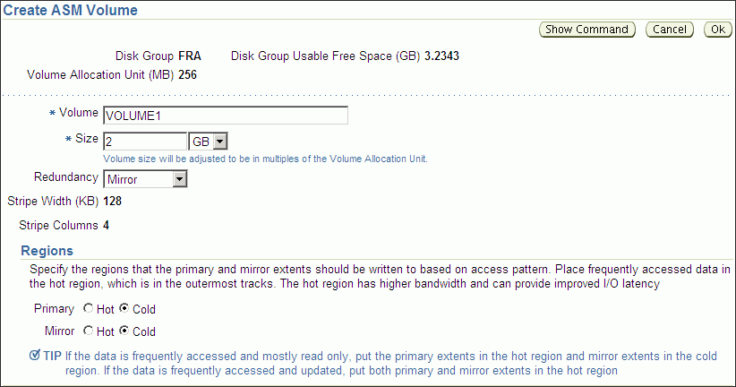
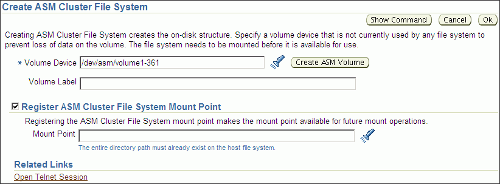
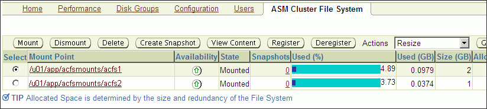
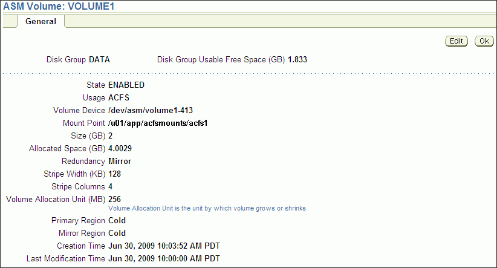
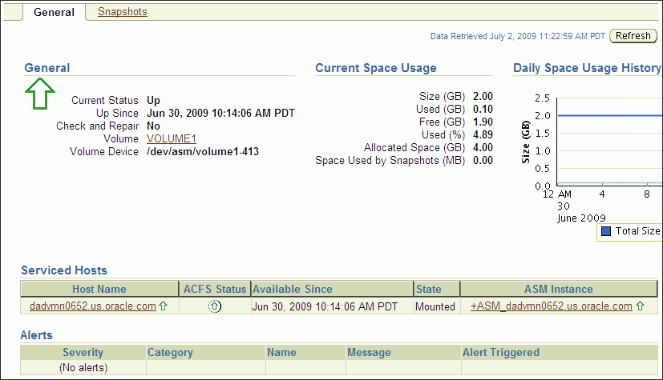
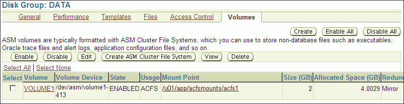
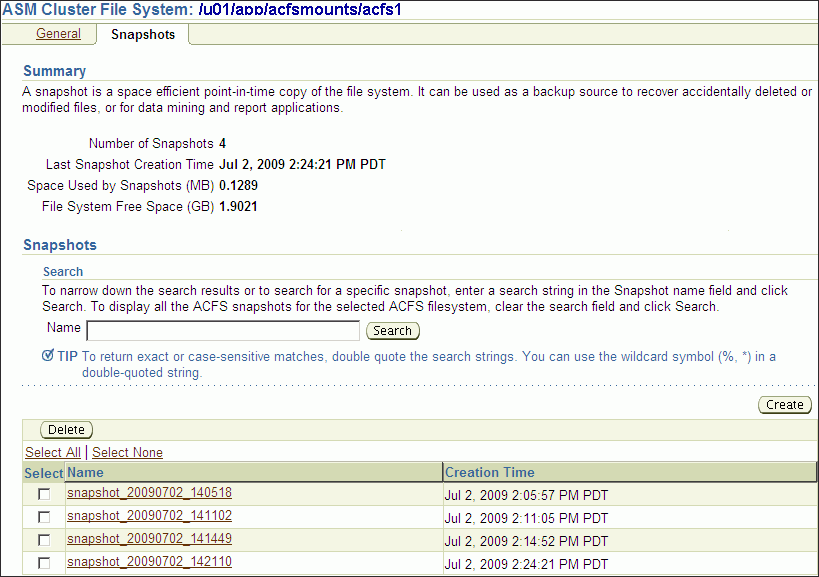
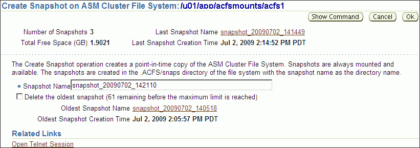
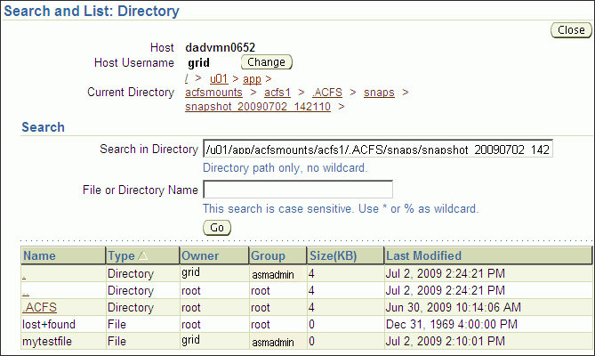

## 10 Administering Oracle ACFS with Oracle Enterprise Manager

This chapter describes how to administer Oracle Automatic Storage Management Cluster File System (Oracle ACFS) using Oracle Enterprise Manager.

This chapter contains the following topics:

- Managing Oracle ACFS with Oracle Enterprise Manager
- Managing Oracle ACFS Snapshots with Oracle Enterprise Manager

All Oracle ASM administration tasks begin with the Oracle Automatic Storage Management Home page in Oracle Enterprise Manager. For information about the Oracle ASM home page and how to access that page, see ["Oracle Automatic Storage Management Home Page"](asm_em.md).

For information about using command-line tools to administer Oracle ACFS file systems, see [Chapter 13, "Oracle ACFS Command-Line Tools"](asmfs_util.md). For information about the basic steps for creating Oracle ACFS file systems, see ["Basic Steps to Manage Oracle ACFS Systems"](asmfs_util001.md).

## Managing Oracle ACFS with Oracle Enterprise Manager

This section discusses how to manage Oracle ACFS volumes and file systems with Oracle Enterprise Manager.

This section contains the following topics:

- Creating Oracle ACFS Volumes and File Systems
- Viewing and Modifying Oracle ACFS Volumes and File Systems

### Creating Oracle ACFS Volumes and File Systems

To create an Oracle ACFS volume, perform the following steps.

1. Access the Disk Groups page from the Oracle ASM home page.
2. Click the Volumes link in the General tab of the Disk Group page. See Figure 10-6.
3. Click Create in the Volumes tab of the Disk Group page.
	The Create ASM Volume page displays, shown in Figure 10-1.
	Enter the volume name (maximum 11 characters), disk group name that contains the volume, and the initial size of the volume.
	You can also select the redundancy setting for the volume and the region settings for primary and mirror extents. For information about redundancy settings, refer to ["Mirroring, Redundancy, and Failure Group Options"](asmdiskgrps.md). For information about hot and cold disk regions, refer to ["Intelligent Data Placement"](asmdiskgrps.md). For information about creating a volume with the ASMCMD `volcreate` command, refer to ["volcreate"](asm_util007.md).

Figure 10-1 shows the Oracle ASM Create ASM Volume page.

Figure 10-1 Oracle Automatic Storage Management Create ASM Volume Page



> This screenshot shows the Create ASM Volume page in Oracle Enterprise Manager.
>
> There is an entry field for volume name and size. To the right of the size entry field there is a pull-down list for units associated with the size value.
>
> A pull-down list enables you to select the redundancy for the volume.
>
> Under the Regions section of the page, you can specify the region setting for the primary and mirror extents, either hot or cold.
>
> There are buttons that perform Show Command, Cancel, or OK (finish).
  

To create an Oracle ACFS file system on a volume in a disk group, perform the following steps.

1. Access the Volumes tab of the Disk Group page. See Figure 10-6.
2. Select an existing volume in the disk group and click Create ASM Cluster File System.
	Figure 10-2 shows the Create ASM Cluster File System page.
	The compatibility parameters `COMPATIBLE.ASM` and `COMPATIBLE.ADVM` must be set to 11.2 or higher for the disk group. See ["Disk Group Compatibility Attributes"](asmdiskgrps.md).
3. On the Create ASM Cluster File System page, enter the information to create a file system. You can optionally register and mount the file system.
	You must enter the volume name. You can enter an optional volume label.
	You can optionally choose to register and mount the file system when it is created. Select a mount point from available directories.
	Enter the host credentials needed to run the command when prompted. To register or mount a file system, you need root or administrator privileges. For information about the registry process, see ["About the Oracle ACFS Mount Registry"](asmfilesystem.md).
	After a directory has been selected, click Show Command to have Oracle Enterprise Manager generate the commands that you can run at an operating system prompt. Examples of commands on a Linux system are:
	```
	/sbin/mkfs -t acfs -b 4k /dev/asm/volume1-361
	/sbin/acfsutil registry -f -a /dev/asm/volume1-361 /oracle/acfsmounts/acfs2
	/bin/mount -t acfs -rw /dev/asm/volume1-361 /oracle/acfsmounts/acfs2
	```
	You can also generate the commands to register or mount an Oracle ACFS file system on the ASM Cluster File System tab. See Figure 10-3.

Figure 10-2 Oracle Automatic Storage Management Create Oracle ACFS Page



> This screenshot shows the Create Oracle ACFS page in Oracle Enterprise Manager.
>
> There is an entry field for the volume device name and optional label. The volume name is required and you can search for an existing volume name. You can also create a new volume.
>
> You can enable the box for registering the Oracle ACFS mount point. There is an entry field for the mount point path of the file system.
>
> There are buttons that perform Show Command, Cancel, or OK (finish).
  

### Viewing and Modifying Oracle ACFS Volumes and File Systems

To view and modify information about Oracle ACFS file systems, click the ASM Cluster File System link in the Oracle ASM home page.

Figure 10-3 shows the ASM Cluster File System tab in Oracle Enterprise Manager. This tab lists all of the Oracle ACFS associated with the Oracle ASM instance.

On this page, you can choose to mount, dismount, delete, create snapshot, view content, register, and deregister a selected file system. In addition, you can create a file system, mount all file systems, or dismount all file systems.

For each Oracle ACFS, the columns provide information for Mount Point, Availability, State, Snapshots, Used (%), Used (GB), Size (GB), Allocated Space, Redundancy, Volume, and Disk Group. Redundancy, Volume, and Disk Group columns are on the far right of the page and are not shown in the illustration. The mount point, snapshots, volume, and disk group are provided as links to further information.

Figure 10-3 Oracle Automatic Storage Management Oracle ACFS Page



> This screenshot shows the ASM Cluster File System tab in Oracle Enterprise Manager.
>
> The screenshot is described in the text.
>
> Copyright © 2007, 2011, Oracle and/or its affiliates. All rights reserved.  
> [Legal Notices](https://docs.oracle.com/cd/E11882_01/dcommon/html/cpyr.htm)
  

To view information about a specific volume, click the volume name in the Volume column on the ASM Cluster File System page.

Figure 10-4 shows the General tab of the ASM Volumes page.

Figure 10-4 Oracle Automatic Storage Management General Tab of the Volumes Page



> This screenshot shows the General tab of the ASM Volumes page in Oracle Enterprise Manager.
>
> This page lists the disk group which contains the volume, the free space in the disk group, the state of the volume, the usage of the volume, the volume device name, the mount point path, the size of the volume, the allocated space for the volume, the redundancy specified for the volume, the stripe width, the stripe columns, the volume allocation unit (AU), the region setting (Hot or Cold), the creation time, and the modification time.
>
> There are Edit and OK buttons.
  

To view information about a file system, click the link in the Mount Point column on the ASM Cluster File System page.

Figure 10-5 shows the General tab of the ASM Cluster File System page.

Figure 10-5 Oracle Automatic Storage Management Oracle ACFS General Page



> This screenshot shows the General tab of the Oracle ACFS page in Oracle Enterprise Manager.
>
> The page shows the current status of the file system, the uptime of the file system, whether the file system has been checked and repaired, the volume mounted on the file system, and the volume device name.
>
> For current space usage, the page shows size, size used (GB), free space (GB), used (%), used (%), allocated space, and snapshot space.
>
> On the right side of the page is a chart showing daily space usage history.
>
> There is a Refresh button for refreshing the data on the page.
  

To view information about a disk group for an Oracle ACFS, click the disk group name in the Disk Group column on the ASM Cluster File System page. The General tab of the Disk Group page displays as shown in [Figure 9-7](asm_em.md).

To view information about volumes in a disk group, click the Volumes tab at the top of the Disk Group page.

Figure 10-6 shows the Oracle ACFS Volume page.

Figure 10-6 Oracle Automatic Storage Management Oracle ACFS Volume Page



> This screenshot shows the Oracle ACFS Volume page in Oracle Enterprise Manager.
>
> The volume name, volume device name, state, usage, mount point, size, allocated space, and redundancy are displayed for each volume.
>
> There are button options to enable, disable, edit, create an Oracle ACFS file system, view, and delete a selected volume.
  

## Managing Oracle ACFS Snapshots with Oracle Enterprise Manager

To view and modify information about existing snapshots or create snapshots for a file system, perform the following steps.

1. Click the ASM Cluster File System tab on the Oracle ASM home page
2. Click a mount point link in the Mount Point column as shown in Figure 10-3
3. Click the Snapshots tab, shown in Figure 10-7.

Optionally, you can click a number link for existing snapshots in the Snapshots column on the ASM Cluster File System page to display the Snapshots page.

On the Snapshots page, you can create snapshots or search for and display specific snapshots. To search for a snapshot, enter a name with optional wildcard characters in the search field then click Search.

Figure 10-7 Oracle Automatic Storage Management Oracle ACFS Snapshots Tab



> This screenshot shows the Oracle ACFS Snapshots tab in Oracle Enterprise Manager.
>
> The page contains a Summary and Snapshots section. The summary section provides overall information about the snapshots for the file system.
>
> In the Snapshots section is an entry field that enables you to search for snapshots. In addition, you can create a snapshot on this page with the Create button.
>
> Individual snapshots are listed at the bottom of the page. There is an option to delete a selected snapshot. Clicking on the snapshot name link drills down for more information.
  

To create a snapshot, perform the following steps.

1. Click Create in the Snapshots page.
	Figure 10-8 shows the Create Snapshot page.
2. Complete the information on the page.
	Accept the default snapshot name, or provide a name. Optionally, you can choose to delete the oldest snapshot.
3. When you have completed the screen, you can click OK to run the command, or click Show Command to view the generated command.
	For example, the following is a generated command for creating a snapshot:
	```
	/sbin/acfsutil snap create "snapshot_20090702_142135" /oracle/acfsmounts/acfs1
	```
	To run the generated command, you need the appropriate privileges on the host computer. Oracle Enterprise Manager prompts you to enter host credentials if they have not been set up.
	You can also open a Telnet session from the Create Snapshot page to manually enter the generated operating system command.

Figure 10-8 Oracle Automatic Storage Management Create Snapshot Page



> This screenshot shows the Create Oracle ACFS Snapshots tab in Oracle Enterprise Manager.
>
> There is an entry field for the required snapshot name and a check box that you can enable to delete the oldest snapshot when you create a new snapshot.
>
> Copyright © 2007, 2011, Oracle and/or its affiliates. All rights reserved.  
> [Legal Notices](https://docs.oracle.com/cd/E11882_01/dcommon/html/cpyr.htm)
  

To drill down in a snapshot directory, click the snapshot name in the Snapshots page to display the Search and List Directory page.

Figure 10-9 shows the Search and List Directory page for a specific snapshot directory. The directory contains the snapshots of the file system

Figure 10-9 Oracle Automatic Storage Management Search and List Directory Page



> This screenshot shows the Oracle ACFS Snapshots Search and List Directory in Oracle Enterprise Manager.
>
> There is an entry field to search for a snapshot in a specified directory and an additional entry field to search for a specified file or directory name. To initiate the search, select the Go button.
>
> After a search, the contents of the snapshot directory are displayed.
