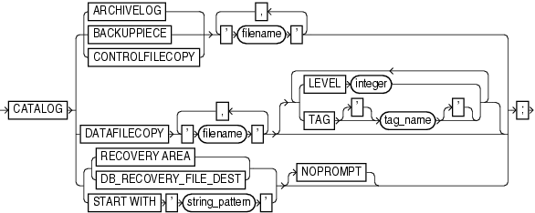

Syntax descriptions are provided in this book for RMAN command-line constructs in graphic form or Backus Naur Form (BNF). See [Oracle Database SQL Language Reference](https://docs.oracle.com/cd/E11882_01/server.112/e41084/ap_syntx.htm#SQLRF018) for general information about how to interpret syntax diagrams and BNF notation. This section explains RMAN conventions exclusively.

Recovery Manager syntax diagrams use lines and arrows to show syntactic structure, as shown in the following example for the `CATALOG` command.

catalog::=

> **CATALOG** { { **ARCHIVELOG** | **BACKUPPIECE** | **CONTROLFILECOPY** } ' *filename* ' \[, ' *filename* '\]... | **DATAFILECOPY** ' *filename* ' \[, ' *filename* '\]... \[ { { **LEVEL** *integer* | **TAG** \[**'**\] *tag\_name* \[**'**\]}}...\] | { { **RECOVERY** **AREA** | **DB\_RECOVERY\_FILE\_DEST** } | **START** **WITH** ' *string\_pattern* '} \[**NOPROMPT**\]}
  
  

This section describes the components of syntax diagrams and gives examples of how to write RMAN commands. Syntax diagrams are made up of these items:

## Keywords in RMAN Syntax

Keywords have special meanings in Recovery Manager syntax. In the syntax diagrams, keywords appear in rectangular boxes and an uppercase font, like the word `CATALOG` in the example diagram. When used in text and code examples, RMAN keywords appear in uppercase, monospace font, for example, `CATALOG` `DATAFILECOPY`. You must use keywords in RMAN statements exactly as they appear in the syntax diagram, except that they can be either uppercase or lowercase.

## Placeholders in RMAN Syntax

Placeholders in syntax diagrams indicate non-keywords. In the syntax diagrams, they appear in ovals, as in the word integer in the example diagram. When described in text, RMAN placeholders appear in lowercase italic, for example, 'filename'. Placeholders are usually:

- Names of database objects (tablespace\_name)
- Oracle data type names (date\_string)
- Subclauses (datafileSpec)

When you see a placeholder in a syntax diagram, substitute an object or expression of the appropriate type in the RMAN statement. For example, to write a `DUPLICATE TARGET DATABASE TO` 'database\_name' command, use the name of the duplicate database you want to create, such as `dupdb`, for the database\_name placeholder in the diagram.

The only system-independent, valid environment variables in RMAN quoted strings are a question mark (`?`) for the Oracle home and an at-sign (`@`) for the SID. However, you can use operating system-specific environment variables on the target system within quoted strings. The environment variables are interpreted by the database server and not the RMAN client.

The following table shows placeholders that appear in the syntax diagrams and provides examples of the values you might substitute for them in your statements.

| Placeholder | Description | Examples |
| --- | --- | --- |
| Quoted strings such as `'` `filename` `'`, `'` `tablespace_name` `'`, `'` `channel_name` `'`, `'` `channel_parms` `'` | A string of characters contained in either single or double quotes. A quoted string may contain white space, punctuation, and RMAN and SQL keywords. | `"?/dbs/cf.f"`  `'dev1'` |
| Nonquoted strings such as `channel_id`, `tag_name`, `date_string` | A sequence of characters containing no white space and no punctuation characters and starting with an alphabetic character. | `ch1` |
| `integer` | Any sequence of only numeric characters. | `67843` |

## Quotes in RMAN Syntax

The RMAN syntax diagrams shows some placeholder values enclosed in required or optional quotes. The syntax diagrams show single quotes, though in all cases double quotes are also valid in RMAN syntax. For example, you may specify either 'filename' or "filename". For `SQL` commands, use double quotes, because the SQL statement may also contain quotes. Single and double quotes are not used interchangeably in SQL, and single quotes are the more common type of quote in a SQL statement.