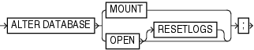

Purpose

Use the `ALTER DATABASE` command to mount or open a database.

See Also:

[Oracle Database SQL Language Reference](https://docs.oracle.com/cd/E11882_01/server.112/e41084/toc.htm) for `ALTER` `DATABASE` syntax and semantics

Syntax

alterDatabase::=



> **ALTER DATABASE** \[ **MOUNT** | **OPEN** { **RESETLOGS** }\];
  

Prerequisites

Execute this command either within the braces of a `RUN` command or at the RMAN prompt. The target instance must be started.

Semantics

| Syntax Element | Description |
| --- | --- |
| `MOUNT` | Mounts the database without opening it. Issuing the command with this option is equivalent to the SQL statement `ALTER` `DATABASE` `MOUNT`. |
| `OPEN` | Opens the database (see Example 2-13). When you open the database after `RECOVER` `DATABASE`, RMAN re-creates any locally managed temp files recorded in the RMAN repository if necessary. However, if you perform recovery with a backup control file and no recovery catalog, then RMAN does not record temp files created after the control file backup in the RMAN repository. Also, RMAN does not re-create the temp files automatically. |
| `   RESETLOGS` | Archives the current online redo log files (or up to the last redo record before redo corruption if corruption is found), clears the contents of the online redo log files, and resets the online redo log to log sequence 1. The RMAN command `ALTER DATABASE OPEN RESETLOGS` is equivalent to the SQL statement `ALTER DATABASE OPEN RESETLOGS`.  If you use a recovery catalog, then RMAN issues an implicit `RESET DATABASE` after the database is opened to make this new incarnation the current one in the catalog. If you execute the SQL statement `ALTER DATABASE OPEN RESETLOGS` rather than the RMAN command of the same name, then you must manually run the `RESET DATABASE` command. |

Examples

Example 2-13 Making a Consistent Database Backup

Assume that the database is open and you want to make a consistent backup of the whole database. This example shuts down the database consistently, mounts the database, makes a consistent whole database backup, and then opens the database.

```
SHUTDOWN IMMEDIATE;
STARTUP MOUNT;
BACKUP DATABASE PLUS ARCHIVELOG;
# Now that the backup is complete, open the database.
ALTER DATABASE OPEN;
```

Example 2-14 Mounting the Database After Restoring the Control File

This example restores the control file, mounts it, and performs recovery. Finally, the example resets the online redo log.

```
STARTUP FORCE NOMOUNT;
RESTORE CONTROLFILE FROM AUTOBACKUP;
ALTER DATABASE MOUNT;
# You must run the RECOVER command after restoring a control file even if no 
# datafiles require recovery.
RECOVER DEVICE TYPE DISK DATABASE;
ALTER DATABASE OPEN RESETLOGS;
```