Purpose

Use the `BACKUP` command to back up a primary or standby database, tablespace, data file (current or copy), control file (current or copy), server parameter file, archived redo log file, or backup set.

Prerequisites

RMAN must be connected to a target database. See the `CONNECT` and `RMAN` commands to learn how to connect to a database as `TARGET`.

Database Archiving Modes

If the target database is in `ARCHIVELOG` mode, then the database must be mounted or open with a current control file. Backups made while the database is open are inconsistent. You must apply redo log files after restoring an inconsistent backup to make the database consistent.

If the target database is in `NOARCHIVELOG` mode, then the database must be mounted after a consistent shutdown when you make the backup. The shutdown is only consistent if you successfully execute the `SHUTDOWN` command with the `NORMAL`, `IMMEDIATE`, or `TRANSACTIONAL` options. You cannot use RMAN to back up a `NOARCHIVELOG` database after an instance failure or `SHUTDOWN ABORT`.

Backup Media

RMAN can only back up files onto valid media. If you specify `DEVICE TYPE DISK`, then RMAN makes backups to random access disks. You can make a backup on any device that can store a data file. If the statement `CREATE TABLESPACE` `tablespace_name` `DATAFILE` `'filename'` works, then `'filename'` is a valid backup path name. If you specify `DEVICE TYPE sbt`, then you can back up files to any media supported by the media manager.

When backing up Oracle Database files to disk, the logical block size of the files must be an even multiple of the physical block size of the destination device. For example, a disk device with a block size of 2 KB can only be used as a destination for backups of Oracle files with logical block sizes of 2 KB, 4 KB, 6 KB and so on. In practice, most disk drives have physical block sizes of 512 bytes, so this limitation rarely affects backup. However, you can encounter this limitation when using `BACKUP ... DEVICE TYPE DISK` to back your database up to a writeable CD or DVD, or some other device that has a larger physical block size.

Channels

If no automatic channel is configured for the specified device type, then you must manually allocate a channel for each `BACKUP` execution. If no manual channel is allocated, then RMAN uses the default channels set with the `CONFIGURE` command. RMAN has a `DISK` channel preconfigured but no preconfigured `sbt` channels.

Note:

Backups that use the disk test API are not supported for production backups. Instead, use the preconfigured `DISK` channel or manually allocate a `DISK` channel.

Usage Notes

RMAN can only back up data files, control files, server parameter files, archived redo log files, and RMAN backups of these files. RMAN cannot make backups of other database-related files such as network configuration files, password files, the block change tracking file, and the contents of the Oracle home directory. Likewise, some features of Oracle Database, such as external tables or the `BFILE` data type, store data in files other than those in the preceding list. RMAN cannot back up these files.

RMAN decomposes a `BACKUP` command into multiple independent backup steps. RMAN can execute each independent step on any channel allocated for a specific device. If multiple channels are allocated, and if one channel fails or encounters a problem during a backup step, then RMAN attempts to complete the work on another channel. RMAN reports a message in `V$RMAN_OUTPUT` and in the output to the interactive session or log file when channel failover occurs.

RMAN backups made on one platform are not transportable to a different platform.

RMAN backups made in a previous release of Oracle Database are usable after a database migration or upgrade.

If you change the `DB_NAME` for a database, but not its DBID, then RMAN considers backups made of the database with the previous `DB_NAME` as eligible to be restored.

Incremental Backups

An INCREMENTAL backup at level 0 backs up all data blocks in data files being backed up. An incremental backup at level 0 is identical in content to a `FULL` backup, but unlike a full backup the level 0 backup is a part of the incremental backup strategy.

A level 1 backup copies only changed blocks. A level 1 incremental backup is either differential or `CUMULATIVE`. If cumulative, RMAN backs up all blocks changed since the most recent level 0 backup. If differential, RMAN backs up blocks updated since the most recent level 0 or level 1 incremental backup. You can apply a level 1 backup of a standby database to a level 0 backup of a primary database, and also apply a level 1 backup of a primary database to a level 0 backup of a standby database.

Incremental backups at level 0 can be either backup sets or image copies, but incremental backups at level 1 can only be backup sets.

The database performs checks when attempting to create a level 1 incremental backup to ensure that the incremental backup is usable by a subsequent `RECOVER` command. Among the checks performed are:

- A level 0 backup must exist for each data file in the `BACKUP` command as the base backup for an incremental strategy. Level 0 backups must not have status `UNAVAILABLE`. If no level 0 backup exists, then RMAN makes a level 0 backup automatically.
- Sufficient incremental backups taken since level 0 must exist and be available such that the incremental backup to be created is usable.

Note:

When creating an incremental backup, RMAN considers backups from parent incarnations as valid. For example, assume you make a level 0 backup and then `OPEN RESETLOGS`. If you make a level 1 incremental backup, then RMAN backs up all blocks changed since the pre- `RESETLOGS` level 0 backup. When making a level 1 backup, RMAN only makes a new level 0 backup if no level 0 is available in either the current or parent database incarnation.

You can improve incremental backup performance by enabling block change tracking on a primary or standby database. In this case, RMAN keeps a record of which blocks have changed in the block change tracking file.

The change tracking file maintains bitmaps that mark changes in the data files between backups. The database performs a bitmap switch before each backup. Oracle Database automatically manages space in the change tracking file to retain block change data that covers the 8 most recent backups. After the maximum of 8 bitmaps is reached, the most recent bitmap is overwritten by the bitmap that tracks the current changes.

The first level 0 incremental backup scans the entire data file. Subsequent incremental backups use the block change tracking file to scan only the blocks that have been marked as changed since the last backup. An incremental backup can be optimized only when it is based on a parent backup that was made after the start of the oldest bitmap in the block change tracking file.

Consider the 8-bitmap limit when developing your incremental backup strategy. For example, if you make a level 0 database backup followed by 7 differential incremental backups, then the block change tracking file now includes 8 bitmaps. If you then make a cumulative level 1 incremental backup, RMAN cannot optimize the backup because the bitmap corresponding to the parent level 0 backup is overwritten with the bitmap that tracks the current changes.

See Also:

[Oracle Database Backup and Recovery User's Guide](https://docs.oracle.com/cd/E11882_01/backup.112/e10642/rcmbckba.htm#BRADV8125) for details about block change tracking

Encryption of Backup Sets

RMAN can transparently encrypt data written to backup sets and decrypt those backup sets when they are needed in a `RESTORE` operation. To create encrypted backups on disk, the database must use the Advanced Security Option. To create encrypted backups directly on tape, RMAN must use the Oracle Secure Backup SBT interface, but does not require the Advanced Security Option. RMAN issues an `ORA-19916` error if you attempt to create encrypted RMAN backups using an SBT library other than Oracle Secure Backup.

RMAN can encrypt backups by using several different encryption algorithms, which are listed in `V$RMAN_ENCRYPTION_ALGORITHMS`. RMAN supports three modes of encryption for backups:

- Transparent encryption, in which RMAN can create and restore encrypted backups with no special DBA intervention, if the required Oracle public key infrastructure (PKI) is available
- Password-based encryption, where a password is specified during the backup, and the same password must be supplied to restore the backup
- Dual-mode encryption, where backups can be created using either as with transparent encryption or password-based encryption, and where decryption can be performed based upon either the Oracle Wallet, or a password the DBA supplies at decryption time

Note:

Wallet-based encryption is more secure than password-based encryption because no passwords are involved. You should use password-based encryption only when absolutely necessary because your backups must be transportable.

The `CONFIGURE` and `SET` commands manage the encryption settings for database backups. See the reference entries for those commands for more details. Backup sets containing archived redo log files are encrypted if any of the following is true:

- `SET` `ENCRYPTION ON` is in effect when the backup is being created.
- Encryption is configured for the whole database or at least one tablespace.

See Also:

- Oracle Database Backup and Recovery User's Guidefor an overview of the backup encryption, a guide to its use, and information on choosing among different modes of encryption
- [Oracle Database Advanced Security Administrator's Guide](https://docs.oracle.com/cd/E11882_01/network.112/e40393/asotools.htm#ASOAG9502) to learn about PKI and the Oracle Wallet

Backing Up Standby Databases

The RMAN `BACKUP` command backs up the standby database exactly the same as a primary database, except that the backup takes place on the standby site. The primary database has no influence on the backup of the standby database.

When you connect to the standby database to perform the backup, use the `TARGET` keyword and not the `AUXILIARY` keyword.

The state of the standby database when the backup is made determines whether the backup is consistent or inconsistent. To make a consistent backup, the standby database must shutdown cleanly and be mounted, but not placed in recovery mode. Any other status results in an inconsistent backup and must be restored using media recovery.

RMAN Backups in a Data Guard Environment

A recovery catalog is required when you are performing RMAN operations in a Data Guard environment. The catalog enables all RMAN operations to be transparently executable at any primary or standby database. You can offload primary database backups onto any standby database in the environment; the RMAN backups are interchangeable. If you use RMAN in `NOCATALOG` mode, then RMAN uses only the metadata in the mounted control file.

In a Data Guard environment, the database that creates a backup or copy is associated with the file. For example, if RMAN connects as `TARGET` to database `prod` and backs it up, then this database backup is associated with `prod`. A backup remains associated with the database that created in unless you use the `CHANGE` `... RESET DB_UNIQUE_NAME` to associate the backup with a different database.

The association of a backup is different from its accessibility. The recovery catalog considers disk backups as accessible only to the database in the Data Guard environment on which it was created, whereas tape backups created on one database are considered accessible to all databases. If a backup file is not associated with any database, then the row describing it in the recovery catalog view shows `null` for the `SITE_KEY` column. By default, RMAN associates files whose `SITE_KEY` is `null` with the database to which RMAN is connected as `TARGET`.

In a Data Guard environment, RMAN commands can operate on any backups that are accessible. For example, assume that databases `prod` and `standby1` reside on different hosts. RMAN backs up data file 1 on `prod` to `/prodhst/disk1/df1.dbf` on the production host and also to tape. RMAN backs up data file 1 on `standby1` to `/sby1hst/disk2/df1.dbf` on the standby host and also to tape. If RMAN is connected to database `prod` as `TARGET`, then you cannot use RMAN to perform operations with the `/sby1hst/disk2/df1.dbf` backup located on the standby host. However, RMAN considers the tape backup made on `standby1` as eligible to be restored.

Note:

You can FTP a backup from a standby host to a primary host or vice versa and then `CATALOG` it. After a file is cataloged by the target database, the file is associated with the target database.

If backups are accessible to RMAN, you can use RMAN maintenance commands such as `CHANGE`, `CROSSCHECK`, and `DELETE` for backups when connected to any primary or standby database.

See Also:

[Oracle Data Guard Concepts and Administration](https://docs.oracle.com/cd/E11882_01/server.112/e41134/rman.htm#SBYDB04700) to learn how to use RMAN to back up and restore files in a Data Guard environment

Syntax

backup::=

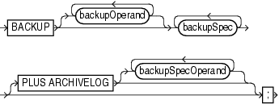

> **BACKUP** \[ { *backupOperand* }...\] *backupSpec* \[*backupSpec*\]... \[**PLUS** **ARCHIVELOG** \[ { *backupSpecOperand* }...\]\]
  
  

(backupOperand::=, backupSpec::=, backupSpecOperand::=)

backupOperand::=

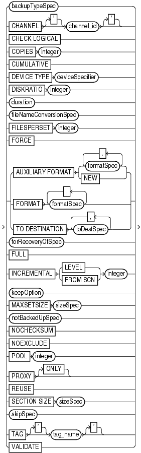

> *backupTypeSpec* | **CHANNEL** \[**'**\] *channel\_id* \[**'**\] | **CHECK** **LOGICAL** | **COPIES** *integer* | **CUMULATIVE** | **DEVICE** **TYPE** *deviceSpecifier* | **DISKRATIO** *integer* | *duration* | *fileNameConversionSpec* | **FILESPERSET** *integer* | **FORCE** | { **AUXILIARY** **FORMAT** { *formatSpec* \[, *formatSpec*\]... | **NEW** } | **FORMAT** *formatSpec* \[, *formatSpec*\]... | **TO** **DESTINATION** *toDestSpec* \[, *toDestSpec*\]...} | *forRecoveryOfSpec* | **FOR** **TRANSPORT** | **FULL** | **INCREMENTAL** { **LEVEL** | **FROM** **SCN** } *integer* | *keepOption* | **MAXSETSIZE** *sizeSpec* | *notBackedUpSpec* | **NOCHECKSUM** | **NOEXCLUDE** | **POOL** *integer* | **PROXY** \[**ONLY**\] | **REUSE** | **SECTION** **SIZE** *sizeSpec* | *skipSpec* | **TAG** \[**'**\] *tag\_name* \[**'**\] | **TO** **PLATFORM** ' *platform* ' | **VALIDATE**
  
  

([deviceSpecifier::=](rcmsubcl006.md), [fileNameConversionSpec::=](rcmsubcl007.md), [formatSpec::=](rcmsubcl010.md), [toDestSpec::=](rcmsubcl018.md), forRecoveryOfSpec::=, [keepOption::=](rcmsubcl011.md), notBackedUpSpec::=, sizeSpec::=, skipSpec::=)

backupSpec::=

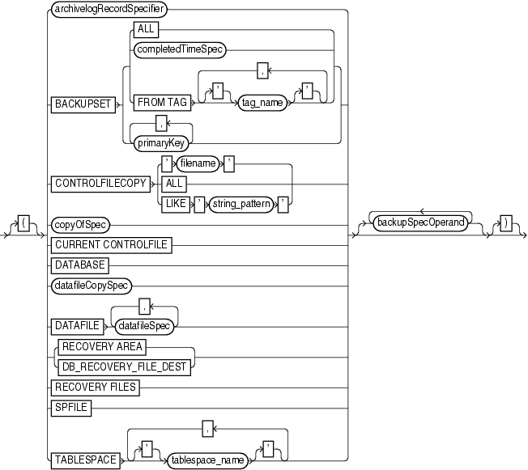

> \[**{**\] { *archivelogRecordSpecifier* | **BACKUPSET** { { **ALL** | *completedTimeSpec* | **FROM** **TAG** \[**'**\] *tag\_name* \[**'**\] \[, \[**'**\] *tag\_name* \[**'**\]\]...} | *primaryKey* \[, *primaryKey*\]...} | **CONTROLFILECOPY** {' *filename* ' | **ALL** | **LIKE** ' *string\_pattern* '} | *copyOfSpec* | **CURRENT** **CONTROLFILE** | **DATABASE** | *datafileCopySpec* | **DATAFILE** *datafileSpec* \[, *datafileSpec*\]... | **DUMP** **FILE** {\[\[**'**\] *filename* \[**'**\] \[ { { **BACKUPPIECE** **FORMAT** *formatSpec* \[, *formatSpec*\]... | **DATAPUMP** **DESTINATION** ' *datapump\_destination* '}}...\]\] | { **BACKUPPIECE** **FORMAT** *formatSpec* \[, *formatSpec*\]... | **DATAPUMP** **DESTINATION** ' *datapump\_destination* '} \[ { **BACKUPPIECE** **FORMAT** *formatSpec* \[, *formatSpec*\]... | **DATAPUMP** **DESTINATION** ' *datapump\_destination* '}\]...} | { **RECOVERY** **AREA** | **DB\_RECOVERY\_FILE\_DEST** } | **RECOVERY** **FILES** | **SPFILE** | **TABLESPACE** \[**'**\] *tablespace\_name* \[**'**\] \[, \[**'**\] *tablespace\_name* \[**'**\]\]...} \[ { *backupSpecOperand* }...\] \[**}**\]
  
  

([archivelogRecordSpecifier::=](rcmsubcl002.md), [completedTimeSpec::=](rcmsubcl003.md), copyOfSpec::=, datafileCopySpec::=, [datafileSpec::=](rcmsubcl005.md), backupSpecOperand::=)

backupSpecOperand::=

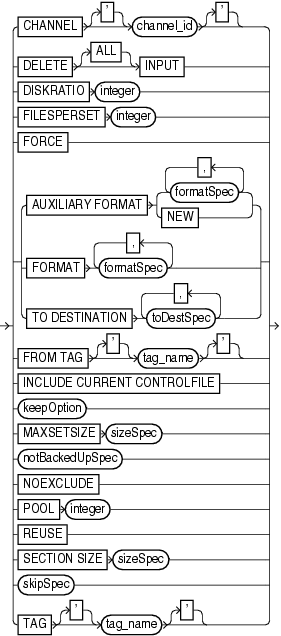

> **CHANNEL** \[**'**\] *channel\_id* \[**'**\] | **DELETE** \[**ALL**\] **INPUT** | **DISKRATIO** *integer* | **FILESPERSET** *integer* | **FORCE** | { **AUXILIARY** **FORMAT** { *formatSpec* \[, *formatSpec*\]... | **NEW** } | **FORMAT** *formatSpec* \[, *formatSpec*\]... | **TO** **DESTINATION** *toDestSpec* \[, *toDestSpec*\]...} | **FROM** **TAG** \[**'**\] *tag\_name* \[**'**\] | **INCLUDE** **CURRENT** **CONTROLFILE** | *keepOption* | **MAXSETSIZE** *sizeSpec* | *notBackedUpSpec* | **NOEXCLUDE** | **POOL** *integer* | **REUSE** | **SECTION** **SIZE** *sizeSpec* | *skipSpec* | **TAG** \[**'**\] *tag\_name* \[**'**\]
  
  

([formatSpec::=](rcmsubcl010.md), [toDestSpec::=](rcmsubcl018.md) [keepOption::=](rcmsubcl011.md), notBackedUpSpec::=, sizeSpec::=, skipSpec::=)

backupTypeSpec::=

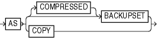

> **AS** {\[**COMPRESSED**\] **BACKUPSET** | **COPY** }
  
  

copyOfSpec::=

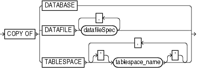

> **COPY** **OF** { **DATABASE** | **DATAFILE** *datafileSpec* \[, *datafileSpec*\]... | **TABLESPACE** \[**'**\] *tablespace\_name* \[**'**\] \[, \[**'**\] *tablespace\_name* \[**'**\]\]...}
  
  

([datafileSpec::=](rcmsubcl005.md))

datafileCopySpec::=

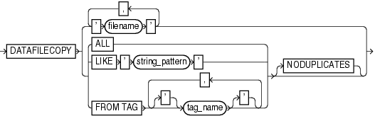

> **DATAFILECOPY** { ' *filename* ' \[, ' *filename* '\]... | { **ALL** | **LIKE** ' *string\_pattern* ' | **FROM** **TAG** \[**'**\] *tag\_name* \[**'**\] \[, \[**'**\] *tag\_name* \[**'**\]\]...} \[**NODUPLICATES**\]}
  
  

duration::=

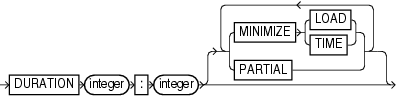

> **DURATION** *integer*: *integer* \[ { { **MINIMIZE** { **LOAD** | **TIME** } | **PARTIAL** }}...\]
  
  

forRecoveryOfSpec::=

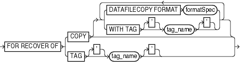

> **FOR** **RECOVER** **OF** { **COPY** \[ { { **DATAFILECOPY** **FORMAT** *formatSpec* | **WITH** **TAG** \[**'**\] *tag\_name* \[**'**\]}}...\] | **TAG** \[**'**\] *tag\_name* \[**'**\]}
  
  

([formatSpec::=](rcmsubcl010.md))

notBackedUpSpec::=

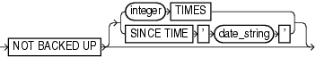

> **NOT** **BACKED** **UP** \[ { *integer* **TIMES** | **SINCE** **TIME** ' *date\_string* '}\]
  
  

sizeSpec::=

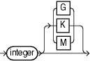

> *integer* \[ {G | K | M}\]
  
  

skipSpec::=

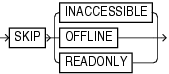

> **SKIP** { **INACCESSIBLE** | **OFFLINE** | **READONLY** }
  

Semantics

backup

This clause specifies the objects to be backed up as well as the options to control the backup. Refer to backup::= for the syntax diagram.

| Syntax Element | Description |
| --- | --- |
| `backupOperand` | Specifies various options for the `BACKUP` command. |
| `backupSpec` | Specifies one or more objects to be backed up.  Each `backupSpec` clause generates one or more backup sets (`` `AS BACKUPSET` ``) or image copies (`` `AS COPY` ``). For `AS BACKUPSET`, the `backupSpec` clause generates multiple backup sets if the number of data files specified in or implied by its list of objects exceeds the `FILESPERSET` limit. |
| `   PLUS ARCHIVELOG` | Includes archived redo log files in the backup (see Example 2-15). Causes RMAN to perform the following steps: 1. Run an `ALTER SYSTEM ARCHIVE LOG CURRENT` statement. 2. Run the `BACKUP ARCHIVELOG ALL` command. If backup optimization is enabled, then RMAN only backs up logs that have not yet been backed up. 3. Back up the files specified in the `BACKUP` command. 4. Run an `ALTER SYSTEM ARCHIVE LOG CURRENT` statement. 5. Back up any remaining archived redo log files. If backup optimization is not enabled, then RMAN backs up the logs generated in step 1 plus all the logs generated during the backup.  You cannot specify `PLUS ARCHIVELOG` on the `BACKUP ARCHIVELOG` command or `BACKUP AS COPY INCREMENTAL` command (or `BACKUP INCREMENTAL` command when the default backup type is `COPY`). You cannot specify `PLUS ARCHIVELOG` when also specifying `INCREMENTAL FROM SCN`.  Unless the online redo log is archived after the backup, `DUPLICATE` is not possible with this backup.  Note: This clause cannot be used with the `KEEP UNTIL` clause. |
| `backupSpecOperand` | Specifies a variety of options and parameters that affect the `backupSpec` clause. |

backupOperand

This subclause specifies options such as the device type and output format. Refer to backupOperand::= for the syntax diagram.

| Syntax Element | Description |
| --- | --- |
| `backupTypeSpec` | Specifies the type of backup being created, either backup sets (`` `AS BACKUPSET` ``) or image copies (`` `AS COPY` ``).  See Also: `backupTypeSpec` for details |
| `CHANNEL` `channel_id` | Specifies the case-sensitive name of a channel to use when creating backups. Use any meaningful name, for example `ch1` or `dev1`. The database uses the channel ID to report I/O errors. If you do not set this parameter, then RMAN dynamically assigns the backup sets to any available channels during execution.  As shown in Example 2-23, you can use `CHANNEL` to specify which channels back up which files.  Note: You can also specify this parameter in the `backupSpec` clause. |
| `CHECK LOGICAL` | Tests data and index blocks that pass physical corruption checks for logical corruption (see Example 2-25). This option typically adds 1-3% overhead.  Examples of logical corruption are corruption of a row piece or index entry. If RMAN finds logical corruption, then it logs the block in the alert log and server session trace file. The `SET` `MAXCORRUPT` command specifies the total number of physical and logical corruptions permitted in a data file.  By default, the `BACKUP` command computes a checksum for each block and stores it in the backup. If you specify the `NOCHECKSUM` option, then RMAN does not perform a checksum of the blocks when writing the backup.  If `SET MAXCORRUPT` and `` `NOCHECKSUM` `` are not set, then `CHECK` `LOGICAL` detects all types of corruption that are possible to detect during a backup. |
| `COPIES` `integer` | Sets the number of identical backups (`1` - `4`) that RMAN creates. The default value is `1`.  You can use multiple format strings to specify different names and locations for the copies. Example 2-22 illustrates a duplexed backup to different locations on disk.  RMAN can duplex backups to either disk or tape, but cannot duplex backups to tape and disk simultaneously. When backing up to tape, ensure that the number of copies does not exceed the number of available tape devices. Also, if `COPIES` is greater than 1, then the `BACKUP_TAPE_IO_SLAVES` initialization parameter must be enabled on the target database.  You can specify duplexing in multiple commands. The order of precedence is as follows, with settings higher on the list overriding lower settings:  1. `BACKUP` `COPIES` 2. `SET` `BACKUP` `COPIES` 3. `CONFIGURE` `...` `BACKUP` `COPIES`  Note: This option does not apply with `AS COPY` and results in an error message.  Note: Duplexing cannot be used when creating files in the fast recovery area. |
| `CUMULATIVE` | Copies the data blocks used since the most recent level 0 backup (see Example 2-16).  Note: This option does not apply with `` `AS COPY` `` and results in an error message. |
| `DEVICE TYPE` `deviceSpecifier` | Allocates automatic channels for the specified device type only. For example, if you configure disk and tape channels, then configure `sbt` as the default device type, then the following command allocates disk channels only: ``` BACKUP DEVICE TYPE DISK DATABASE; ```  The `DEVICE TYPE` option is valid only for automatic channels and is not valid for manually allocated channels. You cannot use the `DEVICE TYPE` option for a device other than `DISK` if you have not run `CONFIGURE` `DEVICE TYPE` for this device.  Note: To specify a disk channel for the `BACKUP RECOVERY AREA` command, you must use the `TO DESTINATION` of the subclause [toDestSpec](rcmsubcl001.md).  See Also: `deviceSpecifier` |
| `DISKRATIO` `integer` | Directs RMAN to populate each backup set with data files from at least integer disks.  This parameter is only enabled when you are backing up data files or control files, and when the operating system can give RMAN disk contention and node affinity data. To manually disable this feature, set `DISKRATIO` to `0`.  For example, assume that data files are distributed across 10 disks. If the disks supply data at 10 bytes/second, and if the tape drive requires 50 bytes/second to keep streaming, then set `DISKRATIO` to `5` to direct RMAN to include data files from at least 5 disks in each backup set.  If you set `FILESPERSET` but not `DISKRATIO`, then `DISKRATIO` defaults to the same value as `FILESPERSET`. If you specify neither parameter, then `DISKRATIO` defaults to 4. RMAN compares the `DISKRATIO` value to the actual number of devices involved in the backup and uses the lowest value. For example, if `DISKRATIO` is 4 and the data files are located on three disks, then RMAN attempts to include data files from three disks in each backup set.  The `DISKRATIO` parameter is easier for data file backups when the data files are striped or reside on separate disk spindles and you either:  - Use a high-bandwidth tape drive that requires several data files to be multiplexed to keep the tape drive streaming. - Make backups while the database is open and you must spread the I/O load across several disk spindles to leave bandwidth for online operations.  Note: Do not spread I/O over more than the minimum number of disks required to keep the tape streaming. Otherwise, you increase restore time for a file without increasing performance. |
| `duration` | Specifies options related to the maximum time for a backup command to run.  See Also: `duration` |
| `fileNameConversionSpec` | This option is valid only when `BACKUP` is creating image copies. Files being copied are renamed according to the specified patterns. If a file being backed up has a name that does not match any of the specified rename patterns, then RMAN uses `FORMAT` to name the output image copies. If no `FORMAT` is specified, then RMAN uses the default format `` `%U` ``.  See Also: `fileNameConversionSpec` for file renaming patterns |
| `FILESPERSET` `integer` | Specifies the maximum number of input files to include in each output backup set. This parameter is only relevant when `BACKUP` generates backup sets.  RMAN backs up the files in each `backupSpec` as one or more backup sets. When the number of files in each `backupSpec` exceeds the `FILESPERSET` setting, then RMAN splits the files into multiple backup sets accordingly. The default value for `FILESPERSET` is `64`.  The RMAN behavior is illustrated by the following `BACKUP` commands:  ``` BACKUP AS BACKUPSET (DATAFILE 3, 4, 5, 6, 7) (DATAFILE 8, 9); BACKUP AS BACKUPSET DATAFILE 3, 4, 5, 6, 7, 8, 9; BACKUP AS BACKUPSET DATAFILE 3, ... 72; ```  In the first command, RMAN places data files 3, 4, 5, 6, and 7 into one backup set and data files 8 and 9 into another backup set. In the second command, RMAN places all data files into one backup set. In the third command, the ellipses indicate data files 3 through 72. Because in this case RMAN is backing up 70 data files, RMAN places 64 files in one backup set and 6 in another.  By default, RMAN divides files among backup sets to make optimal use of channel resources. The number of files to be backed up is divided by the number of channels. If the result is less than 64, then this number is the `FILESPERSET` value. Otherwise, `FILESPERSET` defaults to 64.  Note: You cannot specify the number of backup pieces that are in a backup set. |
| `FORCE` | Forces RMAN to ignore backup optimization. That is, even if `CONFIGURE` `BACKUP OPTIMIZATION` is set to `ON`, RMAN backs up all specified files.  Note: You can also specify this option in the `backupSpecOperand` clause. |
| `AUXILIARY FORMAT` | Copies the files on the target database to the specified location on the auxiliary instance. RMAN can only generate image copies when `AUXILIARY FORMAT` is specified. RMAN must be connected to both `TARGET` and `AUXILIARY` instances and have access to auxiliary channels.  You can use the `BACKUP AUXILIARY FORMAT` command to copy data files, archived logs, controlfile, and server parameter file (spfile) over the network between primary and standby databases. For example, if a data file on a primary database was lost, you could `CONNECT` to the standby database as `TARGET` and the primary database as `AUXILIARY`, and copy an intact data file from the standby host to the primary host.  See Also:Example 2-30, "Copying Archived Log From Operating System File to ASM" |
| `formatSpec` | Specifies a pattern for naming the output image copies on an auxiliary instance. The path must be valid on the auxiliary host.  See Also: `formatSpec` for valid substitution variables |
| `   NEW` | Creates an image copy in the directory specified in the `DB_CREATE_FILE_DEST` initialization parameter of the auxiliary instance. The image copy is an Oracle-managed file. |
| `FORMAT` `formatSpec` | Specifies a pattern for naming the output backup pieces or image copies (see Example 2-17). For `` `AS COPY` ``, if one or more of the directories mentioned in the specified format does not exist, then RMAN signals an error.  The default location for disk backups depends on whether a fast recovery area is enabled and whether `FORMAT` is specified:  - If a fast recovery area is enabled, and if you do specify `FORMAT`, then RMAN names the output files according to the `FORMAT` setting. If no location is specified in `FORMAT`, then RMAN creates the backup in a platform-specific location—not in the recovery area. - If a fast recovery area is enabled, and if you do not specify `FORMAT`, then RMAN creates the backup in the recovery area and uses the substitution variable `` `%U` `` to name the backup. - If a fast recovery area is not enabled, and if you do not specify `FORMAT`, then RMAN creates the backup in a platform-specific location and uses `` `%U` `` to name the backup.  To create RMAN backups in the fast recovery area with names in Oracle Managed Files format, do not specify the `FORMAT` clause on the `BACKUP` command or channel.  Note: You cannot specify an Oracle Managed Files file name as the format for a backup. For example, if `+DISK1/datafile/system.732.609791431` is an OMF file name, then you cannot specify this file name in the `FORMAT` parameter.  Backup pieces must have unique names. The maximum length of a backup piece file name is platform-specific. For backups to a media manager, the length is also limited by the limit in the supported version of the media management API. Vendors supporting SBT 1.1 must support file names up to 14 characters. Some SBT 1.1 vendors may support longer file names. Vendors supporting SBT 2.0 must support file names up to 512 characters. Some SBT 2.0 vendors may support longer file names.  You cannot specify multiple, identical `FORMAT` strings within a single `backupSpec` (for example, `BACKUP DATAFILE 3 TO '/tmp/df3.f', DATAFILE 4 TO '/tmp/df4.f'`). However, RMAN permits a single `FORMAT` string to exist in multiple `backupSpec` clauses.  Note: If you are making an archival backup with the `KEEP` option (see Example 2-26), then the format string must contain `%U`. The autobackup also uses this format string.  See Also: `formatSpec` for valid substitution variables |
| `TO DESTINATION` [toDestSpec](rcmsubcl001.md) | Specifies the directory where the backup is created. This parameter is valid for disk and not SBT channels. The backup files are created in an Oracle Managed Files (OMF) directory. Backup skips the files only when backups do not exist in the specified `TO DESTINATION`. |
| `forRecoveryOfSpec` | Identifies the backup being created as an incremental backup to be used in rolling forward an image copy.  See Also: `forRecoveryOfSpec` |
| `FULL` | Creates a backup of all blocks of data files included in the backup. `FULL` is the opposite of `INCREMENTAL`. RMAN makes full backups by default if neither `FULL` nor `INCREMENTAL` is specified.  A full backup has no effect on subsequent incremental backups and is not considered a part of any incremental backup strategy. A full image copy backup can be incrementally updated, however, by applying incremental backups with the `RECOVER` command.  Note: Unused block compression, which is described in the entry for `BACKUP` `AS BACKUPSET`, causes some data file blocks to be skipped during full backups. |
| `INCREMENTAL LEVEL` `integer` | Copies only those data blocks that have changed since the last incremental `integer` backup, where `integer` is `0` or `1` (see Example 2-16).  See "Incremental Backups" for an explanation of incremental backups. |
| `INCREMENTAL FROM SCN` `integer` | Creates an incremental backup of all specified data files that includes all data file blocks changed at SCNs greater than or equal to the specified SCN.  One use of this option is to refresh a standby database with changes from the primary database (see Example 2-24, and the chapter on RMAN backups in [Oracle Data Guard Concepts and Administration](https://docs.oracle.com/cd/E11882_01/server.112/e41134/rman.htm#SBYDB04700)). This backup contains all changed blocks since the standby database was created or last synchronized. At the standby database, you can use `RECOVER` with `NOREDO` to apply the incremental backup. All changed blocks captured in the incremental backup are applied at the standby database, bringing it current with the primary database.  If you are not making incremental backups based on Volume Shadow Copy Service (VSS) snapshots, then you should specify `formatSpec` when you specify `INCREMENTAL FROM SCN`. The `FORMAT` string should include substitution variables such as `` `%U` `` because RMAN generates a control file backup.  If you specify `FROM SCN` with the `NOKEEP` option, and if you do not specify `formatSpec` when you specify `INCREMENTAL FROM SCN`, then RMAN creates incremental backups in the fast recovery area so that you can create incremental backups based on VSS snapshots in a Windows environment. In this way, you can use incremental backup sets and VSS shadow copies in conjunction. Specify the checkpoint SCN value in the `FROM SCN` parameter identical to the `BACKUP_CHECKPOINT` value in the VSS backup metadata document. If block change tracking is enabled, then the backups use the change tracking mechanism, which significantly reduces the time taken to create incremental backups. RMAN can apply incremental backups from the fast recovery area during recovery transparently.  Note: You cannot use `PLUS ARCHIVELOG` when also specifying `INCREMENTAL FROM SCN`.  See Also: [Oracle Database Platform Guide for Microsoft Windows](https://docs.oracle.com/cd/E11882_01/win.112/e10845/vss.htm#NTQRF280) to learn about making backups with VSS |
| `keepOption` | Overrides any configured retention policy for this backup so that the backup is not considered obsolete, as shown in Example 2-26.  You can use the `KEEP` syntax to generate archival database backups that satisfy business or legal requirements. The `KEEP` setting is an attribute of the backup set (not individual backup piece) or image copy.  Note: You cannot use `KEEP` with `BACKUP BACKUPSET`.  With the `KEEP` syntax, you can keep the backups so that they are considered obsolete after a specified time (`KEEP UNTIL`), or make them never obsolete (`KEEP FOREVER`). As shown in Example 2-27, you must be connected to a recovery catalog when you specify `KEEP FOREVER`.  Note: You can use `CHANGE` to alter the status of a backup generated with `KEEP`.  See Also: `keepOption` for more information about backups made with the `KEEP` option |
| `MAXSETSIZE` `sizeSpec` | Specifies a maximum size for a backup set (as shown in Example 2-17). RMAN limits all backup sets to this size.  It is possible for a backup set to span multiple tapes, so blocks from each data file are written to multiple tapes. If one tape of a multivolume backup set fails, then you lose the data on all the tapes rather than just one. Because a backup set always include a whole file rather than part of a file, you can use `MAXSETSIZE` to specify that each backup set should fit on one tape.  Specify size in bytes (default), kilobytes (`K`), megabytes (`M`), or gigabytes (`G`). For example, to limit a backup set to 3 MB, specify `MAXSETSIZE 3M`. The default size is in bytes, rounded down from kilobytes. For example, `MAXSETSIZE 3000` is rounded down to 2 KB (2048 bytes). The minimum value must be greater than or equal to the database block size.  The default number of files in each backup set is determined by `FILESPERSET`, which defaults to 64. When you specify `MAXSETSIZE`, RMAN attempts to limit the size in bytes of the backup sets according to the `MAXSETSIZE` parameter. The limit on the number of files in a backup set apply even if the total size of the resulting backup set is less than `MAXSETSIZE`.  Note: This option results in an error message if used with `BACKUP` `AS COPY`. If you run `BACKUP AS COPY` on a channel that has `MAXSETSIZE` set, then `MAXSETSIZE` is silently ignored. |
| `notBackedUpSpec` | Limits the set of archived redo log files to be backed up according to whether a specified number of backups are present (and not obsolete), or whether the logs have been backed up since a specified date.  See Also: `notBackedUpSpec` |
| `NOCHECKSUM` | Suppresses block checksums during the backup.  A checksum is a number that is computed from the contents of a data block. `DB_BLOCK_CHECKSUM` is a database initialization parameter that controls the writing of checksums for the blocks in data files in the database (not backups). If `DB_BLOCK_CHECKSUM` is `typical`, then the database computes a checksum for each block during normal operations and stores it in the block before writing it to disk. When the database reads the block from disk later, it recomputes the checksum and compares it to the stored value. If they do not match, then the block is damaged.  Note: You cannot disable checksums for data files in the `SYSTEM` tablespace even if `DB_BLOCK_CHECKSUM=false`.  By default, the `BACKUP` command computes a checksum for each block and stores it in the backup. The `BACKUP` command ignores the values of `DB_BLOCK_CHECKSUM` because this initialization parameter applies to data files in the database, not backups. If you specify the `NOCHECKSUM` option, then RMAN does not perform a checksum of the blocks when writing the backup.  When restoring a backup data file, RMAN honors the `DB_BLOCK_CHECKSUM` initialization parameter setting. RMAN clears the checksum if `DB_BLOCK_CHECKSUM` is set to `false`. If set to `typical`, then RMAN verifies the checksum when restoring from the backup and writing to the data file.  Note: You can turn off checksum checking by specifying `NOCHECKSUM`, but other physical consistency checks, such as checks of the block headers and footers, cannot be disabled.  See Also: [Oracle Database Reference](https://docs.oracle.com/cd/E11882_01/server.112/e40402/toc.htm) for more information about the `DB_BLOCK_CHECKSUM` initialization parameter |
| `NOEXCLUDE` | When specified on a `BACKUP` `DATABASE` or `BACKUP COPY OF DATABASE` command, RMAN backs up all tablespaces, including any for which a `CONFIGURE` `EXCLUDE` command has been entered. This option does not override `SKIP` `OFFLINE` or `SKIP READONLY`. |
| `POOL` `integer` | Specifies the media pool in which the backup is stored. Consult your media management documentation to see whether `POOL` is supported.  Note: This option does not work with `AS COPY` and results in an error. |
| `PROXY` | Backs up the specified files with the proxy copy functionality, which gives the media management software control over the data transfer between storage devices and the data files on disk. The media manager—not RMAN—decides how and when to move data.  When you run `BACKUP` with the `PROXY` option, RMAN performs these steps:  1. Searches for a channel of the specified device type that is proxy-capable. If no such channel is found, then RMAN issues a warning and attempts a a conventional (that is, non-proxy) backup of the specified files. 2. If RMAN locates a proxy-capable channel, then it calls the media manager to check if it can proxy copy the files. If the media manager cannot proxy copy, then RMAN uses conventional backup sets to back up the files.  Note: If you specify `PROXY`, then the `%p` variable must be included in the `FORMAT` string either explicitly or implicitly within `` `%U` ``.  Note: This option does not work with `AS COPY` and results in an error. |
| `   ONLY` | Causes the database to issue an error message when it cannot proxy copy rather than creating conventional backup sets. If you do not want RMAN to try a conventional copy when a proxy copy fails, use the `ONLY` option |
| `REUSE` | Enables RMAN to overwrite an existing backup or copy with the same file name as the file that `BACKUP` is currently creating. |
| `SECTION SIZE` `sizeSpec` | Specifies the size of each backup section produced during a data file backup.  By setting this parameter, RMAN can create a multisection backup. In a multisection backup, RMAN creates a backup piece that contains one file section, which is a contiguous range of blocks in a file. All sections of a multisection backup are the same size. You can create a multisection backup for a data file, but not a data file copy.  File sections enable RMAN to create multiple steps for the backup of a single large data file. RMAN channels can process each step independently and in parallel, with each channel producing one section of a multisection backup set.  If you specify a section size that is larger than the size of the file, then RMAN does not use multisection backup for the file. If you specify a small section size that would produce more than 256 sections, then RMAN increases the section size to a value that results in exactly 256 sections.  Depending on where you specify this parameter in the RMAN syntax, you can specify different section sizes for different files in the same backup job.  Note: You cannot use `SECTION SIZE` with `MAXPIECESIZE` or with `INCREMENTAL LEVEL 1`. |
| `skipSpec` | Excludes data files or archived redo log files from the backup if they are inaccessible, offline, or read-only.  See Also: `skipSpec` for details. |
| `TAG` `tag_name` | Specifies a user-specified tag name for a backup set, proxy copy, data file copy, or control file copy. The tag is applied to the output files generated by the `BACKUP` command.  The tag name is not case-sensitive. The name must be 30 characters or less. The characters are limited to the characters that are valid in file names on the target file system. For example, ASM does not support the use of the hyphen (`-`) character in the file names it uses internally, so `weekly-incremental` is not a valid tag name for backups in ASM disk groups. Environment variables are not valid in the `TAG` parameter.  Typically, a tag name is a meaningful name such as `MON_PM_BKUP` or `WEEKLY_FULL_BKUP`. Tags are reusable, so that backup set 100 can have the tag `MON_PM_BKUP` one week while backup set 105 has the same tag the next week.  If you do not specify a tag name, then by default RMAN creates a tag for backups (except for control file autobackups). The default tag uses the format `TAG` `YYYYMMDDTHHMMSS`, where `YYYY` is the year, `MM` is the month, `DD` is the day, `HH` is the hour (in 24-hour format), `MM` is the minutes, and `SS` is the seconds. For example, a backup of data file `1` might receive the tag `TAG20070208T133437`. The date and time refer to when RMAN started the backup. If multiple backup sets are created by one `BACKUP` `AS BACKUPSET` command, then each backup piece is assigned the same default tag.  You can also specify the tag at the `` `backupSpec` `` level. If you specify the tag at:  - The command level, then all backup sets created by the command have the tag. - The `backupSpec` level, then backup sets created with different backup specifications can have different tags. - Both levels, then the tag in the `backupSpec` takes precedence.  Note: A tag is an attribute of each backup piece in a given copy of a backup set (for `AS BACKUPSET`) or each image copy (for `AS COPY`). For example, if you run `BACKUP AS BACKUPSET COPIES 1 DATABASE TAG TUE_PM`, then only one copy of the backup set exists and each backup piece has tag `TUE_PM`. Assume that this backup set has primary key `1234`. If you then run `BACKUP BACKUPSET 1234 TAG WED_PM`, then the first copy of the backup set has tag `TUE_PM` and the second copy of the backup set has tag `WED_PM`. |
| `VALIDATE` | Scans the specified files and verifies their contents, testing whether this file can be backed up and whether the data blocks are corrupt.  RMAN creates no output files. This option is equivalent to using the `VALIDATE` command on the database files specified in the backup.  If you do not specify `CHECK LOGICAL`, then `BACKUP VALIDATE` checks for physical corruption only. If you specify `CHECK LOGICAL`, then `BACKUP VALIDATE` checks for both physical and logical corruption. RMAN populates the `V$DATABASE_BLOCK_CORRUPTION` view with any corruptions that it finds.  You can use the `SET` `MAXCORRUPT` command to set a limit for the number of corrupt blocks tolerated during the backup validation. The default is zero.  If you execute `BACKUP INCREMENTAL` with `VALIDATE`, then the behavior depends on whether block change tracking is enabled. If change tracking is enabled, then RMAN validates only changed blocks; otherwise, RMAN validates all blocks in the files included in the backup.  Note: You cannot validate backups of backup sets. |

backupSpec

This subclause specifies a list of one or more objects to be backed up. Each backupSpec clause generates one or more backup sets (`AS BACKUPSET`) or image copies (`AS COPY`). For `AS BACKUPSET`, the backupSpec clause generates multiple backup sets if the number of data files specified in or implied by its list of objects exceeds the default limit of 4 data files or 16 archived redo log files in each backup set. Refer to backupSpec::= for the syntax diagram.

| Syntax Element | Description |
| --- | --- |
| `archivelogRecordSpecifier` | Specifies a range of archived redo log files to be backed up.  When backing up archived redo log files, RMAN can perform archived log failover automatically. RMAN backs up the log when at least one archived log corresponding to a given log sequence number and thread is available. Also, if the copy that RMAN is backing up contains corrupt blocks, then it searches for good copies of these blocks in other copies of the same archived redo log files.  RMAN does not signal an error if the command finds no logs to back up, since this situation probably exists because no new logs were generated after the previous `BACKUP ARCHIVELOG ALL` `DELETE INPUT` command. The only exception to this behavior is when the `SEQUENCE` number clause is specified. In this scenario, RMAN signals the `RMAN-06004` error if an archived redo log file of the specified sequence is not found.  If you specify `BACKUP ARCHIVELOG ALL`, then RMAN backs up exactly one copy of each distinct log sequence number. For example, if you archive to multiple destinations, RMAN backs up one copy of each log sequence number—not each copy of each log sequence number. For other commands, such as `DELETE` `ALL` does refer to every log, even duplicate log sequences.  If the database is open when you run `BACKUP ARCHIVELOG`, and if the `UNTIL` clause or `SEQUENCE` parameter is not specified, then RMAN runs `ALTER SYSTEM ARCHIVE LOG CURRENT`.  Note: If you run `BACKUP ARCHIVELOG ALL`, or if the specified log range includes logs from prior incarnations, then RMAN backs up logs from prior incarnations to ensure availability of all logs that may be required for recovery through an `OPEN RESETLOGS`.  See Also: `archivelogRecordSpecifier` for syntax, and [Oracle Database Backup and Recovery User's Guide](https://docs.oracle.com/cd/E11882_01/backup.112/e10642/toc.htm) explanations of backup failover for logs and automatic log switching |
| `BACKUPSET` | Specifies a backup of backup sets. Use this parameter with the `DEVICE TYPE` `sbt` clause to offload backups on disk to tape (as shown in Example 2-21). You cannot back up from tape to tape or from tape to disk: only from disk to disk or disk to tape.  If you specify the `DELETE INPUT` option on the `BACKUP BACKUPSET` command, then RMAN deletes all copies of the backup set that exist on disk. For example, if you duplexed a backup to 4 locations, then RMAN deletes all 4 backup sets. The `ALL` option does not add any functionality.  RMAN performs backup set failover when backing up backup sets. RMAN searches for all available backup copies when the copy that it is trying to back up is corrupted or missing. This behavior is similar to RMAN's behavior when backing up archived redo log files that exist in multiple archiving destinations.  If backup optimization is enabled when you back up a backup set, and if the identical backup set has been backed up to the same device type, then RMAN skips the backup of this backup set.  Note: You can duplex backups of backup sets with `BACKUP COPIES` and `SET` `BACKUP COPIES`.  Note: When you use `BACKUP BACKUPSET` command with encrypted backup sets, the backup sets are backed up in their encrypted form. Because `BACKUP BACKUPSET` just copies an already-encrypted backup set to disk or tape, no decryption key is needed during a `BACKUP BACKUPSET` operation. The data is never decrypted during any part of the operation. The `BACKUP BACKUPSET` command can neither encrypt nor decrypt backup sets. |
| `   ALL` | Specifies all backup sets. |
| `completedTimeSpec` | Identifies backup sets according to completion time.  See Also: `completedTimeSpec` |
| `integer` | Specifies backup sets according to primary key. You can obtain the primary keys for backup sets from the output of the `LIST` `BACKUP` command. |
| `FROM TAG` `tag_name` | Identifies one or more backup sets by tag name. If multiple backup sets have the same tag name, then they are all are backed up. The `tag_name` is not case-sensitive. |
| `CONTROLFILECOPY` | Specifies one or more control file copies for backups.  A control file copy can be created with the `BACKUP AS COPY CURRENT CONTROLFILE` command or the SQL statement `ALTER DATABASE BACKUP CONTROLFILE TO '...'`.  Note: A control file autobackup is not a control file copy. |
| `   '` `filename` `'` | Specifies a control file copy by file name. |
| `   ALL` | Specifies all control file copies. |
| `   LIKE` `'` `string_pattern` `'` | Specifies a control file copy by a file name pattern. The percent sign (`%`) as a wildcard meaning 0 o r more characters; an underscore (`_`) is a wildcard meaning 1 character. |
| `copyOfSpec` | Makes a backup of previous image copies of data files and possibly control files.  See Also: `copyOfSpec` |
| `CURRENT CONTROLFILE` | Specifies the current control file. |
| `DATABASE` | Creates a backup of all data files in the database. If generating a backup set, then RMAN can include only data files and control files: it cannot include archived redo log files.  If the `backupSpec` includes data file 1, and if `CONFIGURE CONTROLFILE AUTOBACKUP` is `OFF`, then RMAN automatically includes the control file in the backup. If the instance is started with a server parameter file, then RMAN also includes this parameter file in the backup.  If the `backupSpec` includes data file 1, and if `CONFIGURE CONTROLFILE AUTOBACKUP` is `ON`, then RMAN does not automatically include the control file in the output. Instead, RMAN generates a separate control file autobackup piece. If the instance is started with a server parameter file, then RMAN includes this parameter file in the autobackup piece.  Full database backups should usually be either image copies or compressed backup sets. Image copies are more flexible than backup sets for some purposes (such as use in an incrementally updated backups strategy), and compressed backup sets make more efficient use of storage space, if the CPU overhead involved in creating them is tolerable.  Note: To force RMAN to include the current control file in the backup when `CONTROLFILE AUTOBACKUP` is `ON`, specify the `INCLUDE CURRENT CONTROLFILE` clause.  See Also: The `TABLESPACE` description to learn about backup behavior when the database includes bigfile tablespaces |
| `datafileCopySpec` | Specifies the file names of one or more data file image copies.  See Also: `datafileCopySpec` for details |
| `DATAFILE` `datafileSpec` | Specifies a list of one or more data files. Refer to description of `BACKUP` `DATABASE` for RMAN behavior when data file 1 is backed up.  See Also: `datafileSpec` |
| `RECOVERY AREA` | Backs up recovery files created in the current and all previous fast recovery area destinations. Backups can go to SBT and disk. To backup to disk, you must use the `TO DESTINATION` syntax outlined in [toDestSpec](rcmsubcl001.md).  Recovery files are full and incremental backup sets, control file autobackups, data file copies, and archived redo log files. If an archived redo log file is missing or corrupted, then RMAN looks outside of the recovery area for a good copy of the log that it can use for the backup. Flashback logs, the current control file, and online redo log files are not backed up.  By default, backup optimization is enabled for this command even if the `CONFIGURE` `BACKUP OPTIMIZATION` setting is `OFF`. You can disable backup optimization for `BACKUP RECOVERY AREA` by specifying `FORCE`.  Note: If the fast recovery area is not enabled but has been enabled before, then files created in the previous fast recovery area location are backed up. |
| `DB_RECOVERY_FILE_DEST` | `RECOVERY AREA` and `DB_RECOVERY_FILE_DEST` are synonyms. |
| `RECOVERY FILES` | Backs up all recovery files on disk, whether they are stored in the fast recovery area or other locations on disk. The backups can go to SBT or disk. To backup to disk, you must use the `TO DESTINATION` syntax outlined in [toDestSpec](rcmsubcl001.md).  Recovery files include full and incremental backup sets, control file autobackups, archived redo log files, and data file copies.  By default, backup optimization is enabled for this command even if the `CONFIGURE` `BACKUP OPTIMIZATION` setting is `OFF`. You can disable backup optimization for `RECOVERY FILES` by specifying `FORCE`. |
| `SPFILE` | Specifies that the server parameter file is included in a backup set. The `AS COPY` option is not supported for server parameter file backups.  RMAN backs up the server parameter file currently in use by the target database. RMAN cannot back up the server parameter file when the instance was started with an initialization parameter file. RMAN cannot make incremental backups of the `SPFILE`. |
| `TABLESPACE`   `tablespace_name` | Specifies the names of one or more tablespaces. RMAN translates tablespace names internally into a list of data files, then backs up all data files that are currently part of the tablespaces. If the `SYSTEM` tablespace (and thus data file 1) is included in the backup, and if `CONTROLFILE AUTOBACKUP` is not configured, then RMAN also creates a copy of the control file.  You cannot back up locally-managed temporary tablespaces, although you can back up dictionary-managed tablespaces.  If the following conditions are met, then RMAN can back up transportable tablespaces that have not been made read/write after being transported:  - The `COMPATIBLE` initialization parameter is set to 11.0.0 or higher. - You are using an Oracle Database 11g RMAN client.  If any of the preceding conditions is not met, then RMAN automatically skips transportable tablespaces that have not yet been made read/write. If you specify a transportable tablespace explicitly when any of the conditions is not met, then RMAN issues an error saying that the tablespace does not exist.  Note: If you rename a tablespace, then RMAN detects that the tablespace has changed its name and updates the recovery catalog on the next resynchronization. |
| `backupSpecOperand` | The `backupSpecOperand` that follows a `` `backupSpec` `` specifies options that apply to the `` `backupSpec` ``. |

backupSpecOperand

This subclause specifies a variety of options and parameters that affect the `` `backupSpec` `` clause. Many subclauses are also used with `backupOperand`. Options that are not shared in common with `backupOperand` are listed here. Refer to backupSpecOperand::= for the syntax diagram.

| Syntax Element | Description |
| --- | --- |
| `DELETE [ALL] INPUT` | Deletes the input files after successfully backing them up.  Specify this option only when backing up archived redo log files, data file copies (`COPY OF` or `DATAFILECOPY`), or backup sets. The `BACKUP ARCHIVELOG` command only backs up one copy of each distinct log sequence number, so if the `DELETE INPUT` option is used without the `ALL` keyword, RMAN only deletes the copy of the file that it backs up.  Specifying the `DELETE INPUT` option is equivalent to issuing the `DELETE` command for the input files. When backing up archived redo log files, RMAN uses the configured settings to determine whether an archived redo log can be deleted (`CONFIGURE ARCHIVELOG DELETION POLICY TO BACKED UP`).  The `ALL` option applies only to archived redo log files. If you run `DELETE ALL INPUT`, then the command deletes all copies of corresponding archived redo log files or data file copies that match the selection criteria in the `BACKUP` command (as shown in Example 2-19). For example, if you specify the `SEQUENCE` `n` clause, then RMAN deletes all archived redo log files with same sequence number `n`.  Note: The database retains archived redo log files in the fast recovery area as long as possible and deletes them automatically when disk space is required. You can use the `BACKUP DELETE INPUT`, `DELETE` `ARCHIVELOG`, and `DELETE OBSOLETE` commands to delete log files manually from inside or outside the recovery area. You do not need to specify `BACKUP DELETE INPUT` when backing up the recovery area because the database automatically deletes log files based on the archived redo log deletion policy and other fast recovery area rules. |
| `FROM TAG` `tag_name` | Identifies files by tag name (see Example 2-18). Only the files that match the tag\_name are backed up. Defined in context with several other commands. |
| `INCLUDE CURRENT CONTROLFILE` | Creates a snapshot of the current control file and places it into one of backup sets produced by the `BACKUP` command.  Note: This option does not apply with `AS COPY` and results in an error message. |

backupTypeSpec

This subclause specifies the form of the `BACKUP` command output: backup set or image copy. Refer to backupTypeSpec::= for the syntax diagram.

| Syntax Element | Description |
| --- | --- |
| `AS BACKUPSET` | Creates backup sets on the specified device. This is the default backup type.  `AS` `BACKUPSET` is the only possibility when backing up to tape, and for creating level 1 incremental backups to any destination. Backup sets are RMAN-specific logical structures. The backup set is the smallest unit of a backup.  The `FILESPERSET` parameter of the `BACKUP` command determines the maximum number of files in each backup set. Archived redo log files and data files are never combined into a single backup set.  When using encrypted backups (see "Encryption of Backup Sets"), data files from tablespaces with different encryption settings are never written into the same backup set.  RMAN cannot back up files with different block sizes into the same backup set. RMAN can back up tablespaces with different block sizes, but puts each differently sized data file into its own backup set.  When unused block compression is applied, RMAN reads only the blocks that are currently allocated to a table. RMAN still checks each of the blocks to see whether the header has marked the block as unused. If a block has been unused, it is not written to the backup.  Unused block compression is turned on automatically when all of the following five conditions are true:  1. The `COMPATIBLE` initialization parameter is set to 10.2 or higher. 	Note: If `COMPATIBLE` is set to 10.2, then only tablespaces created with 10.2 compatibility are optimized to exclude blocks that do not currently contain data. If `COMPATIBLE` is set to 11.0.0 or higher, however, then the first backup that produces backup sets after COMPATIBLE is set to 11.0.0 or higher updates the headers of all locally managed data files so that all locally managed data files can be optimized. 2. There are currently no guaranteed restore points defined for the database. 3. The data file is locally managed 4. The data file is being backed up to a backup set as part of a full backup or a level 0 incremental backup 5. The backup set is created on disk or Oracle Secure Backup is the media manager. 	Note: When backing up to a media manager that is not Oracle Secure Backup, RMAN copies all the blocks regardless of whether they contain data or not.  Note: A corrupt unused block is not harmful. This is because when a block is corrupt and RMAN does not read it because of unused block compression, RMAN does not detect the corruption.  See Also: Oracle Backup and Recovery User's Guide for a discussion of null block compression and unused block compression.  Each backup set contains at least one backup piece, which is an RMAN-specific physical file containing the backed up data. You can also use the `BACKUP` command to generate a proxy copy, which is a backup in which the entire data transfer is conducted by a media manager.  RMAN only records complete backup sets in the RMAN repository. There are no partial backup sets. When a `BACKUP` command creates backup pieces but does not produce a complete backup set, the backup pieces are discarded.  Note: You cannot stripe a single backup set across multiple channels. You also cannot stripe a single input file across multiple backup sets. |
| `   COMPRESSED` | Enables binary compression.  RMAN compresses the data written into the backup set to reduce the overall size of the backup set. All backups that create backup sets can create compressed backup sets. Restoring compressed backup sets is no different from restoring uncompressed backup sets.  RMAN applies a binary compression algorithm as it writes data to backup sets. This compression is similar to the compression provided by many media manager vendors. When backing up to a locally attached tape device, compression provided by the media management vendor is usually preferable to the binary compression provided by `BACKUP AS COMPRESSED BACKUPSET`. Therefore, use uncompressed backup sets and turn on the compression provided by the media management vendor when backing up to locally attached tape devices. You should not use RMAN binary compression and media manager compression together.  Some CPU overhead is associated with compressing backup sets. If the target database is running at or near its maximum load, then you may find the overhead unacceptable. In most other circumstances, compressing backup sets saves enough disk space to be worth the CPU overhead. |
| `AS COPY` | Creates image copies (rather than backup sets).  An image copy is a byte-for-byte identical copy of the original file. You can create image copy backups of data files, data file copies, and archived redo log files. Image copy files can only exist on disk. When using incrementally updated backups, the level 0 incremental must be an image copy backup.  By default, `BACKUP` generates backup sets. You can change the default backup type for disk backups to image copies using the `CONFIGURE` `DEVICE TYPE ... BACKUP TYPE TO COPY` command.  RMAN chooses a location for the copy according to the following rules, listed in order of precedence:  1. `FORMAT` specified on `BACKUP` command for the object being backed up 2. `FORMAT` specified for the `BACKUP` command 3. `fileNameConversionSpec` setting for `BACKUP` command 4. `CONFIGURE CHANNEL` `integer` `... FORMAT` 5. `CONFIGURE CHANNEL DEVICE TYPE ... FORMAT` 6. Platform-specific default `FORMAT` (which includes a `` `%U` `` for generating a unique file name)  You can create and restore image copy backups with RMAN or use a native operating system command for copying files. When you use RMAN, copies are recorded in the RMAN repository and are more easily available for use in restore and recovery. Otherwise, you must use the `CATALOG` command to add the user-managed copies to the RMAN repository so that RMAN can use them.  You cannot make a copy of a backup set, although you can make an image copy of an image copy. To back up a backup set, use `BACKUP BACKUPSET`. |

copyOfSpec

This subclause specifies the form of the `BACKUP` command output: backup set or image copy. Refer to copyOfSpec::= for the syntax diagram.

| Syntax Element | Description |
| --- | --- |
| `COPY OF DATABASE` | Makes a backup of previous image copies of all data files and control files in the database. All data files that would normally be included by `BACKUP` `DATABASE` are expected to have copies: if not, RMAN signals an error. It is not necessary for all copies to have been produced by a single `BACKUP` command. If multiple copies exist of a data file, then RMAN backs up the latest. Optionally, specify the copies by tag name (for example, `FULL_COLD_COPY`).  Note: The output of this command can be image copies or backup sets. |
| `COPY OF DATAFILE` `datafileSpec` | Makes a backup of a previous image copy of one or more data files. Specify the data file by file number (`DATAFILE 3`) or file name (`DATAFILE '?/oradata/trgt/users01.dbf'`). You specify the data file file name and not the file name of the copy of the data file. If multiple copies of a given data file exist, then RMAN backs up the most recent copy.  Note: It is not necessary for the image copies that you are backing up to have been created by a single `BACKUP` command.  Note: The output of this command can be image copies or backup sets.  See Also: `datafileSpec` |
| `COPY OF TABLESPACE` `tablespace_name` | Makes a backup of previous image copies of the data files in one or more specified tablespaces. All data files that would normally be included by `BACKUP` `TABLESPACE` should have copies: if not, then RMAN signals an error. It is not necessary for all copies to have been produced by a single `BACKUP` command. If multiple copies exist of data file, then RMAN backs up the latest.  Specify the tablespaces in the list by tablespace name (for example, `users`) or specify a particular copy by tag name (for example, `0403_CPY_OF_USERS`). If you do not specify `TAG`, then RMAN backs up the most recent data file copy for each data file in the tablespace.  Note: The output of this command can be image copies or backup sets. |

datafileCopySpec

This subclause specifies data file copies. Refer to datafileCopySpec::= for the syntax diagram.

| Syntax Element | Description |
| --- | --- |
| `'` `filename` `'` | Specifies the file names of one or more data file image copies. |
| `ALL` | Specifies that all data file image copies are backed up. |
| `LIKE` `'` `string_pattern` `'` | Specifies a file name pattern. The percent sign (`%`) is a wildcard that means zero or more characters; an underscore (`_`) is a wildcard that means one character. |
| `FROM TAG` `tag_name` | Specifies a list of one or more data file copies, identified by the tag name. If multiple data file copies with this tag exist, then RMAN backs up only the most current data file copy of any particular data file. Tags are not case sensitive. |
| `   NODUPLICATES` | Prevents the inclusion of identical data file copies in a backup operation (Example 2-29). For each set of duplicate data file copies, the file with the most recent timestamp is selected. |

duration

This subclause specifies data file copies. Refer to duration::= for the syntax diagram.

| Syntax Element | Description |
| --- | --- |
| `DURATION` `hh:mm` | Specifies a maximum time for a backup command to run. If a backup command does not complete in the specified duration, then the backup stops.  Without the `PARTIAL` option, the backup command is considered to have failed if it does not complete in the specified duration, and RMAN reports an error. If the backup command is part of a `RUN` block, then subsequent commands in the `RUN` block do not execute. |
| `   MINIMIZE`   `   {LOAD \| TIME}` | With disk backups, you can use `MINIMIZE TIME` run the backup at maximum speed (default), or `MINIMIZE LOAD` to slow the rate of backup to lessen the load on the system. With `MINIMIZE LOAD` the backup takes the full specified duration.  If you specify `TIME`, then file most recently backed up is given the lowest priority to back up. This scheduling mechanism provides for the eventual complete backup of the database during successive backup windows, as different data files are backed up in round-robin fashion. |
| `   PARTIAL` | With the `PARTIAL` option, the command is considered to have completed successfully and no error is reported by RMAN even if the whole backup is not completed in the specified duration.  Without the `PARTIAL` option, the backup command is considered to have failed if it does not complete in the specified duration, and RMAN reports an error. If the backup command is part of a `RUN` block, then subsequent commands in the `RUN` block do not execute.  Whether `PARTIAL` is used or not, all backup sets completed before the backup is interrupted are retained and can be used in `RESTORE` and `RECOVER` operations. |

forRecoveryOfSpec

This subclause specifies that a backup is used in an incrementally updated backup strategy. You must specify `INCREMENTAL LEVEL 1` when specifying `FOR RECOVER OF`. Refer to forRecoveryOfSpec::= for the syntax diagram.

| Syntax Element | Description |
| --- | --- |
| `FOR RECOVER OF COPY` | Specifies that this incremental backup should contain all changes since a previous data file copy or incremental backup. By default, RMAN creates a differential incremental backup. You must specify `CUMULATIVE` to force RMAN to create cumulative backups.  You should use the `WITH TAG` clause to separate this incremental backup strategy from the rest of your backup strategies. If you do not specify `WITH TAG`, then RMAN uses the most recent data file copy as the basis for the incremental backup.  A `BACKUP INCREMENTAL LEVEL 1 FOR RECOVER OF COPY` command can create image copies or backup sets. RMAN creates level 0 image copies if no such copies exist, but otherwise creates backup sets.  See Also: [Oracle Database Backup and Recovery User's Guide](https://docs.oracle.com/cd/E11882_01/backup.112/e10642/rcmbckba.htm#BRADV8186) to learn how to make incrementally updated backups |
| `   WITH TAG` `tag_name` | Specifies the tag of the level 0 incremental backup serving as the basis of the backup strategy (see Example 2-20).  By using the `BACKUP INCREMENTAL ... WITH TAG` syntax, you can create level 1 incremental backups suitable for rolling forward a level 0 image copy. You can then use `RECOVER` `COPY OF ... WITH TAG` to apply level 1 backups to this copy. In this way, the strategy continues to roll forward the data file copy so that media recovery does not need to apply as many changes. This technique is the basis for the Enterprise Manager strategy for disk backups.  When `WITH TAG` is specified, RMAN automatically assigns all new incremental backups in the strategy the same tag as the level 0 data file copy. RMAN decides which blocks to include in the level 1 backup based on the available incremental backups that have this tag.  Note: If the `BACKUP` command has both the `TAG` and `WITH TAG` options, then RMAN issues a warning stating that the `TAG` option will be ignored and that incremental backups will receive the tag specified by `WITH TAG`.  If no level 0 backup with the tag specified in the `WITH TAG` parameter exists in either the current or parent database incarnation, then `FOR RECOVER OF COPY` option creates a level 0 data file copy tagged with the value specified in the `WITH TAG` parameter. |
| `   DATAFILECOPY`   `   FORMAT` `formatSpec` | Specifies a pattern for naming the output image copies.  If you add a data file to the database, then you do not need to change the backup script because RMAN automatically creates the level 0 data file copy required by the incrementally updated backup strategy for the newly created file. |
| `FOR RECOVER OF TAG`   `tag_name` | Backs up the archived redo log files or incremental backups that are intended to recover the level 0 incremental backup specified by `tag_name`.  For example, the `BACKUP INCREMENTAL LEVEL 1 FOR RECOVER OF TAG wholedb ARCHIVELOG ALL` command backs up all archived redo log files needed to recover the level 0 incremental backup tagged `wholedb`. |

notBackedUpSpec

This subclause specifies that RMAN should only back up files that have not yet been backed up for the same device type. Refer to notBackedUpSpec::= for the syntax diagram.

| Syntax Element | Description |
| --- | --- |
| `NOT BACKED UP` | Backs up only those files—of the files specified on the `BACKUP` command—that RMAN has never backed up for the same device type (see Example 2-28).  This subclause is a convenient way to back up new data files after adding them to the database. RMAN does not examine data file checkpoints, but backs up any data file that is not already backed up. You can also specify `NOT BACKED UP` when backing up backup sets.  Using `BACKUP` with this clause does manually what an archived redo log deletion policy can do automatically. If you specify the `CONFIGURE` `ARCHIVELOG DELETION POLICY TO BACKED UP` `integer` `TIMES` command, then a `BACKUP ARCHIVELOG ALL` command copies all logs unless `integer` backups exist on the specified device type. If `integer` backups of the logs exist, then the `BACKUP` command skips the logs. In this way, the archived log deletion policy functions as a default `NOT BACKED UP` `integer` `TIMES` clause on the `BACKUP` command.  Archival backups created with the `KEEP` option are not counted when evaluating the `NOT BACKED UP` subclause. For example, if you issue the command  ``` BACKUP ARCHIVELOG SEQUENCE 345 NOT BACKED UP 3 TIMES ```  and the specified log is already backed up into two non- `KEEP` backup sets and one `KEEP` backup set, then that command backs up the log one more time.  Note: This clause overrides backup optimization (`CONFIGURE BACKUP OPTIMIZATION`) and archived redo log file deletion policies (`CONFIGURE ARCHIVELOG DELETION POLICY`). |
| `integer` `TIMES` | Backs up only those archived redo log files that have not been backed up at least `integer` times.  Note: You can only specify `NOT BACKED UP` `integer` `TIMES` when backing up archived redo log files into backup sets.  To determine the number of backups for a file, RMAN only considers backups created on the same device type as the current backup.  This option is a convenient way to back up archived redo log files on a specified media. For example, you want to keep at least three copies of each log on tape. |
| `   SINCE TIME`    `'` `date_string` `'` | Specifies the date after which RMAN should back up files that have no backups.  The `date_string` is either a date in the current `NLS_DATE_FORMAT` or a SQL date expression such as `'SYSDATE-1'`. When calculating the number of backups for a file, RMAN only considers backups created on the same device type as the current backup.  This option is a convenient way to back up data files that were not backed up during a previous failed backup. For example, you back up the database, but the instance fails halfway through. You can restart the backup with the `NOT BACKED UP SINCE TIME` clause and avoid backing up those files that you already backed up. If `AS BACKUPSET` is specified, then this feature is only useful if RMAN generates multiple backup sets during the backup.  When determining whether a file has been backed up, the `SINCE` date is compared with the completion time of the most recent backup. For `BACKUP AS BACKUPSET`, the completion time for a file in a backup set is the completion time of the entire backup set. In other words, all files in the same backup set have the same completion time. |

sizeSpec

This subclause specifies the size of data. Refer to sizeSpec::= for the syntax diagram.

| Syntax Element | Description |
| --- | --- |
| `integer` `[G \| K \| M]` | Specifies the size of data in gigabytes (`G`), kilobytes (`K`), or megabytes (`M`). |

skipSpec

This subclause specifies which files to skip. Refer to skipSpec::= for the syntax diagram.

| Syntax Element | Description |
| --- | --- |
| `SKIP` | Excludes data files or archived redo log files from the backup according to the criteria specified by the following keywords.  Note: You can also specify this option in the `` `backupSpec` `` clause. |
| `   INACCESSIBLE` | Specifies that data files or archived redo log files that cannot be read due to I/O errors are excluded from the backup.  A data file is only considered inaccessible if it cannot be read. Some offline data files can still be read because they still exist on disk. Others have been deleted or moved and so cannot be read, making them inaccessible. |
| `   OFFLINE` | Specifies that offline data files are excluded from the backup. |
| `   READONLY` | Specifies that read-only data files are excluded from the backup. |

Examples

Example 2-15 Backing Up a Database

This example starts the RMAN client from the operating system command line and then connects to a target database using operating system authentication. The `BACKUP` command backs up all data files, the current control file, the server parameter file, and archived redo log files to the default storage device:

```
% rman
RMAN> CONNECT TARGET /
RMAN> BACKUP DATABASE PLUS ARCHIVELOG;
```

Example 2-16 Performing a Cumulative Incremental Backup

This example backs up all blocks changed in the database since the most recent level 0 incremental backup. If no level 0 backup exists when you run a level 1 backup, then RMAN makes a level 0 backup automatically. Any inaccessible files are skipped.

```
BACKUP 
  INCREMENTAL LEVEL 1 CUMULATIVE
  SKIP INACCESSIBLE 
  DATABASE;
```

Example 2-17 Distributing a Backup Across Multiple Disks

This example backs up tablespaces to two different disks and lets RMAN perform automatic parallelization of the backup. The `` `%U` `` in the `FORMAT` string is a substitution variable that generates a unique file name for each output image copy.

```
RUN
{
  ALLOCATE CHANNEL dev1 DEVICE TYPE DISK FORMAT '/disk1/%U';
  ALLOCATE CHANNEL dev2 DEVICE TYPE DISK FORMAT '/disk2/%U'; 
  BACKUP AS COPY
    TABLESPACE SYSTEM, tools, users, undotbs;
}
```

Example 2-18 Identifying Data File Copies by Tag

This example backs up data file image copies to tape. The `BACKUP` command locates all data file copies with the tag `LATESTCOPY`, backs them up to tape, and names the backups using substitution variables. The variable `%f` specifies the absolute file number, whereas `%d` specifies the name of the database. After the data file copies are on tape, the example deletes all image copies with the tag `LATESTCOPY`.

```
BACKUP 
  DEVICE TYPE sbt
  DATAFILECOPY 
    FROM TAG 'LATESTCOPY'
  FORMAT 'Datafile%f_Database%d';
DELETE COPY TAG 'LATESTCOPY';
```

Example 2-19 Backing Up and Deleting Archived Redo Log Files

This example assumes that you have two archiving destinations set: `/disk2/PROD/archivelog/` and `/disk1/arch/`. The command backs up one archived redo log for each unique sequence number. For example, if archived redo log 1000 is in both directories, then RMAN only backs up one copy this log. The `DELETE INPUT` clause with the `ALL` keyword specifies that RMAN should delete all archived redo log files from both archiving directories after the backup.

```
BACKUP DEVICE TYPE sbt
  ARCHIVELOG LIKE '/disk%arc%'
  DELETE ALL INPUT;
```

Sample output for the preceding command appears as follows:

```
Starting backup at 12-MAR-07
allocated channel: ORA_SBT_TAPE_1
channel ORA_SBT_TAPE_1: SID=150 device type=SBT_TAPE
channel ORA_SBT_TAPE_1: Oracle Secure Backup
channel ORA_SBT_TAPE_1: starting archived log backup set
channel ORA_SBT_TAPE_1: specifying archived log(s) in backup set
input archived log thread=1 sequence=4 RECID=4 STAMP=616789551
input archived log thread=1 sequence=5 RECID=5 STAMP=616789551
input archived log thread=1 sequence=6 RECID=6 STAMP=616789554
input archived log thread=1 sequence=7 RECID=7 STAMP=616789731
input archived log thread=1 sequence=8 RECID=8 STAMP=616789825
input archived log thread=1 sequence=9 RECID=10 STAMP=616789901
input archived log thread=1 sequence=10 RECID=12 STAMP=616789985
channel ORA_SBT_TAPE_1: starting piece 1 at 12-MAR-07
channel ORA_SBT_TAPE_1: finished piece 1 at 12-MAR-07
piece handle=0vice0g7_1_1 tag=TAG20070312T105917 comment=API Version 2.0,MMS Version 10.1.0.3
channel ORA_SBT_TAPE_1: backup set complete, elapsed time: 00:00:25
channel ORA_SBT_TAPE_1: deleting archived log(s)
archived log file name=/disk2/PROD/archivelog/2007_03_09/o1_mf_1_4_2z45sgrc_.arc RECID=4 STAMP=616789551
archived log file name=/disk2/PROD/archivelog/2007_03_09/o1_mf_1_5_2z45sgrc_.arc RECID=5 STAMP=616789551
archived log file name=/disk2/PROD/archivelog/2007_03_09/o1_mf_1_6_2z45sl3g_.arc RECID=6 STAMP=616789554
archived log file name=/disk2/PROD/archivelog/2007_03_09/o1_mf_1_7_2z45z2kt_.arc RECID=7 STAMP=616789731
archived log file name=/disk2/PROD/archivelog/2007_03_09/o1_mf_1_8_2z4620sk_.arc RECID=8 STAMP=616789825
archived log file name=/disk1/arch/archiver_1_8_616789153.arc RECID=9 STAMP=616789825
archived log file name=/disk2/PROD/archivelog/2007_03_09/o1_mf_1_9_2z464dhk_.arc RECID=10 STAMP=616789901
archived log file name=/disk1/arch/archiver_1_9_616789153.arc RECID=11 STAMP=616789901
archived log file name=/disk2/PROD/archivelog/2007_03_09/o1_mf_1_10_2z4670gr_.arc RECID=12 STAMP=616789985
archived log file name=/disk1/arch/archiver_1_10_616789153.arc RECID=13 STAMP=616789985
Finished backup at 12-MAR-07
 
Starting Control File and SPFILE Autobackup at 12-MAR-07
piece handle=c-28643857-20070312-02 comment=API Version 2.0,MMS Version 10.1.0.3
Finished Control File and SPFILE Autobackup at 12-MAR-07
```

Example 2-20 Scripting Incrementally Updated Backups

By incrementally updating backups, you can avoid the overhead of making full image copy backups of data files, while also minimizing media recovery time. For example, if you run a daily backup script, then you never have more than one day of redo to apply for media recovery.

Assume you run the following script daily. On first execution, the script creates an image copy backup of the database on disk with the specified tag. On second execution, the script creates a level 1 differential incremental backup of the database. On every subsequent execution, RMAN applies the level 1 incremental backup to the data file copy and then makes a new level 1 backup.

```
RUN
{
  RECOVER COPY OF DATABASE 
    WITH TAG 'incr_update';
  BACKUP
    INCREMENTAL LEVEL 1
    FOR RECOVER OF COPY WITH TAG 'incr_update'
    DATABASE;
}
```

Example 2-21 Backing Up Disk-Based Backup Sets to Tape

Assume your goal is to keep recent backup sets on disk and older backup sets on tape. Also, you want to avoid keeping copies of the same backup set on disk and tape simultaneously. This example backs up backup sets created more than two weeks ago to tape and then deletes the backup pieces from disk.

```
BACKUP
  DEVICE TYPE sbt 
  BACKUPSET
    COMPLETED BEFORE 'SYSDATE-14' 
  DELETE INPUT;
```

Example 2-22 Duplexing a Database Backup

This example uses the `COPIES` parameter to create two compressed backups of the database, with each backup on a separate disk. The output locations are specified in the `FORMAT` parameter.

```
BACKUP AS COMPRESSED BACKUPSET
  DEVICE TYPE DISK 
  COPIES 2
  DATABASE
  FORMAT '/disk1/db_%U', '/disk2/db_%U';
```

Example 2-23 Specifying How Channels Divide Workload

This example explicitly parallelizes a backup by using the `CHANNEL` parameter to specify which channels should back up which files and to which locations.

```
RUN
{
  ALLOCATE CHANNEL ch1 DEVICE TYPE sbt
    PARMS 'ENV=(OB_DEVICE_1=stape1)';
  ALLOCATE CHANNEL ch2 DEVICE TYPE sbt
    PARMS 'ENV=(OB_DEVICE_1=stape2)';
  BACKUP 
    (DATABASE        # ch1 backs up database to tape drive stape1
      CHANNEL ch1)
    (ARCHIVELOG ALL
      CHANNEL ch2);  # ch2 backs up archived redo log files to tape drive stape2
}
```

Example 2-24 Creating an Incremental Backup for Refresh of a Standby Database

This example makes an incremental backup of the primary database and uses it to update an associated standby database. The `BACKUP` command creates an incremental backup of the primary database that can be applied at a standby database to update it with changes since the specified SCN.

```
RMAN> CONNECT TARGET /

connected to target database: PROD (DBID=39525561)

RMAN> CONNECT CATALOG rman@catdb

recovery catalog database Password: password
connected to recovery catalog database

RMAN> BACKUP DEVICE TYPE DISK
2> INCREMENTAL FROM SCN 404128 DATABASE
3>  FORMAT '/disk1/incr_standby_%U';
```

Example 2-25 Specifying Corruption Tolerance for Data File Backups

This example assumes a database that contains five data files. It uses the `SET` `MAXCORRUPT` command to indicate than no more than one corruption is tolerated in each data file. Because the `CHECK LOGICAL` option is specified on the `BACKUP` command, RMAN checks for both physical and logical corruption.

```
RUN
{
  SET MAXCORRUPT FOR DATAFILE 1,2,3,4,5 TO 1;
  BACKUP CHECK LOGICAL
    DATABASE;
}
```

Example 2-26 Creating a Consistent Database Backup for Archival Purposes

This example uses a `keepOption` to create an archival backup set that cannot be considered obsolete for one year. The example backs up the database, archives the redo in the current online logs to ensure that this new backup is consistent, and backs up only those archived redo log files needed to restore the data file backup to a consistent state.

The `BACKUP` command also creates a restore point to match the SCN at which this backup is consistent. The `FORMAT` parameter must be capable of creating multiple backup pieces in multiple backup sets.

```
BACKUP DATABASE
  FORMAT '/disk1/archival_backups/db_%U.bck' 
  TAG quarterly
  KEEP UNTIL TIME 'SYSDATE + 365'
  RESTORE POINT Q1FY06;
```

Example 2-27 Exempting Copies from the Retention Policy

The following example copies two data files and exempts them from the retention policy forever. (`KEEP` `FOREVER` requires a recovery catalog.) The control file and server parameter file are also backed up, even with autobackup off.

```
SHUTDOWN IMMEDIATE;
STARTUP MOUNT;
BACKUP
  KEEP FOREVER
  FORMAT '?/dbs/%U_longterm.cpy'
  TAG LONGTERM_BCK
  DATAFILE 1 DATAFILE 2;
ALTER DATABASE OPEN;
```

Example 2-28 Backing Up Files That Need Backups

Assume that you back up the database and archived redo log files every night to tape by running the following command.

```
BACKUP
  MAXSETSIZE 500M
  DATABASE PLUS ARCHIVELOG;
```

The preceding command sets an upper limit to the size of each backup set so that RMAN produces multiple backup sets. Assume that the media management device fails halfway through the backup and is then restarted. The next day you discover that only half the backup sets completed. In this case, you can run the following command in the evening:

```
BACKUP 
  NOT BACKED UP SINCE TIME 'SYSDATE-1'
  MAXSETSIZE 500M
  DATABASE PLUS ARCHIVELOG;
```

With the preceding command, RMAN backs up only files not backed up during in the previous 24 hours. When RMAN determines that a backup from the specified time window is available, it displays output like the following:

```
skipping datafile 1; already backed up on 18-JAN-07
skipping datafile 2; already backed up on 18-JAN-07
skipping datafile 3; already backed up on 18-JAN-07
```

If you place the `NOT` `BACKED` `UP` `SINCE` clause immediately after the `BACKUP` command, then it affects all objects to be backed up. You can also place it after individual `backupSpec` clauses to cause only backups for those objects described by the `backupSpec` to be subject to the limitation.

Example 2-29 Using NODUPLICATES To Back Up Data File Copies

This example creates a data file copy of data file 2 named `/disk2/df2.cpy`. The example then backs up this data file copy to the `/disk1` and `/disk3` directories. The `NODUPLICATES` option on the final `BACKUP` command indicates that only one copy of data file 2 is backed up.

```
BACKUP AS COPY
  DATAFILE 2
  FORMAT '/disk2/df2.cpy' TAG my_tag;
BACKUP AS COPY
  DATAFILECOPY '/disk2/df2.cpy' 
  FORMAT '/disk1/df2.cpy';
BACKUP AS COPY
  DATAFILECOPY '/disk1/df2.cpy' 
  FORMAT '/disk3/df2.cpy';
BACKUP
  DEVICE TYPE sbt
  DATAFILECOPY ALL NODUPLICATES; # backs up only copy of datafile 2
```

Example 2-30 Copying Archived Log From Operating System File to ASM

```
BACKUP AS COPY REUSE 
ARCHIVELOG LIKE "/ade/b/369893928/oracle/work/arc_dest/arcr_1_11_686060575.arc"
AUXILIARY FORMAT "+RCVAREA";
```