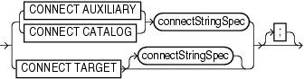

Purpose

Use the `CONNECT` command to establish a connection between RMAN and a target, auxiliary, or recovery catalog database.

RMAN connections to a database are specified and authenticated in the same way as SQL\*Plus connections to a database. The only difference is that RMAN connections to a target or auxiliary database require the `SYSDBA` privilege. The `AS SYSDBA` keywords are implied and cannot be explicitly specified. See [Oracle Database Administrator's Guide](https://docs.oracle.com/cd/E11882_01/server.112/e25494/dba.htm#ADMIN00102) to learn about database connection options when using SQL\*Plus.

Caution:

Good security practice requires that passwords should not be entered in plain text on the command line. You should enter passwords in RMAN only when requested by an RMAN prompt. See [Oracle Database Security Guide](https://docs.oracle.com/cd/E11882_01/network.112/e36292/authentication.htm#DBSEG0032) to learn about password protection.

See Also:

`RMAN` for command-line connection options

Prerequisites

You can only run the `CONNECT TARGET`, `CONNECT CATALOG`, and `CONNECT AUXILIARY` commands at the RMAN prompt and only if RMAN is not already connected to the databases specified by these commands. To connect to a different target, catalog, or auxiliary database you must start a new RMAN session.

Usage Notes

An RMAN session runs in `NOCATALOG` mode by default if all of the following conditions are met:

- You did not specify `CATALOG` or `NOCATALOG` when you started `RMAN`.
- You have not yet run `CONNECT CATALOG` in an RMAN session.
- You run a command such as `BACKUP` that requires an RMAN repository connection (as shown in Example 2-51).

Syntax

connect::=



> { **CONNECT AUXILIARY** | **CONNECT CATALOG** } *connectStringSpec* | **CONNECT TARGET** *connectStringSpec*
  
  

([connectStringSpec::=](rcmsubcl004.md))

Semantics

| Syntax Element | Description |
| --- | --- |
| `CONNECT AUXILIARY` | Establishes a connection between RMAN and an auxiliary database instance.  Auxiliary instances are used with the `TRANSPORT TABLESPACE` and `DUPLICATE` commands, and during RMAN TSPITR. |
| `CONNECT CATALOG` | Establishes a connection between RMAN and a recovery catalog database.  If the recovery catalog is a virtual private catalog (see `CREATE CATALOG`), then the RMAN client connecting to this catalog must be at patch level 10.1.0.6 or 10.2.0.3. Oracle9i RMAN clients cannot connect to a virtual private catalog. This version restriction does not affect RMAN client connections to an Oracle Database 11g base recovery catalog, even if it has some virtual private catalog users.  RMAN issues an `RMAN-06445` error if you attempt to use the `CONNECT CATALOG` command in an RMAN session when RMAN is in the default `NOCATALOG` mode (see "Usage Notes").  Note: You must use RMAN with a recovery catalog in a Data Guard environment. |
| `CONNECT TARGET` | Establishes a connection between RMAN and a target database.  Note: RMAN can connect to physical standby databases as `TARGET` in a Data Guard environment. If you run `CONNECT TARGET` for a database that has a `DB_UNIQUE_NAME` that is unknown to the recovery catalog, but the DBID is the same as a registered database, then RMAN automatically and implicitly registers the database in the recovery catalog. |
| `connectStringSpec` | Specifies the connection information for the database. |

Examples

Example 2-50 Connecting to a Target Database Without a Recovery Catalog

This example starts RMAN in `NOCATALOG` mode and then connects to the target database with an Oracle Net service name `prod1`. RMAN prompts for the `SYS` password.

```
% rman NOCATALOG
RMAN> CONNECT TARGET SYS@prod1;

target database Password: password
connected to target database: PROD1 (DBID=39525561)
```

Example 2-51 Connecting to a Target Database in the Default NOCATALOG Mode

This example starts RMAN without specifying either `CATALOG` or `NOCATALOG` and then uses operating system authentication to connect to a target database with operating system authentication. Because no `CONNECT CATALOG` command has been run, RMAN defaults to `NOCATALOG` mode when you run the `BACKUP` command.

```
% rman
RMAN> CONNECT TARGET /
RMAN> BACKUP DATABASE;
```

At this point in the RMAN session, you cannot run `CONNECT CATALOG` because the session has defaulted to `NOCATALOG` mode. An attempt to connect to the catalog in this session receives an error:

```
RMAN> CONNECT CATALOG rman@catdb

RMAN-00571: ===========================================================
RMAN-00569: =============== ERROR MESSAGE STACK FOLLOWS ===============
RMAN-00571: ===========================================================
RMAN-06445: cannot connect to recovery catalog after NOCATALOG has been used
```

Example 2-52 Connecting to Target, Recovery Catalog, and Auxiliary Databases

This example connects to a target database using operating system authentication and connects to the recovery catalog and auxiliary databases using password files. RMAN prompts for the password.

```
% rman
RMAN> CONNECT TARGET;

connected to target database: PROD (DBID=39525561)

RMAN> CONNECT CATALOG rman@catdb;
 
recovery catalog database Password: password
connected to recovery catalog database

RMAN> CONNECT AUXILIARY SYS@dupdb;

auxiliary database Password: password
connected to auxiliary database: DUPDB (not mounted)
```