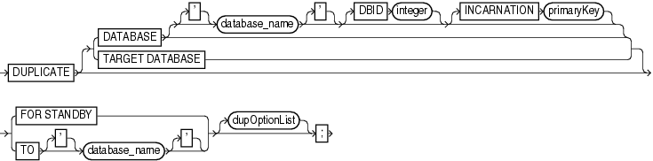
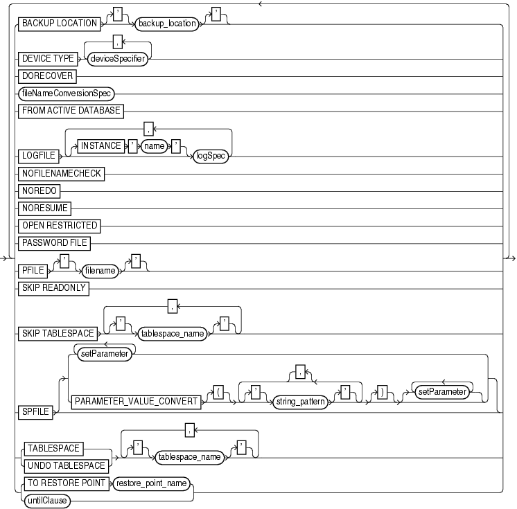
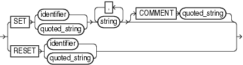
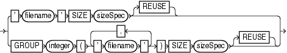

Purpose

Use the `DUPLICATE` command to create a copy of a source database. RMAN can create either of the following types of databases:

- A duplicate database, which is a copy of the source database (or a subset of the source database) with a unique DBID. Because a duplicate database has a unique DBID, it is independent of the source database and can be registered in the same recovery catalog. Typically, duplicate databases are used for testing.
- A standby database, which is a special copy of the source database (called a primary database in a Data Guard environment) that is updated by applying archived redo log files from the primary database. A standby database is not assigned a new DBID.

RMAN can perform the duplication in any of the following supported modes:

- Active duplication
	RMAN duplicates the files directly from either an open or mounted database.
- Backup-based duplication without a target connection
	RMAN creates duplicate files from pre-existing RMAN backups and copies. The `DUPLICATE` command must have been issued with the `DATABASE` clause. This form requires a connection to an auxiliary instance and a recovery catalog.
	This mode is useful when the target database is not available or a connection to it is not desirable (as mandated by security policy restrictions or a firewall).
- Backup-based duplication with a target connection
	RMAN creates duplicate files from pre-existing RMAN backups and copies.
- Backup-based duplication without connection to target and recovery catalog
	RMAN creates duplicate files from RMAN backups and copies that were placed in a designated `BACKUP LOCATION.`

See Also:

- [Oracle Database Backup and Recovery User's Guide](https://docs.oracle.com/cd/E11882_01/backup.112/e10642/rcmdupdb.htm#BRADV010) to learn how to create a duplicate database with the `DUPLICATE` command
- [Oracle Data Guard Concepts and Administration](https://docs.oracle.com/cd/E11882_01/server.112/e41134/create_ps.htm#SBYDB00200) to learn how to create, manage, and back up a standby database

Prerequisites

The prerequisites vary depending on the type of duplication.

Prerequisites Common to All Forms of Duplication

RMAN must be connected as `AUXILIARY` to the instance of the duplicate database. The instance of the duplicate database is called the auxiliary instance. The auxiliary instance must be started with the `NOMOUNT` option.

The source host is the database on which the source database resides. The destination host is the host on which you intend to create the duplicate database. If you intend to create the duplicate database on the source host, then set the `CONTROL_FILES` initialization parameter appropriately so that the `DUPLICATE` command does not generate an error because the source control file is in use. Also, set all \* `_DEST` initialization parameters appropriately so that the source database files are not overwritten by the duplicate database files.

The source and duplicate databases must be on the same platform. In the context of `DUPLICATE`, 32-bit and 64-bit versions of the same platform are considered the same platform. For example, Linux IA (32-bit) is considered the same platform as Linux IA (64-bit). However, after duplicating a database between 32-bit and 64-bit platforms, you must run the `utlirp.sql` script to convert the PL/SQL code to the new format. This script is located in `ORACLE_HOME` `/rdbms/admin` on Linux and UNIX platforms.

The `DUPLICATE` command requires one or more auxiliary channels. These channels perform the work of the duplication on the auxiliary database instance. In the following circumstances, RMAN uses the channel configuration from the source database for auxiliary channels:

- You have not used `ALLOCATE CHANNEL` to manually allocate auxiliary channels.
- You have not used `CONFIGURE` to configure auxiliary channels.

If you have configured automatic target channels to use `CONNECT` strings, then RMAN attempts to replicate the channel allocation on the auxiliary instance. However, if you must control or vary the channel allocation for duplication, you should manually allocate auxiliary channels.

If the `COMPATIBLE` initialization parameter is set greater than or equal to 11.0.0, then by default RMAN duplicates transportable tablespaces that were not made read/write after being transported. Otherwise, RMAN cannot duplicate transportable tablespaces unless they have been made read/write after being transported.

The following database encryption features both use the wallet: transparent data encryption, which functions at the column level, and tablespace encryption. If you are duplicating an encrypted tablespace, then you must manually copy the wallet to the duplicate database.

See Also:

[Oracle Database Advanced Security Administrator's Guide](https://docs.oracle.com/cd/E11882_01/network.112/e40393/asotrans.htm#ASOAG600) to learn about transparent data encryption

Prerequisites Specific to Backup-Based Duplication

As shown in Table 2-6, the prerequisites for backup-based duplication depend on whether RMAN is connected as `TARGET` to the source database.

Table 2-6 Prerequisites for Three Modes of Backup-Based Duplication

| Prerequisite | No Target and No Recovery Connection | No Target Connection | Target Connection |
| --- | --- | --- | --- |
| RMAN requires a connection to a recovery catalog. | No | Yes | No |
| All backups and archived redo log files used for creating and recovering the duplicate database must be accessible by the server session on the destination host. | Yes | Yes | Yes |
| If the destination host is different from the source host, then you must make backups on disk on the source host available to the destination host with the same full path name as in the source database. | No | Yes | Yes |
| You must provide the name of the source database with the `DATABASE` clause. If the name of the source database is not unique in the recovery catalog, then you must also provide the database ID (DBID) in the `DATABASE` clause. | No if `BACKUP LOCATION` does not have backups from multiple databases. | Yes | No |
| `UNTIL` clause must be specified in the current incarnation. | Not applicable | No | Yes |
| `NOREDO` must be specified when RMAN must prevent application of archived redo log files to the backups (see description of `NOREDO` for more information). | Yes | Yes | Yes |
| If you duplicate a subset of tablespaces, and if the source database is not open, then any duplicated tablespaces with undo segments must be listed in the `UNDO TABLESPACE` clause. | Yes | No | Yes (if no catalog used and target is not open) |
| RMAN automatically enforces the rule that the set of tablespaces must be self-contained and must not contain database objects owned by `SYS`. | No | No | Yes |

Prerequisites Specific to Active Database Duplication

When you execute `DUPLICATE` with `FROM ACTIVE DATABASE`, at least one normal target channel and at least one `AUXILIARY` channel are required.

When you connect RMAN to the source database as `TARGET`, you must specify a password, even if RMAN uses operating system authentication. The source database must be mounted or open. If the source database is open, then archiving must be enabled. If the source database is not open, then it must have been shut down consistently.

When you connect RMAN to the auxiliary instance, you must provide a net service name. This requirement applies even if the auxiliary instance is on the local host.

The source database and auxiliary instances must use the same `SYSDBA` password, which means that both instances must have password files. You can create the password file with a single password so you can start the auxiliary instance and enable the source database to connect to it.

The `DUPLICATE` behavior for password files varies depending on whether your duplicate database acts as a standby database. If you create a duplicate database that is not a standby database, then RMAN does not copy the password file by default. You can specify the `PASSWORD FILE` option to indicate that RMAN should overwrite the existing password file on the auxiliary instance. If you create a standby database, then RMAN copies the password file to the standby host by default, overwriting the existing password file. In this case, the `PASSWORD FILE` clause is not necessary.

You cannot use the `UNTIL` clause when performing active database duplication. RMAN chooses a time based on when the online data files have been completely copied, so that the data files can be recovered to a consistent point in time.

See Also:

[Oracle Database Security Guide](https://docs.oracle.com/cd/E11882_01/network.112/e36292/authentication.htm#DBSEG0032) to learn about password protection

Usage Notes

Active database duplication uses the auxiliary service name to copy the source database over the network to the auxiliary instance on the destination host, whereas backup-based duplication uses pre-existing RMAN backups and copies. Table 2-7 shows which files from the source database are duplicated.

Table 2-7 Duplicated Files

| Source Database Files | Active Database | Backup-Based |
| --- | --- | --- |
| Control files | Copied from source database when `FOR STANDBY` specified; otherwise re-created | Restored from backups |
| Data files | Copied from source database (unless excluded with a `SKIP` option) | Restored from backups (unless excluded with a `SKIP` option) |
| Temp files | Re-created (see "Tempfile Re-Creation") | Re-created (see "Tempfile Re-Creation") |
| Online redo log files | Re-created | Re-created |
| Standby redo log files | Re-created when `FOR STANDBY` specified and defined on primary database | Re-created when `FOR STANDBY` specified and defined on primary database |
| Archived redo log files | Copied from source database, but only if needed for the duplication | Obtained from backups or cataloged copies, but only if needed for the duplication |
| Server parameter file | Copied from source database (see `SPFILE` clause in dupOptionList) | Restored from backup if `SPFILE` clause is specified (see dupOptionList) |
| Flashback log files | Not re-created | Not re-created |
| Block change tracking file | Not re-created | Not re-created |
| Password file | Copied by default for standby databases; for nonstandby databases, copied only if `PASSWORD FILE` option is specified | Not re-created |
| Backups and other files in fast recovery area | Not copied | Not copied |

All data files are included in the duplicate database unless they are offline clean or excluded. You can exclude tablespaces with the `SKIP` clause, or by including only a subset of tablespaces with `DUPLICATE ... TABLESPACE`.

The fast recovery area is defined on the duplicate or standby database if you explicitly define it. Also, if a flash recovery was defined on the source database, and if the auxiliary instance uses a server parameter file that was copied or restored with the `DUPLICATE` command, then a flash recovery is defined on the duplicate or standby database.

If you use active database duplication, then see the `FROM ACTIVE DATABASE` description in dupOptionList for usage notes.

Backup-Based Duplication

In backup-based duplication of databases with a connection to the target database and in `NOARCHIVELOG` mode, media recovery uses the `NOREDO` option. Thus, if incremental backups exist, RMAN applies only these incremental backups to the restored files during recovery.

For backup-based duplication of databases in `ARCHIVELOG` mode, RMAN recovers by default up to the last archived redo log generated when the command was executed, or until a time specified with a `SET` `UNTIL` clause.

For backup-based duplication of databases without a connection to the target database, RMAN cannot determine whether the source database was in `NOARCHIVELOG` mode. Therefore, you must use the `NOREDO` option when the source database was in `NOARCHIVELOG` mode when the backups were taken. You can also use the `NOREDO` option when you do not want to apply archived redo log files to a consistent backup.

If you are using backup-based duplication, and if the source database and auxiliary instances reside on different hosts, then you must decide how to make the backups of the source database available to the auxiliary instance. For more information on how to do this with `BACKUP LOCATION`, review the options described in the section [Making Disk Backups Accessible to the Auxiliary Instance](https://docs.oracle.com/cd/E11882_01/backup.112/e10642/rcmdupdb.htm#BRADV99993) in the Oracle Database Backup and Recovery User's Guide.

If the target database does not use a recovery area in ASM storage, then perform one of the following tasks before executing the `DUPLICATE` command:

- If you are using SBT backups, then make the tapes with the backups accessible to the destination host.
- If you are using disk backups, and if you can use the same backup directory names on the destination host as the source host, then do one of the following:
	- Manually transfer the backups and copies from the source host to the destination host to an identical path.
		- Use NFS or shared disks and ensure that the same path is accessible in the destination host.
- If you are using disk backups, and if you cannot use the same backup directory names on the destination host as the source host, then use of the techniques described in [Oracle Database Backup and Recovery User's Guide](https://docs.oracle.com/cd/E11882_01/backup.112/e10642/rcmdupdb.htm#BRADV99993).

If the source database uses a recovery area in ASM storage, then perform one of the following tasks before executing the `DUPLICATE` command:

- Make a database backup to a location outside the fast recovery area. You can make this backup accessible in the following ways:
	- Use NFS to mount the backup on the destination host with the same name.
		- Use NFS to mount the backup on the destination host with a different name, and then `CATALOG` the backup while RMAN is connected as `TARGET` to the source database.
- Back up the fast recovery area to tape and use it for duplication.

Duplication with Oracle Managed Files

If the source database files are in the Oracle Managed Files (OMF) format, then you cannot use the `DB_FILE_NAME_CONVERT` and `LOG_FILE_NAME_CONVERT` initialization parameters or the `fileNameConversionSpec` clause to generate new OMF file names for the duplicate database. If you do not follow this rule, the new OMF files generated from these three methods can cause problems. For more information on OMF names, see the "Considerations When Renaming OMF Auxiliary Set Files in TSPITR" in the Oracle Database Backup and Recovery User's Guide

The only exception to this rule is when changing only an ASM disk group name. Assume that source data files and online redo log files are stored in ASM disk group `+SOURCEDSK`. You want to store the duplicate database files in ASM disk group `+DUPDSK`. In this case, you can set the initialization parameters as follows:

```
DB_FILE_NAME_CONVERT = ("+SOURCEDSK","+DUPDSK")
LOG_FILE_NAME_CONVERT = ("+SOURCEDSK","+DUPDSK")
```

RMAN uses `DB_FILE_NAME_CONVERT` or `LOG_FILE_NAME_CONVERT` to convert the disk group name, and then generates a new, valid file name based on the converted disk group name.

You have the following other supported options for naming data files when the source files are in the Oracle Managed Files format:

- Use `SET` `NEWNAME` to specify names for individual data files.
- Set `DB_FILE_CREATE_DEST` to make all data files of the new database Oracle-managed files, except the files for which `SET NEWNAME` is used. You should not set `DB_FILE_NAME_CONVERT` if you set `DB_FILE_CREATE_DEST`.

Supported options for naming online redo logs duplicated from Oracle-managed files are `DB_CREATE_FILE_DEST`, `DB_RECOVERY_FILE_DEST`, or `DB_CREATE_ONLINE_LOG_DEST_` `n`.

Tempfile Re-Creation

You can use the `DB_FILE_NAME_CONVERT` parameter to convert the temp file names for the new database that are not Oracle-managed files (OMF). The only exception to this restriction are Automatic Storage Management (ASM) OMF names where only the name of the disk group can be changed.

The other method for converting temp file names for the new database is to use `SET NEWNAME FOR TEMPFILE TO'filename'` or `TO NEW`. With this latter method, it does not matter if the data files are OMF or non-OMF, the temp files are re-created in the `DB_CREATE_FILE_DEST` directory location when the database is opened.

To specify different file names for the temp files, see the discussion of `SWITCH` `TEMPFILE`.

Syntax

duplicate::=



> **DUPLICATE** \[ { **DATABASE** \[\[**'**\] *database\_name* \[**'**\] \[**DBID** *integer*\] \[**INCARNATION** *primaryKey*\]\] | **TARGET** **DATABASE** }\] { **FOR** **STANDBY** | **TO** \[**'**\] *database\_name* \[**'**\]} \[*dupOptionList*\]
  
  

(dupOptionList::=)

dupOptionList::=



> { { **BACKUP** **LOCATION** \[**'**\] *backup\_location* \[**'**\] | **DEVICE** **TYPE** *deviceSpecifier* \[, *deviceSpecifier*\]... | **DORECOVER** | *fileNameConversionSpec* | **FROM** **ACTIVE** **DATABASE** | **LOGFILE** \[**INSTANCE** ' *name* '\] *logSpec* \[, \[**INSTANCE** ' *name* '\] *logSpec*\]... | **NOCHECK** | **NOFILENAMECHECK** | **NOREDO** | **NORESUME** | **OPEN** **RESTRICTED** | **PASSWORD** **FILE** | **PFILE** \[**'**\] *filename* \[**'**\] | **SKIP** **READONLY** | **SKIP** **TABLESPACE** \[**'**\] *tablespace\_name* \[**'**\] \[, \[**'**\] *tablespace\_name* \[**'**\]\]... | **SPFILE** \[ { *setParameter* \[*setParameter*\]... | **PARAMETER\_VALUE\_CONVERT** \[**{**\] {\[**'**\] *string\_pattern* \[**'**\]}/ \[**,**\] \[**}**\] \[ { *setParameter* }... }\] | { **TABLESPACE** | **UNDO** **TABLESPACE** } \[**'**\] *tablespace\_name* \[**'**\] \[, \[**'**\] *tablespace\_name* \[**'**\]\]... | { **TO** **RESTORE** **POINT** *restore\_point\_name* | *untilClause* }} \[**}**\] | { **TABLESPACE** | **UNDO** **TABLESPACE** } \[**'**\] *tablespace\_name* \[**'**\] \[, \[**'**\] *tablespace\_name* \[**'**\]\]... | { **TO** **RESTORE** **POINT** *restore\_point\_name* | *untilClause* }}\]...
  
  

([deviceSpecifier::=](rcmsubcl006.md), [fileNameConversionSpec::=](rcmsubcl007.md), logSpec::=, setParameter::=, [untilClause::=](rcmsubcl019.md))

setParameter::=



> **SET** { *identifier* | *quoted\_string* } *string* \[, *string*\]... \[**COMMENT** *quoted\_string*\] | **RESET** { *identifier* | *quoted\_string* }
  
  

logSpec::=



> ' *filename* ' **SIZE** *sizeSpec* \[**REUSE**\] | **GROUP** *integer* { ' *filename* ' \[, ' *filename* '\]... } **SIZE** *sizeSpec* \[**REUSE**\]
  
  

[sizeSpec](rcmsynta007.md)::=


> *integer* \[ {G | K | M}\]
  

Semantics

duplicate

This clause enables you to duplicate a database or tablespace. Refer to the duplicate::= diagram for the syntax.

| Syntax Element | Description |
| --- | --- |
| `TARGET DATABASE` | Specifies the source database, which is the database you want to duplicate. Starting with Oracle Database 11g Release 2 the `TARGET` keyword is optional. |
| `DATABASE` | Specifies the source database |
| `   'database_name'` | Specifies the name of the source database, which is the database that you want to duplicate.  This clause can be used instead of `TARGET DATABASE` when RMAN is connected as `TARGET` to the source database. When performing duplicate with a target connection, then you must specify the currently connected database and not use the INCARNATION subclause.  For backup-based duplication without a target connection, you must either specify the database name or run the `SET DATABASE` 'database\_name' command. |
| `   DBID` `integer` | Specifies the database ID (DBID) of the source database.  The `DBID` parameter is required when you duplicate without a `TARGET` connection to the source database and the database name in the recovery catalog is not unique. Another option is to use the `SET DBID` command.  When RMAN duplicates the database while connected to the source database as `TARGET`, the `DBID` parameter is not needed. If `DBID` is specified, then the parameter value should match the `DBID` of the source database. |
| ` INCARNATION` `primaryKey` | Specifies an orphan incarnation.  By default, the `DUPLICATE` command with the `UNTIL` clause refers to a point in time in the current database incarnation or the direct ancestor of the current incarnation. This clause enables you to designate an incarnation not in the current incarnation path, known as an orphan incarnation. It is invalid to specify `INCARNATION` when connected to a target database or when using `BACKUP LOCATION`.  Another option is to use the `SET INCARNATION` command. |
| `FOR STANDBY` | Specifies that database being duplicated is to be used as a standby database (see Example 2-81).  To create a standby database with the `DUPLICATE` command you must specify the `FOR STANDBY` option. The `DUPLICATE ... FOR STANDBY` command creates the standby database by restoring a standby control file and mounting the standby control file. If you specify `FROM ACTIVE DATABASE`, then RMAN copies the data files from the primary to standby database. Otherwise, RMAN restores backups of the source database data files to the standby database. RMAN restores the most recent files, unless `SET` `UNTIL` is specified.  If you are duplicating the SPFILE, then specify a unique `DB_UNIQUE_NAME` in the `SPFILE` clause. If not, then manually set this parameter to a unique value in the PFILE or SPFILE of the auxiliary instance.  You cannot use `TO` `database_name` for a standby database.  If `DORECOVER` is specified, then RMAN also recovers the database. The standby database is left mounted after duplication is complete.  You cannot use `SET NEWNAME` or `CONFIGURE` `AUXNAME` to transform the file names for the online redo logs on the standby database.  You cannot `CONNECT` RMAN to the standby database and then use `DUPLICATE ... FOR STANDBY` to create an additional standby database. To create additional standby databases, connect RMAN to the original primary database and run `DUPLICATE ... FOR STANDBY`.  Note: Although you can use the `DUPLICATE` command to create a standby database, you cannot use this command to activate a standby database.  When you connect RMAN to the standby database and the recovery catalog in which the primary database is registered, RMAN recognizes the standby database and implicitly registers it. Do not attempt to use the `REGISTER` command for the standby database. |
| `TO` `database_name` | Specifies the name of the duplicate database. This duplicate database is not a standby database, so this clause cannot be used with `FOR STANDBY`.  If you do not specify the `SPFILE` clause, then the specified database name should match the name in the initialization parameter file of the duplicate database instance, which is the instance to which RMAN is connected as `AUXILIARY`. Otherwise, the database signals an error.  You cannot use the same database name for the source database and duplicate database when the duplicate database resides in the same Oracle home as the source database. However, if the duplicate database resides in a different Oracle home from the source database, then its database name just has to differ from other database names in its Oracle home. To simplify administration of duplicate database, Oracle recommends that you use different names for the source and duplicate databases. |
| `dupOptionList` | Specifies options for creating a duplicate or standby database. See dupOptionList. |

dupOptionList

This subclause includes options that control aspects of duplication such as naming the files and determining an end point for the duplication. Refer to the dupOptionList::= diagram for the syntax.

Specify new file names or convert source database file names for the data files and online redo logs when the file names of the duplicate database must be different from the file names of the source database (as when the destination host and source host are the same). If you do not specify file names for the online redo logs and data files of the duplicate database, then RMAN uses the data file names from the source database.

| Syntax Element | Description |
| --- | --- |
| `BACKUP LOCATION` backup\_location | Specifies the backup location on disk where the backups and copies of the database to be duplicated have been placed. This option is valid for duplication without a target or a recovery catalog connection. |
| `DEVICE TYPE` `deviceSpecifier` | Allocates automatic channels for the specified device only (for example, `DISK` or `sbt`).  This option is valid only if you have configured automatic channels and have not manually allocated channels. For example, if you `CONFIGURE` automatic disk and tape channels, and if you run `DUPLICATE...DEVICE TYPE DISK`, then RMAN allocates only disk channels.  See Also: `deviceSpecifier` |
| `DORECOVER` | Specifies that RMAN should recover the standby database after creating it. If you specify an `untilClause`, then RMAN recovers to the specified SCN or time and leaves the database mounted.  RMAN leaves the standby database mounted after media recovery is complete, but does not place the standby database in manual or managed recovery mode. After RMAN creates the standby database, you must resolve any gap sequence before placing it in manual or managed recovery mode, or opening it in read-only mode.  The checkpoint SCN of the control file must be included in an archived redo log that is either available at the standby site or included in an RMAN backup. For example, assume that you create the standby control file and then immediately afterward archive the current log, which has a sequence of 100. In this case, you must recover the standby database up to at least log sequence 100, or the database signals an `ORA-1152` error message because the standby control file backup was taken after the point in time. |
| `fileNameConversionSpec` | Specifies one or more patterns to map source database file names to duplicate database file names (see Example 2-75).  `DB_FILE_NAME_CONVERT` set on the `DUPLICATE` command overrides the initialization parameter `DB_FILE_NAME_CONVERT` (if set). For example, if the initialization parameter file setting is `DB_FILE_NAME_CONVERT=('disk1','disk2')`, but you execute `DUPLICATE ... DB_FILE_NAME_CONVERT ('disk1','disk3')`, then RMAN does not convert the `disk1` substring to `disk2`. Instead, RMAN converts the `disk1` substring to `disk3`.  If a file in the specification list is not affected by the conversion parameter in `DUPLICATE`, then you must rename it by other means, such as `SET NEWNAME`.  Note: If you specify the SPFILE clause, then `DUPLICATE ... DB_FILE_NAME_CONVERT` overrides any conversion parameter specified in the `SPFILE` syntax. For example, if you specify `DB_FILE_NAME_CONVERT` twice in the `DUPLICATE` command, both in the `SPFILE` clause and outside of the `SPFILE` clause, then the setting outside of the `SPFILE` clause takes precedence.  See Also: `fileNameConversionSpec` |
| `FROM ACTIVE DATABASE` | Specifies that the files for the duplicate database are provided directly from the source database and not from a backup of the source database (see Example 2-72).  See Also: "Prerequisites Specific to Active Database Duplication" for command prerequisites |
| `LOGFILE` | Specifies options for creating online redo logs when creating a duplicate database that is not a standby database (see Example 2-75). |
| `   INSTANCE` ` '` `inst_name` `'` | Creates online redo logs for the specified instance in a Real Applications Cluster (Oracle RAC) database. The instance name is a string of up to 80 characters.  RMAN automatically uses the thread mapped to the specified instance. If no `INSTANCE` name is specified, then the log files are for the default instance.  This clause is relevant when you use `DUPLICATE TARGET DATABASE` to duplicate an Oracle RAC database to a single-instance database. Otherwise, you do not need to use `INSTANCE`. If you use the `LOGFILE` clause, then use `INSTANCE` to specify the name of the Oracle RAC instance for each thread that was open during the database backup (for backup-based duplication) or during the `UNTIL TIME` (for active database duplication). |
| `logSpec` | Specifies the file names and groups for the online redo log files.  See Also: `logSpec` for the valid options |
| `NOFILENAMECHECK` | Prevents RMAN from checking whether the data files and online redo logs files of the source database are in use when the source database files share the same names as the duplicate database files. You are responsible for determining that the duplicate operation does not overwrite useful data.  This option is necessary when you are creating a duplicate database in a different host that has the same disk configuration, directory structure, and file names as the host of the source database. For example, assume that you have a small database located in the `/dbs` directory of `srchost`:  ``` /oracle/dbs/system_prod1.dbf /oracle/dbs/users_prod1.dbf /oracle/dbs/rbs_prod1.dbf ```  Assume that you want to duplicate this database to `desthost`, which has the same file system `/oracle/dbs/` `*`, and you want to use the same file names in the duplicate database as in the source database. In this case, specify the `NOFILENAMECHECK` option to avoid an error message. Because RMAN is not aware of the different hosts, RMAN cannot determine automatically that it should not check the file names.  If duplicating a database on the same host as the source database, then ensure that `NOFILENAMECHECK` is not set. Otherwise, RMAN can potentially overwrite and corrupt the target database data files, temp files, or online logs. It may also signal the following error:  ``` RMAN-10035: exception raised in RPC: ORA-19504: failed to create              file "/oracle/dbs/tbs_01.f"  ORA-27086: skgfglk: unable to lock file - already in use  SVR4 Error: 11: Resource temporarily unavailable  Additional information: 8  RMAN-10031: ORA-19624 occurred during call to  DBMS_BACKUP_RESTORE.RESTOREBACKUPPIECE ``` |
| `NOREDO` | Specifies that no archived redo log files should be applied when recovering a consistent backup in any of the following scenarios: - You do not want to apply archived redo log files to the consistent backup even though the archived redo log files are available. - The source database was running in `NOARCHIVELOG` mode at backup time and `DUPLICATE` is not connected to the target database. - The source database is currently running in `ARCHIVELOG` mode but the backup was taken when the database was in `NOARCHIVELOG` mode. |
| `NORESUME` | Disables the ability for RMAN to automatically recover from a failed duplication operation. Using `NORESUME` in the first invocation of duplicate permanently prevents any subsequent duplicate command for the new database from using this automatic optimization.  See Also: Oracle Database Backup and Recovery User's Guide to learn more about the automated recovery from a failed `DUPLICATE` operation. |
| `OPEN RESTRICTED` | Enables a restricted session in the duplicate database by issuing the following SQL statement: `ALTER SYSTEM ENABLE RESTRICTED SESSION`. RMAN issues this statement immediately before the duplicate database is opened. |
| `PASSWORD FILE` | Specifies that RMAN should use the password file on the source database to overwrite the password file currently used by the auxiliary instance (see Example 2-72). This option is only valid when `FROM ACTIVE DATABASE` is specified; otherwise, RMAN signals an error.  If `FOR STANDBY` is specified, then RMAN copies the password file by default; if not specified, then RMAN does not copy the password file by default. You can use `PASSWORD FILE` to request that RMAN overwrite the existing password file with the password file from the source database. If you want the duplicate database to contain all the passwords available on your production database, then use the `PASSWORD FILE` option. |
| `PFILE` `filename` | Specifies a text-based initialization parameter file used by the auxiliary instance (see Example 2-75). RMAN automatically shuts down and restarts the auxiliary instance during duplication. If the auxiliary does not use a server parameter file in the default location, then you must specify the text-based initialization parameter file that RMAN should use when starting the auxiliary instance. The initialization parameter file must reside on the same host as the RMAN client used to perform the duplication.  If the auxiliary instance uses a server parameter file in the default location, then you do not need to specify `PFILE`. |
| `SKIP READONLY` | Excludes data files in current read-only tablespaces from the duplicate database. By default RMAN duplicates current read-only tablespaces.  If a tablespace is currently read/write, but you use `untilClause` to duplicate the database to an SCN at which the tablespace was read-only, then RMAN does not include the tablespace in the duplicate database. Tablespaces that were read-only previously are considered offline tablespaces and so are not included in the duplication.  Note: The read-only tablespaces must be self-contained for the `DUPLICATE` command to succeed with this option. |
| `SKIP TABLESPACE` `tbs_name` | Excludes the specified tablespace from the duplicate database (see Example 2-75).  Note: You must not exclude SYS-owned objects or tablespaces with rollback segments, nor tablespaces containing materialized views. The set of tablespaces to be duplicated must be self-contained.  If you must duplicate a database when some backups of the source database do not exist, then `SKIP TABLESPACE` is required. If you do not specify `SKIP TABLESPACE`, then RMAN attempts to duplicate the following:  - All data files in online tablespaces, whether or not the data files are online. - All tablespaces taken offline with an option other than `NORMAL`. For example, RMAN attempts to duplicate tablespaces taken offline with the `IMMEDIATE` option. You cannot duplicate `OFFLINE NORMAL` tablespaces, although you can add these tablespaces manually after duplication. |
| `SPFILE` | Copies the server parameter file from the source database to the duplicate database. No initialization parameters previously set in the duplicate database are used. |
| `setParameter` | Sets the specified initialization parameters to the specified values. Refer to `setParameter`. |
| `   PARAMETER_VALUE_CONVERT`    `string_pattern`   `   [``setParameter``]` | Replaces the first string with the second string in all matching initialization parameter values. Refer to the description of `PARAMETER_VALUE_CONVERT` in `dupOptionList`. |
| `TABLESPACE` `tablespace_name` | Specifies which tablespaces are included in the specified database. Unlike `SKIP TABLESPACE`, which specifies which tablespaces are excluded from the duplicate database, this option specifies which tablespaces are included and then skips the remaining tablespaces.  Note: RMAN automatically includes the `SYSTEM`, `SYSAUX`, and undo tablespaces in the duplicate database. These tablespaces cannot be skipped and the set of tablespaces that you want to duplicate must be self-contained. |
| `UNDO TABLESPACE` `tablespace_name` | Specifies the names of the tablespaces with undo segments. This option is only required when a subset of tablespaces are being duplicated with the `SKIP TABLESPACE` and `TABLESPACE` clauses. You must provide the list of tablespaces with undo segments in the following cases: - No connection to the target database or the recovery catalog - No connection to a recovery catalog, a connection to the target but the target database is not open. |
| `TO RESTORE POINT`   `restore_point_name` | Specifies a restore point for backup-based duplication, with the SCN at which the restore point was created as the upper, inclusive limit. Because the limit is inclusive, RMAN selects only files that it can use to duplicate a database up to and including the corresponding SCN.  Note: The same restrictions that apply to `untilClause` also apply to `TO RESTORE POINT`. |
| `untilClause` | Sets the end time, SCN, or log sequence number for point-in-time recovery in backup-based duplication (see Example 2-75). The `UNTIL` clause is not supported in active database duplication.  You can achieve the same result by running `SET` `UNTIL` before the `DUPLICATE` command. If you specify the `UNTIL` clause for duplication, then the following restrictions apply:  - RMAN determines whether to use `NOREDO` based on the current state of the database. If the database was in an archiving mode at the specified `UNTIL` time or SCN that is different from the current archiving mode, then RMAN does not use `NOREDO`. - The end point for a `DUPLICATE` command cannot be before the SCN of the most recent `ALTER DATABASE OPEN RESETLOGS`. Duplication with a connection to a target does not support previous database incarnations. However, you can specify previous incarnations if you are duplicating without a connection to a target database. - You cannot recover the duplicate database to the current point in time, that is, the most recent SCN. RMAN recovers the duplicate database up to or before the most recent available archived log, but cannot recover into the online redo logs. |

setParameter

This subclause specifies server parameter file values.

| Syntax Element | Description |
| --- | --- |
| `SET` `identifier string` | Sets the specified initialization parameters to the specified values (see Example 2-73). You can use `SET` to adjust for differences in memory, turn off replication options, and set other options for the duplicate database.  This `SET` functionality is equivalent to pausing the duplication after restoring the server parameter file and issuing `ALTER SYSTEM SET` statements to change the initialization parameter file.  RMAN processes `SET` after `PARAMETER_VALUE_CONVERT`. If `PARAMETER_VALUE_CONVERT` sets the file name specified by a parameter, and if `SET` sets the file name specified by the same parameter, then the `SET` value overrides the `PARAMETER_VALUE_CONVERT` setting.  Note: If `DB_FILE_NAME_CONVERT` is specified on the `DUPLICATE` command, then its file name settings override competing settings specified by `SPFILE SET`. |
| `   COMMENT` `'` `string` `'` | Specifies an optional comment for the parameter setting. |
| `RESET` `identifier string` | Deletes specified initialization parameters from the parameter file. You can use `RESET` to remove unneeded initialization parameters.  This `RESET` functionality is equivalent to pausing the duplication after restoring the server parameter file and issuing `ALTER SYSTEM RESET` statements to change the initialization parameter file. |

logSpec

This subclause specifies the online redo logs when creating a duplicate database that is not a standby database. Refer to the logSpec::= diagram for the syntax diagram.

If you do not specify `LOGFILE`, then RMAN first checks if any of the following initialization parameters are set: `LOG_FILE_NAME_CONVERT,DB_CREATE_FILE_DEST, DB_RECOVERY_FILE_DEST` or `DB_CREATE_ONLINE_LOG_DEST_n`. If these parameters are set, RMAN directs duplicate database online redo log files to Oracle managed storage based on these parameter settings. If none of these initialization parameters are set, then RMAN uses the original redo log file names of the source database for redo log files of the duplicate database. You must specify the `NOFILENAMECHECK` option in this case.

| Syntax Element | Description |
| --- | --- |
| `'` `filename` `'` `SIZE ` `sizeSpec` | Specifies the file name of the online redo log member and the size of the file in kilobytes (`K`) or megabytes (`M`). The default is in bytes. |
| `   REUSE` | Allows the database to reuse an existing file. If the file exists, then the database verifies that its size matches the value of the `SIZE` parameter. If the file does not exist, then it is created. |
| `GROUP` `integer`   `('` `filename` `', ...)`   `SIZE` `sizeSpec` | Specifies the group containing the online redo log members, the file name of the online redo log member, and the size of the file in kilobytes (`K`) or megabytes (`M`). The default is in bytes. |
| `   REUSE` | Allows the database to reuse an existing log. |

Examples

Example 2-72 Duplicating from an Active Database to a Host with the Same Directory Structure

Assume that you want to create a test database from database `prod1` on a new host. The new host has the same directory structure as the source host, so the files in the duplicate database can use the same names as the files in the source database. You want to create the database without using RMAN backups and allow `prod1` to remain open during the duplication.

If `prod1` uses a server parameter file, then you can create an initialization parameter file on the destination host that contains only the `DB_NAME` parameter set to an arbitrary value. Before starting the auxiliary instance you should create a password file that has the same `SYSDBA` password as the source database. Afterward, start the auxiliary instance using an spfile, if available. If you start the auxiliary instance with a pfile, then RMAN creates an spfile in the default location, possibly overwriting any spfile residing there.

By default, RMAN does not duplicate the password file when creating a duplicate database that is not a standby database. The `PASSWORD FILE` option specifies that RMAN should copy the password file to the destination host. If you want the duplicate database to contain all the passwords available on your source database, then use the `PASSWORD FILE` option.

You do not need to configure auxiliary channels because RMAN uses the normal channels configured on the source database to copy the database files. Start the RMAN client, connect to the source and auxiliary database instances, and duplicate the database as follows:

```
% rman
RMAN> CONNECT TARGET SYS@prod1

target database Password: password
connected to target database: PROD1 (DBID=39525561)

RMAN> CONNECT AUXILIARY SYS@dup1

auxiliary database Password: password
connected to auxiliary database: DUP1 (not mounted)

RMAN> DUPLICATE TARGET DATABASE TO dup1
2> FROM ACTIVE DATABASE
3> NOFILENAMECHECK
4> PASSWORD FILE
5> SPFILE;
```

Example 2-73 Copying the Server Parameter File in Active Database Duplication

Assume that you want to create a standby database from database `prod1` on a new host. The destination host has a different directory structure from the source host, so the standby database files are stored in `/disk2` rather than `/disk1`. You want to create the standby database without using RMAN backups and let `prod1` remain open during the duplication.

Your first step is to create a minimal initialization parameter file for the standby database and then start the standby instance. This parameter file is minimal because when you use the `SPFILE` option, RMAN copies the server parameter file to the new host and sets various parameters to the new values provided. The parameters used to start the standby instance are ignored.

Start the RMAN client, `CONNECT` to the source database as `TARGET` and connect to the auxiliary instance. Allocate multiple channels to the target instance and a channel to the auxiliary instance as shown here:

```
ALLOCATE CHANNEL tgt10 TYPE DISK; 
ALLOCATE CHANNEL tgt20 TYPE DISK; 
ALLOCATE CHANNEL tgt30 TYPE DISK; 
ALLOCATE CHANNEL tgt40 TYPE DISK; 
ALLOCATE AUXILIARY CHANNEL dup1 TYPE DISK;
```

You can then enter the following command:

```
DUPLICATE TARGET DATABASE
  FOR STANDBY
  FROM ACTIVE DATABASE
  PASSWORD FILE
  SPFILE 
    PARAMETER_VALUE_CONVERT '/disk1', '/disk2'
    SET DB_FILE_NAME_CONVERT '/disk1','/disk2'
    SET LOG_FILE_NAME_CONVERT '/disk1','/disk2'
    SET DB_UNIQUE_NAME 'dup1'
    SET SGA_MAX_SIZE 200M
    SET SGA_TARGET 125M;
```

Example 2-74 Duplicating a Database Without a Target Connection to a Host with the Same Directory Structure

Assume that you want to duplicate source database `prod` using backups and do not want to connect RMAN as `TARGET` to this database because it is shut down for maintenance. A description of the environment follows:

- The source and destination hosts have identical directory structures. The data file and online redo log names in the duplicate database must be identical to the names in the source database.
- The same number of online redo log files are used in the duplicate database.
- A recovery catalog is available. The source database name `prod` is unique in the recovery catalog.
- Auxiliary channels have been configured with the `CONFIGURE CHANNEL` command.

The following commands create a duplicate database named `dupdb`:

```
% rman 

RMAN> CONNECT CATALOG rman@catdb;
 
recovery catalog database Password: password
connected to recovery catalog database

RMAN> CONNECT AUXILIARY SYS@dupdb;

auxiliary database Password: password
connected to auxiliary database: DUPDB (not mounted)

RMAN> DUPLICATE DATABASE 'PROD' TO 'DUPDB' NOFILENAMECHECK;
```

Assume a different scenario in which the database name `prod` is not unique in the recovery catalog. The following `DUPLICATE` command uses the `DBID` parameter to uniquely identify the source database:

```
RMAN> DUPLICATE DATABASE 'PROD' DBID 39525561 TO 'DUPDB' NOFILENAMECHECK;
```

Example 2-75 Setting New File Names in the DUPLICATE Command

Assume that you want to use tape backups to duplicate the source database `prod` on `srchost` to `newdb` on `desthost`.

In this scenario, the source database does not use a server parameter file. You create a text-based initialization parameter file on `desthost` and use it to start the database instance. Thus, backup-based duplication must use a target connection (see Table 2-6).

When executing `DUPLICATE` on `desthost`, you must use the `PFILE` parameter to specify the location of the initialization parameter file. You must use the RMAN client on the same host as the initialization parameter file for the duplicate database.

You do not want the tablespaces `example` and `history` to be included in the duplicate database, so you specify `DUPLICATE ... SKIP TABLESPACE` for these tablespaces. Also, you want the duplicate database to be in the state that the production database was in 24 hours ago, so you use `DUPLICATE ... UNTIL TIME`.

This example assumes that the data files of the source database are on `srchost` in directory `/h1/oracle/dbs/trgt`. You intend to duplicate the data files to the directory `/h2/oracle/oradata/newdb`, so you specify `DUPLICATE ... DB_FILE_NAME_CONVERT` to generate the names for the duplicate data files. You use `DUPLICATE ... LOGFILE` to specify names for the online redo log files in the duplicate database.

Start the RMAN client on `desthost`, `CONNECT` to the source database as `TARGET`, and connect to the auxiliary instance. You can then enter the following `RUN` command:

```
RUN
{  
  ALLOCATE AUXILIARY CHANNEL newdb DEVICE TYPE sbt; 
  DUPLICATE TARGET DATABASE TO newdb
    PFILE ?/dbs/initNEWDB.ora
    UNTIL TIME 'SYSDATE-1'  # specifies incomplete recovery
    SKIP TABLESPACE example, history   # skip desired tablespaces
    DB_FILE_NAME_CONVERT ('/h1/oracle/dbs/trgt/','/h2/oracle/oradata/newdb/')
    LOGFILE
      GROUP 1 ('/h2/oradata/newdb/redo01_1.f',
               '/h2/oradata/newdb/redo01_2.f') SIZE 4M,
      GROUP 2 ('/h2/oradata/newdb/redo02_1.f',
               '/h2/oradata/newdb/redo02_2.f') SIZE 4M,
      GROUP 3 ('/h2/oradata/newdb/redo03_1.f',
               '/h2/oradata/newdb/redo03_2.f') SIZE 4M REUSE;
}
```

Example 2-76 Using SET NEWNAME FOR DATABASE to Name Duplicate Files

In this scenario, you intend to use backup-based duplication without a target connection.

The source database `prod` contains eight data files spread out over multiple directories. The data files are not Oracle Managed Files. You want to duplicate the source database to `dupdb` on destination host `desthost`.

In this scenario, `srchost` and `desthost` have different directory structures. You want to store the data files in `desthost` in the `/oradata1` subdirectory, so you use `SET NEWNAME FOR DATABASE` to specify the file names stripped of directory paths. For example, if a source data file has the name `'/oradata/prod/financial.dbf'`, then `%b` results in `'financial.dbf'`.

The source database does not use a server parameter file, so you cannot use the `SPFILE` technique to specify names for the duplicate data files. You decide to use the `SET NEWNAME DATABASE` command because you want all duplicate data files in the same directory on the destination host.

You want to create two online redo log groups, each with two members of size 200 KB, in the directory `/duplogs` on the destination host. Assume that `srchost` and `desthost` cannot mount each other's file systems by any means such as NFS.

You have disk copies or backup sets stored on disk for all the data files and archived redo log files in the source database, and you have manually copied them to `desthost` using an operating system utility. These backups and copies exist in the same location on `desthost` as they do in `srchost`.

You use an operating system utility to copy the initialization parameter file from `srchost` to an appropriate location in `desthost`. You have reset all initialization parameters that end in `_DEST` and specify a path name. You do not set `DB_FILE_NAME_CONVERT` and `LOG_FILE_NAME_CONVERT` because you are specifying names for data files and online logs in the `RUN` command itself. The auxiliary instance uses a server-side initialization parameter file in the default location so the `PFILE` parameter is not necessary on the `DUPLICATE` command.

The following sample script creates the duplicate database. A `RUN` command is necessary because you can only execute `SET NEWNAME` within `RUN`.

```
RUN
{
  SET NEWNAME FOR DATABASE TO '/oradata1/%b'; 
  DUPLICATE TARGET DATABASE TO dupdb
    LOGFILE
      GROUP 1 ('/duplogs/redo01a.log', 
               '/duplogs/redo01b.log') SIZE 4M REUSE,
      GROUP 2 ('/duplogs/redo02a.log',
               '/duplogs/redo02b.log') SIZE 4M REUSE;
}
```

Example 2-77 Using SET NEWNAME FOR DATAFILE and SET NEWNAME FOR TABLESPACE to Name Duplicate Files

In this scenario, you intend to duplicate a database by using backup-based duplication.

Assume that the source database `prod` is on `srchost` and contains nine data files, which are spread out over multiple directories. You want to duplicate the source database to database `dupdb` on remote host `desthost`. The `dupdb` database should exclude tablespace `tools`, but keep all of the other tablespaces.

The source database does not use a server parameter file, so you cannot use the `SPFILE` technique to specify names for the duplicate data files. You decide to use `SET NEWNAME` commands to specify the file names because the duplicate data files will be spread across several directories.

In this scenario, `srchost` and `desthost` have different directory structures. You want to store the data files in `desthost` in the `/oradata1` through `/oradata7` subdirectories. You want to place each data file in a different directory, except for the `USERS` tablespace, which contains two data files that you intend to duplicate to `/oradata7`.

You want to create two online redo log groups, each with two members of size 200 KB, in the directory `/duplogs` on the destination host. Assume that `srchost` and `desthost` cannot mount each other's file systems by any means such as NFS.

You have disk copies or backup sets stored on disk for all the data files and archived redo log files in the source database, and you have manually copied them to `desthost` using an operating system utility. These backups and copies exist in the same location on `desthost` as they do in `srchost`.

You use an operating system utility to copy the initialization parameter file from `srchost` to an appropriate location in `desthost`. You have reset all initialization parameters that end in `_DEST` and specify a path name. You do not set `DB_FILE_NAME_CONVERT` and `LOG_FILE_NAME_CONVERT` because you are specifying names for data files and online logs in the `RUN` command itself. The auxiliary instance uses a server-side initialization parameter file in the default location so the `PFILE` parameter is not necessary on the `DUPLICATE` command.

The following sample scripts creates the duplicate database. A `RUN` command is necessary because you can only execute `SET NEWNAME` within `RUN`.

```
RUN
{
  SET NEWNAME FOR DATAFILE 1 TO '/oradata1/system01.dbf'; 
  SET NEWNAME FOR DATAFILE 2 TO '/oradata2/undotbs01.dbf';
  SET NEWNAME FOR DATAFILE 3 TO '/oradata3/cwmlite01.dbf'; 
  SET NEWNAME FOR DATAFILE 4 TO '/oradata4/drsys01'; 
  SET NEWNAME FOR DATAFILE 5 TO '/oradata5/example01.dbf'; 
  # because the users tablespace contains 2 datafiles, the following command
  # generates unique names for both datafiles, placing them in /oradata7
  SET NEWNAME FOR TABLESPACE users TO '/oradata7/users%b.dbf';
  DUPLICATE TARGET DATABASE TO dupdb
    SKIP TABLESPACE tools
    LOGFILE
      GROUP 1 ('/duplogs/redo01a.log', 
               '/duplogs/redo01b.log') SIZE 4M REUSE, 
      GROUP 2 ('/duplogs/redo02a.log', 
               '/duplogs/redo02b.log') SIZE 4M REUSE;
}
```

Example 2-78 Using SET NEWNAME FOR DATAFILE to Name Oracle-Managed Files

There are two ways to store specific data files or temp files in an Oracle-managed files destination that is independent of the locations of the rest of the database files.

1. Set the parameter `DB_CREATE_FILE_DEST` in the initialization parameter file of the auxiliary instance to the desired location.
2. Set the initialization parameters `DB_CREATE_FILE_DEST` and `DB_FILE_NAME_CONVERT`. At this point, you can use the `SET NEWNAME` command for those data files that you do not want to be converted by `DB_FILE_NAME_CONVERT`.

The specified data files or temp files are created with Oracle-managed file names in the location specified by `DB_CREATE_FILE_DEST`.

As shown in the following sample script, you can also use `SET` `NEWNAME` to direct individual data files or temp files to a specific ASM disk group.

```
RUN
{
   SET NEWNAME FOR DATAFILE 1 TO "+DGROUP1";
   SET NEWNAME FOR DATAFILE 2 TO "+DGROUP2";
   .
   .
   .
   DUPLICATE TARGET DATABASE 
     TO dupdb
     FROM ACTIVE DATABASE
     SPFILE SET DB_CREATE_FILE_DEST +DGROUP3;
}
```

Example 2-79 Using CONFIGURE AUXNAME to Name Duplicate Files

This section assumes the same circumstances described in Example 2-77, "Using SET NEWNAME FOR DATAFILE and SET NEWNAME FOR TABLESPACE to Name Duplicate Files". This example is a variation that uses `CONFIGURE AUXNAME` instead of `SET NEWNAME` to specify the new data file names. These new file names are recorded in the control file and used every time you perform the duplication in the future.

This example also uses automatic channels and a client-side initialization parameter file for the database duplication, and uses the `LOGFILE` clause to specify names and sizes for the online redo logs. In this case the `RUN` command is not necessary because you are not using `SET NEWNAME`.

```
CONFIGURE AUXNAME FOR DATAFILE 1 TO '/oradata1/system01.dbf'; 
CONFIGURE AUXNAME FOR DATAFILE 2 TO '/oradata2/undotbs01.dbf';
CONFIGURE AUXNAME FOR DATAFILE 3 TO '/oradata3/cwmlite01.dbf'; 
CONFIGURE AUXNAME FOR DATAFILE 4 TO '/oradata4/drsys01'; 
CONFIGURE AUXNAME FOR DATAFILE 5 TO '/oradata5/example01.dbf'; 
CONFIGURE AUXNAME FOR DATAFILE 6 TO '/oradata6/indx01.dbf';
DUPLICATE TARGET DATABASE
  TO dupdb
  SKIP TABLESPACE tools
  LOGFILE
    GROUP 1 ('/duplogs/redo01a.log',
             '/duplogs/redo01b.log') SIZE 4M REUSE,
    GROUP 2 ('/duplogs/redo02a.log',
             '/duplogs/redo02b.log') SIZE 4M REUSE;
```

RMAN uses all incremental backups, archived redo log backups, and archived redo log files to perform incomplete recovery and then opens the database with the `RESETLOGS` option to create the online redo logs.

After the duplication is complete, you can clear the configured auxiliary names for the data files in the duplicate database, so that they are not overwritten by future operations. For example, enter the following commands:

```
CONFIGURE AUXNAME FOR DATAFILE 1 CLEAR; 
CONFIGURE AUXNAME FOR DATAFILE 2 CLEAR; 
CONFIGURE AUXNAME FOR DATAFILE 3 CLEAR;
CONFIGURE AUXNAME FOR DATAFILE 4 CLEAR;
CONFIGURE AUXNAME FOR DATAFILE 5 CLEAR;
CONFIGURE AUXNAME FOR DATAFILE 6 CLEAR;
```

Alternatively, you may want to periodically synchronize a duplicate database with the original database that was duplicated. In this case, you can run the `DUPLICATE` command again, essentially re-creating the duplicate database. This technique requires making complete copies of the data files of the duplicate database. Run the following script whenever you want to synchronize the duplicate with the source database. For example, you might run the script daily or weekly.

```
DUPLICATE TARGET DATABASE TO dupdb
SKIP TABLESPACE tools
  LOGFILE
    GROUP 1 ('/duplogs/redo01a.log',
             '/duplogs/redo01b.log') SIZE 4M REUSE,
    GROUP 2 ('/duplogs/redo02a.log',
             '/duplogs/redo02b.log') SIZE 4M REUSE;
```

Example 2-80 Creating a Standby Database with the Same Directory Structure

Assume that you want to use RMAN backups to create a standby database on a remote host with the same directory structure as the source host. The source database is called `prod1` and is the primary database in the Data Guard environment.

First, start the RMAN client, `CONNECT` to the source database `prod1` as `TARGET`, and connect to the auxiliary instance. You can then `CONFIGURE` the default device type to `sbt` for a standby database with the `DB_UNIQUE_NAME` of `standby1`:

```
CONFIGURE DEFAULT DEVICE TYPE sbt FOR DB_UNIQUE_NAME standby1;
CONFIGURE DEVICE TYPE sbt PARALLELISM 2 FOR DB_UNIQUE_NAME standby1;
```

Assume all backups needed to create the standby database are on tape. In the standby database initialization parameter file, you set `DB_UNIQUE_NAME` to `standby1`.

The default initialization parameter file location is in use on the standby database. After starting the standby instance `NOMOUNT`, you start the RMAN client, `CONNECT` to the source database as `TARGET`, and connect to the auxiliary instance and recovery catalog. You run the following `DUPLICATE` command, specifying the `NOFILENAMECHECK` option because the standby and primary data files and online redo log files have the same names:

```
DUPLICATE TARGET DATABASE FOR STANDBY
  NOFILENAMECHECK;
```

Example 2-81 Creating a Standby Database in OMF and ASM

Assume that you want to use RMAN backups to create a standby database on a host that uses OMF and ASM. The source database is called `prod1` and is the primary database in the Data Guard environment.

First, start the RMAN client, `CONNECT` to database `prod1` as `TARGET`, and connect to the recovery catalog. Run the following commands to `CONFIGURE` the default device type to `sbt` for a standby database that has the `DB_UNIQUE_NAME` of `standby1` and the net service name `sby1`.

```
CONFIGURE CONNECT IDENTIFIER "sby1" FOR DB_UNIQUE_NAME standby1;
CONFIGURE DEFAULT DEVICE TYPE TO sbt FOR DB_UNIQUE_NAME standby1;
CONFIGURE DEVICE TYPE sbt PARALLELISM 2 FOR DB_UNIQUE_NAME standby1;
```

Assume all backups needed to create the standby database are stored on tape. You set the following parameters in the initialization parameter file for database `standby1`:

- Set `DB_UNIQUE_NAME` to the value `standby1`.
- Set `DB_CREATE_FILE_DEST` and `DB_RECOVERY_FILE_DEST` to the desired ASM disk groups on the standby host. For example, set `DB_CREATE_FILE_DEST` to `+DATAFILE` and `DB_RECOVERY_FILE_DEST` to `+FLASH_REC_AREA`.

Ensure that the standby instance is in `NOMOUNT` mode. Start the RMAN client, `CONNECT` to database `prod1` as `TARGET`, connect to the `standby1` instance as `AUXILIARY`, and connect to the recovery catalog. Enter the following command to create the standby database:

```
DUPLICATE TARGET DATABASE FOR STANDBY;
```

RMAN automatically generates new OMF/ASM data file names for the restored data files.

Example 2-82 Duplicating a Database Without Connection to Target Database and Recovery Catalog

In this example, all the necessary backups of data files, controlfile and archived logs of database `prod` can be accessed from the location: `/net/prod/backups`. This location is where only backups of database `prod` reside. The only connection is to the new instance as `AUXILIARY`.

Enter the following command to create a test database when there is no connection to the recovery catalog or target database:

```
DUPLICATE DATABASE TO 'TEST' BACKUP LOCATION '/net/prod/backups' NOFILENAMECHECK;
```

Example 2-83 Selecting a Specific Database When Duplicating Without Connection to Target Database and Recovery Catalog

In this example, `/backups` contains backups from several databases, including more than two databases with the name `PROD`. In this case, you must specify the `DBNAME` and the `DBID` of the database that you want to duplicate. The only connection is to the auxiliary instance.

```
DUPLICATE DATABASE 'PROD' dbid 8675309 to 'TEST'
  UNTIL TIME "to_date('11/01/2007', 'MM/DD/YYYY')"
  BACKUP LOCATION '/backups' NOFILENAMECHECK
  PFILE='?/dbs/inittest.ora' db_file_name_convert='prod','test';
```