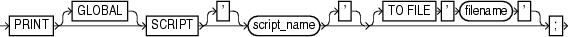

Purpose

Use the `PRINT SCRIPT` command to print a local or global stored script to standard output or to a file.

Prerequisites

Execute `PRINT SCRIPT` only at the RMAN prompt. RMAN must be connected to a target database and a recovery catalog. The recovery catalog database must be open.

If the specified script is a local script, then RMAN must be connected to the target database that it was connected to when you created or replaced the script.

Usage Notes

If `GLOBAL` is not specified, then RMAN looks for a local or global script `script_name` to print. If a local script is found, then it is printed. If no local script is found, but a global script `script_name` is found, then the global script is printed.

Syntax

printScript::=



> **PRINT** \[**GLOBAL**\] **SCRIPT** \[**'**\] *script\_name* \[**'**\] \[**TO** **FILE** ' *filename* '\]
  

Semantics

| Syntax Element | Description |
| --- | --- |
| `GLOBAL` | Identifies the script as global.  If `GLOBAL` is specified, then a global script with the specified name must exist in the recovery catalog. Otherwise, RMAN returns error `RMAN-06004`.  See Also: ["Usage Notes"](rcmsynta014.md) for an explanation of the difference between global and local scripts |
| `script_name` | Specifies the name of the script to print. Quotes must be used around the script name when the name contains either spaces or reserved words. |
| `   TO FILE` `'` `filename` `'` | Sends output to the specified file instead of standard output. |

Examples

Example 2-100 Printing a Script to a File

This example prints a script to the file `/tmp/global_backup_db.rman`:

```
RMAN> PRINT GLOBAL SCRIPT global_backup_db TO FILE "/tmp/global_backup_db.rman";
```

Example 2-101 Printing a Script to the Screen

This example prints a stored script to standard output (and includes sample output):

```
RMAN> PRINT SCRIPT backup_whole;
 
printing stored script: backup_whole
{
    BACKUP
      INCREMENTAL LEVEL 0 TAG backup_whole
      FORMAT "/disk2/backup/%U"
      DATABASE PLUS ARCHIVELOG;
}
```