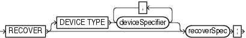
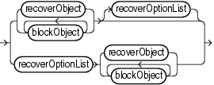
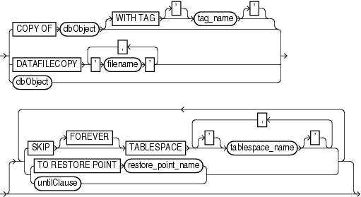
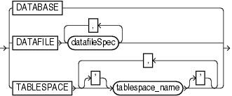
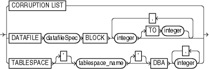
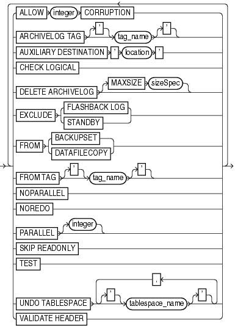

Purpose

Use the `RECOVER` command to perform one of the following distinct tasks:

- Perform complete recovery of the whole database or one or more restored data files
- Perform point-in-time recovery of a database (DBPITR) or tablespace (TSPITR)
- Apply incremental backups to a data file image copy (not a restored data file) to roll it forward in time
- Recover a corrupt data block or set of data blocks within a data file

See Also:

[Oracle Database Backup and Recovery User's Guide](https://docs.oracle.com/cd/E11882_01/backup.112/e10642/rcmcomre.htm#BRADV8005) to learn how to recover data files

Prerequisites

All redo or incremental changes required for the recovery must exist on disk or in SBT. If RMAN needs to restore incremental backups or archived redo log files during recovery, then you must either have automatic channels configured or manually allocate channels of the same type that created these backups.

If you perform media recovery on an encrypted tablespace, then the Oracle wallet must be open when performing media recovery of this tablespace. See [Oracle Database Administrator's Guide](https://docs.oracle.com/cd/E11882_01/server.112/e25494/tspaces.htm#ADMIN12327) to learn about encrypted tablespaces.

Prerequisites Specific to RECOVER BLOCK

The following prerequisites apply to `RECOVER BLOCK`:

- The target database must run in `ARCHIVELOG` mode and be open or mounted with a current control file.
- RMAN can only recover blocks marked media corrupt. The `V$DATABASE_BLOCK_CORRUPTION` view indicates which blocks in a file were marked corrupt since the most recent `BACKUP` or `BACKUP ... VALIDATE` command was run against the file.
- The backups of the data files containing the corrupt blocks must be full backups and not proxy backups. If only proxy backups exist, then you can restore them to a nondefault location on disk, in which case RMAN considers them data file copies. You can then use the data file copies for block media recovery.
- RMAN can use only archived redo log files for recovery. Block media recovery cannot survive a missing or inaccessible log, although it can sometimes survive missing or inaccessible records (see [Oracle Database Backup and Recovery User's Guide](https://docs.oracle.com/cd/E11882_01/backup.112/e10642/rcmblock.htm#BRADV118)).
- For RMAN to be able to search the flashback logs for good copies of corrupt blocks, Flashback Database must be enabled on the target database.
- For RMAN to be able to search a standby database for good copies of corrupt blocks, the target database must be associated with a physical standby database in a Data Guard environment. In addition, the physical standby database must be open read-only in managed recovery.

Note:

An active Data Guard license is required for this operation.

Usage Notes

By default, RMAN performs complete recovery. For point-in-time recovery, the best practice is to enter a `SET` `UNTIL` command before both the `RESTORE` and `RECOVER` commands in a `RUN` command so that the `UNTIL` time applies to both commands. If you run `SET UNTIL` after restoring the database, then you may not be able to recover the database to the target time because the restored files may have timestamps later than the target time.

Note:

You must open the database with the `RESETLOGS` option after incomplete recovery or recovery with a backup control file.

Incremental Backups and Archived Redo Log Files

Except for `RECOVER BLOCK`, RMAN can use both incremental backups and archived redo log files for recovery. RMAN uses the following search order:

1. Incremental backup sets on disk or tape
2. Archived redo log files on disk
3. Archived redo log backups on disk
4. Archived redo log backup sets on tape

When RMAN chooses a destination to restore archived redo log files, it uses the following order of precedence:

1. `SET` `ARCHIVELOG DESTINATION`
2. The `LOG_ARCHIVE_DEST_` `n` parameter whose value is set to `LOCATION=USE_DB_RECOVERY_FILE_DEST`
3. `LOG_ARCHIVE_DEST_1`

RMAN can apply incremental backups to data files that were not restored from an incremental backup. If overlapping levels of incremental backup exist, then RMAN automatically chooses the level covering the longest period of time.

Recovery Through RESETLOGS

You must `RESTORE` data files before you can recover them. RMAN can recover through `RESETLOGS` operations transparently if the data files to be recovered are from a parent incarnation. If required, the `RECOVER` command can also restore and apply archived redo log files and incremental backups from previous database incarnations, even if those logs were generated in previous releases of Oracle Database.

When recovering through an `OPEN RESETLOGS`, ensure that you have all logs needed for recovery. In a previous database incarnation, you must have the logs from the time of the backup until the SCN that is 1 less than the `RESETLOGS SCN`. The incarnation table must have a complete history of `RESETLOGS` operations from the creation time of the database backup. If the complete metadata is not found in `V$DATABASE_INCARNATION`, then you can re-create this metadata by using `CATALOG` for the archived redo log files from the missing incarnations.

See Also:

`RESTORE` command for explanation of the default location for restoring archived redo log files. RMAN automatically specifies the `MAXSIZE` option when staging logs in the fast recovery area.

Syntax

recover::=



> **RECOVER** \[**DEVICE** **TYPE** *deviceSpecifier* \[, *deviceSpecifier*\]...\] *recoverSpec*
  
  

([deviceSpecifier::=](rcmsubcl006.md), recoverObject::=, recoverOptionList::=)

recoverSpec::=



> { *recoverObject* | *blockObject* \[*blockObject*\]...} \[*recoverOptionList*\] | *recoverOptionList* { *recoverObject* | *blockObject* \[*blockObject*\]...}
  
  

(recoverObject::=, blockObject::=, recoverOptionList::=)

recoverObject::=



> { **COPY** **OF** *dbObject* \[**WITH** **TAG** \[**'**\] *tag\_name* \[**'**\]\] | **DATAFILECOPY** ' *filename* ' \[, ' *filename* '\]... | *dbObject* | **TABLE** *schema*. *table* \[: *partition*\] \[, *schema*. *table* \[: *partition*\]\]...} \[ { { **SKIP** \[**FOREVER**\] **TABLESPACE** \[**'**\] *tablespace\_name* \[**'**\] \[, \[**'**\] *tablespace\_name* \[**'**\]\]... | **SNAPSHOT** **TIME** ' *date\_string* ' | { **TO** **RESTORE** **POINT** *restore\_point\_name* | *untilClause* }}}...\]
  
  

(dbObject::=, blockObject::=, [untilClause::=](rcmsubcl019.md))

dbObject::=



> **DATABASE** | **DATAFILE** *datafileSpec* \[, *datafileSpec*\]... | **TABLESPACE** \[**'**\] *tablespace\_name* \[**'**\] \[, \[**'**\] *tablespace\_name* \[**'**\]\]...
  
  

([datafileSpec::=](rcmsubcl005.md))

blockObject::=



> **CORRUPTION** **LIST** | **DATAFILE** *datafileSpec* **BLOCK** *integer* \[**TO** *integer*\] \[, *integer* \[**TO** *integer*\]\]... | **TABLESPACE** \[**'**\] *tablespace\_name* \[**'**\] **DBA** *integer* \[, *integer*\]...
  
  

([datafileSpec::=](rcmsubcl005.md))

recoverOptionList::=



> { **ALLOW** *integer* **CORRUPTION** | **ARCHIVELOG** **TAG** \[**'**\] *tag\_name* \[**'**\] | **AUXILIARY** **DESTINATION** ' *location* ' | **CHECK** **LOGICAL** | **DATAPUMP** **DESTINATION** ' *datapump\_destination* ' | **DELETE** **ARCHIVELOG** \[**MAXSIZE** *sizeSpec*\] | **DUMP** **FILE** \[**'**\] *filename* \[**'**\] | **EXCLUDE** { **FLASHBACK** **LOG** | **STANDBY** } | **FROM** { **BACKUPSET** | **DATAFILECOPY** } | **FROM** **TAG** \[**'**\] *tag\_name* \[**'**\] | **NOPARALLEL** | **NOREDO** | **NOTABLEIMPORT** | **PARALLEL** \[*integer*\] | **REMAP** **TABLE** \[**'**\] *schema* \[**'**\]. \[**'**\] *old\_tablename* \[**'**\]: \[\[**'**\] *partition* \[**'**\]:\] \[**'**\] *new\_tablename* \[**'**\] \[, \[**'**\] *schema* \[**'**\]. \[**'**\] *old\_tablename* \[**'**\]: \[\[**'**\] *partition* \[**'**\]:\] \[**'**\] *new\_tablename* \[**'**\]\]... | **REMAP** **TABLESPACE** \[**'**\] *source\_tablespace\_name* \[**'**\]: \[**'**\] *target\_tablespace\_name* \[**'**\] \[, \[**'**\] *source\_tablespace\_name* \[**'**\]: \[**'**\] *target\_tablespace\_name* \[**'**\]\]... | **SKIP** **READONLY** | **TEST** | **UNDO** **TABLESPACE** \[**'**\] *tablespace\_name* \[**'**\] \[, \[**'**\] *tablespace\_name* \[**'**\]\]... | **VALIDATE** **HEADER** } \[ { **ALLOW** *integer* **CORRUPTION** | **ARCHIVELOG** **TAG** \[**'**\] *tag\_name* \[**'**\] | **AUXILIARY** **DESTINATION** ' *location* ' | **CHECK** **LOGICAL** | **DATAPUMP** **DESTINATION** ' *datapump\_destination* ' | **DELETE** **ARCHIVELOG** \[**MAXSIZE** *sizeSpec*\] | **DUMP** **FILE** \[**'**\] *filename* \[**'**\] | **EXCLUDE** { **FLASHBACK** **LOG** | **STANDBY** } | **FROM** { **BACKUPSET** | **DATAFILECOPY** } | **FROM** **TAG** \[**'**\] *tag\_name* \[**'**\] | **NOPARALLEL** | **NOREDO** | **NOTABLEIMPORT** | **PARALLEL** \[*integer*\] | **REMAP** **TABLE** \[**'**\] *schema* \[**'**\]. \[**'**\] *old\_tablename* \[**'**\]: \[\[**'**\] *partition* \[**'**\]:\] \[**'**\] *new\_tablename* \[**'**\] \[, \[**'**\] *schema* \[**'**\]. \[**'**\] *old\_tablename* \[**'**\]: \[\[**'**\] *partition* \[**'**\]:\] \[**'**\] *new\_tablename* \[**'**\]\]... | **REMAP** **TABLESPACE** \[**'**\] *source\_tablespace\_name* \[**'**\]: \[**'**\] *target\_tablespace\_name* \[**'**\] \[, \[**'**\] *source\_tablespace\_name* \[**'**\]: \[**'**\] *target\_tablespace\_name* \[**'**\]\]... | **SKIP** **READONLY** | **TEST** | **UNDO** **TABLESPACE** \[**'**\] *tablespace\_name* \[**'**\] \[, \[**'**\] *tablespace\_name* \[**'**\]\]... | **VALIDATE** **HEADER** }\]...
  
  

sizeSpec::=


> *integer* \[ {G | K | M}\]
  

Semantics

recover

| Syntax Element | Description |
| --- | --- |
| `DEVICE TYPE` `deviceSpecifier` | Allocates automatic channels for the specified device type only. For example, if you configure automatic disk and tape channels, and if you issue `RECOVER DEVICE TYPE DISK`, then RMAN allocates only disk channels.  You must have configured a device type with the `CONFIGURE` `DEVICE TYPE` command (except for `DISK`, which is preconfigured) before specifying the `DEVICE TYPE` option.  Note: You cannot manually allocate channels and then run `RECOVER DEVICE TYPE`.  See Also: `deviceSpecifier` |
| `recoverSpec` | Specifies the type of object being recovered. |

recoverSpec

| Syntax Element | Description |
| --- | --- |
| `recoverObject` | Specifies the type of object being recovered. |
| `blockObject` | Specifies the blocks to be recovered with block media recovery. |
| `recoverOptionList` | Specifies recovery options. |

recoverObject

This subclause specifies which files to recover. Refer to recoverObject::= for the syntax diagram.

| Syntax Element | Description |
| --- | --- |
| `COPY OF` `dbObject` | Applies incremental backups to the specified image copy to roll it forward to any time equal to or before the most recent incremental backup of the file. The existing image copy is overwritten and remains in a fuzzy state during the recovery. RMAN makes an autobackup after recovering the image copy.  This command updates a data file copy and is not a media recovery of a current database file. This command is meant to be used with the `BACKUP ... FOR RECOVER OF COPY` syntax to implement a strategy using incrementally updated backups.  The following requirements must be met:  - At least one copy of each data file that you are recovering must exist. - Incremental backups taken after the image copy that you are recovering must exist.  RMAN selects one suitable copy if there are multiple possible copies to which the incremental backups can be applied to perform the operation.  Note: RMAN issues a warning (not an error) if it cannot recover to the specified time because no incremental backups are available. |
| `   WITH TAG` `tag_name` | Specifies a tag name to identify the image copy to be rolled forward. |
| `DATAFILECOPY` `'` `filename` `'` | Applies incremental backups to the specified data file image copy (see Example 3-4). Refer to description of `RECOVER COPY OF`. |
| `dbObject` | Specifies the data blocks that require recovery.  See Also: `dbObject` |
| `SKIP` | Takes the data files in the specified tablespaces offline before starting media recovery. These files are left offline after the media recovery is complete.  This option is useful for avoiding recovery of tablespaces containing only temporary data or for postponing recovery of some tablespaces. |
| `   FOREVER` | Takes the data files offline with the `DROP` option (see Example 3-3). Use `SKIP FOREVER TABLESPACE` when you intend to drop the specified tablespaces after opening the database with the `RESETLOGS` option.  Note: If you perform incomplete recovery, then `SKIP` requires the `FOREVER` option. |
| `   TABLESPACE`    `tablespace_name` | Specifies the name of the tablespace to take offline. |
| `TO RESTORE POINT`   `restore_point_name` | Specifies a restore point for termination of the `RECOVER` command, with the SCN at which the restore point was created as the upper, inclusive limit. Because the limit is inclusive, RMAN selects only files that it can use to recover up to and including the SCN corresponding to the restore point. |
| `untilClause` | Specifies a past time, SCN, or log sequence number for termination of the `RECOVER` command.  When used with one or more tablespaces, the clause indicates a tablespace point-in-time recovery (TSPITR) operation for the named tablespaces. The clause cannot be used with `RECOVER DATAFILE`. It should not be used for `RECOVER DATABASE` (see "Usage Notes" for details). After database point-in-time recovery (DBPITR), you must open the database with the `RESETLOGS` option.  See Also: `untilClause` |

dbObject

This subclause specifies whether to recover the database or a subset of the database. Refer to dbObject::= for the syntax diagram.

| Syntax Element | Description |
| --- | --- |
| `DATABASE` | Specifies that the entire database is to be recovered (see Example 3-3). The database must be mounted but not open.  By default, the `RECOVER DATABASE` command does not recover files that are offline normal at the point in time to which the files are being recovered. RMAN omits offline normal files with no further checking.  When recovering after the loss of control files, RMAN automatically updates the control file to point to the actual location of the data files on disk (see Example 3-5).  Note: If the RMAN encounters redo for adding a data file, then RMAN automatically creates a new data file unless the tablespace containing the added data file is skipped during recovery. This situation can arise when a backup control file is restored prior to recovery and the backup control file does not contain a record of the recently-added data file. |
| `DATAFILE` `datafileSpec` | Specifies a list of one or more data files to recover by either file name or absolute data file number. The target database must be mounted or open. If the database is open, then the data files to be recovered must be offline.  If you are not using a recovery catalog, then the file name must be the name of the data file as recorded in the control file. If you are using a recovery catalog, then the file name of the data file must be the most recent name recorded in the catalog, even if the name in the control file has been updated more recently. For example, assume that a data file was renamed in the control file, but the instance fails before you resynchronize the catalog. Specify the old name of the data file in the `RECOVER` command because this is the name recorded in the catalog.  Note: You cannot arbitrarily recover individual data files to different points in time, although you can recover the whole database to a single point in time or recover wholly contained tablespaces to a point in time different from the rest of the database (TSPITR). For more information on TSPITR, see the procedure described in [Oracle Database Backup and Recovery User's Guide](https://docs.oracle.com/cd/E11882_01/backup.112/e10642/rcmtspit.htm#BRADV009).  See Also: `datafileSpec` |
| `TABLESPACE`   `tablespace_name` | Specifies a list of one or more tablespaces to recover (see Example 3-1 and Example 3-2). The target database must be mounted or open. If the database is open, then the tablespaces to be recovered must be offline.  Note: If the RMAN encounters redo for adding a data file, then RMAN automatically creates a new data file. This situation can arise when a backup control file is restored prior to recovery and the backup control file does not contain a record of the recently-added data file. |

blockObject

This subclause specifies the data blocks that require recovery. Refer to blockObject::= for the syntax diagram. Refer to "Prerequisites Specific to RECOVER BLOCK" for prerequisites specific to block media recovery.

You can either use `RECOVER CORRUPTION LIST` to recover all blocks reported in the `V$DATABASE_BLOCK_CORRUPTION` view, or specify the data file number and block number or the tablespace and data block address (DBA). RMAN can only perform complete recovery of individual blocks.

By default, if Flashback Database is enabled, then RMAN searches the flashback logs for good copies of corrupt blocks. By default, if the target database exists in a Data Guard environment, then `RECOVER BLOCK` command can automatically retrieve blocks from a physical standby database to a primary database and vice-versa.

| Syntax Element | Description |
| --- | --- |
| `CORRUPTION LIST` | Recovers all physically corrupt blocks listed in the `V$DATABASE_BLOCK_CORRUPTION` view. Block media recovery may not be able to repair all listed logically corrupt blocks. In these cases, alternate recovery methods, such as tablespace point-in-time recovery, or dropping and re-creating the affected objects, may repair the corruption.  The `V$DATABASE_BLOCK_CORRUPTION` view displays blocks marked corrupt by Oracle Database components such as RMAN commands, `ANALYZE`, `dbv`, SQL queries, and so on. In short, any process that encounters an `ORA-1578` error records the block corruption in this view. The following types of corruption result in rows added to this view:  - Physical corruption (sometimes called media corruption). The database does not recognize the block at all: the checksum is invalid, the block contains all zeros, or the header and footer of the block do not match. - Logical corruption. The block has a valid checksum, the header and footer match, and so forth, but the contents are logically inconsistent.  The view does not record corruptions that can be detected by validating relationships between blocks and segments, but cannot be detected by a check of an individual block.  Note: Any RMAN command that fixes or detects that a block is repaired updates `V$DATABASE_BLOCK_CORRUPTION`. For example, RMAN updates the repository at end of successful block media recovery. If a `BACKUP`, `RESTORE`, or `VALIDATE` command detects that a block is no longer corrupted, then it removes the repaired block from the view. |
| `DATAFILE ` `datafileSpec`   `BLOCK` integer `TO` integer | Recovers an individual data block or set of data blocks within a data file. It can copy blocks from either a standby or a primary database. The `TO` range is inclusive, so that `BLOCK 10 TO BLOCK 20` includes both block 10 and block 20.  Block media recovery is useful when the data loss or corruption applies to a small number of blocks rather than to an entire data file. Typically, block corruption is reported in error messages in trace files or by the `ADVISE FAILURE` command. Block-level data loss usually results from:  - I/O errors causing minor data loss - Memory corruptions that get written to disk  If you do not specify an option from `recoverOptionList`, and if Flashback Database is enabled on the database, then `RECOVER BLOCK` first searches the flashback logs and then the backups for a good version of the block to restore.  Blocks marked media corrupt are not accessible until recovery completes.  Note: You can only perform complete recovery of individual blocks. In other words, you cannot stop recovery before all redo has been applied to the block.  See Also: `datafileSpec` |
| `TABLESPACE` `tablespace_name`   `DBA` `integer` | Specifies the tablespace name or number containing the corrupt blocks and the data block address (DBA) of the corrupt block. You can only perform block media recovery on corrupt blocks.  Note: The data file header block (block 1) cannot be recovered. |

recoverOptionList

This subclause specifies various recovery options. Refer to recoverOptionList::= for the syntax diagram.

| Syntax Element | Description |
| --- | --- |
| `ALLOW` `integer` `CORRUPTION` | Specifies the number of corrupt blocks that can be tolerated while allowing recovery to proceed.You can set this parameter in case of redo log corruption. |
| `ARCHIVELOG TAG` `tag_name` | Specifies the tag for an archived log backup to be used during recovery. Tag names are not case sensitive and display in all uppercase. If the tagged backup does not contain all the necessary archived redo log files for recovery, then RMAN uses logs or incremental backups as needed from whatever is available. |
| `AUXILIARY DESTINATION`   `'` `location` `'` | Specifies a location where auxiliary set data files, control files, and online redo logs are created during TSPITR if another location for an individual file is not explicitly specified.  If you do not specify `AUXILIARY DESTINATION` for a TSPITR, then you must specify the naming of individual auxiliary set data files, control files, and online redo logs before executing `RECOVER TABLESPACE` with the `UNTIL` clause. Otherwise, TSPITR fails.  See also: The chapter on TSPITR in [Oracle Database Backup and Recovery User's Guide](https://docs.oracle.com/cd/E11882_01/backup.112/e10642/rcmtspit.htm#BRADV009) for more details about the auxiliary destination |
| `CHECK LOGICAL` | Tests data and index blocks that pass physical corruption checks for logical corruption, for example, corruption of a row piece or index entry. If RMAN finds logical corruption, then it logs the block in the `alert.log` and server session trace file.  The `SET` `MAXCORRUPT` setting represents the total number of physical and logical corruptions permitted on a file. By default, `MAXCORRUPT` is `0`, so that if any corrupt blocks exist, media recovery fails. If recovery including corrupt blocks is permissible, then set `MAXCORRUPT` to the smallest number of corrupt blocks that causes media recovery to fail. For example, to tolerate one corrupt block, set `MAXCORRUPT` to 1.  If the total number of physical and logical corruptions detected for a file is less than its `MAXCORRUPT` setting, then the RMAN command completes and the database populates `V$DATABASE_BLOCK_CORRUPTION` with corrupt block ranges. Otherwise, the command terminates without populating `V$DATABASE_BLOCK_CORRUPTION`. |
| `DELETE ARCHIVELOG` | Deletes archived redo log files restored from backups or copies that are no longer needed. RMAN does not delete archived redo log files that were on disk before the `RESTORE` command started. If you do not specify `MAXSIZE`, then RMAN deletes restored archived redo log files as they are applied.  Note: If archived redo log files are restored to the fast recovery area, then the `DELETE ARCHIVELOG` option is enabled by default. |
| `   MAXSIZE` `sizeSpec` | Does not use more than `sizeSpec` amount of disk space for restored archived redo log files. If recovery requires the restore of a log larger than the `MAXSIZE` value, then RMAN reports an error indicating that you should increase the `MAXSIZE` value. If `MAXSIZE` is smaller than the backup set containing the logs, then RMAN must read the backup set more than once to extract the logs. In this situation, RMAN issues a warning that `MAXSIZE` must be increased. |
| `EXCLUDE FLASHBACK LOG` | Specifies that the flashback logs should not be searched for blocks to restore. By default, RMAN searches the flashback logs if Flashback Database is enabled. |
| `EXCLUDE STANDBY` | Specifies that a physical standby database should not be searched for blocks to restore. By default, in a Data Guard environment RMAN searches the blocks from a physical standby database. |
| `FROM BACKUPSET` | Specifies that only backup sets are restored. |
| `FROM DATAFILECOPY` | Specifies that only data file image copies are restored. |
| `FROM TAG` `tag_name` | Specifies the tag for an incremental backup to be used during recovery. If the tagged backup does not contain all the necessary incrementals for recovery, then RMAN uses logs or incremental backups as needed from whatever is available. Tag names are not case sensitive and display in all uppercase.  See Also: `BACKUP` to learn how a tag can be applied to an individual copy of a duplexed backup set, and to learn about the default file name format for backup tags |
| `NOPARALLEL` | Specifies that media recovery should not be performed in parallel. Parallel execution is the default for `RECOVER` (see the description of the `RECOVER ... PARALLEL` option). |
| `NOREDO` | Suppresses the application of redo logs during recovery. Only incremental backups are applied.  One use of this option is to use incremental backups to update full backups of `NOARCHIVELOG` databases (see Example 3-6). The `NOREDO` options is required if redo logs are not available. If you do not specify `NOREDO` when recovering a `NOARCHIVELOG` database, then RMAN ends recovery and issues an error.  Note: Incremental backups of `NOARCHIVELOG` databases can only be taken after a consistent shutdown.  Another use is to update standby or duplicate databases. Incremental backups created with the `BACKUP INCREMENTAL FROM SCN` command can be applied at a standby or duplicate database. The standby database procedure is described in [Oracle Data Guard Concepts and Administration.](https://docs.oracle.com/cd/E11882_01/server.112/e41134/rman.htm#SBYDB04700) |
| `PARALLEL` | Specifies parallel recovery (default).  By default, the database uses parallel media recovery to improve performance of the roll forward phase of media recovery. To override the default behavior of performing parallel recovery, use the `RECOVER` with the `NOPARALLEL` option, or `RECOVER PARALLEL 0`.  In parallel media recovery, the database uses a "division of labor" approach to allocate different processes to different data blocks while rolling forward, thereby making the operation more efficient. The number of processes is derived from the `CPU_COUNT` initialization parameter, which by default equals the number of CPUs on the system. For example, if parallel recovery is performed on a system where `CPU_COUNT` is 4, and only one data file is recovered, then four spawned processes read blocks from the data file and apply redo.  Typically, recovery is I/O-bound on reads from and writes to data blocks. Parallelism at the block level may only help recovery performance if it increases total I/Os, for example, by bypassing operating system restrictions on asynchronous I/Os. Systems with efficient asynchronous I/O see little benefit from parallel media recovery.  Note: The `RECOVERY_PARALLELISM` initialization parameter controls instance or crash recovery only. Media recovery is not affected by the value used for `RECOVERY_PARALLELISM`.  See Also: The description of the `PARALLEL` clause in the discussion of `CREATE TABLE` in [Oracle Database SQL Language Reference](https://docs.oracle.com/cd/E11882_01/server.112/e41084/statements_7002.htm#SQLRF01402) |
| `integer` | Specifies the `integer` degree of parallelism.  Each parallel thread may use one or two parallel execution servers. Typically, it is not necessary for you to specify the degree of parallelism. |
| `SKIP READONLY` | Omits read-only files from the recovery. |
| `TEST` | Initiates a trial recovery.  A trial recovery is useful if a normal recovery procedure has encountered a problem. It enables the database to look ahead into the redo stream to detect possible problems. The trial recovery applies redo in a way similar to normal recovery, but it does not write changes to disk and it rolls back its changes after the trial recovery.  Note: You can use this clause only if you have restored a backup taken since the last `RESETLOGS` operation. Otherwise, the database returns an error. |
| `UNDO TABLESPACE`   `tablespace_name` | Specifies a list of tablespaces with undo segments at the target time. Only for use with `RECOVER TABLESPACE`.  During TSPITR, RMAN needs information about which tablespaces had undo segments at the TSPITR target time. This information is usually available in the recovery catalog, if one is used.  If there is no recovery catalog, or if the information is not found in the recovery catalog, then RMAN proceeds if the set of tablespaces with undo segments at the target time is the same as the set of tablespaces with undo segments at the present time. Otherwise, TSPITR fails with an error. In such a case, you can use `UNDO TABLESPACE`. |
| `VALIDATE HEADER` | Reports and validates—but does not restore—the backups that RMAN could use to restore files needed for the recovery.  When you run `RECOVER` with `VALIDATE HEADER`, RMAN performs the same functions as when you specify the `RESTORE ...` `` `PREVIEW` `` option. However, in addition to listing the files needed for restore and recovery, RMAN validates the backup file headers to determine whether the files on disk or in the media management catalog correspond to the metadata in the RMAN repository.  See Also: The description of the `RESTORE ...` `` `PREVIEW` `` option |

Examples

Example 3-1 Recovering a Tablespace in an Open Database

Assume that the disk containing the data files for tablespace `users` becomes unavailable because of a hardware error, but is repaired after a few minutes. This example takes tablespace `users` offline, uses automatic channels to restore the data files to their default location and recover them (deleting the logs that it restored from tape), then brings the tablespace back online.

```
SQL "ALTER TABLESPACE users OFFLINE IMMEDIATE";
RESTORE TABLESPACE users;
RECOVER TABLESPACE users DELETE ARCHIVELOG MAXSIZE 2M;
SQL "ALTER TABLESPACE users ONLINE";
```

Example 3-2 Recovering Data Files Restored to New Locations

This example uses the preconfigured disk channel and manually allocates one media management channel to use data file copies on disk and backups on tape, and restores a data file in tablespace `users` to a different location.

```
RUN
{  
  ALLOCATE CHANNEL ch1 DEVICE TYPE sbt;  
  SQL "ALTER TABLESPACE users OFFLINE IMMEDIATE";  
  SET NEWNAME FOR DATAFILE '/disk1/oradata/prod/users01.dbf' 
    TO '/disk2/users01.dbf';
  RESTORE TABLESPACE users;
  SWITCH DATAFILE ALL;
  RECOVER TABLESPACE users;
  SQL "ALTER TABLESPACE users ONLINE";
}
```

Example 3-3 Performing DBPITR with a Backup Control File and Recovery Catalog

Assume that all data files and control files as well as archived redo log 58 were lost due to a disk failure. Also assume that you do not have incremental backups. You must recover the database with available archived redo log files. You do not need to restore tablespace `tools` because it has been read-only since before the most recent backup. After connecting RMAN to the target database and recovery catalog, issue the following commands:

```
STARTUP FORCE NOMOUNT;
RUN
{  
  SET UNTIL SEQUENCE 40 THREAD 1;  # Recover database until log sequence 40 
  RESTORE CONTROLFILE;
  ALTER DATABASE MOUNT;
  RESTORE DATABASE SKIP TABLESPACE tools;
  RECOVER DATABASE SKIP TABLESPACE tools;
}
ALTER DATABASE OPEN RESETLOGS;
```

RMAN automatically skips the restore and recovery of data file 8, which is the data file in the read-only tablespace. The following portion of sample output indicates the skip:

```
using channel ORA_DISK_1
allocated channel: ORA_SBT_TAPE_1
channel ORA_SBT_TAPE_1: SID=104 device type=SBT_TAPE
channel ORA_SBT_TAPE_1: Oracle Secure Backup
 
skipping datafile 8; already restored to file /disk1/oradata/prod/tools01.dbf
channel ORA_DISK_1: starting datafile backup set restore
.
.
.
Finished restore at 19-FEB-07 

Starting recover at 19-FEB-07
using channel ORA_DISK_1
using channel ORA_SBT_TAPE_1
datafile 8 not processed because file is read-only
```

Example 3-4 Incrementally Updating Backups

By incrementally updating backups, you can avoid the overhead of making full image copy backups of data files, while also minimizing time required for media recovery of your database. This example enables you to recover to any SCN within the previous week, but enables you to avoid having to apply more than one day of redo.

Assume you run the following script daily. On first execution, the script creates an image copy backup of the database on disk with the specified tag. On the second through the seventh executions, the script creates a level 1 differential backup of the database. On the eighth and all subsequent executions, RMAN applies the level 1 incremental to the data file copy made 7 days ago and then makes a new level 1 backup with the changes from the previous day.

```
RUN
{
  RECOVER COPY OF DATABASE 
    WITH TAG 'incr_update' 
    UNTIL TIME 'SYSDATE - 7';
  BACKUP
    INCREMENTAL LEVEL 1 
    FOR RECOVER OF COPY WITH TAG 'incr_update'
    DATABASE;
}
```

Example 3-5 Recovery from Loss of a Control File on a Standby Database

Assume that the standby database `dgprod3` control files are lost because of a media failure. The primary and standby database share SBT storage. A backup of the primary database control file exists on tape.

You start the RMAN client and connect to `dgprod3` as `TARGET` and connect to the recovery catalog. The following RMAN commands restore a control file that is usable by the standby database, update the file names to existing files on disk, and recover the standby database:

```
RESTORE CONTROLFILE;
ALTER DATABASE MOUNT;
RECOVER DATABASE;
```

You can then start redo apply on the standby database.

Example 3-6 Recovering a NOARCHIVELOG Database

You can perform limited recovery of changes to a database running in `NOARCHIVELOG` mode by applying incremental backups. The incremental backups must be consistent, like all backups of a database run in `NOARCHIVELOG` mode, so you cannot back up the database when it is open.

Assume that you run database `prod` in `NOARCHIVELOG` mode with a recovery catalog. You shut down the database consistently and make a level 0 backup of database `prod` to tape on Sunday afternoon. You shut down the database consistently and make a level 1 differential incremental backup to tape at 3:00 a.m. on Wednesday and Friday.

On Saturday, a media failure destroys half the data files and the online redo logs. Because the online logs are lost, you must specify the `NOREDO` option in the `RECOVER` command. Otherwise, RMAN searches for the redo logs after applying the Friday incremental backup and issues an error message when it does not find them.

After connecting RMAN to `prod` and the catalog database, recover as follows:

```
STARTUP FORCE NOMOUNT;
RESTORE CONTROLFILE;      # restore control file from consistent backup
ALTER DATABASE MOUNT;
RESTORE DATABASE;         # restore data files from consistent backup
RECOVER DATABASE NOREDO;  # specify NOREDO because online redo logs are lost
ALTER DATABASE OPEN RESETLOGS;
```

The recovered database reflects only changes up through the time of the Friday incremental backup. Because there are no archived redo log files, there is no way to recover changes made after the incremental backup.

Example 3-7 Recovering All Block Corruption in the Database

This example runs a backup validation to populate the `V$DATABASE_BLOCK_CORRUPTION` view, then recovers any corrupt blocks recorded in the view. Sample output is included for both commands.

```
RMAN> VALIDATE DATABASE;
 
Starting validate at 19-FEB-07
using channel ORA_DISK_1
channel ORA_DISK_1: starting validation of datafile
channel ORA_DISK_1: specifying datafile(s) for validation
.
.
.
List of Datafiles
=================
File Status Marked Corrupt Empty Blocks Blocks Examined High SCN
---- ------ -------------- ------------ --------------- ----------
1    FAILED 0              4070         57600           555975
  File Name: /disk1/oradata/prod/system01.dbf
  Block Type Blocks Failing Blocks Processed
  ---------- -------------- ----------------
  Data       1              41550
  Index      0              7677
  Other      0              4303
.
.
.
RMAN> RECOVER CORRUPTION LIST;
 
Starting recover at 19-FEB-07
using channel ORA_DISK_1
allocated channel: ORA_SBT_TAPE_1
channel ORA_SBT_TAPE_1: SID=104 device type=SBT_TAPE
channel ORA_SBT_TAPE_1: Oracle Secure Backup
searching flashback logs for block images until SCN 547548
finished flashback log search, restored 1 blocks
 
starting media recovery
media recovery complete, elapsed time: 00:00:03
 
Finished recover at 19-FEB-07
```