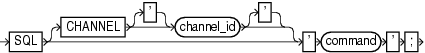

Purpose

Use the `SQL` command to execute a SQL statement or a PL/SQL stored procedure from within RMAN.

See Also:

[Oracle Database SQL Language Reference](https://docs.oracle.com/cd/E11882_01/server.112/e41084/toc.htm)

Prerequisites

None.

Syntax

sql::=



> **SQL {CHANNEL** \[‘\] *channel\_id* \[‘\] **}** *command*;
  

Semantics

| Syntax Element | Description |
| --- | --- |
| `CHANNEL` `channel_id` | Specifies the case-sensitive name of a channel to use when executing an RMAN command within a `RUN` command.  The channel must have been allocated using `ALLOCATE CHANNEL` in this `RUN` command. If you do not set this parameter, then RMAN uses the default channel. |
| `'` `command` `'` | Specifies a SQL statement for execution (see Example 3-51). `SELECT` statements are not permitted.  You must use duplicate single quotes to insert a single quote into a quoted string when the quoted string uses the same style of quoting. For example, if the string that RMAN passes to SQL contains a file name, then the file name must be enclosed in duplicate single quotes and the entire string following the `SQL` keyword must be enclosed in double quotes (see Example 3-52).  Note: Because `EXECUTE` is a SQL\*Plus command, you cannot execute a PL/SQL program unit by specifying `EXECUTE` within the RMAN `SQL` command. Instead, you must use the `BEGIN` and `END` keywords. For example, to execute the PL/SQL procedure `rman.rman_purge` with the `SQL` command, issue the following command:  ``` SQL 'BEGIN rman.rman_purge; END;'; ``` |

Examples

Example 3-51 Archiving the Unarchived Online Logs

This example backs up a tablespace and then archives all unarchived online redo logs.

```
BACKUP TABLESPACE users;
SQL "ALTER SYSTEM ARCHIVE LOG CURRENT";
```

Example 3-52 Specifying a File Name within a Quoted String

This example specifies a file name by using duplicate single quotes within the context of a double-quoted string.

```
SQL "ALTER TABLESPACE users ADD DATAFILE ''/disk1/oradata/users02.dbf'' 
  SIZE 100K AUTOEXTEND ON NEXT 10K MAXSIZE 100K";
```