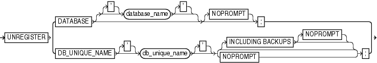

Purpose

Use the `UNREGISTER` command to remove the RMAN metadata for one or more registered databases from the recovery catalog.

See Also:

`DROP DATABASE` to learn how to delete a database and unregister it with one command

Prerequisites

Execute this command only at the RMAN prompt. RMAN must be connected to a recovery catalog. The database to unregister must be currently registered in this catalog.

Syntax

unregister::=



> **UNREGISTER** { **DATABASE** \[\['*\] database\_name* \['\]\] \[**NOPROMPT**\]; | **DB\_UNIQUE\_NAME** \['\] *db\_unique\_name* \['\] {\[**INCLUDING** **BACKUPS** \[**NOPROMPT**\]\] | **NOPROMPT**) }
  

Semantics

| Syntax Element | Description |
| --- | --- |
| `DATABASE` | Specifies a primary database to be unregistered. RMAN unregisters the primary database and any of its associated standby databases (see Example 3-61).  If `database_name` is not specified, then RMAN must identify the database in one of the following ways:  - If RMAN is connected to a database as `TARGET`, then RMAN unregisters the target database and any associated standby databases. - If RMAN is not connected to a database as `TARGET`, or if the name of the `TARGET` database is not unique in the recovery catalog, then RMAN uses the value specified in the `SET` `DBID` command (see Example 3-62). RMAN unregisters all databases with this DBID. |
| `database_name` | Specifies the name of the primary database that you are unregistering.  This database name must be unique in the recovery catalog. Because the database name is unique, RMAN does not need to be connected to a target database or use the `SET` `DBID` command. |
| `DB_UNIQUE_NAME`   `db_unique_name` | Specifies the removal of all metadata except backup metadata for the Data Guard database specified by `db_unique_name`.  The specified database can be either a primary or standby database, although typically you use this clause to unregister a standby database (see Example 3-63).  You can use this clause only when RMAN is connected to a mounted or open target database or the `SET` `DBID` command has been run. Typically, the target database is not the database that you are unregistering. For example, you can connect as `TARGET` to `prod1` and use `DB_UNIQUE_NAME` to unregister `standby1`. The DBID used in `SET DBID` is the same for the primary database and its associated standby databases.  The backups of a database have the `DB_UNIQUE_NAME` associated with the backup file names in the recovery catalog. When a database is unregistered, the database name for these backup files is marked as `null`. You can associate a database name with these files by using the `CHANGE` `... RESET DB_UNIQUE_NAME` command. |
| `   INCLUDING BACKUPS` | Specifies that backup metadata should also be removed for the database specified by `db_unique_name`.  Note: Physical backups are not be deleted by the `UNREGISTER` command. If you want the physical backups removed, then first remove them with the `DELETE` command and then execute `UNREGISTER` with the `INCLUDING BACKUPS` option. |
| `   NOPROMPT` | Does not prompt for confirmation before unregistering the database. |

Example

Example 3-61 Unregistering a Primary Database and Its Standby Databases

Assume that primary database `prod` has associated standby databases `dgprod3` and `dgprod4`. In this example, you connect RMAN to target database `prod`, whose database name is unique in the recovery catalog, and unregister it. RMAN removes all metadata about `prod`, `dgprod3`, and `dgprod4` from the catalog. Sample output is included.

```
RMAN> CONNECT TARGET /

connected to target database: PROD (DBID=1627709917)

RMAN> CONNECT CATALOG rman@catdb

recovery catalog database Password: password
connected to recovery catalog database

RMAN> UNREGISTER DATABASE NOPROMPT;
 
database name is "PROD" and DBID is 1627709917
database unregistered from the recovery catalog
 
RMAN> LIST DB_UNIQUE_NAME ALL;

RMAN>
```

Example 3-62 Unregistering a Database That is Not Unique in Catalog

Assume that two databases registered in a recovery catalog have the name `prod`. Your goal is to unregister the `prod` database that has the DBID `28014364`. Because multiple databases called `prod` are registered in the recovery catalog, and because RMAN is not connected as `TARGET` to the `28014364` database (which has been deleted from the file system), you run `SET` `DBID` before `UNREGISTER DATABASE`. This example includes sample output.

```
RMAN> CONNECT CATALOG rman@catdb

recovery catalog database Password: password
connected to recovery catalog database

RMAN> SET DBID 28014364;

executing command: SET DBID
database name is "PROD" and DBID is 28014364
 
RMAN> UNREGISTER DATABASE;

Do you really want to unregister the database (enter YES or NO)? YES
database unregistered from the recovery catalog
```

Example 3-63 Unregistering a Standby Database

Assume that primary database `prod` has associated standby databases `dgprod3` and `dgprod4`. You want to unregister `dgprod4`, but not remove the metadata for backups taken on this database because these backups are still usable by other databases in the environment. This example uses `SET` `DBID` to specify the DBID of the standby database and then unregisters it (sample output included):

```
RMAN> CONNECT CATALOG rman@catdb

recovery catalog database Password: password
connected to recovery catalog database

RMAN> SET DBID 1627367554;

executing command: SET DBID
database name is "PROD" and DBID is 1627367554

RMAN>  UNREGISTER DB_UNIQUE_NAME dgprod4;

database db_unique_name is "dgprod4", db_name is "PROD" and DBID is 1627367554

Want to unregister the database with target db_unique_name (enter YES or NO)? YES
database with db_unique_name dgprod4 unregistered from the recovery catalog
```