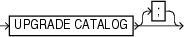

Purpose

Use the `UPGRADE CATALOG` command to upgrade a recovery catalog schema from an older version to the version required by the RMAN client.

Prerequisites

RMAN must be connected to the recovery catalog database, which must be open, as the owner of the recovery catalog. You cannot use the `UPGRADE CATALOG` command while connected to a virtual private catalog (see `CREATE CATALOG` command). Only the base catalog can be upgraded.

The recovery catalog must not be at a version greater than needed by the RMAN executable; otherwise, RMAN issues an error. RMAN displays all error messages generated during the upgrade in the message log.

The Oracle Database 10gR1 version of the recovery catalog schema requires the `CREATE TYPE` privilege. If you created the recovery catalog owner in a release before 10gR1, and if you granted the `RECOVERY_CATALOG_OWNER` role to this user when the role did not include the `CREATE TYPE` privilege, then you must grant `CREATE TYPE` to this user explicitly before performing the upgrade.

Usage Notes

You must enter the `UPGRADE CATALOG` command two consecutive times to confirm the upgrade.

RMAN permits the command to be run when the recovery catalog is current so that the packages can be re-created if necessary.

If an upgrade to a base recovery catalog requires changes to an existing virtual private catalog, then RMAN makes these changes automatically the next time RMAN connects to that virtual private catalog.

The `UPGRADE CATALOG` command does not run scripts to perform an upgrade. Instead, RMAN sends various SQL DDL statements to the recovery catalog to update the recovery catalog schema with new tables, views, columns, and so on.

Syntax

upgradeCatalog::=



> **UPGRADE CATALOG;**
  

Semantics

None.

Example

Example 3-64 Upgrading a Recovery Catalog

This example connects RMAN to recovery catalog database `catdb` and then upgrades it to a more current version:

```
RMAN> CONNECT CATALOG rco@catdb

recovery catalog database Password: password
connected to recovery catalog database 
PL/SQL package rman.DBMS_RCVCAT version 10.01.00 in RCVCAT database is too old

RMAN> UPGRADE CATALOG;

recovery catalog owner is RCO 
enter UPGRADE CATALOG command again to confirm catalog upgrade 

RMAN> UPGRADE CATALOG;

recovery catalog upgraded to version 11.01.00
DBMS_RCVMAN package upgraded to version 11.01.00
DBMS_RCVCAT package upgraded to version 11.01.00
```