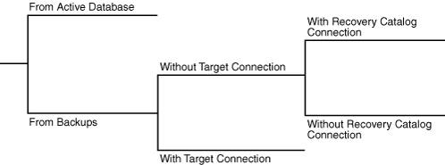
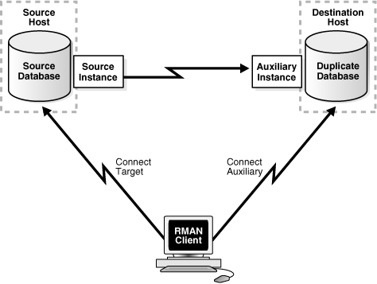
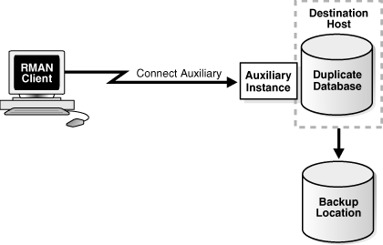
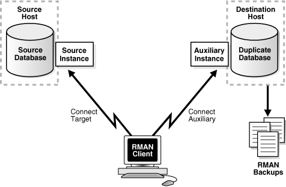

## 24 Duplicating a Database

This chapter describes how to use the `DUPLICATE` command to create an independently functioning database copy.

This chapter contains the following topics:

## Overview of RMAN Database Duplication

Database duplication is the use of the `DUPLICATE` command to copy all or a subset of the data in a source database. The [duplicate database](glossary.md) (the copied database) functions entirely independently from the [source database](glossary.md) (the database being copied).

### Purpose of Database Duplication

A duplicate database is useful for a variety of purposes, most of which involve testing. You can perform the following tasks in a duplicate database:

- Test backup and recovery procedures
- Test an upgrade to a new release of Oracle Database
- Test the effect of applications on database performance
- Create a standby database
- Generate reports

For example, you can duplicate the production database on `host1` to `host2`, and then use the duplicate database on `host2` to practice restoring and recovering this database while the production database on `host1` operates as usual.

If you copy a database with operating system utilities instead of the `DUPLICATE` command, then the [DBID](glossary.md) of the copied database remains the same as the original database. To register the copy database in the same recovery catalog with the original, you must change the DBID with the DBNEWID utility (see [Oracle Database Utilities](https://docs.oracle.com/cd/E11882_01/server.112/e22490/toc.htm)). In contrast, the `DUPLICATE` command automatically assigns the duplicate database a different DBID so that it can be registered in the same recovery catalog as the source database.

The `DUPLICATE` command can create a fully functional copy of your database or a [physical standby database](glossary.md), which serves a very different purpose. A standby database is a copy of the primary database that you update continually with archived log files from the primary database. If the primary database is inaccessible, then you can fail over to the standby database, which becomes the new primary database. A database copy, however, cannot be used in this way: it is not intended for failover scenarios and does not support the various standby recovery and failover options.

See Also:

[Oracle Data Guard Concepts and Administration](https://docs.oracle.com/cd/E11882_01/server.112/e41134/rcmbackp.htm#SBYDB01500) to learn how to create a standby database with the `DUPLICATE` command

### Basic Concepts of Database Duplication

The [source host](glossary.md) is the computer that hosts the source database. The source database instance is the instance associated with the source database.

The [destination host](glossary.md) is the computer that hosts the duplicate database. The source host and destination host can be the same or different computers. The database instance associated with the duplicate database is called the [auxiliary instance](glossary.md).

Note:

Performing simultaneous database duplication operations using the same source database is not supported.

#### Techniques for Duplicating a Database

RMAN supports two basic types of duplication: active database duplication and backup-based duplication. RMAN can perform backup-based duplication with or without either of the following connections:

- Target
- Recovery catalog

A connection to both is required for active database duplication.

Figure 24-1 shows the decision tree for the two duplication techniques.

Figure 24-1 Duplication Techniques



> This graphic illustrates the decision tree for the RMAN duplication. The line on the left branches into the two lines, with the following labels: From Active Database and From Backups. The line labeled From Backups branches into two lines, with the following labels: Without Target Connection and With Target Connection. The line labeled Without Target Connection further branches into two lines, with the following labels: With Recovery Catalog Connection and Without Recovery Catalog Connection.
  

##### Active Database Duplication

In [active database duplication](glossary.md), RMAN connects as `TARGET` to the source database instance and as `AUXILIARY` to the auxiliary instance. RMAN copies the live source database over the network to the auxiliary instance, thereby creating the duplicate database. No backups of the source database are required. Figure 24-2 illustrates active database duplication.

Figure 24-2 Active Database Duplication



> This graphic illustrates active database duplication. The RMAN client is at the bottom of the graphic. At the top-right is the Duplicate Database, which resides on the Destination Host. The rectangle to the left of the duplicate database is labeled Auxiliary Instance. At the top-left is the Source Database, which resides on the Source Host. The rectangle labeled Source Instance is to the right of the source database.
>
> An arrow from the RMAN client to the Duplicate Database, labelled Connect Auxiliary, indicates that RMAN connects to the duplicate database AS AUXILIARY. The arrow from the RMAN client to the Source Database, labelled Connect Target, indicates that RMAN connects to the duplicate database AS TARGET. An arrow from the Source Instance to the Auxiliary Instance is labeled push-based active database duplication. The dotted line arrow from the Auxiliary Instance to the Source Instance is labelled pull-based active duplication.
  

##### Backup-Based Duplication

In [backup-based duplication](glossary.md), RMAN creates the duplicate database by using pre-existing RMAN backups and copies. This technique of duplication uses one of the following mutually exclusive subtechniques:

- Duplication without a target database connection, RMAN obtains metadata about backups from a recovery catalog.
- Duplication without a target database connection and without a recovery catalog. RMAN obtains metadata about where backups and copies reside from `BACKUP LOCATION`.
- Duplication with a target database connection. RMAN obtains metadata about backups from the target database control file or from the recovery catalog.

Figure 24-3 illustrates backup-based duplication without a target connection. RMAN connects to a recovery catalog database instance and the auxiliary instance. The destination host must have access to the RMAN backups required to create the duplicate database.

Figure 24-3 Backup-Based Duplication Without a Target Connection


> This graphic illustrates backup-based duplication without a target connection. The RMAN client is at the bottom of the graphic. At the top-right is the Duplicate Database, which resides on the Destination Host. The rectangle to the left of the duplicate database is labeled Auxiliary Instance. The Duplicate Database is connected through an arrow to the RMAN Backups, displayed below the database. At the top-left is the Recovery Catalog Database, which resides on the Recovery Catalog Host. The rectangle labeled Catalog Instance is to the right of the source database. An arrow from the RMAN client to the Duplicate Database, labelled Connect Auxiliary, indicates that RMAN connects to the duplicate database AS AUXILIARY. The arrow from the RMAN client to the Recovery Catalog Database, labelled Connect Catalog, indicates that RMAN connects to the recovery catalog database AS CATALOG.
  

Figure 24-4 illustrates backup-based duplication without connections to the target or to the recovery catalog database instance. RMAN connects to the auxiliary instance of the duplicate database on the destination host. A disk backup location containing all the backups or copies for duplication must be available to the destination host.

Figure 24-4 Backup-Based Duplication Without a Target Connection or Recovery Catalog Connection



> This graphic illustrates backup-based duplication without a target connection or recovery catalog connection. The RMAN client is on the left of the graphic. On the top-right is the Duplicate Database, which resides on the Destination Host. The rectangle to the left of the duplicate database is labeled Auxiliary Instance. On the bottom-right is the Backup Location.
>
> The arrow from the RMAN client to the Auxiliary Instance is labeled Connect Auxiliary. An arrow connects the Duplicate Database to the Backup Location.
  

Figure 24-5 illustrates backup-based duplication with a target connection. RMAN connects to the source database instance and the auxiliary instance. Optionally, RMAN can connect to a recovery catalog database (not shown in the figure). The destination host must have access to the RMAN backups required to create the duplicate database.

Figure 24-5 Backup-Based Duplication with a Target Connection



> This graphic illustrates backup-based duplication with a target connection. The RMAN client is at the bottom of the graphic. At the top-right is the Duplicate Database, which resides on the Destination Host. The rectangle to the left of the duplicate database is labeled Auxiliary Instance. Below the Duplicate Database are rectangles that are labeled RMAN Backups. The Duplicate Database is connected through an arrow to the RMAN Backups, displayed below the database. At the top-left is the Source Database, which resides on the source Host. The rectangle labeled Source Instance is to the right of the source database.
>
> An arrow from the RMAN client to the Duplicate Database, labelled Connect Auxiliary, indicates that RMAN connects to the duplicate database AS AUXILIARY. The arrow from the RMAN client to the Source Database, labelled Connect Target, indicates that RMAN connects to the recovery catalog database AS TARGET.
  

#### Contents of a Duplicate Database

A duplicate database can include the same contents as the source database or only a subset of the tablespaces in the source database. For example, you can use the `TABLESPACE` option to duplicate only specified tablespaces, or the `SKIP READONLY` option to exclude read-only tablespaces from the duplicate database.

#### How RMAN Duplicates a Database

For backup-based duplication, the principal work of the duplication is performed by the [auxiliary channel](glossary.md) s. These channels correspond to a server session on the auxiliary instance on the destination host. For active database duplication the primary work is performed by target channels.

RMAN must perform database point-in-time recovery, even when no explicit point in time is provided for duplication. Point-in-time recovery is required because the online redo log files in the source database are not backed up and cannot be applied to the duplicate database. The farthest point of recovery of the duplicate database is the most recent redo log file archived by the source database.

As part of the duplicating operation, RMAN automates the following steps:

1. Creates a default server parameter file for the auxiliary instance if the following conditions are true:
	- Duplication does not involve a standby database.
		- Server parameter files are not being duplicated.
		- The auxiliary instance was not started with a server parameter file.
2. Restores from backup or copies from active database the latest control file that satisfies the `UNTIL` clause requirements.
3. Mounts the restored or copied backup control file from the active database.
	Note:
	If the control file in the source database contains disabled threads, then these threads will also be disabled in the duplicate database.
4. Uses the RMAN repository to select the backups for restoring the data files to the auxiliary instance. This step applies to backup-based duplication.
5. Restores and copies the duplicate data files and recovers them with incremental backups and archived redo log files to a noncurrent point in time.
6. Shuts down and restarts the database instance in `NOMOUNT` mode.
7. Creates a new control file, which then creates and stores the new DBID in the data files.
8. Opens the duplicate database with the `RESETLOGS` option and creates the online redo log for the new database.

See Also:

The `DUPLICATE` entry in [Oracle Database Backup and Recovery Reference](https://docs.oracle.com/cd/E11882_01/backup.112/e10643/rcmsynta020.htm#RCMRF126) for a complete list of which files are copied to the duplicate database

### Basic Steps of Database Duplication

This section describes the basic steps of database duplication. Follow the link in each step for further instructions.

To duplicate a database:

1. Prepare for database duplication.
	See "Preparing to Duplicate a Database".
2. Start RMAN and connect to the necessary database instances.
	See "Starting RMAN and Connecting to Databases".
3. Place the source database in the proper state (if necessary).
	See "Placing the Source Database in the Proper State".
4. Configure RMAN channels (if necessary).
	See "Configuring RMAN Channels for Use in Duplication".
5. Perform the duplication.
	See "Duplicating a Database".

## Preparing to Duplicate a Database

Before duplicating the database, you must decide how to perform the duplication and then prepare the database environment, including the auxiliary database instance.

To prepare for duplication:

1. Choose a duplication technique.
	See "Step 1: Choosing a Duplication Technique".
	While duplicating an Oracle Real Application Clusters (Oracle RAC) database, set the `CLUSTER_DATABASE` initialization parameter on the auxiliary database to `FALSE`. This parameter can be reset to `TRUE` after the duplication completes.
2. Choose a strategy for naming the duplicate database files.
	See "Step 2: Choosing a Strategy for Naming Duplicate Files".
3. For a backup-based strategy, make the backups accessible to the auxiliary instance; otherwise, skip this step.
	See "Step 3: Making Backups Accessible to the Duplicate Instance".
4. Prepare remote access to databases.
	See "Step 4: Preparing Remote Access to Databases".
5. Prepare the auxiliary instance.
	See "Step 5: Creating an Initialization Parameter File and Starting the Auxiliary Instance".

### Step 1: Choosing a Duplication Technique

Your business requirements and the database environment determine which duplication technique is best for your situation. Consider the following questions:

- Are you familiar with the prerequisites for each duplication technique?
	Review the "Prerequisites" section of the `DUPLICATE` command entry in [Oracle Database Backup and Recovery Reference](https://docs.oracle.com/cd/E11882_01/backup.112/e10643/rcmsynta020.htm#RCMRF126) for a complete list. Some prerequisites are common to all duplication techniques, such as the following:
	- The source and duplicate databases must be on the same platform. The `DUPLICATE` command considers 32-bit and 64-bit versions of the same operating system as belonging to the same platform.
		- The `DUPLICATE` command requires at least one auxiliary channel to perform the work of the duplication on the auxiliary instance.
	Other prerequisites are specific and depend on the duplication technique. For example, active duplication requires that the source and auxiliary instances use the same password as the source database, whereas backup-based duplication without connections to the target database and recovery catalog requires only that all backups and database copies reside in a single location.
- Do backups of the source database already exist?
	The principal advantage of active database duplication is that it does not require source database backups. Active duplication copies mounted or online database files over a network to the auxiliary instance. One disadvantage of this technique is the negative performance effect on the network. Another disadvantage is that the source database is running processes required to transfer the files to the auxiliary host, thereby affecting the source database and production workload.
	If the source database backups already exist, and if the effect on the network is unacceptable, then backup-based duplication may be a better option. You can copy backups to temporary storage and transfer them manually to the destination host. If duplication is made with a connection to the target or the recovery catalog, then the backup files on the destination host must have the same file specification as they had on the source host. Otherwise, this is not a requirement.
- Is a recovery catalog available?
	If a recovery catalog exists, then you can perform backup-based duplication without connecting RMAN as `TARGET` to the source database. This technique is advantageous where network connections from the auxiliary host to the source database are restricted or prone to intermittent disruptions. In duplication without a `TARGET` connection, the source database is unaffected by the duplication.
- How much disk space is available on the destination host?
	The disk space on the destination host can be an issue when you perform duplication using disk backups. For example, if the source database is 1 terabyte (TB), and if you duplicate the database from disk backups without using shared disk or network file system (NFS), then you must have at least 2 terabytes (TB) of space available on the destination host. In some environments, manual transfer of backups is necessary because NFS performance is a bottleneck.
- Are the source and destination hosts connected by a LAN or a WAN?
	Performance of active database duplication is probably slower on a wide area network (WAN) than a local area network (LAN). If the performance degradation on a WAN is unacceptable, then backup-based duplication may be the only viable option.
- When do you plan to duplicate the database?
	If you must duplicate the database during a period of high user activity, then the loss of network throughput caused by active duplication may be a problem, making backup-based duplication a better choice. Also, in active database duplication the RMAN channels required for copying files to the auxiliary host can affect performance.

### Step 2: Choosing a Strategy for Naming Duplicate Files

When duplicating a database, RMAN generates names for the duplicate control files, data files, temp files, and online redo log files. Therefore, you must decide on a naming strategy for these files.

Oracle recommends the simplest duplication strategy, which is to configure the duplicate database to use the same names as the source database. Using the same names means that your environment meets the following requirements:

- If the source database uses ASM disk groups, then the duplicate database must use ASM disk groups with the same names.
- If the source database files are Oracle Managed Files, then the auxiliary instance must set `DB_FILE_CREATE_DEST` to the same directory location as the source database. Although the directories are the same on the source and destination hosts, Oracle Database chooses the relative names for the duplicate files.
- If this is an Oracle RAC environment, then you must use the same `ORACLE_SID` for both the source and destination hosts.
- If the names of the database files in the source database contain a path, then this path name must be the same in the duplicate database.

When you configure your environment as suggested, no additional configuration is required to name the duplicate files.

See Also:

["Specifying Alternative Names for Duplicate Database Files"](rcmdupad.md) for an explanation of the more complex strategy of using different names for the duplicate files

### Step 3: Making Backups Accessible to the Duplicate Instance

Note:

If you are performing active database duplication, then skip this section and proceed to "Step 4: Preparing Remote Access to Databases".

When duplicating with a target and recovery catalog or just a target connection, RMAN uses metadata in the RMAN repository to locate backups and archived redo log files needed for duplication. If RMAN is connected to a recovery catalog, then RMAN obtains the backup metadata from the catalog. If RMAN is not connected to a catalog, as may be the case when performing backup-based duplication with a target connection, then RMAN obtains metadata from the control file.

Unless you are duplicating without a connection to the target and to the recovery catalog, the names of the backups must be available with the same names recorded in the RMAN repository. Ensure that auxiliary channels on the destination host can access all data file backups and archived redo log files (required to restore and recover the duplicate database to the desired point in time). If not, duplication fails. The archived redo log files can be available either as image copies or backup sets.

Note:

The database backup need not have been generated with `BACKUP DATABASE`. You can mix full and incremental backups of individual data files, but a full backup of every data file is required.

#### Making SBT Backups Accessible to the Auxiliary Instance

The steps in this task are specific to your media manager configuration.

To make SBT backups accessible to the auxiliary instance:

1. If necessary, install media management software on the destination host.
2. Make the tapes with the backups accessible to the destination host. Typically, you do one of the following:
	- Physically move the tapes to a drive attached to the remote host.
		- Use a network-accessible tape server.
3. If necessary, inform the remote media management software about the existence of the tapes.

#### Making Disk Backups Accessible to the Auxiliary Instance

When you make disk backups accessible to the auxiliary instance, your strategy depends on whether or not you duplicate the database while connected to the target or recovery catalog. If you do not connect to the target or recovery catalog, then you must designate a `BACKUP LOCATION` for the duplication.

When you use a `BACKUP LOCATION`, the backups and copies can reside in a shared location or can be moved to the `BACKUP LOCATION` on the destination host. In the latter case, you do not need to preserve the name or the original path of the backup or copy. The location specified by the `BACKUP LOCATION` option must contain sufficient backup sets, image copies, and archived logs to restore all of the files being duplicated, and recover them to the desired point in time.

It is not required that all of the backups be from the same point in time, or that they all be backup sets, or all image copies. Data file backups can be supplied as either image copies or backup sets. Archived logs can be supplied either in their normal format or as backup sets of archived logs.

When you use backups from different points in time, the backup location must contain archived logs covering the time from the start of the oldest backup until the desired recovery point.

If the backup location contains backup files from multiple databases, then the `DATABASE` clause must specify the name of the database that is to be duplicated. If the backup location contains backup files from multiple databases having the same name, then the `DATABASE` clause must specify both the name and `DBID` of the database that is to be duplicated.

The source database's Fast Recovery Area is particularly well suited for use as a backup location because it almost always contains all of the files needed for the duplication. To use a Fast Recovery Area as a backup location, you can either remotely access it from the destination system, or copy its contents to the destination system.

When you are not using a `BACKUP LOCATION`, your strategy depends on the following mutually exclusive scenarios:

- Identical file systems for source and destination hosts
	This scenario is the simplest and Oracle recommends it. For example, assume that the backups of the source database are stored in `/dsk1/bkp`. In this case, you can make disk backups accessible to the destination host in either of these ways:
	- Manually transfer backups from the source host to an identical path in the destination host. For example, if the backups are in `/dsk1/bkp` on the source host, then use FTP to transfer them to `/dsk1/bkp` on the destination host.
		- Use NFS or shared disks and ensure that the same path is accessible in the destination host. For example, assuming the source host can access `/dsk1/bkp`, use NFS to mount `/dsk1/bkp` on the destination host and use `/dsk1/bkp` as the mount point name.
- Different file systems for source and destination hosts
	In this case you cannot use the same directory name on the destination host as you use on the source host. You have the following options:
	- You can use shared disk to make backups available. This section explains the shared disk technique.
		- You cannot use shared disk to make backups available. ["Making Disk Backups Accessible Without Shared Disk"](rcmdupad.md) explains this technique.

Assume that you have two hosts, `srchost` and `dsthost`, and access to NFS or shared disk. The database on `srchost` is called `srcdb`. The backups of `srcdb` reside in `/dsk1/bkp` on host `srchost`. The directory `/dsk1/bkp` is already in use on the destination host, but the directory `/dsk2/dup` is not in use in either host.

To transfer the backups from the source host to the destination host:

1. Create a backup storage directory in either the source or destination host.
	For this example, create backup directory `/dsk2/dup` on the destination host.
2. Mount the directory created in the previous step on the other host, ensuring that the directory and the mount point names are the same.
	For example, if you created `/dsk2/dup` on the destination host, then use NFS to mount this directory as `/dsk2/dup` on the source host.
3. Make the backups available in the new location on the destination host. You can use either of the following techniques:
	- Connect RMAN to the source database as `TARGET` and use the `BACKUP` command to back up the backups, as explained in ["Backing Up RMAN Backups"](rcmbckba.md). For example, use the `BACKUP COPY OF DATABASE` command to copy the backups in `/dsk1/bkp` on the source host to `/dsk2/dup` on the source host. In this case, RMAN automatically catalogs the backups in the new location.
		- Use an operating system utility to transfer the backups to the new location. For example, use FTP to transfer the backups from `/dsk1/bkp` on the source host to `/dsk2/dup` on the destination host, or use the `cp` command to copy the backups from `/dsk1/bkp` on the source host to `/dsk2/dup` on the source host. Afterward, connect RMAN to the source database as `TARGET` and use the `CATALOG` command to update the RMAN repository with the location of the manually transferred backups.

### Step 4: Preparing Remote Access to Databases

When a database must be accessed from another host, you must set up a password file and Oracle Net connectivity. Be aware of the potential security consequences of this type of setup.

#### Establishing Connectivity in Required Cases

To create a password file manually:

Follow the instructions in [Oracle Database Administrator's Guide](https://docs.oracle.com/cd/E11882_01/server.112/e25494/dba.htm#ADMIN10241) to create a password file.

The types of file names allowed for password files and the location of the password file are both platform specific and operating system-specific.

See Also:

- [Oracle Data Guard Concepts and Administration](https://docs.oracle.com/cd/E11882_01/server.112/e41134/rcmbackp.htm#SBYDB01500) to create a password file manually
- [Oracle Database Advanced Security Administrator's Guide](https://docs.oracle.com/cd/E11882_01/network.112/e40393/toc.htm)

To establish Oracle Net connectivity and set up a static listener:

Follow the instructions in [Oracle Database Net Services Administrator's Guide](https://docs.oracle.com/cd/E11882_01/network.112/e41945/gettingstart.htm#NETAG006) to configure a client for connection to a database and add static service information for the listener.

#### Creating a Password File for the Auxiliary Instance

You have the following options for creating a [password file](glossary.md) for the auxiliary instance on the destination host:

- Create the password file manually.
	There are additional requirements for the case of `DUPLICATE ... FROM ACTIVE DATABASE`. You must use the `SYS` user ID, and the password must match the password of the source database. You may want to create the password file with a single password so that you can start the auxiliary instance and enable the source database to connect to it.
- Specify the `PASSWORD FILE` option on the `DUPLICATE... FROM ACTIVE` DATABASE command.
	In this case, RMAN copies the source database password file to the destination host and overwrites any existing password file for the auxiliary instance. This technique is useful if the source database password file has multiple passwords that you want to make available on the duplicate database.

See Also:

[Oracle Database Administrator's Guide](https://docs.oracle.com/cd/E11882_01/server.112/e25494/toc.htm)

Note:

If you create a standby database with the `FROM ACTIVE DATABASE` option, then RMAN always copies the password file to the standby host.

### Step 5: Creating an Initialization Parameter File and Starting the Auxiliary Instance

The location and content of the initialization parameter file depend on your choice in "Step 2: Choosing a Strategy for Naming Duplicate Files". This section makes the following assumptions:

- You choose the recommended technique of using the same naming strategy for the source and destination hosts. Thus for Oracle RAC environments, you use the same `ORACLE_SID` for source and destination hosts.
- You create a text-based initialization parameter file for the auxiliary instance. See [Table 25-5, "Auxiliary Instance Initialization Parameters"](rcmdupad.md).
- The initialization parameter file is located in the operating system-specific default location of the host on which SQL\*Plus runs.
	For example, on Linux and UNIX the default initialization parameter file name is `ORACLE_HOME` `/dbs/init` `ORACLE_SID``.ora` and on Windows the file name is `ORACLE_HOME` `\database\init` `ORACLE_SID``.ora`.
- You plan to specify the `SPFILE` clause on the `DUPLICATE` command.
	The `DUPLICATE ... SPFILE` technique is easiest because during duplication RMAN automatically copies the server parameter file from the source database to the auxiliary instance or restores it from backup. If a server parameter file exists on the auxiliary instance, then RMAN overwrites it.

If you cannot meet the preceding requirements, then see ["Duplicating a Database When No Server Parameter File Exists"](rcmdupad.md).

To create an initialization parameter file and start the auxiliary instance:

1. Using a text editor, create an empty file for use as a text-based initialization parameter file.
2. Copy the initialization parameter file to the operating system-specific default location on the host where SQL\*Plus runs.
3. In the parameter file, set `DB_NAME` to an arbitrary value.
	`DB_NAME` is the only required initialization parameter. The following example shows a sample `DB_NAME` setting:
	```
	DB_NAME=somevalue
	```
4. If necessary, set other initialization parameters like those needed for Oracle RAC, and for connecting by using a user ID that has `SYSDBA` privileges through Oracle Net.
5. Start SQL\*Plus and connect to the auxiliary instance with SYSDBA privileges. Start the auxiliary instance in `NOMOUNT` mode (no `PFILE` parameter on the `STARTUP` command is necessary if the file is in the default location):
	```
	SQL> STARTUP NOMOUNT
	```

Note:

Ensure that the auxiliary instance is started with a text-based initialization parameter file and not a server parameter file. Do not create a control file or try to mount or open the auxiliary instance.

## Placing the Source Database in the Proper State

Note:

If you are performing backup-based duplication without a target connection, then skip to "Configuring RMAN Channels for Use in Duplication".

If RMAN is connected to the source database as `TARGET`, then the source database must be in the proper state for the duplication.

To ensure that the source database is in the proper state:

1. If the source database instance is not mounted or open, then mount or open it.
2. If you are performing active database duplication, then ensure that the following additional requirements are met:
	- If the source database is open, then archiving must be enabled.
		- If the source database is not open, then the database does not require instance recovery.

## Starting RMAN and Connecting to Databases

In this task, you must start the RMAN client and connect to the database instances required by the duplication technique chosen in "Step 1: Choosing a Duplication Technique". The RMAN client can be located on any host so long as it can connect to the necessary databases over the network.

To start RMAN and connect to the target and auxiliary instances:

1. Start the RMAN client on any host that can connect to the necessary database instances.
2. At the RMAN prompt, run `CONNECT` commands for the database instances required for your duplication technique:
	- For active database duplication, you must connect to the source database as `TARGET` and to the auxiliary instance as `AUXILIARY`. You must use the same `SYSDBA` password for both instances and must supply the net service name to connect to the `AUXILIARY` instance. A recovery catalog connection is optional.
		- For backup-based duplication without a target connection, you must connect to the auxiliary instance as `AUXILIARY` and the recovery catalog as `CATALOG`.
		- For backup-based duplication with a target connection, you must connect to the source database as `TARGET` and auxiliary instance as `AUXILIARY`. A recovery catalog is optional.
		- For backup-based duplication without target and recovery catalog connections, you must connect to the auxiliary instance as `AUXILIARY`.
	In the following example of active database duplication, a connection is established to three database instances, all using net service names:
	```
	RMAN> CONNECT TARGET SYS/sysdba@prod;    # source database
	connected to target database: PROD (DBID=39525561)
	RMAN> CONNECT AUXILIARY SYS/sysdba@dupdb; # duplicate database instance
	connected to auxiliary database: DUPDB (not mounted)
	RMAN> CONNECT CATALOG rman/rman@catdb;    # recovery catalog database
	connected to recovery catalog database
	```

## Configuring RMAN Channels for Use in Duplication

The channel on the auxiliary instance, not the source database instance, restores RMAN backups in backup-based duplication. The channel configuration depends on your duplication technique.

### Configuring Channels for Active Database Duplication

In active database duplication, you do not have to change your source database channel configuration or configure `AUXILIARY` channels. However, you may want to increase the parallelism setting of your source database disk channels so that RMAN copies files over the network in parallel.

See Also:

[Oracle Database Backup and Recovery Reference](https://docs.oracle.com/cd/E11882_01/backup.112/e10643/rcmsynta010.htm#RCMRF113) for information about the `CONFIGURE` command

### Configuring Channels for Backup-Based Duplication

RMAN can use the same channel configurations on the source database for duplication on the destination host. RMAN can use these configurations even if the source database channels do not specify the `AUXILIARY` option.

Note the following additional considerations:

- The channel type (`DISK` or `sbt`) of the auxiliary channel must match the backup media. In general, the more channels you allocate for disk backups, the faster the duplication. You cannot increase the speed of duplication after the disks reach their maximum read/write rate. For tape backups, limit the number of channels to the number of devices available.
- If the auxiliary channels need special parameters (for example, to point to a different media manager), then you can configure an automatic channel with the `AUXILIARY` option of the `CONFIGURE` command.
- When you perform duplication without a target connection and without a recovery catalog, only disk channels can be used. If no user-allocated channels are used, then only one channel initially restores the control file. After the control file is mounted, the number of allocated channels depends on the configuration in the restored control file.

## Duplicating a Database

This section describes the most basic procedure to duplicate a database. This section makes the following assumptions:

- You are duplicating the database to a remote host. The duplicate database files use the same names as the source database files.
	Note:
	When running the `DUPLICATE` command in this configuration, you must specify the `NOFILENAMECHECK` option on the `DUPLICATE` command. If you duplicate a database on the same host as the source database, then verify that `NOFILENAMECHECK` is not specified.
- You are duplicating the entire database. For other scenarios, see ["Duplicating a Subset of the Source Database Tablespaces"](rcmdupad.md).

To duplicate a database to a remote host with the same directory structure:

1. Ensure that you have completed Steps 1 through 4 in "Basic Steps of Database Duplication".
2. Run the `DUPLICATE` command.

Example 24-1 illustrates how to perform active duplication when the `SPFILE` clause is specified. `DUPLICATE` requires the `NOFILENAMECHECK` option because the source database files have the same names as the duplicate database files.

The `PASSWORD FILE` option specifies that RMAN should copy the password file to the destination host. RMAN automatically copies the server parameter file to the destination host, starts the auxiliary instance with the server parameter file, copies all necessary database files and archived redo logs over the network to the destination host, and recovers the database. Finally, RMAN opens the database with the `RESETLOGS` option to create the online redo log.

Example 24-1 Duplicating to a Host with the Same Directory Structure (Active)

```
DUPLICATE TARGET DATABASE TO dupdb
  FROM ACTIVE DATABASE
  PASSWORD FILE
  SPFILE
  NOFILENAMECHECK;
```

### Backup-Based Duplication Without a Target Connection: Example

In this variation of Example 24-1, RMAN does not use a `TARGET` connection to the source database. Example 24-2 creates a duplicate of the source database `prod` as it appeared in 2007 in a previous database incarnation. RMAN is not connected to the source database but must be connected to a recovery catalog because no `BACKUP LOCATION` is provided.

Example 24-2 Duplicating a Database to a Past Point in Time (Backup-Based)

```
DUPLICATE DATABASE prod DBID 8675309 TO dupdb
  UNTIL TIME "TO_DATE('11/01/2007', 'MM/DD/YYYY')"
  SPFILE
  NOFILENAMECHECK;
```

Note the following characteristics of Example 24-2:

- The `FROM ACTIVE DATABASE` clause is not specified. By not specifying this clause, you instruct RMAN to perform backup-based duplication.
- The `DBID` is specified because the source database name `prod` is not unique in the recovery catalog.
- `NOFILENAMECHECK` check is specified because it is necessary when the duplicate database files use the same names as the source database files.

Assume a variation in which you want to restore an [archival backup](glossary.md), which is all-inclusive in the sense that every file needed to restore and recover the database is included. The recommended technique for restoring an archival backup for testing is to create a temporary instance and use the `DUPLICATE` command. In this way, you avoid interfering with the source database.

In the `DUPLICATE` command you must specify the restore point that was created with the archival backup. You can only specify `TO RESTORE POINT` if RMAN is connected to a catalog, or to the source database when the restore point exists in the control file. Example 24-3 specifies restore point `TESTDB103107`.

Example 24-3 Using an Archival Backup for Backup-Based Duplication

```
DUPLICATE DATABASE prod DBID 8675309 TO dupdb
  TO RESTORE POINT TESTDB103107
  SPFILE
  NOFILENAMECHECK;
```

### Backup-Based Duplication with a Target Connection: Example

Assume a backup-based variation of Example 24-1 in which RMAN is connected as `TARGET` to the source database. Example 24-4 recovers the duplicate database to 1 week ago to view the data in the source database as it appeared then.

Example 24-4 Duplicating a Database to a Past Point in Time (Backup-Based)

```
DUPLICATE TARGET DATABASE TO dupdb
  SPFILE
  NOFILENAMECHECK
  UNTIL TIME 'SYSDATE-7';
```

Note the following characteristics of Example 24-4:

- The `FROM ACTIVE DATABASE` clause is not specified. By not specifying this clause, you instruct RMAN to perform backup-based duplication.
- The `NOFILENAMECHECK` option is specified because it is necessary when the duplicate database files use the same names as the source database files.

### Backup-Based Duplication Without a Target and a Recovery Catalog Connection: Example

In the variation of Example 24-1, shown in Example 24-5, RMAN does not use a `TARGET` connection to the source database or a `CATALOG` connection to a recovery catalog. All backup and copies necessary for duplication until November 11 of 2007 at 2:00 PM, including a control file backup or copy, have been placed under `/prod_backups`.

Example 24-5 Duplicating a Database Without a Target and Recovery Catalog Connection (Backup-Based)

```
DUPLICATE DATABASE TO dupdb
  UNTIL TIME "TO_DATE('11/01/2007 14:00:00', 'MM/DD/YYYY HH24:MI:SS')"
  SPFILE
  BACKUP LOCATION '/prod_backups'
  NOFILENAMECHECK;
```

Note the following characteristics of Example 24-5:

- The database name is not specified. By not specifying a database name with the `DATABASE` keyword, `DUPLICATE` obtains the database name and `DBID` from the backups. An error is displayed if backups for more than one database were found in the `BACKUP LOCATION`.
- Use of the `BACKUP LOCATION` clause identifies the type of duplication as backup-based with neither a target connection nor recovery catalog.
- The `UNTIL TIME` option is specified. It is the only `UNTIL` subclause permitted with the `BACKUP LOCATION` clause.
- The `NOFILENAMECHECK` option check is specified because it is necessary when the duplicate database files use the same names as the source database files.

Example 24-6 Duplicating a Database to a Past Point in Time (Backup-Based)

```
DUPLICATE TARGET DATABASE TO dupdb
  SPFILE
  NOFILENAMECHECK
  UNTIL TIME 'SYSDATE-7';
```

Note the following characteristics of Example 24-6:

- The `FROM ACTIVE DATABASE` clause is not specified. Omitting this clause instructs RMAN to perform backup-based duplication.
- The `NOFILENAMECHECK` option check is specified because it is necessary when the duplicate database files use the same names as the source database files.

## Restarting DUPLICATE After a Failure

RMAN automatically optimizes a `DUPLICATE` command that is a repeat of a previously failed `DUPLICATE` command. The repeat `DUPLICATE` command notices which data files were successfully copied earlier and does not copy them again. This applies to all forms of duplication, whether they are backup-based (with or without a target connection) or active database duplication. The automatic optimization of the `DUPLICATE` command can be especially useful when a failure occurs during the duplication of very large databases.

To restart a DUPLICATE operation:

1. Exit RMAN.
2. Start SQL\*Plus and connect to the auxiliary instance with `SYSDBA` or `SYSBACKUP` privilege. Start the auxiliary instance in `NOMOUNT` mode with the same `SPFILE` or `PFILE` specification that you used initially. If you omitted this specification initially, then omit it again here.
	This example starts the auxiliary instance using the parameters in `/home/my_pfile.ora`:
	```
	STARTUP FORCE PFILE=/home/my_pfile.ora
	```
3. Exit SQL\*Plus and start RMAN.
4. Connect to the same databases as initially.
5. Repeat the `DUPLICATE` command.

The second `DUPLICATE` operation:

- Locates the data files that were successfully duplicated by the initial `DUPLICATE` command.
- Displays a message similar to the following for each data file that it does not need to duplicate again:
	```
	RMAN-05560: Using previous duplicated file /oradata/new/data01.f for datafile 1 with checkpoint SCN of 1654665
	```
- Restores only the missing or incomplete data files, thereby avoiding recopying and restoring all the data files.

If you do not want RMAN to automatically recover from a failed `DUPLICATE` operation, specify the keyword `NORESUME` to disable the functionality. Using the keyword `NORESUME` in the first invocation of `DUPLICATE` prevents a subsequent `DUPLICATE` command for the new database from using this automatic optimization.