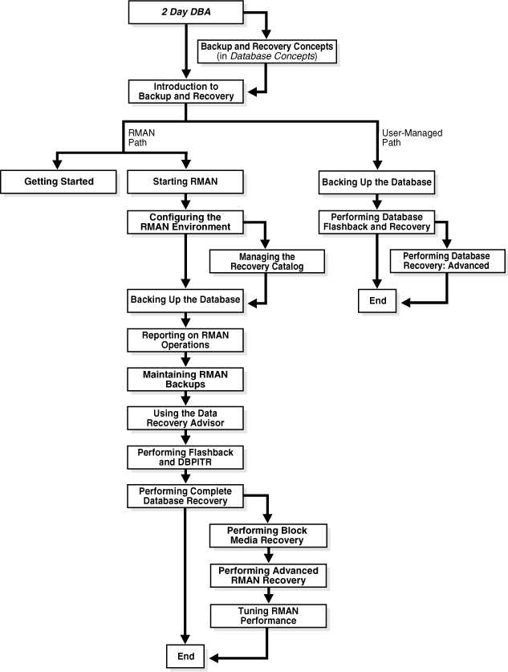

## 1 Introduction to Backup and Recovery

This chapter explains Oracle Database backup and recovery and summarizes the Oracle solutions. This chapter contains the following topics:

Note:

To get started with Recovery Manager (RMAN) right away, proceed to [Chapter 2, "Getting Started with RMAN."](rcmquick.md)

## Purpose of Backup and Recovery

As a backup administrator, your principal duty is to devise, implement, and manage a [backup and recovery](glossary.md) strategy. In general, the purpose of a backup and recovery strategy is to protect the database against data loss and reconstruct the database after data loss. Typically, backup administration tasks include the following:

- Planning and testing responses to different kinds of failures
- Configuring the database environment for backup and recovery
- Setting up a backup schedule
- Monitoring the backup and recovery environment
- Troubleshooting backup problems
- Recovering from data loss if the need arises

As a backup administrator, you may also be asked to perform other duties that are related to backup and recovery:

- Data preservation, which involves creating a database copy for long-term storage
- Data transfer, which involves moving data from one database or one host to another

The purpose of this manual is to explain how to perform the preceding tasks.

### Data Protection

As a backup administrator, your primary job is making and monitoring backups for data protection. A [backup](glossary.md) is a copy of data of a database that you can use to reconstruct data. A backup can be either a [physical backup](glossary.md) or a [logical backup](glossary.md).

Physical backups are copies of the physical files used in storing and recovering a database. These files include data files, control files, and archived redo logs. Ultimately, every physical backup is a copy of files that store database information to another location, whether on disk or on offline storage media such as tape.

Logical backups contain logical data such as tables and stored procedures. You can use Oracle Data Pump to export logical data to binary files, which you can later import into the database. The Data Pump command-line clients `expdp` and `impdp` use the `DBMS_DATAPUMP` and `DBMS_METADATA` PL/SQL packages.

Physical backups are the foundation of any sound backup and recovery strategy. Logical backups are a useful supplement to physical backups in many circumstances but are not sufficient protection against data loss without physical backups.

Unless otherwise specified, the term backup as used in the backup and recovery documentation refers to a physical backup. Backing up a database is the act of making a physical backup. The focus in the backup and recovery documentation set is almost exclusively on physical backups.

While several problems can halt the normal operation of an Oracle database or affect database I/O operations, only the following typically require DBA intervention and data recovery: [media failure](glossary.md), user errors, and application errors. Other failures may require DBA intervention without causing data loss or requiring recovery from backup. For example, you may need to restart the database after an instance failure or allocate more disk space after statement failure because of a full data file.

#### Media Failures

A media failure is a physical problem with a disk that causes a failure of a read from or write to a disk file that is required to run the database. Any database file can be vulnerable to a media failure. The appropriate recovery technique following a media failure depends on the files affected and the types of backup available.

One particularly important aspect of backup and recovery is developing a [disaster recovery](glossary.md) strategy to protect against catastrophic data loss, for example, the loss of an entire database host.

#### User Errors

User errors occur when, either due to an error in application logic or a manual mistake, data in a database is changed or deleted incorrectly. User errors are estimated to be the greatest single cause of database downtime.

Data loss due to user error can be either localized or widespread. An example of localized damage is deleting the wrong person from the employees table. This type of damage requires surgical detection and repair. An example of widespread damage is a batch job that deletes the company orders for the current month. In this case, drastic action is required to avoid a extensive database downtime.

While user training and careful management of privileges can prevent most user errors, your backup strategy determines how gracefully you recover the lost data when user error does cause data loss.

#### Application Errors

Sometimes a software malfunction can corrupt data blocks. In a [physical corruption](glossary.md), which is also called a media corruption, the database does not recognize the block at all: the [checksum](glossary.md) is invalid, the block contains all zeros, or the header and footer of the block do not match. If the corruption is not extensive, then you can often repair it easily with [block media recovery](glossary.md).

See Also:

- [Chapter 9, "Backing Up the Database"](rcmbckba.md)
- [Oracle Database Utilities](https://docs.oracle.com/cd/E11882_01/server.112/e22490/dp_overview.htm#SUTIL100) to learn how to use Data Pump

### Data Preservation

Data preservation is related to data protection, but serves a different purpose. For example, you may need to preserve a copy of a database as it existed at the end of a business quarter. This backup is not part of the disaster recovery strategy. The media to which these backups are written are often unavailable after the backup is complete. You may send the tape into fire storage or ship a portable hard drive to a testing facility. RMAN provides a convenient way to create a backup and exempt it from your [backup retention policy](glossary.md). This type of backup is known as an [archival backup](glossary.md).

See Also:

["Making Database Backups for Long-Term Storage"](rcmbckba.md)

### Data Transfer

In some situations you may need to take a backup of a database or database component and move it to another location. For example, you can use Recovery Manager (RMAN) to create a database copy, create a tablespace copy that can be imported into another database, or move an entire database from one platform to another. These tasks are not strictly speaking part of a backup and recovery strategy, but they do require the use of database backups, and so may be included in the duties of a backup administrator.

See Also:

The chapters in [Part I, "Transferring Data with RMAN"](part_tra.md)

## Oracle Backup and Recovery Solutions

When implementing a backup and recovery strategy, you have the following solutions available:

- [Recovery Manager (RMAN)](glossary.md)
	Recovery Manager is fully integrated with the Oracle database to perform a range of backup and recovery activities, including maintaining an [RMAN repository](glossary.md) of historical data about backups. You can access RMAN through the command line or through Oracle Enterprise Manager.
- User-managed backup and recovery
	In this solution, you perform backup and recovery with a mixture of host operating system commands and SQL\*Plus recovery commands.You are responsible for determining all aspects of when and how backups and recovery are done.

These solutions are supported by Oracle and are fully documented, but RMAN is the preferred solution for database backup and recovery. RMAN provides a common interface for backup tasks across different host operating systems, and offers several backup techniques not available through user-managed methods.

Most of this manual focuses on RMAN-based backup and recovery. User-managed backup and recovery techniques are covered in [Performing User-Managed Backup and Recovery.](part_umb.md) The most noteworthy are the following:

- Incremental backups
	An [incremental backup](glossary.md) stores only blocks changed since a previous backup. Thus, they provide more compact backups and faster recovery, thereby reducing the need to apply redo during [data file media recovery](glossary.md). If you enable [block change tracking](glossary.md), then you can improve performance by avoiding full scans of every input data file. You use the [`BACKUP INCREMENTAL`](https://docs.oracle.com/cd/E11882_01/backup.112/e10643/rcmsynta007.htm#RCMRF107) command to perform incremental backups.
- Block media recovery
	You can repair a data file with only a small number of corrupt data blocks without taking it offline or restoring it from backup. You use the [`RECOVER BLOCK`](https://docs.oracle.com/cd/E11882_01/backup.112/e10643/rcmsynta2001.htm#RCMRF140) command to perform [block media recovery](glossary.md).
- Binary compression
	A [binary compression](glossary.md) mechanism integrated into Oracle Database reduces the size of backups.
- Encrypted backups
	RMAN uses [backup encryption](glossary.md) capabilities integrated into Oracle Database to store backup sets in an encrypted format. To create encrypted backups on disk, the database must use the Advanced Security Option. To create encrypted backups directly on tape, RMAN must use the Oracle Secure Backup SBT interface, but does not require the Advanced Security Option.
- Automated database duplication
	Easily create a copy of your database, supporting various storage configurations, including direct duplication between ASM databases.
- Cross-platform data conversion

Whether you use RMAN or user-managed methods, you can supplement physical backups with logical backups of schema objects made with Data Pump Export utility. You can later use Data Pump Import to re-create data after restore and recovery. Logical backups are mostly beyond the scope of the backup and recovery documentation.

Table 1-1 summarizes the features of the different backup techniques.

Table 1-1 Feature Comparison of Backup Techniques

| Feature | Recovery Manager | User-Managed | Data Pump Export |
| --- | --- | --- | --- |
| Closed database backups | Supported. Requires instance to be mounted. | Supported. | Not supported. |
| Open database backups | Supported. No need to use `BEGIN` / `END` `BACKUP` statements. | Supported. Must use `BEGIN` / `END` `BACKUP` statements. | Requires rollback or undo segments to generate consistent backups. |
| Incremental backups | Supported. | Not supported. | Not supported. |
| Corrupt block detection | Supported. Identifies corrupt blocks and logs in `V$DATABASE_BLOCK_CORRUPTION`. | Not supported. | Supported. Identifies corrupt blocks in the export log. |
| Automatic specification of files to include in a backup | Supported. Establishes the name and locations of all files to be backed up (whole database, tablespaces, data files, control files, and so on). | Not supported. Files to be backed up must be located and copied manually. | Not applicable. |
| Backup repository | Supported. Backups are recorded in the control file, which is the main repository of RMAN metadata. Additionally, you can store this metadata in a [recovery catalog](glossary.md), which is a schema in a different database. | Not supported. DBA must keep own records of backups. | Not supported. |
| Backups to a media manager | Supported. Interfaces with a [media manager](glossary.md). RMAN also supports proxy copy, a feature that allows a media manager to manage completely the transfer of data between disk and backup media. | Supported. Backup to tape is manual or controlled by a media manager. | Not supported. |
| Backup of initialization parameter file | Supported. | Supported. | Not supported. |
| Backup of password and networking files | Not supported. | Supported. | Not supported. |
| Platform-independent language for backups | Supported. | Not supported. | Supported. |

## Oracle Flashback Technology

As explained in [Oracle Database Concepts](https://docs.oracle.com/cd/E11882_01/server.112/e40540/toc.htm), [Oracle Flashback Technology](glossary.md) complements your physical backup and recovery strategy. This set of features provides an additional layer of data protection. Specifically, you can use the various features of Oracle Flashback to view past states of data and rewind your database without restoring backups or performing [point-in-time recovery](glossary.md). In general, flashback features are more efficient and less disruptive than media recovery in most situations in which they apply.

### Logical Flashback Features

Most of the flashback features of Oracle operate at the logical level, enabling you to view and manipulate database objects. The logical-level flashback features of Oracle do not depend on RMAN and are available whether or not RMAN is part of your backup strategy. Except for Oracle Flashback Drop, the logical flashback features rely on undo data, which are records of the effects of each database update and the values overwritten in the update.

Oracle Database includes the following logical flashback features:

- Oracle Flashback Query
	You can specify a target time and run queries against a database, viewing results as they would have appeared at the target time. To recover from an unwanted change like an update to a table, you could choose a target time before the error and run a query to retrieve the contents of the lost rows. [Oracle Database Advanced Application Developer's Guide](https://docs.oracle.com/cd/E11882_01/appdev.112/e41502/adfns_flashback.htm#ADFNS1008) explains how to use this feature.
- Oracle Flashback Version Query
	You can view all versions of all rows that ever existed in one or more tables in a specified time interval. You can also retrieve metadata about the differing versions of the rows, including start and end time, operation, and transaction ID of the transaction that created the version. You can use this feature to recover lost data values and to audit changes to the tables queried. [Oracle Database Advanced Application Developer's Guide](https://docs.oracle.com/cd/E11882_01/appdev.112/e41502/adfns_flashback.htm#ADFNS1008) explains how to use this feature.
- Oracle Flashback Transaction Query
	You can view changes made by a single transaction, or by all the transactions during a specific time period. [Oracle Database Advanced Application Developer's Guide](https://docs.oracle.com/cd/E11882_01/appdev.112/e41502/adfns_flashback.htm#ADFNS1008) explains how to use this feature.
- Oracle Flashback Transaction
	You can reverse a transaction. Oracle Database determines the dependencies between transactions and in effect creates a compensating transaction that reverses the unwanted changes. The database rewinds to a state as if the transaction, and any transactions that could be dependent on it, had never happened. [Oracle Database Advanced Application Developer's Guide](https://docs.oracle.com/cd/E11882_01/appdev.112/e41502/adfns_flashback.htm#ADFNS1008) explains how to use this feature.
- Oracle Flashback Table
	You can recover a table or set of tables to a specified point in time in the past without taking any part of the database offline. In many cases, Flashback Table eliminates the need to perform more complicated point-in-time recovery operations. Flashback Table restores tables while automatically maintaining associated attributes such as current indexes, triggers, and constraints, and in this way enabling you to avoid finding and restoring database-specific properties. ["Rewinding a Table with Flashback Table"](rcmflash.md) explains how to use this feature.
- Oracle Flashback Drop
	You can reverse the effects of a `DROP` `TABLE` statement. ["Rewinding a DROP TABLE Operation with Flashback Drop"](rcmflash.md) explains how to use this feature.

A [flashback data archive](glossary.md) enables you to use some logical flashback features to access data from far back in the past. A flashback data archive consists of one or more tablespaces or parts of tablespaces. When you create a flashback data archive, you specify the name, retention period, and tablespace. You can also specify a default flashback data archive. The database automatically purges old historical data the day after the retention period expires.

You can turn flashback archiving on and off for individual tables. By default, flashback archiving is turned off for every table.

See Also:

- [Chapter 18, "Performing Flashback and Database Point-in-Time Recovery"](rcmflash.md) to learn how to perform Flashback Table and Flashback Drop
- [Oracle Database Advanced Application Developer's Guide](https://docs.oracle.com/cd/E11882_01/appdev.112/e41502/adfns_flashback.htm#ADFNS1008) for more information on the logical flashback features

### Flashback Database

At the physical level, [Oracle Flashback Database](glossary.md) provides a more efficient data protection alternative to [database point-in-time recovery (DBPITR)](glossary.md). If the current data files have unwanted changes, then you can use the RMAN command [`FLASHBACK DATABASE`](https://docs.oracle.com/cd/E11882_01/backup.112/e10643/rcmsynta023.htm#RCMRF194) to revert the data files to their contents at a past time. The end product is much like the result of a DBPITR, but is generally much faster because it does not require restoring data files from backup and requires less redo than media recovery.

Flashback Database uses [flashback logs](glossary.md) to access past versions of data blocks and some information from archived redo logs. Flashback Database requires that you configure a [fast recovery area](glossary.md) for a database because the flashback logs can only be stored there. Flashback logging is not enabled by default. Space used for flashback logs is managed automatically by the database and balanced against space required for other files in the fast recovery area.

Oracle Database also supports restore points along with Flashback Database and backup and recovery. A [restore point](glossary.md) is an alias corresponding to a [system change number (SCN)](glossary.md). You can create a restore point at any time if you anticipate needing to return part or all of a database to its contents at that time. A [guaranteed restore point](glossary.md) ensures that you can use Flashback Database to return a database to the time of the restore point.

See Also:

["Rewinding a Database with Flashback Database"](rcmflash.md) to learn how to perform Flashback Database with the [`FLASHBACK DATABASE`](https://docs.oracle.com/cd/E11882_01/backup.112/e10643/rcmsynta023.htm#RCMRF194) command

## Data Recovery Advisor

Oracle Database includes a [Data Recovery Advisor](glossary.md) tool that automatically diagnoses persistent data failures, presents appropriate repair options, and executes repairs at your request. Data Recovery Advisor provides a single point of entry for Oracle backup and recovery solutions. You can use Data Recovery Advisor through the Enterprise Manager Database Control or Grid Control console or through the RMAN command-line client.

A database failure usually manifests itself as a set of symptoms: error messages, alerts, trace files and dumps, and failed data integrity checks. Data Recovery Advisor automatically diagnoses and informs you of these failures. For Data Recovery Advisor, a [failure](glossary.md) is a persistent data corruption that can be directly mapped to a set of repair actions. Each failure has a status of open or closed. Each failure also has a priority of critical, high, or low.

Failures are detected by data integrity checks, which are diagnostic procedures executed to assess the health of the database or its components. If a [data integrity check](glossary.md) reveals a failure, then Data Recovery Advisor automatically assesses the effect of a set of failures and maps it to a set of repair options. Usually, Data Recovery Advisor presents both automated and manual repair options.

Data Recovery Advisor determines the best automated repair option and its effect on the database. The [repair option](glossary.md) may include repairs such as data file restore and recovery, media recovery, Flashback Database, and so on. Before presenting an automated repair option, Data Recovery Advisor validates it for the specific environment and the availability of media components required to complete the proposed repair.

If you choose an automated repair option, then RMAN coordinates sessions on the Oracle database to perform the [repair](glossary.md) for you. The Data Recovery Advisor tool verifies the repair success and closes the appropriate failures.

See Also:

[Chapter 15, "Diagnosing and Repairing Failures with Data Recovery Advisor,"](rcmrepai.md) to learn how to use Data Recovery Advisor

## Backup and Recovery Documentation Roadmap

Figure 1-1 illustrates the recommended way to navigate the backup and recovery documentation. The roadmap is divided into two main paths: RMAN and user-managed backup and recovery. Optional paths are shown as splitting off and then rejoining each main path.

If you are new to Oracle Database and want to learn about backup recovery, then the best entry point is [Oracle Database 2 Day DBA](https://docs.oracle.com/cd/E11882_01/server.112/e10897/backrest.htm#ADMQS009). The backup and recovery chapter explains how to use Enterprise Manager to perform basic operations. Optionally, you can expand your knowledge of basic backup and recovery principles by reading the relevant chapter in [Oracle Database Concepts](https://docs.oracle.com/cd/E11882_01/server.112/e40540/cncptdba.htm#CNCPT031).

Figure 1-1 Backup and Recovery Documentation Roadmap

> This graphic displays a flowchart of the RMAN documentation roadmap.
>
> [Copyright © 2003, 2015, Oracle and/or its affiliates. All rights reserved.](https://docs.oracle.com/cd/E11882_01/dcommon/html/cpyr.htm)
  

As shown in Figure 1-1, you can either implement your backup and recovery strategy with RMAN, which is recommended, or with user-managed tools.

### Recovery Manager Documentation Roadmap

If you use RMAN as your principal backup and recovery solution, then begin by reading ["Getting Started with RMAN"](rcmquick.md). This brief chapter, which explains the most basic RMAN techniques, may be adequate for your purposes. For a more comprehensive explanation of how to implement a backup and recovery strategy with RMAN, read the chapters in the following order (optional chapters are not listed):

1. Read [Chapter 4, "Starting and Interacting with the RMAN Client."](rcmcnctg.md)
	This chapter explains how to start the RMAN client and connect to databases.
2. Read [Chapter 5, "Configuring the RMAN Environment."](rcmconfb.md)
	This chapter explains how to perform basic tasks such as configuring a [fast recovery area](glossary.md), [backup retention policy](glossary.md), and [archived redo log deletion policy](glossary.md).
3. Read [Chapter 9, "Backing Up the Database."](rcmbckba.md)
	This chapter explains how to implement a basic backup strategy.
4. Read [Chapter 11, "Reporting on RMAN Operations."](rcmreprt.md)
	This chapter explains how to monitor RMAN backup and recovery operations. Specifically, the chapter explains how to use the reporting commands (`LIST`, `REPORT`, and `SHOW`) and the relevant V$ and recovery catalog views.
5. Read [Chapter 12, "Maintaining RMAN Backups and Repository Records."](rcmmaint.md)
	This chapter explains how to verify the existence of backups, change the repository status of backups, delete backups, and perform other maintenance tasks.
6. Read [Chapter 15, "Diagnosing and Repairing Failures with Data Recovery Advisor."](rcmrepai.md)
	This chapter explains how to use the Data Recovery Advisor tool. You can use it to list failures, obtain advice about to respond to these failures, and in some cases automatically repair the failures.
7. Read [Chapter 18, "Performing Flashback and Database Point-in-Time Recovery."](rcmflash.md)
	This chapter explains how to use the `FLASHBACK DATABASE` command and perform point-in-time recovery with the `RECOVER DATABASE` command.
8. Read [Chapter 17, "Performing Complete Database Recovery."](rcmcomre.md)
	This chapter explains how to recover individual tablespaces or the database.

### User-Managed Backup and Recovery Documentation Roadmap

If you do not use RMAN as your principal backup and recovery solution, then you must use third-party tools to make your backups and SQL or SQL\*Plus commands to perform recovery. Read the chapters in the following order:

1. Read [Chapter 28, "Making User-Managed Database Backups."](osbackup.md)
	This chapter explains how to make backups with third-party tools.
2. Read [Chapter 29, "Performing User-Managed Database Flashback and Recovery."](osrecvry.md)
	This chapter explains how to use the SQL statement `FLASHBACK DATABASE` and to perform recovery with the SQL\*Plus `RECOVER` command.
3. Read [Chapter 30, "Performing User-Managed Recovery: Advanced Scenarios."](osadvsce.md)
	This chapter explains various recovery scenarios.