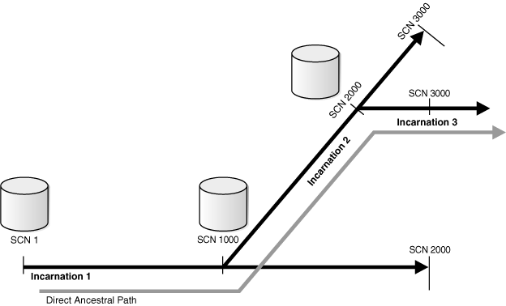

## 14 RMAN Data Repair Concepts

This chapter describes the general concepts that you must understand to perform [data repair](glossary.md). This chapter contains the following topics:

## Overview of RMAN Data Repair

As explained in ["Data Protection"](rcmintro.md), a principal purpose of a backup and recovery strategy is data protection. The key to an effective, efficient strategy is to understand the basic options of data repair.

### Problems Requiring Data Repair

While several problems can halt the normal operation of an Oracle database or affect database I/O operations, only the following typically require DBA intervention and data repair: user errors, application errors, and media failures.

#### User Errors

User errors occur when, either due to an error in application logic or a manual mistake, data in your database is changed or deleted incorrectly. For example, a user logs in to the wrong database and drops a database table. User errors are estimated to be the greatest single cause of database downtime.

#### Application Errors

Sometimes a software malfunction can corrupt data blocks. In a [physical corruption](glossary.md), which is also called a media corruption, the database does not recognize the block.

#### Media Failures

A [media failure](glossary.md) occurs when a problem external to the database prevents it from reading from or writing to a file during normal operations. Typical media failures include disk failures and the deletion of database files. Media failures are less common than user or application errors, but your backup and recovery strategy should prepare for them.

### RMAN Data Repair Techniques

Depending on the situations you anticipate, consider incorporating each of the following options into your strategy for responding to data loss, and then set up your database to make these options possible.

- [Data Recovery Advisor](glossary.md)
	This Oracle Database infrastructure can diagnose failures, advise you on how to respond to them, and repair the failures automatically.
	["Overview of Data Recovery Advisor"](rcmrepai.md) explains the basic concepts of Data Recovery Advisor.
- [logical flashback features](glossary.md)
	This subset of [Oracle Flashback Technology](glossary.md) features enables you to view or rewind individual database objects or transactions to a past time. These features do not require use of RMAN.
	["Overview of Oracle Flashback Technology and Database Point-in-Time Recovery"](rcmflash.md) explains the basic concepts of the logical flashback features and provides pointers where appropriate.
- [Oracle Flashback Database](glossary.md)
	Flashback Database is a block-level recovery mechanism that is similar to media recovery, but is generally faster and does not require a backup to be restored. You can return your whole database to a previous state without restoring old copies of your data files from backup, as long as you have enabled flashback logging in advance. You must have a fast recovery area configured for logging for flashback database or guaranteed restore points.
	["Basic Concepts of Point-in-Time Recovery and Flashback Features"](rcmflash.md) explains the basic concepts of Flashback Database.
- [data file media recovery](glossary.md)
	This form of [media recovery](glossary.md) enables you to restore data file backups and apply archived redo logs or incremental backups to recover lost changes. You can either recover a whole database or a subset of the database. Data file media recovery is the most general-purpose form of recovery and can protect against both physical and logical failures.
	The general concepts of data file media recovery are explained in this chapter. The techniques are described in [Chapter 17, "Performing Complete Database Recovery"](rcmcomre.md) and ["Performing Database Point-in-Time Recovery"](rcmflash.md).
- [block media recovery](glossary.md)
	This form of [media recovery](glossary.md) enables you to recover individual blocks within a data file rather than the whole data file.
	["Overview of Block Media Recovery"](rcmblock.md) explains the basic concepts of block media recovery.
- [tablespace point-in-time recovery (TSPITR)](glossary.md)
	This is a specialized form of [point-in-time recovery](glossary.md) in which you recover one or more tablespaces to a time earlier than the rest of the database.
	["Overview of RMAN TSPITR"](rcmtspit.md) explains the basic concepts of TSPITR.

In general, the concepts required to use the preceding repair techniques are explained along with the techniques. This chapter explains concepts that are common to several RMAN data repair solutions.

## RMAN Restore Operations

In an RMAN [restore](glossary.md) operation, you select files to be restored and then run the `RESTORE` command. Typically, you restore files in preparation for media recovery. You can restore the following types of files:

- Database (all datafiles)
- Tablespaces
- Control files
- Archived redo logs
- Server parameter files

You can specify either the default location or a new location for restored datafiles and control files. If you restore to the default location, then RMAN overwrites any files with the same name that currently exist in this location. Alternatively, you can use the `SET` `NEWNAME` command to specify new locations for restored datafiles. You can then run a `SWITCH` command to update the control file to indicate that the restored files in their new locations are now the current datafiles.

See Also:

[Oracle Database Backup and Recovery Reference](https://docs.oracle.com/cd/E11882_01/backup.112/e10643/rcmsynta2008.htm#RCMRF149) for `RESTORE` syntax and prerequisites, [Oracle Database Backup and Recovery Reference](https://docs.oracle.com/cd/E11882_01/backup.112/e10643/rcmsynta2014.htm#RCMRF153) for `SET` `NEWNAME` syntax, and [Oracle Database Backup and Recovery Reference](https://docs.oracle.com/cd/E11882_01/backup.112/e10643/rcmsynta2020.htm#RCMRF159) for `SWITCH` syntax

### Backup Selection

RMAN uses the records of available backup sets or image copies in the RMAN repository to select the best available backups for use in the restore operation. The most recent backup available, or the most recent backup satisfying any `UNTIL` clause specified in the `RESTORE` command, is the preferred choice. If two backups are from the same point in time, then RMAN prefers image copies over backup sets because RMAN can restore more quickly from image copies than from backup sets (especially those stored on tape).

All specifications of the `RESTORE` command must be satisfied before RMAN restores a backup. Unless limited by the `DEVICE` `TYPE` clause, the `RESTORE` command searches for backups on all device types of configured channels. If no available backup in the repository satisfies all the specified criteria, then RMAN returns an error indicating that the file cannot be restored.

If you use only manually allocated channels, then a backup job may fail if there is no usable backup on the media for which you allocated channels. Configuring automatic channels makes it more likely that RMAN can find and restore a backup that satisfies the specified criteria.

If backup sets are protected with [backup encryption](glossary.md), then RMAN automatically decrypts them when their contents are restored. Transparently encrypted backups require no intervention to restore, as long as the Oracle wallet is open and available. Password-encrypted backups require the correct password to be entered before they can be restored.

See Also:

["Configuring Advanced Channel Options"](rcmconfa.md)

### Restore Failover

RMAN automatically uses [restore failover](glossary.md) to skip corrupted or inaccessible backups and look for usable backups. When a backup is not found, or contains corrupt data, RMAN automatically looks for another backup from which to restore the desired files.

RMAN generates messages that indicate the type of failover that it is performing. For example, when RMAN fails over to another backup of the same file, it generates a message similar to the following:

```
failover to piece handle=/u01/backup/db_1 tag=BACKUP_031009
```

If no usable copies are available, then RMAN searches for previous backups. The message generated is similar to the following example:

```
ORA-19624: operation failed, retry possible
ORA-19505: failed to identify file "/u01/backup/db_1"
ORA-27037: unable to obtain file status
SVR4 Error: 2: No such file or directory
Additional information: 3
failover to previous backup
```

RMAN performs restore failover repeatedly until it has exhausted all possible backups. If all of the backups are unusable or no backups exists, then RMAN attempts to re-create the data file. Restore failover is also used when there are errors restoring archived redo logs during `RECOVER`, `RECOVER ... BLOCK`, and `FLASHBACK DATABASE` commands.

### About RMAN Restore Operations and ASM

When Automatic Storage Management (ASM) disk groups are used, an RMAN restore operation creates new copies of data files only if the full name of a data file, including the incarnation, does not match with the name of an existing data file. A fully qualified ASM file name is of the form `+diskgroup/dbname/filetype/filetypetag.file.incarnation`. When you first restore the control file and then restore the other database files, the names of the data files in the control file may not match with the names of the existing data files and therefore the data files are recreated.

Use one of the following methods to ensure that existing data files are not recreated during a restore or duplicate operation:

- In the control file, use alias names for each data file. The alias must not include the ASM incarnation number.
- After restoring the control file and before restoring the other database files, use the `CATALOG` command to ensure that the existing data files are cataloged in the restored control file. Next, use the `SWITCH` command to make the restored control file point to the existing data files.
- Use `SET NEWNAME` to rename the data files before restoring the data files and after restoring the control file.

### Restore Optimization

RMAN uses [restore optimization](glossary.md) to avoid restoring data files from backup when possible. If a data file is present in the correct location and its header contains the expected information, then RMAN does not restore the data file from backup.

Note:

Restore optimization only checks the data file header. It does not the scan the data file body for corrupted blocks.

You can use the `FORCE` option of the `RESTORE` command to override this behavior and restore the requested files unconditionally.

Restore optimization is particularly useful when an operation that restores several data files is interrupted. For example, assume that a full database restore encounters a power failure after all except one data file have been restored. If you run the same `RESTORE` command again, then RMAN only restores the single data file that was not restored during the previous attempt.

Restore optimization is also used when duplicating a database. If a data file at the duplicate is in the correct place with the correct header contents, then the data file is not duplicated. Unlike `RESTORE`, `DUPLICATE` does not support a `FORCE` option. To force RMAN to duplicate a data file that is skipped due to restore optimization, delete the data file from the duplicate before running the `DUPLICATE` command.

See Also:

[Oracle Real Application Clusters Administration and Deployment Guide](https://docs.oracle.com/cd/E11882_01/rac.112/e41960/backup.htm#RACAD059) for description of `RESTORE` behavior in an Oracle RAC configuration

## RMAN Media Recovery

In [media recovery](glossary.md), RMAN applies changes to restored data to roll forward this data in time. RMAN can perform either [data file media recovery](glossary.md) or [block media recovery](glossary.md).

Data file media recovery is the application of redo logs or incremental backups to a restored data file to update it to the current time or some other specified time. As explained in [Oracle Database Concepts](https://docs.oracle.com/cd/E11882_01/server.112/e40540/cncptdba.htm#CNCPT031), you can use RMAN to perform [complete recovery](glossary.md), [database point-in-time recovery (DBPITR)](glossary.md), or [tablespace point-in-time recovery (TSPITR)](glossary.md). You can use the `RESTORE` command to restore backups of lost and damaged data files or control files and the `RECOVER` command to perform media recovery.

Block media recovery is the recovery of individual data blocks rather than entire data files. This section explains data file media recovery only. Block media recovery, which is a specialized form of media recovery, is explained in ["Overview of Block Media Recovery"](rcmblock.md).

### Selection of Incremental Backups and Archived Redo Logs

RMAN automates media recovery. RMAN automatically restores and applies both incremental backups and archived redo logs in whatever combination is most efficient.

If the RMAN repository indicates that no copies of a required log sequence number exist on disk, then it automatically restores the required log from backup. By default, RMAN restores the archived logs to the fast recovery area, if an archiving destination is set to `USE_DB_RECOVERY_FILE_DEST`. Otherwise, RMAN restores the logs to the first local archiving destination specified in the initialization parameter file.

See Also:

[Oracle Database Backup and Recovery Reference](https://docs.oracle.com/cd/E11882_01/backup.112/e10643/rcmsynta015.htm#RCMRF119) for `CROSSCHECK` syntax

### Database Incarnations

A database [incarnation](glossary.md) is created whenever you open the database with the `RESETLOGS` option. After complete recovery, you can resume normal operations without an `OPEN` `RESETLOGS`. After a DBPITR or recovery with a backup control file, however, you must open the database with the `RESETLOGS` option, thereby creating a new incarnation of the database. The database requires a new incarnation to avoid confusion when two different redo streams have the same SCNs, but occurred at different times. If you apply the wrong redo to your database, then you corrupt it.

The existence of multiple incarnations of a single database determines how RMAN treats backups that are not in the current incarnation path. Usually, the current database incarnation is the correct one to use. Nevertheless, in some cases resetting the database to a previous incarnation is the best approach. For example, you may be dissatisfied with the results of a point-in-time recovery that you have performed and want to return the database to a time before the `RESETLOGS`. An understanding of database incarnations is helpful to prepare for such situations.

#### OPEN RESETLOGS Operations

When you open the database with the `RESETLOGS` option, the database performs the following actions:

- Archives the current online redo logs (if they are accessible) and then erases the contents of the online redo logs and resets the log sequence number to 1.
	For example, if the current online redo logs are sequence 1000 and 1001 when you open `RESETLOGS`, then the database archives logs 1000 and 1001 and then resets the online redo logs to sequence 1 and 2.
- Creates the online redo log files if they do not currently exist.
- Initializes redo thread records and online redo log records in the control file to the beginning of the new database incarnation.
	More specifically, the database sets the redo thread status to closed, sets the current thread sequence in the redo thread records to 1, sets the thread checkpoint of each redo thread to the beginning of log sequence 1, chooses one redo log from each thread and initialize its sequence to 1, and so on.
- Updates all current datafiles and online redo logs and all subsequent archived redo logs with a new `RESETLOGS` `SCN` and time stamp.

Because the database does not apply an archived redo log to a data file unless the `RESETLOGS` `SCN` and time stamps match, the `RESETLOGS` requirement prevents you from corrupting data files with archived logs that are not from direct parent incarnations of the current incarnation. The relationship among incarnations is explained more fully in the following section.

In previous releases, it was recommended that you back up the database immediately after the `OPEN RESETLOGS`. Because you can now easily recover a pre- `RESETLOGS` backup like any other backup, making a new database backup is optional. To perform recovery through `RESETLOGS` you must have all archived logs generated after the most recent backup and at least one control file (current, backup, or created).

#### Relationship Among Database Incarnations

Database incarnations can stand in the following relationships to each other:

- The [current incarnation](glossary.md) is the one in which the database is currently operating.
- The incarnation from which the current incarnation branched following an `OPEN` `RESETLOGS` operation is the [parent incarnation](glossary.md) of the current incarnation.
- The parent of the parent incarnation is an [ancestor incarnation](glossary.md). Any parent of an ancestor incarnation is also an ancestor of the current incarnation.
- The [direct ancestral path](glossary.md) of the current incarnation begins with the earliest incarnation and includes only the branches to an ancestor of the current incarnation, the parent incarnation, or the current incarnation.

An incarnation number is used to uniquely tag and identify a stream of redo. Figure 14-1 illustrates a database that goes through several incarnations, each with a different incarnation number.

Figure 14-1 Database Incarnation History



> This illustration depicts the incarnation history of a database that goes through three incarnations. The incarnation history and the series of point-in-time recovery operations and RESETLOGS operations that creates the incarnation history is described in the text which follows.
>
> [Copyright © 2003, 2015, Oracle and/or its affiliates. All rights reserved.](https://docs.oracle.com/cd/E11882_01/dcommon/html/cpyr.htm)
  

Incarnation 1 of the database starts at SCN 1 and continues through SCN 1000 to SCN 2000. Suppose that at SCN 2000 in incarnation 1, you perform a point-in-time recovery back to SCN 1000, and then open the database with the `RESETLOGS` option. Incarnation 2 now begins at SCN 1000 and continues to SCN 3000. In this example, incarnation 1 is the parent of incarnation 2.

Suppose that at SCN 3000 in incarnation 2, you perform a point-in-time recovery to SCN 2000 and open the database with the `RESETLOGS` option. In this case, incarnation 2 is the parent of incarnation 3. Incarnation 1 is an ancestor of incarnation 3.

When DBPITR or Flashback Database has occurred in database, an SCN can refer to multiple points in time, depending on which incarnation is current. For example, SCN 1500 in Figure 14-1 could refer to an SCN in incarnation 1 or 2.

You can use the `RESET` `DATABASE` `TO` `INCARNATION` command to specify that SCNs are to be interpreted in the frame of reference of a specific database incarnation. The `RESET DATABASE TO INCARNATION` command is required when you use `FLASHBACK`, `RESTORE`, or `RECOVER` to return to an SCN in a noncurrent database incarnation. However, RMAN executes the `RESET DATABASE TO INCARNATION` command implicitly with Flashback, as explained in ["Resetting the Database Incarnation in the Recovery Catalog"](rcmcatdb.md).

See Also:

- ["Recovering the Database to an Ancestor Incarnation"](rcmflash.md)
- [Oracle Database Backup and Recovery Reference](https://docs.oracle.com/cd/E11882_01/backup.112/e10643/rcmsynta2007.htm#RCMRF148) for details about the `RESET` `DATABASE` command

#### Orphaned Backups

When a database goes through multiple incarnations, some backups can become [orphaned backups](glossary.md). Orphaned backups are backups created during incarnations of the database that are not in the direct ancestral path.

Assume the scenario shown in Figure 14-1. If incarnation 3 is the current incarnation, then the following backups are orphaned:

- All backups from incarnation 1 after SCN 1000
- All backups from incarnation 2 after SCN 2000

In contrast, the following backups are not orphaned because they are in the direct ancestral path:

- All backups from incarnation 1 before SCN 1000
- All backups from incarnation 2 before SCN 2000
- All backups from incarnation 3

You can use orphaned backups when you intend to restore the database to an SCN not in the direct ancestral path. RMAN can restore backups from parent and ancestor incarnations and recover to the current time, even across `OPEN RESETLOGS` operations, as long as a continuous path of archived logs exists from the earliest backups to the point to which you want to recover. If you restore a control file from an incarnation in which the changes represented in the backups had not been abandoned, then RMAN can also restore and recover orphaned backups.