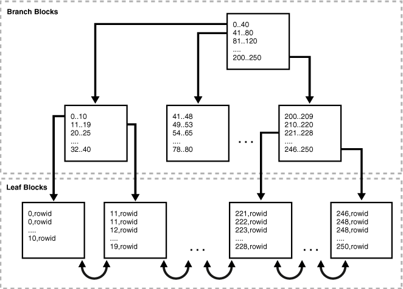
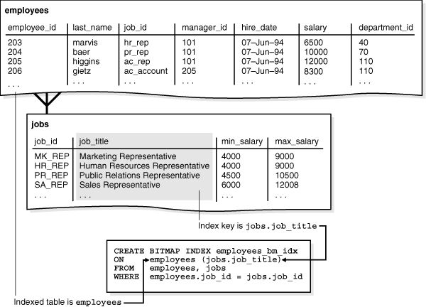
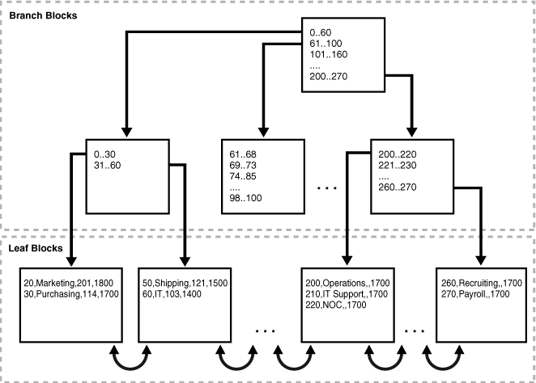
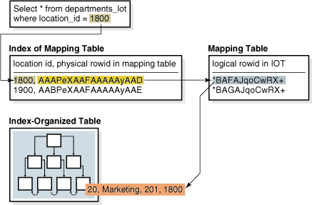

## 3 Indexes and Index-Organized Tables

This chapter discusses indexes, which are schema objects that can speed access to table rows, and index-organized tables, which are tables stored in an index structure.

This chapter contains the following sections:

- Overview of Indexes
- Overview of Index-Organized Tables

## Overview of Indexes

An index is an optional structure, associated with a table or [table cluster](glossary.md), that can sometimes speed data access. By creating an [index](glossary.md) on one or more columns of a table, you gain the ability in some cases to retrieve a small set of randomly distributed rows from the table. Indexes are one of many means of reducing disk I/O.

If a heap-organized table has no indexes, then the database must perform a [full table scan](glossary.md) to find a value. For example, without an index, a [query](glossary.md) of location `2700` in the `hr.departments` table requires the database to search every row in every table block for this value. This approach does not scale well as data volumes increase.

For an analogy, suppose an HR manager has a shelf of cardboard boxes. Folders containing employee information are inserted randomly in the boxes. The folder for employee Whalen (ID 200) is 10 folders up from the bottom of box 1, whereas the folder for King (ID 100) is at the bottom of box 3. To locate a folder, the manager looks at every folder in box 1 from bottom to top, and then moves from box to box until the folder is found. To speed access, the manager could create an index that sequentially lists every employee ID with its folder location:

```
ID 100: Box 3, position 1 (bottom)
ID 101: Box 7, position 8 
ID 200: Box 1, position 10
.
.
.
```

Similarly, the manager could create separate indexes for employee last names, department IDs, and so on.

In general, consider creating an index on a column in any of the following situations:

- The indexed columns are queried frequently and return a small percentage of the total number of rows in the table.
- A referential [integrity constraint](glossary.md) exists on the indexed column or columns. The index is a means to avoid a full table [lock](glossary.md) that would otherwise be required if you update the parent table [primary key](glossary.md), merge into the parent table, or delete from the parent table.
- A unique key constraint will be placed on the table and you want to manually specify the index and all index options.

See Also:

[Chapter 5, "Data Integrity"](datainte.md)

### Index Characteristics

Indexes are schema objects that are logically and physically independent of the data in the objects with which they are associated. Thus, an index can be dropped or created without physically affecting the table for the index.

Note:

If you drop an index, then applications still work. However, access of previously indexed data can be slower.

The absence or presence of an index does not require a change in the wording of any SQL statement. An index is a fast [access path](glossary.md) to a single row of data. It affects only the speed of execution. Given a data value that has been indexed, the index points directly to the location of the rows containing that value.

The database automatically maintains and uses indexes after they are created. The database also automatically reflects changes to data, such as adding, updating, and deleting rows, in all relevant indexes with no additional actions required by users. Retrieval performance of indexed data remains almost constant, even as rows are inserted. However, the presence of many indexes on a table degrades [DML](glossary.md) performance because the database must also update the indexes.

Indexes have the following properties:

- Usability
	Indexes are usable (default) or unusable. An unusable index is not maintained by DML operations and is ignored by the [optimizer](glossary.md). An unusable index can improve the performance of bulk loads. Instead of dropping an index and later re-creating it, you can make the index unusable and then rebuild it. Unusable indexes and index partitions do not consume space. When you make a usable index unusable, the database drops its index [segment](glossary.md).
- Visibility
	Indexes are visible (default) or invisible. An invisible index is maintained by DML operations and is not used by default by the optimizer. Making an index invisible is an alternative to making it unusable or dropping it. Invisible indexes are especially useful for testing the removal of an index before dropping it or using indexes temporarily without affecting the overall application.

See Also:

- ["Overview of the Optimizer"](sqllangu.md)
- [Oracle Database 2 Day DBA](https://docs.oracle.com/cd/E11882_01/server.112/e10897/schema.htm#ADMQS083) and [Oracle Database Administrator's Guide](https://docs.oracle.com/cd/E11882_01/server.112/e25494/indexes.htm#ADMIN016) to learn how to manage indexes
- [Oracle Database Performance Tuning Guide](https://docs.oracle.com/cd/E11882_01/server.112/e41573/data_acc.htm#PFGRF004) to learn how to tune indexes

#### Keys and Columns

A key is a set of columns or [expressions](glossary.md) on which you can build an index. Although the terms are often used interchangeably, indexes and keys are different. Indexes are structures stored in the database that users manage using SQL statements. Keys are strictly a logical concept.

The following statement creates an index on the `customer_id` column of the sample table `oe.orders`:

```
CREATE INDEX ord_customer_ix ON orders (customer_id);
```

In the preceding statement, the `customer_id` column is the index key. The index itself is named `ord_customer_ix`.

Note:

Primary and unique keys automatically have indexes, but you might want to create an index on a [foreign key](glossary.md).

See Also:

[Oracle Database SQL Language Reference](https://docs.oracle.com/cd/E11882_01/server.112/e41084/statements_5012.htm#SQLRF01209) `CREATE INDEX` syntax and semantics

#### Composite Indexes

A composite index, also called a concatenated index, is an index on multiple columns in a table. Columns in a composite index should appear in the order that makes the most sense for the queries that will retrieve data and need not be adjacent in the table.

Composite indexes can speed retrieval of data for `SELECT` statements in which the `WHERE` clause references all or the leading portion of the columns in the composite index. Therefore, the order of the columns used in the definition is important. In general, the most commonly accessed columns go first.

For example, suppose an application frequently queries the `last_name`, `job_id`, and `salary` columns in the `employees` table. Also assume that `last_name` has high [cardinality](glossary.md), which means that the number of distinct values is large compared to the number of table rows. You create an index with the following column order:

```
CREATE INDEX employees_ix
   ON employees (last_name, job_id, salary);
```

Queries that access all three columns, only the `last_name` column, or only the `last_name` and `job_id` columns use this index. In this example, queries that do not access the `last_name` column do not use the index.

Note:

In some cases, such as when the leading column has very low cardinality, the database may use a skip scan of this index (see "Index Skip Scan").

Multiple indexes can exist for the same table if the permutation of columns differs for each index. You can create multiple indexes using the same columns if you specify distinctly different permutations of the columns. For example, the following SQL statements specify valid permutations:

```
CREATE INDEX employee_idx1 ON employees (last_name, job_id);
CREATE INDEX employee_idx2 ON employees (job_id, last_name);
```

See Also:

[Oracle Database Performance Tuning Guide](https://docs.oracle.com/cd/E11882_01/server.112/e41573/data_acc.htm#PFGRF94776) for more information about using composite indexes

#### Unique and Nonunique Indexes

Indexes can be unique or nonunique. Unique indexes guarantee that no two rows of a table have duplicate values in the key column or columns. For example, no two employees can have the same employee ID. Thus, in a unique index, one [rowid](glossary.md) exists for each data value. The data in the leaf blocks is sorted only by key.

Nonunique indexes permit duplicates values in the indexed column or columns. For example, the `first_name` column of the `employees` table may contain multiple `Mike` values. For a nonunique index, the rowid is included in the key in sorted order, so nonunique indexes are sorted by the index key and rowid (ascending).

Oracle Database does not index table rows in which all key columns are [null](glossary.md), except for bitmap indexes or when the cluster key column value is null.

#### Types of Indexes

Oracle Database provides several indexing schemes, which provide complementary performance functionality. The indexes can be categorized as follows:

- B-tree indexes
	These indexes are the standard index type. They are excellent for primary key and highly-selective indexes. Used as concatenated indexes, B-tree indexes can retrieve data sorted by the indexed columns. B-tree indexes have the following subtypes:
	- Index-organized tables
		An index-organized table differs from a heap-organized because the data is itself the index. See "Overview of Index-Organized Tables".
		- Reverse key indexes
		In this type of index, the bytes of the index key are reversed, for example, 103 is stored as 301. The reversal of bytes spreads out inserts into the index over many blocks. See "Reverse Key Indexes".
		- Descending indexes
		This type of index stores data on a particular column or columns in descending order. See "Ascending and Descending Indexes".
		- B-tree cluster indexes
		This type of index is used to index a table cluster key. Instead of pointing to a row, the key points to the block that contains rows related to the cluster key. See ["Overview of Indexed Clusters"](tablecls.md).
- Bitmap and bitmap join indexes
	In a bitmap index, an index entry uses a bitmap to point to multiple rows. In contrast, a B-tree index entry points to a single row. A bitmap join index is a bitmap index for the join of two or more tables. See "Bitmap Indexes".
- Function-based indexes
	This type of index includes columns that are either transformed by a function, such as the `UPPER` function, or included in an expression. B-tree or bitmap indexes can be function-based. See "Function-Based Indexes".
- Application domain indexes
	This type of index is created by a user for data in an application-specific domain. The physical index need not use a traditional index structure and can be stored either in the Oracle database as tables or externally as a file. See "Application Domain Indexes".

See Also:

[Oracle Database Performance Tuning Guide](https://docs.oracle.com/cd/E11882_01/server.112/e41573/data_acc.htm#PFGRF004) to learn about different index types

### B-Tree Indexes

B-trees, short for balanced trees, are the most common type of database index. A B-tree index is an ordered list of values divided into ranges. By associating a key with a row or range of rows, B-trees provide excellent retrieval performance for a wide range of queries, including exact match and range searches.

Figure 3-1 illustrates the structure of a B-tree index. The example shows an index on the `department_id` column, which is a foreign key column in the `employees` table.

Figure 3-1 Internal Structure of a B-tree Index



> The graphic is divided into two boxes with dotted borders, one on top of the other. The top is labeled "Branch Blocks" and the lower "Leaf Blocks." The graphic contains a tree of boxes. At the top is a box with the following values: 0..40, 41..90, and so on. Three arrows point to a second row of branch blocks. One block in this row has values 1..10, 11..19, 20..25, and so on. An adjacent block has values 41..48, 49..53, and so on. The last black has values 200..209, 210..220, and so on.
>
> The leftmost and rightmost blocks each has a pair of arrows pointing down. The leftmost arrow points to a leaf block containing the following values: 0,rowid, 0,rowid, 10,rowid, and so on. The block to the right contains the following values: 11,rowid, 11,rowid, and so on. The next block contains values: 221,rowid, 222,rowid, and so on. The rightmost block contains the following values: 246,rowid, 248,rowid, and so on. With the exception of the leftmost and rightmost block, each of the leaf blocks in the bottom row is linked by a double-headed arrow to the block on either side.
  

#### Branch Blocks and Leaf Blocks

A B-tree index has two types of blocks: branch blocks for searching and leaf blocks that store values. The upper-level branch blocks of a B-tree index contain index data that points to lower-level index blocks. In Figure 3-1, the root branch block has an entry `0-40`, which points to the leftmost block in the next branch level. This branch block contains entries such as `0-10` and `11-19`. Each of these entries points to a leaf block that contains key values that fall in the range.

A B-tree index is balanced because all leaf blocks automatically stay at the same depth. Thus, retrieval of any record from anywhere in the index takes approximately the same amount of time. The height of the index is the number of blocks required to go from the root block to a leaf block. The branch level is the height minus 1. In Figure 3-1, the index has a height of 3 and a branch level of 2.

Branch blocks store the minimum key prefix needed to make a branching decision between two keys. This technique enables the database to fit as much data as possible on each branch block. The branch blocks contain a pointer to the child block containing the key. The number of keys and pointers is limited by the block size.

The leaf blocks contain every indexed data value and a corresponding rowid used to locate the actual row. Each entry is sorted by (key, rowid). Within a leaf block, a key and rowid is linked to its left and right sibling entries. The leaf blocks themselves are also doubly linked. In Figure 3-1 the leftmost leaf block (`0-10`) is linked to the second leaf block (`11-19`).

Note:

Indexes in columns with character data are based on the binary values of the characters in the database character set.

#### Index Scans

In an index scan, the database retrieves a row by traversing the index, using the indexed column values specified by the statement. If the database scans the index for a value, then it will find this value in n I/Os where n is the height of the B-tree index. This is the basic principle behind Oracle Database indexes.

If a SQL statement accesses only indexed columns, then the database reads values directly from the index rather than from the table. If the statement accesses columns in addition to the indexed columns, then the database uses rowids to find the rows in the table. Typically, the database retrieves table data by alternately reading an index block and then a table block.

See Also:

[Oracle Database Performance Tuning Guide](https://docs.oracle.com/cd/E11882_01/server.112/e41573/optimops.htm#PFGRF94611) for detailed information about index scans

##### Full Index Scan

In a full index scan, the database reads the entire index in order. A full index scan is available if a [predicate](glossary.md) (`WHERE` clause) in the SQL statement references a column in the index, and in some circumstances when no predicate is specified. A full scan can eliminate sorting because the data is ordered by index key.

Suppose that an application runs the following query:

```
SELECT department_id, last_name, salary 
FROM   employees
WHERE  salary > 5000 
ORDER BY department_id, last_name;
```

Also assume that `department_id`, `last_name`, and `salary` are a composite key in an index. Oracle Database performs a full scan of the index, reading it in sorted order (ordered by department ID and last name) and filtering on the salary attribute. In this way, the database scans a set of data smaller than the `employees` table, which contains more columns than are included in the query, and avoids sorting the data.

For example, the full scan could read the index entries as follows:

```
50,Atkinson,2800,rowid
60,Austin,4800,rowid
70,Baer,10000,rowid
80,Abel,11000,rowid
80,Ande,6400,rowid
110,Austin,7200,rowid
.
.
.
```

##### Fast Full Index Scan

A fast full index scan is a full index scan in which the database accesses the data in the index itself without accessing the table, and the database reads the index blocks in no particular order.

Fast full index scans are an alternative to a [full table scan](glossary.md) when both of the following conditions are met:

- The index must contain all columns needed for the query.
- A row containing all nulls must not appear in the query result set. For this result to be guaranteed, at least one column in the index must have either:
	- A `NOT NULL` constraint
		- A predicate applied to it that prevents nulls from being considered in the query result set

For example, an application issues the following query, which does not include an `ORDER BY` clause:

```
SELECT last_name, salary
FROM   employees;
```

The `last_name` column has a not null constraint. If the last name and salary are a composite key in an index, then a fast full index scan can read the index entries to obtain the requested information:

```
Baida,2900,rowid
Zlotkey,10500,rowid
Austin,7200,rowid
Baer,10000,rowid
Atkinson,2800,rowid
Austin,4800,rowid
.
.
.
```

##### Index Range Scan

An index range scan is an ordered scan of an index that has the following characteristics:

- One or more leading columns of an index are specified in conditions. A condition specifies a combination of one or more expressions and logical (Boolean) [operators](glossary.md) and returns a value of `TRUE`, `FALSE`, or `UNKNOWN`.
- 0, 1, or more values are possible for an index key.

The database commonly uses an index range scan to access selective data. The [selectivity](glossary.md) is the percentage of rows in the table that the query selects, with 0 meaning no rows and 1 meaning all rows. Selectivity is tied to a query [predicate](glossary.md), such as `WHERE last_name LIKE 'A%'`, or a combination of predicates. A predicate becomes more selective as the value approaches 0 and less selective (or more unselective) as the value approaches 1.

For example, a user queries employees whose last names begin with `A`. Assume that the `last_name` column is indexed, with entries as follows:

```
Abel,rowid
Ande,rowid
Atkinson,rowid
Austin,rowid
Austin,rowid
Baer,rowid
.
.
.
```

The database could use a range scan because the `last_name` column is specified in the predicate and multiples rowids are possible for each index key. For example, two employees are named Austin, so two rowids are associated with the key `Austin`.

An index range scan can be bounded on both sides, as in a query for departments with IDs between 10 and 40, or bounded on only one side, as in a query for IDs over 40. To scan the index, the database moves backward or forward through the leaf blocks. For example, a scan for IDs between 10 and 40 locates the first index leaf block that contains the lowest key value that is 10 or greater. The scan then proceeds horizontally through the linked list of leaf nodes until it locates a value greater than 40.

##### Index Unique Scan

In contrast to an index range scan, an index unique scan must have either 0 or 1 rowid associated with an index key. The database performs a unique scan when a predicate references all of the columns in a `UNIQUE` index key using an equality operator. An index unique scan stops processing as soon as it finds the first record because no second record is possible.

As an illustration, suppose that a user runs the following query:

```
SELECT *
FROM   employees
WHERE  employee_id = 5;
```

Assume that the `employee_id` column is the primary key and is indexed with entries as follows:

```
1,rowid
2,rowid
4,rowid
5,rowid
6,rowid
.
.
.
```

In this case, the database can use an index unique scan to locate the rowid for the employee whose ID is 5.

##### Index Skip Scan

An index skip scan uses logical subindexes of a composite index. The database "skips" through a single index as if it were searching separate indexes. Skip scanning is beneficial if there are few distinct values in the leading column of a composite index and many distinct values in the nonleading key of the index.

The database may choose an index skip scan when the leading column of the composite index is not specified in a query predicate. For example, assume that you run the following query for a customer in the `sh.customers` table:

```
SELECT * FROM sh.customers WHERE cust_email = 'Abbey@company.com';
```

The `customers` table has a column `cust_gender` whose values are either `M` or `F`. Assume that a composite index exists on the columns (`cust_gender`, `cust_email`). Example 3-1 shows a portion of the index entries.

Example 3-1 Composite Index Entries

```
F,Wolf@company.com,rowid
F,Wolsey@company.com,rowid
F,Wood@company.com,rowid
F,Woodman@company.com,rowid
F,Yang@company.com,rowid
F,Zimmerman@company.com,rowid
M,Abbassi@company.com,rowid
M,Abbey@company.com,rowid
```

The database can use a skip scan of this index even though `cust_gender` is not specified in the `WHERE` clause.

In a skip scan, the number of logical subindexes is determined by the number of distinct values in the leading column. In Example 3-1, the leading column has two possible values. The database logically splits the index into one subindex with the key `F` and a second subindex with the key `M`.

When searching for the record for the customer whose email is `Abbey@company.com`, the database searches the subindex with the value `F` first and then searches the subindex with the value `M`. Conceptually, the database processes the query as follows:

```
SELECT * FROM sh.customers WHERE cust_gender = 'F' 
  AND cust_email = 'Abbey@company.com'
UNION ALL
SELECT * FROM sh.customers WHERE cust_gender = 'M'
  AND cust_email = 'Abbey@company.com';
```

See Also:

[Oracle Database Performance Tuning Guide](https://docs.oracle.com/cd/E11882_01/server.112/e41573/optimops.htm#PFGRF10105) to learn more about skip scans

##### Index Clustering Factor

The [index clustering factor](glossary.md) measures row order in relation to an indexed value such as employee last name. The more order that exists in row storage for this value, the lower the clustering factor.

The clustering factor is useful as a rough measure of the number of I/Os required to read an entire table by means of an index:

- If the clustering factor is high, then Oracle Database performs a relatively high number of I/Os during a large index range scan. The index entries point to random table blocks, so the database may have to read and reread the same blocks over and over again to retrieve the data pointed to by the index.
- If the clustering factor is low, then Oracle Database performs a relatively low number of I/Os during a large index range scan. The index keys in a range tend to point to the same data block, so the database does not have to read and reread the same blocks over and over.

The clustering factor is relevant for index scans because it can show:

- Whether the database will use an index for large range scans
- The degree of table organization in relation to the index key
- Whether you should consider using an index-organized table, partitioning, or table cluster if rows must be ordered by the index key

For example, assume that the `employees` table fits into two data blocks. Table 3-1 depicts the rows in the two data blocks (the ellipses indicate data that is not shown).

Table 3-1 Contents of Two Data Blocks in the Employees Table

| Data Block 1 | Data Block 2 |
| --- | --- |
| ``` 100   Steven    King       SKING    ...   156   Janette   King       JKING    ... 115   Alexander Khoo       AKHOO    ... . . . 116   Shelli    Baida      SBAIDA   ... 204   Hermann   Baer       HBAER    ... 105   David     Austin     DAUSTIN  ... 130   Mozhe     Atkinson   MATKINSO ... 166   Sundar    Ande       SANDE    ... 174   Ellen     Abel       EABEL    ... ``` | ``` 149   Eleni     Zlotkey    EZLOTKEY  ... 200   Jennifer  Whalen     JWHALEN   ... . . . 137   Renske    Ladwig     RLADWIG  ... 173   Sundita   Kumar      SKUMAR   ... 101   Neena     Kochar     NKOCHHAR ... ``` |

Rows are stored in the blocks in order of last name (shown in bold). For example, the bottom row in data block 1 describes Abel, the next row up describes Ande, and so on alphabetically until the top row in block 1 for Steven King. The bottom row in block 2 describes Kochar, the next row up describes Kumar, and so on alphabetically until the last row in the block for Zlotkey.

Assume that an index exists on the last name column. Each name entry corresponds to a rowid. Conceptually, the index entries would look as follows:

```
Abel,block1row1
Ande,block1row2
Atkinson,block1row3
Austin,block1row4
Baer,block1row5
.
.
.
```

Assume that a separate index exists on the employee ID column. Conceptually, the index entries might look as follows, with employee IDs distributed in almost random locations throughout the two blocks:

```
100,block1row50
101,block2row1
102,block1row9
103,block2row19
104,block2row39
105,block1row4
.
.
.
```

Example 3-2 queries the `ALL_INDEXES` view for the clustering factor for these two indexes. The clustering factor for `EMP_NAME_IX` is low, which means that adjacent index entries in a single leaf block tend to point to rows in the same data blocks. The clustering factor for `EMP_EMP_ID_PK` is high, which means that adjacent index entries in the same leaf block are much less likely to point to rows in the same data blocks.

Example 3-2 Clustering Factor

```
SQL> SELECT INDEX_NAME, CLUSTERING_FACTOR 
  2  FROM ALL_INDEXES 
  3  WHERE INDEX_NAME IN ('EMP_NAME_IX','EMP_EMP_ID_PK');
 
INDEX_NAME           CLUSTERING_FACTOR
-------------------- -----------------
EMP_EMP_ID_PK                       19
EMP_NAME_IX                          2
```

See Also:

[Oracle Database Reference](https://docs.oracle.com/cd/E11882_01/server.112/e40402/statviews_1109.htm#REFRN20088) to learn about `ALL_INDEXES`

#### Reverse Key Indexes

A reverse key index is a type of B-tree index that physically reverses the bytes of each index key while keeping the column order. For example, if the index key is `20`, and if the two bytes stored for this key in hexadecimal are `C1,15` in a standard B-tree index, then a reverse key index stores the bytes as `15,C1`.

Reversing the key solves the problem of contention for leaf blocks in the right side of a B-tree index. This problem can be especially acute in an Oracle Real Application Clusters (Oracle RAC) database in which multiple instances repeatedly modify the same block. For example, in an `orders` table the primary keys for orders are sequential. One instance in the cluster adds order 20, while another adds 21, with each instance writing its key to the same leaf block on the right-hand side of the index.

In a reverse key index, the reversal of the byte order distributes inserts across all leaf keys in the index. For example, keys such as 20 and 21 that would have been adjacent in a standard key index are now stored far apart in separate blocks. Thus, I/O for insertions of sequential keys is more evenly distributed.

Because the data in the index is not sorted by column key when it is stored, the reverse key arrangement eliminates the ability to run an index range scanning query in some cases. For example, if a user issues a query for order IDs greater than 20, then the database cannot start with the block containing this ID and proceed horizontally through the leaf blocks.

See Also:

[Oracle Database Performance Tuning Guide](https://docs.oracle.com/cd/E11882_01/server.112/e41573/design.htm#PFGRF94117) to learn about design considerations for reverse key indexes

#### Ascending and Descending Indexes

In an ascending index, Oracle Database stores data in ascending order. By default, character data is ordered by the binary values contained in each byte of the value, numeric data from smallest to largest number, and date from earliest to latest value.

For an example of an ascending index, consider the following SQL statement:

```
CREATE INDEX emp_deptid_ix ON hr.employees(department_id);
```

Oracle Database sorts the `hr.employees` table on the `department_id` column. It loads the ascending index with the `department_id` and corresponding rowid values in ascending order, starting with `0`. When it uses the index, Oracle Database searches the sorted `department_id` values and uses the associated rowids to locate rows having the requested `department_id` value.

By specifying the `DESC` keyword in the `CREATE INDEX` statement, you can create a descending index. In this case, the index stores data on a specified column or columns in descending order. If the index in Figure 3-1 on the `employees.department_id` column were descending, then the leaf blocking containing `250` would be on the left side of the tree and block with `0` on the right. The default search through a descending index is from highest to lowest value.

Descending indexes are useful when a query sorts some columns ascending and others descending. For an example, assume that you create a composite index on the `last_name` and `department_id` columns as follows:

```
CREATE INDEX emp_name_dpt_ix ON hr.employees(last_name ASC, department_id DESC);
```

If a user queries `hr.employees` for last names in ascending order (A to Z) and department IDs in descending order (high to low), then the database can use this index to retrieve the data and avoid the extra step of sorting it.

See Also:

- [Oracle Database Performance Tuning Guide](https://docs.oracle.com/cd/E11882_01/server.112/e41573/optimops.htm#PFGRF94617) to learn more about ascending and descending index searches
- [Oracle Database SQL Language Reference](https://docs.oracle.com/cd/E11882_01/server.112/e41084/statements_5012.htm#SQLRF53994) for descriptions of the `ASC` and `DESC` options of `CREATE INDEX`

#### Key Compression

Oracle Database can use [key compression](glossary.md) to compress portions of the primary key column values in a B-tree index or an index-organized table. Key compression can greatly reduce the space consumed by the index.

In general, index keys have two pieces, a grouping piece and a unique piece. Key compression breaks the index key into a prefix entry, which is the grouping piece, and a suffix entry, which is the unique or nearly unique piece. The database achieves compression by sharing the prefix entries among the suffix entries in an index block.

Note:

If a key is not defined to have a unique piece, then the database provides one by appending a rowid to the grouping piece.

By default, the prefix of a unique index consists of all key columns excluding the last one, whereas the prefix of a nonunique index consists of all key columns. For example, suppose that you create a composite index on the `oe.orders` table as follows:

```
CREATE INDEX orders_mod_stat_ix ON orders ( order_mode, order_status );
```

Many repeated values occur in the `order_mode` and `order_status` columns. An index block may have entries as shown in Example 3-3.

Example 3-3 Index Entries in Orders Table

```
online,0,AAAPvCAAFAAAAFaAAa
online,0,AAAPvCAAFAAAAFaAAg
online,0,AAAPvCAAFAAAAFaAAl
online,2,AAAPvCAAFAAAAFaAAm
online,3,AAAPvCAAFAAAAFaAAq
online,3,AAAPvCAAFAAAAFaAAt
```

In Example 3-3, the key prefix would consist of a concatenation of the `order_mode` and `order_status` values. If this index were created with default key compression, then duplicate key prefixes such as `online`,`0` and `online`,`2` would be compressed. Conceptually, the database achieves compression as shown in the following example:

```
online,0
AAAPvCAAFAAAAFaAAa
AAAPvCAAFAAAAFaAAg
AAAPvCAAFAAAAFaAAl
online,2
AAAPvCAAFAAAAFaAAm
online,3
AAAPvCAAFAAAAFaAAq
AAAPvCAAFAAAAFaAAt
```

Suffix entries form the compressed version of index rows. Each suffix entry references a prefix entry, which is stored in the same index block as the suffix entry.

Alternatively, you could specify a prefix length when creating a compressed index. For example, if you specified prefix length `1`, then the prefix would be `order_mode` and the suffix would be `order_status,rowid`. For the values in Example 3-3, the index would factor out duplicate occurrences of `online` as follows:

```
online
0,AAAPvCAAFAAAAFaAAa
0,AAAPvCAAFAAAAFaAAg
0,AAAPvCAAFAAAAFaAAl
2,AAAPvCAAFAAAAFaAAm
3,AAAPvCAAFAAAAFaAAq
3,AAAPvCAAFAAAAFaAAt
```

The index stores a specific prefix once per leaf block at most. Only keys in the leaf blocks of a B-tree index are compressed. In the branch blocks the key suffix can be truncated, but the key is not compressed.

See Also:

- [Oracle Database Administrator's Guide](https://docs.oracle.com/cd/E11882_01/server.112/e25494/tables.htm#ADMIN11692) to learn how to use compressed indexes
- [Oracle Database VLDB and Partitioning Guide](https://docs.oracle.com/cd/E11882_01/server.112/e25523/part_admin001.htm#VLDBG1111) to learn how to use key compression for partitioned indexes
- [Oracle Database SQL Language Reference](https://docs.oracle.com/cd/E11882_01/server.112/e41084/statements_5012.htm#SQLRF53999) for descriptions of the `key_compression` clause of `CREATE INDEX`

### Bitmap Indexes

In a bitmap index, the database stores a bitmap for each index key. In a conventional B-tree index, one index entry points to a single row. In a bitmap index, each index key stores pointers to multiple rows.

Bitmap indexes are primarily designed for data warehousing or environments in which queries reference many columns in an ad hoc fashion. Situations that may call for a bitmap index include:

- The indexed columns have low cardinality, that is, the number of distinct values is small compared to the number of table rows.
- The indexed table is either read-only or not subject to significant modification by DML statements.

For a data warehouse example, the `sh.customers` table has a `cust_gender` column with only two possible values: `M` and `F`. Suppose that queries for the number of customers of a particular gender are common. In this case, the `customers.cust_gender` column would be a candidate for a bitmap index.

Each bit in the bitmap corresponds to a possible rowid. If the bit is set, then the row with the corresponding rowid contains the key value. A mapping function converts the bit position to an actual rowid, so the bitmap index provides the same functionality as a B-tree index although it uses a different internal representation.

If the indexed column in a single row is updated, then the database [locks](glossary.md) the index key entry (for example, `M` or `F`) and not the individual bit mapped to the updated row. Because a key points to many rows, DML on indexed data typically locks all of these rows. For this reason, bitmap indexes are not appropriate for many [OLTP](glossary.md) applications.

See Also:

- [Oracle Database Performance Tuning Guide](https://docs.oracle.com/cd/E11882_01/server.112/e41573/data_acc.htm#PFGRF94788) to learn how to use bitmap indexes for performance
- [Oracle Database Data Warehousing Guide](https://docs.oracle.com/cd/E11882_01/server.112/e25554/indexes.htm#DWHSG8130) to learn how to use bitmap indexes in a data warehouse

#### Bitmap Indexes on a Single Table

Example 3-4 shows a query of the `sh.customers` table. Some columns in this table are candidates for a bitmap index.

Example 3-4 Query of customers Table

```
SQL> SELECT cust_id, cust_last_name, cust_marital_status, cust_gender
  2  FROM   sh.customers 
  3  WHERE  ROWNUM < 8 ORDER BY cust_id;
 
   CUST_ID CUST_LAST_ CUST_MAR C
---------- ---------- -------- -
         1 Kessel              M
         2 Koch                F
         3 Emmerson            M
         4 Hardy               M
         5 Gowen               M
         6 Charles    single   F
         7 Ingram     single   F
 
7 rows selected.
```

The `cust_marital_status` and `cust_gender` columns have low cardinality, whereas `cust_id` and `cust_last_name` do not. Thus, bitmap indexes may be appropriate on `cust_marital_status` and `cust_gender`. A bitmap index is probably not useful for the other columns. Instead, a unique B-tree index on these columns would likely provide the most efficient representation and retrieval.

Table 3-2 illustrates the bitmap index for the `cust_gender` column output shown in Example 3-4. It consists of two separate bitmaps, one for each gender.

Table 3-2 Sample Bitmap

| Value | Row 1 | Row 2 | Row 3 | Row 4 | Row 5 | Row 6 | Row 7 |
| --- | --- | --- | --- | --- | --- | --- | --- |
| `M` | 1 | 0 | 1 | 1 | 1 | 0 | 0 |
| `F` | 0 | 1 | 0 | 0 | 0 | 1 | 1 |

A mapping function converts each bit in the bitmap to a rowid of the `customers` table. Each bit value depends on the values of the corresponding row in the table. For example, the bitmap for the `M` value contains a `1` as its first bit because the gender is `M` in the first row of the `customers` table. The bitmap `cust_gender='M'` has a `0` for its the bits in rows 2, 6, and 7 because these rows do not contain `M` as their value.

Note:

Bitmap indexes can include keys that consist entirely of null values, unlike B-tree indexes. Indexing nulls can be useful for some SQL statements, such as queries with the aggregate function `COUNT`.

An analyst investigating demographic trends of the customers may ask, "How many of our female customers are single or divorced?" This question corresponds to the following SQL query:

```
SELECT COUNT(*) 
FROM   customers  
WHERE  cust_gender = 'F' 
AND    cust_marital_status IN ('single', 'divorced');
```

Bitmap indexes can process this query efficiently by counting the number of `1` values in the resulting bitmap, as illustrated in Table 3-3. To identify the customers who satisfy the criteria, Oracle Database can use the resulting bitmap to access the table.

Table 3-3 Sample Bitmap

| Value | Row 1 | Row 2 | Row 3 | Row 4 | Row 5 | Row 6 | Row 7 |
| --- | --- | --- | --- | --- | --- | --- | --- |
| `M` | 1 | 0 | 1 | 1 | 1 | 0 | 0 |
| `F` | 0 | 1 | 0 | 0 | 0 | 1 | 1 |
| `single` | 0 | 0 | 0 | 0 | 0 | 1 | 1 |
| `divorced` | 0 | 0 | 0 | 0 | 0 | 0 | 0 |
| `single` or `divorced`, and `F` | 0 | 0 | 0 | 0 | 0 | 1 | 1 |

Bitmap indexing efficiently merges indexes that correspond to several conditions in a `WHERE` clause. Rows that satisfy some, but not all, conditions are filtered out before the table itself is accessed. This technique improves response time, often dramatically.

#### Bitmap Join Indexes

A bitmap join index is a bitmap index for the [join](glossary.md) of two or more tables. For each value in a table column, the index stores the rowid of the corresponding row in the indexed table. In contrast, a standard bitmap index is created on a single table.

A bitmap join index is an efficient means of reducing the volume of data that must be joined by performing restrictions in advance. For an example of when a bitmap join index would be useful, assume that users often query the number of employees with a particular job type. A typical query might look as follows:

```
SELECT COUNT(*) 
FROM   employees, jobs 
WHERE  employees.job_id = jobs.job_id 
AND    jobs.job_title = 'Accountant';
```

The preceding query would typically use an index on `jobs.job_title` to retrieve the rows for `Accountant` and then the job ID, and an index on `employees.job_id` to find the matching rows. To retrieve the data from the index itself rather than from a scan of the tables, you could create a bitmap join index as follows:

```
CREATE BITMAP INDEX employees_bm_idx 
ON     employees (jobs.job_title) 
FROM   employees, jobs
WHERE  employees.job_id = jobs.job_id;
```

As illustrated in Figure 3-2, the index key is `jobs.job_title` and the indexed table is `employees`.

Figure 3-2 Bitmap Join Index



> This graphic shows a block labeled Employees and a white block labeled Jobs. The Jobs table contains the job\_id, job\_title, min\_salary, and max\_salary columns. The job\_title column is shaded. The Employees box is linked by a crow's foot to the Jobs table, with the fee on the Employees box. On the bottom right, a shaded box contains the CREATE BITMAP INDEX statement given in the preceding text. An arrow points from the Employees box to the ON line of the statement with the label: "Indexed table is employees." An arrow leads from the shaded box in Jobs to the (jobs.job\_title) part of the ON line.
  

Conceptually, `employees_bm_idx` is an index of the `jobs.title` column in the SQL query shown in Example 3-5 (sample output included). The `job_title` key in the index points to rows in the `employees` table. A query of the number of accountants can use the index to avoid accessing the `employees` and `jobs` tables because the index itself contains the requested information.

Example 3-5 Join of employees and jobs Tables

```
SELECT jobs.job_title AS "jobs.job_title", employees.rowid AS "employees.rowid"
FROM   employees, jobs
WHERE  employees.job_id = jobs.job_id
ORDER BY job_title;
 
jobs.job_title                      employees.rowid
----------------------------------- ------------------
Accountant                          AAAQNKAAFAAAABSAAL
Accountant                          AAAQNKAAFAAAABSAAN
Accountant                          AAAQNKAAFAAAABSAAM
Accountant                          AAAQNKAAFAAAABSAAJ
Accountant                          AAAQNKAAFAAAABSAAK
Accounting Manager                  AAAQNKAAFAAAABTAAH
Administration Assistant            AAAQNKAAFAAAABTAAC
Administration Vice President       AAAQNKAAFAAAABSAAC
Administration Vice President       AAAQNKAAFAAAABSAAB
.
.
.
```

In a data warehouse, the [join condition](glossary.md) is an equijoin (it uses the equality operator) between the primary key columns of the dimension tables and the foreign key columns in the fact table. Bitmap join indexes are sometimes much more efficient in storage than materialized join views, an alternative for materializing joins in advance.

See Also:

[Oracle Database Data Warehousing Guide](https://docs.oracle.com/cd/E11882_01/server.112/e25554/indexes.htm#DWHSG8140) for more information on bitmap join indexes

#### Bitmap Storage Structure

Oracle Database uses a B-tree index structure to store bitmaps for each indexed key. For example, if `jobs.job_title` is the key column of a bitmap index, then the index data is stored in one B-tree. The individual bitmaps are stored in the leaf blocks.

Assume that the `jobs.job_title` column has unique values `Shipping Clerk`, `Stock Clerk`, and several others. A bitmap index entry for this index has the following components:

- The job title as the index key
- A low rowid and high rowid for a range of rowids
- A bitmap for specific rowids in the range

Conceptually, an index leaf block in this index could contain entries as follows:

```
Shipping Clerk,AAAPzRAAFAAAABSABQ,AAAPzRAAFAAAABSABZ,0010000100
Shipping Clerk,AAAPzRAAFAAAABSABa,AAAPzRAAFAAAABSABh,010010
Stock Clerk,AAAPzRAAFAAAABSAAa,AAAPzRAAFAAAABSAAc,1001001100
Stock Clerk,AAAPzRAAFAAAABSAAd,AAAPzRAAFAAAABSAAt,0101001001
Stock Clerk,AAAPzRAAFAAAABSAAu,AAAPzRAAFAAAABSABz,100001
.
.
.
```

The same job title appears in multiple entries because the rowid range differs.

Assume that a session updates the job ID of one employee from `Shipping Clerk` to `Stock Clerk`. In this case, the session requires exclusive access to the index key entry for the old value (`Shipping Clerk`) and the new value (`Stock Clerk`). Oracle Database locks the rows pointed to by these two entries—but not the rows pointed to by `Accountant` or any other key—until the `UPDATE` commits.

The data for a bitmap index is stored in one [segment](glossary.md). Oracle Database stores each bitmap in one or more pieces. Each piece occupies part of a single [data block](glossary.md).

See Also:

["User Segments"](logical.md)

### Function-Based Indexes

You can create indexes on functions and expressions that involve one or more columns in the table being indexed. A function-based index computes the value of a function or expression involving one or more columns and stores it in the index. A function-based index can be either a B-tree or a bitmap index.

The function used for building the index can be an arithmetic expression or an expression that contains a SQL function, user-defined PL/SQL function, package function, or C callout. For example, a function could add the values in two columns.

See Also:

- [Oracle Database Administrator's Guide](https://docs.oracle.com/cd/E11882_01/server.112/e25494/indexes.htm#ADMIN11730) to learn how to create function-based indexes
- [Oracle Database Performance Tuning Guide](https://docs.oracle.com/cd/E11882_01/server.112/e41573/data_acc.htm#PFGRF94785) for more information about using function-based indexes
- [Oracle Database SQL Language Reference](https://docs.oracle.com/cd/E11882_01/server.112/e41084/statements_5012.htm#SQLRF53993) for restrictions and usage notes for function-based indexes

#### Uses of Function-Based Indexes

Function-based indexes are efficient for evaluating statements that contain functions in their `WHERE` clauses. The database only uses the function-based index when the function is included in a query. When the database processes `INSERT` and `UPDATE` statements, however, it must still evaluate the function to process the statement.

For example, suppose you create the following function-based index:

```
CREATE INDEX emp_total_sal_idx
  ON employees (12 * salary * commission_pct, salary, commission_pct);
```

The database can use the preceding index when processing queries such as Example 3-6 (partial sample output included).

Example 3-6 Query Containing an Arithmetic Expression

```
SELECT   employee_id, last_name, first_name, 
         12*salary*commission_pct AS "ANNUAL SAL"
FROM     employees
WHERE    (12 * salary * commission_pct) < 30000
ORDER BY "ANNUAL SAL" DESC;

EMPLOYEE_ID LAST_NAME                 FIRST_NAME           ANNUAL SAL
----------- ------------------------- -------------------- ----------
        159 Smith                     Lindsey                   28800
        151 Bernstein                 David                     28500
        152 Hall                      Peter                     27000
        160 Doran                     Louise                    27000
        175 Hutton                    Alyssa                    26400
        149 Zlotkey                   Eleni                     25200
        169 Bloom                     Harrison                  24000
```

Function-based indexes defined on the SQL functions `UPPER(``column_name``)` or `LOWER(``column_name``)` facilitate case-insensitive searches. For example, suppose that the `first_name` column in `employees` contains mixed-case characters. You create the following function-based index on the `hr.employees` table:

```
CREATE INDEX emp_fname_uppercase_idx 
ON employees ( UPPER(first_name) );
```

The `emp_fname_uppercase_idx` index can facilitate queries such as the following:

```
SELECT * 
FROM   employees
WHERE  UPPER(first_name) = 'AUDREY';
```

A function-based index is also useful for indexing only specific rows in a table. For example, the `cust_valid` column in the `sh.customers` table has either `I` or `A` as a value. To index only the `A` rows, you could write a function that returns a null value for any rows other than the `A` rows. You could create the index as follows:

```
CREATE INDEX cust_valid_idx
ON customers ( CASE cust_valid WHEN 'A' THEN 'A' END );
```

See Also:

- [Oracle Database Globalization Support Guide](https://docs.oracle.com/cd/E11882_01/server.112/e10729/ch5lingsort.htm#NLSPG294) for information about linguistic indexes
- [Oracle Database SQL Language Reference](https://docs.oracle.com/cd/E11882_01/server.112/e41573/stats.htm#PFGRF94739) to learn more about SQL functions

#### Optimization with Function-Based Indexes

The [optimizer](glossary.md) can use an index range scan on a function-based index for queries with expressions in `WHERE` clause. The range scan [access path](glossary.md) is especially beneficial when the predicate (`WHERE` clause) has low [selectivity](glossary.md). In Example 3-6 the optimizer can use an index range scan if an index is built on the expression `12*salary*commission_pct`.

A [virtual column](glossary.md) is useful for speeding access to data derived from expressions. For example, you could define virtual column `annual_sal` as `12*salary*commission_pct` and create a function-based index on `annual_sal`.

The optimizer performs expression matching by parsing the expression in a SQL statement and then comparing the expression trees of the statement and the function-based index. This comparison is case-insensitive and ignores blank spaces.

See Also:

- ["Overview of the Optimizer"](sqllangu.md)
- [Oracle Database Performance Tuning Guide](https://docs.oracle.com/cd/E11882_01/server.112/e41573/stats.htm#PFGRF003) for more information about gathering statistics
- [Oracle Database Administrator's Guide](https://docs.oracle.com/cd/E11882_01/server.112/e25494/tables.htm#ADMIN12494) to learn how to add virtual columns to a table

### Application Domain Indexes

An application domain index is a customized index specific to an application. Oracle Database provides extensible indexing to do the following:

- Accommodate indexes on customized, complex data types such as documents, spatial data, images, and video clips (see ["Unstructured Data"](cncptdev.md))
- Make use of specialized indexing techniques

You can encapsulate application-specific index management routines as an indextype schema object and define a domain index on table columns or attributes of an object type. Extensible indexing can efficiently process application-specific [operators](glossary.md).

The application software, called the cartridge, controls the structure and content of a domain index. The database interacts with the application to build, maintain, and search the domain index. The index structure itself can be stored in the database as an index-organized table or externally as a file.

See Also:

[Oracle Database Data Cartridge Developer's Guide](https://docs.oracle.com/cd/E11882_01/appdev.112/e10765/introduction.htm#ADDCI110) for information about using data cartridges within the Oracle Database extensibility architecture

### Index Storage

Oracle Database stores index data in an [index segment](glossary.md). Space available for index data in a [data block](glossary.md) is the data block size minus block overhead, entry overhead, rowid, and one length byte for each value indexed.

The [tablespace](glossary.md) of an index segment is either the default tablespace of the owner or a tablespace specifically named in the `CREATE INDEX` statement. For ease of administration you can store an index in a separate tablespace from its table. For example, you may choose not to back up tablespaces containing only indexes, which can be rebuilt, and so decrease the time and storage required for backups.

See Also:

[Chapter 12, "Logical Storage Structures"](logical.md)

## Overview of Index-Organized Tables

An index-organized table is a table stored in a variation of a B-tree index structure. In a [heap-organized table](glossary.md), rows are inserted where they fit. In an index-organized table, rows are stored in an index defined on the primary key for the table. Each index entry in the B-tree also stores the non-key column values. Thus, the index is the data, and the data is the index. Applications manipulate index-organized tables just like heap-organized tables, using SQL statements.

For an analogy of an index-organized table, suppose a human resources manager has a book case of cardboard boxes. Each box is labeled with a number—1, 2, 3, 4, and so on—but the boxes do not sit on the shelves in sequential order. Instead, each box contains a pointer to the shelf location of the next box in the sequence.

Folders containing employee records are stored in each box. The folders are sorted by employee ID. Employee King has ID 100, which is the lowest ID, so his folder is at the bottom of box 1. The folder for employee 101 is on top of 100, 102 is on top of 101, and so on until box 1 is full. The next folder in the sequence is at the bottom of box 2.

In this analogy, ordering folders by employee ID makes it possible to search efficiently for folders without having to maintain a separate index. Suppose a user requests the records for employees 107, 120, and 122. Instead of searching an index in one step and retrieving the folders in a separate step, the manager can search the folders in sequential order and retrieve each folder as found.

Index-organized tables provide faster access to table rows by primary key or a valid prefix of the key. The presence of non-key columns of a row in the leaf block avoids an additional [data block](glossary.md) I/O. For example, the salary of employee 100 is stored in the index row itself. Also, because rows are stored in primary key order, range access by the primary key or prefix involves minimal block I/Os. Another benefit is the avoidance of the space overhead of a separate primary key index.

Index-organized tables are useful when related pieces of data must be stored together or data must be physically stored in a specific order. This type of table is often used for information retrieval, spatial (see ["Overview of Oracle Spatial"](cncptdev.md)), and [OLAP](glossary.md) applications (see ["OLAP"](cmntopc.md)).

See Also:

- [Oracle Database Administrator's Guide](https://docs.oracle.com/cd/E11882_01/server.112/e25494/tables.htm#ADMIN01506) to learn how to manage index-organized tables
- [Oracle Database Performance Tuning Guide](https://docs.oracle.com/cd/E11882_01/server.112/e41573/data_acc.htm#PFGRF94787) to learn how to use index-organized tables to improve performance
- [Oracle Database SQL Language Reference](https://docs.oracle.com/cd/E11882_01/server.112/e41084/statements_7002.htm#SQLRF54492) for `CREATE TABLE ... ORGANIZATION INDEX` syntax and semantics

### Index-Organized Table Characteristics

The database system performs all operations on index-organized tables by manipulating the B-tree index structure. Table 3-4 summarizes the differences between index-organized tables and heap-organized tables.

Table 3-4 Comparison of Heap-Organized Tables with Index-Organized Tables

| Heap-Organized Table | Index-Organized Table |
| --- | --- |
| The [rowid](glossary.md) uniquely identifies a row. Primary key constraint may optionally be defined. | Primary key uniquely identifies a row. Primary key constraint must be defined. |
| Physical rowid in `ROWID` [pseudocolumn](glossary.md) allows building secondary indexes. | Logical rowid in `ROWID` pseudocolumn allows building secondary indexes. |
| Individual rows may be accessed directly by rowid. | Access to individual rows may be achieved indirectly by primary key. |
| Sequential [full table scan](glossary.md) returns all rows in some order. | A [full index scan](glossary.md) or fast full index scan returns all rows in some order. |
| Can be stored in a [table cluster](glossary.md) with other tables. | Cannot be stored in a table cluster. |
| Can contain a column of the `LONG` data type and columns of [LOB](glossary.md) data types. | Can contain LOB columns but not `LONG` columns. |
| Can contain [virtual columns](glossary.md) (only relational heap tables are supported). | Cannot contain virtual columns. |

Figure 3-3 illustrates the structure of an index-organized `departments` table. The leaf blocks contain the rows of the table, ordered sequentially by primary key. For example, the first value in the first leaf block shows a department ID of `20`, department name of `Marketing`, manager ID of `201`, and location ID of `1800`.

Figure 3-3 Index-Organized Table



> The graphic is divided into two boxes with dotted borders, one on top of the other. The top is labeled "Branch Blocks" and the lower "Leaf Blocks." The graphic contains a tree of boxes. At the top is a box with the following values: 0..60, 81..100, 101.160, and so on. Three arrows point to a second row of branch blocks. One block in this row has values 0..30 and 31..60. An adjacent block has values 61..68, 69..73, and so on. The last block has values 200..220, 221..230, and so on.
>
> The leftmost and rightmost blocks each has a pair of arrows pointing down. The leftmost arrow points to a leaf block containing the following values: "20,Marketing,201,1800" and "30,Purchasing,114,1700". The block to the right contains the following values: "50,Shipping,121,1500" and "60,IT,103,1400". The next block contains values: "200,Operations,,1700", "210,IT Support,,1700", and "220,NOC,1700". The rightmost block contains the following values: "260,Recruiting,,1700" and "270,Payroll,,1700". With the exception of the leftmost and rightmost block, each of the leaf blocks in the bottom row is linked by a double-headed arrow to the block on either side.
  

An index-organized table stores all data in the same structure and does not need to store the rowid. As shown in Figure 3-3, leaf block 1 in an index-organized table might contain entries as follows, ordered by primary key:

```
20,Marketing,201,1800
30,Purchasing,114,1700
```

Leaf block 2 in an index-organized table might contain entries as follows:

```
50,Shipping,121,1500
60,IT,103,1400
```

A scan of the index-organized table rows in primary key order reads the blocks in the following sequence:

1. Block 1
2. Block 2

To contrast data access in a heap-organized table to an index-organized table, suppose block 1 of a heap-organized `departments` table segment contains rows as follows:

```
50,Shipping,121,1500
20,Marketing,201,1800
```

Block 2 contains rows for the same table as follows:

```
30,Purchasing,114,1700
60,IT,103,1400
```

A B-tree index leaf block for this heap-organized table contains the following entries, where the first value is the primary key and the second is the [rowid](glossary.md):

```
20,AAAPeXAAFAAAAAyAAD
30,AAAPeXAAFAAAAAyAAA
50,AAAPeXAAFAAAAAyAAC
60,AAAPeXAAFAAAAAyAAB
```

A scan of the table rows in primary key order reads the table segment blocks in the following sequence:

1. Block 1
2. Block 2
3. Block 1
4. Block 2

Thus, the number of block I/Os in this example is double the number in the index-organized example.

See Also:

- ["Table Organization"](tablecls.md)
- ["Introduction to Logical Storage Structures"](logical.md)

### Index-Organized Tables with Row Overflow Area

When creating an index-organized table, you can specify a separate segment as a row overflow area. In index-organized tables, B-tree index entries can be large because they contain an entire row, so a separate segment to contain the entries is useful. In contrast, B-tree entries are usually small because they consist of the key and rowid.

If a row overflow area is specified, then the database can divide a row in an index-organized table into the following parts:

- The index entry
	This part contains column values for all the primary key columns, a physical rowid that points to the overflow part of the row, and optionally a few of the non-key columns. This part is stored in the index segment.
- The overflow part
	This part contains column values for the remaining non-key columns. This part is stored in the overflow storage area segment.

See Also:

- [Oracle Database Administrator's Guide](https://docs.oracle.com/cd/E11882_01/server.112/e25494/tables.htm#ADMIN11685) to learn how to use the `OVERFLOW` clause of `CREATE TABLE` to set a row overflow area
- [Oracle Database SQL Language Reference](https://docs.oracle.com/cd/E11882_01/server.112/e41084/statements_7002.htm#SQLRF54499) for `CREATE TABLE ... OVERFLOW` syntax and semantics

### Secondary Indexes on Index-Organized Tables

A secondary index is an index on an index-organized table. In a sense, it is an index on an index. The secondary index is an independent schema object and is stored separately from the index-organized table.

As explained in ["Rowid Data Types"](tablecls.md), Oracle Database uses row identifiers called logical rowids for index-organized tables. A logical rowid is a base64-encoded representation of the table primary key. The logical rowid length depends on the primary key length.

Rows in index leaf blocks can move within or between blocks because of insertions. Rows in index-organized tables do not migrate as heap-organized rows do (see ["Chained and Migrated Rows"](logical.md)). Because rows in index-organized tables do not have permanent physical addresses, the database uses logical rowids based on primary key.

For example, assume that the `departments` table is index-organized. The `location_id` column stores the ID of each department. The table stores rows as follows, with the last value as the location ID:

```
10,Administration,200,1700
20,Marketing,201,1800
30,Purchasing,114,1700
40,Human Resources,203,2400
```

A secondary index on the `location_id` column might have index entries as follows, where the value following the comma is the logical rowid:

```
1700,*BAFAJqoCwR/+ 
1700,*BAFAJqoCwQv+
1800,*BAFAJqoCwRX+
2400,*BAFAJqoCwSn+
```

Secondary indexes provide fast and efficient access to index-organized tables using columns that are neither the primary key nor a prefix of the primary key. For example, a query of the names of departments whose ID is greater than 1700 could use the secondary index to speed data access.

See Also:

- [Oracle Database Administrator's Guide](https://docs.oracle.com/cd/E11882_01/server.112/e25494/tables.htm#ADMIN11696) to learn how to create secondary indexes on an index-organized table
- [Oracle Database VLDB and Partitioning Guide](https://docs.oracle.com/cd/E11882_01/server.112/e25523/part_admin.htm#VLDBG003) to learn about creating secondary indexes on indexed-organized table partitions

#### Logical Rowids and Physical Guesses

Secondary indexes use the logical rowids to locate table rows. A logical rowid includes a physical guess, which is the physical rowid of the index entry when it was first made. Oracle Database can use physical guesses to probe directly into the leaf block of the index-organized table, bypassing the primary key search. When the physical location of a row changes, the logical rowid remains valid even if it contains a physical guess that is stale.

For a heap-organized table, access by a secondary index involves a scan of the secondary index and an additional I/O to fetch the [data block](glossary.md) containing the row. For index-organized tables, access by a secondary index varies, depending on the use and accuracy of physical guesses:

- Without physical guesses, access involves two index scans: a scan of the secondary index followed by a scan of the primary key index.
- With physical guesses, access depends on their accuracy:
	- With accurate physical guesses, access involves a secondary index scan and an additional I/O to fetch the data block containing the row.
		- With inaccurate physical guesses, access involves a secondary index scan and an I/O to fetch the wrong data block (as indicated by the guess), followed by an index unique scan of the index organized table by primary key value.

#### Bitmap Indexes on Index-Organized Tables

A secondary index on an index-organized table can be a [bitmap index](glossary.md). As explained in "Bitmap Indexes", a bitmap index stores a bitmap for each index key.

When bitmap indexes exist on an index-organized table, all the bitmap indexes use a heap-organized mapping table. The mapping table stores the logical rowids of the index-organized table. Each mapping table row stores one logical rowid for the corresponding index-organized table row.

The database accesses a bitmap index using a search key. If the database finds the key, then the bitmap entry is converted to a physical rowid. With heap-organized tables, the database uses the physical rowid to access the base table. With index-organized tables, the database uses the physical rowid to access the mapping table, which in turn yields a logical rowid that the database uses to access the index-organized table. Figure 3-4 illustrates index access for a query of the `departments_iot` table.

Figure 3-4 Bitmap Index on Index-Organized Table



> This graphic depicts a select statement from departments\_iot for location 1800. The number 1800 points to a box that says Index of Mapping Table. The location 1800 is associated with a physical rowid in a mapping table. This rowid points to a logical row in a Mapping Table. This logical rowid points to a row (30, Marketing, 210,1800) in the index-organized table.
  

Note:

Movement of rows in an index-organized table does not leave the bitmap indexes built on that index-organized table unusable.

See Also:

["Rowids of Row Pieces"](tablecls.md)