## 12 Logical Storage Structures

This chapter describes the nature of and relationships among logical storage structures. These structures are created and recognized by Oracle Database and are not known to the operating system.

This chapter contains the following sections:

## Introduction to Logical Storage Structures

Oracle Database allocates logical space for all data in the database. The logical units of database space allocation are data blocks, extents, segments, and tablespaces. At a physical level, the data is stored in data files on disk (see [Chapter 11, "Physical Storage Structures"](physical.md)). The data in the data files is stored in operating system blocks.

Figure 12-1 is an entity-relationship diagram for physical and logical storage. The crow's foot notation represents a one-to-many relationship.

Figure 12-1 Logical and Physical Storage

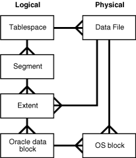

> This graphic depicts the relationship between logical and physical storage structures in crow's feet notation. In the Logical column on the left are Tablespace, Segment, Extent, and Oracle data block. Each type has a one-to-many relationship with the type below it. In the Physical column on the right are Datafile and OS block. Tablespace has a one-to-many relationship with Datafile. Oracle data block has a one-to-many relationship with OS block. Datafile has a one-to-many relationship with extent.
>
> End of description
  

### Logical Storage Hierarchy

Figure 12-2 shows the relationships among data blocks, extents, and segments within a tablespace. In this example, a segment has two extents stored in different data files.

Figure 12-2 Segments, Extents, and Data Blocks Within a Tablespace

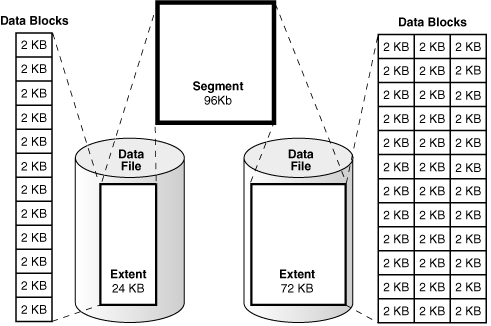

> This graphic depicts the relationship between a Tablespace, Segment, Datafiles, Extents, and Data Blocks.
>
> The tablespace holds one Segment of 96 Kb. The segment is divided into one extent of 24 Kb and another of 72 Kb, each of which is in a separate datafile. The 72 Kb extent maps to 12 rows of 2 Kb blocks, with 3 2 Kb blocks in each row. The 24 Kb extent maps to 12 2 Kb blocks.
  

At the finest level of granularity, Oracle Database stores data in data blocks. One logical [data block](glossary.md) corresponds to a specific number of bytes of physical disk space, for example, 2 KB. Data blocks are the smallest units of storage that Oracle Database can use or allocate.

An [extent](glossary.md) is a set of logically contiguous data blocks allocated for storing a specific type of information. In Figure 12-2, the 24 KB extent has 12 data blocks, while the 72 KB extent has 36 data blocks.

A [segment](glossary.md) is a set of extents allocated for a specific database object, such as a [table](glossary.md). For example, the data for the `employees` table is stored in its own [data segment](glossary.md), whereas each [index](glossary.md) for `employees` is stored in its own [index segment](glossary.md). Every database object that consumes storage consists of a single segment.

Each segment belongs to one and only one [tablespace](glossary.md). Thus, all extents for a segment are stored in the same tablespace. Within a tablespace, a segment can include extents from multiple data files, as shown in Figure 12-2. For example, one extent for a segment may be stored in `users01.dbf`, while another is stored in `users02.dbf`. A single extent can never span data files.

See Also:

["Overview of Data Files"](physical.md)

### Logical Space Management

Oracle Database must use logical space management to track and allocate the extents in a tablespace. When a database object requires an extent, the database must have a method of finding and providing it. Similarly, when an object no longer requires an extent, the database must have a method of making the free extent available.

Oracle Database manages space within a tablespace based on the type that you create. You can create either of the following types of tablespaces:

- Locally managed tablespaces (default)
	The database uses bitmaps in the tablespaces themselves to manage extents. Thus, locally managed tablespaces have a part of the tablespace set aside for a bitmap. Within a tablespace, the database can manage segments with automatic segment space management (ASSM) or manual segment space management (MSSM).
- Dictionary-managed tablespaces
	The database uses the [data dictionary](glossary.md) to manage extents (see ["Overview of the Data Dictionary"](datadict.md)).

Figure 12-3 shows the alternatives for logical space management in a tablespace.

Figure 12-3 Logical Space Management

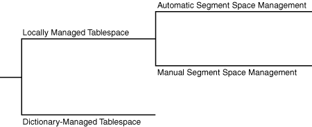

> This graphic shows a decision tree. The first branch is between locally managed tablespaces and dictionary-managed tablespaces. The latter then branches between automatic segment-space management and manual segment-space management.
>
> [Copyright © 1993, 2015, Oracle and/or its affiliates. All rights reserved.](https://docs.oracle.com/cd/E11882_01/dcommon/html/cpyr.htm)
  

#### Locally Managed Tablespaces

A locally managed tablespace maintains a bitmap in the data file header to track free and used space in the data file body. Each bit corresponds to a group of blocks. When space is allocated or freed, Oracle Database changes the bitmap values to reflect the new status of the blocks.

The following graphic is a conceptual representation of bitmap-managed storage. A `1` in the header refers to used space, whereas a `0` refers to free space.

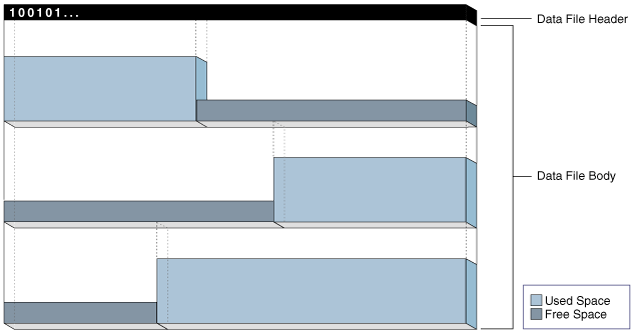

> This graphic shows a data file with the following numbers in its header: 1 0 0 1 0 1. The data file contains three rows of extents. The first five blocks are mostly full; the second 7 blocks are mostly empty; the next 7 blocks are mostly empty; the next 5 blocks are mostly full; the next 4 blocks are mostly empty; the next 8 blocks are mostly full.
  
  

A locally managed tablespace has the following advantages:

- Avoids using the data dictionary to manage extents
	Recursive operations can occur in dictionary-managed tablespaces if consuming or releasing space in an extent results in another operation that consumes or releases space in a data dictionary table or undo segment.
- Tracks adjacent free space automatically
	In this way, the database eliminates the need to coalesce free extents.
- Determines the size of locally managed extents automatically
	Alternatively, all extents can have the same size in a locally managed tablespace and override object storage options.

Note:

Oracle strongly recommends the use of locally managed tablespaces with Automatic Segment Space Management.

Segment space management is an attribute inherited from the tablespace that contains the segment. Within a locally managed tablespace, the database can manage segments automatically or manually. For example, segments in tablespace `users` can be managed automatically while segments in tablespace `tools` are managed manually.

##### Automatic Segment Space Management

The ASSM method uses bitmaps to manage space. Bitmaps provide the following advantages:

- Simplified administration
	ASSM avoids the need to manually determine correct settings for many storage parameters. Only one crucial SQL parameter controls space allocation: `PCTFREE`. This parameter specifies the percentage of space to be reserved in a block for future updates (see "Percentage of Free Space in Data Blocks").
- Increased concurrency
	Multiple [transactions](glossary.md) can search separate lists of free data blocks, thereby reducing contention and waits. For many standard workloads, application performance with ASSM is better than the performance of a well-tuned application that uses MSSM.
- Dynamic affinity of space to instances in an Oracle Real Application Clusters (Oracle RAC) environment

ASSM is more efficient and is the default for permanent, locally managed tablespaces.

Note:

This chapter assumes the use of ASSM in all of its discussions of logical storage space.

##### Manual Segment Space Management

The legacy MSSM method uses a linked list called a free list to manage free space in the segment. For a database object that has free space, a free list keeps track of blocks under the [high water mark](glossary.md) (HWM), which is the dividing line between segment space that is used and not yet used. As blocks are used, the database puts blocks on or removes blocks from the free list as needed.

In addition to `PCTFREE`, MSSM requires you to control space allocation with SQL parameters such as `PCTUSED`, `FREELISTS`, and `FREELIST GROUPS`. `PCTUSED` sets the percentage of free space that must exist in a currently used block for the database to put it on the free list. For example, if you set `PCTUSED` to `40` in a `CREATE TABLE` statement, then you cannot insert rows into a block in the segment until less than 40% of the block space is used.

As an illustration, suppose you insert a row into a table. The database checks a free list of the table for the first available block. If the row cannot fit in the block, and if the used space in the block is greater than or equal to `PCTUSED`, then the database takes the block off the list and searches for another block. If you delete rows from the block, then the database checks whether used space in the block is now less than `PCTUSED`. If so, then the database places the block at the beginning of the free list.

An object may have multiple free lists. In this way, multiple sessions performing DML on a table can use different lists, which can reduce contention. Each database session uses only one free list for the duration of its session.

As shown in Figure 12-4, you can also create an object with one or more free list groups, which are collections of free lists. Each group has a master free list that manages the individual process free lists in the group. Space overhead for free lists, especially for free list groups, can be significant.

Figure 12-4 Free List Groups

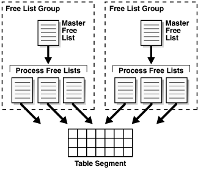

> This graphic shows two free list groups. Each group contains one master free list and three process free lists. Each process free list points to the same table segment.
>
> [Copyright © 1993, 2015, Oracle and/or its affiliates. All rights reserved.](https://docs.oracle.com/cd/E11882_01/dcommon/html/cpyr.htm)
  

Managing segment space manually can be complex. You must adjust `PCTFREE` and `PCTUSED` to reduce row migration (see "Chained and Migrated Rows") and avoid wasting space. For example, if every used block in a segment is half full, and if `PCTUSED` is 40, then the database does not permit inserts into any of these blocks. Because of the difficulty of fine-tuning space allocation parameters, Oracle strongly recommends ASSM. In ASSM, `PCTFREE` determines whether a new row can be inserted into a block, but it does not use free lists and ignores `PCTUSED`.

See Also:

- [Oracle Database Administrator's Guide](https://docs.oracle.com/cd/E11882_01/server.112/e25494/tspaces.htm#ADMIN11360) to learn about locally managed tablespaces
- [Oracle Database 2 Day DBA](https://docs.oracle.com/cd/E11882_01/server.112/e10897/storage.htm#ADMQS12054) and [Oracle Database Administrator's Guide](https://docs.oracle.com/cd/E11882_01/server.112/e25494/tspaces.htm#ADMIN10065) to learn more about automatic segment space management
- [Oracle Database SQL Language Reference](https://docs.oracle.com/cd/E11882_01/server.112/e41084/clauses007.htm#SQLRF30011) to learn about storage parameters such as `PCTFREE` and `PCTUSED`

#### Dictionary-Managed Tablespaces

A dictionary-managed tablespace uses the data dictionary to manage its extents. Oracle Database updates tables in the data dictionary whenever an extent is allocated or freed for reuse. For example, when a table needs an extent, the database queries the data dictionary tables, and searches for free extents. If the database finds space, then it modifies one data dictionary table and inserts a row into another. In this way, the database manages space by modifying and moving data.

The SQL that the database executes in the background to obtain space for database objects is recursive SQL. Frequent use of recursive SQL can have a negative impact on performance because updates to the data dictionary must be serialized. Locally managed tablespaces, which are the default, avoid this performance problem.

See Also:

[Oracle Database Administrator's Guide](https://docs.oracle.com/cd/E11882_01/server.112/e25494/tspaces.htm#ADMIN11392) to learn how to migrate tablespaces from dictionary-managed to locally managed

## Overview of Data Blocks

Oracle Database manages the logical storage space in the data files of a database in units called data blocks, also called Oracle blocks or pages. A data block is the minimum unit of database I/O.

### Data Blocks and Operating System Blocks

At the physical level, database data is stored in disk files made up of operating system blocks. An operating system block is the minimum unit of data that the operating system can read or write. In contrast, an Oracle block is a logical storage structure whose size and structure are not known to the operating system.

Figure 12-5 shows that operating system blocks may differ in size from data blocks. The database requests data in multiples of data blocks, not operating system blocks.

Figure 12-5 Data Blocks and Operating System Blocks

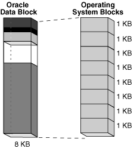

> The graphic shows an Oracle Data Block of size 8 KB. This data block points to a stack of Operating System Blocks. There are 8 operating system blocks. Each operating system block is 1 KB.
>
> [Copyright © 1993, 2015, Oracle and/or its affiliates. All rights reserved.](https://docs.oracle.com/cd/E11882_01/dcommon/html/cpyr.htm)
  

When the database requests a data block, the operating system translates this operation into a requests for data in permanent storage. The logical separation of data blocks from operating system blocks has the following implications:

- Applications do not need to determine the physical addresses of data on disk.
- Database data can be striped or mirrored on multiple physical disks.

#### Database Block Size

Every database has a database block size. The `DB_BLOCK_SIZE` initialization parameter sets the data block size for a database when it is created. The size is set for the `SYSTEM` and `SYSAUX` tablespaces and is the default for all other tablespaces. The database block size cannot be changed except by re-creating the database.

If `DB_BLOCK_SIZE` is not set, then the default data block size is operating system-specific. The standard data block size for a database is 4 KB or 8 KB. If the size differs for data blocks and operating system blocks, then the data block size must be a multiple of the operating system block size.

See Also:

- [Oracle Database Reference](https://docs.oracle.com/cd/E11882_01/server.112/e40402/initparams050.htm#REFRN10031) to learn about the `DB_BLOCK_SIZE` initialization parameter
- [Oracle Database Administrator's Guide](https://docs.oracle.com/cd/E11882_01/server.112/e25494/create.htm#ADMIN11106) and [Oracle Database Performance Tuning Guide](https://docs.oracle.com/cd/E11882_01/server.112/e41573/iodesign.htm#PFGRF94404) to learn how to choose block sizes

#### Tablespace Block Size

You can create individual tablespaces whose block size differs from the `DB_BLOCK_SIZE` setting. A nonstandard block size can be useful when moving a [transportable tablespace](glossary.md) to a different platform.

See Also:

[Oracle Database Administrator's Guide](https://docs.oracle.com/cd/E11882_01/server.112/e25494/create.htm#ADMIN11107) to learn how to specify a nonstandard block size for a tablespace

### Data Block Format

Every data block has a format or internal structure that enables the database to track the data and free space in the block. This format is similar whether the data block contains table, index, or [table cluster](glossary.md) data. Figure 12-6 shows the format of an uncompressed data block (see "Data Block Compression" to learn about compressed blocks).

Figure 12-6 Data Block Format

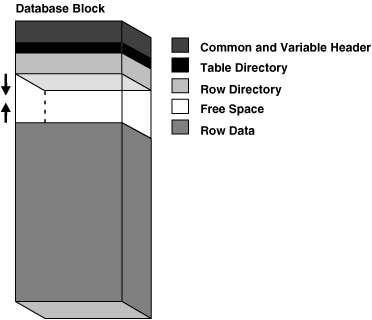

> This graphic shows the parts of a database block: common and variable header, table directory, row directory, free space, and row data. These parts are presented as slabs within a vertical column. One arrow points down from the row directory, while another points up from the row data. The arrows indicate that the amount of free space in the database block is variable.
  

#### Data Block Overhead

Oracle Database uses the [block overhead](glossary.md) to manage the block itself. The block overhead is not available to store user data. As shown in Figure 12-6, the block overhead includes the following parts:

- Block header
	This part contains general information about the block, including disk address and segment type. For blocks that are transaction-managed, the [block header](glossary.md) contains active and historical transaction information.
	A transaction entry is required for every transaction that updates the block. Oracle Database initially reserves space in the block header for transaction entries. In data blocks allocated to segments that support transactional changes, free space can also hold transaction entries when the header space is depleted. The space required for transaction entries is operating system dependent. However, transaction entries in most operating systems require approximately 23 bytes.
- Table directory
	For a [heap-organized table](glossary.md), this directory contains metadata about tables whose rows are stored in this block. Multiple tables can store rows in the same block.
- Row directory
	For a heap-organized table, this directory describes the location of rows in the data portion of the block.
	After space has been allocated in the row directory, the database does not reclaim this space after row deletion. Thus, a block that is currently empty but formerly had up to 50 rows continues to have 100 bytes allocated for the row directory. The database reuses this space only when new rows are inserted in the block.

Some parts of the block overhead are fixed in size, but the total size is variable. On average, the block overhead totals 84 to 107 bytes.

#### Row Format

The row data part of the block contains the actual data, such as table rows or index key entries. Just as every data block has an internal format, every row has a row format that enables the database to track the data in the row.

Oracle Database stores rows as variable-length records. A row is contained in one or more row pieces. Each row piece has a row header and column data.

Figure 12-7 shows the format of a row.

Figure 12-7 The Format of a Row Piece

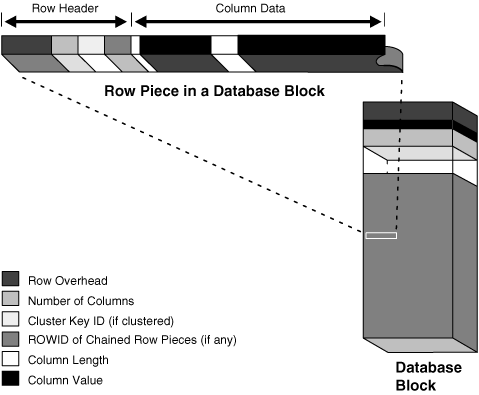

> This image shows a row piece in a database block. The row piece is pictured as a horizontal slab. The left side of the slab is the row header and the right side is the column data. The row header contains the following: row overhead, number of columns, cluster key ID (if clustered), ROWID of chained row pieces (if any). The column data section contains the column length and column value. The row header contains the following: row overhead, number of columns, cluster key ID (if clustered), ROWID of chained row pieces (if any).
>
> The large row piece at the top of the diagram corresponds to a small row piece in a database block, pictured as a vertical column. This column is identical to the column in the previous graphic.
  

##### Column Data

After the row header, the column data section stores the actual data in the row. The row piece usually stores columns in the order listed in the `CREATE TABLE` statement, but this order is not guaranteed. For example, columns of type `LONG` are created last.

As shown in Figure 12-7, for each column in a row piece, Oracle Database stores the column length and data separately. The space required depends on the data type. If the data type of a column is variable length, then the space required to hold a value can grow and shrink with updates to the data.

Each row has a slot in the row directory of the data block header. The slot points to the beginning of the row.

See Also:

["Table Storage"](tablecls.md) and ["Index Storage"](indexiot.md)

##### Rowid Format

Oracle Database uses a [rowid](glossary.md) to uniquely identify a row. Internally, the rowid is a structure that holds information that the database needs to access a row. A rowid is not physically stored in the database, but is inferred from the file and block on which the data is stored.

An extended rowid includes a data object number. This rowid type uses a base 64 encoding of the physical address for each row. The encoding characters are `A-Z`, `a-z`, `0-9`, `+`, and `/`.

Example 12-1 queries the `ROWID` [pseudocolumn](glossary.md) to show the extended rowid of the row in the `employees` table for employee 100.

Example 12-1 ROWID Pseudocolumn

```
SQL> SELECT ROWID FROM employees WHERE employee_id = 100;
 
ROWID
------------------
AAAPecAAFAAAABSAAA
```

Figure 12-8 illustrates the format of an extended rowid.

Figure 12-8 ROWID Format

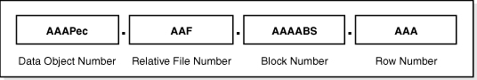

> This graphic depicts a rectangle that contains four smaller rectangles, placed side by side. The first contains AAAPec and is labeled "Data Object Number." The second contains AAF and is labeled "Relative File Number." The third contains AAAABS and is labeled "Block Number." The last contains AAA and is labeled "Row Number."
  

An extended rowid is displayed in a four-piece format, `OOOOOOFFFBBBBBBRRR`, with the format divided into the following components:

- `OOOOOO`
	The data object number identifies the segment (data object `AAAPec` in Example 12-1). A data object number is assigned to every database segment. Schema objects in the same segment, such as a [table cluster](glossary.md), have the same data object number.
- `FFF`
	The tablespace-relative data file number identifies the data file that contains the row (file `AAF` in Example 12-1).
- `BBBBBB`
	The data block number identifies the block that contains the row (block `AAAABS` in Example 12-1). Block numbers are relative to their data file, not their tablespace. Thus, two rows with identical block numbers could reside in different data files of the same tablespace.
- `RRR`
	The row number identifies the row in the block (row `AAA` in Example 12-1).

After a rowid is assigned to a row piece, the rowid can change in special circumstances. For example, if row movement is enabled, then the rowid can change because of partition key updates, Flashback Table operations, shrink table operations, and so on. If row movement is disabled, then a rowid can change if the row is exported and imported using Oracle Database utilities.

Note:

Internally, the database performs row movement as if the row were physically deleted and reinserted. However, row movement is considered an update, which has implications for triggers.

See Also:

- ["Rowid Data Types"](tablecls.md)
- [Oracle Database SQL Language Reference](https://docs.oracle.com/cd/E11882_01/server.112/e41084/sql_elements001.htm#SQLRF50998) to learn about rowids

### Data Block Compression

The database can use [table compression](glossary.md) to eliminate duplicate values in a data block (see ["Table Compression"](tablecls.md)). This section describes the format of data blocks that use compression.

The format of a data block that uses basic and advanced row compression is essentially the same as an uncompressed block. The difference is that a symbol table at the beginning of the block stores duplicate values for the rows and columns. The database replaces occurrences of these values with a short reference to the symbol table.

Assume that the rows in Example 12-2 are stored in a data block for the seven-column `sales` table.

Example 12-2 Rows in sales Table

```
2190,13770,25-NOV-00,S,9999,23,161
2225,15720,28-NOV-00,S,9999,25,1450
34005,120760,29-NOV-00,P,9999,44,2376
9425,4750,29-NOV-00,I,9999,11,979
1675,46750,29-NOV-00,S,9999,19,1121
```

When basic or advanced row compression is applied to this table, the database replaces duplicate values with a symbol reference. Example 12-3 is a conceptual representation of the compression in which the symbol `*` replaces `29-NOV-00` and `%` replaces `9999`.

Example 12-3 OLTP Compressed Rows in sales Table

```
2190,13770,25-NOV-00,S,%,23,161
2225,15720,28-NOV-00,S,%,25,1450
34005,120760,*,P,%,44,2376
9425,4750,*,I,%,11,979
1675,46750,*,S,%,19,1121
```

Table 12-1 conceptually represents the symbol table that maps symbols to values.

Table 12-1 Symbol Table

| Symbol | Value | Column | Rows |
| --- | --- | --- | --- |
| \* | 29-NOV-00 | 3 | 958-960 |
| % | 9999 | 5 | 956-960 |

### Space Management in Data Blocks

As the database fills a data block from the bottom up, the amount of free space between the row data and the block header decreases. This free space can also shrink during updates, as when changing a trailing null to a nonnull value. The database manages free space in the data block to optimize performance and avoid wasted space.

Note:

This section assumes the use of automatic segment space management.

#### Percentage of Free Space in Data Blocks

The `PCTFREE` storage parameter is essential to how the database manages free space. This SQL parameter sets the minimum percentage of a data block reserved as free space for updates to existing rows. Thus, `PCTFREE` is important for preventing row migration and avoiding wasted space.

For example, assume that you create a table that will require only occasional updates, most of which will not increase the size of the existing data. You specify the `PCTFREE` parameter within a `CREATE` `TABLE` statement as follows:

```
CREATE TABLE test_table (n NUMBER) PCTFREE 20;
```

Figure 12-9 shows how a `PCTFREE` setting of `20` affects space management. The database adds rows to the block over time, causing the row data to grow upwards toward the block header, which is itself expanding downward toward the row data. The `PCTFREE` setting ensures that at least 20% of the data block is free. For example, the database prevents an `INSERT` statement from filling the block so that the row data and header occupy a combined 90% of the total block space, leaving only 10% free.

Figure 12-9 PCTFREE

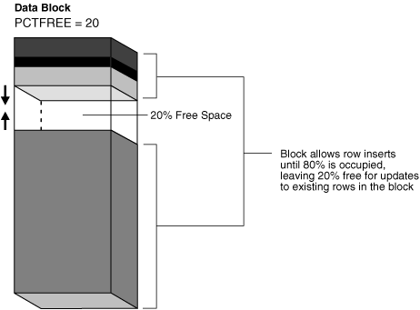

> This graphic depicts a data block with the PCTFREE parameter set to 20. The block shows a gap of 20% free space in the upper part of the block. The caption says "Block allows row inserts until 80% is occupied, leaving 20% free for updates to existing rows in the block."
  

Note:

This discussion does not apply to [LOB](glossary.md) data types, which do not use the `PCTFREE` storage parameter or free lists. See ["Overview of LOBs"](cncptdev.md).

See Also:

[Oracle Database SQL Language Reference](https://docs.oracle.com/cd/E11882_01/server.112/e41084/clauses007.htm#SQLRF52292) for the syntax and semantics of the `PCTFREE` parameter

#### Optimization of Free Space in Data Blocks

While the percentage of free space cannot be less than `PCTFREE`, the amount of free space can be greater. For example, a `PCTFREE` setting of 20% prevents the total amount of free space from dropping to 5% of the block, but permits 50% of the block to be free space. The following SQL statements can increase free space:

- `DELETE` statements
- `UPDATE` statements that either update existing values to smaller values or increase existing values and force a row to migrate
- `INSERT` statements on a table that uses OLTP compression
	If inserts fill a block with data, then the database invokes block compression, which may result in the block having more free space.

The space released is available for `INSERT` statements under the following conditions:

- If the `INSERT` statement is in the same transaction and after the statement that frees space, then the statement can use the space.
- If the `INSERT` statement is in a separate transaction from the statement that frees space (perhaps run by another user), then the statement can use the space made available only after the other transaction commits and only if the space is needed.

See Also:

[Oracle Database Administrator's Guide](https://docs.oracle.com/cd/E11882_01/server.112/e25494/tables.htm#ADMIN11630) to learn about OLTP compression

##### Coalescing Fragmented Space

Released space may or may not be contiguous with the main area of free space in a data block, as shown in Figure 12-10. Noncontiguous free space is called fragmented space.

Figure 12-10 Data Block with Fragmented Space

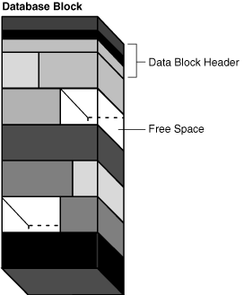

> This graphic depicts a data block in which space is fragmented. The block is depicted as containing 7 rows of slabs of different shades. The 3rd and 6th row contain white slabs, which indicate free space.
>
> [Copyright © 1993, 2015, Oracle and/or its affiliates. All rights reserved.](https://docs.oracle.com/cd/E11882_01/dcommon/html/cpyr.htm)
  

Oracle Database automatically and transparently coalesces the free space of a data block only when the following conditions are true:

- An `INSERT` or `UPDATE` statement attempts to use a block that contains sufficient free space to contain a new row piece.
- The free space is fragmented so that the row piece cannot be inserted in a contiguous section of the block.

After coalescing, the amount of free space is identical to the amount before the operation, but the space is now contiguous. Figure 12-11 shows a data block after space has been coalesced.

Figure 12-11 Data Block After Coalescing Free Space

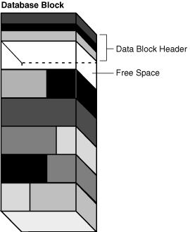

> This graphic depicts a data block in which space is fragmented. Underneath the data block header, the block has 6 stacked slabs of different shades. The top slab is clear, indicating free space.
>
> [Copyright © 1993, 2015, Oracle and/or its affiliates. All rights reserved.](https://docs.oracle.com/cd/E11882_01/dcommon/html/cpyr.htm)
  

Oracle Database performs coalescing only in the preceding situations because otherwise performance would decrease because of the continuous coalescing of the free space in data blocks.

##### Reuse of Index Space

The database can reuse space within an index block. For example, if you insert a value into a column and delete it, and if an index exists on this column, then the database can reuse the index slot when a row requires it.

The database can reuse an index block itself. Unlike a table block, an index block only becomes free when it is empty. The database places the empty block on the free list of the index structure and makes it eligible for reuse. However, Oracle Database does not automatically compact the index: an `ALTER INDEX REBUILD` or `COALESCE` statement is required.

Figure 12-12 represents an index of the `employees.department_id` column before the index is coalesced. The first three leaf blocks are only partially full, as indicated by the gray fill lines.

Figure 12-12 Index Before Coalescing

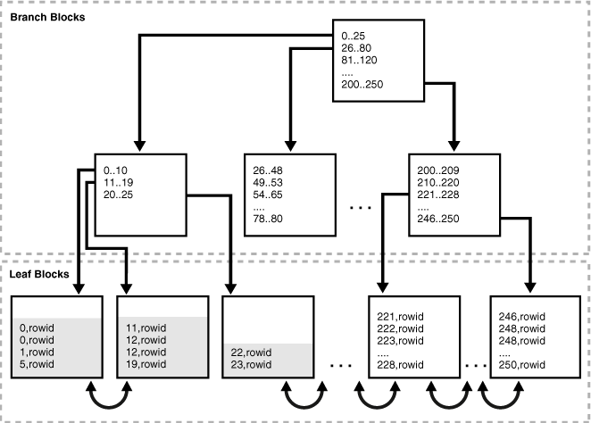

> The graphic is divided into two boxes with dotted borders, one on top of the other. The top is labeled "Branch Blocks" and the lower "Leaf Blocks." The graphic contains a tree of boxes. At the top is a box with the following values: 0..40, 41..90, and so on. Three arrows point to a second row of branch blocks. One block in this row has values 0..10, 11..10, and so on. An adjacent block has values 41..48, 49..53, and so on. The last black has values 200..209, 210..220, and so on.
>
> The leftmost and rightmost blocks each has a pair of arrows pointing down. The leftmost arrow points to a leaf block containing the following values: 0,rowid, 0,rowid, 1,rowid, and so on. The block to the right contains the following values: 11,rowid, 12,rowid, and so on. The next block contains 22,rowid and 23, rowid. Each of these three blocks is shaded. The shaded blocks are separated from the blocks to the right by three ellipses.
>
> The next block contains values: 221,rowid, 222,rowid, and so on. The rightmost block contains the following values: 246,rowid, 248,rowid, and so on. With the exception of the leftmost and rightmost block, each of the leaf blocks in the bottom row is linked by a double-headed arrow to the block on either side.
  

Figure 12-13 shows the index in Figure 12-12 after the index has been coalesced. The first two leaf blocks are now full, as indicated by the gray fill lines, and the third leaf block has been freed.

Figure 12-13 Index After Coalescing

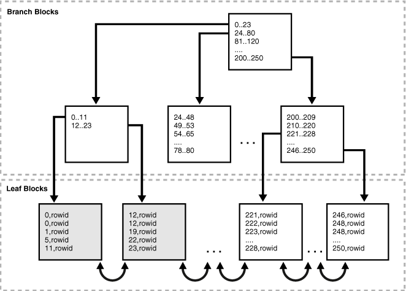

> The graphic is divided into two boxes with dotted borders, one on top of the other. The top is labeled "Branch Blocks" and the lower "Leaf Blocks." The graphic contains a tree of boxes. At the top is a box with the following values: 0..40, 41..90, and so on. Three arrows point to a second row of branch blocks. One block in this row has values 0..10, 11..10, and so on. An adjacent block has values 41..48, 49..53, and so on. The last black has values 200..209, 210..220, and so on.
>
> The leftmost and rightmost blocks each has a pair of arrows pointing down. The leftmost arrow points to a leaf block containing the following values: 0,rowid, 0,rowid, 1,rowid, 5, rowid and so on. The block to the right contains the following values: 12,rowid, 12,rowid, and so on. These two blocks are shaded. The next block contains values: 221,rowid, 222,rowid, and so on. The rightmost block contains the following values: 246,rowid, 248,rowid, and so on. With the exception of the leftmost and rightmost block, each of the leaf blocks in the bottom row is linked by a double-headed arrow to the block on either side.
  

See Also:

- [Oracle Database Administrator's Guide](https://docs.oracle.com/cd/E11882_01/server.112/e25494/indexes.htm#ADMIN11720) to learn how to coalesce and rebuild indexes
- [Oracle Database SQL Language Reference](https://docs.oracle.com/cd/E11882_01/server.112/e41084/functions030.htm#SQLRF00617) to learn about the `COALESCE` statement

#### Chained and Migrated Rows

Oracle Database must manage rows that are too large to fit into a single block. The following situations are possible:

- The row is too large to fit into one data block when it is first inserted.
	In [row chaining](glossary.md), Oracle Database stores the data for the row in a chain of one or more data blocks reserved for the segment. Row chaining most often occurs with large rows. Examples include rows that contain a column of data type `LONG` or `LONG` `RAW`, a `VARCHAR2(4000)` column in a 2 KB block, or a row with a huge number of columns. Row chaining in these cases is unavoidable.
- A row that originally fit into one data block is updated so that the overall row length increases, but insufficient free space exists to hold the updated row.
	In [row migration](glossary.md), Oracle Database moves the entire row to a new data block, assuming the row can fit in a new block. The original row piece of a migrated row contains a pointer or "forwarding address" to the new block containing the migrated row. The rowid of a migrated row does not change.
- A row has more than 255 columns.
	Oracle Database can only store 255 columns in a row piece. Thus, if you insert a row into a table that has 1000 columns, then the database creates 4 row pieces, typically chained over multiple blocks.

Figure 12-14 depicts shows the insertion of a large row in a data block. The row is too large for the left block, so the database chains the row by placing the first row piece in the left block and the second row piece in the right block.

Figure 12-14 Row Chaining

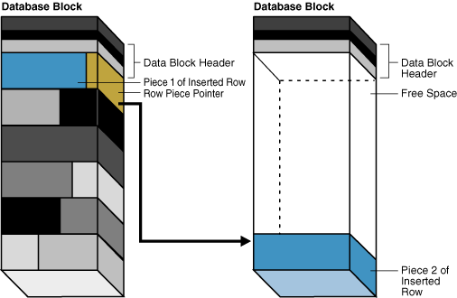

> This graphic shows a Database Block on the left. The top shows a Data Block Header. The block contains multiple slabs. Below the header slab is a slab that says "Piece 1 of Inserted Row." Next to this slab is a smaller slab that says "Row Piece Pointer." An arrow extends out of the pointer and points to the bottom slab in a different database block. This bottom slab is labeled "Piece 2 of Inserted Row." The rest of this block is empty and is labeled "Free Space." This block has a data block header.
  

Figure 12-15, the left block contains a row that is updated so that the row is now too large for the block. The database moves the entire row to the right block and leaves a pointer to the migrated row in the left block.

Figure 12-15 Row Migration

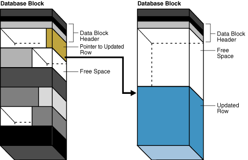

> This graphic shows a Database Block on the left. The top shows a Data Block Header. The block contains multiple slabs. Below the header slab is a slab that says "Pointer to Updated Row." Next to this slab is an empty slab. An arrow extends out of the pointer and points to the bottom slab in a different database block. This bottom slab is labeled "Updated Row." The rest of this block is empty and is labeled "Free Space." This block has a data block header.
  

When a row is chained or migrated, the I/O needed to retrieve the data increases. This situation results because Oracle Database must scan multiple blocks to retrieve the information for the row. For example, if the database performs one I/O to read an index and one I/O to read a nonmigrated table row, then an additional I/O is required to obtain the data for a migrated row.

The Segment Advisor, which can be run both manually and automatically, is an Oracle Database component that identifies segments that have space available for reclamation. The advisor can offer advice about objects that have significant free space or too many chained rows.

See Also:

- ["Row Storage"](tablecls.md) and ["Rowids of Row Pieces"](tablecls.md)
- [Oracle Database 2 Day DBA](https://docs.oracle.com/cd/E11882_01/server.112/e10897/storage.htm#ADMQS0625) and [Oracle Database Administrator's Guide](https://docs.oracle.com/cd/E11882_01/server.112/e25494/schema.htm#ADMIN01401) to learn how to reclaim wasted space
- [Oracle Database Performance Tuning Guide](https://docs.oracle.com/cd/E11882_01/server.112/e41573/instance_tune.htm#PFGRF94470) to learn about reducing chained and migrated rows

## Overview of Extents

An extent is a logical unit of database storage space allocation made up of contiguous data blocks. Data blocks in an extent are logically contiguous but can be physically spread out on disk because of RAID striping and file system implementations.

### Allocation of Extents

By default, the database allocates an initial extent for a data segment when the segment is created. An extent is always contained in one data file.

Although no data has been added to the segment, the data blocks in the initial extent are reserved for this segment exclusively. The first data block of every segment contains a directory of the extents in the segment. Figure 12-16 shows the initial extent in a segment in a data file that previously contained no data.

Figure 12-16 Initial Extent of a Segment

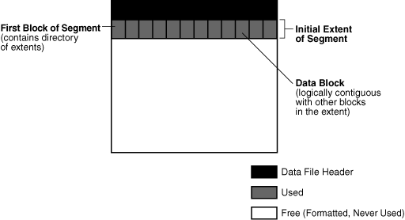

> The graphic depicts a data file as a vertical rectangle. The topmost slab is labeled "Data File Header." Below is a slab of 12 blocks. The whole slab is labeled "Initial Extent of Segment." The first block is labeled "First Block of Segment (contains directory of extents)." The 3rd block from the left is labeled "Data Block (logically contiguous with other blocks in the extent)." The rest of the data file is blank and is labeled "Free (Formatted, Never Used)."
  

If the initial extent become full, and if more space is required, then the database automatically allocates an incremental extent for this segment. An incremental extent is a subsequent extent created for the segment.

The allocation algorithm depends on whether the tablespace is locally managed or dictionary-managed. In the locally managed case, the database searches the bitmap of a data file for adjacent free blocks. If the data file has insufficient space, then the database looks in another data file. Extents for a segment are always in the same tablespace but may be in different data files.

Figure 12-17 shows that the database can allocate extents for a segment in any data file in the tablespace. For example, the segment can allocate the initial extent in `users01.dbf`, allocate the first incremental extent in `users02.dbf`, and allocate the next extent in `users01.dbf`.

Figure 12-17 Incremental Extent of a Segment

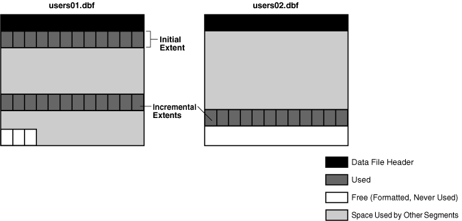

> The graphic contains two data files as vertical rectangles. The data file on the left is named users01.dbf. The top slab is all black. Below is a row of 12 blocks labeled Initial Extent. Halfway down the file is another slab labeled Incremental Extent. On the bottom left corner are three white blocks. The data file on the right is named users02.dbf. The top slab is all black. Partway down is a slab of 12 blocks labeled Incremental Extent. Beneath this slab is a white slab. The white slab is "Free (Formatted, Never Used)." The slabs of 12 blocks are labeled "Used."
  

The blocks of a newly allocated extent, although they were free, may not be empty of old data. In ASSM, Oracle Database formats the blocks of a newly allocated extent when it starts using the extent, but only as needed (see "Segment Space and the High Water Mark").

Note:

This section applies to serial operations, in which one [server process](glossary.md) parses and runs a statement. Extents are allocated differently in parallel SQL statements, which entail multiple server processes.

See Also:

[Oracle Database Administrator's Guide](https://docs.oracle.com/cd/E11882_01/server.112/e25494/tables.htm#ADMIN11660) to learn how to manually allocate extents

### Deallocation of Extents

In general, the extents of a user segment do not return to the tablespace unless you drop the object using a `DROP` command. In Oracle Database 11g Release 2 (11.2.0.2), you can also drop the segment using the `DBMS_SPACE_ADMIN` package. For example, if you delete all rows in a table, then the database does not reclaim the data blocks for use by other objects in the tablespace.

Note:

In an undo segment, Oracle Database periodically deallocates one or more extents if it has the `OPTIMAL` size specified or if the database is in [automatic undo management mode](glossary.md) (see "Undo Tablespaces").

In some circumstances, you can manually deallocate space. The Oracle Segment Advisor helps determine whether an object has space available for reclamation based on the level of fragmentation in the object. The following techniques can free extents:

- You can use an online segment shrink to reclaim fragmented space in a segment. Segment shrink is an online, in-place operation. In general, data compaction leads to better cache utilization and requires fewer blocks to be read in a [full table scan](glossary.md).
- You can move the data of a nonpartitioned table or table partition into a new segment, and optionally into a different tablespace for which you have quota.
- You can rebuild or coalesce the index (see "Reuse of Index Space").
- You can truncate a table or table cluster, which removes all rows. By default, Oracle Database deallocates all space used by the removed rows except that specified by the `MINEXTENTS` storage parameter. In Oracle Database 11g Release 2 (11.2.0.2), you can also use `TRUNCATE` with the `DROP ALL STORAGE` option to drop entire segments.
- You can deallocate unused space, which frees the unused space at the high water mark end of the database segment and makes the space available for other segments in the tablespace (see "Segment Space and the High Water Mark").

When extents are freed, Oracle Database modifies the bitmap in the data file for locally managed tablespaces to reflect the regained extents as available space. Any data in the blocks of freed extents becomes inaccessible.

See Also:

[Oracle Database Administrator's Guide](https://docs.oracle.com/cd/E11882_01/server.112/e25494/schema.htm#ADMIN01401) to learn how to reclaim segment space

### Storage Parameters for Extents

Every segment is defined by storage parameters expressed in terms of extents. These parameters control how Oracle Database allocates free space for a segment.

The storage settings are determined in the following order of precedence, with setting higher on the list overriding settings lower on the list:

1. Segment storage clause
2. Tablespace storage clause
3. Oracle Database default

A locally managed tablespace can have either uniform extent sizes or variable extent sizes determined automatically by the system:

- For uniform extents, you can specify an extent size or use the default size of 1 MB. All extents in the tablespace are of this size. Locally managed temporary tablespaces can only use this type of allocation.
- For automatically allocated extents, Oracle Database determines the optimal size of additional extents.

For locally managed tablespaces, some storage parameters cannot be specified at the tablespace level. However, you can specify these parameters at the segment level. In this case, the databases uses all parameters together to compute the initial size of the segment. Internal algorithms determine the subsequent size of each extent.

See Also:

- [Oracle Database Administrator's Guide](https://docs.oracle.com/cd/E11882_01/server.112/e25494/tspaces.htm#ADMIN11361) to learn about extent management considerations when creating a locally managed tablespace
- [Oracle Database SQL Language Reference](https://docs.oracle.com/cd/E11882_01/server.112/e41084/clauses009.htm#SQLRF30013) to learn about options in the storage clause

## Overview of Segments

A segment is a set of extents that contains all the data for a logical storage structure within a tablespace. For example, Oracle Database allocates one or more extents to form the data segment for a table. The database also allocates one or more extents to form the index segment for a table.

As explained in "Logical Space Management", Oracle Database manages segment space automatically or manually. This section assumes the use of ASSM.

### User Segments

A single data segment in a database stores the data for one user object. There are different types of segments. Examples of user segments include:

- Table, table partition, or table cluster
- [LOB](glossary.md) or LOB partition
- Index or index partition

Each nonpartitioned object and object partition is stored in its own segment. For example, if an index has five partitions, then five segments contain the index data.

#### User Segment Creation

By default, the database uses deferred segment creation to update only database metadata when creating tables and indexes. Starting in Oracle Database 11g Release 2 (11.2.0.2), the database also defers segment creation when creating partitions. When a user inserts the first row into a table or partition, the database creates segments for the table or partition, its LOB columns, and its indexes.

Deferred segment creation enables you to avoid using database resources unnecessarily. For example, installation of an application can create thousands of objects, consuming significant disk space. Many of these objects may never be used.

You can use the `DBMS_SPACE_ADMIN` package to manage segments for empty objects. Starting with Oracle Database 11g Release 2 (11.2.0.2), you can use this PL/SQL package to do the following:

- Manually materialize segments for empty tables or partitions that do not have segments created
- Remove segments from empty tables or partitions that currently have an empty segment allocated

To best illustrate the relationship between object creation and segment creation, assume that deferred segment creation is disabled. You create a table as follows:

```
CREATE TABLE test_table (my_column NUMBER);
```

As shown in Figure 12-18, the database creates one segment for the table.

Figure 12-18 Creation of a User Segment

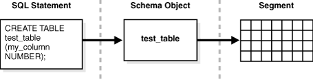

> This graphic is divided into three parts. The first shows a square labeled "SQL Statement." It contains the statement "CREATE TABLE test\_table (my\_column NUMBER);". An arrow points to the square in the second part labeled "Schema Object." The square contains the word "test\_table." The last part is labeled "Segment" and contains a square divided into multiple small squares.
  

When you create a table with a [primary key](glossary.md) or unique key, Oracle Database automatically creates an index for this key. Again assume that deferred segment creation is disabled. You create a table as follows:

```
CREATE TABLE lob_table (my_column NUMBER PRIMARY KEY, clob_column CLOB);
```

Figure 12-19 shows that the data for `lob_table` is stored in one segment, while the implicitly created index is in a different segment. Also, the CLOB data is stored in its own segment, as is its associated CLOB index (see ["Internal LOBs"](cncptdev.md)). Thus, the `CREATE TABLE` statement results in the creation of four different segments.

Figure 12-19 Multiple Segments

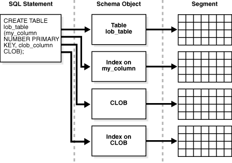

> This graphic is divided into three parts. The first shows a square labeled "SQL Statement." It contains the statement "CREATE TABLE lob\_table (my\_column NUMBER PRIMARY KEY, clob\_column CLOB);". Four arrows point to the four squares in the second part labeled "Schema Object." The squares are: Table lob\_table, Index my\_column, CLOB, and Index on CLOB. Each of these squares points to a square in the Segment column. Each of the Segment squares is divided into multiple smaller squares.
  

Note:

The segments of a table and the index for this table do not have to occupy the same tablespace.

The database allocates one or more extents when a segment is created. Storage parameters for the object determine how the extents for each segment are allocated (see "Storage Parameters for Extents"). The parameters affect the efficiency of data retrieval and storage for the data segment associated with the object.

See Also:

- [Oracle Database Administrator's Guide](https://docs.oracle.com/cd/E11882_01/server.112/e25494/tables.htm#ADMIN13319) to learn how to manage deferred segment creation
- [Oracle Database Advanced Replication](https://docs.oracle.com/cd/E11882_01/server.112/e10706/repmview.htm#REPLN265) for information on materialized views and materialized view logs
- [Oracle Database SQL Language Reference](https://docs.oracle.com/cd/E11882_01/server.112/e41084/statements_7002.htm#SQLRF01402) for `CREATE TABLE` syntax

### Temporary Segments

When processing a [query](glossary.md), Oracle Database often requires temporary workspace for intermediate stages of SQL statement execution. Typical operations that may require a [temporary segment](glossary.md) include sorting, [hashing](glossary.md), and merging bitmaps. While creating an index, Oracle Database also places index segments into temporary segments and then converts them into permanent segments when the index is complete.

Oracle Database does not create a temporary segment if an operation can be performed in memory. However, if memory use is not possible, then the database automatically allocates a temporary segment on disk.

#### Allocation of Temporary Segments for Queries

Oracle Database allocates temporary segments for queries as needed during a user session and drops them when the query completes. Changes to temporary segments are not recorded in the [online redo log](glossary.md), except for space management operations on the temporary segment (see ["Overview of the Online Redo Log"](physical.md)).

The database creates temporary segments in the temporary tablespace assigned to the user. The default storage characteristics of the tablespace determine the characteristics of the extents in the temporary segment. Because allocation and deallocation of temporary segments occurs frequently, the best practice is to create at least one special tablespace for temporary segments. The database distributes I/O across disks and avoids fragmenting `SYSTEM` and other tablespaces with temporary segments.

Note:

When `SYSTEM` is locally managed, you must define a default temporary tablespace at database creation. A locally managed `SYSTEM` tablespace cannot be used for default temporary storage.

See Also:

- [Oracle Database Administrator's Guide](https://docs.oracle.com/cd/E11882_01/server.112/e25494/tspaces.htm#ADMIN11366) to learn how to create temporary tablespaces
- [Oracle Database SQL Language Reference](https://docs.oracle.com/cd/E11882_01/server.112/e41084/statements_7003.htm#SQLRF01403) for `CREATE TEMPORARY TABLESPACE` syntax and semantics

#### Allocation of Temporary Segments for Temporary Tables and Indexes

Oracle Database can also allocate temporary segments for [temporary tables](glossary.md) and their indexes. Temporary tables hold data that exists only for the duration of a transaction or session. Each session accesses only the extents allocated for the session and cannot access extents allocated for other sessions.

Oracle Database allocates segments for a temporary table when the first `INSERT` into that table occurs. The insertion can occur explicitly or because of `CREATE TABLE AS SELECT`. The first `INSERT` into a temporary table allocates the segments for the table and its indexes, creates the root page for the indexes, and allocates any `LOB` segments.

Segments for a temporary table are allocated in a temporary tablespace of the current user. Assume that the temporary tablespace assigned to `user1` is `temp1` and the temporary tablespace assigned to `user2` is `temp2`. In this case, `user1` stores temporary data in the `temp1` segments, while `user2` stores temporary data in the `temp2` segments.

See Also:

- ["Temporary Tables"](tablecls.md)
- [Oracle Database Administrator's Guide](https://docs.oracle.com/cd/E11882_01/server.112/e25494/tables.htm#ADMIN11633) to learn how to create temporary tables

### Undo Segments

Oracle Database maintains records of the actions of transactions, collectively known as [undo data](glossary.md). Oracle Database uses undo to do the following:

- Roll back an [active transaction](glossary.md)
- Recover a terminated transaction
- Provide [read consistency](glossary.md)
- Perform some logical flashback operations

Oracle Database stores undo data inside the database rather than in external logs. Undo data is stored in blocks that are updated just like data blocks, with changes to these blocks generating redo. In this way, Oracle Database can efficiently access undo data without needing to read external logs.

Undo data is stored in an [undo tablespace](glossary.md). Oracle Database provides a fully automated mechanism, known as [automatic undo management mode](glossary.md), for managing undo segments and space in an undo tablespace.

#### Undo Segments and Transactions

When a transaction starts, the database binds (assigns) the transaction to an undo segment, and therefore to a [transaction table](glossary.md), in the current undo tablespace. In rare circumstances, if the database instance does not have a designated undo tablespace, then the transaction binds to the system undo segment.

Multiple active transactions can write concurrently to the same undo segment or to different segments. For example, transactions T1 and T2 can both write to undo segment U1, or T1 can write to U1 while T2 writes to undo segment U2.

Conceptually, the extents in an undo segment form a ring. Transactions write to one undo extent, and then to the next extent in the ring, and so on in cyclical fashion. Figure 12-20 shows two transactions, T1 and T2, which begin writing in the third extent (E3) of an undo segment and continue writing to the fourth extent (E4).

Figure 12-20 Ring of Allocated Extents in an Undo Segment

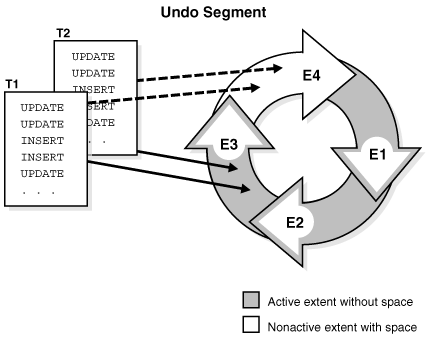

> This diagram shows a ring of extents in an undo segment: E1, E2, E3, and E4. Extents E1-E3 are active extents without space. In the diagram, transaction T1 and T2 both write to E3 and then start writing to E4. E4 is a nonactive extent with space.
>
> [Copyright © 1993, 2015, Oracle and/or its affiliates. All rights reserved.](https://docs.oracle.com/cd/E11882_01/dcommon/html/cpyr.htm)
  

At any given time, a transaction writes sequentially to only one extent in an undo segment, known as the current extent for the transaction. Multiple active transactions can write simultaneously to the same current extent or to different current extents. Figure 12-20 shows transactions T1 and T2 writing simultaneously to extent E3. Within an undo extent, a data block contains data for only one transaction.

As the current undo extent fills, the first transaction needing space checks the availability of the next allocated extent in the ring. If the next extent does not contain data from an active transaction, then this extent becomes the current extent. Now all transactions that need space can write to the new current extent. In Figure 12-21, when E4 is full, T1 and T2 continue writing to E1, overwriting the nonactive undo data in E1.

Figure 12-21 Cyclical Use of Allocated Extents in an Undo Segment

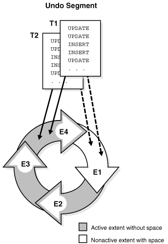

> This diagram shows a ring of extents in an undo segment: E1, E2, E3, and E4. Extents E1-E3 are active extents without space. In the diagram, transaction T1 and T2 both write to E4 and then start writing to E1. E4 is an active extent without space. E1 is a nonactive extent with space.
  

If the next extent does contain data from an active transaction, then the database must allocate a new extent. Figure 12-22 shows a scenario in which T1 and T2 are writing to E4. When E4 fills up, the transactions cannot continue writing to E1 because E1 contains active undo entries. Therefore, the database allocates a new extent (E5) for this undo segment. The transactions continue writing to E5.

Figure 12-22 Allocation of a New Extent for an Undo Segment

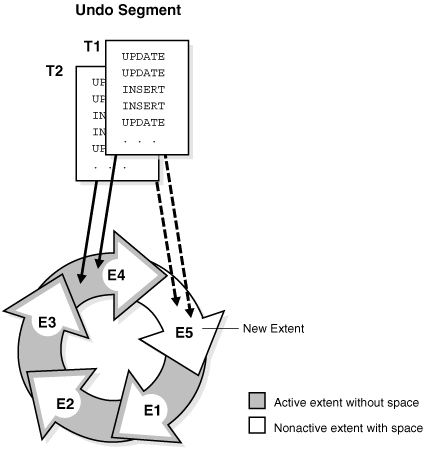

> This diagram shows a ring of extents in an undo segment: E1, E2, E3, E4, and E5. Extents E1-E4 are active extents without space. In the diagram, transaction T1 and T2 both write to E4 and then start writing to E5. E5 is a new extent. E1 through E4 are active extents without space. E5 is a nonactive extent with space.
  

See Also:

[Oracle Database 2 Day DBA](https://docs.oracle.com/cd/E11882_01/server.112/e10897/storage.htm#ADMQS063) and [Oracle Database Administrator's Guide](https://docs.oracle.com/cd/E11882_01/server.112/e25494/undo.htm#ADMIN013) to learn how to manage undo segments

#### Transaction Rollback

When a `ROLLBACK` statement is issued, the database uses undo records to roll back changes made to the database by the uncommitted transaction. During recovery, the database rolls back any uncommitted changes applied from the online redo log to the data files. Undo records provide [read consistency](glossary.md) by maintaining the before image of the data for users accessing data at the same time that another user is changing it.

### Segment Space and the High Water Mark

To manage space, Oracle Database tracks the state of blocks in the segment. The high water mark (HWM) is the point in a segment beyond which data blocks are unformatted and have never been used.

MSSM uses free lists to manage segment space. At table creation, no blocks in the segment are formatted. When a session first inserts rows into the table, the database searches the free list for usable blocks. If the database finds no usable blocks, then it preformats a group of blocks, places them on the free list, and begins inserting data into the blocks. In MSSM, a full table scan reads all blocks below the HWM.

ASSM does not use free lists and so must manage space differently. When a session first inserts data into a table, the database formats a single bitmap block instead of preformatting a group of blocks as in MSSM. The bitmap tracks the state of blocks in the segment, taking the place of the free list. The database uses the bitmap to find free blocks and then formats each block before filling it with data. ASSM spread out inserts among blocks to avoid concurrency issues.

Every data block in an ASSM segment is in one of the following states:

- Above the HWM
	These blocks are unformatted and have never been used.
- Below the HWM
	These blocks are in one of the following states:
	- Allocated, but currently unformatted and unused
		- Formatted and contain data
		- Formatted and empty because the data was deleted

Figure 12-23 depicts an ASSM segment as a horizontal series of blocks. At table creation, the HWM is at the beginning of the segment on the left. Because no data has been inserted yet, all blocks in the segment are unformatted and never used.

Figure 12-23 HWM at Table Creation

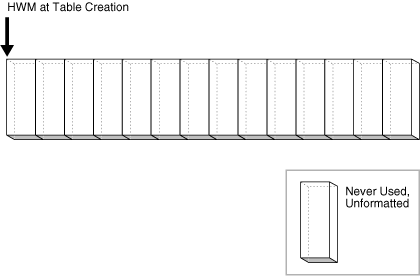

> This graphic shows a horizontal series of white blocks. The edge of the left-most block is labeled "HWM at Table Creation." The legend indicates that a white block is "Never Used, Unformatted."
>
> [Copyright © 1993, 2015, Oracle and/or its affiliates. All rights reserved.](https://docs.oracle.com/cd/E11882_01/dcommon/html/cpyr.htm)
  

Suppose that a transaction inserts rows into the segment. The database must allocate a group of blocks to hold the rows. The allocated blocks fall below the HWM. The database formats a bitmap block in this group to hold the metadata, but does not preformat the remaining blocks in the group.

In Figure 12-24, the blocks below the HWM are allocated, whereas blocks above the HWM are neither allocated or formatted. As inserts occur, the database can write to any block with available space. The low high water mark (low HWM) marks the point below which all blocks are known to be formatted because they either contain data or formerly contained data.

Figure 12-24 HWM and Low HWM

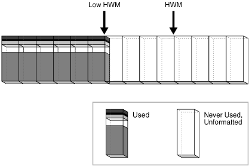

> This graphic shows a horizontal series of blocks. The first 6 blocks are gray. The next 8 are empty. The edge shared by the gray and empty blocks is labeled "Low HWM." Four blocks to the right an arrow labeled "HWM" points down. The legend indicates that an empty block is "Never Used, Unformatted." A gray block is "Used."
  

In Figure 12-25, the database chooses a block between the HWM and low HWM and writes to it. The database could have just as easily chosen any other block between the HWM and low HWM, or any block below the low HWM that had available space. In Figure 12-25, the blocks to either side of the newly filled block are unformatted.

Figure 12-25 HWM and Low HWM

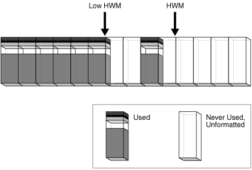

> This graphic shows a horizontal series of blocks. The first 6 blocks are gray. The right edge of the last gray block is labeled "Low HWM." The next 2 are empty, followed by one gray block, and then followed by 1 empty block. The right edge of the empty block is labeled "Low HWM." The next 4 blocks are empty. The legend indicates that an empty block is "Never Used, Unformatted." A gray block is "Used."
  

The low HWM is important in a [full table scan](glossary.md). Because blocks below the HWM are formatted only when used, some blocks could be unformatted, as in Figure 12-25. For this reason, the database reads the bitmap block to obtain the location of the low HWM. The database reads all blocks up to the low HWM because they are known to be formatted, and then carefully reads only the formatted blocks between the low HWM and the HWM.

Assume that a new transaction inserts rows into the table, but the bitmap indicates that insufficient free space exists under the HWM. In Figure 12-26, the database advances the HWM to the right, allocating a new group of unformatted blocks.

Figure 12-26 Advancing HWM and Low HWM

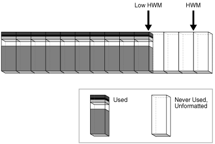

> This graphic shows a horizontal series of blocks. The first 10 blocks are gray. The next 4 are empty. The edge shared by the gray and empty blocks is labeled "Low HWM." One block from the right end an arrow points down and is labeled "HWM." The legend indicates that an empty block is "Never Used, Unformatted." A gray block is "Used."
  

When the blocks between the HWM and low HWM are full, the HWM advances to the right and the low HWM advances to the location of the old HWM. As the database inserts data over time, the HWM continues to advance to the right, with the low HWM always trailing behind it. Unless you manually rebuild, truncate, or shrink the object, the HWM never retreats.

See Also:

- [Oracle Database Administrator's Guide](https://docs.oracle.com/cd/E11882_01/server.112/e25494/schema.htm#ADMIN10161) to learn how to shrink segments online
- [Oracle Database SQL Language Reference](https://docs.oracle.com/cd/E11882_01/server.112/e41084/statements_10007.htm#SQLRF01707) for `TRUNCATE TABLE` syntax and semantics

## Overview of Tablespaces

A tablespace is a logical storage container for segments. Segments are database objects, such as tables and indexes, that consume storage space. At the physical level, a tablespace stores data in one or more data files or temp files.

A database must have the `SYSTEM` and `SYSAUX` tablespaces. Figure 12-27 shows the tablespaces in a typical database. The following sections describe the tablespace types.

Figure 12-27 Tablespaces

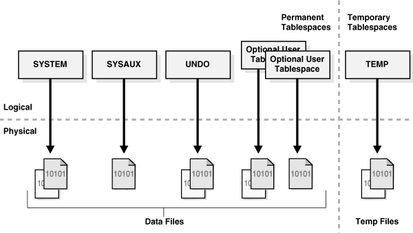

> This graphic shows a SYSTEM, SYSAUX, UNDO, Optional User Tablespace, and TEMP tablespace. Each tablespace icon is above a line labeled Logical. Every tablespace except TEMP points to one or more data files. TEMP points to two temp files. The files are in a section labeled Physical. The TEMP tablespace is labeled Temporary Tablespaces. All other tablespaces are labeled Permanent Tablespace.
  

### Permanent Tablespaces

A permanent tablespace groups persistent schema objects. The segments for objects in the tablespace are stored physically in data files.

Each database user is assigned a default permanent tablespace. A very small database may need only the default `SYSTEM` and `SYSAUX` tablespaces. However, Oracle recommends that you create at least one tablespace to store user and application data. You can use tablespaces to achieve the following goals:

- Control disk space allocation for database data
- Assign a quota (space allowance or limit) to a database user
- Take individual tablespaces online or offline without affecting the availability of the whole database
- Perform backup and recovery of individual tablespaces
- Import or export application data by using the Oracle Data Pump utility (see ["Oracle Data Pump Export and Import"](cncptdba.md))
- Create a transportable tablespace that you can copy or move from one database to another, even across platforms
	Moving data by transporting tablespaces can be orders of magnitude faster than either export/import or unload/load of the same data, because transporting a tablespace involves only copying data files and integrating the tablespace metadata. When you transport tablespaces you can also move index data.

See Also:

- [Oracle Database Administrator's Guide](https://docs.oracle.com/cd/E11882_01/server.112/e25494/tspaces.htm#ADMIN01101) to learn how to transport tablespaces
- [Oracle Database Utilities](https://docs.oracle.com/cd/E11882_01/server.112/e22490/dp_overview.htm#SUTIL100) to learn about Oracle Data Pump
- [Oracle Streams Concepts and Administration](https://docs.oracle.com/cd/E11882_01/server.112/e17069/strms_ipro.htm#STRMS159) for more information on ways to copy or transport files

#### The SYSTEM Tablespace

The `SYSTEM` tablespace is a necessary administrative tablespace included with the database when it is created. Oracle Database uses `SYSTEM` to manage the database.

The `SYSTEM` tablespace includes the following information, all owned by the `SYS` user:

- The data dictionary
- Tables and views that contain administrative information about the database
- Compiled stored objects such as triggers, procedures, and packages

The `SYSTEM` tablespace is managed as any other tablespace, but requires a higher level of privilege and is restricted in some ways. For example, you cannot rename or drop the `SYSTEM` tablespace.

By default, Oracle Database sets all newly created user tablespaces to be locally managed. In a database with a locally managed `SYSTEM` tablespace, you cannot create dictionary-managed tablespaces (which are deprecated). However, if you execute the `CREATE DATABASE` statement manually and accept the defaults, then the `SYSTEM` tablespace is dictionary managed. You can migrate an existing dictionary-managed `SYSTEM` tablespace to a locally managed format.

Note:

Oracle strongly recommends that you use Database Configuration Assistant (DBCA) to create new databases so that all tablespaces, including `SYSTEM`, are locally managed by default.

See Also:

- "Online and Offline Tablespaces" for information about the permanent online condition of the `SYSTEM` tablespace
- ["Tools for Database Installation and Configuration"](cncptdba.md) to learn about DBCA
- [Oracle Database Administrator's Guide](https://docs.oracle.com/cd/E11882_01/server.112/e25494/tspaces.htm#ADMIN11393) to learn how to create or migrate to a locally managed `SYSTEM` tablespace
- [Oracle Database SQL Language Reference](https://docs.oracle.com/cd/E11882_01/server.112/e41084/statements_5004.htm#SQLRF01204) for `CREATE DATABASE` syntax and semantics

#### The SYSAUX Tablespace

The `SYSAUX` tablespace is an auxiliary tablespace to the `SYSTEM` tablespace. The `SYSAUX` tablespace provides a centralized location for database metadata that does not reside in the `SYSTEM` tablespace. It reduces the number of tablespaces created by default, both in the seed database and in user-defined databases.

Several database components, including Oracle Enterprise Manager and Oracle Streams, use the `SYSAUX` tablespace as their default storage location. Therefore, the `SYSAUX` tablespace is created automatically during database creation or upgrade.

During normal database operation, the database does not allow the `SYSAUX` tablespace to be dropped or renamed. If the `SYSAUX` tablespace becomes unavailable, then core database functionality remains operational. The database features that use the `SYSAUX` tablespace could fail, or function with limited capability.

See Also:

[Oracle Database Administrator's Guide](https://docs.oracle.com/cd/E11882_01/server.112/e25494/create.htm#ADMIN00203) to learn about the `SYSAUX` tablespace

#### Undo Tablespaces

An undo tablespace is a locally managed tablespace reserved for system-managed undo data (see "Undo Segments"). Like other permanent tablespaces, undo tablespaces contain data files. Undo blocks in these files are grouped in extents.

##### Automatic Undo Management Mode

Undo tablespaces require the database to be in the default [automatic undo management mode](glossary.md). This mode eliminates the complexities of manually administering undo segments. The database automatically tunes itself to provide the best possible retention of undo data to satisfy long-running queries that may require this data.

An undo tablespace is automatically created with a new installation of Oracle Database. Earlier versions of Oracle Database may not include an undo tablespace and use legacy rollback segments instead, known as manual undo management mode. When upgrading to Oracle Database 11g, you can enable automatic undo management mode and create an undo tablespace. Oracle Database contains an Undo Advisor that provides advice on and helps automate your undo environment.

A database can contain multiple undo tablespaces, but only one can be in use at a time. When an instance attempts to open a database, Oracle Database automatically selects the first available undo tablespace. If no undo tablespace is available, then the instance starts without an undo tablespace and stores undo data in the `SYSTEM` tablespace. Storing undo data in `SYSTEM` is not recommended.

See Also:

- [Oracle Database Administrator's Guide](https://docs.oracle.com/cd/E11882_01/server.112/e25494/undo.htm#ADMIN11461) to learn about automatic undo management
- [Oracle Database Upgrade Guide](https://docs.oracle.com/cd/E11882_01/server.112/e23633/afterup.htm#UPGRD12439) to learn how to migrate to automatic undo management mode
- [Oracle Database 2 Day DBA](https://docs.oracle.com/cd/E11882_01/server.112/e10897/storage.htm#ADMQS0635) for information on the Undo Advisor and on how to use advisors

##### Automatic Undo Retention

The undo retention period is the minimum amount of time that Oracle Database attempts to retain old undo data before overwriting it. Undo retention is important because long-running queries may require older block images to supply [read consistency](glossary.md). Also, some Oracle Flashback features can depend on undo availability.

In general, it is desirable to retain old undo data as long as possible. After a transaction commits, undo data is no longer needed for rollback or transaction recovery. The database can retain old undo data if the undo tablespace has space for new transactions. When available space is low, the database begins to overwrite old undo data for committed transactions.

Oracle Database automatically provides the best possible undo retention for the current undo tablespace. The database collects usage statistics and tunes the retention period based on these statistics and the undo tablespace size. If the undo tablespace is configured with the `AUTOEXTEND` option, and if the maximum size is not specified, then undo retention tuning is different. In this case, the database tunes the undo retention period to be slightly longer than the longest-running query, if space allows.

See Also:

[Oracle Database Administrator's Guide](https://docs.oracle.com/cd/E11882_01/server.112/e25494/undo.htm#ADMIN11464) for more details on automatic tuning of undo retention

### Temporary Tablespaces

A temporary tablespace contains transient data that persists only for the duration of a session. No permanent schema objects can reside in a temporary tablespace. The database stores temporary tablespace data in temp files.

Temporary tablespaces can improve the concurrency of multiple sort operations that do not fit in memory. These tablespaces also improve the efficiency of space management operations during sorts.

When the `SYSTEM` tablespace is locally managed, a default temporary tablespace is included in the database by default during database creation. A locally managed `SYSTEM` tablespace cannot serve as default temporary storage.

Note:

You cannot make a default temporary tablespace permanent.

You can specify a user-named default temporary tablespace when you create a database by using the `DEFAULT TEMPORARY TABLESPACE` extension to the `CREATE DATABASE` statement. If `SYSTEM` is dictionary managed, and if a default temporary tablespace is not defined at database creation, then `SYSTEM` is the default temporary storage. However, the database writes a warning in the [alert log](glossary.md) saying that a default temporary tablespace is recommended.

See Also:

- ["Permanent and Temporary Data Files"](physical.md)
- [Oracle Database Administrator's Guide](https://docs.oracle.com/cd/E11882_01/server.112/e25494/create.htm#ADMIN11090) to learn how to create a default temporary tablespace
- [Oracle Database SQL Language Reference](https://docs.oracle.com/cd/E11882_01/server.112/e41084/statements_5004.htm#SQLRF53870) for the syntax of the `DEFAULT TEMPORARY TABLESPACE` clause of `CREATE DATABASE` and `ALTER DATABASE`

### Tablespace Modes

The tablespace mode determines the accessibility of the tablespace.

#### Read/Write and Read-Only Tablespaces

Every tablespace is in a write mode that specifies whether it can be written to. The mutually exclusive modes are as follows:

- Read/write mode
	Users can read and write to the tablespace. All tablespaces are initially created as read/write. The `SYSTEM` and `SYSAUX` tablespaces and temporary tablespaces are permanently read/write, which means that they cannot be made read-only.
- Read-only mode
	Write operations to the data files in the tablespace are prevented. A read-only tablespace can reside on read-only media such as DVDs or WORM drives.
	Read-only tablespaces eliminate the need to perform backup and recovery of large, static portions of a database. Read-only tablespaces do not change and thus do not require repeated backup. If you recover a database after a media failure, then you do not need to recover read-only tablespaces.

See Also:

- [Oracle Database Administrator's Guide](https://docs.oracle.com/cd/E11882_01/server.112/e25494/tspaces.htm#ADMIN11379) to learn how to change a tablespace to read only or read/write mode
- [Oracle Database SQL Language Reference](https://docs.oracle.com/cd/E11882_01/server.112/e41084/statements_3002.htm#SQLRF53606) for `ALTER TABLESPACE` syntax and semantics
- [Oracle Database Backup and Recovery User's Guide](https://docs.oracle.com/cd/E11882_01/backup.112/e10642/rcmquick.htm#BRADV89370) for more information about recovery

#### Online and Offline Tablespaces

A tablespace can be online (accessible) or offline (not accessible) whenever the database is open. A tablespace is usually online so that its data is available to users. The `SYSTEM` tablespace and temporary tablespaces cannot be taken offline.

A tablespace can go offline automatically or manually. For example, you can take a tablespace offline for maintenance or backup and recovery. The database automatically takes a tablespace offline when certain errors are encountered, as when the [database writer (DBW)](glossary.md) process fails in several attempts to write to a data file. Users trying to access tables in an offline tablespace receive an error.

When a tablespace goes offline, the database does the following:

- The database does not permit subsequent DML statements to reference objects in the offline tablespace. An offline tablespace cannot be read or edited by any utility other than Oracle Database.
- Active transactions with completed statements that refer to data in that tablespace are not affected at the transaction level.
- The database saves undo data corresponding to those completed statements in a deferred undo segment in the `SYSTEM` tablespace. When the tablespace is brought online, the database applies the undo data to the tablespace, if needed.

See Also:

- ["Online and Offline Data Files"](physical.md)
- ["Database Writer Process (DBWn)"](process.md)
- [Oracle Database Administrator's Guide](https://docs.oracle.com/cd/E11882_01/server.112/e25494/tspaces.htm#ADMIN12490) to learn how to alter tablespace availability

### Tablespace File Size

A tablespace is either a bigfile tablespace or a smallfile tablespace. These tablespaces are indistinguishable in terms of execution of SQL statements that do not explicitly refer to data files or temp files. The difference is as follows:

- A smallfile tablespace can contain multiple data files or temp files, but the files cannot be as large as in a bigfile tablespace. This is the default tablespace type.
- A bigfile tablespace contains one very large data file or temp file. This type of tablespaces can do the following:
	- Increase the storage capacity of a database
		The maximum number of data files in a database is limited (usually to 64 KB files), so increasing the size of each data file increases the overall storage.
		- Reduce the burden of managing many data files and temp files
		Bigfile tablespaces simplify file management with Oracle Managed Files and Automatic Storage Management (Oracle ASM) by eliminating the need for adding new files and dealing with multiple files.
		- Perform operations on tablespaces rather than individual files
		Bigfile tablespaces make the tablespace the main unit of the disk space administration, backup and recovery, and so on.
	Bigfile tablespaces are supported only for locally managed tablespaces with ASSM. However, locally managed undo and temporary tablespaces can be bigfile tablespaces even when segments are manually managed.

See Also:

- ["Backup and Recovery"](cncptdba.md)
- [Oracle Database Administrator's Guide](https://docs.oracle.com/cd/E11882_01/server.112/e25494/tspaces.htm#ADMIN01102) to learn how to manage bigfile tablespaces