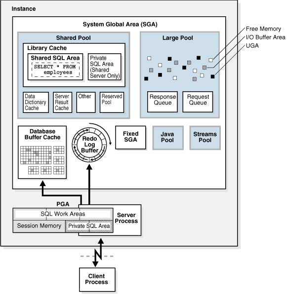
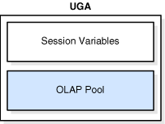
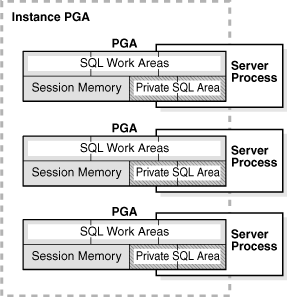
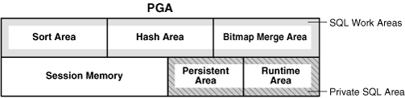
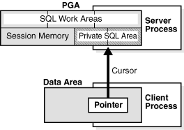
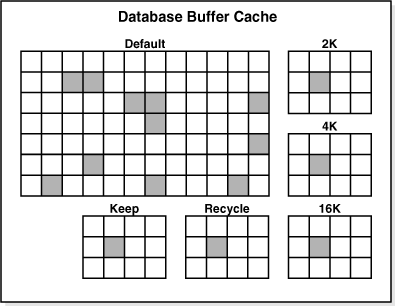
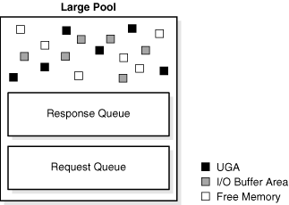

## 14 Memory Architecture

This chapter discusses the memory architecture of an Oracle Database [instance](glossary.md).

This chapter contains the following sections:

See Also:

[Oracle Database Administrator's Guide](https://docs.oracle.com/cd/E11882_01/server.112/e25494/memory.htm#ADMIN00207) for instructions for configuring and managing memory

## Introduction to Oracle Database Memory Structures

When an instance is started, Oracle Database allocates a memory area and starts [background processes](glossary.md). The memory area stores information such as the following:

- Program code
- Information about each connected [session](glossary.md), even if it is not currently active
- Information needed during program execution, for example, the current state of a [query](glossary.md) from which rows are being fetched
- Information such as [lock](glossary.md) data that is shared and communicated among processes
- Cached data, such as [data blocks](glossary.md) and redo records, that also exists on disk

See Also:

[Chapter 15, "Process Architecture"](process.md)

### Basic Memory Structures

The basic memory structures associated with Oracle Database include:

- System global area (SGA)
	The SGA is a group of shared memory structures, known as SGA components, that contain data and control information for one Oracle Database instance. The SGA is shared by all server and background processes. Examples of data stored in the SGA include cached data blocks and shared SQL areas.
- Program global area (PGA)
	A PGA is a nonshared memory region that contains data and control information exclusively for use by an Oracle process. The PGA is created by Oracle Database when an Oracle process is started.
	One PGA exists for each [server process](glossary.md) and background process. The collection of individual PGAs is the total instance PGA, or instance PGA. Database initialization parameters set the size of the instance PGA, not individual PGAs.
- User Global Area (UGA)
	The UGA is memory associated with a user session.
- Software code areas
	Software code areas are portions of memory used to store code that is being run or can be run. Oracle Database code is stored in a software area that is typically at a different location from user programs—a more exclusive or protected location.

Figure 14-1 illustrates the relationships among these memory structures.

Figure 14-1 Oracle Database Memory Structures



> This image shows a large rounded-corner rectangle representing the SGA. Inside the SGA, arranged in two rows of four, are boxes for the Java pool, the buffer cache, the redo buffer, the result cache, the shared pool, the Streams pool, and the large pool. The last box is named Other Components. Outside the SGA, with arrows going back and forth to the SGA, is a box labeled Server Process containing the PGA. A Client Process box is outside the SGA and points to the Server Process box.
  

### Oracle Database Memory Management

Memory management involves maintaining optimal sizes for the Oracle instance memory structures as demands on the database change. Oracle Database manages memory based on the settings of memory-related [initialization parameters](glossary.md). The basic options for memory management are as follows:

- Automatic memory management
	You specify the target size for instance memory. The database instance automatically tunes to the target memory size, redistributing memory as needed between the SGA and the instance PGA.
- Automatic shared memory management
	This management mode is partially automated. You set a target size for the SGA and then have the option of setting an aggregate target size for the PGA or managing PGA work areas individually.
- Manual memory management
	Instead of setting the total memory size, you set many initialization parameters to manage components of the SGA and instance PGA individually.

If you create a database with Database Configuration Assistant (DBCA) and choose the basic installation option, then automatic memory management is the default.

See Also:

- ["Memory Management"](cncptdba.md) for more information about memory management options for DBAs
- ["Tools for Database Installation and Configuration"](cncptdba.md) to learn about DBCA
- [Oracle Database 2 Day DBA](https://docs.oracle.com/cd/E11882_01/server.112/e10897/instance.htm#ADMQS12038) and [Oracle Database Administrator's Guide](https://docs.oracle.com/cd/E11882_01/server.112/e25494/memory.htm#ADMIN11197) to learn about memory management options

## Overview of the User Global Area

The UGA is session memory, which is memory allocated for session variables, such as logon information, and other information required by a database session. Essentially, the UGA stores the session state. Figure 14-2 depicts the UGA.

Figure 14-2 User Global Area (UGA)



> This graphic depicts a box labeled "UGA." Inside the box are two smaller boxes: one labeled "Session Variables" and the other labeled "OLAP Pool." The OLAP Pool box is shaded.
>
> [Copyright © 1993, 2015, Oracle and/or its affiliates. All rights reserved.](https://docs.oracle.com/cd/E11882_01/dcommon/html/cpyr.htm)
  

If a session loads a [PL/SQL](glossary.md) package into memory, then the UGA contains the package state, which is the set of values stored in all the package variables at a specific time (see ["PL/SQL Packages"](srvrside.md)). The package state changes when a package subprogram changes the variables. By default, the package variables are unique to and persist for the life of the session.

The OLAP page pool is also stored in the UGA. This pool manages [OLAP](glossary.md) data pages, which are equivalent to data blocks. The page pool is allocated at the start of an OLAP session and released at the end of the session. An OLAP session opens automatically whenever a user queries a dimensional object such as a [cube](glossary.md).

The UGA must be available to a database session for the life of the session. For this reason, the UGA cannot be stored in the PGA when using a [shared server](glossary.md) connection because the PGA is specific to a single process. Therefore, the UGA is stored in the SGA when using shared server connections, enabling any shared server process access to it. When using a [dedicated server](glossary.md) connection, the UGA is stored in the PGA.

See Also:

- ["Connections and Sessions"](process.md)
- [Oracle Database Net Services Administrator's Guide](https://docs.oracle.com/cd/E11882_01/network.112/e41945/net_arch.htm#NETAG210) to learn about shared server connections
- [Oracle OLAP User's Guide](https://docs.oracle.com/cd/E11882_01/olap.112/e17123/overview.htm#OLAUG100) for an overview of Oracle OLAP

## Overview of the Program Global Area

The PGA is memory specific to an operating process or thread that is not shared by other processes or threads on the system. Because the PGA is process-specific, it is never allocated in the SGA.

The PGA is a memory heap that contains session-dependent variables required by a dedicated or shared server process. The server process allocates memory structures that it requires in the PGA.

An analogy for a PGA is a temporary countertop workspace used by a file clerk. In this analogy, the file clerk is the server process doing work on behalf of the customer (client process). The clerk clears a section of the countertop, uses the workspace to store details about the customer request and to sort the folders requested by the customer, and then gives up the space when the work is done.

Figure 14-3 shows an instance PGA (collection of all PGAs) for an instance that is not configured for shared servers. You can use an initialization parameter to set a target maximum size of the instance PGA (see ["Summary of Memory Management Methods"](cncptdba.md)). Individual PGAs can grow as needed up to this target size.

Figure 14-3 Instance PGA



> This graphic shows a rectangle labeled "Instance PGA." Inside this rectangle are three smaller rectangles labeled "PGA." Each PGA contains the following: SQL Work AReas, Session Memory, and Private SQL Area. A Server Process box is behind and slightly to the right of each PGA box.
>
> [Copyright © 1993, 2015, Oracle and/or its affiliates. All rights reserved.](https://docs.oracle.com/cd/E11882_01/dcommon/html/cpyr.htm)
  

Note:

Background processes also allocate their own PGAs. This discussion focuses on server process PGAs only.

### Contents of the PGA

The PGA is subdivided into different areas, each with a different purpose. Figure 14-4 shows the possible contents of the PGA for a dedicated server session. Not all of the PGA areas will exist in every case.

Figure 14-4 PGA Contents



> This graphic shows a large rectangle labeled "PGA." The rectangle is divided into two slabs. The top slab, which is labeled SQL Work Areas, is subdivided into Sort Area, Hash Area, and Bitmap Merge Area boxes. The left half of the bottom slab is Session Memory. The right half is divided into Persistent Area and Runtime Area. These two boxes are labeled "Private SQL Area."
  

#### Private SQL Area

A private SQL area holds information about a parsed SQL statement and other session-specific information for processing. When a server process executes SQL or PL/SQL code, the process uses the private SQL area to store [bind variable](glossary.md) values, query execution state information, and query execution work areas.

Do not confuse a private SQL area, which is in the UGA, with the shared SQL area, which stores execution plans in the SGA. Multiple private SQL areas in the same or different sessions can point to a single execution plan in the SGA. For example, 20 executions of `SELECT * FROM employees` in one session and 10 executions of the same query in a different session can share the same plan. The private SQL areas for each execution are not shared and may contain different values and data.

A cursor is a name or handle to a specific private SQL area. As shown in Figure 14-5, you can think of a cursor as a pointer on the client side and as a state on the server side. Because cursors are closely associated with private SQL areas, the terms are sometimes used interchangeably.

Figure 14-5 Cursor



> On the top is a PGA inside a server process. On the bottom is a client process that contains a data area. In this data area is a box labeled "Pointer." An arrow extends from the pointer to the Private SQL Area part of the PGA.
>
> [Copyright © 1993, 2015, Oracle and/or its affiliates. All rights reserved.](https://docs.oracle.com/cd/E11882_01/dcommon/html/cpyr.htm)
  

A private SQL area is divided into the following areas:

- The run-time area
	This area contains query execution state information. For example, the run-time area tracks the number of rows retrieved so far in a [full table scan](glossary.md).
	Oracle Database creates the run-time area as the first step of an execute request. For [DML](glossary.md) statements, the run-time area is freed when the SQL statement is closed.
- The persistent area
	This area contains bind variable values. A bind variable value is supplied to a SQL statement at run time when the statement is executed. The persistent area is freed only when the cursor is closed.

The client process is responsible for managing private SQL areas. The allocation and deallocation of private SQL areas depends largely on the application, although the number of private SQL areas that a client process can allocate is limited by the initialization parameter `OPEN_CURSORS`.

Although most users rely on the automatic cursor handling of database utilities, the Oracle Database programmatic interfaces offer developers more control over cursors. In general, applications should close all open cursors that will not be used again to free the persistent area and to minimize the memory required for application users.

See Also:

- "Shared SQL Areas"
- [Oracle Database Advanced Application Developer's Guide](https://docs.oracle.com/cd/E11882_01/appdev.112/e41502/adfns_sqlproc.htm#ADFNS99874) and [Oracle Database PL/SQL Language Reference](https://docs.oracle.com/cd/E11882_01/appdev.112/e25519/static.htm#LNPLS00602) to learn how to use cursors

#### SQL Work Areas

A work area is a private allocation of PGA memory used for memory-intensive operations. For example, a sort operator uses the sort area to sort a set of rows. Similarly, a [hash join](glossary.md) operator uses a hash area to build a [hash table](glossary.md) from its left input, whereas a [bitmap merge](glossary.md) uses the bitmap merge area to merge data retrieved from scans of multiple bitmap indexes.

Example 14-1 shows a [join](glossary.md) of `employees` and `departments` with its [query plan](glossary.md).

Example 14-1 Query Plan for Table Join

```
SQL> SELECT * 
  2  FROM   employees e JOIN departments d 
  3  ON     e.department_id=d.department_id 
  4  ORDER BY last_name;
.
.
.
----------------------------------------------------------------------------------
| Id  | Operation           | Name        | Rows  | Bytes | Cost (%CPU)| Time    |
----------------------------------------------------------------------------------
|   0 | SELECT STATEMENT    |             |   106 |  9328 |    7  (29)| 00:00:01 |
|   1 |  SORT ORDER BY      |             |   106 |  9328 |    7  (29)| 00:00:01 |
|*  2 |   HASH JOIN         |             |   106 |  9328 |    6  (17)| 00:00:01 |
|   3 |    TABLE ACCESS FULL| DEPARTMENTS |    27 |   540 |    2   (0)| 00:00:01 |
|   4 |    TABLE ACCESS FULL| EMPLOYEES   |   107 |  7276 |    3   (0)| 00:00:01 |
----------------------------------------------------------------------------------
```

In Example 14-1, the run-time area tracks the progress of the full table scans. The session performs a hash join in the hash area to match rows from the two tables. The `ORDER BY` sort occurs in the sort area.

If the amount of data to be processed by the operators does not fit into a work area, then Oracle Database divides the input data into smaller pieces. In this way, the database processes some data pieces in memory while writing the rest to temporary disk storage for processing later.

The database automatically tunes work area sizes when automatic PGA memory management is enabled. You can also manually control and tune the size of a work area. See ["Memory Management"](cncptdba.md) for more information.

Generally, larger work areas can significantly improve performance of an operator at the cost of higher memory consumption. Optimally, the size of a work area is sufficient to accommodate the input data and auxiliary memory structures allocated by its associated SQL operator. If not, response time increases because part of the input data must be cached on disk. In the extreme case, if the size of a work area is too small compared to input data size, then the database must perform multiple passes over the data pieces, dramatically increasing response time.

See Also:

- [Oracle Database Administrator's Guide](https://docs.oracle.com/cd/E11882_01/server.112/e25494/memory.htm#ADMIN11233) to learn how to use automatic PGA management
- [Oracle Database Performance Tuning Guide](https://docs.oracle.com/cd/E11882_01/server.112/e41573/memory.htm#PFGRF01401) to learn how to tune PGA memory

### PGA Usage in Dedicated and Shared Server Modes

PGA memory allocation depends on whether the database uses dedicated or shared server connections. Table 14-1 shows the differences.

Table 14-1 Differences in Memory Allocation Between Dedicated and Shared Servers

| Memory Area | Dedicated Server | Shared Server |
| --- | --- | --- |
| Nature of session memory | Private | Shared |
| Location of the persistent area | PGA | SGA |
| Location of the run-time area for DML/DDL statements | PGA | PGA |

See Also:

[Oracle Database Net Services Administrator's Guide](https://docs.oracle.com/cd/E11882_01/server.112/e25494/manproc.htm#ADMIN00502) to learn how to configure a database for shared server

## Overview of the System Global Area

The SGA is a read/write memory area that, along with the Oracle background processes, make up a database instance. All server processes that execute on behalf of users can read information in the instance SGA. Several processes write to the SGA during database operation.

Note:

The server and background processes do not reside within the SGA, but exist in a separate memory space.

Each database instance has its own SGA. Oracle Database automatically allocates memory for an SGA at instance startup and reclaims the memory at instance shutdown. When you start an instance with SQL\*Plus or Oracle Enterprise Manager, the size of the SGA is shown as in the following example:

```
SQL> STARTUP
ORACLE instance started.
 
Total System Global Area  368283648 bytes
Fixed Size                  1300440 bytes
Variable Size             343935016 bytes
Database Buffers           16777216 bytes
Redo Buffers                6270976 bytes
Database mounted.
Database opened.
```

As shown in Figure 14-1, the SGA consists of several memory components, which are pools of memory used to satisfy a particular class of memory allocation requests. All SGA components except the redo log buffer allocate and deallocate space in units of contiguous memory called granules. Granule size is platform-specific and is determined by total SGA size.

You can query the `V$SGASTAT` view for information about SGA components.

The most important SGA components are the following:

- Database Buffer Cache
- Redo Log Buffer
- Shared Pool
- Large Pool
- Java Pool
- Streams Pool
- Fixed SGA

See Also:

- ["Introduction to the Oracle Database Instance"](startup.md)
- [Oracle Database Performance Tuning Guide](https://docs.oracle.com/cd/E11882_01/server.112/e41573/memory.htm#PFGRF94256) to learn more about granule sizing

### Database Buffer Cache

The database buffer cache, also called the buffer cache, is the memory area that stores copies of data blocks read from data files. A buffer is a main memory address in which the buffer manager temporarily caches a currently or recently used data block. All users concurrently connected to a database instance share access to the buffer cache.

Oracle Database uses the buffer cache to achieve the following goals:

- Optimize physical I/O
	The database updates data blocks in the cache and stores metadata about the changes in the redo log buffer. After a `COMMIT`, the database writes the redo buffers to disk but does not immediately write data blocks to disk. Instead, [database writer (DBW)](glossary.md) performs lazy writes in the background.
- Keep frequently accessed blocks in the buffer cache and write infrequently accessed blocks to disk
	When Database Smart Flash Cache (flash cache) is enabled, part of the buffer cache can reside in the flash cache. This buffer cache extension is stored on a flash disk device, which is a solid state storage device that uses flash memory. The database can improve performance by caching buffers in flash memory instead of reading from magnetic disk.
	Note:
	Database Smart Flash Cache is available only in Solaris and Oracle Enterprise Linux.

#### Buffer States

The database uses internal algorithms to manage buffers in the cache. A buffer can be in any of the following mutually exclusive states:

- Unused
	The buffer is available for use because it has never been used or is currently unused. This type of buffer is the easiest for the database to use.
- Clean
	This buffer was used earlier and now contains a read-consistent version of a block as of a point in time. The block contains data but is "clean" so it does not need to be checkpointed. The database can pin the block and reuse it.
- Dirty
	The buffer contain modified data that has not yet been written to disk. The database must checkpoint the block before reusing it.

Every buffer has an access mode: or free (unpinned). A buffer is "pinned" in the cache so that it does not age out of memory while a user session accesses it. Multiple sessions cannot modify a pinned buffer at the same time.

The database uses a sophisticated algorithm to make buffer access efficient. Pointers to dirty and nondirty buffers exist on the same least recently used (LRU) list, which has a hot end and cold end. A cold buffer is one that has not been recently used. A hot buffer is frequently accessed and has been recently used.

Note:

Conceptually, there is only one LRU, but for [concurrency](glossary.md) the database actually uses several LRUs.

#### Buffer Modes

When a client requests data, Oracle Database retrieves buffers from the database buffer cache in either of the following modes:

- Current mode
	A current mode get, also called a db block get, is a retrieval of a block as it currently appears in the buffer cache. For example, if an uncommitted transaction has updated two rows in a block, then a current mode get retrieves the block with these uncommitted rows. The database uses db block gets most frequently during modification statements, which must update only the current version of the block.
- Consistent mode
	A consistent read get is a retrieval of a read-consistent version of a block. This retrieval may use [undo data](glossary.md). For example, if an uncommitted transaction has updated two rows in a block, and if a query in a separate session requests the block, then the database uses undo data to create a read-consistent version of this block (called a consistent read clone) that does not include the uncommitted updates. Typically, a query retrieves blocks in consistent mode.

See Also:

- ["Read Consistency and Undo Segments"](consist.md)
- [Oracle Database Reference](https://docs.oracle.com/cd/E11882_01/server.112/e40402/stats.htm#REFRN103) for descriptions of database statistics such as db block get and consistent read get

#### Buffer I/O

A logical I/O, also known as a buffer I/O, refers to reads and writes of buffers in the buffer cache. When a requested buffer is not found in memory, the database performs a physical I/O to copy the buffer from either the flash cache or disk into memory, and then a logical I/O to read the cached buffer.

##### Buffer Writes

The [database writer (DBW)](glossary.md) process periodically writes cold, dirty buffers to disk. DBWn writes buffers in the following circumstances:

- A server process cannot find clean buffers for reading new blocks into the database buffer cache.
	As buffers are dirtied, the number of free buffers decreases. If the number drops below an internal threshold, and if clean buffers are required, then server processes signal DBWn to write.
	The database uses the LRU to determine which dirty buffers to write. When dirty buffers reach the cold end of the LRU, the database moves them off the LRU to a write queue. DBWn writes buffers in the queue to disk, using multiblock writes if possible. This mechanism prevents the end of the LRU from becoming clogged with dirty buffers and allows clean buffers to be found for reuse.
- The database must advance the [checkpoint](glossary.md), which is the position in the redo thread from which [instance recovery](glossary.md) must begin.
- Tablespaces are changed to read-only status or taken offline.

See Also:

- ["Database Writer Process (DBWn)"](process.md)
- [Oracle Database Performance Tuning Guide](https://docs.oracle.com/cd/E11882_01/server.112/e41573/instance_tune.htm#PFGRF02410) to learn how to diagnose and tune buffer write issues

##### Buffer Reads

When the number of clean or unused buffers is low, the database must remove buffers from the buffer cache. The algorithm depends on whether the flash cache is enabled:

- Flash cache disabled
	The database re-uses each clean buffer as needed, overwriting it. If the overwritten buffer is needed later, then the database must read it from magnetic disk.
- Flash cache enabled
	DBWn can write the body of a clean buffer to the flash cache, enabling reuse of its in-memory buffer. The database keeps the buffer header in an LRU list in main memory to track the state and location of the buffer body in the flash cache. If this buffer is needed later, then the database can read it from the flash cache instead of from magnetic disk.

When a client process requests a buffer, the server process searches the buffer cache for the buffer. A cache hit occurs if the database finds the buffer in memory. The search order is as follows:

1. The server process searches for the whole buffer in the buffer cache.
	If the process finds the whole buffer, then the database performs a logical read of this buffer.
2. The server process searches for the buffer header in the flash cache LRU list.
	If the process finds the buffer header, then the database performs an optimized physical read of the buffer body from the flash cache into the in-memory cache.
3. If the process does not find the buffer in memory (a cache miss), then the server process performs the following steps:
	1. Copies the block from a data file into memory (a physical read)
		2. Performs a logical read of the buffer that was read into memory

Figure 14-6 illustrates the buffer search order. The extended buffer cache includes both the in-memory buffer cache, which contains whole buffers, and the flash cache, which contains buffer bodies. In the figure, the database searches for a buffer in the buffer cache and, not finding the buffer, reads it into memory from magnetic disk.

Figure 14-6 Buffer Search


> This graphic depicts the buffer search order described in the preceding text. The extended buffer cache includes both the in-memory buffer cache, which contains whole buffers, and the flash cache, which contains buffer bodies. The server process looks in the in-memory cache for the buffer (arrow 1), then the flash cache (arrow 2), and finally reads the buffer from magnetic disk (arrow 3).
  

In general, accessing data through a cache hit is faster than through a cache miss. The buffer cache hit ratio measures how often the database found a requested block in the buffer cache without needing to read it from disk.

The database can perform physical reads from either a data file or a [temp file](glossary.md). Reads from a data file are followed by logical I/Os. Reads from a temp file occur when insufficient memory forces the database write data to a [temporary table](glossary.md) and read it back later. These physical reads bypass the buffer cache and do not incur a logical I/O.

See Also:

[Oracle Database Performance Tuning Guide](https://docs.oracle.com/cd/E11882_01/server.112/e41573/memory.htm#PFGRF94270) to learn how to calculate the buffer cache hit ratio

##### Buffer Touch Counts

The database measures the frequency of access of buffers on the LRU list using a touch count. This mechanism enables the database to increment a counter when a buffer is pinned instead of constantly shuffling buffers on the LRU list.

Note:

The database does not physically move blocks in memory. The movement is the change in location of a pointer on a list.

When a buffer is pinned, the database determines when its touch count was last incremented. If the count was incremented over three seconds ago, then the count is incremented; otherwise, the count stays the same. The three-second rule prevents a burst of pins on a buffer counting as many touches. For example, a session may insert several rows in a data block, but the database considers these inserts as one touch.

If a buffer is on the cold end of the LRU, but its touch count is high, then the buffer moves to the hot end. If the touch count is low, then the buffer ages out of the cache.

##### Buffers and Full Table Scans

When buffers must be read from disk, the database inserts the buffers into the middle of the LRU list. In this way, hot blocks can remain in the cache so that they do not need to be read from disk again.

A problem is posed by a [full table scan](glossary.md), which sequentially reads all rows under the table [high water mark](glossary.md) (see ["Segment Space and the High Water Mark"](logical.md)). Suppose that the total size of the blocks in a table segment is greater than the size of the buffer cache. A full scan of this table could clean out the buffer cache, preventing the database from maintaining a cache of frequently accessed blocks.

Blocks read into the database cache as the result of a full scan of a large table are treated differently from other types of reads. The blocks are immediately available for reuse to prevent the scan from effectively cleaning out the buffer cache.

In the rare case where the default behavior is not desired, you can change the `CACHE` attribute of the table. In this case, the database does not force or pin the blocks in the buffer cache, but ages them out of the cache in the same way as any other block. Use care when exercising this option because a full scan of a large table may clean most of the other blocks out of the cache.

See Also:

- [Oracle Database SQL Language Reference](https://docs.oracle.com/cd/E11882_01/server.112/e41084/statements_7002.htm#SQLRF54597) for information about the `CACHE` clause
- [Oracle Database Performance Tuning Guide](https://docs.oracle.com/cd/E11882_01/server.112/e41573/memory.htm#PFGRF94273) to learn how to interpret buffer cache advisory statistics

#### Buffer Pools

A buffer pool is a collection of buffers. The database buffer cache is divided into one or more buffer pools.

You can manually configure separate buffer pools that either keep data in the buffer cache or make the buffers available for new data immediately after using the data blocks. You can then assign specific schema objects to the appropriate buffer pool to control how blocks age out of the cache.

The possible buffer pools are as follows:

- Default pool
	This pool is the location where blocks are normally cached. Unless you manually configure separate pools, the default pool is the only buffer pool.
- Keep pool
	This pool is intended for blocks that were accessed frequently, but which aged out of the default pool because of lack of space. The goal of the keep buffer pool is to retain objects in memory, thus avoiding I/O operations.
- Recycle pool
	This pool is intended for blocks that are used infrequently. A recycle pool prevent objects from consuming unnecessary space in the cache.

A database has a standard block size (see ["Database Block Size"](logical.md)). You can create a tablespace with a block size that differs from the standard size. Each nondefault block size has its own pool. Oracle Database manages the blocks in these pools in the same way as in the default pool.

Figure 14-7 shows the structure of the buffer cache when multiple pools are used. The cache contains default, keep, and recycle pools. The default block size is 8 KB. The cache contains separate pools for tablespaces that use the nonstandard block sizes of 2 KB, 4 KB, and 16 KB.

Figure 14-7 Database Buffer Cache



> This graphic shows a box labeled "Database Buffer Cache." It contains six boxes: Default, 2K, 4K, 16K, Keep, and Recycle. Each box is divided into a checkerboard containing a random mix of white and shaded squares.
>
> [Copyright © 1993, 2015, Oracle and/or its affiliates. All rights reserved.](https://docs.oracle.com/cd/E11882_01/dcommon/html/cpyr.htm)
  

See Also:

- [Oracle Database 2 Day DBA](https://docs.oracle.com/cd/E11882_01/server.112/e10897/montune.htm#ADMQS10342) and [Oracle Database Administrator's Guide](https://docs.oracle.com/cd/E11882_01/server.112/e25494/memory.htm#ADMIN11222) to learn more about buffer pools
- [Oracle Database Performance Tuning Guide](https://docs.oracle.com/cd/E11882_01/server.112/e41573/memory.htm#PFGRF94276) to learn how to use multiple buffer pools

### Redo Log Buffer

The redo log buffer is a circular buffer in the SGA that stores redo entries describing changes made to the database. Redo entries contain the information necessary to reconstruct, or redo, changes made to the database by DML or DDL operations. Database recovery applies redo entries to data files to reconstruct lost changes.

Oracle Database processes copy redo entries from the user memory space to the redo log buffer in the SGA. The redo entries take up continuous, sequential space in the buffer. The background process [log writer (LGWR)](glossary.md) writes the redo log buffer to the active online redo log group on disk. Figure 14-8 shows this redo buffer activity.

Figure 14-8 Redo Log Buffer


> This graphic depicts the database buffer cache as a square filled with small checker boards. A line leads from this cache to a box labeled "Server Process." The Server Process contains a PGA. A line leads from Server Process to a circular icon labeled "Redo Log Buffer." A line leads from this buffer to a box labeled "LGWR." An arrow points from LGWR to a cylinder labeled "Online Redo Log."
  

LGWR writes redo sequentially to disk while DBWn performs scattered writes of data blocks to disk. Scattered writes tend to be much slower than sequential writes. Because LGWR enable users to avoid waiting for DBWn to complete its slow writes, the database delivers better performance.

The `LOG_BUFFER` initialization parameter specifies the amount of memory that Oracle Database uses when buffering redo entries. Unlike other SGA components, the redo log buffer and fixed SGA buffer do not divide memory into granules.

See Also:

- ["Log Writer Process (LGWR)"](process.md) and ["Importance of Checkpoints for Instance Recovery"](startup.md)
- [Oracle Database Administrator's Guide](https://docs.oracle.com/cd/E11882_01/server.112/e25494/onlineredo.htm#ADMIN11302) for information about the online redo log

### Shared Pool

The shared pool caches various types of program data. For example, the shared pool stores parsed SQL, PL/SQL code, system parameters, and [data dictionary](glossary.md) information. The shared pool is involved in almost every operation that occurs in the database. For example, if a user executes a SQL statement, then Oracle Database accesses the shared pool.

The shared pool is divided into several subcomponents, the most important of which are shown in Figure 14-9.

Figure 14-9 Shared Pool


> This graphic is shows a large rectangle labeled "Shared Pool." Within it is a rectangle labeled "Library Cache." Within this rectangle are two rectangles: Shared SQL Area and Private SQL Area. Below the Library Cache are four squares: Data Dictionary Cache (which contains a box that says "Dictionary Data Stored in Rows"), Result Cache (containing the rectangle SQL Query Result Cache and PL/SQL Function Result Cache), Other, and Reserved Pool.
  

This section includes the following topics:

- Library Cache
- Data Dictionary Cache
- Server Result Cache
- Reserved Pool

#### Library Cache

The library cache is a shared pool memory structure that stores executable SQL and PL/SQL code. This cache contains the shared SQL and PL/SQL areas and control structures such as locks and library cache handles. In a shared server architecture, the library cache also contains private SQL areas.

When a SQL statement is executed, the database attempts to reuse previously executed code. If a parsed representation of a SQL statement exists in the library cache and can be shared, then the database reuses the code, known as a soft parse or a library cache hit. Otherwise, the database must build a new executable version of the application code, known as a hard parse or a library cache miss.

##### Shared SQL Areas

The database represents each SQL statement that it runs in the following SQL areas:

- Shared SQL area
	The database uses the shared SQL area to process the first occurrence of a SQL statement. This area is accessible to all users and contains the statement parse tree and [execution plan](glossary.md). Only one shared SQL area exists for a unique statement.
- Private SQL area
	Each session issuing a SQL statement has a private SQL area in its PGA (see "Private SQL Area"). Each user that submits the same statement has a private SQL area pointing to the same shared SQL area. Thus, many private SQL areas in separate PGAs can be associated with the same shared SQL area.

The database automatically determines when applications submit similar SQL statements. The database considers both SQL statements issued directly by users and applications and recursive SQL statements issued internally by other statements.

The database performs the following steps:

1. Checks the shared pool to see if a shared SQL area exists for a syntactically and semantically identical statement:
	- If an identical statement exists, then the database uses the shared SQL area for the execution of the subsequent new instances of the statement, thereby reducing memory consumption.
		- If an identical statement does not exist, then the database allocates a new shared SQL area in the shared pool. A statement with the same syntax but different semantics uses a child cursor.
	In either case, the private SQL area for the user points to the shared SQL area that contains the statement and execution plan.
2. Allocates a private SQL area on behalf of the session
	The location of the private SQL area depends on the connection established for the session. If a session is connected through a shared server, then part of the private SQL area is kept in the SGA.

Figure 14-10 shows a dedicated server architecture in which two sessions keep a copy of the same SQL statement in their own PGAs. In a shared server, this copy is in the UGA, which is in the large pool or in the shared pool when no large pool exists.

Figure 14-10 Private SQL Areas and Shared SQL Area


> This graphic shows a large shared box named Instance. Inside the Instance box is an SGA box that contains a Shared Pool. Within the Shared Pool is the Library Cache, which in turn contains a Shared SQL Area box. The Shared SQL Area box contains the following statement: SELECT \* FROM employees. Two Server Process boxes are attached to the Instance box. A Client Process icon is attached to each Server Process box. A PGA box containing a Private SQL Area box is attached to each Server Process box. Each Private SQL Area box contains the following statement: SELECT \* FROM employees.
  

See Also:

- [Oracle Database Performance Tuning Guide](https://docs.oracle.com/cd/E11882_01/server.112/e41573/memory.htm#PFGRF94290) to learn more about managing the library cache
- [Oracle Database Advanced Application Developer's Guide](https://docs.oracle.com/cd/E11882_01/appdev.112/e41502/adfns_sqlproc.htm#ADFNS99965) for more information about shared SQL

##### Program Units and the Library Cache

The library cache holds executable forms of PL/SQL programs and Java classes. These items are collectively referred to as program units.

The database processes program units similarly to SQL statements. For example, the database allocates a shared area to hold the parsed, compiled form of a PL/SQL program. The database allocates a private area to hold values specific to the session that runs the program, including local, global, and package variables, and buffers for executing SQL. If multiple users run the same program, then each user maintains a separate copy of his or her private SQL area, which holds session-specific values, and accesses a single shared SQL area.

The database processes individual SQL statements within a PL/SQL program unit as previously described. Despite their origins within a PL/SQL program unit, these SQL statements use a shared area to hold their parsed representations and a private area for each session that runs the statement.

##### Allocation and Reuse of Memory in the Shared Pool

The database allocates shared pool memory when a new SQL statement is parsed. The memory size depends on the complexity of the statement.

In general, an item in the shared pool stays until it is removed according to an LRU algorithm. The database allows shared pool items used by many sessions to remain in memory as long as they are useful, even if the process that created the item terminates. This mechanism minimizes the overhead and processing of SQL statements.

If space is needed for new items, then the database frees memory for infrequently used items. A shared SQL area can be removed from the shared pool even if the shared SQL area corresponds to an open cursor that has not been used for some time. If the open cursor is subsequently used to run its statement, then Oracle Database reparses the statement and allocates a new shared SQL area.

The database also removes a shared SQL area from the shared pool in the following circumstances:

- If statistics are gathered for a table, [table cluster](glossary.md), or index, then by default the database gradually removes all shared SQL areas that contain statements referencing the analyzed object after a period of time. The next time a removed statement is run, the database parses it in a new shared SQL area to reflect the new statistics for the schema object.
- If a schema object is referenced in a SQL statement, and if this object is later modified by a DDL statement, then the database invalidates the shared SQL area. The optimizer must reparse the statement the next time it is run.
- If you change the global database name, then the database removes all information from the shared pool.

You can use the `ALTER SYSTEM FLUSH SHARED_POOL` statement to manually remove all information in the shared pool to assess the performance that can be expected after an instance restart.

See Also:

- [Oracle Database SQL Language Reference](https://docs.oracle.com/cd/E11882_01/server.112/e41084/statements_2014.htm#SQLRF53120) for information about using `ALTER SYSTEM FLUSH SHARED_POOL`
- [Oracle Database Reference](https://docs.oracle.com/cd/E11882_01/server.112/e40402/dynviews_3043.htm#REFRN30246) for information about `V$SQL` and `V$SQLAREA` dynamic views

#### Data Dictionary Cache

The [data dictionary](glossary.md) is a collection of database tables and views containing reference information about the database, its structures, and its users. Oracle Database accesses the data dictionary frequently during SQL statement parsing.

The data dictionary is accessed so often by Oracle Database that the following special memory locations are designated to hold dictionary data:

- Data dictionary cache
	This cache holds information about database objects. The cache is also known as the row cache because it holds data as rows instead of buffers.
- Library cache

All server processes share these caches for access to data dictionary information.

See Also:

- [Chapter 6, "Data Dictionary and Dynamic Performance Views"](datadict.md)
- [Oracle Database Performance Tuning Guide](https://docs.oracle.com/cd/E11882_01/server.112/e41573/memory.htm#PFGRF94324) to learn how to allocate additional memory to the data dictionary cache

#### Server Result Cache

Unlike the buffer pools, the server result cache holds result sets and not data blocks. The server result cache contains the SQL query result cache and PL/SQL function result cache, which share the same infrastructure.

A client result cache differs from the server result cache. A client cache is configured at the application level and is located in client memory, not in database memory.

See Also:

- [Oracle Database Administrator's Guide](https://docs.oracle.com/cd/E11882_01/server.112/e25494/memory.htm#ADMIN11228) for information about sizing the result cache
- [Oracle Database PL/SQL Packages and Types Reference](https://docs.oracle.com/cd/E11882_01/appdev.112/e40758/d_result_cache.htm#ARPLS202) for information about the `DBMS_RESULT_CACHE` package
- [Oracle Database Performance Tuning Guide](https://docs.oracle.com/cd/E11882_01/server.112/e41573/memory.htm#PFGRF985) for more information about the client result cache

##### SQL Query Result Cache

The database can store the results of queries and query fragments in the SQL query result cache, using the cached results for future queries and query fragments. Most applications benefit from this performance improvement.

For example, suppose an application runs the same `SELECT` statement repeatedly. If the results are cached, then the database returns them immediately. In this way, the database avoids the expensive operation of rereading blocks and recomputing results. The database automatically invalidates a cached result whenever a transaction modifies the data or metadata of database objects used to construct that cached result.

Users can annotate a query or query fragment with a `RESULT_CACHE` [hint](glossary.md) to indicate that the database should store results in the SQL query result cache. The `RESULT_CACHE_MODE` initialization parameter determines whether the SQL query result cache is used for all queries (when possible) or only for annotated queries.

See Also:

- [Oracle Database Reference](https://docs.oracle.com/cd/E11882_01/server.112/e40402/initparams221.htm#REFRN10270) to learn more about the `RESULT_CACHE_MODE` initialization parameter
- [Oracle Database SQL Language Reference](https://docs.oracle.com/cd/E11882_01/server.112/e41084/sql_elements006.htm#SQLRF20004) to learn about the `RESULT_CACHE` hint

##### PL/SQL Function Result Cache

The PL/SQL function result cache stores function result sets. Without caching, 1000 calls of a function at 1 second per call would take 1000 seconds. With caching, 1000 function calls with the same inputs could take 1 second total. Good candidates for result caching are frequently invoked functions that depend on relatively static data.

PL/SQL function code can include a request to cache its results. Upon invocation of this function, the system checks the cache. If the cache contains the result from a previous function call with the same parameter values, then the system returns the cached result to the invoker and does not reexecute the function body. If the cache does not contain the result, then the system executes the function body and adds the result (for these parameter values) to the cache before returning control to the invoker.

Note:

You can specify the database objects that are used to compute a cached result so that if any of them are updated, the cached result becomes invalid and must be recomputed.

The cache can accumulate many results—one result for every unique combination of parameter values with which each result-cached function was invoked. If the database needs more memory, then it ages out one or more cached results.

See Also:

- [Oracle Database Advanced Application Developer's Guide](https://docs.oracle.com/cd/E11882_01/appdev.112/e41502/adfns_packages.htm#ADFNS333) to learn more about the PL/SQL function result cache
- [Oracle Database PL/SQL Language Reference](https://docs.oracle.com/cd/E11882_01/appdev.112/e25519/subprograms.htm#LNPLS00817) to learn more about the PL/SQL function result cache

#### Reserved Pool

The reserved pool is a memory area in the shared pool that Oracle Database can use to allocate large contiguous chunks of memory.

Allocation of memory from the shared pool is performed in chunks. Chunking allows large objects (over 5 KB) to be loaded into the cache without requiring a single contiguous area. In this way, the database reduces the possibility of running out of contiguous memory because of fragmentation.

Infrequently, Java, PL/SQL, or SQL cursors may make allocations out of the shared pool that are larger than 5 KB. To allow these allocations to occur most efficiently, the database segregates a small amount of the shared pool for the reserved pool.

See Also:

[Oracle Database Performance Tuning Guide](https://docs.oracle.com/cd/E11882_01/server.112/e41573/memory.htm#PFGRF94336) to learn how to configure the reserved pool

### Large Pool

The large pool is an optional memory area intended for memory allocations that are larger than is appropriate for the shared pool. The large pool can provide large memory allocations for the following:

- UGA for the shared server and the [Oracle XA](glossary.md) interface (used where transactions interact with multiple databases)
- Message buffers used in the parallel execution of statements
- Buffers for Recovery Manager (RMAN) I/O slaves

By allocating session memory from the large pool for shared SQL, the database avoids performance overhead caused by shrinking the shared SQL cache. By allocating memory in large buffers for RMAN operations, I/O server processes, and parallel buffers, the large pool can satisfy large memory requests better than the shared pool.

Figure 14-11 is a graphical depiction of the large pool.

Figure 14-11 Large Pool



> This graphic represents the Large Pool as a box. In the top half of the box are scattered tiny squares, each of which is either black, shaded, or empty. The legend indicates that black means UGA, shaded means I/O Buffer Area, and empty means free memory. Underneath the scattering of tiny boxes are two rectangles: Response Queue and Request Queue.
  

The large pool is different from reserved space in the shared pool, which uses the same LRU list as other memory allocated from the shared pool. The large pool does not have an LRU list. Pieces of memory are allocated and cannot be freed until they are done being used. As soon as a chunk of memory is freed, other processes can use it.

See Also:

- ["Dispatcher Request and Response Queues"](dist_pro.md) to learn about allocating session memory for shared server
- [Oracle Database Advanced Application Developer's Guide](https://docs.oracle.com/cd/E11882_01/appdev.112/e41502/adfns_xa.htm#ADFNS017) to learn about Oracle XA
- [Oracle Database Performance Tuning Guide](https://docs.oracle.com/cd/E11882_01/server.112/e41573/memory.htm#PFGRF94327) for more information about the large pool
- ["Parallel Execution"](process.md) for information about allocating memory for parallel execution

### Java Pool

The Java pool is an area of memory that stores all session-specific Java code and data within the Java Virtual Machine (JVM). This memory includes Java objects that are migrated to the Java session space at end-of-call.

For dedicated server connections, the Java pool includes the shared part of each Java class, including methods and read-only memory such as code vectors, but not the per-session Java state of each session. For shared server, the pool includes the shared part of each class and some UGA used for the state of each session. Each UGA grows and shrinks as necessary, but the total UGA size must fit in the Java pool space.

The Java Pool Advisor statistics provide information about library cache memory used for Java and predict how changes in the size of the Java pool can affect the parse rate. The Java Pool Advisor is internally turned on when `statistics_level` is set to `TYPICAL` or higher. These statistics reset when the advisor is turned off.

See Also:

- [Oracle Database Java Developer's Guide](https://docs.oracle.com/cd/E11882_01/java.112/e10588/chone.htm#JJDEV01000)
- [Oracle Database Performance Tuning Guide](https://docs.oracle.com/cd/E11882_01/server.112/e41573/memory.htm#PFGRF94315) to learn about views containing Java pool advisory statistics

### Streams Pool

The Streams pool stores buffered queue messages and provides memory for Oracle Streams capture processes and apply processes. The Streams pool is used exclusively by Oracle Streams.

Unless you specifically configure it, the size of the Streams pool starts at zero. The pool size grows dynamically as required by Oracle Streams.

### Fixed SGA

The fixed SGA is an internal housekeeping area. For example, the fixed SGA contains:

- General information about the state of the database and the instance, which the background processes need to access
- Information communicated between processes, such as information about locks (see ["Overview of Automatic Locks"](consist.md))

The size of the fixed SGA is set by Oracle Database and cannot be altered manually. The fixed SGA size can change from release to release.

## Overview of Software Code Areas

Software code areas are portions of memory that store code that is being run or can be run. Oracle Database code is stored in a software area that is typically more exclusive and protected than the location of user programs.

Software areas are usually static in size, changing only when software is updated or reinstalled. The required size of these areas varies by operating system.

Software areas are read-only and can be installed shared or nonshared. Some database tools and utilities, such as Oracle Forms and SQL\*Plus, can be installed shared, but some cannot. When possible, database code is shared so that all users can access it without having multiple copies in memory, resulting in reduced main memory and overall improvement in performance. Multiple instances of a database can use the same database code area with different databases if running on the same computer.

Note:

The option of installing software shared is not available for all operating systems, for example, on PCs operating Windows. See your operating system-specific documentation for more information.