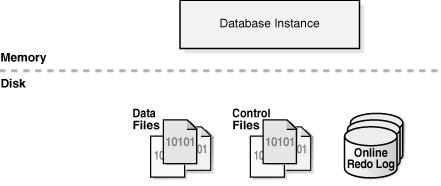
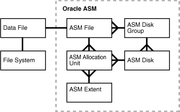
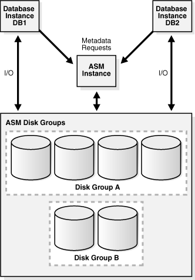
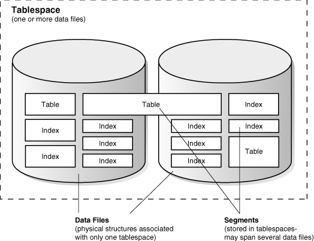
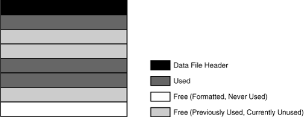
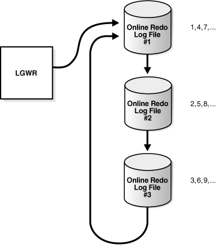
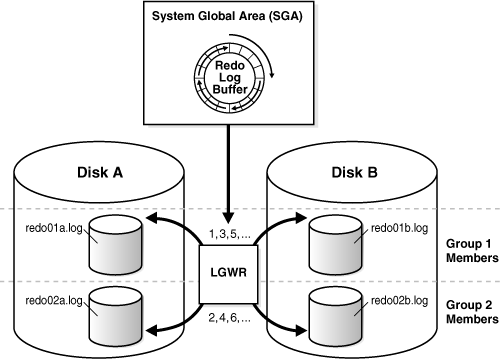

## 11 Physical Storage Structures

This chapter describes the primary physical database structures of an Oracle database. Physical structures are viewable at the operating system level.

This chapter contains the following sections:

## Introduction to Physical Storage Structures

One characteristic of an RDBMS is the independence of logical data structures such as [tables](glossary.md), [views](glossary.md), and [indexes](glossary.md) from physical storage structures. Because physical and logical structures are separate, you can manage physical storage of data without affecting access to logical structures. For example, renaming a database file does not rename the tables stored in it.

An Oracle database is a set of files that store Oracle data in persistent disk storage. This section discusses the database files generated when you issue a `CREATE DATABASE` statement:

- Data files and temp files
	A [data file](glossary.md) is a physical file on disk that was created by Oracle Database and contains data structures such as tables and indexes. A [temp file](glossary.md) is a data file that belongs to a temporary tablespace. The data is written to these files in an Oracle proprietary format that cannot be read by other programs.
- Control files
	A [control file](glossary.md) is a root file that tracks the physical components of the database.
- Online redo log files
	The [online redo log](glossary.md) is a set of files containing records of changes made to data.

A database [instance](glossary.md) is a set of memory structures that manage database files. Figure 11-1 shows the relationship between the instance and the files that it manages.

Figure 11-1 Database Instance and Database Files

> The graphic is depicted in two halves: memory and disk. The database instance block is shown in the memory section. In the disk sections are icons depicting data files, control files, and the online redo log.
>
> [Copyright © 1993, 2015, Oracle and/or its affiliates. All rights reserved.](https://docs.oracle.com/cd/E11882_01/dcommon/html/cpyr.htm)
  

See Also:

- [Oracle Database Administrator's Guide](https://docs.oracle.com/cd/E11882_01/server.112/e25494/create.htm#ADMIN002) to learn how to create a database
- [Oracle Database SQL Language Reference](https://docs.oracle.com/cd/E11882_01/server.112/e41084/statements_5004.htm#SQLRF01204) for `CREATE DATABASE` semantics and syntax

### Mechanisms for Storing Database Files

Several mechanisms are available for allocating and managing the storage of these files. The most common mechanisms include:

- Oracle Automatic Storage Management (Oracle ASM)
	Oracle ASM includes a file system designed exclusively for use by Oracle Database. "Oracle Automatic Storage Management (Oracle ASM)" describes Oracle ASM.
- Operating system file system
	Most Oracle databases store files in a file system, which is a data structure built inside a contiguous disk address space. All operating systems have file managers that allocate and deallocate disk space into files within a file system.
	A file system enables disk space to be allocated to many files. Each file has a name and is made to appear as a contiguous address space to applications such as Oracle Database. The database can create, read, write, resize, and delete files.
	A file system is commonly built on top of a logical volume constructed by a software package called a logical volume manager (LVM). The LVM enables pieces of multiple physical disks to be combined into a single contiguous address space that appears as one disk to higher layers of software.
- Raw device
	Raw devices are disk partitions or logical volumes not formatted with a file system. The primary benefit of raw devices is the ability to perform direct I/O and to write larger buffers. In direct I/O, applications write to and read from the storage device directly, bypassing the operating system buffer cache.
	Note:
	Many file systems now support direct I/O for databases and other applications that manage their own caches. Historically, raw devices were the only means of implementing direct I/O.
- Cluster file system
	A cluster file system is software that enables multiple computers to share file storage while maintaining consistent space allocation and file content. In an Oracle RAC environment, a cluster file system makes shared storage appears as a file system shared by many computers in a clustered environment. With a cluster file system, the failure of a computer in the cluster does not make the file system unavailable. In an operating system file system, however, if a computer sharing files through NFS or other means fails, then the file system is unavailable.

A database employs a combination of the preceding storage mechanisms. For example, a database could store the control files and online redo log files in a traditional file system, some user data files on raw partitions, the remaining data files in Oracle ASM, and archived the redo log files to a cluster file system.

See Also:

- [Oracle Database 2 Day DBA](https://docs.oracle.com/cd/E11882_01/server.112/e10897/storage.htm#ADMQS12062) to learn how to view database storage structures with Oracle Enterprise Manager (Enterprise Manager)
- [Oracle Database Administrator's Guide](https://docs.oracle.com/cd/E11882_01/server.112/e25494/part2.htm#ADMIN12595) to view database storage structures by querying database views

### Oracle Automatic Storage Management (Oracle ASM)

[Oracle ASM](glossary.md) is a high-performance, ease-of-management storage solution for Oracle Database files. Oracle ASM is a volume manager and provides a file system designed exclusively for use by the database.

Oracle ASM provides several advantages over conventional file systems and storage managers, including the following:

- Simplifies storage-related tasks such as creating and laying out databases and managing disk space
- Distributes data across physical disks to eliminate hot spots and to provide uniform performance across the disks
- Rebalances data automatically after storage configuration changes

To use Oracle ASM, you allocate partitioned disks for Oracle Database with preferences for striping and mirroring. Oracle ASM manages the disk space, distributing the I/O load across all available resources to optimize performance while removing the need for manual I/O tuning. For example, you can increase the size of the disk for the database or move parts of the database to new devices without having to shut down the database.

#### Oracle ASM Storage Components

Oracle Database can store a data file as an Oracle ASM file in an Oracle ASM disk group, which is a collection of disks that Oracle ASM manages as a unit. Within a disk group, Oracle ASM exposes a file system interface for database files.

Figure 11-2 shows the relationships between storage components in a database that uses Oracle ASM. The diagram depicts the relationship between an Oracle ASM file and a data file, although Oracle ASM can store other types of files. The crow's foot notation represents a one-to-many relationship.

Figure 11-2 Oracle ASM Components

> On the left of this diagram is a box labeled "Data File" with a line leading to a box labeled "File System." The other boxes in the diagram are within a dotted-line box labeled "Oracle ASM." The Data File box has a one-to-one line leading to a box labeled "ASM File." This box has a many-to-one line leading to a box labeled "ASM Disk Group," which has a one-to-many line leading to a box labeled "ASM Disk." The ASM File box has a one-to-many line leading to a box labeled "ASM Allocation Unit," which has a one-to-many line leading to box labeled "ASM Extent."
  

Figure 11-2 illustrates the following Oracle ASM concepts:

- Oracle ASM Disks
	An Oracle ASM disk is a storage device that is provisioned to an Oracle ASM disk group. An Oracle ASM disk can be a physical disk or partition, a Logical Unit Number (LUN) from a storage array, a logical volume, or a network-attached file.
	Oracle ASM disks can be added or dropped from a disk group while the database is running. When you add a disk to a disk group, you either assign a disk name or the disk is given an Oracle ASM disk name automatically.
- Oracle ASM Disk Groups
	An Oracle ASM disk group is a collection of Oracle ASM disks managed as a logical unit. The data structures in a disk group are self-contained and consume some disk space in a disk group.
	Within a disk group, Oracle ASM exposes a file system interface for Oracle database files. The content of files that are stored in a disk group are evenly distributed, or striped, to eliminate hot spots and to provide uniform performance across the disks. The performance is comparable to the performance of raw devices.
- Oracle ASM Files
	An Oracle ASM file is a file stored in an Oracle ASM disk group. Oracle Database communicates with Oracle ASM in terms of files. The database can store data files, control files, online redo log files, and other types of files as Oracle ASM files. When requested by the database, Oracle ASM creates an Oracle ASM file and assigns it a fully qualified name beginning with a plus sign (`+`) followed by a disk group name, as in `+DISK1`.
	Note:
	Oracle ASM files can coexist with other storage management options such as raw disks and third-party file systems. This capability simplifies the integration of Oracle ASM into pre-existing environments.
- Oracle ASM Extents
	An Oracle ASM extent is the raw storage used to hold the contents of an Oracle ASM file. An Oracle ASM file consists of one or more file extents. Each Oracle ASM extent consists of one or more allocation units on a specific disk.
	Note:
	An Oracle ASM extent is different from the [extent](glossary.md) used to store data in a [segment](glossary.md).
- Oracle ASM Allocation Units
	An allocation unit is the fundamental unit of allocation within a disk group. An allocation unit is the smallest contiguous disk space that Oracle ASM allocates. One or more allocation units form an Oracle ASM extent.

See Also:

- [Oracle Database 2 Day DBA](https://docs.oracle.com/cd/E11882_01/server.112/e10897/asm.htm#ADMQS12100) to learn how to administer Oracle ASM disks with Oracle Enterprise Manager (Enterprise Manager)
- [Oracle Automatic Storage Management Administrator's Guide](https://docs.oracle.com/cd/E11882_01/server.112/e18951/asmcon.htm#OSTMG036) to learn more about Oracle ASM

#### Oracle ASM Instances

An Oracle ASM instance is a special Oracle instance that manages Oracle ASM disks. Both the ASM and the database instances require shared access to the disks in an ASM disk group. ASM instances manage the metadata of the disk group and provide file layout information to the database instances. Database instances direct I/O to ASM disks without going through an ASM instance.

An ASM instance is built on the same technology as a database instance. For example, an ASM instance has a [system global area (SGA)](glossary.md) and background processes that are similar to those of a database instance. However, an ASM instance cannot mount a database and performs fewer tasks than a database instance.

Figure 11-3 shows a single-node configuration with one Oracle ASM instance and two database instances, each associated with a different single-instance database. The ASM instance manages the metadata and provides space allocation for the ASM files storing the data for the two databases. One ASM disk group has four ASM disks and the other has two disks. Both database instances can access the disk groups.

Figure 11-3 Oracle ASM Instance and Database Instances

> At the top left is a box named Database Instance DB1. At the top right is a box named Database Instance DB2. Both boxes point to a box named ASM Instance. Above this box is the caption "Metadata Requests." All three boxes point down to a big box named ASM Disk Groups. Inside this box are the icons Disk Group A and Disk Group B.
  

See Also:

- [Oracle Database 2 Day DBA](https://docs.oracle.com/cd/E11882_01/server.112/e10897/asm.htm#ADMQS12100) to learn how to administer Oracle ASM disks with Oracle Enterprise Manager (Enterprise Manager)
- [Oracle Automatic Storage Management Administrator's Guide](https://docs.oracle.com/cd/E11882_01/server.112/e18951/toc.htm) to learn more about Oracle ASM

### Oracle Managed Files and User-Managed Files

Oracle Managed Files is a file naming strategy that enables you to specify operations in terms of database objects rather than file names. For example, you can create a tablespace without specifying the names of its data files. In this way, Oracle Managed Files eliminates the need for administrators to directly manage the operating system files in a database. Oracle ASM requires Oracle Managed Files.

Note:

This feature does not affect the creation or naming of administrative files such as trace files, audit files, and alert logs (see ["Overview of Diagnostic Files"](startup.md)).

With user-managed files, you directly manage the operating system files in the database. You make the decisions regarding file structure and naming. For example, when you create a tablespace you set the name and path of the tablespace data files.

Through initialization parameters, you specify the file system directory for a specific type of file. The Oracle Managed Files feature ensures that the database creates a unique file and deletes it when no longer needed. The database internally uses standard file system interfaces to create and delete files for data files and temp files, control files, and recovery-related files stored in the [fast recovery area](glossary.md).

Oracle Managed Files does not eliminate existing functionality. You can create new files while manually administering old files. Thus, a database can have a mixture of Oracle Managed Files and user-managed files.

See Also:

[Oracle Database Administrator's Guide](https://docs.oracle.com/cd/E11882_01/server.112/e25494/omf.htm#ADMIN003) to learn how to use Oracle Managed Files

## Overview of Data Files

At the operating system level, Oracle Database stores database data in [data files](glossary.md). Every database must have at least one data file.

### Use of Data Files

[Part IV, "Oracle Relational Data Structures"](part_datstr.md) explains the logical structures in which users store data, the most important of which are tables. Each nonpartitioned [schema object](glossary.md) and each partition of an object is stored in its own [segment](glossary.md).

For ease of administration, Oracle Database allocates space for user data in [tablespaces](glossary.md), which like segments are logical storage structures. Each segment belongs to only one tablespace. For example, the data for a nonpartitioned table is stored in a single segment, which is turn is stored in one tablespace.

Oracle Database physically stores tablespace data in data files. Tablespaces and data files are closely related, but have important differences:

- Each tablespace consists of one or more data files, which conform to the operating system in which Oracle Database is running.
- The data for a database is collectively stored in the data files located in each tablespace of the database.
- A segment can span one or more data files, but it cannot span multiple tablespaces.
- A database must have the `SYSTEM` and `SYSAUX` tablespaces. Oracle Database automatically allocates the first data files of any database for the `SYSTEM` tablespace during database creation.
	The `SYSTEM` tablespace contains the [data dictionary](glossary.md), a set of tables that contains database metadata. Typically, a database also has an [undo tablespace](glossary.md) and a temporary tablespace (usually named `TEMP`).

Figure 11-4 shows the relationship between tablespaces, data files, and segments.

Figure 11-4 Data Files and Tablespaces

> This graphic shows one tablespace that contains two data files. Inside the datafiles are table and index icons. One table is shown spanning two datafiles.
>
> One caption points to both datafiles. The caption says "Data files are physical structures associated with only one tablespace." The segments caption points to a table and index object. The caption says "Segments are stored in tablespaces and may span several data files."
  

See Also:

- ["Overview of Tablespaces"](logical.md)
- [Oracle Database Administrator's Guide](https://docs.oracle.com/cd/E11882_01/server.112/e25494/dfiles.htm#ADMIN012) and [Oracle Database 2 Day DBA](https://docs.oracle.com/cd/E11882_01/server.112/e10897/storage.htm#ADMQS12052) to learn how to manage data files

### Permanent and Temporary Data Files

A permanent tablespace contains persistent schema objects. Objects in permanent tablespaces are stored in data files.

A temporary tablespace contains schema objects only for the duration of a session. Locally managed temporary tablespaces have temporary files ([temp file](glossary.md) s), which are special files designed to store data in hash, sort, and other operations. Temp files also store result set data when insufficient space exists in memory.

Temp files are similar to permanent data files, with the following exceptions:

- Permanent database objects such as tables are never stored in temp files.
- Temp files are always set to `NOLOGGING` mode, which means that they never have redo generated for them. Media recovery does not recognize temp files.
- You cannot make a temp file read-only.
- You cannot create a temp file with the `ALTER` `DATABASE` statement.
- When you create or resize temp files, they are not always guaranteed allocation of disk space for the file size specified. On file systems such as Linux and UNIX, temp files are created as sparse files. In this case, disk blocks are allocated not at file creation or resizing, but as the blocks are accessed for the first time.
	Caution:
	Sparse files enable fast temp file creation and resizing; however, the disk could run out of space later when the temp files are accessed.
- Temp file information is shown in the data dictionary view `DBA_TEMP_FILES` and the dynamic performance view `V$TEMPFILE`, but not in `DBA_DATA_FILES` or the `V$DATAFILE` view.

See Also:

- ["Temporary Tablespaces"](logical.md)
- [Oracle Database Administrator's Guide](https://docs.oracle.com/cd/E11882_01/server.112/e25494/omf.htm#ADMIN11504) to learn how to manage temp files

### Online and Offline Data Files

Every data file is either online (available) or offline (unavailable). You can alter the availability of individual data files or temp files by taking them offline or bringing them online. Offline data files cannot be accessed until they are brought back online.

Administrators may take data files offline for many reasons, including performing offline backups, renaming a data file, or block corruption. The database takes a data file offline automatically if the database cannot write to it.

Like a data file, a tablespace itself is offline or online. When you take a data file offline in an online tablespace, the tablespace itself remains online. You can make all data files of a tablespace temporarily unavailable by taking the tablespace itself offline

See Also:

- ["Online and Offline Tablespaces"](logical.md)
- [Oracle Database Administrator's Guide](https://docs.oracle.com/cd/E11882_01/server.112/e25494/dfiles.htm#ADMIN11426) to learn how to alter data file availability

### Data File Structure

Oracle Database creates a data file for a tablespace by allocating the specified amount of disk space plus the overhead for the data file header. The operating system under which Oracle Database runs is responsible for clearing old information and authorizations from a file before allocating it to the database.

The data file header contains metadata about the data file such as its size and [checkpoint](glossary.md) [SCN](glossary.md). Each header contains an absolute file number and a relative file number. The absolute file number uniquely identifies the data file within the database. The relative file number uniquely identifies a data file within a tablespace.

When Oracle Database first creates a data file, the allocated disk space is formatted but contains no user data. However, the database reserves the space to hold the data for future segments of the associated tablespace. As the data grows in a tablespace, Oracle Database uses the free space in the data files to allocate [extents](glossary.md) for the segment.

Figure 11-5 illustrates the different types of space in a data file. Extents are either used, which means they contain segment data, or free, which means they are available for reuse. Over time, updates and deletions of objects within a tablespace can create pockets of empty space that individually are not large enough to be reused for new data. This type of empty space is referred to as fragmented free space.

Figure 11-5 Space in a Data File

> This graphic depicts a data file as layered slabs. The top slab is the data file header. The second, fifth, and sixth slabs are used. The last slab is free (formatted, but never used). The third, fourth, and seventh slabs are free (previously used, currently unused).
>
> [Copyright © 1993, 2015, Oracle and/or its affiliates. All rights reserved.](https://docs.oracle.com/cd/E11882_01/dcommon/html/cpyr.htm)
  

See Also:

[Oracle Database 2 Day DBA](https://docs.oracle.com/cd/E11882_01/server.112/e10897/storage.htm#ADMQS12066) and [Oracle Database Administrator's Guide](https://docs.oracle.com/cd/E11882_01/server.112/e25494/dfiles.htm#ADMIN11459) to learn how to view data file information

## Overview of Control Files

The database [control file](glossary.md) is a small binary file associated with only one database. Each database has one unique control file, although it may maintain identical copies of it.

### Use of Control Files

The control file is the root file that Oracle Database uses to find database files and to manage the state of the database generally. A control file contains information such as the following:

- The database name and database unique identifier (DBID)
- The time stamp of database creation
- Information about data files, online redo log files, and [archived redo log files](glossary.md)
- Tablespace information
- RMAN backups

The control file serves the following purposes:

- It contains information about data files, online redo log files, and so on that are required to open the database.
	The control file tracks structural changes to the database. For example, when an administrator adds, renames, or drops a data file or online redo log file, the database updates the control file to reflect this change.
- It contains metadata that must be accessible when the database is not open.
	For example, the control file contains information required to recover the database, including checkpoints. A [checkpoint](glossary.md) indicates the [SCN](glossary.md) in the redo stream where [instance recovery](glossary.md) would be required to begin (see ["Overview of Instance Recovery"](startup.md)). Every committed change before a checkpoint SCN is guaranteed to be saved on disk in the data files. At least every three seconds the checkpoint process records information in the control file about the checkpoint position in the online redo log.

Oracle Database reads and writes to the control file continuously during database use and must be available for writing whenever the database is open. For example, recovering a database involves reading from the control file the names of all the data files contained in the database. Other operations, such as adding a data file, update the information stored in the control file.

See Also:

- ["Checkpoint Process (CKPT)"](process.md)
- [Oracle Database Administrator's Guide](https://docs.oracle.com/cd/E11882_01/server.112/e25494/control.htm#ADMIN006) to learn how to manage the control file

### Multiple Control Files

Oracle Database enables multiple, identical control files to be open concurrently and written for the same database. By multiplexing a control file on different disks, the database can achieve redundancy and thereby avoid a single point of failure.

Note:

Oracle recommends that you maintain multiple control file copies, each on a different disk.

If a control file becomes unusable, then the database instance fails when it attempts to access the damaged control file. When other current control file copies exist, the database can be remounted and opened without [media recovery](glossary.md). If all control files of a database are lost, however, then the instance fails and media recovery is required. Media recovery is not straightforward if an older backup of a control file must be used because a current copy is not available.

See Also:

- [Oracle Database Administrator's Guide](https://docs.oracle.com/cd/E11882_01/server.112/e25494/control.htm#ADMIN10064) to learn how to maintain multiple control files
- [Oracle Database Backup and Recovery User's Guide](https://docs.oracle.com/cd/E11882_01/backup.112/e10642/rcmadvre.htm#BRADV154) to learn how to back up and restore control files

### Control File Structure

Information about the database is stored in different sections of the control file. Each section is a set of records about an aspect of the database. For example, one section in the control file tracks data files and contains a set of records, one for each data file. Each section is stored in multiple logical control file blocks. Records can span blocks within a section.

The control file contains the following types of records:

- Circular reuse records
	These records contain noncritical information that is eligible to be overwritten if needed. When all available record slots are full, the database either expands the control file to make room for a new record or overwrites the oldest record. Examples include records about archived redo log files and RMAN backups.
- Noncircular reuse records
	These records contain critical information that does not change often and cannot be overwritten. Examples of information include tablespaces, data files, online redo log files, and redo threads. Oracle Database never reuses these records unless the corresponding object is dropped from the tablespace.

As explained in ["Overview of the Dynamic Performance Views"](datadict.md), you can query the dynamic performance views, also known as `V$` views, to view the information stored in the control file. For example, you can query `V$DATABASE` to obtain the database name and DBID. However, only the database can modify the information in the control file.

Reading and writing the control file blocks is different from reading and writing [data blocks](glossary.md). For the control file, Oracle Database reads and writes directly from the disk to the [program global area (PGA)](glossary.md). Each process allocates a certain amount of its PGA memory for control file blocks.

See Also:

- [Oracle Database Reference](https://docs.oracle.com/cd/E11882_01/server.112/e40402/dynviews_1088.htm#REFRN30044) to learn about the `V$CONTROLFILE_RECORD_SECTION` view
- [Oracle Database Reference](https://docs.oracle.com/cd/E11882_01/server.112/e40402/initparams036.htm#REFRN10020) to learn about the `CONTROL_FILE_RECORD_KEEP_TIME` initialization parameter

## Overview of the Online Redo Log

The most crucial structure for recovery is the online [redo log](glossary.md), which consists of two or more preallocated files that store changes to the database as they occur. The online redo log records changes to the data files.

### Use of the Online Redo Log

The database maintains online redo log files to protect against data loss. Specifically, after an [instance failure](glossary.md) the online redo log files enable Oracle Database to recover committed data not yet written to the data files.

Oracle Database writes every transaction synchronously to the [redo log buffer](glossary.md), which is then written to the online redo logs. The contents of the log include uncommitted transactions, undo data, and schema and object management statements.

Oracle Database uses the online redo log only for recovery. However, administrators can query online redo log files through a SQL interface in the Oracle LogMiner utility (see ["Oracle LogMiner"](cncptdba.md)). Redo log files are a useful source of historical information about database activity.

See Also:

["Overview of Instance Recovery"](startup.md)

### How Oracle Database Writes to the Online Redo Log

The online redo log for a database instance is called a [redo thread](glossary.md). In single-instance configurations, only one instance accesses a database, so only one redo thread is present. In an Oracle Real Application Clusters (Oracle RAC) configuration, however, two or more instances concurrently access a database, with each instance having its own redo thread. A separate redo thread for each instance avoids contention for a single set of online redo log files.

An online redo log consists of two or more online redo log files. Oracle Database requires a minimum of two files to guarantee that one is always available for writing while the other is being archived (if the database is in [ARCHIVELOG mode](glossary.md)).

See Also:

[Oracle Database 2 Day + Real Application Clusters Guide](https://docs.oracle.com/cd/E11882_01/rac.112/e17264/adminrac.htm#TDPRC217) and [Oracle Real Application Clusters Administration and Deployment Guide](https://docs.oracle.com/cd/E11882_01/rac.112/e41960/storage.htm#RACAD704) to learn about online redo log groups in Oracle RAC

#### Online Redo Log Switches

Oracle Database uses only one online redo log file at a time to store records written from the redo log buffer. The online redo log file to which the [log writer (LGWR)](glossary.md) process is actively writing is called the current online redo log file.

A [log switch](glossary.md) occurs when the database stops writing to one online redo log file and begins writing to another. Normally, a switch occurs when the current online redo log file is full and writing must continue. However, you can configure log switches to occur at regular intervals, regardless of whether the current online redo log file is filled, and force log switches manually.

Log writer writes to online redo log files circularly. When log writer fills the last available online redo log file, the process writes to the first log file, restarting the cycle. Figure 11-6 illustrates the circular writing of the redo log.

Figure 11-6 Reuse of Online Redo Log Files

> The LGWR box points to a cylinder named Online Redo Log File #1. Next to it are the numbers 1, 4, and 7. This cylinder points to a cylinder named Online Redo Log File #2. Next to it are the numbers 2, 5, and 8. This cylinder points to a cylinder named Online Redo Log File #3. Next to it are the numbers 3, 6, and 9. Cylinder #3 points back up to cylinder #1.
>
> End of image description.
  

The numbers in Figure 11-6 shows the sequence in which LGWR writes to each online redo log file. The database assigns each file a new [log sequence number](glossary.md) when a log switches and log writers begins writing to it. When the database reuses an online redo log file, this file receives the next available log sequence number.

Filled online redo log files are available for reuse depending on the archiving mode:

- If archiving is disabled, which means that the database is in `NOARCHIVELOG` mode, then a filled online redo log file is available after the changes recorded in it have been checkpointed (written) to disk by [database writer (DBW)](glossary.md).
- If archiving is enabled, which means that the database is in [ARCHIVELOG mode](glossary.md), then a filled online redo log file is available to log writer after the changes have been written to the data files and the file has been archived.

In some circumstances, log writer may be prevented from reusing an existing online redo log file. For example, an online redo log file may be active (required for instance recovery) rather than inactive (not required for instance recovery). Also, an online redo log file may be in the process of being cleared.

See Also:

- ["Overview of Background Processes"](process.md)
- [Oracle Database 2 Day DBA](https://docs.oracle.com/cd/E11882_01/server.112/e10897/storage.htm#ADMQS12073) and [Oracle Database Administrator's Guide](https://docs.oracle.com/cd/E11882_01/server.112/e25494/onlineredo.htm#ADMIN007) to learn how to manage the online redo log

#### Multiple Copies of Online Redo Log Files

Oracle Database can automatically maintain two or more identical copies of the online redo log in separate locations. An online redo log group consists of an online redo log file and its redundant copies. Each identical copy is a member of the online redo log group. Each group is defined by a number, such as group 1, group 2, and so on.

Maintaining multiple members of an online redo log group protects against the loss of the redo log. Ideally, the locations of the members should be on separate disks so that the failure of one disk does not cause the loss of the entire online redo log.

In Figure 11-7, `A_LOG1` and `B_LOG1` are identical members of group 1, while `A_LOG2` and `B_LOG2` are identical members of group 2. Each member in a group must be the same size. LGWR writes concurrently to group 1 (members `A_LOG1` and `B_LOG1`), then writes concurrently to group 2 (members `A_LOG2` and `B_LOG2`), then writes to group 1, and so on. LGWR never writes concurrently to members of different groups.

Figure 11-7 Multiple Copies of Online Redo Log Files

> This image shows two disks, DISK A and DISK B, containing online redo log files. Each disk contains identical online redo log files. LGWR writes concurrently to the online redo log files. Each identical set of redo log files is called a group. This image shows two groups.Group 1 consists of the following members:
>
> - redo01a.log on Disk A
> - redo01b.log on Disk B
>
> Group 2 consists of the following members:
>
> - redo02a.log on Disk A
> - redo02b.log on Disk B
>
> End of image description.
  

Note:

Oracle recommends that you multiplex the online redo log. The loss of log files can be catastrophic if recovery is required. When you multiplex the online redo log, the database must increase the amount of I/O it performs. Depending on your system, this additional I/O may impact overall database performance.

See Also:

[Oracle Database Administrator's Guide](https://docs.oracle.com/cd/E11882_01/server.112/e25494/onlineredo.htm#ADMIN11309) to learn how to maintain multiple copies of the online redo log files

#### Archived Redo Log Files

An archived redo log file is a copy of a filled member of an online redo log group. This file is not considered part of the database, but is an offline copy of an online redo log file created by the database and written to a user-specified location.

Archived redo log files are a crucial part of a backup and recovery strategy. You can use archived redo log files to:

- Recover a database backup
- Update a [standby database](glossary.md) (see ["Computer Failures"](cmntopc.md))
- Obtain information about the history of a database using the LogMiner utility (see ["Oracle LogMiner"](cncptdba.md))

Archiving is the operation of generating an archived redo log file. Archiving is either automatic or manual and is only possible when the database is in `ARCHIVELOG` mode.

An archived redo log file includes the redo entries and the log sequence number of the identical member of the online redo log group. In Figure 11-7, files `A_LOG1` and `B_LOG1` are identical members of Group 1. If the database is in `ARCHIVELOG` mode, and if automatic archiving is enabled, then the archiver process (ARCn) will archive one of these files. If `A_LOG1` is corrupted, then the process can archive `B_LOG1`. The archived redo log contains a copy of every group created since you enabled archiving.

See Also:

- ["Data File Recovery"](cncptdba.md)
- [Oracle Database Administrator's Guide](https://docs.oracle.com/cd/E11882_01/server.112/e25494/archredo.htm#ADMIN008) to learn how to manage the archived redo log

### Structure of the Online Redo Log

Online redo log files contain redo records. A redo record is made up of a group of change vectors, each of which describes a change to a [data block](glossary.md). For example, an update to a salary in the `employees` table generates a redo record that describes changes to the [data segment](glossary.md) block for the table, the undo segment data block, and the [transaction table](glossary.md) of the undo segments.

The redo records have all relevant metadata for the change, including the following:

- [SCN](glossary.md) and time stamp of the change
- Transaction ID of the transaction that generated the change
- SCN and time stamp when the transaction committed (if it committed)
- Type of operation that made the change
- Name and type of the modified data segment

See Also:

["Overview of Data Blocks"](logical.md)