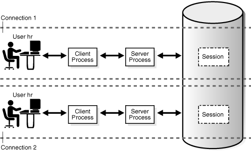
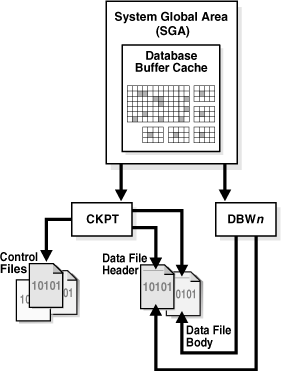
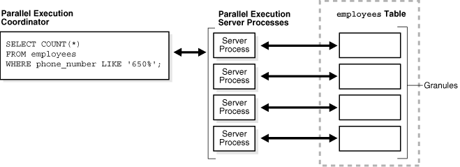

## 15 Process Architecture

This chapter discusses the processes in an Oracle database.

This chapter contains the following sections:

## Introduction to Processes

A [process](glossary.md) is a mechanism in an operating system that can run a series of steps. The mechanism depends on the operating system. For example, on Linux an Oracle background process is a Linux process. On Windows, an Oracle background process is a thread of execution within a process.

Code modules are run by processes. All connected Oracle Database users must run the following modules to access a database [instance](glossary.md):

- Application or Oracle Database utility
	A database user runs a database application, such as a [precompiler](glossary.md) program or a database tool such as SQL\*Plus, that issues SQL statements to a database.
- Oracle database code
	Each user has Oracle database code executing on his or her behalf that interprets and processes the application's SQL statements.

A process normally runs in its own private memory area. Most processes can periodically write to an associated trace file (see ["Trace Files"](startup.md)).

### Multiple-Process Oracle Database Systems

Multiple-process Oracle (also called multiuser Oracle) uses several processes to run different parts of the Oracle Database code and additional processes for the users—either one process for each connected user or one or more processes shared by multiple users. Most databases are multiuser because a primary advantages of a database is managing data needed by multiple users simultaneously.

Each process in a database instance performs a specific job. By dividing the work of the database and applications into several processes, multiple users and applications can connect to an instance simultaneously while the system gives good performance.

### Types of Processes

A database instance contains or interacts with the following types of processes:

- Client processes run the application or Oracle tool code.
- Oracle processes run the Oracle database code. Oracle processes including the following subtypes:
	- Background processes start with the database instance and perform maintenance tasks such as performing [instance recovery](glossary.md), cleaning up processes, writing redo buffers to disk, and so on.
		- Server processes perform work based on a client request.
		For example, these processes parse SQL queries, place them in the [shared pool](glossary.md), create and execute a [query plan](glossary.md) for each [query](glossary.md), and read buffers from the [database buffer cache](glossary.md) or from disk.
		Note:
		Server processes, and the process memory allocated in these processes, run in the instance. The instance continues to function when server processes terminate.
		- Slave processes perform additional tasks for a background or server process.

The process structure varies depending on the operating system and the choice of Oracle Database options. For example, the code for connected users can be configured for [dedicated server](glossary.md) or [shared server](glossary.md) connections. In a shared server architecture, each server process that runs database code can serve multiple client processes.

Figure 15-1 shows a [system global area (SGA)](glossary.md) and background processes using dedicated server connections. For each user connection, the application is run by a [client process](glossary.md) that is different from the dedicated server process that runs the database code. Each client process is associated with its own server process, which has its own [program global area (PGA)](glossary.md).

Figure 15-1 Oracle Processes and the SGA


> The graphic shows the SGA. Within the SGA are the Database Buffer Cache, Redo Log Buffer, Shared Pool, Large Pool, Fixed SGA, Java Pool, and Streams Pool. To the right of the SGA are the background processes PMON, SMON, RECO, MMON, MMNL, and Others. Below the SGA are DBWn, CKPT, LGWR, ARCn, and RVWR. Below the SGA are the PGA and Server Process. The Server Process is connected to a Client Process.
  

See Also:

- ["Dedicated Server Architecture"](dist_pro.md) and ["Shared Server Architecture"](dist_pro.md)
- Your Oracle Database operating system-specific documentation for more details on configuration choices
- [Oracle Database Reference](https://docs.oracle.com/cd/E11882_01/server.112/e40402/dynviews_2101.htm#REFRN30186) to learn about the `V$PROCESS` view

## Overview of Client Processes

When a user runs an application such as a Pro\*C program or SQL\*Plus, the operating system creates a client process (sometimes called a user process) to run the user application. The client application has Oracle Database libraries linked into it that provide the APIs required to communicate with the database.

### Client and Server Processes

Client processes differ in important ways from the Oracle processes interacting directly with the instance. The Oracle processes servicing the client process can read from and write to the SGA, whereas the client process cannot. A client process can run on a host other than the database host, whereas Oracle processes cannot.

For example, assume that a user on a client host starts SQL\*Plus and connects over the network to database `sample` on a different host (the database instance is not started):

```
SQL> CONNECT SYS@inst1 AS SYSDBA
Enter password: *********
Connected to an idle instance.
```

On the client host, a search of the processes for either `sqlplus` or `sample` shows only the `sqlplus` client process:

```
% ps -ef | grep -e sample -e sqlplus | grep -v grep
clientuser 29437 29436  0 15:40 pts/1    00:00:00 sqlplus           as sysdba
```

On the database host, a search of the processes for either `sqlplus` or `sample` shows a server process with a nonlocal connection, but no client process:

```
% ps -ef | grep -e sample -e sqlplus | grep -v grep
serveruser 29441     1  0 15:40 ?        00:00:00 oraclesample (LOCAL=NO)
```

### Connections and Sessions

A [connection](glossary.md) is a physical communication pathway between a client process and a database instance. A communication pathway is established using available interprocess communication mechanisms or network software. Typically, a connection occurs between a client process and a server process or dispatcher, but it can also occur between a client process and Oracle Connection Manager (CMAN).

A [session](glossary.md) is a logical entity in the database instance memory that represents the state of a current user login to a database. For example, when a user is authenticated by the database with a password, a session is established for this user. A session lasts from the time the user is authenticated by the database until the time the user disconnects or exits the database application.

A single connection can have 0, 1, or more sessions established on it. The sessions are independent: a commit in one session does not affect [transactions](glossary.md) in other sessions.

Note:

If Oracle Net [connection pooling](glossary.md) is configured, then it is possible for a connection to drop but leave the sessions intact.

Multiple sessions can exist concurrently for a single database user. As shown in Figure 15-2, user `hr` can have multiple connections to a database. In dedicated server connections, the database creates a server process on behalf of each connection. Only the client process that causes the dedicated server to be created uses it. In a shared server connection, many client processes access a single shared server process.

Figure 15-2 One Session for Each Connection



> This graphic has two identical rows of squares: User hr, Client Process, Server Process, and Session. The squares are connected with double-headed arrows. The top row is labeled Connection 1. The bottom row is labeled Connection 2.
>
> [Copyright © 1993, 2015, Oracle and/or its affiliates. All rights reserved.](https://docs.oracle.com/cd/E11882_01/dcommon/html/cpyr.htm)
  

Figure 15-3 illustrates a case in which user `hr` has a single connection to a database, but this connection has two sessions.

Figure 15-3 Two Sessions in One Connection


> This graphic has one rows of squares: User hr, User Process, Server Process, and two Session boxes (on top of each other). The squares are connected with double-headed arrows. The row has a dotted line above and below it and is labeled Connection.
>
> [Copyright © 1993, 2015, Oracle and/or its affiliates. All rights reserved.](https://docs.oracle.com/cd/E11882_01/dcommon/html/cpyr.htm)
  

Generating an autotrace report of SQL statement execution statistics re-creates the scenario in Figure 15-3. Example 15-2 connects SQL\*Plus to the database as user `SYSTEM` and enables tracing, thus creating a new session (sample output included).

Example 15-1 One Connection with Two Sessions

```
SQL> SELECT SID, SERIAL#, PADDR FROM V$SESSION WHERE USERNAME = USER;

SID SERIAL# PADDR
--- ------- --------
 90      91 3BE2E41C
 
SQL> SET AUTOTRACE ON STATISTICS;
SQL> SELECT SID, SERIAL#, PADDR FROM V$SESSION WHERE USERNAME = USER;
 
SID SERIAL# PADDR
--- ------- --------
 88      93 3BE2E41C
 90      91 3BE2E41C
...
SQL> DISCONNECT
```

The `DISCONNECT` command in Example 15-1 actually ends the sessions, not the connection. Opening a new terminal and connecting to the instance as a different user, the query in Example 15-2 shows that the connection from Example 15-1 is still active.

Example 15-2 Connection with No Sessions

```
SQL> CONNECT dba1@inst1
Password: ********
Connected.
SQL> SELECT PROGRAM FROM V$PROCESS WHERE ADDR = HEXTORAW('3BE2E41C');

PROGRAM
------------------------------------------------
oracle@stbcs09-1 (TNS V1-V3)
```

See Also:

["Shared Server Architecture"](dist_pro.md)

## Overview of Server Processes

Oracle Database creates server processes to handle the requests of client processes connected to the instance. A client process always communicates with a database through a separate server process.

Server processes created on behalf of a database application can perform one or more of the following tasks:

- Parse and run SQL statements issued through the application, including creating and executing the [query plan](glossary.md) (see ["Stages of SQL Processing"](sqllangu.md))
- Execute PL/SQL code
- Read data blocks from data files into the database buffer cache (the DBWn background process has the task of writing modified blocks back to disk)
- Return results in such a way that the application can process the information

### Dedicated Server Processes

In dedicated server connections, the client connection is associated with one and only one server process (see ["Dedicated Server Architecture"](dist_pro.md)). On Linux, 20 client processes connected to a database instance are serviced by 20 server processes.

Each client process communicates directly with its server process. This server process is dedicated to its client process for the duration of the session. The server process stores process-specific information and the [UGA](glossary.md) in its PGA (see ["PGA Usage in Dedicated and Shared Server Modes"](memory.md)).

### Shared Server Processes

In shared server connections, client applications connect over a network to a dispatcher process, not a server process (see ["Shared Server Architecture"](dist_pro.md)). For example, 20 client processes can connect to a single dispatcher process.

The dispatcher process receives requests from connected clients and puts them into a request queue in the [large pool](glossary.md) (see ["Large Pool"](memory.md)). The first available shared server process takes the request from the queue and processes it. Afterward, the shared server place the result into the dispatcher response queue. The dispatcher process monitors this queue and transmits the result to the client.

Like a dedicated server process, a shared server process has its own PGA. However, the UGA for a session is in the SGA so that any shared server can access session data.

## Overview of Background Processes

A multiprocess Oracle database uses some additional processes called background processes. The background processes perform maintenance tasks required to operate the database and to maximize performance for multiple users.

Each background process has a separate task, but works with the other processes. For example, the LGWR process writes data from the [redo log buffer](glossary.md) to the [online redo log](glossary.md). When a filled log file is ready to be archived, `LGWR` signals another process to archive the file.

Oracle Database creates background processes automatically when a database instance starts. An instance can have many background processes, not all of which always exist in every database configuration. The following query lists the background processes running on your database:

```
SELECT PNAME 
FROM   V$PROCESS 
WHERE  PNAME IS NOT NULL 
ORDER BY PNAME;
```

This section includes the following topics:

- Mandatory Background Processes
- Optional Background Processes
- Slave Processes

See Also:

[Oracle Database Reference](https://docs.oracle.com/cd/E11882_01/server.112/e40402/bgprocesses.htm#REFRN104) for descriptions of all the background processes

### Mandatory Background Processes

The mandatory background processes are present in all typical database configurations. These processes run by default in a database instance started with a minimally configured initialization parameter file (see [Example 13-1](startup.md)).

This section describes the following mandatory background processes:

- Process Monitor Process (PMON)
- System Monitor Process (SMON)
- Database Writer Process (DBWn)
- Log Writer Process (LGWR)
- Checkpoint Process (CKPT)
- Manageability Monitor Processes (MMON and MMNL)
- Recoverer Process (RECO)

See Also:

- [Oracle Database Reference](https://docs.oracle.com/cd/E11882_01/server.112/e40402/bgprocesses.htm#REFRN104) for descriptions of other mandatory processes, including MMAN, DIAG, VKTM, DBRM, and PSP0
- [Oracle Real Application Clusters Administration and Deployment Guide](https://docs.oracle.com/cd/E11882_01/rac.112/e41960/admcon.htm#RACAD7275) and [Oracle Clusterware Administration and Deployment Guide](https://docs.oracle.com/cd/E11882_01/rac.112/e41959/intro.htm#CWADD90953) for more information about background processes specific to Oracle RAC and Oracle Clusterware

#### Process Monitor Process (PMON)

The process monitor (PMON) monitors the other background processes and performs process recovery when a server or dispatcher process terminates abnormally. PMON is responsible for cleaning up the database buffer cache and freeing resources that the client process was using. For example, PMON resets the status of the active [transaction table](glossary.md), releases [locks](glossary.md) that are no longer required, and removes the process ID from the list of active processes.

PMON also registers information about the instance and dispatcher processes with the Oracle Net listener (see ["The Oracle Net Listener"](dist_pro.md)). When an instance starts, PMON polls the listener to determine whether it is running. If the listener is running, then PMON passes it relevant parameters. If it is not running, then PMON periodically attempts to contact it.

#### System Monitor Process (SMON)

The system monitor process (SMON) is in charge of a variety of system-level cleanup duties. The duties assigned to SMON include:

- Performing instance recovery, if necessary, at instance startup. In an Oracle RAC database, the SMON process of one database instance can perform instance recovery for a failed instance.
- Recovering terminated transactions that were skipped during instance recovery because of file-read or tablespace offline errors. SMON recovers the transactions when the tablespace or file is brought back online.
- Cleaning up unused temporary [segments](glossary.md). For example, Oracle Database allocates extents when creating an index. If the operation fails, then SMON cleans up the temporary space.
- Coalescing contiguous free extents within dictionary-managed tablespaces.

SMON checks regularly to see whether it is needed. Other processes can call SMON if they detect a need for it.

#### Database Writer Process (DBWn)

The database writer process (DBWn) writes the contents of database buffers to data files. DBWn processes write modified buffers in the database buffer cache to disk (see ["Database Buffer Cache"](memory.md)).

Although one database writer process (DBW0) is adequate for most systems, you can configure additional processes—DBW1 through DBW9 and DBWa through DBWj—to improve write performance if your system modifies data heavily. These additional DBWn processes are not useful on uniprocessor systems.

The DBWn process writes dirty buffers to disk under the following conditions:

- When a server process cannot find a clean reusable buffer after scanning a threshold number of buffers, it signals DBWn to write. DBWn writes dirty buffers to disk asynchronously if possible while performing other processing.
- DBWn periodically writes buffers to advance the [checkpoint](glossary.md), which is the position in the [redo thread](glossary.md) from which instance recovery begins (see ["Overview of Checkpoints"](startup.md)). The log position of the checkpoint is determined by the oldest dirty buffer in the buffer cache.

In many cases the blocks that DBWn writes are scattered throughout the disk. Thus, the writes tend to be slower than the sequential writes performed by LGWR. DBWn performs multiblock writes when possible to improve efficiency. The number of blocks written in a multiblock write varies by operating system.

See Also:

[Oracle Database Performance Tuning Guide](https://docs.oracle.com/cd/E11882_01/server.112/e41573/instance_tune.htm#PFGRF94511) for advice on configuring, monitoring, and tuning DBWn

#### Log Writer Process (LGWR)

The log writer process (LGWR) manages the redo log buffer. LGWR writes one contiguous portion of the buffer to the online redo log. By separating the tasks of modifying database buffers, performing scattered writes of dirty buffers to disk, and performing fast sequential writes of redo to disk, the database improves performance.

In the following circumstances, LGWR writes all redo entries that have been copied into the buffer since the last time it wrote:

- A user commits a transaction (see ["Committing Transactions"](transact.md)).
- An online redo [log switch](glossary.md) occurs.
- Three seconds have passed since LGWR last wrote.
- The redo log buffer is one-third full or contains 1 MB of buffered data.
- DBWn must write modified buffers to disk.
	Before DBWn can write a dirty buffer, redo records associated with changes to the buffer must be written to disk (the write-ahead protocol). If DBWn finds that some redo records have not been written, it signals LGWR to write the records to disk and waits for LGWR to complete before writing the data buffers to disk.

##### LGWR and Commits

Oracle Database uses a fast commit mechanism to improve performance for committed transactions. When a user issues a `COMMIT` statement, the transaction is assigned a [system change number (SCN)](glossary.md). LGWR puts a commit record in the redo log buffer and writes it to disk immediately, along with the commit SCN and transaction's redo entries.

The redo log buffer is circular. When LGWR writes redo entries from the redo log buffer to an online redo log file, server processes can copy new entries over the entries in the redo log buffer that have been written to disk. LGWR normally writes fast enough to ensure that space is always available in the buffer for new entries, even when access to the online redo log is heavy.

The atomic write of the redo entry containing the transaction's commit record is the single event that determines the transaction has committed. Oracle Database returns a success code to the committing transaction although the data buffers have not yet been written to disk. The corresponding changes to data blocks are deferred until it is efficient for DBWn to write them to the data files.

Note:

LGWR can write redo log entries to disk before a transaction commits. The changes that are protected by the redo entries become permanent only if the transaction later commits.

When activity is high, LGWR can use group commits. For example, a user commits, causing LGWR to write the transaction's redo entries to disk. During this write other users commit. LGWR cannot write to disk to commit these transactions until its previous write completes. Upon completion, LGWR can write the list of redo entries of waiting transactions (not yet committed) in one operation. In this way, the database minimizes disk I/O and maximizes performance. If commits requests continue at a high rate, then every write by LGWR can contain multiple commit records.

##### LGWR and Inaccessible Files

LGWR writes synchronously to the active mirrored group of online redo log files. If a log file is inaccessible, then LGWR continues writing to other files in the group and writes an error to the LGWR trace file and the [alert log](glossary.md). If all files in a group are damaged, or if the group is unavailable because it has not been archived, then LGWR cannot continue to function.

See Also:

- ["How Oracle Database Writes to the Online Redo Log"](physical.md) and ["Redo Log Buffer"](memory.md)
- [Oracle Database Performance Tuning Guide](https://docs.oracle.com/cd/E11882_01/server.112/e41573/memory.htm#PFGRF94347) for information about how to monitor and tune the performance of LGWR

#### Checkpoint Process (CKPT)

The checkpoint process (CKPT) updates the control file and data file headers with checkpoint information and signals DBWn to write blocks to disk. Checkpoint information includes the checkpoint position, SCN, location in online redo log to begin recovery, and so on. As shown in Figure 15-4, CKPT does not write data blocks to data files or redo blocks to online redo log files.

Figure 15-4 Checkpoint Process



> This graphic shows an SGA box containing a Database Buffer Cache icon. An arrow points downward out of the buffer cache to a DBWn box. The DBWn box has one arrow pointing to Data File Body and another arrow pointing to Data File Header. The CKPT box also has one arrow pointing to Data File Body and another arrow pointing to Data File Header. A CKPT box points to an icon labeled Control Files.
  

See Also:

["Overview of Checkpoints"](startup.md)

#### Manageability Monitor Processes (MMON and MMNL)

The manageability monitor process (MMON) performs many tasks related to the [Automatic Workload Repository (AWR)](glossary.md). For example, MMON writes when a metric violates its threshold value, taking snapshots, and capturing statistics value for recently modified SQL objects.

The manageability monitor lite process (MMNL) writes statistics from the Active Session History (ASH) buffer in the SGA to disk. MMNL writes to disk when the ASH buffer is full.

#### Recoverer Process (RECO)

In a [distributed database](glossary.md), the recoverer process (RECO) automatically resolves failures in [distributed transactions](glossary.md). The RECO process of a node automatically connects to other databases involved in an in-doubt distributed transaction. When RECO reestablishes a connection between the databases, it automatically resolves all in-doubt transactions, removing from each database's pending transaction table any rows that correspond to the resolved transactions.

See Also:

[Oracle Database Administrator's Guide](https://docs.oracle.com/cd/E11882_01/server.112/e25494/ds_txnman.htm#ADMIN12287) for more information about transaction recovery in distributed systems

### Optional Background Processes

An optional background process is any background process not defined as mandatory. Most optional background processes are specific to tasks or features. For example, background processes that support Oracle Streams Advanced Queuing (AQ) or [Oracle Automatic Storage Management (Oracle ASM)](glossary.md) are only available when these features are enabled.

This section describes some common optional processes:

- Archiver Processes (ARCn)
- Job Queue Processes (CJQ0 and Jnnn)
- Flashback Data Archiver Process (FBDA)
- Space Management Coordinator Process (SMCO)

See Also:

- ["Oracle Streams Advanced Queuing (AQ)"](cmntopc.md)
- [Oracle Database Reference](https://docs.oracle.com/cd/E11882_01/server.112/e40402/bgprocesses.htm#REFRN104) for descriptions of background processes specific to AQ and ASM

#### Archiver Processes (ARCn)

The archiver processes (ARCn) copy online redo log files to offline storage after a redo log switch occurs. These processes can also collect transaction redo data and transmit it to [standby database](glossary.md) destinations. ARCn processes exist only when the database is in [ARCHIVELOG mode](glossary.md) and automatic archiving is enabled.

See Also:

- ["Archived Redo Log Files"](physical.md)
- [Oracle Database Administrator's Guide](https://docs.oracle.com/cd/E11882_01/server.112/e25494/archredo.htm#ADMIN11337) to learn how to adjust the number of archiver processes
- [Oracle Database Performance Tuning Guide](https://docs.oracle.com/cd/E11882_01/server.112/e41573/iodesign.htm#PFGRF94397) to learn how to tune archiver performance

#### Job Queue Processes (CJQ0 and Jnnn)

Oracle Database uses job queue processes to run user jobs, often in batch mode. A job is a user-defined task scheduled to run one or more times. For example, you can use a job queue to schedule a long-running update in the background. Given a start date and a time interval, the job queue processes attempt to run the job at the next occurrence of the interval.

Oracle Database manages job queue processes dynamically, thereby enabling job queue clients to use more job queue processes when required. The database releases resources used by the new processes when they are idle.

Dynamic job queue processes can run a large number of jobs concurrently at a given interval. The sequence of events is as follows:

1. The job coordinator process (CJQ0) is automatically started and stopped as needed by Oracle Scheduler (see ["Oracle Scheduler"](cncptdba.md)). The coordinator process periodically selects jobs that need to be run from the system `JOB$` table. New jobs selected are ordered by time.
2. The coordinator process dynamically spawns job queue slave processes (Jnnn) to run the jobs.
3. The job queue process runs one of the jobs that was selected by the CJQ0 process for execution. Each job queue process runs one job at a time to completion.
4. After the process finishes execution of a single job, it polls for more jobs. If no jobs are scheduled for execution, then it enters a sleep state, from which it wakes up at periodic intervals and polls for more jobs. If the process does not find any new jobs, then it terminates after a preset interval.

The initialization parameter `JOB_QUEUE_PROCESSES` represents the maximum number of job queue processes that can concurrently run on an instance. However, clients should not assume that all job queue processes are available for job execution.

Note:

The coordinator process is not started if the initialization parameter `JOB_QUEUE_PROCESSES` is set to 0.

See Also:

- [Oracle Database Administrator's Guide](https://docs.oracle.com/cd/E11882_01/server.112/e25494/scheduse.htm#ADMIN034) to learn about Oracle Scheduler jobs
- [Oracle Streams Advanced Queuing User's Guide](https://docs.oracle.com/cd/E11882_01/server.112/e11013/componet.htm#ADQUE2530) to learn about AQ background processes

#### Flashback Data Archiver Process (FBDA)

The flashback data archiver process (FBDA) archives historical rows of tracked tables into Flashback Data Archives. When a transaction containing DML on a tracked table commits, this process stores the pre-image of the rows into the Flashback Data Archive. It also keeps metadata on the current rows.

FBDA automatically manages the flashback data archive for space, organization, and retention. Additionally, the process keeps track of how far the archiving of tracked transactions has occurred.

#### Space Management Coordinator Process (SMCO)

The SMCO process coordinates the execution of various space management related tasks, such as proactive space allocation and space reclamation. SMCO dynamically spawns slave processes (Wnnn) to implement the task.

See Also:

[Oracle Database Advanced Application Developer's Guide](https://docs.oracle.com/cd/E11882_01/appdev.112/e41502/adfns_flashback.htm#ADFNS01011) to learn about Flashback Data Archive

### Slave Processes

Slave processes are background processes that perform work on behalf of other processes. This section describes some slave processes used by Oracle Database.

See Also:

[Oracle Database Reference](https://docs.oracle.com/cd/E11882_01/server.112/e40402/bgprocesses.htm#REFRN104) for descriptions of Oracle Database slave processes

#### I/O Slave Processes

I/O slave processes (Innn) simulate asynchronous I/O for systems and devices that do not support it. In asynchronous I/O, there is no timing requirement for transmission, enabling other processes to start before the transmission has finished.

For example, assume that an application writes 1000 blocks to a disk on an operating system that does not support asynchronous I/O. Each write occurs sequentially and waits for a confirmation that the write was successful. With asynchronous disk, the application can write the blocks in bulk and perform other work while waiting for a response from the operating system that all blocks were written.

To simulate asynchronous I/O, one process oversees several slave processes. The invoker process assigns work to each of the slave processes, who wait for each write to complete and report back to the invoker when done. In true asynchronous I/O the operating system waits for the I/O to complete and reports back to the process, while in simulated asynchronous I/O the slaves wait and report back to the invoker.

The database supports different types of I/O slaves, including the following:

- I/O slaves for Recovery Manager (RMAN)
	When using RMAN to back up or restore data, you can make use of I/O slaves for both disk and tape devices.
- Database writer slaves
	If it is not practical to use multiple database writer processes, such as when the computer has one CPU, then the database can distribute I/O over multiple slave processes. DBWR is the only process that scans the buffer cache LRU list for blocks to be written to disk. However, I/O slaves perform the I/O for these blocks.

See Also:

- [Oracle Database Backup and Recovery User's Guide](https://docs.oracle.com/cd/E11882_01/server.112/e41573/instance_tune.htm#PFGRF94511) to learn more about I/O slaves for backup and restore operations
- [Oracle Database Performance Tuning Guide](https://docs.oracle.com/cd/E11882_01/server.112/e41573/instance_tune.htm#PFGRF024) to learn more about database writer slaves

#### Parallel Query Slaves

In parallel execution or parallel processing, multiple processes work together simultaneously to run a single SQL statement. By dividing the work among multiple processes, Oracle Database can run the statement more quickly. For example, four processes handle four different quarters in a year instead of one process handling all four quarters by itself.

Parallel execution reduces response time for data-intensive operations on large databases such as data warehouses. Symmetric multiprocessing (SMP) and clustered system gain the largest performance benefits from parallel execution because statement processing can be split up among multiple CPUs. Parallel execution can also benefit certain types of [OLTP](glossary.md) and hybrid systems.

In Oracle RAC systems, the service placement of a particular service controls parallel execution. Specifically, parallel processes run on the nodes on which you have configured the service. By default, Oracle Database runs the parallel process only on the instance that offers the service used to connect to the database. This does not affect other parallel operations such as parallel recovery or the processing of `GV$` queries.

See Also:

- [Oracle Database Data Warehousing Guide](https://docs.oracle.com/cd/E11882_01/server.112/e25554/toc.htm) and [Oracle Database VLDB and Partitioning Guide](https://docs.oracle.com/cd/E11882_01/server.112/e25523/parallel.htm#VLDBG010) to learn more about parallel execution
- [Oracle Real Application Clusters Administration and Deployment Guide](https://docs.oracle.com/cd/E11882_01/rac.112/e41960/hafeats.htm#RACAD7124) for considerations regarding parallel execution in Oracle RAC environments

##### Serial Execution

In serial execution, a single server process performs all necessary processing for the sequential execution of a SQL statement. For example, to perform a [full table scan](glossary.md) such as `SELECT` \* `FROM employees`, one server process performs all of the work, as shown in Figure 15-5.

Figure 15-5 Serial Full Table Scan


> At the left of this graphic is a rectangle labeled "Serial Process." It contains the following query: SELECT COUNT(\*) FROM employees WHERE phone\_number LIKE '650%'. To the right of the box is a rectangle labeled Server Process. The Server Process box also has an arrow pointing down. To the right of Server Process is a box labeled "employees Table."
  

##### Parallel Execution

In parallel execution, the server process acts as the parallel execution coordinator responsible for parsing the query, allocating and controlling the slave processes, and sending output to the user. Given a [query plan](glossary.md) for a SQL query, the coordinator breaks down each [operator](glossary.md) in a SQL query into parallel pieces, runs them in the order specified in the query, and integrates the partial results produced by the slave processes executing the operators.

Figure 15-6 shows a parallel scan of the `employees` table. The table is divided dynamically (dynamic partitioning) into load units called granules. Each granule is a range of data blocks of the table read by a single slave process, called a parallel execution server, which uses `P` `nnn` as a name format.

Figure 15-6 Parallel Full Table Scan



> At the left of this graphic is a rectangle labeled "Parallel Execution Coordinator." It contains the following query: SELECT COUNT(\*) FROM employees WHERE phone\_number LIKE '650%'. To the right of the box is a stack of four boxes labeled "Parallel Execution Servers." Each Parallel Execution Server points to a rectangle to the right. This stack of four rectangle is labeled "Granules." The granules are inside a dotted box labeled "employees Table."
  

The database maps granules to execution servers at execution time. When an execution server finishes reading the rows corresponding to a granule, and when granules remain, it obtains another granule from the coordinator. This operation continues until the table has been read. The execution servers send results back to the coordinator, which assembles the pieces into the desired [full table scan](glossary.md).

The number of parallel execution servers assigned to a single operation is the degree of parallelism for an operation. Multiple operations within the same SQL statement all have the same degree of parallelism.