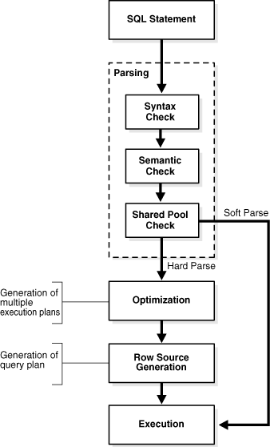
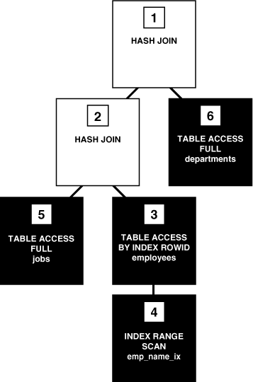

## 7 SQL

This chapter provides an overview of the Structured Query Language ([SQL](glossary.md)) and how Oracle Database processes SQL statements.

This chapter includes the following topics:

## Introduction to SQL

SQL (pronounced sequel) is the set-based, high-level declarative computer language with which all programs and users access data in an Oracle database. Although some Oracle tools and applications mask SQL use, all database operations are performed using SQL. Any other data access method circumvents the security built into Oracle Database and potentially compromises data security and integrity.

SQL provides an interface to a relational database such as Oracle Database. SQL unifies tasks such as the following in one consistent language:

- Creating, replacing, altering, and dropping objects
- Inserting, updating, and deleting table rows
- Querying data
- Controlling access to the database and its objects
- Guaranteeing database consistency and integrity

SQL can be used interactively, which means that statements are entered manually into a program. SQL statements can also be embedded within a program written in a different language such as C or Java.

See Also:

- [Oracle Database SQL Language Reference](https://docs.oracle.com/cd/E11882_01/server.112/e41084/intro.htm#SQLRF001) for an introduction to SQL
- ["Introduction to Server-Side Programming"](srvrside.md) and ["Client-Side Database Programming"](cncptdev.md)

### SQL Data Access

There are two broad families of computer languages: declarative languages that are nonprocedural and describe what should be done, and procedural languages such as C++ and Java that describe how things should be done. SQL is declarative in the sense that users specify the result that they want, not how to derive it. The SQL language compiler performs the work of generating a procedure to navigate the database and perform the desired task.

SQL enables you to work with data at the logical level. You need be concerned with implementation details only when you want to manipulate the data. For example, the following statement queries records for employees whose last name begins with `K`:

```
SELECT   last_name, first_name
FROM     hr.employees
WHERE    last_name LIKE 'K%'
ORDER BY last_name, first_name;
```

The database retrieves all rows satisfying the `WHERE` [condition](glossary.md), also called the [predicate](glossary.md), in a single step. These rows can be passed as a unit to the user, to another SQL statement, or to an application. You do not need to process the rows one by one, nor are you required to know how the rows are physically stored or retrieved.

All SQL statements use the [optimizer](glossary.md), a part of Oracle Database that determines the most efficient means of accessing the specified data. Oracle Database also supports techniques that you can use to make the optimizer perform its job better.

See Also:

[Oracle Database SQL Language Reference](https://docs.oracle.com/cd/E11882_01/server.112/e41084/toc.htm) for detailed information about SQL statements and other parts of SQL (such as [operators](glossary.md), functions, and format models)

### SQL Standards

Oracle strives to follow industry-accepted standards and participates actively in SQL standards committees. Industry-accepted committees are the American National Standards Institute (ANSI) and the International Organization for Standardization (ISO). Both ANSI and the ISO/IEC have accepted SQL as the standard language for relational databases.

The latest SQL standard was adopted in July 2003 and is often called SQL:2003. One part of the SQL standard, Part 14, SQL/XML (ISO/IEC 9075-14) was revised in 2006 and is often referred to as SQL/XML:2006.

Oracle SQL includes many extensions to the ANSI/ISO standard SQL language, and Oracle Database tools and applications provide additional statements. The tools SQL\*Plus, SQL Developer, and Oracle Enterprise Manager enable you to run any ANSI/ISO standard SQL statement against an Oracle database and any additional statements or functions available for those tools.

See Also:

- [Oracle Database SQL Language Reference](https://docs.oracle.com/cd/E11882_01/server.112/e41084/ap_standard_sql.htm#SQLRF019) for an explanation of the differences between Oracle SQL and standard SQL
- [SQL\*Plus User's Guide and Reference](https://docs.oracle.com/cd/E11882_01/server.112/e16604/toc.htm) for SQL\*Plus commands, including their distinction from SQL statements
- ["Tools for Database Administrators"](cncptdba.md) and ["Tools for Database Developers"](cncptdev.md)

## Overview of SQL Statements

All operations performed on the information in an Oracle database are run using SQL statements. A SQL statement is a computer program or instruction that consists of identifiers, parameters, variables, names, data types, and SQL reserved words.

Note:

SQL reserved words have special meaning in SQL and should not be used for any other purpose. For example, `SELECT` and `UPDATE` are reserved words and should not be used as table names.

A SQL statement must be the equivalent of a complete SQL sentence, such as:

```
SELECT last_name, department_id FROM employees
```

Oracle Database only runs complete SQL statements. A fragment such as the following generates an error indicating that more text is required:

```
SELECT last_name;
```

Oracle SQL statements are divided into the following categories:

- Data Definition Language (DDL) Statements
- Data Manipulation Language (DML) Statements
- Transaction Control Statements
- Session Control Statements
- System Control Statement
- Embedded SQL Statements

### Data Definition Language (DDL) Statements

Data definition language ([DDL](glossary.md)) statements define, structurally change, and drop [schema objects](glossary.md). For example, DDL statements enable you to:

- Create, alter, and drop schema objects and other database structures, including the database itself and database users. Most DDL statements start with the keywords `CREATE`, `ALTER`, or `DROP`.
- Delete all the data in schema objects without removing the structure of these objects (`TRUNCATE`).
	Note:
	Unlike `DELETE`, `TRUNCATE` generates no [undo data](glossary.md), which makes it faster than `DELETE`. Also, `TRUNCATE` does not invoke delete [triggers](glossary.md).
- Grant and revoke privileges and roles (`GRANT`, `REVOKE`).
- Turn auditing options on and off (`AUDIT`, `NOAUDIT`).
- Add a comment to the [data dictionary](glossary.md) (`COMMENT`).

DDL enables you to alter attributes of an object without altering the applications that access the object. For example, you can add a column to a table accessed by a human resources application without rewriting the application. You can also use DDL to alter the structure of objects while database users are performing work in the database.

Example 7-1 uses DDL statements to create the `plants` table and then uses DML to insert two rows in the table. The example then uses DDL to alter the table structure, grant and revoke privileges on this table to a user, and then drop the table.

Example 7-1 DDL Statements

```
CREATE TABLE plants
    ( plant_id    NUMBER PRIMARY KEY, 
      common_name VARCHAR2(15) );

INSERT INTO plants VALUES (1, 'African Violet'); # DML statement

INSERT INTO plants VALUES (2, 'Amaryllis'); # DML statement

ALTER TABLE plants ADD 
    ( latin_name VARCHAR2(40) );

GRANT SELECT ON plants TO scott;

REVOKE SELECT ON plants FROM scott;

DROP TABLE plants;
```

An implicit `COMMIT` occurs immediately before the database executes a DDL statement and a `COMMIT` or `ROLLBACK` occurs immediately afterward. In Example 7-1, two `INSERT` statements are followed by an `ALTER TABLE` statement, so the database commits the two `INSERT` statements. If the `ALTER TABLE` statement succeeds, then the database commits this statement; otherwise, the database rolls back this statement. In either case the two `INSERT` statements have already been committed.

See Also:

- ["Overview of Database Security"](cmntopc.md) to learn about privileges and roles
- [Oracle Database 2 Day Developer's Guide](https://docs.oracle.com/cd/E11882_01/appdev.112/e10766/tdddg_objects.htm#TDDDG30000) and [Oracle Database Administrator's Guide](https://docs.oracle.com/cd/E11882_01/server.112/e25494/tables.htm#ADMIN01503) to learn how to create schema objects
- [Oracle Database SQL Language Reference](https://docs.oracle.com/cd/E11882_01/server.112/e41084/statements_1001.htm#SQLRF30041) for a list of DDL statements

### Data Manipulation Language (DML) Statements

Data manipulation language ([DML](glossary.md)) statements query or manipulate data in existing schema objects. Whereas DDL statements enable you to change the structure of the database, DML statements enable you to query or change the contents. For example, `ALTER TABLE` changes the structure of a table, whereas `INSERT` adds one or more rows to the table.

DML statements are the most frequently used SQL statements and enable you to:

- Retrieve or fetch data from one or more tables or views (`SELECT`).
- Add new rows of data into a table or view (`INSERT`) by specifying a list of column values or using a [subquery](glossary.md) to select and manipulate existing data.
- Change column values in existing rows of a table or view (`UPDATE`).
- Update or insert rows conditionally into a table or [view](glossary.md) (`MERGE`).
- Remove rows from tables or views (`DELETE`).
- View the [execution plan](glossary.md) for a SQL statement (`EXPLAIN` `PLAN`). See "How Oracle Database Processes DML".
- Lock a table or view, temporarily limiting access by other users (`LOCK` `TABLE`).

The following example uses DML to query the `employees` table. The example uses DML to insert a row into `employees`, update this row, and then delete it:

```
SELECT * FROM employees;

INSERT INTO employees (employee_id, last_name, email, job_id, hire_date, salary)
  VALUES (1234, 'Mascis', 'JMASCIS', 'IT_PROG', '14-FEB-2011', 9000);

UPDATE employees SET salary=9100 WHERE employee_id=1234;

DELETE FROM employees WHERE employee_id=1234;
```

A collection of DML statements that forms a logical unit of work is called a [transaction](glossary.md). For example, a transaction to transfer money could involve three discrete operations: decreasing the savings account balance, increasing the checking account balance, and recording the transfer in an account history table. Unlike DDL statements, DML statements do not implicitly commit the current transaction.

See Also:

- ["Introduction to Transactions "](transact.md)
- [Oracle Database 2 Day Developer's Guide](https://docs.oracle.com/cd/E11882_01/appdev.112/e10766/tdddg_connecting.htm#TDDDG20000) to learn how to query and manipulate data
- [Oracle Database SQL Language Reference](https://docs.oracle.com/cd/E11882_01/server.112/e41084/statements_1001.htm#SQLRF30042) for a list of DML statements

#### SELECT Statements

A [query](glossary.md) is an operation that retrieves data from a table or view. `SELECT` is the only SQL statement that you can use to query data. The set of data retrieved from execution of a `SELECT` statement is known as a result set.

Table 7-1 shows two required keywords and two keywords that are commonly found in a `SELECT` statement. The table also associates capabilities of a `SELECT` statement with the keywords.

Table 7-1 Keywords in a SQL Statement

| Keyword | Required? | Description | Capability |
| --- | --- | --- | --- |
| `SELECT` | Yes | Specifies which columns should be shown in the result. Projection produces a subset of the columns in the table.  An [expression](glossary.md) is a combination of one or more values, [operators](glossary.md), and SQL functions that resolves to a value. The list of expressions that appears after the `SELECT` keyword and before the `FROM` clause is called the select list. | Projection |
| `FROM` | Yes | Specifies the tables or views from which the data should be retrieved. | Joining |
| `WHERE` | No | Specifies a condition to filter rows, producing a subset of the rows in the table. A condition specifies a combination of one or more expressions and logical (Boolean) operators and returns a value of `TRUE`, `FALSE`, or `UNKNOWN`. | Selection |
| `ORDER BY` | No | Specifies the order in which the rows should be shown. |  |

See Also:

[Oracle Database SQL Language Reference](https://docs.oracle.com/cd/E11882_01/server.112/e41084/statements_10002.htm#SQLRF01702) for `SELECT` syntax and semantics

#### Joins

A [join](glossary.md) is a query that combines rows from two or more tables, views, or materialized views. Example 7-2 joins the `employees` and `departments` tables (`FROM` clause), selects only rows that meet specified criteria (`WHERE` clause), and uses projection to retrieve data from two columns (`SELECT`). Sample output follows the SQL statement.

Example 7-2 Sample Join

```
SELECT email, department_name
FROM   employees JOIN departments
ON     employees.department_id = departments.department_id
WHERE  employee_id IN (100,103)
ORDER BY email;

EMAIL                     DEPARTMENT_NAME
------------------------- ------------------------------
AHUNOLD                   IT
SKING                     Executive
```

Figure 7-1 graphically represents the operations of projection and selection in the join shown in Example 7-2.

Figure 7-1 Projection and Selection


> The graphic shows four icons representing tables. The upper left table is labeled Employees and above it is the title Projection. Part of a statement is shown: "SELECT last\_name, email". The last\_name points to the second column in the table. The email in the statement points to the four column in the table. To the right of the Employees icon is the following partial SQL statement: "Where department\_name = 'Shipping' AND salary > 6000". To the right of this fragment is the Employees table icon. Arrows lead from the fragment pointing to rows in the Employees table.
>
> In the lower left is the Employees table icon. To the lower right is the Departments table icon. Between the icons is the following SQL statement fragment: "FROM employees JOIN departments ON employees.department\_id = departments.department\_id". The statement points to the last column on the Employees table and the first column in the Departments table. Between the two table icons is a Join arrow.
  

Most joins have at least one [join condition](glossary.md), either in the `FROM` clause or in the `WHERE` clause, that compares two columns, each from a different table. The database combines pairs of rows, each containing one row from each table, for which the join condition evaluates to `TRUE`. The optimizer determines the order in which the database joins tables based on the join conditions, indexes, and any available statistics for the tables.

Join types include the following:

- Inner joins
	An inner join is a join of two or more tables that returns only rows that satisfy the join condition. For example, if the join condition is `employees.department_id=departments.department_id`, then rows that do not satisfy this condition are not returned.
- Outer joins
	An outer join returns all rows that satisfy the join condition and also returns rows from one table for which no rows from the other table satisfy the condition. For example, a left outer join of `employees` and `departments` retrieves all rows in the `employees` table even if there is no match in `departments`. A right outer join retrieves all rows in `departments` even if there is no match in `employees`.
- Cartesian products
	If two tables in a join query have no join condition, then the database returns their Cartesian product. Each row of one table combines with each row of the other. For example, if `employees` has 107 rows and `departments` has 27, then the Cartesian product contains 107\*27 rows. A Cartesian product is rarely useful.

See Also:

[Oracle Database SQL Language Reference](https://docs.oracle.com/cd/E11882_01/server.112/e41084/queries006.htm#SQLRF30046) for detailed descriptions and examples of joins

#### Subqueries and Implicit Queries

A subquery is a `SELECT` statement nested within another SQL statement. Subqueries are useful when you must execute multiple queries to solve a single problem.

Each query portion of a statement is called a query block. In Example 7-3, the subquery in parentheses is the inner query block. The inner `SELECT` statement retrieves the IDs of departments with location ID 1800. These department IDs are needed by the outer query block, which retrieves names of employees in the departments whose IDs were supplied by the subquery.

Example 7-3 Subquery

```
SELECT first_name, last_name 
FROM   employees
WHERE  department_id 
IN     (SELECT department_id FROM departments WHERE location_id = 1800);
```

The structure of the SQL statement does not force the database to execute the inner query first. For example, the database could rewrite the entire query as a join of `employees` and `departments`, so that the subquery never executes by itself. As another example, the Virtual Private Database (VPD) feature could restrict the query of employees using a `WHERE` clause, so that the database decides to query the employees first and then obtain the department IDs. The optimizer determines the best sequence of steps to retrieve the requested rows.

An implicit query is a component of a DML statement that retrieves data without using a subquery. An `UPDATE`, `DELETE`, or `MERGE` statement that does not explicitly include a `SELECT` statement uses an implicit query to retrieve rows to be modified. For example, the following statement includes an implicit query for the `Baer` record:

```
UPDATE employees 
  SET salary = salary*1.1 
  WHERE last_name = 'Baer';
```

The only DML statement that does not necessarily include a query component is an `INSERT` statement with a `VALUES` clause. For example, an `INSERT INTO TABLE mytable VALUES (1)` statement does not retrieve rows before inserting a row.

See Also:

["Virtual Private Database (VPD)"](cmntopc.md)

### Transaction Control Statements

Transaction control statements manage the changes made by DML statements and group DML statements into transactions. These statements enable you to:

- Make changes to a transaction permanent (`COMMIT`).
- Undo the changes in a transaction, since the transaction started (`ROLLBACK`) or since a savepoint (`ROLLBACK TO SAVEPOINT`). A savepoint is a user-declared intermediate marker within the context of a transaction.
	Note:
	The `ROLLBACK` command ends a transaction, but `ROLLBACK TO SAVEPOINT` does not.
- Set a point to which you can roll back (`SAVEPOINT`).
- Establish properties for a transaction (`SET` `TRANSACTION`).
- Specify whether a deferrable [integrity constraint](glossary.md) is checked following each DML statement or when the transaction is committed (`SET CONSTRAINT`).

The following example starts a transaction named `Update salaries`. The example creates a savepoint, updates an employee salary, and then rolls back the transaction to the savepoint. The example updates the salary to a different value and commits.

```
SET TRANSACTION NAME 'Update salaries';

SAVEPOINT before_salary_update;

UPDATE employees SET salary=9100 WHERE employee_id=1234 # DML

ROLLBACK TO SAVEPOINT before_salary_update;

UPDATE employees SET salary=9200 WHERE employee_id=1234 # DML

COMMIT COMMENT 'Updated salaries';
```

### Session Control Statements

Session control statements dynamically manage the properties of a user [session](glossary.md). As explained in ["Connections and Sessions"](process.md), a session is a logical entity in the database instance memory that represents the state of a current user login to a database. A session lasts from the time the user is authenticated by the database until the user disconnects or exits the database application.

Session control statements enable you to:

- Alter the current session by performing a specialized function, such as enabling and disabling SQL tracing (`ALTER` `SESSION`).
- Enable and disable roles, which are groups of privileges, for the current session (`SET` `ROLE`).

The following example turns on SQL tracing for the session and then enables all roles granted in the current session except `dw_manager`:

```
ALTER SESSION SET SQL_TRACE = TRUE;

SET ROLE ALL EXCEPT dw_manager;
```

Session control statements do not implicitly commit the current transaction.

See Also:

[Oracle Database SQL Language Reference](https://docs.oracle.com/cd/E11882_01/server.112/e41084/statements_1001.htm#SQLRF30044) for `ALTER SESSION` syntax and semantics

### System Control Statement

System control statements change the properties of the database [instance](glossary.md). The only system control statement is `ALTER` `SYSTEM`. It enables you to change settings such as the minimum number of shared servers, terminate a session, and perform other system-level tasks.

Following are examples of system control statements:

```
ALTER SYSTEM SWITCH LOGFILE; 

ALTER SYSTEM KILL SESSION '39, 23';
```

The `ALTER SYSTEM` statement does not implicitly commit the current transaction.

See Also:

[Oracle Database SQL Language Reference](https://docs.oracle.com/cd/E11882_01/server.112/e41084/statements_2014.htm#SQLRF00902) for `ALTER SYSTEM` syntax and semantics

### Embedded SQL Statements

Embedded SQL statements incorporate DDL, DML, and transaction control statements within a procedural language program. They are used with the Oracle precompilers. Embedded SQL is one approach to incorporating SQL in your procedural language applications. Another approach is to use a procedural API such as Open Database Connectivity (ODBC) or Java Database Connectivity (JDBC).

Embedded SQL statements enable you to:

- Define, allocate, and release [cursors](glossary.md) (`DECLARE CURSOR`, `OPEN`, `CLOSE`).
- Specify a database and connect to it (`DECLARE DATABASE`, `CONNECT`).
- Assign variable names (`DECLARE STATEMENT`).
- Initialize descriptors (`DESCRIBE`).
- Specify how error and warning conditions are handled (`WHENEVER`).
- Parse and run SQL statements (`PREPARE`, `EXECUTE`, `EXECUTE IMMEDIATE`).
- Retrieve data from the database (`FETCH`).

See Also:

["Introduction to Server-Side Programming"](srvrside.md) and ["Client-Side APIs"](cncptdev.md)

## Overview of the Optimizer

To understand how Oracle Database processes SQL statements, it is necessary to understand the part of the database called the optimizer (also known as the query optimizer or cost-based optimizer). All SQL statements use the optimizer to determine the most efficient means of accessing the specified data.

### Use of the Optimizer

To execute a DML statement, Oracle Database may have to perform many steps. Each step either retrieves rows of data physically from the database or prepares them for the user issuing the statement.

Many different ways of processing a DML statement are often possible. For example, the order in which tables or indexes are accessed can vary. The steps that the database uses to execute a statement greatly affect how quickly the statement runs. The optimizer generates [execution plans](glossary.md) describing possible methods of execution.

The optimizer determines which execution plan is most efficient by considering several sources of information, including query conditions, available [access paths](glossary.md), statistics gathered for the system, and hints. For any SQL statement processed by Oracle, the optimizer performs the following operations:

- Evaluation of expressions and conditions
- Inspection of integrity constraints to learn more about the data and optimize based on this metadata
- Statement transformation
- Choice of optimizer goals
- Choice of access paths
- Choice of join orders

The optimizer generates most of the possible ways of processing a query and assigns a cost to each step in the generated execution plan. The plan with the lowest cost is chosen as the [query plan](glossary.md) to be executed.

Note:

You can obtain an execution plan for a SQL statement without executing the plan. Only an execution plan that the database actually uses to execute a query is correctly termed a query plan.

You can influence optimizer choices by setting the optimizer goal and by gathering representative statistics for the optimizer. For example, you may set the optimizer goal to either of the following:

- Total throughput
	The `ALL_ROWS` hint instructs the optimizer to get the last row of the result to the client application as fast as possible.
- Initial response time
	The `FIRST_ROWS` hint instructs the optimizer to get the first row to the client as fast as possible.

A typical end-user, interactive application would benefit from initial response time optimization, whereas a batch-mode, non-interactive application would benefit from total throughput optimization.

See Also:

- [Oracle Database PL/SQL Packages and Types Reference](https://docs.oracle.com/cd/E11882_01/appdev.112/e40758/d_stats.htm#ARPLS059) for information about using `DBMS_STATS`
- [Oracle Database Performance Tuning Guide](https://docs.oracle.com/cd/E11882_01/server.112/e41573/optimops.htm#PFGRF94582) for more information about the optimizer and using hints

### Optimizer Components

The optimizer contains three main components, which are shown in Figure 7-2.

Figure 7-2 Optimizer Components


> This graphic shows the optimizer components in a box with a dotted border. The box contains three boxes vertically arranged: Query Transformer, Estimator, and Plan Generator. A Parsed Query enters from the top. An arrow leading from Query Transformer to Estimator is labeled Transformed query. An arrow leading from Estimator to Plan Generator is labeled "Query + estimated." An arrow leading from Plan Generator to the bottom of the figure is labeled "Query Plan (to Row Source Generator)." A box labeled Data Dictionary points to the Estimator box in the middle. The arrow is labeled "statistics."
  

The input to the optimizer is a parsed query (see "SQL Parsing"). The optimizer performs the following operations:

1. The optimizer receives the parsed query and generates a set of potential plans for the SQL statement based on available access paths and hints.
2. The optimizer estimates the cost of each plan based on statistics in the data dictionary. The cost is an estimated value proportional to the expected resource use needed to execute the statement with a particular plan.
3. The optimizer compares the costs of plans and chooses the lowest-cost plan, known as the query plan, to pass to the row source generator (see "SQL Row Source Generation").

#### Query Transformer

The query transformer determines whether it is helpful to change the form of the query so that the optimizer can generate a better execution plan. The input to the query transformer is a parsed query, which is represented by a set of query blocks.

See Also:

["Query Rewrite"](schemaob.md)

#### Estimator

The estimator determines the overall cost of a given execution plan. The estimator generates three different types of measures to achieve this goal:

- Selectivity
	This measure represents a fraction of rows from a row set. The selectivity is tied to a query predicate, such as `last_name='Smith'`, or a combination of predicates.
- Cardinality
	This measure represents the number of rows in a row set.
- Cost
	This measure represents units of work or resource used. The query optimizer uses disk I/O, CPU usage, and memory usage as units of work.

If statistics are available, then the estimator uses them to compute the measures. The statistics improve the degree of accuracy of the measures.

#### Plan Generator

The plan generator tries out different plans for a submitted query and picks the plan with the lowest cost. The optimizer generates subplans for each of the nested subqueries and unmerged views, which is represented by a separate query block. The plan generator explores various plans for a query block by trying out different access paths, join methods, and join orders.

The optimizer automatically manages plans and ensures that only verified plans are used. SQL Plan Management (SPM) allows controlled plan evolution by only using a new plan after it has been verified to be perform better than the current plan.

Diagnostic tools such as the `EXPLAIN PLAN` statement enable you to view execution plans chosen by the optimizer. `EXPLAIN PLAN` shows the query plan for the specified SQL query if it were executed now in the current session. Other diagnostic tools are Oracle Enterprise Manager and the SQL\*Plus `AUTOTRACE` command. Example 7-6 shows the execution plan of a query when `AUTOTRACE` is enabled.

See Also:

- ["Tools for Database Administrators"](cncptdba.md)
- [Oracle Database SQL Language Reference](https://docs.oracle.com/cd/E11882_01/server.112/e41084/statements_9010.htm#SQLRF01601) to learn about `EXPLAIN PLAN`
- [Oracle Database Performance Tuning Guide](https://docs.oracle.com/cd/E11882_01/server.112/e41573/optimops.htm#PFGRF94582) to learn about the optimizer components

### Access Paths

An access path is the way in which data is retrieved from the database. For example, a query that uses an index has a different access path from a query that does not. In general, index access paths are best for statements that retrieve a small subset of table rows. Full scans are more efficient for accessing a large portion of a table.

The database can use several different access paths to retrieve data from a table. The following is a representative list:

- Full table scans
	This type of scan reads all rows from a table and filters out those that do not meet the selection criteria. The database sequentially scans all data blocks in the segment, including those under the [high water mark](glossary.md) that separates used from unused space (see ["Segment Space and the High Water Mark"](logical.md)).
- Rowid scans
	The [rowid](glossary.md) of a row specifies the data file and data block containing the row and the location of the row in that block. The database first obtains the rowids of the selected rows, either from the statement `WHERE` clause or through an index scan, and then locates each selected row based on its rowid.
- Index scans
	This scan searches an index for the indexed column values accessed by the SQL statement (see ["Index Scans"](indexiot.md)). If the statement accesses only columns of the index, then Oracle Database reads the indexed column values directly from the index.
- Cluster scans
	A cluster scan is used to retrieve data from a table stored in an indexed [table cluster](glossary.md), where all rows with the same cluster key value are stored in the same data block (see ["Overview of Indexed Clusters"](tablecls.md)). The database first obtains the rowid of a selected row by scanning the cluster index. Oracle Database locates the rows based on this rowid.
- Hash scans
	A hash scan is used to locate rows in a hash cluster, where all rows with the same hash value are stored in the same data block (see ["Overview of Hash Clusters"](tablecls.md). The database first obtains the hash value by applying a [hash function](glossary.md) to a cluster key value specified by the statement. Oracle Database then scans the data blocks containing rows with this hash value.

The optimizer chooses an access path based on the available access paths for the statement and the estimated cost of using each access path or combination of paths.

See Also:

[Oracle Database 2 Day + Performance Tuning Guide](https://docs.oracle.com/cd/E11882_01/server.112/e10822/tdppt_sqlopt.htm#TDPPT170) and [Oracle Database Performance Tuning Guide](https://docs.oracle.com/cd/E11882_01/server.112/e41573/optimops.htm#PFGRF94599) to learn about access paths

### Optimizer Statistics

Optimizer statistics are a collection of data that describe details about the database and the objects in the database. The statistics provide a statistically correct picture of data storage and distribution usable by the optimizer when evaluating access paths.

Optimizer statistics include the following:

- Table statistics
	These include the number of rows, number of blocks, and average row length.
- Column statistics
	These include the number of distinct values and nulls in a column and the distribution of data.
- Index statistics
	These include the number of leaf blocks and index levels.
- System statistics
	These include CPU and I/O performance and utilization.

Oracle Database gathers optimizer statistics on all database objects automatically and maintains these statistics as an automated maintenance task. You can also gather statistics manually using the `DBMS_STATS` package. This PL/SQL package can modify, view, export, import, and delete statistics.

Optimizer statistics are created for the purposes of query optimization and are stored in the data dictionary. These statistics should not be confused with performance statistics visible through dynamic performance views.

See Also:

- [Oracle Database 2 Day + Performance Tuning Guide](https://docs.oracle.com/cd/E11882_01/server.112/e10822/tdppt_method.htm#TDPPT007) and [Oracle Database Performance Tuning Guide](https://docs.oracle.com/cd/E11882_01/server.112/e41573/stats.htm#PFGRF003) to learn how to gather and manage statistics
- [Oracle Database PL/SQL Packages and Types Reference](https://docs.oracle.com/cd/E11882_01/appdev.112/e40758/d_stats.htm#ARPLS059) to learn about `DBMS_STATS`

### Optimizer Hints

A hint is a comment in a SQL statement that acts as an instruction to the optimizer. Sometimes the application designer, who has more information about a particular application's data than is available to the optimizer, can choose a more effective way to run a SQL statement. The application designer can use hints in SQL statements to specify how the statement should be run.

For example, suppose that your interactive application runs a query that returns 50 rows. This application initially fetches only the first 25 rows of the query to present to the end user. You want the optimizer to generate a plan that gets the first 25 records as quickly as possible so that the user is not forced to wait. You can use a hint to pass this instruction to the optimizer as shown in the `SELECT` statement and `AUTOTRACE` output in Example 7-4.

Example 7-4 Execution Plan for SELECT with FIRST\_ROWS Hint

```
SELECT /*+ FIRST_ROWS(25) */ employee_id, department_id
FROM   hr.employees
WHERE  department_id > 50;

------------------------------------------------------------------------
| Id | Operation                    | Name              | Rows | Bytes
------------------------------------------------------------------------
|  0 | SELECT STATEMENT             |                   | 26   | 182
|  1 |  TABLE ACCESS BY INDEX ROWID | EMPLOYEES         | 26   | 182
|* 2 |   INDEX RANGE SCAN           | EMP_DEPARTMENT_IX |      |
------------------------------------------------------------------------
```

The execution plan in Example 7-4 shows that the optimizer chooses an index on the `employees.department_id` column to find the first 25 rows of `employees` whose department ID is over 50. The optimizer uses the rowid retrieved from the index to retrieve the record from the `employees` table and return it to the client. Retrieval of the first record is typically almost instantaneous.

Example 7-5 shows the same statement, but without the optimizer hint.

Example 7-5 Execution Plan for SELECT with No Hint

```
SELECT employee_id, department_id
FROM   hr.employees
WHERE  department_id > 50;
 
------------------------------------------------------------------------
| Id | Operation              | Name              | Rows | Bytes | Cos
------------------------------------------------------------------------
|  0 | SELECT STATEMENT       |                   | 50   | 350   |
|* 1 |  VIEW                  | index$_join$_001  | 50   | 350   |
|* 2 |   HASH JOIN            |                   |      |       |
|* 3 |    INDEX RANGE SCAN    | EMP_DEPARTMENT_IX | 50   | 350   |
|  4 |    INDEX FAST FULL SCAN| EMP_EMP_ID_PK     | 50   | 350   |
```

The execution plan in Example 7-5 joins two indexes to return the requested records as fast as possible. Rather than repeatedly going from index to table as in Example 7-4, the optimizer chooses a range scan of `EMP_DEPARTMENT_IX` to find all rows where the department ID is over 50 and place these rows in a [hash table](glossary.md). The optimizer then chooses to read the `EMP_EMP_ID_PK` index. For each row in this index, it probes the hash table to find the department ID.

In this case, the database cannot return the first row to the client until the index range scan of `EMP_DEPARTMENT_IX` completes. Thus, this generated plan would take longer to return the first record. Unlike the plan in Example 7-4, which accesses the table by index rowid, the plan in Example 7-5 uses multiblock I/O, resulting in large reads. The reads enable the last row of the entire result set to be returned more rapidly.

See Also:

[Oracle Database Performance Tuning Guide](https://docs.oracle.com/cd/E11882_01/server.112/e41573/hintsref.htm#PFGRF501) to learn how to use optimizer hints

## Overview of SQL Processing

This section explains how Oracle Database processes SQL statements. Specifically, the section explains the way in which the database processes DDL statements to create objects, DML to modify data, and queries to retrieve data.

### Stages of SQL Processing

Figure 7-3 depicts the general stages of SQL processing: parsing, optimization, row source generation, and execution. Depending on the statement, the database may omit some of these steps.

Figure 7-3 Stages of SQL Processing



> This graphic shows the stages of SQL processing, represented as five vertical boxes linked by downward-pointing arrows: SQL Statement, Parsing, Optimization, Row Source Generation, and Execution. The Parsing box is labeled "Syntax check, Semantic check." The Optimization box is labeled "Generation of multiple execution plans." The Row Source Generation box is labeled "Generation of query plan." An arrow labeled "Soft parse" extends from the Parsing box to the Execution box.
  

#### SQL Parsing

As shown in Figure 7-3, the first stage of SQL processing is parsing. This stage involves separating the pieces of a SQL statement into a data structure that can be processed by other routines. The database parses a statement when instructed by the application, which means that only the application­, and not the database itself, can reduce the number of parses.

When an application issues a SQL statement, the application makes a parse call to the database to prepare the statement for execution. The parse call opens or creates a [cursor](glossary.md), which is a handle for the session-specific [private SQL area](glossary.md) that holds a parsed SQL statement and other processing information. The cursor and private SQL area are in the [PGA](glossary.md).

During the parse call, the database performs the following checks:

- Syntax Check
- Semantic Check
- Shared Pool Check

The preceding checks identify the errors that can be found before statement execution. Some errors cannot be caught by parsing. For example, the database can encounter [deadlocks](glossary.md) or errors in data conversion only during statement execution (see ["Locks and Deadlocks"](consist.md)).

##### Syntax Check

Oracle Database must check each SQL statement for syntactic validity. A statement that breaks a rule for well-formed SQL syntax fails the check. For example, the following statement fails because the keyword `FROM` is misspelled as `FORM`:

```
SQL> SELECT * FORM employees;
SELECT * FORM employees
         *
ERROR at line 1:
ORA-00923: FROM keyword not found where expected
```

##### Semantic Check

The semantics of a statement are its meaning. Thus, a semantic check determines whether a statement is meaningful, for example, whether the objects and columns in the statement exist. A syntactically correct statement can fail a semantic check, as shown in the following example of a query of a nonexistent table:

```
SQL> SELECT * FROM nonexistent_table;
SELECT * FROM nonexistent_table
              *
ERROR at line 1:
ORA-00942: table or view does not exist
```

##### Shared Pool Check

During the parse, the database performs a shared pool check to determine whether it can skip resource-intensive steps of statement processing. To this end, the database uses a [hashing](glossary.md) algorithm to generate a hash value for every SQL statement. The statement hash value is the SQL ID shown in `V$SQL.SQL_ID`.

When a user submits a SQL statement, the database searches the [shared SQL area](glossary.md) to see if an existing parsed statement has the same hash value. The hash value of a SQL statement is distinct from the following values:

- Memory address for the statement
	Oracle Database uses the SQL ID to perform a keyed read in a lookup table. In this way, the database obtains possible memory addresses of the statement.
- Hash value of an execution plan for the statement
	A SQL statement can have multiple plans in the shared pool. Each plan has a different hash value. If the same SQL ID has multiple plan hash values, then the database knows that multiple plans exist for this SQL ID.

Parse operations fall into the following categories, depending on the type of statement submitted and the result of the hash check:

- Hard parse
	If Oracle Database cannot reuse existing code, then it must build a new executable version of the application code. This operation is known as a hard parse, or a library cache miss. The database always perform a hard parse of DDL.
	During the hard parse, the database accesses the [library cache](glossary.md) and [data dictionary cache](glossary.md) numerous times to check the data dictionary. When the database accesses these areas, it uses a serialization device called a [latch](glossary.md) on required objects so that their definition does not change (see ["Latches"](consist.md)). Latch contention increases statement execution time and decreases concurrency.
- Soft parse
	A soft parse is any parse that is not a hard parse. If the submitted statement is the same as a reusable SQL statement in the shared pool, then Oracle Database reuses the existing code. This reuse of code is also called a library cache hit.
	Soft parses can vary in the amount of work they perform. For example, configuring the session shared SQL area can sometimes reduce the amount of latching in the soft parses, making them "softer."
	In general, a soft parse is preferable to a hard parse because the database skips the optimization and row source generation steps, proceeding straight to execution.

Figure 7-4 is a simplified representation of a shared pool check of an `UPDATE` statement in a [dedicated server](glossary.md) architecture.

Figure 7-4 Shared Pool Check


> This graphic shows a shared pool check. At the top are three boxes laid on top of one another, each box smaller than the one behind it. The smallest box shows hash values and is labeled Shared SQL Area. The second box is labeled Shared Pool. The outer box is labeled SGA. Below this box is another box labeled PGA. Within the PGA box is a box labeled Private SQL Area, which contains a hash value. A double-ended arrow connects the upper and lower boxes and is labeled "Comparison of hash values." To the right of the PGA box is a person icon labeled User Process. The icons are connected by a double-sided arrow. Above the User Process icon is an "Update...." statement. An arrow leads from the User Process below so the Server Process icon below.
  

If a check determines that a statement in the shared pool has the same hash value, then the database performs semantic and environment checks to determine whether the statements have the same meaning. Identical syntax is not sufficient. For example, suppose two different users log in to the database and issue the following SQL statements:

```
CREATE TABLE my_table ( some_col INTEGER );
SELECT * FROM my_table;
```

The `SELECT` statements for the two users are syntactically identical, but two separate schema objects are named `my_table`. This semantic difference means that the second statement cannot reuse the code for the first statement.

Even if two statements are semantically identical, an environmental difference can force a hard parse. In this case, the environment is the totality of session settings that can affect execution plan generation, such as the work area size or optimizer settings. Consider the following series of SQL statements executed by a single user:

```
ALTER SYSTEM FLUSH SHARED_POOL;
SELECT * FROM my_table;

ALTER SESSION SET OPTIMIZER_MODE=FIRST_ROWS;
SELECT * FROM my_table;

ALTER SESSION SET SQL_TRACE=TRUE;
SELECT * FROM my_table;
```

In the preceding example, the same `SELECT` statement is executed in three different optimizer environments. Consequently, the database creates three separate shared SQL areas for these statements and forces a hard parse of each statement.

See Also:

- ["Private SQL Area"](memory.md) and ["Shared SQL Areas"](memory.md)
- [Oracle Database Performance Tuning Guide](https://docs.oracle.com/cd/E11882_01/server.112/e41573/memory.htm#PFGRF94287) to learn how to configure the shared pool

#### SQL Optimization

As explained in "Overview of the Optimizer", query optimization is the process of choosing the most efficient means of executing a SQL statement. The database optimizes queries based on statistics collected about the actual data being accessed. The optimizer uses the number of rows, the size of the data set, and other factors to generate possible execution plans, assigning a numeric cost to each plan. The database uses the plan with the lowest cost.

The database must perform a hard parse at least once for every unique DML statement and performs optimization during this parse. DDL is never optimized unless it includes a DML component such as a subquery that requires optimization.

See Also:

[Oracle Database Performance Tuning Guide](https://docs.oracle.com/cd/E11882_01/server.112/e41573/optimops.htm#PFGRF001) for detailed information about the query optimizer

#### SQL Row Source Generation

The row source generator is software that receives the optimal execution plan from the optimizer and produces an iterative plan, called the query plan, that is usable by the rest of the database. The iterative plan is a binary program that, when executed by the SQL virtual machine, produces the result set.

The query plan takes the form of a combination of steps. Each step returns a row set. The rows in this set are either used by the next step or, in the last step, are returned to the application issuing the SQL statement.

A row source is a row set returned by a step in the execution plan along with a control structure that can iteratively process the rows. The row source can be a table, view, or result of a join or grouping operation.

The row source generator produces a row source tree, which is a collection of row sources. The row source tree shows the following information:

- An ordering of the tables referenced by the statement
- An access method for each table mentioned in the statement
- A join method for tables affected by join operations in the statement
- Data operations such as filter, sort, or aggregation

Example 7-6 shows the execution plan of a `SELECT` statement when `AUTOTRACE` is enabled. The statement selects the last name, job title, and department name for all employees whose last names begin with the letter `A`. The execution plan for this statement is the output of the row source generator.

Example 7-6 Execution Plan

```
SELECT e.last_name, j.job_title, d.department_name 
FROM   hr.employees e, hr.departments d, hr.jobs j
WHERE  e.department_id = d.department_id
AND    e.job_id = j.job_id
AND    e.last_name LIKE 'A%' ;
 
Execution Plan
----------------------------------------------------------
Plan hash value: 975837011
 
---------------------------------------------------------------------------------------------
| Id  | Operation                     | Name        | Rows  | Bytes | Cost (%CPU)| Time     |
---------------------------------------------------------------------------------------------
|   0 | SELECT STATEMENT              |             |     3 |   189 |     7  (15)| 00:00:01 |
|*  1 |  HASH JOIN                    |             |     3 |   189 |     7  (15)| 00:00:01 |
|*  2 |   HASH JOIN                   |             |     3 |   141 |     5  (20)| 00:00:01 |
|   3 |    TABLE ACCESS BY INDEX ROWID| EMPLOYEES   |     3 |    60 |     2   (0)| 00:00:01 |
|*  4 |     INDEX RANGE SCAN          | EMP_NAME_IX |     3 |       |     1   (0)| 00:00:01 |
|   5 |    TABLE ACCESS FULL          | JOBS        |    19 |   513 |     2   (0)| 00:00:01 |
|   6 |   TABLE ACCESS FULL           | DEPARTMENTS |    27 |   432 |     2   (0)| 00:00:01 |
---------------------------------------------------------------------------------------------
 
Predicate Information (identified by operation id):
---------------------------------------------------
 
   1 - access("E"."DEPARTMENT_ID"="D"."DEPARTMENT_ID")
   2 - access("E"."JOB_ID"="J"."JOB_ID")
   4 - access("E"."LAST_NAME" LIKE 'A%')
       filter("E"."LAST_NAME" LIKE 'A%')
```

#### SQL Execution

During execution, the SQL engine executes each row source in the tree produced by the row source generator. This step is the only mandatory step in DML processing.

Figure 7-5 is an execution tree, also called a parse tree, that shows the flow of row sources from one step to another. In general, the order of the steps in execution is the reverse of the order in the plan, so you read the plan from the bottom up. Initial spaces in the `Operation` column indicate hierarchical relationships. For example, if the name of an operation is preceded by two spaces, then this operation is a child of an operation preceded by one space. Operations preceded by one space are children of the `SELECT` statement itself.

Figure 7-5 Row Source Tree



> This graphic shows a tree of boxes. At the top box 1 is labeled MERGE JOIN ANTI. Box 2 to the lower left is labeled NESTED LOOPS. Box 6 to the lower right is labeled TABLE ACCESS FULL jobs. Box 3 to the lower left of Box 2 is labeled TABLE ACCESS FULL departments. Box 4 to the lower right is labeled TABLE ACCESS BY INDEX ROWID employees. Box 5 underneath Box 4 is labeled INDEX RANGE SCAN emp\_departments\_ix.
  

In Figure 7-5, each node of the tree acts as a row source, which means that each step of the execution plan either retrieves rows from the database or accepts rows from one or more row sources as input. The SQL engine executes each row source as follows:

- Steps indicated by the black boxes physically retrieve data from an object in the database. These steps are the access paths, or techniques for retrieving data from the database.
	- Step 6 uses a [full table scan](glossary.md) to retrieve all rows from the `departments` table.
		- Step 5 uses a full table scan to retrieve all rows from the `jobs` table.
		- Step 4 scans the `emp_name_ix` index in order, looking for each key that begins with the letter `A` and retrieving the corresponding rowid (see ["Index Range Scan"](indexiot.md)). For example, the rowid corresponding to `Atkinson` is `AAAPzRAAFAAAABSAAe`.
		- Step 3 retrieves from the `employees` table the rows whose rowids were returned by Step 4. For example, the database uses rowid `AAAPzRAAFAAAABSAAe` to retrieve the row for `Atkinson`.
- Steps indicated by the clear boxes operate on row sources.
	- Step 2 performs a hash join, accepting row sources from Steps 3 and 5, joining each row from the Step 5 row source to its corresponding row in Step 3, and returning the resulting rows to Step 1.
		For example, the row for employee `Atkinson` is associated with the job name `Stock Clerk`.
		- Step 1 performs another hash join, accepting row sources from Steps 2 and 6, joining each row from the Step 6 source to its corresponding row in Step 2, and returning the result to the client.
		For example, the row for employee `Atkinson` is associated with the department named `Shipping`.

In some execution plans the steps are iterative and in others sequential. The plan shown in Example 7-6 is iterative because the SQL engine moves from index to table to client and then repeats the steps.

During execution, the database reads the data from disk into memory if the data is not in memory. The database also takes out any locks and latches necessary to ensure data integrity and logs any changes made during the SQL execution. The final stage of processing a SQL statement is closing the cursor.

See Also:

[Oracle Database Performance Tuning Guide](https://docs.oracle.com/cd/E11882_01/server.112/e41573/ex_plan.htm#PFGRF009) for detailed information about execution plans and the `EXPLAIN PLAN` statement

### How Oracle Database Processes DML

Most DML statements have a query component. In a query, execution of a cursor places the results of the query into a set of rows called the result set.

Result set rows can be fetched either a row at a time or in groups. In the fetch stage, the database selects rows and, if requested by the query, orders the rows. Each successive fetch retrieves another row of the result until the last row has been fetched.

In general, the database cannot determine for certain the number of rows to be retrieved by a query until the last row is fetched. Oracle Database retrieves the data in response to fetch calls, so that the more rows the database reads, the more work it performs. For some queries the database returns the first row as quickly as possible, whereas for others it creates the entire result set before returning the first row.

#### Read Consistency

In general, a query retrieves data by using the Oracle Database [read consistency](glossary.md) mechanism. This mechanism, which uses [undo data](glossary.md) to show past versions of data, guarantees that all [data blocks](glossary.md) read by a query are consistent to a single point in time.

For an example of read consistency, suppose a query must read 100 data blocks in a [full table scan](glossary.md). The query processes the first 10 blocks while DML in a different session modifies block 75. When the first session reaches block 75, it realizes the change and uses undo data to retrieve the old, unmodified version of the data and construct a noncurrent version of block 75 in memory.

See Also:

["Multiversion Read Consistency"](consist.md)

#### Data Changes

DML statements that must change data use the read consistency mechanism to retrieve only the data that matched the search criteria when the modification began. Afterward, these statements retrieve the data blocks as they exist in their current state and make the required modifications. The database must perform other actions related to the modification of the data such as generating redo and undo data.

See Also:

["Overview of the Online Redo Log"](physical.md)

### How Oracle Database Processes DDL

Oracle Database processes DDL differently from DML. For example, when you create a table, the database does not optimize the `CREATE TABLE` statement. Instead, Oracle Database parses the DDL statement and carries out the command.

The database process DDL differently because it is a means of defining an object in the data dictionary. Typically, Oracle Database must parse and execute many recursive SQL statements to execute a DDL command. Suppose you create a table as follows:

```
CREATE TABLE mytable (mycolumn INTEGER);
```

Typically, the database would run dozens of recursive statements to execute the preceding statement. The recursive SQL would perform actions such as the following:

- Issue a `COMMIT` before executing the `CREATE TABLE` statement
- Verify that user privileges are sufficient to create the table
- Determine which tablespace the table should reside in
- Ensure that the tablespace quota has not been exceeded
- Ensure that no object in the schema has the same name
- Insert rows that define the table into the data dictionary
- Issue a `COMMIT` if the DDL statement succeeded or a `ROLLBACK` if it did not

See Also:

[Oracle Database Advanced Application Developer's Guide](https://docs.oracle.com/cd/E11882_01/appdev.112/e41502/adfns_sqlproc.htm#ADFNS007) to learn about SQL processing for application developers