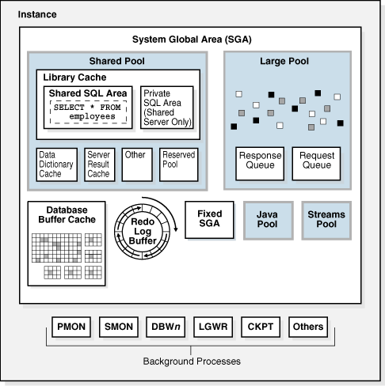
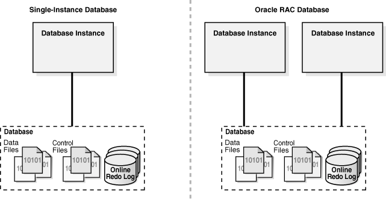
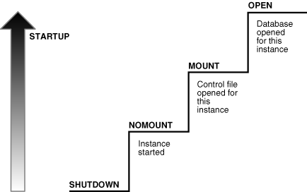
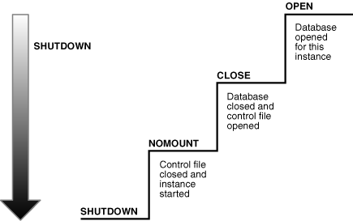
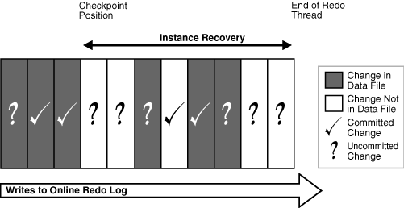
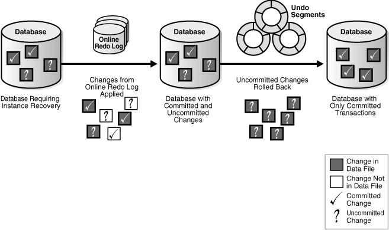
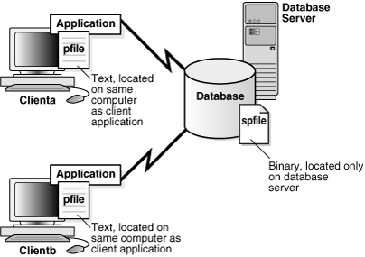
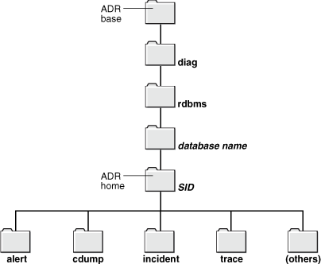

## 13 Oracle Database Instance

This chapter explains the nature of an Oracle database instance, the parameter and diagnostic files associated with an instance, and what occurs during instance creation and the opening and closing of a database.

This chapter contains the following sections:

## Introduction to the Oracle Database Instance

A database [instance](glossary.md) is a set of memory structures that manage database files. A [database](glossary.md) is a set of physical files on disk created by the `CREATE DATABASE` statement. The instance manages its associated data and serves the users of the database.

Every running Oracle database is associated with at least one Oracle database instance. Because an instance exists in memory and a database exists on disk, an instance can exist without a database and a database can exist without an instance.

### Database Instance Structure

When an instance is started, Oracle Database allocates a memory area called the [system global area (SGA)](glossary.md) and starts one or more [background processes](glossary.md). The SGA serves various purposes, including the following:

- Maintaining internal data structures that are accessed by many processes and threads concurrently
- Caching data blocks read from disk
- Buffering redo data before writing it to the online redo log files
- Storing SQL [execution plans](glossary.md)

The SGA is shared by the [Oracle processes](glossary.md), which include [server processes](glossary.md) and background processes, running on a single computer. The way in which Oracle processes are associated with the SGA varies according to operating system.

A database instance includes background processes. Server processes, and the process memory allocated in these processes, also exist in the instance. The instance continues to function when server processes terminate.

Figure 13-1 shows the main components of an Oracle database instance.

Figure 13-1 Database Instance



> This graphic represents an instance as a square. Inside the square is another square labeled System Global Area. The SGA holds the Shared Pool (which holds the Library Cache and Data Dictionary Cache), the Database Buffer Cache, the Redo Log Buffer, the Java Pool, the Streams Pool, and the Large Pool. Below the SGA is a row of background processes, each in its own box: PMON, SMON, DBWn, LGWR, CKPT, and Others.
  

See Also:

- ["Overview of the System Global Area"](memory.md)
- ["Overview of Background Processes"](process.md)

### Database Instance Configurations

You can run Oracle Database in either of the following mutually exclusive configurations:

- Single-instance configuration
	A one-to-one relationship exists between the database and an instance.
- Oracle Real Application Clusters (Oracle RAC) configuration
	A one-to-many relationship exists between the database and instances.

Figure 13-2 shows possible database instance configurations.

Figure 13-2 Database Instance Configurations



> This graphic is divided into two columns: Single-Instance Database and Oracle RAC Database. The first figure in the Single-Instance Database column shows a Database (containing data files, control files, and an online redo log) associated with an Instance (represented as a box). The Oracle RAC Database column shows two Database Instance boxes. These boxes both point to the same Database box.
  

Whether in a single-instance or Oracle RAC configuration, a database instance is associated with only one database at a time. You can start a database instance and mount (associate the instance with) one database, but not mount two databases simultaneously with the same instance.

Note:

This chapter discusses a single-instance database configuration unless otherwise noted.

Multiple instances can run concurrently on the same computer, each accessing its own database. For example, a computer can host two distinct databases: `prod1` and `prod2`. One database instance manages `prod1`, while a separate instance manages `prod2`.

See Also:

[Oracle Real Application Clusters Administration and Deployment Guide](https://docs.oracle.com/cd/E11882_01/rac.112/e41960/admin.htm#RACAD900) for information specific to Oracle RAC

#### Duration of an Instance

An instance begins when it is created with the `STARTUP` command and ends when it is terminated. During this period, an instance can associate itself with one and only one database. Furthermore, the instance can mount a database only once, close it only once, and open it only once. After a database has been closed or shut down, you must start a different instance to mount and open this database.

Table 13-1 illustrates a database instance attempting to reopen a database that it previously closed.

Table 13-1 Duration of an Instance

| Statement | Explanation |
| --- | --- |
| ``` SQL> STARTUP ORACLE instance started.   Total System Global Area  468729856 bytes Fixed Size                  1333556 bytes Variable Size             440403660 bytes Database Buffers           16777216 bytes Redo Buffers               10215424 bytes Database mounted. Database opened. ``` | The `STARTUP` command creates an instance, which mounts and opens the database. |
| ``` SQL> SELECT  TO_CHAR(STARTUP_TIME,'MON-DD-RR HH24:MI:SS') AS "Inst Start Time" FROM V$INSTANCE;   Inst Start Time ------------------ JUN-18-11 13:14:48 ``` | This query shows the time that the current instance was started. |
| ``` SQL> SHUTDOWN IMMEDIATE ``` | The instance closes the database and shuts down, ending the life of this instance. |
| ``` SQL> STARTUP Oracle instance started. . . . ``` | The `STARTUP` command creates a new instance and mounts and open the database. |
| ``` SQL> SELECT  TO_CHAR(STARTUP_TIME,'MON-DD-RR HH24:MI:SS') AS "Inst Start Time" FROM V$INSTANCE;   Inst Start Time ------------------ JUN-18-11 13:16:40 ``` | This query shows the time that the current instance was started. The different start time shows that this instance is different from the one that shut down the database. |

#### Oracle System Identifier (SID)

The system identifier (SID) is a unique name for an Oracle database instance on a specific host. On UNIX and Linux, Oracle Database uses the SID and [Oracle home](glossary.md) values to create a key to shared memory. Also, the SID is used by default to locate the parameter file, which is used to locate relevant files such as the database control files.

On most platforms, the `ORACLE_SID` environment variable sets the SID, whereas the `ORACLE_HOME` variable sets the Oracle home. When connecting to an instance, clients can specify the SID in an Oracle Net connection or use a net service name. Oracle Database converts a service name into an `ORACLE_HOME` and `ORACLE_SID`.

See Also:

- ["Service Names"](dist_pro.md)
- [Oracle Database Administrator's Guide](https://docs.oracle.com/cd/E11882_01/server.112/e25494/create.htm#ADMIN11074) to learn how to specify an Oracle SID

## Overview of Instance Startup and Shutdown

A database instance provides user access to a database. This section explains the possible states of the instance and the database.

### Overview of Instance and Database Startup

In a typical use case, you manually start an instance and then mount and open the database, making it available for users. You can use the SQL\*Plus `STARTUP` command, Oracle Enterprise Manager (Enterprise Manager), or the SRVCTL utility to perform these steps. Figure 13-3 shows how a database progresses from a shutdown state to an open state.

Figure 13-3 Instance and Database Startup Sequence



> On the left of this graphic is an upward-pointing arrow labeled STARTUP. To the right is a series of four steps in a staircase. The bottom step is SHUTDOWN. The next step is NOMOUNT, with the comment "instance started." The next step is MOUNT, with the comment "Control file opened for this instance." The next step is OPEN, with the comment "Database opened for this instance."
  

A database goes through the following phases when it proceeds from a shutdown state to an open database state:

1. Instance started without mounting database
	The instance is started, but is not yet associated with a database.
	"How an Instance Is Started" explains this stage.
2. Database mounted
	The instance is started and is associated with a database by reading its [control file](glossary.md) (see ["Overview of Control Files"](physical.md)). The database is closed to users.
	"How a Database Is Mounted" explains this stage.
3. Database open
	The instance is started and is associated with an open database. The data contained in the [data files](glossary.md) is accessible to authorized users.
	"How a Database Is Opened" explains this stage.

See Also:

- ["Oracle Enterprise Manager"](cncptdba.md)
- [Oracle Database 2 Day DBA](https://docs.oracle.com/cd/E11882_01/server.112/e10897/instance.htm#ADMQS0514) and [Oracle Database Administrator's Guide](https://docs.oracle.com/cd/E11882_01/server.112/e25494/start.htm#ADMIN10063) to learn how to start an instance
- [Oracle Database Administrator's Guide](https://docs.oracle.com/cd/E11882_01/server.112/e25494/restart.htm#ADMIN5032) to learn how to use SRVCTL

#### Connection with Administrator Privileges

Database startup and shutdown are powerful administrative options that are restricted to users who connect to Oracle Database with administrator privileges. Normal users do not have control over the current status of an Oracle database.

Depending on the operating system, one of the following conditions establishes administrator privileges for a user:

- The operating system privileges of the user enable him or her to connect using administrator privileges.
- The user is granted the `SYSDBA` or `SYSOPER` system privileges and the database uses password files to authenticate database administrators over the network.

`SYSDBA` and `SYSOPER` are special system privileges that enable access to a database instance even when the database is not open. Control of these privileges is outside of the database itself.When you connect with the `SYSDBA` system privilege, you are in the schema owned by `SYS`. When you connect as `SYSOPER`, you are in the public schema. `SYSOPER` privileges are a subset of `SYSDBA` privileges.

See Also:

- ["SYS and SYSTEM Schemas"](tablecls.md)
- ["Overview of Database Security"](cmntopc.md) to learn about password files and authentication for database administrators
- [Oracle Database Administrator's Guide](https://docs.oracle.com/cd/E11882_01/server.112/e25494/dba.htm#ADMIN11048) to learn about `SYSDBA` and `SYSOPER`

#### How an Instance Is Started

When Oracle Database starts an instance, it performs the following basic steps:

1. Searches for a [server parameter file](glossary.md) in a platform-specific default location and, if not found, for a text [initialization parameter file](glossary.md) (specifying `STARTUP` with the `SPFILE` or `PFILE` parameters overrides the default behavior)
2. Reads the parameter file to determine the values of initialization parameters
3. Allocates the SGA based on the initialization parameter settings
4. Starts the Oracle background processes
5. Opens the [alert log](glossary.md) and trace files and writes all explicit parameter settings to the [alert log](glossary.md) in valid parameter syntax

At this stage, no database is associated with the instance. Scenarios that require a `NOMOUNT` state include database creation and certain backup and recovery operations.

See Also:

[Oracle Database Administrator's Guide](https://docs.oracle.com/cd/E11882_01/server.112/e25494/create.htm#ADMIN00202) to learn how to manage initialization parameters using a server parameter file

#### How a Database Is Mounted

The instance mounts a database to associate the database with this instance. To mount the database, the instance obtains the names of the database control files specified in the `CONTROL_FILES` initialization parameter and opens the files. Oracle Database reads the control files to find the names of the data files and the online redo log files that it will attempt to access when opening the database.

In a [mounted database](glossary.md), the database is closed and accessible only to database administrators. Administrators can keep the database closed while completing specific maintenance operations. However, the database is not available for normal operations.

If Oracle Database allows multiple instances to mount the same database concurrently, then the `CLUSTER_DATABASE` initialization parameter setting can make the database available to multiple instances. Database behavior depends on the setting:

- If `CLUSTER_DATABASE` is `false` (default) for the first instance that mounts a database, then only this instance can mount the database.
- If `CLUSTER_DATABASE` is `true` for the first instance, then other instances can mount the database if their `CLUSTER_DATABASE` parameter settings are set to `true`. The number of instances that can mount the database is subject to a predetermined maximum specified when creating the database.

See Also:

- [Oracle Database Administrator's Guide](https://docs.oracle.com/cd/E11882_01/server.112/e25494/start.htm#ADMIN11152) to learn how to mount a database
- [Oracle Real Application Clusters Administration and Deployment Guide](https://docs.oracle.com/cd/E11882_01/rac.112/e41960/toc.htm) for more information about the use of multiple instances with a single database

#### How a Database Is Opened

Opening a mounted database makes it available for normal database operations. Any valid user can connect to an open database and access its information. Usually, a database administrator opens the database to make it available for general use.

When you open the database, Oracle Database performs the following actions:

- Opens the online data files in tablespaces other than undo tablespaces
	If a tablespace was offline when the database was previously shut down (see ["Online and Offline Tablespaces"](logical.md)), then the tablespace and its corresponding data files will be offline when the database reopens.
- Acquires an undo tablespace
	If multiple undo tablespaces exists, then the `UNDO_TABLESPACE` initialization parameter designates the undo tablespace to use. If this parameter is not set, then the first available undo tablespace is chosen.
- Opens the online redo log files

See Also:

["Data Repair"](cncptdba.md)

##### Read-Only Mode

By default, the database opens in read/write mode. In this mode, users can make changes to the data, generating redo in the online redo log. Alternatively, you can open in read-only mode to prevent data modification by user transactions.

Note:

By default, a physical [standby database](glossary.md) opens in read-only mode. See [Oracle Data Guard Concepts and Administration](https://docs.oracle.com/cd/E11882_01/server.112/e41134/manage_ps.htm#SBYDB00706).

Read-only mode restricts database access to read-only transactions, which cannot write to data files or to online redo log files. However, the database can perform recovery or operations that change the database state without generating redo. For example, in read-only mode:

- Data files can be taken offline and online. However, you cannot take permanent tablespaces offline.
- Offline data files and tablespaces can be recovered.
- The control file remains available for updates about the state of the database.
- Temporary tablespaces created with the `CREATE TEMPORARY TABLESPACE` statement are read/write.
- Writes to operating system audit trails, trace files, and alert logs can continue.

See Also:

[Oracle Database Administrator's Guide](https://docs.oracle.com/cd/E11882_01/server.112/e25494/start.htm#ADMIN11154) to learn how to open a database in read-only mode

##### Database File Checks

If any of the data files or redo log files are not present when the instance attempts to open the database, or if the files are present but fail consistency tests, then the database returns an error. Media recovery may be required.

See Also:

["Backup and Recovery"](cncptdba.md)

### Overview of Database and Instance Shutdown

In a typical use case, you manually shut down the database, making it unavailable for users while you perform maintenance or other administrative tasks. You can use the SQL\*Plus `SHUTDOWN` command or Enterprise Manager to perform these steps. Figure 13-4 shows the progression from an open state to a consistent shutdown.

Figure 13-4 Instance and Database Shutdown Sequence



> On the left of this graphic is an upward-pointing arrow labeled SHUTDOWN. To the right is a series of four steps in a staircase. The bottom step is SHUTDOWN. The next step up is NOMOUNT, with the comment "Control file closed and instance started." The next step is CLOSE, with the comment "Database closed and control file opened." The next step is OPEN, with the comment "Database opened for this instance."
  

Oracle Database automatically performs the following steps whenever an open database is shut down consistently:

1. Database closed
	The database is mounted, but online data files and redo log files are closed.
	"How a Database Is Closed" explains this stage.
2. Database unmounted
	The instance is started, but is no longer associated with the control file of the database.
	"How a Database Is Unmounted" explains this stage.
3. Database instance shut down
	The database instance is no longer started.
	"How an Instance Is Shut Down" explains this stage.

Oracle Database does not go through all of the preceding steps in an instance failure or `SHUTDOWN ABORT`, which immediately terminates the instance.

See Also:

[Oracle Database 2 Day DBA](https://docs.oracle.com/cd/E11882_01/server.112/e10897/instance.htm#ADMQS052) and [Oracle Database Administrator's Guide](https://docs.oracle.com/cd/E11882_01/server.112/e25494/start.htm#ADMIN11156) to learn how to shut down a database

#### Shutdown Modes

A database administrator with `SYSDBA` or `SYSOPER` privileges can shut down the database using the SQL\*Plus `SHUTDOWN` command or Enterprise Manager. The `SHUTDOWN` command has options that determine shutdown behavior. Table 13-2 summarizes the behavior of the different shutdown modes.

Table 13-2 Shutdown Modes

| Database Behavior | ABORT | IMMEDIATE | TRANSACTIONAL | NORMAL |
| --- | --- | --- | --- | --- |
| Permits new user connections | No | No | No | No |
| Waits until current sessions end | No | No | No | Yes |
| Waits until current transactions end | No | No | Yes | Yes |
| Performs a [checkpoint](glossary.md) and closes open files | No | Yes | Yes | Yes |

The possible `SHUTDOWN` statements are:

- `SHUTDOWN ABORT`
	This mode is intended for emergency situations, such as when no other form of shutdown is successful. This mode of shutdown is the fastest. However, a subsequent open of this database may take substantially longer because instance recovery must be performed to make the data files consistent.
	Note:
	Because `SHUTDOWN` `ABORT` does not checkpoint the open data files, instance recovery is necessary before the database can reopen. The other shutdown modes do not require instance recovery before the database can reopen.
- `SHUTDOWN IMMEDIATE`
	This mode is typically the fastest next to `SHUTDOWN` `ABORT`. Oracle Database terminates any executing SQL statements and disconnects users. Active transactions are terminated and uncommitted changes are rolled back.
- `SHUTDOWN TRANSACTIONAL`
	This mode prevents users from starting new transactions, but waits for all current transactions to complete before shutting down. This mode can take a significant amount of time depending on the nature of the current transactions.
- `SHUTDOWN NORMAL`
	This is the default mode of shutdown. The database waits for all connected users to disconnect before shutting down.

See Also:

- [Oracle Database 2 Day DBA](https://docs.oracle.com/cd/E11882_01/server.112/e10897/instance.htm#ADMQS05145) and [Oracle Database Administrator's Guide](https://docs.oracle.com/cd/E11882_01/server.112/e25494/start.htm#ADMIN11156) to learn about the different shutdown modes
- [SQL\*Plus User's Guide and Reference](https://docs.oracle.com/cd/E11882_01/server.112/e16604/ch_twelve041.htm#SQPUG124) to learn about the `SHUTDOWN` command

#### How a Database Is Closed

The database close operation is implicit in a database shutdown. The nature of the operation depends on whether the database shutdown is normal or abnormal.

##### How a Database Is Closed During Normal Shutdown

When a database is closed as part of a `SHUTDOWN` with any option other than `ABORT`, Oracle Database writes data in the SGA to the data files and online redo log files. Next, the database closes online data files and online redo log files. Any offline data files of offline tablespaces have been closed already. When the database reopens, any tablespace that was offline remains offline.

At this stage, the database is closed and inaccessible for normal operations. The control files remain open after a database is closed.

##### How a Database Is Closed During Abnormal Shutdown

If a `SHUTDOWN ABORT` or abnormal termination occurs, then the instance of an open database closes and shuts down the database instantaneously. Oracle Database does not write data in the buffers of the SGA to the data files and redo log files. The subsequent reopening of the database requires instance recovery, which Oracle Database performs automatically.

#### How a Database Is Unmounted

After the database is closed, Oracle Database unmounts the database to disassociate it from the instance. After a database is unmounted, Oracle Database closes the control files of the database. At this point, the instance remains in memory.

#### How an Instance Is Shut Down

The final step in database shutdown is shutting down the instance. When the database instance is shut down, the SGA is removed from memory and the background processes are terminated.

In unusual circumstances, shutdown of an instance may not occur cleanly. Memory structures may not be removed from memory or one of the background processes may not be terminated. When remnants of a previous instance exist, a subsequent instance startup may fail. In such situations, you can force the new instance to start by removing the remnants of the previous instance and then starting a new instance, or by issuing a `SHUTDOWN` `ABORT` statement in SQL\*Plus or using Enterprise Manager.

See Also:

[Oracle Database Administrator's Guide](https://docs.oracle.com/cd/E11882_01/server.112/e25494/start.htm#ADMIN11156) for more detailed information about database shutdown

## Overview of Checkpoints

A [checkpoint](glossary.md) is a crucial mechanism in consistent database shutdowns, instance recovery, and Oracle Database operation generally. The term checkpoint has the following related meanings:

- A data structure that indicates the checkpoint position, which is the [SCN](glossary.md) in the redo stream where instance recovery must begin
	The checkpoint position is determined by the oldest dirty buffer in the database buffer cache. The checkpoint position acts as a pointer to the redo stream and is stored in the control file and in each data file header.
- The writing of modified database buffers in the [database buffer cache](glossary.md) to disk

See Also:

["System Change Numbers (SCNs)"](transact.md)

### Purpose of Checkpoints

Oracle Database uses checkpoints to achieve the following goals:

- Reduce the time required for recovery in case of an instance or media failure
- Ensure that dirty buffers in the buffer cache are written to disk regularly
- Ensure that all committed data is written to disk during a consistent shutdown

### When Oracle Database Initiates Checkpoints

The checkpoint process (CKPT) is responsible for writing checkpoints to the data file headers and control file. Checkpoints occur in a variety of situations. For example, Oracle Database uses the following types of checkpoints:

- Thread checkpoints
	The database writes to disk all buffers modified by redo in a specific thread before a certain target. The set of thread checkpoints on all instances in a database is a database checkpoint. Thread checkpoints occur in the following situations:
	- Consistent database shutdown
		- `ALTER SYSTEM CHECKPOINT` statement
		- Online redo log switch
		- `ALTER DATABASE BEGIN BACKUP` statement
- Tablespace and data file checkpoints
	The database writes to disk all buffers modified by redo before a specific target. A tablespace checkpoint is a set of data file checkpoints, one for each data file in the tablespace. These checkpoints occur in a variety of situations, including making a tablespace read-only or taking it offline normal, shrinking a data file, or executing `ALTER TABLESPACE BEGIN BACKUP`.
- Incremental checkpoints
	An incremental checkpoint is a type of thread checkpoint partly intended to avoid writing large numbers of blocks at online redo log switches. DBWn checks at least every three seconds to determine whether it has work to do. When DBWn writes dirty buffers, it advances the checkpoint position, causing CKPT to write the checkpoint position to the control file, but not to the data file headers.

Other types of checkpoints include instance and media recovery checkpoints and checkpoints when schema objects are dropped or truncated.

See Also:

- ["Checkpoint Process (CKPT)"](process.md)
- [Oracle Real Application Clusters Administration and Deployment Guide](https://docs.oracle.com/cd/E11882_01/rac.112/e41960/admin.htm#RACAD039) for information about global checkpoints in Oracle RAC

## Overview of Instance Recovery

Instance recovery is the process of applying records in the [online redo log](glossary.md) to data files to reconstruct changes made after the most recent [checkpoint](glossary.md). Instance recovery occurs automatically when an administrator attempts to open a database that was previously shut down inconsistently.

### Purpose of Instance Recovery

Instance recovery ensures that the database is in a consistent state after an instance failure. The files of a database can be left in an inconsistent state because of how Oracle Database manages database changes.

A [redo thread](glossary.md) is a record of all of the changes generated by an instance. A single-instance database has one thread of redo, whereas an Oracle RAC database has multiple redo threads, one for each database instance.

When a [transaction](glossary.md) is committed, [log writer (LGWR)](glossary.md) writes both the remaining redo entries in memory and the transaction SCN to the [online redo log](glossary.md). However, the [database writer (DBW)](glossary.md) process writes modified data blocks to the data files whenever it is most efficient. For this reason, uncommitted changes may temporarily exist in the data files while committed changes do not yet exist in the data files.

If an instance of an open database fails, either because of a `SHUTDOWN ABORT` statement or abnormal termination, then the following situations can result:

- Data blocks committed by a transaction are not written to the data files and appear only in the [online redo log](glossary.md). These changes must be reapplied to the database.
- The data files contains changes that had not been committed when the instance failed. These changes must be rolled back to ensure transactional consistency.

Instance recovery uses only online redo log files and current online data files to synchronize the data files and ensure that they are consistent.

### When Oracle Database Performs Instance Recovery

Whether instance recovery is required depends on the state of the redo threads. A redo thread is marked open in the control file when a database instance opens in read/write mode, and is marked closed when the instance is shut down consistently. If redo threads are marked open in the control file, but no live instances hold the thread enqueues corresponding to these threads, then the database requires instance recovery.

Oracle Database performs instance recovery automatically in the following situations:

- The database opens for the first time after the failure of a single-instance database or all instances of an Oracle RAC database. This form of instance recovery is also called crash recovery. Oracle Database recovers the online redo threads of the terminated instances together.
- Some but not all instances of an Oracle RAC database fail. Instance recovery is performed automatically by a surviving instance in the configuration.

The SMON background process performs instance recovery, applying online redo automatically. No user intervention is required.

See Also:

- ["System Monitor Process (SMON)"](process.md)
- [Oracle Real Application Clusters Administration and Deployment Guide](https://docs.oracle.com/cd/E11882_01/rac.112/e41960/backup.htm#RACAD063) to learn about instance recovery in an Oracle RAC database

### Importance of Checkpoints for Instance Recovery

Instance recovery uses checkpoints to determine which changes must be applied to the data files. The checkpoint position guarantees that every committed change with an SCN lower than the checkpoint SCN is saved to the data files.

Figure 13-5 depicts the redo thread in the online redo log.

Figure 13-5 Checkpoint Position in Online Redo Log



> This graphic shows the redo log buffer as a pile of slabs. Slabs 1-3, 6, and 8-9 are darkly shaded, which means "Change in Data File." Slabs 4-5, 7, 10-11 are not shaded, which means "Change Not in Data File." Slabs 12-14 are lightly shaded, which means "Free Buffer." An arrow marks the point right below slab 3 as "Checkpoint Position." An arrow marks the position right above the top free buffer as "End of Redo Thread."
  

During instance recovery, the database must apply the changes that occur between the checkpoint position and the end of the redo thread. As shown in Figure 13-5, some changes may already have been written to the data files. However, only changes with SCNs lower than the checkpoint position are guaranteed to be on disk.

See Also:

[Oracle Database Performance Tuning Guide](https://docs.oracle.com/cd/E11882_01/server.112/e41573/instance_tune.htm#PFGRF13014) to learn how to limit instance recovery time

### Instance Recovery Phases

The first phase of instance recovery is called [cache recovery](glossary.md) or rolling forward, and involves reapplying all of the changes recorded in the online redo log to the data files. Because rollback data is recorded in the online redo log, rolling forward also regenerates the corresponding undo segments.

Rolling forward proceeds through as many online redo log files as necessary to bring the database forward in time. After rolling forward, the data blocks contain all committed changes recorded in the online redo log files. These files could also contain uncommitted changes that were either saved to the data files before the failure, or were recorded in the online redo log and introduced during cache recovery.

After the roll forward, any changes that were not committed must be undone. Oracle Database uses the checkpoint position, which guarantees that every committed change with an SCN lower than the checkpoint SCN is saved on disk. Oracle Database applies undo blocks to roll back uncommitted changes in data blocks that were written before the failure or introduced during cache recovery. This phase is called rolling back or [transaction recovery](glossary.md).

Figure 13-6 illustrates rolling forward and rolling back, the two steps necessary to recover from database instance failure.

Figure 13-6 Basic Instance Recovery Steps: Rolling Forward and Rolling Back



> This graphic shows a backup of a database that needs recovery. First, redo logs are applied to the database with committed and uncommitted transactions. Then undo blocks are applied the database with committed transactions.
>
> [Copyright © 1993, 2015, Oracle and/or its affiliates. All rights reserved.](https://docs.oracle.com/cd/E11882_01/dcommon/html/cpyr.htm)
  

Oracle Database can roll back multiple transactions simultaneously as needed. All transactions that were active at the time of failure are marked as terminated. Instead of waiting for the SMON process to roll back terminated transactions, new transactions can roll back individual blocks themselves to obtain the required data.

See Also:

- ["Undo Segments"](logical.md) to learn more about undo data
- [Oracle Database Performance Tuning Guide](https://docs.oracle.com/cd/E11882_01/server.112/e41573/instance_tune.htm#PFGRF13010) for a discussion of instance recovery mechanics and tuning

## Overview of Parameter Files

To start a database instance, Oracle Database must read either a server parameter file, which is recommended, or a text initialization parameter file, which is a legacy implementation. These files contain a list of configuration parameters.

To create a database manually, you must start an instance with a parameter file and then issue a `CREATE DATABASE` command. Thus, the instance and parameter file can exist even when the database itself does not exist.

### Initialization Parameters

Initialization parameters are configuration parameters that affect the basic operation of an instance. The instance reads initialization parameters from a file at startup.

Oracle Database provides many initialization parameters to optimize its operation in diverse environments. Only a few of these parameters must be explicitly set because the default values are adequate in most cases.

#### Functional Groups of Initialization Parameters

Most initialization parameters belong to one of the following functional groups:

- Parameters that name entities such as files or directories
- Parameters that set limits for a process, database resource, or the database itself
- Parameters that affect capacity, such as the size of the SGA (these parameters are called variable parameters)

Variable parameters are of particular interest to database administrators because they can use these parameters to improve database performance.

#### Basic and Advanced Initialization Parameters

Initialization parameters are divided into two groups: basic and advanced. In most cases, you must set and tune only the approximately 30 basic parameters to obtain reasonable performance. The basic parameters set characteristics such as the database name, locations of the control files, database block size, and undo tablespace.

In rare situations, modification to the advanced parameters may be required for optimal performance. The advanced parameters enable expert DBAs to adapt the behavior of the Oracle Database to meet unique requirements.

Oracle Database provides values in the starter initialization parameter file provided with your database software, or as created for you by the Database Configuration Assistant (see ["Tools for Database Installation and Configuration"](cncptdba.md)). You can edit these Oracle-supplied initialization parameters and add others, depending on your configuration and how you plan to tune the database. For relevant initialization parameters not included in the parameter file, Oracle Database supplies defaults.

See Also:

- [Oracle Database 2 Day DBA](https://docs.oracle.com/cd/E11882_01/server.112/e10897/instance.htm#ADMQS053) and [Oracle Database Administrator's Guide](https://docs.oracle.com/cd/E11882_01/server.112/e25494/create.htm#ADMIN12541) to learn how to specify initialization parameters
- [Oracle Database Reference](https://docs.oracle.com/cd/E11882_01/server.112/e40402/initparams_part.htm#REFRN001) for an explanation of the types of initialization parameters
- [Oracle Database Reference](https://docs.oracle.com/cd/E11882_01/server.112/e40402/dynviews_2087.htm#REFRN30176) for a description of `V$PARAMETER` and [SQL\*Plus User's Guide and Reference](https://docs.oracle.com/cd/E11882_01/server.112/e16604/ch_twelve040.htm#SQPUG123) for `SHOW PARAMETER` syntax

### Server Parameter Files

A server parameter file is a repository for initialization parameters that is managed by Oracle Database. A server parameter file has the following key characteristics:

- Only one server parameter file exists for a database. This file must reside on the database host.
- The server parameter file is written to and read by only by Oracle Database, not by client applications.
- The server parameter file is binary and cannot be modified by a text editor.
- Initialization parameters stored in the server parameter file are persistent. Any changes made to the parameters while a database instance is running can persist across instance shutdown and startup.

A server parameter file eliminates the need to maintain multiple text initialization parameter files for client applications. A server parameter file is initially built from a text initialization parameter file using the `CREATE SPFILE` statement. It can also be created directly by the Database Configuration Assistant.

See Also:

- [Oracle Database Administrator's Guide](https://docs.oracle.com/cd/E11882_01/server.112/e25494/create.htm#ADMIN11115) to learn more about server parameter files
- [Oracle Database SQL Language Reference](https://docs.oracle.com/cd/E11882_01/server.112/e41084/statements_6016.htm#SQLRF01315) to learn about `CREATE SPFILE`

### Text Initialization Parameter Files

A text initialization parameter file is a text file that contains a list of initialization parameters. This type of parameter file, which is a legacy implementation of the parameter file, has the following key characteristics:

- When starting up or shutting down a database, the text initialization parameter file must reside on the same host as the client application that connects to the database.
- A text initialization parameter file is text-based, not binary.
- Oracle Database can read but not write to the text initialization parameter file. To change the parameter values you must manually alter the file with a text editor.
- Changes to initialization parameter values by `ALTER` `SYSTEM` are only in effect for the current instance. You must manually update the text initialization parameter file and restart the instance for the changes to be known.

The text initialization parameter file contains a series of `key=value` pairs, one per line. For example, a portion of an initialization parameter file could look as follows:

```
db_name=sample
control_files=/disk1/oradata/sample_cf.dbf
db_block_size=8192
open_cursors=52
undo_management=auto
shared_pool_size=280M
pga_aggregate_target=29M
.
.
.
```

To illustrate the manageability problems that text parameter files can create, assume that you use computers `clienta` and `clientb` and must be able to start the database with SQL\*Plus on either computer. In this case, two separate text initialization parameter files must exist, one on each computer, as shown in Figure 13-7. A server parameter file solves the problem of the proliferation of parameter files.

Figure 13-7 Multiple Initialization Parameter Files



> On the left of this graphic are two identical client computers. Attached to each computer icon are a box labeled Application and a box labeled pfile. The pfile box has a label that says: "Text, located on the same computer as client application." Both application boxes are shown connecting to a database. The database icon is associated with an spfile icon that says: "Binary, located only on database server."
  

See Also:

- [Oracle Database Administrator's Guide](https://docs.oracle.com/cd/E11882_01/server.112/e25494/create.htm#ADMIN11099) to learn more about text initialization parameter files
- [Oracle Database SQL Language Reference](https://docs.oracle.com/cd/E11882_01/server.112/e41084/statements_6008.htm#SQLRF01308) to learn about `CREATE PFILE`

### Modification of Initialization Parameter Values

You can adjust initialization parameters to modify the behavior of a database. The classification of parameters as static or dynamic determines how they can be modified. Table 13-3 summarizes the differences.

Table 13-3 Static and Dynamic Initialization Parameters

| Characteristic | Static | Dynamic |
| --- | --- | --- |
| Requires modification of the parameter file (text or server) | Yes | No |
| Requires database instance restart before setting takes affect | Yes | No |
| Described as "Modifiable" in [Oracle Database Reference](https://docs.oracle.com/cd/E11882_01/server.112/e40402/initparams004.htm#REFRN00102) initialization parameter entry | No | Yes |
| Modifiable only for the database or instance | Yes | No |

Static parameters include `DB_BLOCK_SIZE`, `DB_NAME`, and `COMPATIBLE`. Dynamic parameters are grouped into session-level parameters, which affect only the current user session, and system-level parameters, which affect the database and all sessions. For example, `MEMORY_TARGET` is a system-level parameter, while `NLS_DATE_FORMAT` is a session-level parameter (see ["Locale-Specific Settings"](cncptdev.md)).

The scope of a parameter change depends on when the change takes effect. When an instance has been started with a server parameter file, you can use the `ALTER SYSTEM` `SET` statement to change values for system-level parameters as follows:

- `SCOPE=MEMORY`
	Changes apply to the database instance only. The change will not persist if the database is shut down and restarted.
- `SCOPE=SPFILE`
	Changes are written to the server parameter file but do not affect the current instance. Thus, the changes do not take effect until the instance is restarted.
	Note:
	You must specify `SPFILE` when changing the value of a parameter described as not modifiable in [Oracle Database Reference](https://docs.oracle.com/cd/E11882_01/server.112/e40402/initparams004.htm#REFRN00102).
- `SCOPE=BOTH`
	Changes are written both to memory and to the server parameter file. This is the default scope when the database is using a server parameter file.

The database prints the new value and the old value of an initialization parameter to the alert log. As a preventative measure, the database validates changes of basic parameter to prevent illegal values from being written to the server parameter file.

See Also:

- [Oracle Database Administrator's Guide](https://docs.oracle.com/cd/E11882_01/server.112/e25494/create.htm#ADMIN11119) to learn how to change initialization parameter settings
- [Oracle Database Reference](https://docs.oracle.com/cd/E11882_01/server.112/e40402/initparams_part.htm#REFRN001) for descriptions of all initialization parameters
- [Oracle Database SQL Language Reference](https://docs.oracle.com/cd/E11882_01/server.112/e41084/statements_2014.htm#SQLRF00902) for `ALTER SYSTEM` syntax and semantics

## Overview of Diagnostic Files

Oracle Database includes a fault diagnosability infrastructure for preventing, detecting, diagnosing, and resolving database problems. Problems include critical errors such as code bugs, metadata corruption, and customer data corruption.

The goals of the advanced fault diagnosability infrastructure are the following:

- Detecting problems proactively
- Limiting damage and interruptions after a problem is detected
- Reducing problem diagnostic and resolution time
- Simplifying customer interaction with Oracle Support

### Automatic Diagnostic Repository

Automatic Diagnostic Repository (ADR) is a file-based repository that stores database diagnostic data such as trace files, the alert log, and Health Monitor reports. Key characteristics of ADR include:

- Unified directory structure
- Consistent diagnostic data formats
- Unified tool set

The preceding characteristics enable customers and Oracle Support to correlate and analyze diagnostic data across multiple Oracle instances, components, and products.

ADR is located outside the database, which enables Oracle Database to access and manage ADR when the physical database is unavailable. An instance can create ADR before a database has been created.

#### Problems and Incidents

ADR proactively tracks problems, which are critical errors in the database. Critical errors manifest as internal errors, such as `ORA-600`, or other severe errors. Each problem has a problem key, which is a text string that describes the problem.

When a problem occurs multiple times, ADR creates a time-stamped incident for each occurrence. An incident is uniquely identified by a numeric incident ID. When an incident occurs, ADR sends an incident alert to Enterprise Manager. Diagnosis and resolution of a critical error usually starts with an incident alert.

Because a problem could generate many incidents in a short time, ADR applies flood control to incident generation after certain thresholds are reached. A flood-controlled incident generates an alert log entry, but does not generate incident dumps. In this way, ADR informs you that a critical error is ongoing without overloading the system with diagnostic data.

See Also:

[Oracle Database Administrator's Guide](https://docs.oracle.com/cd/E11882_01/server.112/e25494/diag.htm#ADMIN11257) for detailed information about the fault diagnosability infrastructure

#### ADR Structure

The ADR base is the ADR root directory. The ADR base can contain multiple ADR homes, where each ADR home is the root directory for all diagnostic data—traces, dumps, the alert log, and so on—for an instance of an Oracle product or component. For example, in an Oracle RAC environment with shared storage and ASM, each database instance and each ASM instance has its own ADR home.

Figure 13-8 illustrates the ADR directory hierarchy for a database instance. Other ADR homes for other Oracle products or components, such as ASM or Oracle Net Services, can exist within this hierarchy, under the same ADR base.

Figure 13-8 ADR Directory Structure for an Oracle Database Instance



> This figure shows the directory structure of the ADR for a single database instance, where each directory is represented by a folder. At the top is a folder labeled as "ADR base". Beneath ADR base is a directory named diag, beneath which is a directory named rdbms. Beneath the rdbms directory is a directory whose name is the database name. Beneath that directory is a directory whole name is the database SID. This directory is flagged by a label as the ADR home for the database instance. Beneath the ADR home directory (the directory whose name is the database SID) are the following subdirectories: alert, cdump, incident, trace, and one named "(others)", which indicates several other ADR home subdirectories.
  

As the following Linux example shows, when you start an instance with a unique SID and database name before creating a database, Oracle Database creates ADR by default as a directory structure in the host file system. The SID and database name form part of the path name for files in the ADR Home.

Example 13-1 Creation of ADR

```
% setenv ORACLE_SID osi
% echo "DB_NAME=dbn" > init.ora
% sqlplus / as sysdba
.
.
. 
Connected to an idle instance.
 
SQL> STARTUP NOMOUNT PFILE="./init.ora"
ORACLE instance started.
 
Total System Global Area  146472960 bytes
Fixed Size                  1317424 bytes
Variable Size              92276176 bytes
Database Buffers           50331648 bytes
Redo Buffers                2547712 bytes
 
SQL> SELECT NAME, VALUE FROM V$DIAG_INFO;
 
NAME                  VALUE
--------------------- --------------------------------------------------
Diag Enabled          TRUE 
ADR Base              /u01/oracle/log
ADR Home              /u01/oracle/log/diag/rdbms/dbn/osi
Diag Trace            /u01/oracle/log/diag/rdbms/dbn/osi/trace
Diag Alert            /u01/oracle/log/diag/rdbms/dbn/osi/alert
Diag Incident         /u01/oracle/log/diag/rdbms/dbn/osi/incident
Diag Cdump            /u01/oracle/log/diag/rdbms/dbn/osi/cdump
Health Monitor        /u01/oracle/log/diag/rdbms/dbn/osi/hm
Default Trace File    /u01/oracle/log/diag/rdbms/dbn/osi/trace/osi_ora_10533.trc 
Active Problem Count  0
Active Incident Count 0
```

The following sections describe the contents of ADR.

### Alert Log

Each database has an alert log, which is an XML file containing a chronological log of database messages and errors. The alert log contents include the following:

- All internal errors (`ORA-600`), block corruption errors (`ORA-1578`), and [deadlock](glossary.md) errors (`ORA-60`)
- Administrative operations such as [DDL](glossary.md) statements and the SQL\*Plus commands `STARTUP`, `SHUTDOWN`, `ARCHIVE LOG`, and `RECOVER`
- Several messages and errors relating to the functions of shared server and dispatcher processes
- Errors during the automatic refresh of a materialized view

Oracle Database uses the alert log as an alternative to displaying information in the Enterprise Manager GUI. If an administrative operation is successful, then Oracle Database writes a message to the alert log as "completed" along with a time stamp.

Oracle Database creates an alert log in the `alert` subdirectory shown in Figure 13-8 when you first start a database instance, even if no database has been created yet. The following example shows a portion of a text-only alert log:

```
Fri Jun 19 17:05:34 2011
Starting ORACLE instance (normal)
LICENSE_MAX_SESSION = 0
LICENSE_SESSIONS_WARNING = 0
Shared memory segment for instance monitoring created
Picked latch-free SCN scheme 2
Autotune of undo retention is turned on.
IMODE=BR
ILAT =12
LICENSE_MAX_USERS = 0
SYS auditing is disabled
Starting up ORACLE RDBMS Version: 11.2.0.0.0.
Using parameter settings in client-side pfile 
.
.
.
System parameters with nondefault values:
  db_name                  = "my_test"
Fri Jun 19 17:05:37 2011
PMON started with pid=2, OS id=10329
Fri Jun 19 17:05:37 2011
VKTM started with pid=3, OS id=10331 at elevated priority
VKTM running at (20)ms precision
Fri Jun 19 17:05:37 2011
DIAG started with pid=4, OS id=10335
```

As shown in Example 13-1, query `V$DIAG_INFO` to locate the alert log.

### Trace Files

A trace file is an administrative file that contain diagnostic data used to investigate problems. Also, trace files can provide guidance for tuning applications or an instance, as explained in ["Performance Diagnostics and Tuning"](cncptdba.md).

#### Types of Trace Files

Each server and background process can periodically write to an associated trace file. The files information on the process environment, status, activities, and errors.

The SQL trace facility also creates trace files, which provide performance information on individual SQL statements. To enable tracing for a client identifier, service, module, action, session, instance, or database, you must execute the appropriate procedures in the `DBMS_MONITOR` package or use Oracle Enterprise Manager.

A dump is a special type of trace file. Whereas a trace tends to be continuous output of diagnostic data, a dump is typically a one-time output of diagnostic data in response to an event (such as an incident). When an incident occurs, the database writes one or more dumps to the incident directory created for the incident. Incident dumps also contain the incident number in the file name.

See Also:

- ["Session Control Statements"](sqllangu.md)
- [Oracle Database Administrator's Guide](https://docs.oracle.com/cd/E11882_01/server.112/e25494/diag.htm#ADMIN11263) to learn about trace files, dumps, and core files
- [Oracle Database Performance Tuning Guide](https://docs.oracle.com/cd/E11882_01/server.112/e41573/sqltrace.htm#PFGRF010) to learn about application tracing

#### Locations of Trace Files

ADR stores trace files in the `trace` subdirectory, as shown in Figure 13-8. Trace file names are platform-dependent and use the extension `.trc`.

Typically, database background process trace file names contain the Oracle SID, the background process name, and the operating system process number. An example of a trace file for the `RECO` process is `mytest_reco_10355.trc`.

Server process trace file names contain the Oracle SID, the string `ora`, and the operating system process number. An example of a server process trace file name is `mytest_ora_10304.trc`.

Sometimes trace files have corresponding trace map (`.trm`) files. These files contain structural information about trace files and are used for searching and navigation.

See Also:

[Oracle Database Administrator's Guide](https://docs.oracle.com/cd/E11882_01/server.112/e25494/diag.htm#ADMIN12484) to learn how to find trace files