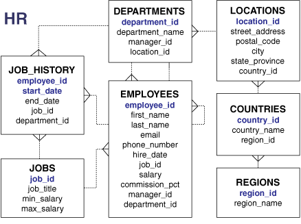
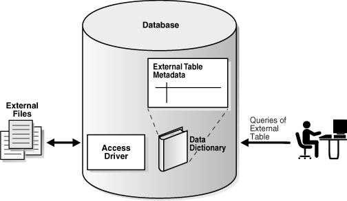
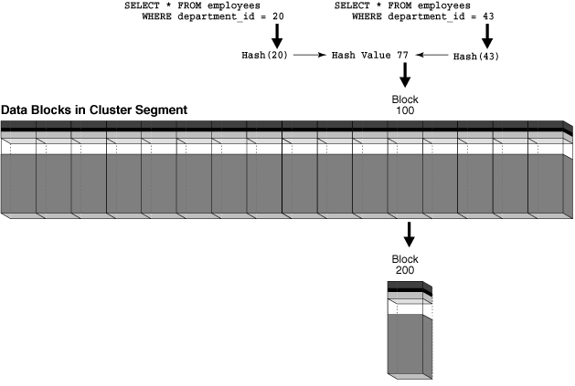

## 2 Tables and Table Clusters

This chapter provides an introduction to schema objects and discusses tables, which are the most common types of schema objects.

This chapter contains the following sections:

## Introduction to Schema Objects

A database [schema](glossary.md) is a logical container for data structures, called schema objects. Examples of schema objects are tables and indexes. Schema objects are created and manipulated with [SQL](glossary.md).

A [database user](glossary.md) has a password and various database [privileges](glossary.md). Each user owns a single schema, which has the same name as the user. The schema contains the data for the user owning the schema. For example, the `hr` user owns the `hr` schema, which contains schema objects such as the `employees` table. In a production database, the schema owner usually represents a database application rather than a person.

Within a schema, each schema object of a particular type has a unique name. For example, `hr.employees` refers to the table `employees` in the `hr` schema. Figure 2-1 depicts a schema owner named `hr` and schema objects within the `hr` schema.

Figure 2-1 HR Schema


> On the left of the graphic is an icon representing the HR user. An arrow labeled "owns" extends to the right of this user. The arrow points to a box bordered by a dotted line. This box is labeled "HR Schema." Inside this box are icons representing tables and indexes. These icons are labeled "schema objects."
  

See Also:

["Overview of Database Security"](cmntopc.md) to learn more about users and privileges

### Schema Object Types

The most important schema objects in a relational database are tables. A [table](glossary.md) stores data in rows.

Oracle SQL enables you to create and manipulate many other types of schema objects, including the following:

- Indexes
	Indexes are schema objects that contains an entry for each indexed row of the table or [table cluster](glossary.md) and provide direct, fast access to rows. Oracle Database supports several types of index. An index-organized table is a table in which the data is stored in an index structure. See [Chapter 3, "Indexes and Index-Organized Tables"](indexiot.md).
- Partitions
	Partitions are pieces of large tables and indexes. Each partition has its own name and may optionally have its own storage characteristics. See ["Overview of Partitions"](schemaob.md).
- Views
	Views are customized presentations of data in one or more tables or other views. You can think of them as stored queries. Views do not actually contain data. See ["Overview of Views"](schemaob.md).
- Sequences
	A sequence is a user-created object that can be shared by multiple users to generate integers. Typically, sequences are used to generate [primary key](glossary.md) values. See ["Overview of Sequences"](schemaob.md).
- Dimensions
	A dimension defines a parent-child relationship between pairs of column sets, where all the columns of a column set must come from the same table. Dimensions are commonly used to categorize data such as customers, products, and time. See ["Overview of Dimensions"](schemaob.md).
- Synonyms
	A synonym is an alias for another schema object. Because a synonym is simply an alias, it requires no storage other than its definition in the [data dictionary](glossary.md). See ["Overview of Synonyms"](schemaob.md).
- PL/SQL subprograms and packages
	PL/SQL is the Oracle procedural extension of SQL. A PL/SQL subprogram is a named PL/SQL block that can be invoked with a set of parameters. A PL/SQL package groups logically related PL/SQL types, variables, and subprograms. See ["PL/SQL Subprograms"](srvrside.md) and ["PL/SQL Packages"](srvrside.md).

Other types of objects are also stored in the database and can be created and manipulated with SQL statements but are not contained in a schema. These objects include database users, [roles](glossary.md), [contexts](glossary.md), and [directory objects](glossary.md).

See Also:

- [Oracle Database 2 Day DBA](https://docs.oracle.com/cd/E11882_01/server.112/e10897/schema.htm#ADMQS008) and [Oracle Database Administrator's Guide](https://docs.oracle.com/cd/E11882_01/server.112/e25494/general.htm#ADMIN021) to learn how to manage schema objects
- [Oracle Database SQL Language Reference](https://docs.oracle.com/cd/E11882_01/server.112/e41084/sql_elements007.htm#SQLRF20003) for more about schema objects and database objects

### Schema Object Storage

Some schema objects store data in logical storage structures called [segments](glossary.md). For example, a nonpartitioned [heap-organized table](glossary.md) or an index creates a segment. Other schema objects, such as views and sequences, consist of metadata only. This section describes only schema objects that have segments.

Oracle Database stores a schema object logically within a [tablespace](glossary.md). There is no relationship between schemas and tablespaces: a tablespace can contain objects from different schemas, and the objects for a schema can be contained in different tablespaces. The data of each object is physically contained in one or more data files.

Figure 2-2 shows a possible configuration of table and index segments, tablespaces, and data files. The data segment for one table spans two data files, which are both part of the same tablespace. A segment cannot span multiple tablespaces.

Figure 2-2 Segments, Tablespaces, and Data Files


> This graphic shows two data files side by side. Each data file contains four Index icons and two Table icons. A single Table icon spans the two data files. The legend says that Data Files are physical structures associated with only one tablespace. Segments are stored in tablespaces and may span several data files.
  

See Also:

- [Chapter 12, "Logical Storage Structures"](logical.md) to learn about tablespaces and segments
- [Oracle Database 2 Day DBA](https://docs.oracle.com/cd/E11882_01/server.112/e10897/storage.htm#ADMQS006) and [Oracle Database Administrator's Guide](https://docs.oracle.com/cd/E11882_01/server.112/e25494/schema.htm#ADMIN014) to learn how to manage storage for schema objects

### Schema Object Dependencies

Some schema objects reference other objects, creating schema object dependencies. For example, a view contains a [query](glossary.md) that references tables or other views, while a [PL/SQL](glossary.md) subprogram invokes other subprograms. If the definition of object A references object B, then A is a dependent object with respect to B and B is a referenced object with respect to A.

Oracle Database provides an automatic mechanism to ensure that a dependent object is always up to date with respect to its referenced objects. When a dependent object is created, the database tracks dependencies between the dependent object and its referenced objects. When a referenced object changes in a way that might affect a dependent object, the dependent object is marked invalid. For example, if a user drops a table, no view based on the dropped table is usable.

An invalid dependent object must be recompiled against the new definition of a referenced object before the dependent object is usable. Recompilation occurs automatically when the invalid dependent object is referenced.

As an illustration of how schema objects can create dependencies, the following sample script creates a table `test_table` and then a procedure that queries this table:

```
CREATE TABLE test_table ( col1 INTEGER, col2 INTEGER );

CREATE OR REPLACE PROCEDURE test_proc
AS
BEGIN
 FOR x IN ( SELECT col1, col2 FROM test_table )
 LOOP
   -- process data
   NULL;
 END LOOP;
END;
/
```

The following query of the status of procedure `test_proc` shows that it is valid:

```
SQL> SELECT OBJECT_NAME, STATUS FROM USER_OBJECTS WHERE OBJECT_NAME = 'TEST_PROC';
 
OBJECT_NAME STATUS
----------- -------
TEST_PROC   VALID
```

After adding the `col3` column to `test_table`, the procedure is still valid because the procedure has no dependencies on this column:

```
SQL> ALTER TABLE test_table ADD col3 NUMBER;
 
Table altered.
 
SQL> SELECT OBJECT_NAME, STATUS FROM USER_OBJECTS WHERE OBJECT_NAME = 'TEST_PROC';
 
OBJECT_NAME STATUS
----------- -------
TEST_PROC   VALID
```

However, changing the data type of the `col1` column, which the `test_proc` procedure depends on in, invalidates the procedure:

```
SQL> ALTER TABLE test_table MODIFY col1 VARCHAR2(20);
 
Table altered.
 
SQL> SELECT OBJECT_NAME, STATUS FROM USER_OBJECTS WHERE OBJECT_NAME = 'TEST_PROC';
 
OBJECT_NAME STATUS
----------- -------
TEST_PROC   INVALID
```

Running or recompiling the procedure makes it valid again, as shown in the following example:

```
SQL> EXECUTE test_proc
 
PL/SQL procedure successfully completed.
 
SQL> SELECT OBJECT_NAME, STATUS FROM USER_OBJECTS WHERE OBJECT_NAME = 'TEST_PROC';
 
OBJECT_NAME STATUS
----------- -------
TEST_PROC   VALID
```

See Also:

[Oracle Database Administrator's Guide](https://docs.oracle.com/cd/E11882_01/server.112/e25494/general.htm#ADMIN11556) and [Oracle Database Advanced Application Developer's Guide](https://docs.oracle.com/cd/E11882_01/appdev.112/e41502/adfns_dependencies.htm#ADFNS99966) to learn how to manage schema object dependencies

### SYS and SYSTEM Schemas

All Oracle databases include default administrative accounts. Administrative accounts are highly privileged and are intended only for DBAs authorized to perform tasks such as starting and stopping the database, managing memory and storage, creating and managing database users, and so on.

The administrative account `SYS` is automatically created when a database is created. This account can perform all database administrative functions. The `SYS` schema stores the base tables and views for the [data dictionary](glossary.md). These base tables and views are critical for the operation of Oracle Database. Tables in the `SYS` schema are manipulated only by the database and must never be modified by any user.

The `SYSTEM` account is also automatically created when a database is created. The `SYSTEM` schema stores additional tables and views that display administrative information, and internal tables and views used by various Oracle Database options and tools. Never use the `SYSTEM` schema to store tables of interest to nonadministrative users.

### Sample Schemas

An Oracle database may include sample schemas, which are a set of interlinked schemas that enable Oracle documentation and Oracle instructional materials to illustrate common database tasks. The `hr` schema is a sample schema that contains information about employees, departments and locations, work histories, and so on.

Figure 2-3 is an entity-relationship diagram of the tables in the `hr` schema. Most examples in this manual use objects from this schema.

Figure 2-3 HR Schema



> This figure shows the tables in the HR schema and the columns in each table, as well as dependencies between the tables.
>
> The job\_history has columns employee\_id (primary key), start\_date (primary key), end\_date, job\_id, and department\_id. Each job history record must be associated with one employee in the employees table.
>
> The jobs table has the columns job\_id (primary key), job\_title, min\_salary, and max\_salary. Each job may be related to one or more employees in the employees table.
>
> The departments table has columns department\_id (the primary key), department\_name, manager\_id, and location\_id. Each department must be related to one or more employees in the employee table and must be related to one location in the locations table.
>
> The employees table has columns employee\_id (primary key), first\_name, last\_name, email, phone\_number, hire\_date, job\_id, salary, commission\_pct, manager\_id, and department\_id. Each employee must be related to one department in the departments table and one job in the jobs table, and may be related to one or more records in the job\_history table.
>
> The locations table has columns location\_id (primary key), street\_address, postal\_code, city, state\_province, and country\_id. Each location may be associated with one or more departments and must be associated with one country.
>
> The countries table has columns country\_id (primary key), country\_name, and region\_id. Each country may be related to one or more locations and must be associated with one region.
>
> The regions table has columns region\_id (primary key) and region\_name. Each region may be associated with one or more countries.
  

See Also:

[Oracle Database Sample Schemas](https://docs.oracle.com/cd/E11882_01/server.112/e10831/toc.htm)

## Overview of Tables

A [table](glossary.md) is the basic unit of data organization in an Oracle database. A table describes an entity, which is something of significance about which information must be recorded. For example, an employee could be an entity.

Oracle Database tables fall into the following basic categories:

- Relational tables
	Relational tables have simple columns and are the most common table type. Example 2-1 shows a `CREATE TABLE` statement for a relational table.
- Object tables
	The columns correspond to the top-level attributes of an [object type](glossary.md). See "Object Tables".

You can create a relational table with the following organizational characteristics:

- A [heap-organized table](glossary.md) does not store rows in any particular order. The `CREATE TABLE` statement creates a heap-organized table by default.
- An [index-organized table](glossary.md) orders rows according to the primary key values. For some applications, index-organized tables enhance performance and use disk space more efficiently. See ["Overview of Index-Organized Tables"](indexiot.md).
- An external table is a read-only table whose metadata is stored in the database but whose data in stored outside the database. See "External Tables".

A table is either permanent or temporary. A permanent table definition and data persist across sessions. A [temporary table](glossary.md) definition persists in the same way as a permanent table definition, but the data exists only for the duration of a [transaction](glossary.md) or [session](glossary.md). Temporary tables are useful in applications where a result set must be held temporarily, perhaps because the result is constructed by running multiple operations.

This section contains the following topics:

- Columns and Rows
- Example: CREATE TABLE and ALTER TABLE Statements
- Oracle Data Types
- Integrity Constraints
- Object Tables
- Temporary Tables
- External Tables
- Table Storage
- Table Compression

See Also:

[Oracle Database 2 Day DBA](https://docs.oracle.com/cd/E11882_01/server.112/e10897/schema.htm#ADMQS082) and [Oracle Database Administrator's Guide](https://docs.oracle.com/cd/E11882_01/server.112/e25494/tables.htm#ADMIN015) to learn how to manage tables

### Columns and Rows

A table definition includes a table name and set of columns. A [column](glossary.md) identifies an attribute of the entity described by the table. For example, the column `employee_id` in the `employees` table refers to the employee ID attribute of an employee entity.

In general, you give each column a column name, a [data type](glossary.md), and a width when you create a table. For example, the data type for `employee_id` is `NUMBER(6)`, indicating that this column can only contain numeric data up to 6 digits in width. The width can be predetermined by the data type, as with `DATE`.

A table can contain a [virtual column](glossary.md), which unlike a nonvirtual column does not consume disk space. The database derives the values in a virtual column on demand by computing a set of user-specified [expressions](glossary.md) or functions. For example, the virtual column `income` could be a function of the `salary` and `commission_pct` columns.

After you create a table, you can insert, query, delete, and update rows using SQL. A [row](glossary.md) is a collection of column information corresponding to a record in a table. For example, a row in the `employees` table describes the attributes of a specific employee.

See Also:

[Oracle Database Administrator's Guide](https://docs.oracle.com/cd/E11882_01/server.112/e25494/tables.htm#ADMIN12494) to learn how to manage virtual columns

### Example: CREATE TABLE and ALTER TABLE Statements

The Oracle SQL command to create a table is `CREATE TABLE`. Example 2-1 shows the `CREATE TABLE` statement for the `employees` table in the `hr` sample schema. The statement specifies columns such as `employee_id`, `first_name`, and so on, specifying a data type such as `NUMBER` or `DATE` for each column.

Example 2-1 CREATE TABLE employees

```
CREATE TABLE employees
    ( employee_id    NUMBER(6)
    , first_name     VARCHAR2(20)
    , last_name      VARCHAR2(25)
         CONSTRAINT     emp_last_name_nn  NOT NULL
    , email          VARCHAR2(25)
        CONSTRAINT     emp_email_nn  NOT NULL
    , phone_number   VARCHAR2(20)
    , hire_date      DATE
        CONSTRAINT     emp_hire_date_nn  NOT NULL
    , job_id         VARCHAR2(10)
        CONSTRAINT     emp_job_nn  NOT NULL
    , salary         NUMBER(8,2)
    , commission_pct NUMBER(2,2)
    , manager_id     NUMBER(6)
    , department_id  NUMBER(4)
    , CONSTRAINT     emp_salary_min
                     CHECK (salary > 0)
    , CONSTRAINT     emp_email_uk
                     UNIQUE (email)
    ) ;
```

Example 2-2 shows an `ALTER TABLE` statement that adds [integrity constraints](glossary.md) to the `employees` table. Integrity constraints enforce business rules and prevent the entry of invalid information into tables.

Example 2-2 ALTER TABLE employees

```
ALTER TABLE employees
ADD ( CONSTRAINT     emp_emp_id_pk
                       PRIMARY KEY (employee_id)
    , CONSTRAINT     emp_dept_fk
                       FOREIGN KEY (department_id)
                         REFERENCES departments
    , CONSTRAINT     emp_job_fk
                       FOREIGN KEY (job_id)
                         REFERENCES jobs (job_id)
    , CONSTRAINT     emp_manager_fk
                       FOREIGN KEY (manager_id)
                         REFERENCES employees
    ) ;
```

Example 2-3 shows 8 rows and 6 columns of the `hr.employees` table.

Example 2-3 Rows in the employees Table

```
EMPLOYEE_ID FIRST_NAME  LAST_NAME      SALARY COMMISSION_PCT DEPARTMENT_ID
----------- ----------- ------------- ------- -------------- -------------
        100 Steven      King            24000                           90
        101 Neena       Kochhar         17000                           90
        102 Lex         De Haan         17000                           90
        103 Alexander   Hunold           9000                           60
        107 Diana       Lorentz          4200                           60
        149 Eleni       Zlotkey         10500             .2            80
        174 Ellen       Abel            11000             .3            80
        178 Kimberely   Grant            7000            .15
```

The output in Example 2-3 illustrates some of the following important characteristics of tables, columns, and rows:

- A row of the table describes the attributes of one employee: name, salary, department, and so on. For example, the first row in the output shows the record for the employee named Steven King.
- A column describes an attribute of the employee. In the example, the `employee_id` column is the [primary key](glossary.md), which means that every employee is uniquely identified by employee ID. Any two employees are guaranteed not to have the same employee ID.
- A non-key column can contain rows with identical values. In the example, the salary value for employees 101 and 102 is the same: `17000`.
- A [foreign key](glossary.md) column refers to a primary or unique key in the same table or a different table. In this example, the value of `90` in `department_id` corresponds to the `department_id` column of the `departments` table.
- A field is the intersection of a row and column. It can contain only one value. For example, the field for the department ID of employee 104 contains the value `60`.
- A field can lack a value. In this case, the field is said to contain a [null](glossary.md) value. The value of the `commission_pct` column for employee 100 is null, whereas the value in the field for employee 149 is `.2`. A column allows nulls unless a `NOT` `NULL` or primary key integrity constraint has been defined on this column, in which case no row can be inserted without a value for this column.

See Also:

[Oracle Database SQL Language Reference](https://docs.oracle.com/cd/E11882_01/server.112/e41084/statements_7002.htm#SQLRF01402) for `CREATE TABLE` syntax and semantics

### Oracle Data Types

Each column has a data type, which is associated with a specific storage format, constraints, and valid range of values. The data type of a value associates a fixed set of properties with the value. These properties cause Oracle Database to treat values of one data type differently from values of another. For example, you can multiply values of the `NUMBER` data type, but not values of the `RAW` data type.

When you create a table, you must specify a data type for each of its columns. Each value subsequently inserted in a column assumes the column data type.

Oracle Database provides several built-in data types. The most commonly used data types fall into the following categories:

- Character Data Types
- Numeric Data Types
- Datetime Data Types
- Rowid Data Types
- Format Models and Data Types

Other important categories of built-in types include raw, large objects (LOBs), and collections. PL/SQL has data types for constants and variables, which include `BOOLEAN`, reference types, composite types (records), and user-defined types.

See Also:

- ["Overview of LOBs"](cncptdev.md)
- [Oracle Database SQL Language Reference](https://docs.oracle.com/cd/E11882_01/server.112/e41084/sql_elements001.htm#SQLRF0021) to learn about built-in SQL data types
- [Oracle Database PL/SQL Language Reference](https://docs.oracle.com/cd/E11882_01/appdev.112/e25519/datatypes.htm#LNPLS003) to learn about PL/SQL data types
- [Oracle Database Advanced Application Developer's Guide](https://docs.oracle.com/cd/E11882_01/appdev.112/e41502/adfns_sqltypes.htm#ADFNS0002) for information about how to use the built-in data types

#### Character Data Types

Character data types store character (alphanumeric) data in strings. The most commonly used character data type is `VARCHAR2`, which is the most efficient option for storing character data.

The byte values correspond to the character encoding scheme, generally called a character set or code page. The database character set is established at database creation. Examples of character sets are 7-bit ASCII, EBCDIC, and Unicode UTF-8.

The length semantics of character data types can be measured in bytes or characters. Byte semantics treat strings as a sequence of bytes. This is the default for character data types. Character semantics treat strings as a sequence of characters. A character is technically a code point of the database character set.

See Also:

- ["Character Sets"](cncptdev.md)
- [Oracle Database 2 Day Developer's Guide](https://docs.oracle.com/cd/E11882_01/appdev.112/e10766/tdddg_objects.htm#TDDDG31000) and [Oracle Database Advanced Application Developer's Guide](https://docs.oracle.com/cd/E11882_01/appdev.112/e41502/adfns_sqltypes.htm#ADFNS00302) and to learn how to select a character data type

##### VARCHAR2 and CHAR Data Types

The `VARCHAR2` data type stores variable-length character literals. The terms literal and constant value are synonymous and refer to a fixed data value. For example, `'LILA'`, `'St. George Island'`, and `'101'` are all character literals; `5001` is a numeric literal. Character literals are enclosed in single quotation marks so that the database can distinguish them from schema object names.

Note:

This manual uses the terms text literal, character literal, and string interchangeably.

When you create a table with a `VARCHAR2` column, you specify a maximum string length. In Example 2-1, the `last_name` column has a data type of `VARCHAR2(25)`, which means that any name stored in the column can have a maximum of 25 bytes.

For each row, Oracle Database stores each value in the column as a variable-length field unless a value exceeds the maximum length, in which case the database returns an error. For example, in a single-byte character set, if you enter 10 characters for the `last_name` column value in a row, then the column in the row piece stores only 10 characters (10 bytes), not 25. Using `VARCHAR2` reduces space consumption.

In contrast to `VARCHAR2`, `CHAR` stores fixed-length character strings. When you create a table with a `CHAR` column, the column requires a string length. The default is 1 byte. The database uses blanks to pad the value to the specified length.

Oracle Database compares `VARCHAR2` values using nonpadded comparison semantics and compares `CHAR` values using blank-padded comparison semantics.

See Also:

[Oracle Database SQL Language Reference](https://docs.oracle.com/cd/E11882_01/server.112/e41084/sql_elements002.htm#SQLRF51040) for details about blank-padded and nonpadded comparison semantics

##### NCHAR and NVARCHAR2 Data Types

The `NCHAR` and `NVARCHAR2` data types store Unicode character data. Unicode is a universal encoded character set that can store information in any language using a single character set. `NCHAR` stores fixed-length character strings that correspond to the national character set, whereas `NVARCHAR2` stores variable length character strings.

You specify a national character set when creating a database. The character set of `NCHAR` and `NVARCHAR2` data types must be either `AL16UTF16` or `UTF8`. Both character sets use Unicode encoding.

When you create a table with an `NCHAR` or `NVARCHAR2` column, the maximum size is always in character length semantics. Character length semantics is the default and only length semantics for `NCHAR` or `NVARCHAR2`.

See Also:

[Oracle Database Globalization Support Guide](https://docs.oracle.com/cd/E11882_01/server.112/e10729/ch7progrunicode.htm#NLSPG0071) for information about Oracle's globalization support feature

#### Numeric Data Types

The Oracle Database numeric data types store fixed and floating-point numbers, zero, and infinity. Some numeric types also store values that are the undefined result of an operation, which is known as "not a number" or NAN.

Oracle Database stores numeric data in variable-length format. Each value is stored in scientific notation, with 1 byte used to store the exponent. The database uses up to 20 bytes to store the mantissa, which is the part of a floating-point number that contains its significant digits. Oracle Database does not store leading and trailing zeros.

##### NUMBER Data Type

The `NUMBER` data type stores fixed and floating-point numbers. The database can store numbers of virtually any magnitude. This data is guaranteed to be portable among different operating systems running Oracle Database. The `NUMBER` data type is recommended for most cases in which you must store numeric data.

You specify a fixed-point number in the form `NUMBER` `(``p``,``s``)`, where `p` and `s` refer to the following characteristics:

- Precision
	The precision specifies the total number of digits. If a precision is not specified, then the column stores the values exactly as provided by the application without any rounding.
- Scale
	The scale specifies the number of digits from the decimal point to the least significant digit. Positive scale counts digits to the right of the decimal point up to and including the least significant digit. Negative scale counts digits to the left of the decimal point up to but not including the least significant digit. If you specify a precision without a scale, as in `NUMBER(6)`, then the scale is 0.

In Example 2-1, the `salary` column is type `NUMBER(8,2)`, so the precision is 8 and the scale is 2. Thus, the database stores a salary of 100,000 as `100000.00`.

##### Floating-Point Numbers

Oracle Database provides two numeric data types exclusively for floating-point numbers: `BINARY_FLOAT` and `BINARY_DOUBLE`. These types support all of the basic functionality provided by the `NUMBER` data type. However, while `NUMBER` uses decimal precision, `BINARY_FLOAT` and `BINARY_DOUBLE` use binary precision, which enables faster arithmetic calculations and usually reduces storage requirements.

`BINARY_FLOAT` and `BINARY_DOUBLE` are approximate numeric data types. They store approximate representations of decimal values, rather than exact representations. For example, the value 0.1 cannot be exactly represented by either `BINARY_DOUBLE` or `BINARY_FLOAT`. They are frequently used for scientific computations. Their behavior is similar to the data types `FLOAT` and `DOUBLE` in Java and XMLSchema.

See Also:

[Oracle Database SQL Language Reference](https://docs.oracle.com/cd/E11882_01/server.112/e41084/sql_elements001.htm#SQLRF00222) to learn about precision, scale, and other characteristics of numeric types

#### Datetime Data Types

The datetime data types are `DATE` and `TIMESTAMP`. Oracle Database provides comprehensive time zone support for time stamps.

##### DATE Data Type

The `DATE` data type stores date and time. Although datetimes can be represented in character or number data types, `DATE` has special associated properties. The `hire_date` column in Example 2-1 has a `DATE` data type.

The database stores dates internally as numbers. Dates are stored in fixed-length fields of 7 bytes each, corresponding to century, year, month, day, hour, minute, and second.

Note:

Dates fully support arithmetic operations, so you add to and subtract from dates just as you can with numbers. See [Oracle Database Advanced Application Developer's Guide](https://docs.oracle.com/cd/E11882_01/appdev.112/e41502/adfns_sqltypes.htm#ADFNS202).

The database displays dates according to the specified format model. A format model is a character literal that describes the format of a datetime in a character string. The standard date format is `DD-MON-RR`, which displays dates in the form `01-JAN-11`.

`RR` is similar to `YY` (the last two digits of the year), but the century of the return value varies according to the specified two-digit year and the last two digits of the current year. Assume that in 1999 the database displays `01-JAN-11`. If the date format uses `RR`, then `11` specifies `2011`, whereas if the format uses `YY`, then `11` specifies `1911`. You can change the default date format at both the [instance](glossary.md) and the [session](glossary.md) level.

Oracle Database stores time in 24-hour format— `HH:MI:SS`. If no time portion is entered, then by default the time in a date field is `00:00:00 A.M`. In a time-only entry, the date portion defaults to the first day of the current month.

See Also:

- [Oracle Database Advanced Application Developer's Guide](https://docs.oracle.com/cd/E11882_01/appdev.112/e41502/adfns_sqltypes.htm#ADFNS182) for more information about centuries and date format masks
- [Oracle Database SQL Language Reference](https://docs.oracle.com/cd/E11882_01/server.112/e41084/sql_elements004.htm#SQLRF00212) for information about datetime format codes

##### TIMESTAMP Data Type

The `TIMESTAMP` data type is an extension of the `DATE` data type. It stores fractional seconds in addition to the information stored in the `DATE` data type. The `TIMESTAMP` data type is useful for storing precise time values, such as in applications that must track event order.

The `DATETIME` data types `TIMESTAMP WITH TIME ZONE` and `TIMESTAMP WITH LOCAL TIME ZONE` are time-zone aware. When a user selects the data, the value is adjusted to the time zone of the user session. This data type is useful for collecting and evaluating date information across geographic regions.

See Also:

[Oracle Database SQL Language Reference](https://docs.oracle.com/cd/E11882_01/server.112/e41084/sql_elements001.htm#SQLRF00203) for details about the syntax of creating and entering data in time stamp columns

#### Rowid Data Types

Every row stored in the database has an address. Oracle Database uses a `ROWID` data type to store the address ([rowid](glossary.md)) of every row in the database. Rowids fall into the following categories:

- Physical rowids store the addresses of rows in heap-organized tables, table clusters, and table and index partitions.
- Logical rowids store the addresses of rows in index-organized tables.
- Foreign rowids are identifiers in foreign tables, such as DB2 tables accessed through a gateway. They are not standard Oracle Database rowids.

A data type called the universal rowid, or `UROWID`, supports all kinds of rowids.

##### Use of Rowids

Oracle Database uses rowids internally for the construction of indexes. A [B-tree index](glossary.md), which is the most common type, contains an ordered list of keys divided into ranges. Each key is associated with a rowid that points to the associated row's address for fast access. End users and application developers can also use rowids for several important functions:

- Rowids are the fastest means of accessing particular rows.
- Rowids provide the ability to see how a table is organized.
- Rowids are unique identifiers for rows in a given table.

You can also create tables with columns defined using the `ROWID` data type. For example, you can define an exception table with a column of data type `ROWID` to store the rowids of rows that violate integrity constraints. Columns defined using the `ROWID` data type behave like other table columns: values can be updated, and so on.

##### ROWID Pseudocolumn

Every table in an Oracle database has a pseudocolumn named `ROWID`. A pseudocolumn behaves like a table column, but is not actually stored in the table. You can select from pseudocolumns, but you cannot insert, update, or delete their values. A pseudocolumn is also similar to a SQL [function](glossary.md) without arguments. Functions without arguments typically return the same value for every row in the result set, whereas pseudocolumns typically return a different value for each row.

Values of the `ROWID` pseudocolumn are strings representing the address of each row. These strings have the data type `ROWID`. This pseudocolumn is not evident when listing the structure of a table by executing `SELECT` or `DESCRIBE`, nor does the pseudocolumn consume space. However, the rowid of each row can be retrieved with a SQL query using the reserved word `ROWID` as a column name.

Example 2-4 queries the `ROWID` pseudocolumn to show the rowid of the row in the `employees` table for employee 100.

Example 2-4 ROWID Pseudocolumn

```
SQL> SELECT ROWID FROM employees WHERE employee_id = 100;
 
ROWID
------------------
AAAPecAAFAAAABSAAA
```

See Also:

- ["Rowid Format"](logical.md)
- [Oracle Database Advanced Application Developer's Guide](https://docs.oracle.com/cd/E11882_01/appdev.112/e41502/adfns_sqltypes.htm#ADFNS00306) to learn how to identify rows by address
- [Oracle Database SQL Language Reference](https://docs.oracle.com/cd/E11882_01/server.112/e41084/sql_elements001.htm#SQLRF50998) to learn about rowid types

#### Format Models and Data Types

A format model is a character literal that describes the format of datetime or numeric data stored in a character string. A format model does not change the internal representation of the value in the database.

When you convert a character string into a date or number, a format model determines how the database interprets the string. In SQL, you can use a format model as an argument of the `TO_CHAR` and `TO_DATE` functions to format a value to be returned from the database or to format a value to be stored in the database.

The following statement selects the salaries of the employees in Department 80 and uses the `TO_CHAR` function to convert these salaries into character values with the format specified by the number format model `'$99,990.99'`:

```
SQL> SELECT last_name employee, TO_CHAR(salary, '$99,990.99')
  2  FROM   employees
  3  WHERE  department_id = 80 AND last_name = 'Russell';
 
EMPLOYEE                  TO_CHAR(SAL
------------------------- -----------
Russell                    $14,000.00
```

The following example updates a hire date using the `TO_DATE` function with the format mask `'YYYY MM DD'` to convert the string `'1998 05 20'` to a `DATE` value:

```
SQL> UPDATE employees
  2  SET hire_date = TO_DATE('1998 05 20','YYYY MM DD')
  3  WHERE last_name = 'Hunold';
```

See Also:

[Oracle Database SQL Language Reference](https://docs.oracle.com/cd/E11882_01/server.112/e41084/sql_elements004.htm#SQLRF00210) to learn more about format models

### Integrity Constraints

Integrity constraints are named rules that restrict the values for one or more columns in a table. These rules prevent invalid data entry into tables. Also, constraints can prevent the deletion of a table when certain dependencies exist.

If a constraint is enabled, then the database checks data as it is entered or updated. Data that does not conform to the constraint is prevented from being entered. If a constraint is disabled, then data that does not conform to the constraint can be allowed to enter the database.

In Example 2-1, the `CREATE TABLE` statement specifies `NOT NULL` constraints for the `last_name`, `email`, `hire_date`, and `job_id` columns. The constraint clauses identify the columns and the conditions of the constraint. These constraints ensure that the specified columns contain no null values. For example, an attempt to insert a new employee without a job ID generates an error.

You can create a constraint when or after you create a table. Constraints can be temporarily disabled if needed. The database stores constraints in the [data dictionary](glossary.md).

See Also:

- [Chapter 5, "Data Integrity"](datainte.md) to learn about integrity constraints
- [Oracle Database SQL Language Reference](https://docs.oracle.com/cd/E11882_01/server.112/e41084/clauses002.htm#SQLRF52180) to learn about SQL constraint clauses

### Object Tables

An Oracle object type is a user-defined type with a name, attributes, and methods. Object types make it possible to model real-world entities such as customers and purchase orders as objects in the database.

An object type defines a logical structure, but does not create storage. Example 2-5 creates an object type named `department_typ`.

Example 2-5 Object Type

```
CREATE TYPE department_typ AS OBJECT
   ( d_name     VARCHAR2(100),
     d_address  VARCHAR2(200) );
/
```

An object table is a special kind of table in which each row represents an object. The `CREATE TABLE` statement in Example 2-6 creates an object table named `departments_obj_t` of the object type `department_typ`. The attributes (columns) of this table are derived from the definition of the object type. The `INSERT` statement inserts a row into this table.

Example 2-6 Object Table

```
CREATE TABLE departments_obj_t OF department_typ;
INSERT INTO departments_obj_t 
  VALUES ('hr', '10 Main St, Sometown, CA');
```

Like a relational column, an object table can contain rows of just one kind of thing, namely, object instances of the same declared type as the table. By default, every row object in an object table has an associated logical object identifier (OID) that uniquely identifies it in an object table. The OID column of an object table is a hidden column.

See Also:

- [Oracle Database Object-Relational Developer's Guide](https://docs.oracle.com/cd/E11882_01/appdev.112/e11822/adobjint.htm#ADOBJ001) to learn about object-relational features in Oracle Database
- [Oracle Database SQL Language Reference](https://docs.oracle.com/cd/E11882_01/server.112/e41084/statements_8001.htm#SQLRF01506) for `CREATE TYPE` syntax and semantics

### Temporary Tables

Oracle Database temporary tables hold data that exists only for the duration of a transaction or session. Data in a temporary table is private to the session, which means that each session can only see and modify its own data.

Temporary tables are useful in applications where a result set must be buffered. For example, a scheduling application enables college students to create optional semester course schedules. Each schedule is represented by a row in a temporary table. During the session, the schedule data is private. When the student decides on a schedule, the application moves the row for the chosen schedule to a permanent table. At the end of the session, the schedule data in the temporary data is automatically dropped.

#### Temporary Table Creation

The `CREATE GLOBAL TEMPORARY TABLE` statement creates a temporary table. The `ON COMMIT` clause specifies whether the table data is transaction-specific (default) or session-specific.

Unlike temporary tables in some other relational databases, when you create a temporary table in an Oracle database, you create a static table definition. The temporary table is a persistent object described in the data dictionary, but appears empty until your session inserts data into the table. You create a temporary table for the database itself, not for every PL/SQL [stored procedure](glossary.md).

Because temporary tables are statically defined, you can create indexes for them with the `CREATE INDEX` statement. Indexes created on temporary tables are also temporary. The data in the index has the same session or transaction scope as the data in the temporary table. You can also create a [view](glossary.md) or [trigger](glossary.md) on a temporary table.

See Also:

- [Oracle Database Administrator's Guide](https://docs.oracle.com/cd/E11882_01/server.112/e25494/tables.htm#ADMIN11633) to learn how create and manage temporary tables
- [Oracle Database SQL Language Reference](https://docs.oracle.com/cd/E11882_01/server.112/e41084/statements_7002.htm#SQLRF01402) for `CREATE GLOBAL TEMPORARY TABLE` syntax and semantics
- ["Overview of Views"](schemaob.md) and ["Overview of Triggers"](srvrside.md)

#### Segment Allocation in Temporary Tables

Like permanent tables, temporary tables are defined in the data dictionary. Temporary segments are allocated when data is first inserted. Until data is loaded in a session the table appears empty. Temporary segments are deallocated at the end of the transaction for transaction-specific temporary tables and at the end of the session for session-specific temporary tables.

See Also:

["Temporary Segments"](logical.md)

### External Tables

An external table accesses data in external sources as if this data were in a table in the database. You can use SQL, PL/SQL, and Java to query the external data.

External tables are useful for querying flat files. For example, a SQL-based application may need to access records in a text file. The records are in the following form:

```
100,Steven,King,SKING,515.123.4567,17-JUN-03,AD_PRES,31944,150,90
101,Neena,Kochhar,NKOCHHAR,515.123.4568,21-SEP-05,AD_VP,17000,100,90 
102,Lex,De Haan,LDEHAAN,515.123.4569,13-JAN-01,AD_VP,17000,100,90
```

You could create an external table, copy the file to the location specified in the external table definition, and use SQL to query the records in the text file.

External tables are also valuable for performing [ETL](glossary.md) tasks common in [data warehouse](glossary.md) environments. For example, external tables enable the pipelining of the data loading phase with the transformation phase, eliminating the need to stage data inside the database in preparation for further processing inside the database. See ["Overview of Data Warehousing and Business Intelligence"](cmntopc.md).

#### External Table Creation

Internally, creating an external table means creating metadata in the data dictionary. Unlike an ordinary table, an external table does not describe data stored in the database, nor does it describe how data is stored externally. Rather, external table metadata describes how the external table layer must present data to the database.

A `CREATE TABLE ... ORGANIZATION EXTERNAL` statement has two parts. The external table definition describes the column types. This definition is like a view that enables SQL to query external data without loading it into the database. The second part of the statement maps the external data to the columns.

External tables are read-only unless created with `CREATE TABLE AS SELECT` with the `ORACLE_DATAPUMP` access driver. Restrictions for external tables include no support for indexed columns, virtual columns, and column objects.

#### External Table Access Drivers

An access driver is an API that interprets the external data for the database. The access driver runs inside the database, which uses the driver to read the data in the external table. The access driver and the external table layer are responsible for performing the transformations required on the data in the data file so that it matches the external table definition. Figure 2-4 represents how external data is accessed.

Figure 2-4 External Tables



> On the left side of the diagram is an icon of files labeled "External Files." To the right of this icon is a double arrow. In the middle is a cylinder icon containing two boxes: Access Driver and External Table Metadata. The latter shows two dotted lines leading to Data Dictionary. To the right of the cylinder is a left-sided arrow labeled "Queries of External Table." To the right of this arrow is an icon of a user in front of a computer.
  

Oracle provides the `ORACLE_LOADER` (default) and `ORACLE_DATAPUMP` access drivers for external tables. For both drivers, the external files are not Oracle data files.

`ORACLE_LOADER` enables read-only access to external files using SQL\*Loader. You cannot create, update, or append to an external file using the `ORACLE_LOADER` driver.

The `ORACLE_DATAPUMP` driver enables you to unload external data. This operation involves reading data from the database and inserting the data into an external table, represented by one or more external files. After external files are created, the database cannot update or append data to them. The driver also enables you to load external data, which involves reading an external table and loading its data into a database.

See Also:

- [Oracle Database Administrator's Guide](https://docs.oracle.com/cd/E11882_01/server.112/e25494/tables.htm#ADMIN01507) to learn about managing external tables, external connections, and [directory objects](glossary.md)
- [Oracle Database Utilities](https://docs.oracle.com/cd/E11882_01/server.112/e22490/et_concepts.htm#SUTIL011) to learn about external tables
- [Oracle Database SQL Language Reference](https://docs.oracle.com/cd/E11882_01/server.112/e41084/statements_7002.htm#SQLRF54502) for information about creating and querying external tables

### Table Storage

Oracle Database uses a [data segment](glossary.md) in a tablespace to hold table data. As explained in ["User Segments"](logical.md), a segment contains [extents](glossary.md) made up of [data blocks](glossary.md).

The data segment for a table (or cluster data segment, when dealing with a [table cluster](glossary.md)) is located in either the default tablespace of the table owner or in a tablespace named in the `CREATE TABLE` statement.

#### Table Organization

By default, a table is organized as a heap, which means that the database places rows where they fit best rather than in a user-specified order. Thus, a heap-organized table is an unordered collection of rows. As users add rows, the database places the rows in the first available free space in the data segment. Rows are not guaranteed to be retrieved in the order in which they were inserted.

Note:

Index-organized tables use a different principle of organization. See ["Overview of Index-Organized Tables"](indexiot.md).

The `hr.departments` table is a heap-organized table. It has columns for department ID, name, manager ID, and location ID. As rows are inserted, the database stores them wherever they fit. A data block in the table segment might contain the unordered rows shown in Example 2-7.

Example 2-7 Rows in Departments Table

```
50,Shipping,121,1500
120,Treasury,,1700
70,Public Relations,204,2700
30,Purchasing,114,1700
130,Corporate Tax,,1700
10,Administration,200,1700
110,Accounting,205,1700
```

The column order is the same for all rows in a table. The database usually stores columns in the order in which they were listed in the `CREATE TABLE` statement, but this order is not guaranteed. For example, if a table has a column of type `LONG`, then Oracle Database always stores this column last in the row. Also, if you add a new column to a table, then the new column becomes the last column stored.

A table can contain a virtual column, which unlike normal columns does not consume space on disk. The database derives the values in a virtual column on demand by computing a set of user-specified expressions or functions. You can index virtual columns, collect statistics on them, and create integrity constraints. Thus, virtual columns are much like nonvirtual columns.

See Also:

[Oracle Database SQL Language Reference](https://docs.oracle.com/cd/E11882_01/server.112/e41084/statements_7002.htm#SQLRF54465) to learn about virtual columns

#### Row Storage

The database stores rows in data blocks. Each row of a table containing data for less than 256 columns is contained in one or more row pieces.

If possible, Oracle Database stores each row as one row piece. However, if all of the row data cannot be inserted into a single data block, or if an update to an existing row causes the row to outgrow its data block, then the database stores the row using multiple row pieces (see ["Data Block Format"](logical.md)).

Rows in a table cluster contain the same information as rows in nonclustered tables. Additionally, rows in a table cluster contain information that references the cluster key to which they belong.

#### Rowids of Row Pieces

A [rowid](glossary.md) is effectively a 10-byte physical address of a row. As explained in "Rowid Data Types", every row in a heap-organized table has a rowid unique to this table that corresponds to the physical address of a row piece. For table clusters, rows in different tables that are in the same data block can have the same rowid.

Oracle Database uses rowids internally for the construction of indexes. For example, each key in a B-tree index is associated with a rowid that points to the address of the associated row for fast access (see ["B-Tree Indexes"](indexiot.md)). Physical rowids provide the fastest possible access to a table row, enabling the database to retrieve a row in as little as a single I/O.

See Also:

["Rowid Format"](logical.md)

#### Storage of Null Values

A null is the absence of a value in a column. Nulls indicate missing, unknown, or inapplicable data.

Nulls are stored in the database if they fall between columns with data values. In these cases, they require 1 byte to store the length of the column (zero). Trailing nulls in a row require no storage because a new row header signals that the remaining columns in the previous row are null. For example, if the last three columns of a table are null, then no data is stored for these columns.

See Also:

[Oracle Database SQL Language Reference](https://docs.oracle.com/cd/E11882_01/server.112/e41084/sql_elements005.htm#SQLRF30037) to learn more about null values

### Table Compression

The database can use [table compression](glossary.md) to reduce the amount of storage required for the table. Compression saves disk space, reduces memory use in the [database buffer cache](glossary.md), and in some cases speeds query execution. Table compression is transparent to database applications.

#### Basic and Advanced Row Compression

Dictionary-based table compression provides good compression ratios for heap-organized tables. Oracle Database supports the following types of dictionary-based table compression:

- Basic table compression
	This type of compression is intended for bulk load operations. The database does not compress data modified using conventional DML. You must use direct path loads, `ALTER TABLE . . . MOVE` operations, or online table redefinition to achieve basic compression.
- Advanced row compression
	This type of compression is intended for OLTP applications and compresses data manipulated by any SQL operation.

For basic and advanced row compression, the database stores compressed rows in row-major format. All columns of one row are stored together, followed by all columns of the next row, and so on (see [Figure 12-7](logical.md)). Duplicate values are replaced with a short reference to a symbol table stored at the beginning of the block. Thus, information needed to re-create the uncompressed data is stored in the data block itself.

Compressed data blocks look much like normal data blocks. Most database features and functions that work on regular data blocks also work on compressed blocks.

You can declare compression at the tablespace, table, partition, or subpartition level. If specified at the tablespace level, then all tables created in the tablespace are compressed by default.

The following statement applies OLTP compression to the `orders` table:

```
ALTER TABLE oe.orders COMPRESS FOR OLTP;
```

The following example of a partial `CREATE TABLE` statement specifies OLTP compression for one partition and basic compression for the other partition:

```
CREATE TABLE sales (
    prod_id     NUMBER     NOT NULL,
    cust_id     NUMBER     NOT NULL, ... )
 PCTFREE 5 NOLOGGING NOCOMPRESS
 PARTITION BY RANGE (time_id)
 ( partition sales_2010 VALUES LESS THAN(TO_DATE(...)) COMPRESS BASIC,
   partition sales_2011 VALUES LESS THAN (MAXVALUE) COMPRESS FOR OLTP );
```

See Also:

- ["Data Block Compression"](logical.md) to learn about the format of compressed data blocks
- [Oracle Database Administrator's Guide](https://docs.oracle.com/cd/E11882_01/server.112/e25494/tables.htm#ADMIN11630) and [Oracle Database Performance Tuning Guide](https://docs.oracle.com/cd/E11882_01/server.112/e41573/build_db.htm#PFGRF94152) to learn about table compression
- ["SQL\*Loader"](cncptdba.md) to learn about using SQL\*Loader for direct path loads

#### Hybrid Columnar Compression

With Hybrid Columnar Compression, the database stores the same column for a group of rows together. The data block does not store data in row-major format, but uses a combination of both row and columnar methods.

Storing column data together, with the same data type and similar characteristics, dramatically increases the storage savings achieved from compression. The database compresses data manipulated by any SQL operation, although compression levels are higher for direct path loads. Database operations work transparently against compressed objects, so no application changes are required.

##### Types of Hybrid Columnar Compression

If your underlying storage supports Hybrid Columnar Compression, then you can specify the following compression types, depending on your requirements:

- Warehouse compression
	This type of compression is optimized to save storage space, and is intended for data warehouse applications.
- Online archival compression
	This type of compression is optimized for maximum compression levels, and is intended for historical data and data that does not change.

To achieve warehouse or online archival compression, you must use direct path loads, `ALTER TABLE . . . MOVE` operations, or online table redefinition.

Hybrid Columnar Compression is optimized for Data Warehousing and decision support applications on Exadata storage. Exadata maximizes the performance of queries on tables that are compressed using Hybrid Columnar Compression, taking advantage of the processing power, memory, and Infiniband network bandwidth that are integral to the Exadata storage server.

Other Oracle storage systems support Hybrid Columnar Compression, and deliver the same space savings as on Exadata storage, but do not deliver the same level of query performance. For these storage systems, Hybrid Columnar Compression is ideal for in-database archiving of older data that is infrequently accessed.

##### Compression Units

Hybrid Columnar Compression uses a logical construct called a compression unit to store a set of rows. When you load data into a table, the database stores groups of rows in columnar format, with the values for each column stored and compressed together. After the database has compressed the column data for a set of rows, the database fits the data into the compression unit.

For example, you apply Hybrid Columnar Compression to a `daily_sales` table. At the end of every day, you populate the table with items and the number sold, with the item ID and date forming a composite primary key. Table 2-1 shows a subset of the rows in `daily_sales`.

Table 2-1 Sample Table daily\_sales

| Item\_ID | Date | Num\_Sold | Shipped\_From | Restock |
| --- | --- | --- | --- | --- |
| 1000 | 01-JUN-11 | 2 | WAREHOUSE1 | Y |
| 1001 | 01-JUN-11 | 0 | WAREHOUSE3 | N |
| 1002 | 01-JUN-11 | 1 | WAREHOUSE3 | N |
| 1003 | 01-JUN-11 | 0 | WAREHOUSE2 | N |
| 1004 | 01-JUN-11 | 2 | WAREHOUSE1 | N |
| 1005 | 01-JUN-11 | 1 | WAREHOUSE2 | N |

Assume that the rows in Table 2-1 are stored in one compression unit. Hybrid Columnar Compression stores the values for each column together, and then uses multiple algorithms to compress each column. The database chooses the algorithms based on a variety of factors, including the data type of the column, the cardinality of the actual values in the column, and the compression level chosen by the user.

As shown in Figure 2-5, each compression unit can span multiple data blocks. The values for a particular column may or may not span multiple blocks.

Figure 2-5 Compression Unit


> This graphic shows a long rectangle that contains the following boxes: Column 1, Column 2, Column 3, Column 4, and Column 5. Column 1 is the largest box. Column 3 and Column 4 are smaller. Column 2 is the smallest box. Column 5 is next smallest.
>
> Below the rectangle are four boxes: Data Block 1, Data Block 2, Data Block 3, and Data Block 4. The graphic indicates that column data can span multiple data blocks.
  

Hybrid Columnar Compression has implications for row locking (see ["Row Locks (TX)"](consist.md)). When an update occurs for a row in an uncompressed data block, only the updated row is locked. In contrast, the database must lock all rows in the compression unit if an update is made to any row in the unit. Updates to rows using Hybrid Columnar Compression cause rowids to change.

Note:

When tables use Hybrid Columnar Compression, Oracle DML locks larger blocks of data (compression units), which may reduce concurrency.

See Also:

- [Oracle Database Licensing Information](https://docs.oracle.com/cd/E11882_01/license.112/e47877/editions.htm#DBLIC2152) to learn about licensing requirements for Hybrid Columnar Compression
- [Oracle Database Administrator's Guide](https://docs.oracle.com/cd/E11882_01/server.112/e25494/tables.htm#ADMIN11630) to learn how to use Hybrid Columnar Compression

## Overview of Table Clusters

A [table cluster](glossary.md) is a group of tables that share common columns and store related data in the same blocks. When tables are clustered, a single [data block](glossary.md) can contain rows from multiple tables. For example, a block can store rows from both the `employees` and `departments` tables rather than from only a single table.

The cluster key is the column or columns that the clustered tables have in common. For example, the `employees` and `departments` tables share the `department_id` column. You specify the cluster key when creating the table cluster and when creating every table added to the table cluster.

The cluster key value is the value of the cluster key columns for a particular set of rows. All data that contains the same cluster key value, such as `department_id=20`, is physically stored together. Each cluster key value is stored only once in the cluster and the cluster index, no matter how many rows of different tables contain the value.

For an analogy, suppose an HR manager has two book cases: one with boxes of employees folders and the other with boxes of departments folders. Users often ask for the folders for all employees in a particular department. To make retrieval easier, the manager rearranges all the boxes in a single book case. She divides the boxes by department ID. Thus, all folders for employees in department 20 and the folder for department 20 itself are in one box; the folders for employees in department 100 and the folder for department 100 are in a different box, and so on.

You can consider clustering tables when they are primarily queried (but not modified) and records from the tables are frequently queried together or joined. Because table clusters store related rows of different tables in the same data blocks, properly used table clusters offer the following benefits over nonclustered tables:

- Disk I/O is reduced for [joins](glossary.md) of clustered tables.
- Access time improves for joins of clustered tables.
- Less storage is required to store related table and index data because the cluster key value is not stored repeatedly for each row.

Typically, clustering tables is not appropriate in the following situations:

- The tables are frequently updated.
- The tables frequently require a [full table scan](glossary.md).
- The tables require truncating.

See Also:

[Oracle Database Performance Tuning Guide](https://docs.oracle.com/cd/E11882_01/server.112/e41573/data_acc.htm#PFGRF94791) for guidelines on when to use table clusters

### Overview of Indexed Clusters

An indexed cluster is a table cluster that uses an index to locate data. The cluster index is a B-tree index on the cluster key. A cluster index must be created before any rows can be inserted into clustered tables.

Assume that you create the cluster `employees_departments_cluster` with the cluster key `department_id`, as shown in Example 2-8. Because the `HASHKEYS` clause is not specified, this cluster is an indexed cluster. Afterward, you create an index named `idx_emp_dept_cluster` on this cluster key.

Example 2-8 Indexed Cluster

```
CREATE CLUSTER employees_departments_cluster
   (department_id NUMBER(4))
SIZE 512;

CREATE INDEX idx_emp_dept_cluster ON CLUSTER employees_departments_cluster;
```

You then create the `employees` and `departments` tables in the cluster, specifying the `department_id` column as the cluster key, as follows (the ellipses mark the place where the column specification goes):

```
CREATE TABLE employees ( ... )
   CLUSTER employees_departments_cluster (department_id);
 
CREATE TABLE departments ( ... )
   CLUSTER employees_departments_cluster (department_id);
```

Finally, you add rows to the `employees` and `departments` tables. The database physically stores all rows for each department from the `employees` and `departments` tables in the same data blocks. The database stores the rows in a heap and locates them with the index.

Figure 2-6 shows the `employees_departments_cluster` table cluster, which contains `employees` and `departments`. The database stores rows for employees in department 20 together, department 110 together, and so on. If the tables are not clustered, then the database does not ensure that the related rows are stored together.

Figure 2-6 Clustered Table Data


> On the left of the figure is a database cylinder icon labeled "Clustered Tables." On the top of the cylinder is a square. The square points to an icon that looks like a sheet of paper. The icon is labeled "Clustered Key department\_id." The icon shows one set of rows for department 20 and another for department 110.
>
> On the right of the figure is a database cylinder icon labeled "Unclustered Tables." On the top of the cylinder are two squares. The left square points to an icon that looks like a sheet of paper. The icon is labeled "employees" and contains rows for employees. The square on the right is labeled "departments" and shows one row for department 20 and another for department 110.
  

The B-tree cluster index associates the cluster key value with the database block address (DBA) of the block containing the data. For example, the index entry for key 20 shows the address of the block that contains data for employees in department 20:

```
20,AADAAAA9d
```

The cluster index is separately managed, just like an index on a nonclustered table, and can exist in a separate tablespace from the table cluster.

See Also:

- ["Overview of Indexes"](indexiot.md)
- [Oracle Database Administrator's Guide](https://docs.oracle.com/cd/E11882_01/server.112/e25494/clustrs.htm#ADMIN018) to learn how to create and manage indexed clusters
- [Oracle Database SQL Language Reference](https://docs.oracle.com/cd/E11882_01/server.112/e41084/statements_5001.htm#SQLRF01201) for `CREATE CLUSTER` syntax and semantics

### Overview of Hash Clusters

A hash cluster is like an indexed cluster, except the index key is replaced with a [hash function](glossary.md). No separate cluster index exists. In a hash cluster, the data is the index.

With an indexed table or indexed cluster, Oracle Database locates table rows using key values stored in a separate index. To find or store a row in an indexed table or table cluster, the database must perform at least two I/Os:

- One or more I/Os to find or store the key value in the index
- Another I/O to read or write the row in the table or table cluster

To find or store a row in a hash cluster, Oracle Database applies the hash function to the cluster key value of the row. The resulting hash value corresponds to a data block in the cluster, which the database reads or writes on behalf of the issued statement.

Hashing is an optional way of storing table data to improve the performance of data retrieval. Hash clusters may be beneficial when the following conditions are met:

- A table is queried much more often than modified.
- The hash key column is queried frequently with equality conditions, for example, `WHERE department_id=20`. For such queries, the cluster key value is hashed. The hash key value points directly to the disk area that stores the rows.
- You can reasonably guess the number of hash keys and the size of the data stored with each key value.

#### Hash Cluster Creation

The cluster key, like the key of an indexed cluster, is a single column or composite key shared by the tables in the cluster. The hash key values are actual or possible values inserted into the cluster key column. For example, if the cluster key is `department_id`, then hash key values could be 10, 20, 30, and so on.

Oracle Database uses a hash function that accepts an infinite number of hash key values as input and sorts them into a finite number of buckets. Each bucket has a unique numeric ID known as a hash value. Each hash value maps to the database block address for the block that stores the rows corresponding to the hash key value (department 10, 20, 30, and so on).

To create a hash cluster, you use the same `CREATE CLUSTER` statement as for an indexed cluster, with the addition of a hash key. The number of hash values for the cluster depends on the hash key. In Example 2-9, the number of departments that are likely to exist is 100, so `HASHKEYS` is set to `100`.

Example 2-9 Hash Cluster

```
CREATE CLUSTER employees_departments_cluster
   (department_id NUMBER(4))
SIZE 8192 HASHKEYS 100;
```

After you create `employees_departments_cluster`, you can create the `employees` and `departments` tables in the cluster. You can then load data into the hash cluster just as in the indexed cluster described in Example 2-8.

See Also:

[Oracle Database Administrator's Guide](https://docs.oracle.com/cd/E11882_01/server.112/e25494/hash.htm#ADMIN019) to learn how to create and manage hash clusters

#### Hash Cluster Queries

The database, not the user, determines how to hash the key values input by the user. For example, assume that users frequently execute queries such as the following, entering different department ID numbers for `p_id`:

```
SELECT *
FROM   employees
WHERE  department_id = :p_id;
 
SELECT * 
FROM   departments 
WHERE  department_id = :p_id;

SELECT * 
FROM   employees e, departments d 
WHERE  e.department_id = d.department_id
AND    d.department_id = :p_id;
```

If a user queries employees in `department_id` `=20`, then the database might hash this value to bucket 77. If a user queries employees in `department_id` = `10`, then the database might hash this value to bucket 15. The database uses the internally generated hash value to locate the block that contains the employee rows for the requested department.

Figure 2-7 depicts a hash cluster segment as a horizontal row of blocks. As shown in the graphic, a query can retrieve data in a single I/O.

Figure 2-7 Retrieving Data from a Hash Cluster


> At the top of the figure is the following statement: SELECT \* FROM employees WHERE department\_id = 20. The 20 points down to Hash(20), which in turn points to Hash Value 77. Hash Value 77 points to a block labeled 100. This block exists in row of boxes labeled "Data Blocks in Cluster Segment."
  

A limitation of hash clusters is the unavailability of range scans on nonindexed cluster keys (see ["Index Range Scan"](indexiot.md)). Assume that no separate index exists for the hash cluster created in Example 2-9. A query for departments with IDs between 20 and 100 cannot use the hashing algorithm because it cannot hash every possible value between 20 and 100. Because no index exists, the database must perform a full scan.

#### Hash Cluster Variations

A single-table hash cluster is an optimized version of a hash cluster that supports only one table at a time. A one-to-one mapping exists between hash keys and rows. A single-table hash cluster can be beneficial when users require rapid access to a table by primary key. For example, users often look up an employee record in the `employees` table by `employee_id`.

A sorted hash cluster stores the rows corresponding to each value of the hash function in such a way that the database can efficiently return them in sorted order. The database performs the optimized sort internally. For applications that always consume data in sorted order, this technique can mean faster retrieval of data. For example, an application might always sort on the `order_date` column of the `orders` table.

See Also:

[Oracle Database Administrator's Guide](https://docs.oracle.com/cd/E11882_01/server.112/e25494/hash.htm#ADMIN01901) to learn how to create single-table and sorted hash clusters

#### Hash Cluster Storage

Oracle Database allocates space for a hash cluster differently from an indexed cluster. In Example 2-9, `HASHKEYS` specifies the number of departments likely to exist, whereas `SIZE` specifies the size of the data associated with each department. The database computes a storage space value based on the following formula:

```
HASHKEYS * SIZE / database_block_size
```

Thus, if the block size is 4096 bytes in Example 2-9, then the database allocates at least 200 blocks to the hash cluster.

Oracle Database does not limit the number of hash key values that you can insert into the cluster. For example, even though `HASHKEYS` is `100`, nothing prevents you from inserting 200 unique departments in the `departments` table. However, the efficiency of the hash cluster retrieval diminishes when the number of hash values exceeds the number of hash keys.

To illustrate the retrieval issues, assume that block 100 in Figure 2-7 is completely full with rows for department 20. A user inserts a new department with `department_id` 43 into the `departments` table. The number of departments exceeds the `HASHKEYS` value, so the database hashes `department_id` 43 to hash value 77, which is the same hash value used for `department_id` 20. Hashing multiple input values to the same output value is called a hash collision.

When users insert rows into the cluster for department 43, the database cannot store these rows in block 100, which is full. The database links block 100 to a new overflow block, say block 200, and stores the inserted rows in the new block. Both block 100 and 200 are now eligible to store data for either department. As shown in Figure 2-8, a query of either department 20 or 43 now requires two I/Os to retrieve the data: block 100 and its associated block 200. You can solve this problem by re-creating the cluster with a different `HASHKEYS` value.

Figure 2-8 Retrieving Data from a Hash Cluster When a Hash Collision Occurs



> At the top left of the figure is the following statement: SELECT \* FROM employees WHERE department\_id = 20. The 20 points down to Hash(20), which in turn points to Hash Value 77, which in turn points to a Data Block labeled 100. This block exists in row of boxes labeled "Data Blocks in Cluster Segment." At the top right is the following statement: SELECT \* FROM employees WHERE department\_id = 43. The 43 points to Hash(43). The Hash (43) points to Hash Value 77. The 77 points down to Block 100. Block 100 points to Block 200.
  

See Also:

[Oracle Database Administrator's Guide](https://docs.oracle.com/cd/E11882_01/server.112/e25494/hash.htm#ADMIN11762) to learn how to manage space in hash clusters