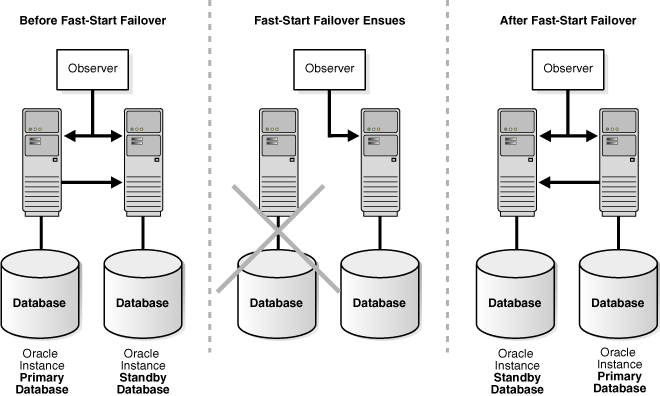
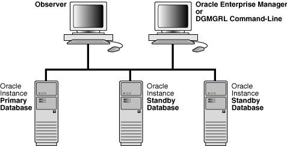

## 5 Switchover and Failover Operations

This chapter describes how the broker manages databases during switchover and failover. It contains the following topics:

## 5.1 Overview of Switchover and Failover in a Broker Environment

An Oracle database operates in one of two roles: primary or standby. Data Guard helps you change the role of a database using either a switchover or a failover:

- A switchover is a role reversal between the primary database and one of its standby databases. A switchover guarantees no data loss and is typically done for planned maintenance of the primary system. During a switchover, the primary database transitions to a standby role, and the standby database transitions to the primary role.
- A failover is done when the primary database (all instances of an Oracle RAC primary database) fails or has become unreachable and one of the standby databases is transitioned to take over the primary role. Failover may or may not result in data loss depending on the protection mode in effect at the time of the failover.

Without the broker, you perform role transitions by issuing a series of SQL statements (as described in [Oracle Data Guard Concepts and Administration](https://docs.oracle.com/cd/E11882_01/server.112/e41134/toc.htm)). The broker simplifies switchovers and failovers by allowing you to invoke them using a single key click in Oracle Enterprise Manager or a single command in the DGMGRL command-line interface (referred to in this documentation as manual failover). Moreover, you can enable fast-start failover to fail over automatically when the conditions for fast-start failover are met. When fast-start failover is enabled, the broker determines if a failover is necessary and initiates the failover to the specified target standby database automatically, with no need for DBA intervention.

Fast-start failover allows you to increase availability with less need for manual intervention, thereby reducing management costs. Manual failover gives you control over exactly when a failover occurs and to which target standby database. Regardless of the method you choose, the broker coordinates the role transition on all databases in the configuration.

## 5.2 Choosing a Target Standby Database

There are many factors to take into consideration when selecting a standby database to be the next primary database after a switchover or a failover. You need to consider all of the options at the time you are building your Data Guard configuration, including factors such as the characteristics of physical standbys versus logical standbys versus snapshot standbys, the network latency to your standby database sites, the computing capabilities at a future primary database site, and so on.

Note:

A snapshot standby cannot be the target of a switchover or fast-start failover operation. You can, however, perform a manual failover to a snapshot standby.

For switchovers, understanding all of the factors can simplify the choice of which standby database to consider as your new primary database. In disaster situations where a failover is necessary, you may be more limited in which standby database is the best one to pick up the failed primary database's activities. The following sections provide guidelines to help you choose a target standby database.

Note:

For fast-start failover, you must pre-select the target standby database that will be used. Section 5.5 provides more information about fast-start failover.

### 5.2.1 Choosing a Target Standby Database for Switchover

When performing a switchover in a configuration whose standby databases are all of the same type (all physical or all logical standby databases), choose the standby database that has the least amount of unapplied redo. By choosing the standby database with the least amount of unapplied redo, you can minimize the overall time it takes to complete the switchover operation. For example:

- Using DGMGRL, you can do this by examining the Apply Lag row of the `SHOW DATABASE` output for each standby database in the configuration.
- Using Enterprise Manager, you can view the value of the `ApplyLag` column for each standby database in the `Standby` `Databases` section of the Data Guard Overview Page.

If the configuration contains both physical and logical standby databases, consider choosing a physical standby database (that has the least amount of unapplied redo) to be the target standby database. A switchover to a physical standby database is preferable because all databases in the configuration will be available as standby databases to the new primary database after the switchover operation completes. Whereas a switchover to a logical standby database will invalidate and disable all of the physical and snapshot standby databases in the configuration. You will then need to re-create the physical standby databases from a copy of the new primary database before you can reenable them.

You cannot perform a switchover to a snapshot standby database unless you first convert it back to a physical standby database.

Note:

If the Data Guard configuration is operating in maximum protection mode, the broker does not allow a switchover to occur to a logical standby database. The configuration must be operating in either maximum availability mode or maximum performance mode in order to be able to switch over to a logical standby database.

### 5.2.2 Choosing a Target Standby Database for Failover

When performing a failover in a configuration whose standbys are all of the same type, choose the standby database that has the smallest transport lag. Doing so can minimize the amount of data loss and in some cases, incur no data loss at all.

If the configuration contains physical, snapshot, and logical standby databases, consider choosing a physical standby database as the target standby database. A failover to a physical standby database is preferable because it is likely that all standby databases in the configuration will still be available as standby databases to the new primary database after the failover operation completes.

You may failover to a snapshot standby database. However failing over to a snapshot standby database will require more time because the broker must first convert it back to a physical standby database. After the conversion, the broker will start Redo Apply to apply accumulated redo data, before failing the database over to the primary role. Because the broker performs the failover after converting the snapshot standby database to a physical standby database, it is likely that all standby databases in the configuration will still be available as standby databases to the new primary database after the failover operation completes.

A failover to a logical standby database requires that all physical and snapshot standby databases be re-created from a copy of the new primary database after the failover completes. In addition, a logical standby database may contain only a subset of the data present in the primary database. (For example, if the `DBMS_LOGSTDBY.SKIP` procedure was used to specify which database operations done on the primary database will not be applied to the logical standby database.)

However, there may be exceptions to the recommendation to choose a physical standby database as the target standby database. For example, if all your physical standbys are also unavailable, then failing over to a logical standby is your only choice.

## 5.3 Switchover

You can switch a database from the primary role to the standby role, as well as from standby to primary. This is known as a database switchover, because the standby database that you specify becomes the primary database, and the original primary database becomes a standby database, with no loss of data.

Whenever possible, you should switch over to a physical standby database:

- If the switchover transitions a physical standby database to the primary role, then:
	- The original primary database will be switched to a physical standby role.
		- The online redo log files will be continuously archived from the new primary database to all standby databases in the configuration.
		- The original primary database will be restarted as a part of the switchover operation. Note that the new primary database does not need to be restarted.
		Standby databases not involved in the switchover (known as bystander standby databases) continue operating in the state they were in before the switchover occurred and will automatically begin applying redo data received from the new primary database.
- If the switchover transitions a logical standby database to the primary role, then:
	- The original primary database will be switched to a logical standby role.
		- Neither the primary database nor the logical standby database needs to be restarted after the switchover completes.
		Other logical standby bystander databases in the broker configuration will remain viable after the switchover. There is no need to restart any databases. All physical and snapshot standby databases will be disabled and must be re-created from a copy of the new primary database after a switchover to a logical standby database.
	Switchover to a logical standby database is disallowed when the configuration is operating in maximum protection mode.
	WARNING:
	Switching over to a logical standby database results in the snapshot and physical standby databases in the broker configuration being disabled by the broker, making these databases no longer viable as standby databases. Section 5.4.3 describes how to restore their viability as standby databases.
	If you intend to switch back to the original primary database relatively soon, you may allow the physical and snapshot standbys to remain disabled. Once you have completed the switchover back to the original primary, you may then reenable the physical and snapshot standby databases since they are still viable standbys for the original primary database.

### 5.3.1 Before You Perform a Switchover Operation

Consider the following points before you begin a switchover:

- When you start a switchover, the broker verifies that at least one standby database, including the primary database that is about to be transitioned to the standby role, is configured to support the overall protection mode (maximum protection, maximum availability, or maximum performance) after the switchover is completed.
- Prepare the primary database in advance for its possible future role as a standby database in the context of the overall protection mode (see [Section 4.6](dbresource.md)). Such preparation includes:
	- Ensuring that standby redo log files are configured on the primary database.
		- Presetting database properties related to redo transport services, such as `LogXptMode`, `NetTimeout`, `StandbyArchiveLocation`, and `AlternateLocation`. For more details about managing redo transport services using database properties, see [Section 4.4](dbresource.md).
		- Presetting database properties related to Redo Apply services, such as `DelayMins`. For more details about managing Redo Apply services using properties, see [Section 4.5](dbresource.md).
		- For each temporary table, verifying that temporary files associated with that table on the primary database also exist on the standby database.
	Note that the broker does not use the properties to set up redo transport services and Redo Apply services until you actually switch over the primary database to the standby role. Thus, the validity of the values of these properties is not verified until after the switchover. Once you set these properties, their values persist through role changes during switchover and failover.
- Before performing a switchover to a physical standby database that is in real-time query mode, consider bringing all instances of that standby database to the mounted but not open state to achieve the fastest possible role transition and to cleanly terminate any user sessions connected to the physical standby database prior to the role transition.
- If fast-start failover is enabled in either maximum availability or maximum performance mode, a switchover can be performed only to the pre-specified target standby database and only if the standby database is synchronized with the primary database. For information about enabling fast-start failover, see Section 5.5.2.

After a switchover completes, the broker preserves the overall Data Guard protection mode as part of the switchover process by keeping the protection mode at the same protection level (maximum protection, maximum availability, or maximum performance) it was at before the switchover. Also, the network transmission mode (`SYNC` or `ASYNC`) for transporting redo to other bystander standby databases does not change after a switchover. Apply services on all other bystander standby databases automatically begin applying redo data received from the new primary database.

If there are physical or snapshot standby databases in the configuration and the switchover occurs to a logical standby database, you need to re-create those databases from a copy of the new primary database and then reenable those databases, as described in Section 5.4.3.

### 5.3.2 Starting a Switchover

The act of switching roles should be a well-planned activity. The primary and standby databases involved in the switchover should have as small a redo lag as possible. [Oracle Data Guard Concepts and Administration](https://docs.oracle.com/cd/E11882_01/server.112/e41134/role_management.htm#SBYDB00600) provides information about setting up the databases in preparation of a switchover.

To start a switchover using Enterprise Manager, select the standby database that you want to change to the primary role and click Switchover. When using DGMGRL, you need to issue only one `SWITCHOVER` command to specify the name of the standby database that you want to change into the primary role.

The broker controls the rest of the switchover, as described in Section 5.3.3.

### 5.3.3 How the Broker Performs a Switchover

Once you start the switchover, the broker:

1. Verifies that the primary and the target standby databases are in the following states:
	1. The primary database is enabled and is in the `TRANSPORT-ON` state.
		2. The target standby database is enabled and is in the `APPLY-ON` state.
	The broker allows the switchover to proceed as long as there are no errors for the primary database and the standby database that you selected to participate in the switchover operation. Errors occurring for any other bystander standby databases will not impede the switchover.
2. Shuts down all instances except one, if required.
	If you are switching over to a physical standby database, the broker shuts down all but one instance on the current primary database. No instances will be shut down on the target physical standby database.
	No instances will be shut down if switching over to a logical standby database. You cannot switch over to a snapshot standby database.
3. Switches roles between the primary and standby databases.
	The broker first converts the original primary database to run in the standby role. Then, the broker transitions the target standby database to the primary role. If any errors occur during either conversion, the broker stops the switchover. See [Section 9.3, "Troubleshooting Problems During a Switchover Operation"](troubleshooting.md) for more information.
4. Updates the broker configuration file to record the change in roles.
	Because the configuration file profiles all database objects in the configuration, this ensures that each database will run in the correct role and state should it be restarted later for any reason.
5. Restarts the new standby (former primary) database if the switchover occurs to a physical standby database, and Redo Apply begins applying redo data from the new primary database. If this is an Oracle RAC physical standby database, the broker directs Oracle Clusterware to restart the instances that were shut down prior to the switchover. In a configuration operating in maximum protection mode, the new primary database will also be restarted.
6. The new primary database is opened in read/write mode and redo transport services are started.
	If the former physical standby database was running with real-time query enabled, the new physical standby database will run with real-time query enabled.

The broker verifies the state and status of the databases to ensure that the switchover transitioned the databases to their new role correctly. Bystander standby databases that are not disabled by the broker after the switchover will continue operating in the state they were in before the switchover. Redo Apply and SQL Apply on all other bystander standby databases automatically begin applying redo data received from the new primary database.

## 5.4 Manual Failover

You can convert a standby database to a primary database when the original primary database fails and there is no possibility of recovering the primary database in a timely manner. This is known as a manual failover. There may or may not be data loss depending upon whether your primary and target standby databases were synchronized at the time of the primary database failure. The word manual is used to contrast this type of failover with a fast-start failover (described in Section 5.5).

Note:

You can perform a manual failover even if fast-start failover is enabled. See Section 5.5.2.4 for more information.

The following sections describe how to perform manual failovers:

- Section 5.4.1, "Complete and Immediate Manual Failovers"
- Section 5.4.2, "Performing a Manual Failover Operation"
- Section 5.4.3, "Reenabling Disabled Databases After a Role Change"

### 5.4.1 Complete and Immediate Manual Failovers

Using Enterprise Manager or DGMGRL, you can perform either a complete (recommended) or an immediate failover:

- A complete failover is the recommended and default failover option. It automatically recovers the maximum amount of redo data for the protection mode the configuration is operating in. A complete failover also attempts to avoid disabling any standby databases that were not the target of the failover, so that they may continue serving as standby databases to the new primary database.
	Whether or not standby databases that were not the target of failover (bystander standby databases) are disabled depends upon how much redo data they have applied relative to the failover target and the standby type of the failover target:
	- If the failover target is a physical or snapshot standby database, the original primary database must be reinstated or re-created in order to be a standby database for the new primary database. In addition, some standby databases may be disabled by the broker during the failover if the broker detects that they have applied redo beyond where the new primary database had applied. Any standby database that was disabled by the broker must be reinstated or re-created, as described in Section 5.4.3, before it can be a standby database for the new primary database.
		Note that if failover was performed on a snapshot standby database, the old primary must be either reinstated or re-created as a physical standby database.
		- If the failover target is a logical standby database, the original primary database and all physical and snapshot standby databases in the configuration will be disabled. The primary database can be reinstated if it had flashback database enabled. The physical and snapshot standby databases will have to be re-created from a copy of the new primary database. See Section 5.4.3 for more information.
	If the primary database can be mounted, it may be possible to flush any unsent redo data from the primary database to the target standby database using the `ALTER SYSTEM FLUSH REDO` SQL statement. If this operation is successful, a zero data loss failover may be possible even if the primary database is not in a zero data loss protection mode. See [Oracle Data Guard Concepts and Administration](https://docs.oracle.com/cd/E11882_01/server.112/e41134/role_management.htm#SBYDB00625) for more information on using the `ALTER SYSTEM FLUSH REDO` statement.
	During a complete failover, the broker performs the failover steps described in Section 5.4.2.1.
- An immediate failover is the fastest type of failover. However, no additional data is applied on the standby database once you invoke the failover. Another consequence of immediate failover is that all other databases in the configuration are disabled and must be reinstated or re-created before they can serve as standby databases for the new primary database. Section 5.4.3 describes how to do this. During an immediate failover, the broker performs the failover steps described in Section 5.4.2.2.
	Caution:
	Always try to perform a complete failover first unless redo apply has stopped at the failover target due to an `ORA-752` or `ORA-600` `[3020]` error. If one of these errors has occurred, follow the guidelines in "Resolving ORA-752 or ORA-600 \[3020\] During Standby Recovery" in My Oracle Support Note 1265884.1 before proceeding. This support note is available at `http://support.oracle.com`.
	An immediate failover should only be performed when a complete failover is unsuccessful or in the case just noted above. A complete failover can occur without any data loss, depending on the destination attributes of redo transport services, but an immediate failover usually results in some data loss.

### 5.4.2 Performing a Manual Failover Operation

After determining that there is no possibility of recovering the primary database in a timely manner, ensure that the primary database is shut down and then begin the failover operation.

The steps in this section describe how to perform a manual failover. Depending on the failover and the types of standby databases involved, some of the databases may need to be reinstated or re-created. The instructions guide you through the appropriate steps for each type of situation.

Step 1 Determine which of the available standby databases is the best target for the failover.

Follow the guidelines described in Section 5.2, "Choosing a Target Standby Database".

Step 2 Start the failover.

Using Enterprise Manager or DGMGRL, perform either a complete (recommended) or an immediate failover.

Manual Failover Using Enterprise Manager:

On the Data Guard Overview Page in Enterprise Manager, select the standby database that you want to change to the primary role and click Failover. Then, on the Failover Confirmation Page, click Yes to invoke the default Complete failover option.

Manual Failover Using DGMGRL:

On the target standby database, issue the `FAILOVER` command to perform a failover, specifying the name of the standby database that you want to become the primary database:

```
DGMGRL> FAILOVER TO database-name;
```

Specify the optional `IMMEDIATE` clause to perform an immediate failover if any of the the following conditions are true:

- An `ORA-752` error has occurred at the standby database
- An `ORA-600` `[3020]` error has occurred at the standby database and Oracle support has determined that it was caused by a lost write at the primary database
- A complete failover is not possible
```
DGMGRL> FAILOVER TO database-name IMMEDIATE;
```

See Also:

- [FAILOVER](dgmgrl.md)

If the target is a snapshot standby database, the broker first converts the database to a physical standby database. If performing a complete failover, all accumulated redo data will be applied before changing the role of the database to primary. If performing an immediate failover, the role of the database will be changed to primary without applying any accumulated redo data.

No instances will be shut down if failing over to a physical or logical standby database.

Step 3 Reset the protection mode.

After a manual failover (complete or immediate), the overall Data Guard protection mode is handled as follows:

- If the protection mode was at maximum protection, it is reset to maximum performance. You can upgrade the protection mode later, if necessary, as described in [Section 4.6.1](dbresource.md).
- If the protection mode was at maximum availability or maximum performance, it remains unchanged.

Note:

If you perform a manual failover when fast-start failover is enabled:
- The failover can only be performed to the pre-selected target standby database.
- The broker preserves the protection mode that was in effect prior to the failover.

Step 4 Re-establish a disaster-recovery configuration.

To maintain a viable disaster-recovery solution in the event of another disaster, you may need to perform the additional steps described in Section 5.4.3 to:

- Reinstate the original primary database to act as a standby database in the new configuration.
	Caution:
	Do not attempt to reinstate the old primary database if an `ORA-752` or `ORA-600` `[3020]` error has occurred at the failover target, because doing so may lead to data loss. Instead, the old primary database must be re-created as a standby from a backup of the new primary using the procedure described in Section 5.4.3.2.
- Reinstate or re-create standby databases in the configuration that were disabled by the broker.
	After a complete failover finishes, any bystander standby database that is not viable as a standby for the new primary database will be disabled by the broker. This can happen for either of the following reasons:
	- A bystander standby database has applied more redo data than the new primary database itself had applied when it was a standby database. The standby database must be re-created or reinstated before it can serve as a standby for the new primary database.
		- The failover was to a logical standby database. The broker disables all of the physical and snapshot standby databases in the configuration. They must be re-created before they can serve as standby to the new primary database.

#### 5.4.2.1 How the Broker Performs a Complete Failover Operation

Once you start a complete failover, the broker:

1. Verifies that the target standby database is enabled. If the database is not enabled, you will not be able to perform a failover to this database.
2. Waits for the target standby database to finish applying any unapplied redo data before stopping Redo Apply (if the target is a physical standby database) or SQL Apply (if the target is a logical standby database).
	If the target is a snapshot standby database, the broker first converts the database back to a physical standby and then starts Redo Apply to apply all the accumulated redo before completing the failover and opening the database as a primary database.
3. Transitions the target standby database into the primary database role, as follows:
	1. Changes the role of the database from standby to primary.
		2. Opens the new primary database in read/write mode.
		3. Determines whether or not any standby databases that did not participate in the failover operation have applied redo data beyond the new primary database, and thus need to be disabled.
		If a bystander standby database is not disabled by the broker during this failover, it will remain in the state it was in before the failover. For example, if a physical standby database was in the `APPLY-OFF` state, it will remain in the `APPLY-OFF` state.
		By default, the broker always determines whether bystander standby databases will be viable standby databases for the new primary when performing a complete failover. If you want the broker to skip this viability check of bystander standby databases during a complete failover, thus decreasing the overall failover time, set the `BystandersFollowRoleChange` configuration property to `NONE`.
		When this property is set to `NONE`, the broker will disable all bystander standby databases without checking whether they have applied more redo data than the new primary database. You will have to reinstate or re-create (see Section 5.4.3) the standby databases after failover has completed. The `SHOW CONFIGURATION` command will show you which databases can be reinstated and which databases must be re-created. Use the `SHOW CONFIGURATION BystandersFollowRoleChange` command to see the value of this property. The default value is `ALL`.
		This property also affects whether the broker skips viability checks of bystander standby databases when a fast-start failover occurs.
		4. Starts redo transport services to begin transmitting redo data to all bystander standby databases that were not disabled.
		Note:
		Bystander standby databases may be disabled by the broker during the failover, and they must be reinstated or re-created before they can serve as standby databases to the new primary database. Oracle recommends configuring Flashback Database on every database so that if failover occurs to a physical standby database, you can more easily reinstate any disabled standby databases. If failover occurs to a logical standby database, all physical and snapshot standby databases will be disabled by the broker. In this case, Flashback Database cannot be used to reinstate databases. They must be re-created from a copy of the new primary database. Logical standby databases that are disabled during failover can be reinstated.
4. If the failover target database is an Oracle RAC physical or snapshot standby database, the broker directs Oracle Clusterware to restart all instances that may have been shut down prior to the failover.

The broker allows the failover to proceed as long as there are no errors for the standby database that you selected to participate in the failover. Errors occurring for any bystander standby databases will not stop the failover. If you initiated a complete failover and it fails, you might need to use immediate failover.

#### 5.4.2.2 How the Broker Performs an Immediate Failover Operation

Once you start an immediate failover, the broker:

1. Verifies that the target standby database is enabled. If the standby database is not enabled for management by the broker, then the failover cannot occur.
2. Stops Redo Apply or SQL Apply on the standby database immediately, without waiting until all available redo data has been applied. This may result in data loss.
3. Transitions the target standby database into the primary role, opens the new primary database in read/write mode, and starts redo transport services.
	After an immediate failover completes, all the standby databases in the configuration, regardless of their type, are disabled. They may be reinstated if Flashback Database is enabled on those databases. Otherwise, they must be re-created from a copy of the new primary database.

The broker allows a complete failover to proceed as long as there are no errors present on the standby database that you selected to participate in the failover.

The broker allows an immediate failover to proceed even if there are errors present on the standby database that you selected to participate in the failover.

### 5.4.3 Reenabling Disabled Databases After a Role Change

To restore your original disaster-recovery solution after switchover to a logical standby database or after failover to any standby database, you may need to perform additional steps.

Databases that have been disabled after a role transition are not removed from the broker configuration, but they are no longer managed by the broker.

To reenable broker management of these databases, you must reinstate or re-create the databases using one of the following procedures:

- If a database can be reinstated, the database will show the following status:
	```
	ORA-16661: the standby database needs to be reinstated
	```
	Reinstate the database using the DGMGRL `REINSTATE DATABASE` command or the reinstate option in Enterprise Manager, as described in Section 5.4.3.1, "How to Reinstate a Database". The broker automatically reenables the database as part of reinstating it.
- If a database must be re-created from a copy of the new primary database, it will have the following status:
	```
	ORA-16795: the standby database needs to be re-created
	```
	Re-create the standby database from a copy of the primary database and then reenable it. The procedures for creating a standby database are documented in [Oracle Data Guard Concepts and Administration](https://docs.oracle.com/cd/E11882_01/server.112/e41134/create_ps.htm#SBYDB00200). See Section 5.4.3.2, "How to Re-create and Reenable a Disabled Database" for more information.

Note:

Any database that was disabled while multiple role changes were performed cannot be reinstated. You must re-create the database manually from a copy of the current primary database and then reenable the database in the broker configuration.

Whether you reinstate or re-create a database depends on if you performed a switchover or failover and on the type of standby database that was the target of the operation. Note that role changes to logical and snapshot standby databases will always result in physical standby database bystanders being disabled. They cannot be reinstated. They must be re-created from a copy of the new primary database.

The following sections describe how to reinstate or reenable a database.

#### 5.4.3.1 How to Reinstate a Database

You can use the broker's reinstate capability to make the failed primary database a viable standby database for the new primary. This can be done regardless of whether the failover was done to a physical, logical, or snapshot standby database.

You can also reinstate bystander standby databases that were disabled during a failover operation.

Databases that can be reinstated will have the following status value:

```
ORA-16661: the standby database needs to be reinstated
```

For the `REINSTATE` command to succeed, Flashback Database must have been enabled on the database prior to the failover and there must be sufficient flashback logs on that database. In addition, the database to be reinstated and the new primary database must have network connectivity.

To reinstate a database:

1. Restart the database to the mounted state
2. Connect to the new primary database
3. Use Enterprise Manager or DGMGRL to reinstate the database

The broker reinstates a failed primary database as a standby database of the same type (physical or logical standby database) as the old standby database. The only exception to this is failovers to snapshot standby databases. In such cases, the failed primary database is reinstated as a physical standby database.

The broker reinstates bystander standby databases that were disabled during a failover as standby databases to the new primary database.

Reinstatement Using Enterprise Manager

On the Data Guard Overview page, click the `Database must be reinstated` link. This brings up the General Properties page that provides a Reinstate button. After you click the Reinstate button, Enterprise Manager begins reinstating the database.

When the process is complete, the database will be enabled as a standby database to the new primary database, and Enterprise Manager displays the Data Guard Overview page.

Reinstatement Using DGMGRL

Issue the following command while connected to any database in the broker configuration, except the database that is to be reinstated:

```
DGMGRL> REINSTATE DATABASE db_unique_name;
```

The newly reinstated standby database will begin serving as a standby database to the new primary database. If reinstatement of a database fails, its status changes to `ORA-16795: the standby database needs to be re-created`. You must then re-create it from a copy of the new primary database and reenable it as described in Section 5.4.3.2.

#### 5.4.3.2 How to Re-create and Reenable a Disabled Database

If you performed a failover or switchover that requires you to re-create the failed primary database or standby databases that were disabled during the role transition, follow the procedures in the [Oracle Data Guard Concepts and Administration](https://docs.oracle.com/cd/E11882_01/server.112/e41134/toc.htm) chapters, "Creating a Physical Standby Database" and "Creating a Logical Standby Database."

Note that if you are re-creating the old primary database, it must be created as the standby type of the old standby database. For example, if the old standby was a physical or snapshot standby, then the old primary must be re-created as a physical standby.

After the database has been re-created, enable broker management of the re-created standby database by using the DGMGRL `ENABLE DATABASE` command.

## 5.5 Fast-Start Failover

Fast-start failover allows the broker to automatically fail over to a previously chosen standby database in the event of loss of the primary database. Fast-start failover quickly and reliably fails over the target standby database to the primary database role, without requiring you to perform any manual steps to invoke the failover. Fast-start failover can be used only in a broker configuration and can be configured only through DGMGRL or Enterprise Manager.

Either maximum availability mode or maximum performance mode can be used with fast-start failover. Maximum availability mode provides an automatic failover environment guaranteed to lose no data. Maximum performance mode provides an automatic failover environment guaranteed to lose no more than the amount of data (in seconds) specified by the `FastStartFailoverLagLimit` configuration property. This property indicates the maximum amount of data loss that is permissible in order for an automatic failover to occur. It is only used when fast-start failover is enabled and the configuration is operating in maximum performance mode.

Once fast-start failover is enabled, the broker will ensure that fast-start failover is only possible when the configured data loss guarantee can be upheld. If the configured data loss guarantee cannot be upheld, redo generation on the primary database will be stalled. To avoid a prolonged stall, either the observer or target standby database may allow the primary database to continue redo generation after first recording that a fast-start failover cannot happen.

The broker will restore the ability to automatically failover once the configured data loss guarantee is restored. For a configuration that is operating in maximum availability mode, this occurs once the target standby database has received all missing redo data. For a configuration that is operating in maximum performance mode, this occurs once the target standby database's redo applied point is no longer lagging the primary database's redo generation point by the value specified by the `FastStartFailoverLagLimit` configuration property.

This section describes how to enable fast-start failover and an observer site that monitors the fast-start failover environment. The observer is a separate OCI client-side component that runs on a different computer from the primary and standby databases and monitors the availability of the primary database. The observer is described in more detail in Section 5.5.7.

Once the observer is started, no further user interaction is required. If both the observer and designated standby database lose connectivity with the primary database for longer than the number of seconds specified by the `FastStartFailoverThreshold` configuration property, the observer will initiate a fast-start failover to the standby database. In addition, the primary database will shut down if it perceives a loss of connectivity for a period longer than `FastStartFailoverThreshold` seconds, if the `FastStartFailoverPmyShutdown` configuration property is set to `TRUE`. After the failover completes, the former primary database is automatically reinstated as a standby database when a connection to it is reestablished, if the `FastStartFailoverAutoReinstate` configuration property is set to `TRUE`.

Note:

When a fast-start failover occurs because either a user configurable fast-start failover condition is detected or an application initiates a fast-start failover by calling the `DBMS_DG.INITIATE_FS_FAILOVER` function, the former primary database is always shut down and never automatically reinstated. This is true regardless of the settings for the `FastStartFailoverPmyShutdown` and `FastStartFailoverAutoReinstate` configuration properties. See Section 5.5.2 for more information.

Figure 5-1 shows the relationships between the primary database, target standby database, and the observer during fast-start failover:

- Before Fast-Start Failover: Data Guard is operating in a steady state, with the primary database transmitting redo data to the target standby database and the observer monitoring the state of the entire configuration.
- FastStart Failover Ensues: Disaster strikes the primary database and its network connections to both the observer and the target standby database are lost. Upon detecting the break in communication, the observer attempts to reestablish a connection with the primary database for the amount of time defined by the `FastStartFailoverThreshold` property before initiating a fast-start failover. If the observer is unable to regain a connection to the primary database within the specified time, and the target standby database is ready for fast-start failover, then fast-start failover ensues.
- After Fast-Start Failover: The fast-start failover has completed and the target standby database is running in the primary database role. After the former primary database has been repaired, the observer reestablishes its connection to that database and reinstates it as a new standby database. The new primary database starts transmitting redo data to the new standby database.

Figure 5-1 Relationship of Primary and Standby Databases and the Observer



> This figure is described in the text preceding the figure.
>
> [Copyright © 1999, 2015, Oracle and/or its affiliates. All rights reserved.](https://docs.oracle.com/cd/E11882_01/dcommon/html/cpyr.htm)
  

The following sections describe these topics:

- Prerequisites for Enabling Fast-Start Failover
- Enabling Fast-Start Failover
- Viewing Fast-Start Failover Configuration Statistics and Status
- Disabling Fast-Start Failover
- Performance Considerations for Fast-Start Failover
- Managing the Observer
- Reinstating the Former Primary Database in the Broker Configuration
- Shutting Down Databases In a Fast-Start Failover Environment

### 5.5.1 Prerequisites for Enabling Fast-Start Failover

The following prerequisites must be met before the broker allows you to enable fast-start failover:

- Ensure the broker configuration is operating in either maximum availability mode or maximum performance mode.
	See [Section 4.6.1](dbresource.md) for information about configuring the protection mode, standby redo logs, and the `LogXptMode` property.
- Ensure that the standby database you choose to be the target of fast-start failover has its `LogXptMode` property set to `SYNC` if you wish to enable fast-start failover in maximum availability mode, or to `ASYNC` if you wish to enable fast-start failover in maximum performance mode. The current primary database must have its `LogXptMode` property set accordingly and must have standby redo logs configured.
- Enable Flashback Database and set up a fast recovery area on both the primary database and the target standby database.
	See [Oracle Database Backup and Recovery User's Guide](https://docs.oracle.com/cd/E11882_01/backup.112/e10642/toc.htm).
- Install the DGMGRL command-line interface on the observer computer as described in [Section 2.1](install.md).
- Configure the `TNSNAMES.ORA` file on the observer system so that the observer is able to connect to the primary database and the pre-selected target standby database.
- Create static service names so that the observer can automatically restart a database as part of reinstatement. See [Section 2.2, "Prerequisites"](install.md) for more information.

### 5.5.2 Enabling Fast-Start Failover

You can enable fast-start failover from any site while connected to any database in the broker configuration. Enabling fast-start failover does not trigger a failover. Instead, it allows the observer that is monitoring the configuration to initiate a fast-start failover should conditions warrant a failover.

Perform the following steps to enable fast-start failover and start the observer. The steps assume that you are connected as `SYS` and that a primary and standby database are already set up in a broker configuration.

Step 1 Determine which of the available standby databases is the best target for the failover.

Follow the guidelines described in Section 5.2, "Choosing a Target Standby Database".

Step 2 Specify the target standby database with the FastStartFailoverTarget configuration property.

You can specify only one target standby database when setting the `FastStartFailoverTarget` configuration property on the current primary database:

- If there is only one standby database in the configuration, you can skip this step and continue with Step 3. When enabling fast-start failover, the broker automatically sets the `FastStartFailoverTarget` property on the primary and standby databases to point to each other as their respective target during a failover.
- If there is more than one standby database in the configuration, you must explicitly set the `FastStartFailoverTarget` property on the primary database to select a target standby database. When enabling fast-start failover, the broker verifies that the property indicates an existing standby, and then reciprocally sets the standby database's `FastStartFailoverTarget` property to the primary database.
	Note:
	To change the `FastStartFailoverTarget` property to point to a different standby database, disable fast-start failover, set the `FastStartFailoverTarget` property, and reenable fast-start failover.

See [Section 8.3.10, "FastStartFailoverTarget"](dbpropref.md) for more information about this property.

Step 3 Determine the protection mode you want

Fast-start failover can be enabled for either maximum availability mode or maximum performance mode. If you cannot tolerate any loss of data, then ensure that the configuration protection mode is set to maximum availability. To do this, the `LogXptMode` database property for both the primary and target standby database must be set to `SYNC`. Then set the configuration protection mode to maximum availability. For example:

```
DGMGRL> EDIT DATABASE 'North_Sales' SET PROPERTY LogXptMode=SYNC;
DGMGRL> EDIT DATABASE 'South_Sales' SET PROPERTY LogXptMode=SYNC;
DGMGRL> EDIT CONFIGURATION SET PROTECTION MODE AS MaxAvailability;
```

If you are more concerned about the performance of the primary database than a minimal loss of data, consider enabling fast-start failover when the configuration protection mode is set to maximum performance. In this mode you will need to consider how much data loss is acceptable in terms of seconds and set the `FastStartFailoverLagLimit` configuration property accordingly. This property specifies the amount of data, in seconds, that the target standby database can lag behind the primary database in terms of redo applied. If the standby database's redo applied point is within that many seconds of the primary database's redo generation point, a fast-start failover will be allowed. The `FastStartFailoverLagLimit` configuration property is only used by the broker when enabling fast-start failover for configurations operating in maximum performance mode. The default value is 30 seconds and the lowest possible value is 10 seconds.

In addition to setting the configuration protection mode to maximum performance, you will also need to ensure that the `LogXptMode` database property for both the primary and target standby database is set to `ASYNC`. For example:

```
DGMGRL> EDIT DATABASE 'North_Sales' SET PROPERTY LogXptMode=ASYNC;
DGMGRL> EDIT DATABASE 'South_Sales' SET PROPERTY LogXptMode=ASYNC;
DGMGRL> EDIT CONFIGURATION SET PROTECTION MODE AS MaxPerformance;
DGMGRL> EDIT CONFIGURATION SET PROPERTY FastStartFailoverLagLimit=45;
```

Step 4 Set the FastStartFailoverThreshold configuration property.

Fast-start failover will occur if both the observer and the target standby database lose connection to the primary database for the period of time specified by the `FastStartFailoverThreshold` configuration property.

Set the `FastStartFailoverThreshold` property to specify the number of seconds you want the observer and target standby database to wait (after detecting the primary database is unavailable) before initiating a failover. For example:

```
DGMGRL> EDIT CONFIGURATION SET PROPERTY FastStartFailoverThreshold = 45;
```

The default value for the `FastStartFailoverThreshold` property is 30 seconds and the lowest possible value is 6 seconds. If you have an Oracle RAC primary database, consider specifying a higher value to minimize the possibility of a false failover in the event of an instance failure.

The time interval starts when the observer first loses its connection to the primary database. If the observer is unable to regain a connection to the primary database within the specified time, then the observer begins a fast-start failover provided the standby database is ready to fail over. Although the default value of 30 seconds is typically adequate for detecting outages and failures on most configurations, you can adjust failover sensitivity with this property to decrease the probability of false failovers in a temporarily unstable environment.

If the `FastStartFailoverPmyShutdown` configuration property is set to `TRUE`, the primary database will shut down after `FastStartFailoverThreshold` seconds has elapsed if redo generation has been stalled and the primary database is unable to reestablish connectivity with either the observer or target standby database.

Note that the `FastStartFailoverThreshold` property can be changed even when fast-start failover is enabled.

See Also:

[Section 8.1.8](dbpropref.md) for reference information about the `FastStartFailoverThreshold` property

Step 5 Set other database properties (optional).

You can optionally set the database properties described in the following table:

| Property Name | Description | Default Value |
| --- | --- | --- |
| `FastStartFailoverPmyShutdown` | This configuration property causes the primary database to shut down if fast-start failover is enabled and `V$DATABASE.FS_FAILOVER_STATUS` indicates the primary has been `STALLED` for longer than `FastStartFailoverThreshold` seconds. A value of `TRUE` helps to ensure that an isolated primary database cannot satisfy user queries.  This property cannot be used to prevent the primary database from shutting down if a fast-start failover occurred because a user configuration condition was detected or was requested by an application by calling the `DBMS_DG.INITIATE_FS_FAILOVER` function. | `TRUE` |
| `FastStartFailoverLagLimit` | This configuration property establishes an acceptable limit, in seconds, that the standby is allowed to fall behind the primary in terms of redo applied, beyond which a fast-start failover will not be allowed. The lowest possible value is 10 seconds.  This property is used when fast-start failover is enabled and the configuration is operating in maximum performance mode. | 30 seconds |
| `FastStartFailoverAutoReinstate` | This configuration property causes the former primary database to be automatically reinstated if a fast-start failover was initiated because the primary database was either isolated or had crashed. To prevent automatic reinstatement of the former primary database in these cases, set this configuration property to `FALSE`. The broker never automatically reinstates the former primary database if a fast-start failover was initiated because a user configuration condition was detected or was requested by an application calling the `DBMS_DG.INITIATE_FS_FAILOVER` function. | `TRUE` |
| `ObserverConnectIdentifier` | This database property is used to specify how the observer should connect to and monitor the primary and standby database. Set this property for the primary and target standby database if you want the observer to use a different connect identifier than that used to ship redo data (that is, the connect identifier specified by the `DGConnectIdentifier` property). | Observer uses the value of the `DGConnectIdentifier` property to connect to and monitor the primary and target standby databases. |

Step 6 Enable additional fast-start failover conditions (optional)

By default, a fast-start failover is done when both the observer and the standby cannot reach the primary after the configured time threshold (`FastStartFailoverThreshold`) has passed.

You can optionally indicate the database health conditions that should cause fast-start failover to occur. These conditions are described in the following table:

| Health Condition | Description | Enabled by Default |
| --- | --- | --- |
| Datafile Offline | A datafile is offline because of a write error. | Yes |
| Corrupted Dictionary | Dictionary corruption of a critical database object. Currently, this state can be detected only when the database is open | Yes |
| Corrupted Controlfile | Controlfile is permanently damaged because of a disk failure. | Yes |
| Inaccessible Logfile | LGWR is unable to write to any member of the log group because on an I/O error | No |
| Stuck Archiver | Archiver is unable to archive a redo log because the device is full or unavailable. | No |

In Oracle RAC configurations, the Inaccessible Logfile and Stuck Archiver health conditions may only be applicable to a single instance. Careful consideration should be given before enabling fast-start failover for either of these conditions because doing so will supersede availability options provided by Oracle Clusterware.

You can also specify errors raised by the Oracle server (ORA errors) as conditions for which fast-start failover should occur.

You can specify particular conditions for which a fast-start failover should occur using either Oracle Enterprise Manager or the DGMGRL `ENABLE FAST_START FAILOVER CONDITION` and `DISABLE FAST_START FAILOVER CONDITION` commands.

Step 7 Enable fast-start failover.

Use the Enterprise Manager Fast-Start Failover wizard or the DGMGRL `ENABLE FAST_START FAILOVER` command to enable fast-start failover. To enable fast-start failover, both the primary and target standby databases must be running and have connectivity, and satisfy all of the prerequisite conditions listed in Section 5.5.1.

Enable Fast-Start Failover Using Enterprise Manager

To enable fast-start failover in Enterprise Manager, use the Fast-Start Failover wizard. On the Data Guard Overview Page next to the "Fast-Start Failover" status field, click `Disabled` to invoke the Fast-Start Failover Page. Then, on the Fast-Start Failover Change Mode Page, click `Enabled`. Enterprise Manager will start the observer. Then, on the Fast-Start Failover Configure Page, select the standby database that should be the target of a failover. See Section 5.2, "Choosing a Target Standby Database" for helpful advice. This page will not allow you to alter the protection mode. Rather, fast-start failover will be enabled in accordance with the current protection mode. If the currently configured mode is maximum protection, Enterprise Manager will downgrade the mode to maximum availability.

Enable Fast-Start Failover Using DGMGRL

To enable fast-start failover with DGMGRL, issue the `ENABLE FAST_START FAILOVER` command while connected to any database in the broker configuration, including on the observer computer. For example:

```
DGMGRL> ENABLE FAST_START FAILOVER;
Enabled.
```

Note:

Administration at the target standby site should be as comprehensive as that at the primary site because the standby database may assume the primary role without prior notice. Staff support, hardware and software, security (both software and site), network connections, and bandwidth should be equivalent at both sites.

Step 8 Start the Observer.

The primary database must be running in order to start the observer.

You can start the observer before or after you enable fast-start failover. If fast-start failover is already enabled, the observer immediately begins monitoring the status and connections to the primary and target standby databases. If fast-start failover is not already enabled, the observer waits until fast-start failover gets enabled and then begins monitoring.

Starting the Observer Using Enterprise Manager

If the Enterprise Manager agent is installed on the observer computer, it automatically starts the observer when you enable fast-start failover through Enterprise Manager. If the agent is not present, you must start the observer manually using the following instructions for the DGMGRL command-line interface.

Starting the Observer Using DGMGRL

To start the observer with DGMGRL, issue the following command on the observer computer:

```
DGMGRL> START OBSERVER;
```

The observer is a continuously executing process that is created when the `START OBSERVER` command is issued. Thus, the command-line prompt on the observer computer does not return until you issue the `STOP OBSERVER` command from another DGMGRL session. To issue commands and interact with the broker configuration, you must connect through another DGMGRL client session.

See the [START OBSERVER](dgmgrl.md) command for more information.

Step 9 Verify the fast-start failover environment.

To verify the readiness of the fast-start failover configuration, issue the DGMGRL `SHOW CONFIGURATION VERBOSE` command or the `SHOW FAST_START FAILOVER` command on the primary database. For example:

```
DGMGRL> SHOW FAST_START FAILOVER;
 
Fast-Start Failover: ENABLED
 Threshold:           60 seconds
 Target:              South_Sales
 Observer:            observer.example.com
 Lag Limit:           30 seconds (not in use)
 Shutdown Primary:    TRUE
 Auto-reinstate:      TRUE
 
Configurable Failover Conditions
 Health Conditions:
   Corrupted Controlfile          YES
   Corrupted Dictionary           YES
   Inaccessible Logfile            NO
   Stuck Archiver                  NO
   Datafile Offline               YES
 
 Oracle Error Conditions:
   (none)
```

The following sections provide more information about the fast-start failover environment:

- When Fast-Start Failover Is Enabled and the Observer Is Running
- Restrictions When Fast-Start Failover is Enabled
- Shutting Down the Primary Database When Fast-Start Failover Is Enabled
- Performing Manual Role Changes When Fast-Start Failover Is Enabled

#### 5.5.2.1 When Fast-Start Failover Is Enabled and the Observer Is Running

Once you enable fast-start failover and start the observer, the observer continuously monitors the environment to ensure the primary database is available. This section lists the steps the observer takes to determine if a fast-start failover is needed and then to perform one, if necessary.

Step 1 Monitor the environment to ensure the primary database is available.

The observer waits the number of seconds specified by the `FastStartFailoverThreshold` configuration property before attempting a fast-start failover when the primary database has crashed or has lost connectivity with the observer, as in the following situations:

- The primary database loses its connections with both the observer and target standby database
- Instance failures
	If a single-instance primary database (either Oracle RAC or non-Oracle RAC), or if all instances of an Oracle RAC primary database fail, the observer attempts a fast-start failover.
- Shutdown abort
	If a single-instance primary database (either Oracle RAC or non-Oracle RAC), or if all instances of an Oracle RAC primary database are shut down with the `ABORT` option, the observer attempts a fast-start failover. Fast-start failover will not be attempted for the other types of database shutdown (`NORMAL`, `IMMEDIATE`, `TRANSACTIONAL`).

The observer never waits for the threshold to expire to perform a fast-start failover in the following situations:

- User-configurable condition
	If the observer determines that any of the user-configurable conditions has been detected, the observer attempts a fast-start failover.
- Application calls to `DBMS_DG.INITIATE_FS_FAILOVER`
	If an application has called this function and it has received a status of `SUCCESS`, the observer attempts a fast-start failover.

Step 2 Reconnect within the time specified by FastStartFailoverThreshold.

If the observer detects an availability problem with the primary database, the observer typically attempts to reconnect to the primary database within the time specified by the `FastStartFailoverThreshold` configuration property. The `FastStartFailoverThreshold` time interval starts when the observer first detects there might be a failure with the primary database.

The time interval specified by the `FastStartFailoverThreshold` property is ignored if the observer detects that a user-configurable condition has occurred or if a fast-start failover has been requested by the `DBMS_DG.INITIATE_FS_FAILOVER` function.

If the primary database is an Oracle Real Application Clusters (Oracle RAC) database, the observer will attempt to connect to one of the remaining primary instances. Fast-start failover will not occur unless all instances comprising the Oracle RAC primary database are perceived to have failed. The observer uses the value specified by either the `DGConnectIdentifier` or `ObserverConnectIdentifier` database properties to connect to the primary and fast-start failover target standby databases. The value specified for either of these properties should allow the observer to connect to any instance of an Oracle RAC database.

Step 3 Verify the target standby database is ready for failover.

If fast-start failover is initiated, the observer verifies the target standby database is ready to fail over to the primary database role.

Fast-start failover cannot occur if:

- Fast-start failover is no longer enabled
- The observer cannot connect to the target standby database
	See Also:
	Section 5.5.7.3, "What Happens if the Observer Fails?" if the observer is not running
- The observer and the target standby database are inconsistent with regard to the current state of the broker configuration
- The observer is not running
- If the protection mode is maximum availability and the target standby database was not synchronized with the primary database at the time the primary database failed
- If the protection mode is maximum performance and the apply point of the target standby database lags the redo generation point of the primary database by more than the amount specified by the `FastStartFailoverLagLimit` configuration property at the time the primary database failed
- The target standby database has contact with the primary database
- The `FS_FAILOVER_STATUS` column in the `V$DATABASE` view for the target standby database displays a reason why fast-start failover cannot occur
- A manual failover is already in progress. See Section 5.4 for complete information about manual failovers.
- The primary database was shut down without using the `ABORT` option

Step 4 Initiate a fast-start failover.

If the target standby database is ready for failover, the observer immediately directs the target standby database to fail over to the primary database role. If failover is not possible for some reason, the observer will continue checking whether the standby database is ready to fail over. But it will also continue trying to reconnect to the primary database indefinitely. If it reconnects to the primary database before the standby agrees to fail over, the observer will stop attempting to initiate a fast-start failover.

Step 5 Reinstate the former primary database as a new standby database.

After the fast-start failover completes successfully, the observer will attempt to reinstate the former primary database as a new standby database when a connection to the former primary database is reestablished, and the `FastStartFailoverAutoReinstate` configuration property is set to `TRUE`. If the `FastStartFailoverPmyShutdown` configuration property is set to `TRUE`, the former primary database will have been automatically shut down and must be manually restarted before the observer can attempt to reinstate it.

Note that these properties only affect whether primary shutdown and automatic reinstatement are performed if a fast-start failover occurs because the primary crashed or was isolated from the observer and target standby database.

See Also:

Section 5.5.8 for more information about reinstatement

#### 5.5.2.2 Restrictions When Fast-Start Failover is Enabled

When fast-start failover is enabled, you cannot:

- Change:
	- The configuration protection mode
		- The [LogXptMode](dbpropref.md) database property on the primary or target standby databases
		- The [FastStartFailoverTarget](dbpropref.md) configuration property on the primary or target standby databases
- Disable or delete:
	- The broker configuration
		- The standby database that is the target of fast-start failover
- Perform a manual failover:
	- Unless the conditions listed in Section 5.5.2.4 have been met
		- To a standby database that is not configured as the fast-start failover target
	To determine if the configuration is ready for fast-start failover to occur, issue the DGMGRL `SHOW DATABASE <target-standby-database>` command, or query the `V$DATABASE` view on either the primary or target standby databases. The column value for `V$DATABASE.FS_FAILOVER_STATUS` will be `SYNCHRONIZED` in a configuration operating in maximum availability mode, and it will be `TARGET UNDER LAG LIMIT` in a configuration operating in maximum performance mode when ready to fast-start failover. The `FS_FAILOVER_OBSERVER_PRESENT` column displays `YES` for the target standby database.
- Perform a switchover to a standby database that is not configured as the fast-start failover target
- Perform a switchover to the target standby database in a configuration operating in maximum availability mode, unless the standby database is synchronized with the primary database
- Perform a switchover to the target standby database in a configuration operating in maximum performance mode, unless the standby database is within the lag limit of the primary database
- Attempt to open the primary database, or the following error may be returned:
	```
	ORA-16649: possible failover to another database prevents this database from being opened
	```
	This error may return if the fast-start failover validity check fails or does not complete in under two minutes.

#### 5.5.2.3 Shutting Down the Primary Database When Fast-Start Failover Is Enabled

Fast-start failover will not be triggered if the primary or standby database is shut down normally (using `SHUTDOWN NORMAL`, `SHUTDOWN IMMEDIATE`, or `SHUTDOWN TRANSACTIONAL`). A normal shutdown will prevent fast-start failover until the primary database and standby database are connected and communicating again.

#### 5.5.2.4 Performing Manual Role Changes When Fast-Start Failover Is Enabled

If fast-start failover is enabled you can still perform a switchover or a manual failover as long as the following conditions are met:

- The role change is directed to the same standby database that was specified with the `FastStartFailoverTarget` configuration property.
- The target standby database is synchronized with the primary database if it is a configuration operating in maximum availability mode, or the target standby database is within the lag limit if it is a configuration operating in maximum performance mode.
- For manual failover, the observer is started and communicating with the target standby database. You must ensure that the primary database is shut down prior to performing a manual failover.

Note:

You can disable fast-start failover if necessary, by using the `FORCE` option. See Section 5.5.5, "Disabling Fast-Start Failover".

See Also:

Section 5.3 and Section 5.4 for more information about switchovers and manual failovers, respectively

### 5.5.3 Directing a Fast-Start Failover From an Application

You can use the `DBMS_DG` PL/SQL package to allow an application to direct a fast-start failover when it encounters specific conditions. When a serious condition uniquely known to the application is detected, it may call the `DBMS_DG.INITIATE_FS_FAILOVER` function, thus alerting either the primary or fast-start failover target standby database that it wants a fast-start failover to occur immediately. The database on which the procedure was called notifies the observer of this. The observer immediately initiates a fast-start failover, as long as the standby database is in a valid fast-start failover state ("observed" and either "synchronized" or "within lag") to accept a failover. Once the observer has initiated a fast-start failover, the primary database shuts down automatically. The observer does not attempt to reinstate the former primary database.

If the configuration is not failable, the `DBMS_DG.INITIATE_FS_FAILOVER` function returns an `ORA` error number (it does not signal an exception) informing the caller that a fast-start failover could not be performed.

Note:

The application should use caution when calling this function because the observer will initiate failover, if at all possible.

See Also:

[Oracle Database PL/SQL Packages and Types Reference](https://docs.oracle.com/cd/E11882_01/appdev.112/e40758/d_dg.htm#ARPLS920) for more information about the `DBMS_DG` package

### 5.5.4 Viewing Fast-Start Failover Configuration Statistics and Status

To verify the observer is started and the configuration is ready for fast-start failover, you can issue the DGMGRL `SHOW DATABASE <target-standby-database>` command or query the `V$DATABASE` view on the target standby database.

You can also query the `V$FS_FAILOVER_STATS` view to display statistics about fast-start failover occurring on the system.

The rest of this section provides examples of using DGMGRL `SHOW` commands to display fast-start failover information and includes sections describing the following views:

- V$DATABASE View
- V$FS\_FAILOVER\_STATS View

Example 1 SHOW FAST-START FAILOVER

The DGMGRL `SHOW FAST-START FAILOVER` command displays all the fast-start failover related information. For example:

```
DGMGRL> SHOW FAST_START FAILOVER;
 
Fast-Start Failover: ENABLED
 Threshold:           60 seconds
 Target:              South_Sales
 Observer:            observer.example.com
 Lag Limit:           30 seconds (not in use)
 Shutdown Primary:    TRUE
 Auto-reinstate:      TRUE
 
Configurable Failover Conditions
 Health Conditions:
   Corrupted Controlfile          YES
   Corrupted Dictionary           YES
   Inaccessible Logfile            NO
   Stuck Archiver                  NO
   Datafile Offline               YES
 
 Oracle Error Conditions:
   (none)
```

Example 2 SHOW CONFIGURATION VERBOSE

The following example shows the fast-start failover information for the DRSolution configuration:

```
DGMGRL> SHOW CONFIGURATION VERBOSE;
 
Configuration - DRSolution
 
  Protection Mode: MaxAvailability
  Databases:
    North_Sales  - Primary database
    South_Sales  - (*) Physical standby database
 
  (*) Fast-Start Failover target
 
  Properties:
    FastStartFailoverThreshold      = '60'
    OperationTimeout                = '30'
    FastStartFailoverLagLimit       = '30'
    CommunicationTimeout            = '180'
    FastStartFailoverAutoReinstate  = 'TRUE'
    FastStartFailoverPmyShutdown    = 'TRUE'
    BystandersFollowRoleChange      = 'ALL'
 
Fast-Start Failover: ENABLED
 
  Threshold:        180 seconds
  Target:           South_Sales
  Observer:         observer.example.com
  Lag Limit:        30 seconds (not in use)
  Shutdown Primary: TRUE
  Auto-reinstate:   TRUE
 
Configuration Status:
SUCCESS
```

#### 5.5.4.1 V$DATABASE View

You can query the `V$DATABASE` view to verify that the observer is started and the configuration is ready for fast-start failover. When querying the `V$DATABASE` view, pay special attention to the following:

- The `FS_FAILOVER_STATUS` column, which can contain the values described in Table 5-1. Note that if the `V$DATABASE.FS_FAILOVER_STATUS` column has a value of `DISABLED`, then any values returned for the remaining columns related to fast-start failover (`V$DATABASE.FS_FAILOVER_*`) become irrelevant.
- The `FS_FAILOVER_OBSERVER_PRESENT` column, which indicates whether the observer is running and actively pinging the database.

Table 5-1 FS\_FAILOVER\_STATUS Column of the V$DATABASE View

| Column Value | Description | Fast-Start Failover... |
| --- | --- | --- |
| `BYSTANDER` | Fast-start failover is enabled, but this standby database is not the target of the fast-start failover. The database cannot provide fast-start failover status information. | Is enabled |
| `DISABLED` | Fast-start failover is disabled. | Is not possible |
| `LOADING DICTIONARY` | Displays only on a logical standby database that has not yet completed loading a copy of the primary database's data dictionary. | Is not possible |
| `PRIMARY UNOBSERVED` | Displays only on the target standby database when it is `SYNCHRONIZED` with or is `TARGET UNDER LAG LIMIT` of the primary database, has connectivity to the observer, but the primary database does not have a connection to the observer. | Is not possible |
| `REINSTATE FAILED` | Reinstatement of the failed primary database as a new standby database failed. See [Section 9.1](troubleshooting.md) for details about the broker's `drc*` log files. | Has completed |
| `REINSTATE REQUIRED` | The failed primary database requires reinstatement as a new standby database to the new primary. The observer automatically starts the reinstatement process. `REINSTATE REQUIRED` is present only after fast-start failover has occurred and shows on both the new primary database and the database undergoing reinstatement. This is cleared on both when the reinstatement has been completed. | Has completed |
| `STALLED` | Displays on the primary database after loss of connectivity to the target standby database and the change to the `UNSYNCHRONIZED` state (maximum availability mode) or to the `TARGET OVER LAG LIMIT` state (maximum performance mode) cannot be confirmed by either the target standby database or the observer. Note that the value of the `FastStartFailoverPmyShutdown` configuration property must be `FALSE` for the primary to stall indefinitely under these conditions. With a value of `TRUE` for this property, the primary will shut down after being stalled for the number of seconds specified by the `FastStartFailoverThreshold` property.  It shuts down or stalls because it is likely a failover has occurred.  Note: this state also occurs on the primary during startup when fast-start failover is possible and neither the target standby database nor the observer are present to confirm it is okay to continue opening the database. | Is possible |
| `TARGET OVER LAG LIMIT` | Displays if the standby database's redo applied point lags the primary database's redo generation point by more than the number of seconds specified by the `FastStartFailoverLagLimit` configuration property and the configuration is operating in maximum performance mode. | Is not possible |
| `TARGET UNDER LAG LIMIT` | Displays if the standby database's redo applied point does not lag the primary database's redo generation point by more than the number of seconds specified by the `FastStartFailoverLagLimit` configuration property and the configuration is operating in maximum performance mode. | Is possible |
| `SUSPENDED` | Displays only on the target standby database when either the primary or target standby database was shut down in a controlled fashion (using the `NORMAL`, `IMMEDIATE`, or `TRANSACTIONAL`, options, but not the `ABORT` option). Fast-start failover is inhibited in this case. `SUSPENDED` is cleared when connectivity with the primary database is restored. | Is not possible |
| `SYNCHRONIZED` | Displays when the primary and target standby databases are synchronized and the configuration is operating in maximum availability mode. | Is possible if the target standby database displays `SYNCHRONIZED` and the `FS_FAILOVER_OBSERVER_PRESENT` column displays `YES` |
| `UNSYNCHRONIZED` | Displays when the target standby database does not have all of the primary database redo data and the configuration is operating in maximum availability mode. | Is not possible |

#### 5.5.4.2 V$FS\_FAILOVER\_STATS View

Because fast-start failovers are fully automated and can occur at any time, it is useful to query this view on the primary database to display statistics about fast-start failovers that have occurred on the system, including:

- `LAST_FAILOVER_TIME` that shows the timestamp of last fast-start failover
- `LAST_FAILOVER_REASON` that shows the reason for the last fast-start failover

The following is an example of querying the `V$FS_FAILOVER_STATS` view:

```
SQL> SELECT LAST_FAILOVER_TIME, LAST_FAILOVER_REASON FROM V$FS_FAILOVER_STATS;
 
LAST_FAILOVER_TIME
--------------------
LAST_FAILOVER_REASON
------------------------------------------------------------------------------------------------------------------------------------
02/13/2007 16:53:10
Primary Disconnected
```

### 5.5.5 Disabling Fast-Start Failover

Disabling fast-start failover prevents the observer from initiating a failover to the target standby database. In this case, manual failover may still be possible. See Section 5.4 for information about manual failover.

Note:

Disabling fast-start failover does not stop the observer. To stop the observer, see Section 5.5.7.4, "Stopping the Observer".

To disable fast-start failover, use the Fast-Start Failover wizard in Enterprise Manager or the DGMGRL `DISABLE FAST_START FAILOVER` `[FORCE]` command. The `FORCE` option disables fast-start failover on the database to which you are connected even when errors occur. Whether or not you need the `FORCE` option depends mostly on if the primary and target standby database have network connectivity:

- If the primary and target standby database have network connectivity, and the database to which you are connected has network connectivity with the primary database, the `FORCE` option has no effect. Simply use `DISABLE FAST_START FAILOVER`. This method will disable fast-start failover on all databases in the broker configuration.
	If errors occur during the disable operation, the broker returns an error message and stops the disable operation.
- If the primary and target standby databases do not have network connectivity or if the database to which you are connected does not have network connectivity with the primary database, consider using `DISABLE FAST_START FAILOVER` with the `FORCE` option.
	The broker may not be able to disable fast-start failover on all databases in the broker configuration when you issue the `DISABLE FAST_START FAILOVER FORCE` command. As a result, there is no guarantee that the observer will not perform a fast-start failover to the target standby database if the observer determines that conditions warrant a failover. The following list indicates the extent to which fast-start failover is disabled in the broker configuration when the `DISABLE FAST_START FAILOVER FORCE` command is issued on the primary database, target standby database, and a standby database that is not the fast-start failover target.
	If you issue this command on:
	- The target standby database when it does not have connectivity with the primary database, fast-start failover is disabled only on the target standby database. In this case, the observer cannot perform a fast-start failover even if conditions warrant a failover. Disabling fast-start failover with the `FORCE` option when connected to the target standby database guarantees that fast-start failover will not occur.
		When the primary database and the target standby database regain network connectivity, the broker will disable fast-start failover for the entire broker configuration.
		- The primary database, it attempts to disable fast-start failover on as many databases in the configuration with which it has a network connection. If the primary database does not have connectivity with the target standby database, fast-start failover remains enabled on the target standby database and the observer may still attempt a fast-start failover if conditions warrant a failover.
		Caution:
		This action may result in two databases in the configuration simultaneously assuming the primary database role should fast-start failover occur. For this reason, you should first issue this command on the target standby database.
		- Another standby database that does not have connectivity with the primary database, fast-start failover is disabled for this database. Because fast-start failover was not disabled on the target standby database, the observer may still attempt a fast-start failover to the target standby database should conditions warrant a failover.
		When the primary database and the (non-target) standby database regain network connectivity, the broker will propagate its current fast-start failover setting (`ENABLED` or `DISABLED`) to the non-target standby.
		Caution:
		When you are experiencing network disconnections and you issue the `DISABLE FAST_START FAILOVER FORCE` command on the primary database or a standby database that does not have connectivity with the primary database, fast-start failover may not be disabled for all databases in the broker configuration. As a result the observer may still initiate fast-start failover to the target standby database, if conditions warrant a failover. This may result in two databases in the configuration simultaneously assuming the primary database role.

Conditions Requiring the FORCE Option

Disabling fast-start failover without the `FORCE` option can succeed only if the database on which the command is issued has a network connection with the primary database and if the primary database and target standby database have a network connection. This is the recommended method for disabling fast-start failover.

However, there may be situations in which you must disable fast-start failover when the primary database and the target standby database do not have a network connection, or the database on which you issued the disable fast-start failover command does not have a network connection to the primary database. In cases where there is a lost network connection, be aware that the observer may attempt a fast-start failover to the target standby database if conditions warrant a failover.The `FORCE` option may be the preferred method for disabling fast-start failover when:

- A network outage isolates the primary database from the observer and the target standby database before conditions exist that warrant a failover.
	In this case, the primary database stalls and prevents any further transactions from committing because a fast-start failover may have occurred while it was isolated. If you expect the network to be disconnected for a long time and you need to make the primary database available, first confirm that a fast-start failover has not occurred to the target standby database. Then, disable fast-start failover with the `FORCE` option on the primary database.If possible, confirm that fast-start failover has not occurred to the target standby database prior to disabling fast-start failover with the `FORCE` option on the primary database.
	Caution:
	This action may result in two databases in the configuration simultaneously assuming the primary database role. This can be avoided by first disabling fast-start failover with the `FORCE` option on the target standby.
- You want to conduct a manual failover to any standby database in the configuration (for example, because a failure occurred on the primary database at a time when the primary and target standby database were not ready to failover).
	In this case fast-start failover cannot occur because the databases are not ready to failover. You cannot perform a manual failover to the target standby database for the same reason. To proceed, you must first disable fast-start failover using the `FORCE` option, and then perform a manual failover.
	Caution:
	This action will result in loss of data and the possibility of two databases in the configuration simultaneously assuming the primary database role. This can be avoided by first disabling fast-start failover with the `FORCE` option on the target standby.
- A fast-start failover to the target standby database fails.
	If the failover fails for any reason, it could leave the target standby database inoperable, regardless of whether the target standby database is ready to failover. If there is another standby database that is available for failover, you can perform a manual failover to that standby database after you first disable fast-start failover using the `FORCE` option on that standby database.
- You want to prevent fast-start failover from occurring because the primary database will resume service soon.
	In this case, disable fast-start failover using the `FORCE` option on the target standby database. Once the primary database regains connectivity with the target standby database, fast-start failover will be disabled for all the databases in the configuration.

Disabling Fast-Start Failover Using Enterprise Manager

Click Disable in the Fast-Start Failover wizard. Then, click Continue to proceed to the next page. See the Enterprise Manager online Help system for more information.

Disabling Fast-Start Failover Using DGMGRL

Issue the `DISABLE FAST_START FAILOVER` command or the `DISABLE FAST_START FAILOVER` `FORCE` command. See the ["DISABLE FAST\_START FAILOVER"](dgmgrl.md) command in [Chapter 7](dgmgrl.md) for more information.

### 5.5.6 Performance Considerations for Fast-Start Failover

Consider the following recommendations to obtain better performance when using fast-start failover:

- The failover time is dependent upon whether the target standby database (physical or logical standby database) has applied all of the redo data it has received from the primary database.
- Enabling fast-start failover in a configuration operating in maximum performance mode provides better overall performance on the primary database because redo data is sent asynchronously to the target standby database. Note that this does not guarantee no data will be lost.
- Fast-start failover is faster when you take steps to optimize recovery so that the application of redo data to the standby database is kept up to date with the primary database's rate of redo application. To optimize the log apply rate:
	- Do not configure the `DelayMins` database property to delay applying archived redo log files to the standby database (see [Section 4.5](dbresource.md) for more information).
		- See [Oracle Data Guard Concepts and Administration](https://docs.oracle.com/cd/E11882_01/server.112/e41134/toc.htm) for information about tuning the log apply rate for a physical standby database.
		- See the Oracle Maximum Availability Architecture white papers at:
		`http://www.oracle.com/goto/maa`
- When setting the `FastStartFailoverLagLimit` configuration property, consider these tradeoffs between performance and potential data-loss:
	- A low lag limit will minimize data loss but may impact the performance of the primary database.
		- A high lag limit may lead to more data loss but may lessen the performance impact of the primary database.

### 5.5.7 Managing the Observer

The observer is integrated in the DGMGRL client-side component of the broker and typically runs on a different computer from the primary or standby databases and from the computer where you manage the broker configuration. The observer continuously monitors the fast-start failover environment to ensure the primary database is available (described in Section 5.5.2.1). The observer's main purpose is to enhance high availability and lights out computing by reducing the human intervention required by the manual failover process that can add minutes or hours to downtime.

You can manage the observer through either the Data Guard Overview pages in Oracle Enterprise Manager or using DGMGRL commands. Figure 5-2 shows the observer monitoring a fast-start failover configuration.

Figure 5-2 The Observer in the Fast-Start Failover Environment



> This figure is described in the text surrounding the figure.
>
> [Copyright © 1999, 2015, Oracle and/or its affiliates. All rights reserved.](https://docs.oracle.com/cd/E11882_01/dcommon/html/cpyr.htm)
  

The following sections provide information about managing the observer:

- Installing and Starting the Observer
- Viewing Information About the Observer
- What Happens if the Observer Fails?
- Stopping the Observer
- Moving the Observer to Another Computer
- How the Observer Maintains Fast-Start Failover Configuration Information

#### 5.5.7.1 Installing and Starting the Observer

The observer should be installed and run on a computer system that is separate from the primary and standby systems. Installing and starting the observer is an integral part of using fast-start failover and is described in detail in these sections:

- [Section 2.1](install.md) describes installing Oracle Database Enterprise Edition or Oracle Personal Edition on the observer system.
- Section 5.5.2 describes how to start the observer as a part of the step-by-step process to enable fast-start failover. Examples of starting the observer using DGMGRL are included in [Section 6.6](cli.md).

There can be only one observer monitoring the broker configuration. If you attempt to start another one, the broker returns the following error message:

```
ORA-16647: could not start more than one observer
```

To start the observer, you must be able to log in to DGMGRL with an account that has the SYSDBA privilege. The observer is an OCI client that connects to the primary and target standby databases using the same `SYS` credentials you used when you connected to the Data Guard configuration with DGMGRL.

The observer and DGMGRL must be running the same Oracle Database release. For example, if DGMGRL is running on an Oracle Database release 2 (11.2.0.4) system, then the observer must be running on 11.2.0.4 also.

#### 5.5.7.2 Viewing Information About the Observer

You can find information about the observer by querying the following columns in the `V$DATABASE` view:

- `FS_FAILOVER_OBSERVER_HOST` shows the name of the computer on which the observer is running
- `FS_FAILOVER_OBSERVER_PRESENT` shows whether or not the observer is connected to the local database

Table 5-2 FS\_FAILOVER\_OBSERVER\_PRESENT Column of the V$DATABASE View

| Column Value <sup>Foot 1</sup> | Description |
| --- | --- |
| `YES` | Observer is currently connected to the local database |
| `NO` | Observer is not connected to the local database |

<sup>Footnote 1</sup> This value is consistent across instances in an Oracle Real Applications Clusters (Oracle RAC) environment. That is, if the observer is connected to any instance in the Oracle RAC, all instances will show a value of `YES`.

For example, to determine if fast-start failover can occur, the `FS_FAILOVER_STATUS` column displays either `SYNCHRONIZED` or `TARGET UNDER LAG LIMIT` and the `FS_FAILOVER_OBSERVER_PRESENT` column displays `YES` for the target standby database. For example:

| Database | `FS_FAILOVER_STATUS` | Protection Mode | `FS_FAILOVER_OBSERVER_PRESENT` |
| --- | --- | --- | --- |
| Primary | `SYNCHRONIZED` | Maximum Availability | `YES` |
| Standby | `SYNCHRONIZED` | Maximum Availability | `YES` |
| Primary | `TARGET UNDER LAG LIMIT` | Maximum Performance | `YES` |
| Standby | `TARGET UNDER LAG LIMIT` | Maximum Performance | `YES` |

In the following example, assume the network between the primary database and the observer has failed. In this case, the `FS_FAILOVER_STATUS` and `FS_FAILOVER_OBSERVER_PRESENT` columns will appear as shown in the following table and fast-start failover will not occur:

| Database | `FS_FAILOVER_STATUS` | `FS_FAILOVER_OBSERVER_PRESENT` |
| --- | --- | --- |
| Primary | `SYNCHRONIZED` | `NO` |
| Standby | `PRIMARY UNOBSERVED` | `YES` |

#### 5.5.7.3 What Happens if the Observer Fails?

If the primary and target standby databases stay connected but the connection to the observer is lost, then the broker reports that the configuration is not observed. The configuration and database status report that the observer is not running and return one of the following status messages:

```
ORA-16658: unobserved fast-start failover configuration
ORA-16820: fast-start failover observer is no longer observing this database
```

While the configuration is in the unobserved state, fast-start failover cannot happen. Therefore, the primary database can continue processing transactions, even if the target standby database fails. The configuration status returns the `SUCCESS` status after the observer reestablishes its connection to the primary database, which then notifies the target standby database.

Making the Observer Highly Available

Oracle Enterprise Manager Cloud Control (Cloud Control) supports automatic restart of the observer on the same host if it detects that the observer process has failed. This automatic restart ability is activated whenever fast-start failover is enabled.

Cloud Control also supports automatic restart of the observer on an alternate host if the first host fails. Refer to the Cloud Control online help for information about how to designate an alternate observer host.

See Also:

Section 5.5.4, "Viewing Fast-Start Failover Configuration Statistics and Status"

#### 5.5.7.4 Stopping the Observer

You may want to stop the observer when you no longer want to use fast-start failover (see Section 5.5.5, "Disabling Fast-Start Failover") or if you want to move the observer to a different host machine (see Section 5.5.7.5, "Moving the Observer to Another Computer").

To stop the observer when fast-start failover is enabled, the primary database and target standby database must be connected and communicating with each other. Stopping the observer does not disable fast-start failover. However, fast-start failover cannot occur when the target standby database is in the unobserved state.

To stop the observer when fast-start failover is enabled, but the primary and standby are isolated from each other, you must first disable fast-start failover by using the `FORCE` option, and then stop the observer. (See Section 5.5.5, "Disabling Fast-Start Failover" for important considerations when using the `FORCE` option.)

To stop the observer when fast-start failover is not enabled, the primary database must be running.You can stop the observer while connected to any database in the broker configuration that has network connectivity to the primary database, as follows:

- Using Enterprise Manager
	Choose the Stop Observer option on the first page of the fast-start failover wizard and click Continue at the bottom of the page. See the Enterprise Manager online help system for more information.
- Using DGMGRL
	Issue the following command:
	```
	DGMGRL> STOP OBSERVER;
	```
	See the [STOP OBSERVER](dgmgrl.md) command for more information.
	Note:
	The observer does not stop immediately when you issue the `STOP OBSERVER` command. After the broker receives the `STOP OBSERVER` request, the request is passed to the observer the next time the observer contacts the broker, and the observer then stops itself.

#### 5.5.7.5 Moving the Observer to Another Computer

To move the observer to another computer:

1. Stop the observer from any computer system in the broker configuration, as described in Section 5.5.7.4.
2. Start the observer on the new computer system, as described in Step 8 of Section 5.5.2.

There is no need to disable fast-start failover when you move the observer.

#### 5.5.7.6 How the Observer Maintains Fast-Start Failover Configuration Information

The observer persistently maintains information about the fast-start failover configuration in a binary file created in the working directory where you started the observer. By default, the observer creates this file in the current working directory when it is started and names the file `fsfo.dat`. This file contains connect identifiers to both the primary and the target standby databases.

Ensure this file cannot be read by unauthorized users.

Once the observer is started, you cannot change the file's name and location. However, you can change the name or the location of the file if you start the observer using the DGMGRL `START OBSERVER` command and include the `FILE` qualifier. See the [START OBSERVER](dgmgrl.md) command for more information.

Note:

If the observer is stopped abnormally (for example, by typing `CTRL/C`), restart it and reference the existing `fsfo.dat` file with the `FILE` qualifier.

If you want to use one Oracle home to start multiple observers, with each observer monitoring a different fast-start failover configuration, use the `FILE` qualifier to specify a unique observer configuration file location for each configuration to be monitored. If you want to capture any logging generated by the observer, use the `LOGFILE` option and ensure that file name is unique as well. For example:

```
% dgmgrl -logfile $ORACLE_HOME/rdbms/log/config1.log
DGMGRL> CONNECT /@primary1;
DGMGRL> START OBSERVER FILE=$ORACLE_HOME/dbs/config1.dat;
 
% dgmgrl -logfile $ORACLE_HOME/rdbms/log/config2.log
DGMGRL> CONNECT /@primary2;
DGMGRL> START OBSERVER FILE=$ORACLE_HOME/dbs/config2.dat;
```

### 5.5.8 Reinstating the Former Primary Database in the Broker Configuration

If a fast-start failover was initiated because the primary database had crashed or lost connectivity with the observer and target standby database, the observer automatically attempts to reinstate the former primary database as a standby database, if the `FastStartFailoverAutoReinstate` configuration property is set to `TRUE`. Reinstatement restores high availability to the broker configuration so that, in the event of a failure of the new primary database, another fast-start failover can occur. The reinstated database acts as the fast-start failover target for the new primary database, making a subsequent fast-start failover possible. The new standby database is a viable target of a failover when it begins receiving redo data received from the new primary database.

To allow the observer to automatically reinstate the former primary database, the database must be started and mounted, but it cannot be opened. The observer will restart the former primary database to the mounted state if it is open, prior to reinstating the database. The broker reinstates the database as a standby database of the same type as the former standby database of the new primary database.

If the former primary database cannot be reinstated automatically, you can manually reinstate it using either the DGMGRL `REINSTATE` command or Enterprise Manager. Step-by-step instructions for manual reinstatement are described in Section 5.4.3.

#### 5.5.8.1 Requirements

Reinstatement is supported only after failover in a broker configuration. It also requires Flashback Database to be enabled on both the primary and target standby databases. Section 5.5.1 provides complete information about all of the fast-start failover and reinstatement requirements.

#### 5.5.8.2 Restrictions on Reinstatement

The broker cannot automatically reinstate the former primary database if:

- A fast-start failover occurred because a user-configurable condition was detected or was requested by an application by calling the `DBMS_DG.INITIATE_FS_FAILOVER` function.
- `FastStartFailoverAutoReinstate` is set to `FALSE`
- Another failover or switchover occurred after the fast-start failover completed but before the former primary database restarted
- Fast-start failover was disabled
- The observer cannot connect to the former primary database
- The former primary database cannot connect to the new primary database
- The former primary database and the new primary database are not configured in the same fast-start failover environment
- The former primary database was disabled because of a manual failover when fast-start failover was disabled
	Note:
	Standby databases that are disabled during switchover, manual failover, or fast-start failover will not be automatically reinstated.

If automatic reinstatement fails, the broker will log errors and the former primary database will remain in the mounted state. At this point, you can either:

- Disable fast-start failover (described in Section 5.5.5) and attempt to open the former primary database
- Manually reinstate the former primary database, as described in Section 5.4.3

#### 5.5.8.3 How the Broker Handles a Failed Reinstatement

If a failure occurs once a reinstatement operation (automatic or manual) is underway, the broker logs the appropriate information in the broker configuration files and broker log files. The former primary database is disabled. Most in-progress failures cannot be restarted (for example, archived redo log file corruption on the primary database). You must manually re-create the database as a standby database and then reenable it.

See Also:

Section 5.4.3.2, "How to Re-create and Reenable a Disabled Database"

### 5.5.9 Shutting Down Databases In a Fast-Start Failover Environment

Perform the following steps if you need to shut down the primary or standby databases:

1. Stop the observer and wait for the `FS_FAILOVER_OBSERVER_PRESENT` column in the `V$DATABASE` fixed view to contain the value " `NO` " for both the primary and target standby databases. This ensures that a fast-start failover will not occur while you are shutting down the primary database.
2. Shut down the primary database and the target standby database using either DGMGRL `SHUTDOWN` command or the SQL\*Plus `SHUTDOWN` statement.

When restarting the databases, you may restart them in any order. When both databases have been restarted, you may restart the observer.

## 5.6 Database Client Considerations

This section describes the event notification and database connection failover support that is available to database clients when a broker-managed failover occurs.

After a failover, the broker publishes Fast Application Notification (FAN) events. These FAN events can be used in the following ways:

- Applications can use FAN without programmatic changes if they use one of these Oracle integrated database clients: Oracle Database JDBC, Oracle Database Oracle Call Interface (OCI), and Oracle Data Provider for.NET ( ODP.NET). These clients can be configured for Fast Connection Failover (FCF) to automatically connect to a new primary database after a failover.
- JAVA applications can use FAN programmatically by using the JDBC FAN application programming interface to subscribe to FAN events and to execute event handling actions upon the receipt of an event.
- FAN server-side callouts can be configured on the database tier.

FAN events are published using Oracle Notification Services (ONS) and Oracle Streams Advanced Queuing (AQ).

Note:

A single-instance database must be registered with Oracle Restart in order to publish FAN events via ONS.

See Also:

- [Oracle Real Application Clusters Administration and Deployment Guide](https://docs.oracle.com/cd/E11882_01/rac.112/e41960/hafeats.htm#RACAD7128) for more information about configuring FAN, FCF, and ONS on an Oracle Real Application Clusters (Oracle RAC) database
- [Oracle Database Administrator's Guide](https://docs.oracle.com/cd/E11882_01/server.112/e25494/restart.htm#ADMIN12721) for information about configuring Oracle Restart, FAN, FCF, and ONS on a single-instance database

### 5.6.1 Data Guard Specific FAN and FCF Configuration Requirements

This section describes configuration requirements that must be met in order to publish and properly handle FAN events generated as the result of a broker-managed failover.

These requirements are supplemental to those described in the documents previously referenced and in the following client-specific guides:

- [Oracle Database JDBC Developer's Guide](https://docs.oracle.com/cd/E11882_01/java.112/e16548/toc.htm)
- [Oracle Call Interface Programmer's Guide](https://docs.oracle.com/cd/E11882_01/appdev.112/e10646/toc.htm)
- [Oracle Data Provider for.NET Developer's Guide](https://docs.oracle.com/cd/E11882_01/win.112/e23174/toc.htm)

#### 5.6.1.1 Oracle Net Configuration Requirements

For FCF to occur, a client must be able to locate the new primary database after a failover. This section describes how to configure an Oracle Net connect descriptor that meets this requirement.

The connect descriptor can be configured in one of two ways:

1. Configure the connect descriptor for connect-time failover. Add the primary database and each standby database to the address list. Set the `CONNECT_TIMEOUT` parameter to a small value to minimize the delay experienced if a network address is not available. Increase the value of this parameter if resource contention causes connection timeouts to occur during normal operation.
	For example:
	```
	sales =
	          (DESCRIPTION= 
	            (FAILOVER=ON)
	            (CONNECT_TIMEOUT=5)
	            (ADDRESS_LIST=
	              (ADDRESS=(HOST=boston-scan)(PORT=1521))
	              (ADDRESS=(HOST=dallas-scan)(PORT=1521)))
	            (CONNECT_DATA=(SERVICE_NAME=sales)))
	```
2. Configure the connect descriptor with a single network name that is registered with a global naming service such as DNS or LDAP. Create a trigger based on the `DB_ROLE_CHANGE` system event that changes the network address associated with the network name to the network address of the new primary database after a failover.
	See Also:
	- [Oracle Database PL/SQL Language Reference](https://docs.oracle.com/cd/E11882_01/appdev.112/e25519/triggers.htm#LNPLS20141) for more information about the `DB_ROLE_CHANGE` system event

The connect descriptor must contain the `SERVICE_NAME` parameter in either case.

#### 5.6.1.2 Database Service Configuration Requirements

Note:

The examples shown in this section do not necessarily show the specific attributes you might need to use in your own environment. The required attributes vary depending on your configuration (including whether your environment is Oracle RAC-based or single-instance). Refer to the appropriate Oracle RAC or Oracle Restart documentation for further information.

Database services can be configured to be active in specific database roles on Oracle RAC databases and on single-instance databases managed by Oracle Restart. The broker interacts with Oracle Clusterware or Oracle Restart to ensure that the appropriate database services are active and that the appropriate FAN events are published after a role change.

FAN events are always published through ONS. However, the event notifying a failover is only published for database services that have been configured to be active while the database is in the primary role on the new primary database. Services can also be configured so that FAN events are published through AQ. You must explicitly enable FAN event publication through AQ if you have either OCI or ODP.NET clients because that is the FAN event notification mechanism that those clients use.

Services that must be active in any given database role (primary, physical standby, logical standby, or snapshot standby) must be configured with the SRVCTL utility explicitly on each database where the service must be active. In the following example commands, a service named `PAYROLL` is configured to be active in the `PRIMARY` role (`-l` option) on the primary database `NORTH`. The service is then configured to be active in the `PRIMARY` role on the standby database `SOUTH`, so that it will be active on that database after a role transition. FAN event notification through AQ is also enabled.

Execute the following on primary database `NORTH`:

```
srvctl add service –d NORTH –s PAYROLL –l PRIMARY -q TRUE -e SELECT -m BASIC -w 10 -z 150
```

Execute the following on standby database `SOUTH`:

```
srvctl add service –d SOUTH –s PAYROLL –l PRIMARY -q TRUE -e SELECT -m BASIC -w 10 -z 150
```

Services that are to be active while the database is in the physical standby role must also be created and started on the current primary database regardless of whether the service will be started on that database or not. This is to ensure that the service definition gets propagated to the physical standby database via the redo stream and thus allows for the service to be started on the physical standby database. The service can be started on the physical standby only after the redo generated by starting the service has been applied. It is important that the following SRVCTL add service options are specified and have the same values on all the databases:

| Option | Description |
| --- | --- |
| \-B | Goal for load balancing advisory |
| \-x | Indicates whether distributed transaction processing should be enabled |
| \-q | Indicates whether AQ HA notifications should be enabled |
| \-m | Failover method |
| \-e | Failover type |
| \-z | Failover retries |
| \-w | Failover delay |
| \-j | Goal for connection load balancing |
| \-t | Edition name |

If all the databases do not have the same values, SRVCTL attempts to override the values, which will fail on the physical standby database because it is open read-only. In the following example, a service named `sales` is configured to be active in the `PHYSICAL_STANDBY` role (`-l` option) on the primary database `NORTH`. It is then started and stopped on the primary database. It could optionally also be removed from the primary database if there is no intention to ever run this service on the current primary database. It is then configured to be active in the `PHYSICAL_STANDBY` role on the physical standby database `SOUTH`.

Execute the following on primary database `NORTH`:

```
srvctl add service -d NORTH -s sales -l PHYSICAL_STANDBY -q TRUE -e SELECT -m BASIC -w 10 -z 150
srvctl start service –d NORTH –s sales
srvctl stop service –d NORTH –s sales
```

Execute the following on the physical standby database `SOUTH`:

```
srvctl add service -d SOUTH -s sales -l PHYSICAL_STANDBY -q TRUE -e SELECT -m BASIC -w 10 -z 150
```

Note:

If the service has been configured to start automatically (`-y AUTOMATIC`), the service will automatically start only after a database role change.

See Also:

- For single-instance databases managed by Oracle Restart, see [Oracle Database Administrator's Guide](https://docs.oracle.com/cd/E11882_01/server.112/e25494/restart.htm#ADMIN12927) for more information about configuring database services with the SRVCTL utility
- For Oracle RAC databases, see [Oracle Real Application Clusters Administration and Deployment Guide](https://docs.oracle.com/cd/E11882_01/rac.112/e41960/srvctladmin.htm#RACAD7737) for more information about configuring database services with the SRVCTL utility

#### 5.6.1.3 ONS Configuration Requirements

If a client-side ONS configuration is used, the client-side ONS configuration file must specify the hostname and port of the ONS daemon(s) of the primary database and each standby database.

If the client uses remote ONS subscription, the client must specify the hostname and port of the ONS daemon(s) of the primary database and each standby database.