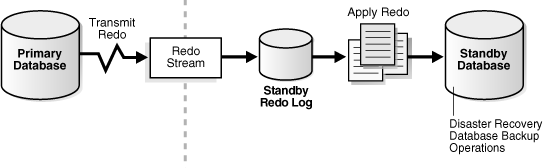
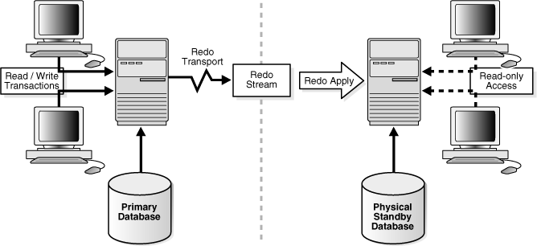
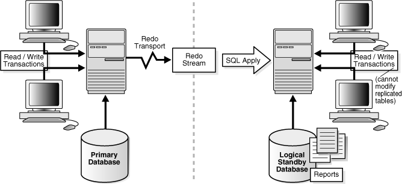

## 1 Introduction to Oracle Data Guard

Oracle Data Guard ensures high availability, data protection, and disaster recovery for enterprise data. Data Guard provides a comprehensive set of services that create, maintain, manage, and monitor one or more standby databases to enable production Oracle databases to survive disasters and data corruptions. Data Guard maintains these standby databases as copies of the production database. Then, if the production database becomes unavailable because of a planned or an unplanned outage, Data Guard can switch any standby database to the production role, minimizing the downtime associated with the outage. Data Guard can be used with traditional backup, restoration, and cluster techniques to provide a high level of data protection and data availability.

With Data Guard, administrators can optionally improve production database performance by offloading resource-intensive backup and reporting operations to standby systems.

This chapter includes the following topics that describe the highlights of Oracle Data Guard:

## 1.1 Data Guard Configurations

A Data Guard configuration consists of one production database and one or more standby databases. The databases in a Data Guard configuration are connected by Oracle Net and may be dispersed geographically. There are no restrictions on where the databases are located, provided they can communicate with each other. For example, you can have a standby database on the same system as the production database, along with two standby databases on other systems at remote locations.

You can manage primary and standby databases using the SQL command-line interfaces or the Data Guard broker interfaces, including a command-line interface (DGMGRL) and a graphical user interface that is integrated in Oracle Enterprise Manager.

### 1.1.1 Primary Database

A Data Guard configuration contains one production database, also referred to as the primary database, that functions in the primary role. This is the database that is accessed by most of your applications.

The primary database can be either a single-instance Oracle database or an Oracle Real Application Clusters (Oracle RAC) database.

### 1.1.2 Standby Databases

A standby database is a transactionally consistent copy of the primary database. Using a backup copy of the primary database, you can create up to thirty standby databases and incorporate them in a Data Guard configuration. Once created, Data Guard automatically maintains each standby database by transmitting redo data from the primary database and then applying the redo to the standby database.

Similar to a primary database, a standby database can be either a single-instance Oracle database or an Oracle RAC database.

The types of standby databases are as follows:

- Physical standby database
	Provides a physically identical copy of the primary database, with on disk database structures that are identical to the primary database on a block-for-block basis. The database schema, including indexes, are the same. A physical standby database is kept synchronized with the primary database, through Redo Apply, which recovers the redo data received from the primary database and applies the redo to the physical standby database.
	As of Oracle Database 11g release 1 (11.1), a physical standby database can receive and apply redo while it is open for read-only access. A physical standby database can therefore be used concurrently for data protection and reporting.
- Logical standby database
	Contains the same logical information as the production database, although the physical organization and structure of the data can be different. The logical standby database is kept synchronized with the primary database through SQL Apply, which transforms the data in the redo received from the primary database into SQL statements and then executes the SQL statements on the standby database.
	A logical standby database can be used for other business purposes in addition to disaster recovery requirements. This allows users to access a logical standby database for queries and reporting purposes at any time. Also, using a logical standby database, you can upgrade Oracle Database software and patch sets with almost no downtime. Thus, a logical standby database can be used concurrently for data protection, reporting, and database upgrades.
- Snapshot Standby Database
	A snapshot standby database is a fully updatable standby database.
	Like a physical or logical standby database, a snapshot standby database receives and archives redo data from a primary database. Unlike a physical or logical standby database, a snapshot standby database does not apply the redo data that it receives. The redo data received by a snapshot standby database is not applied until the snapshot standby is converted back into a physical standby database, after first discarding any local updates made to the snapshot standby database.
	A snapshot standby database is best used in scenarios that require a temporary, updatable snapshot of a physical standby database. Note that because redo data received by a snapshot standby database is not applied until it is converted back into a physical standby, the time needed to recover from a primary database failure is directly proportional to the amount of redo data that needs to be applied.

### 1.1.3 Configuration Example

Figure 1-1 shows a typical Data Guard configuration that contains a primary database that transmits redo data to a standby database. The standby database is remotely located from the primary database for disaster recovery and backup operations. You can configure the standby database at the same location as the primary database. However, for disaster recovery purposes, Oracle recommends you configure standby databases at remote locations.

Figure 1-1 Typical Data Guard Configuration

> This illustration shows a Data Guard configuration consisting of a primary database and a physical standby database.
>
> From the primary database, redo is being transmitted and applied to the standby database. Log apply services apply the redo out of the standby redo log files to the standby database.
>
> Copyright © 1999, 2014, Oracle and/or its affiliates. All rights reserved.  
> [Legal Notices](https://docs.oracle.com/cd/E11882_01/dcommon/html/cpyr.htm)
  

## 1.2 Data Guard Services

The following sections explain how Data Guard manages the transmission of redo data, the application of redo data, and changes to the database roles:

- Redo Transport Services
	Control the automated transfer of redo data from the production database to one or more archival destinations.
- Apply Services
	Apply redo data on the standby database to maintain transactional synchronization with the primary database. Redo data can be applied either from archived redo log files, or, if real-time apply is enabled, directly from the standby redo log files as they are being filled, without requiring the redo data to be archived first at the standby database.
- Role Transitions
	Change the role of a database from a standby database to a primary database, or from a primary database to a standby database using either a switchover or a failover operation.

### 1.2.1 Redo Transport Services

Redo transport services control the automated transfer of redo data from the production database to one or more archival destinations.

Redo transport services perform the following tasks:

- Transmit redo data from the primary system to the standby systems in the configuration
- Manage the process of resolving any gaps in the archived redo log files due to a network failure
- Automatically detect missing or corrupted archived redo log files on a standby system and automatically retrieve replacement archived redo log files from the primary database or another standby database

### 1.2.2 Apply Services

The redo data transmitted from the primary database is written to the standby redo log on the standby database. Apply services automatically apply the redo data on the standby database to maintain consistency with the primary database. It also allows read-only access to the data.

The main difference between physical and logical standby databases is the manner in which apply services apply the archived redo data:

- For physical standby databases, Data Guard uses Redo Apply technology, which applies redo data on the standby database using standard recovery techniques of an Oracle database, as shown in Figure 1-2.

Figure 1-2 Automatic Updating of a Physical Standby Database

> This illustration shows a Data Guard configuration consisting of a primary database and a physical standby database. From the primary database, redo data is archived to the standby database where log apply services use Redo Apply technology to apply redo from the archived redo log files to the physical standby database.
  

- For logical standby databases, Data Guard uses SQL Apply technology, which first transforms the received redo data into SQL statements and then executes the generated SQL statements on the logical standby database, as shown in Figure 1-3.

Figure 1-3 Automatic Updating of a Logical Standby Database

> This illustration shows a Data Guard configuration consisting of a primary database and a logical standby database.
>
> From the primary database, redo data is archived to the standby database where log apply services transform the archived redo log files into SQL statements, which are then executed on the open logical standby database using SQL Apply technology.
  

### 1.2.3 Role Transitions

An Oracle database operates in one of two roles: primary or standby. Using Data Guard, you can change the role of a database using either a switchover or a failover operation.

A switchover is a role reversal between the primary database and one of its standby databases. A switchover ensures no data loss. This is typically done for planned maintenance of the primary system. During a switchover, the primary database transitions to a standby role, and the standby database transitions to the primary role.

A failover is when the primary database is unavailable. Failover is performed only in the event of a failure of the primary database, and the failover results in a transition of a standby database to the primary role. The database administrator can configure Data Guard to ensure no data loss.

The role transitions described in this documentation are invoked manually using SQL statements. You can also use the Oracle Data Guard broker to simplify role transitions and automate failovers using Oracle Enterprise Manager or the DGMGRL command-line interface, as described in Section 1.3.

## 1.3 Data Guard Broker

The Data Guard broker is a distributed management framework that automates the creation, maintenance, and monitoring of Data Guard configurations. You can use either the Oracle Enterprise Manager graphical user interface (GUI) or the Data Guard command-line interface (DGMGRL) to:

- Create and enable Data Guard configurations, including setting up redo transport services and apply services
- Manage an entire Data Guard configuration from any system in the configuration
- Manage and monitor Data Guard configurations that contain Oracle RAC primary or standby databases
- Simplify switchovers and failovers by allowing you to invoke them using either a single key click in Oracle Enterprise Manager or a single command in the DGMGRL command-line interface.
- Enable fast-start failover to fail over automatically when the primary database becomes unavailable. When fast-start failover is enabled, the Data Guard broker determines if a failover is necessary and initiates the failover to the specified target standby database automatically, with no need for DBA intervention.

In addition, Oracle Enterprise Manager automates and simplifies:

- Creating a physical or logical standby database from a backup copy of the primary database
- Adding new or existing standby databases to an existing Data Guard configuration
- Monitoring log apply rates, capturing diagnostic information, and detecting problems quickly with centralized monitoring, testing, and performance tools

See Also:

[Oracle Data Guard Broker](https://docs.oracle.com/cd/E11882_01/server.112/e40771/toc.htm) for more information

### 1.3.1 Using Oracle Enterprise Manager Grid Control

Oracle Enterprise Manager Grid Control (also referred to as Enterprise Manager in this book) provides a web-based interface for viewing, monitoring, and administering primary and standby databases in a Data Guard configuration. Enterprise Manager's easy-to-use interfaces, combined with the broker's centralized management and monitoring of the Data Guard configuration, enhance the Data Guard solution for high availability, site protection, and data protection of an enterprise.

From the Central Console of Enterprise Manager Grid Control, you can perform all management operations either locally or remotely. You can view home pages for Oracle databases, including primary and standby databases and instances, create or add existing standby databases, start and stop instances, monitor instance performance, view events, schedule jobs, and perform backup and recovery operations.

### 1.3.2 Using the Data Guard Command-Line Interface

The Data Guard command-line interface (DGMGRL) enables you to control and monitor a Data Guard configuration from the DGMGRL prompt or within scripts. You can perform most of the activities required to manage and monitor the databases in the configuration using DGMGRL. See [Oracle Data Guard Broker](https://docs.oracle.com/cd/E11882_01/server.112/e40771/toc.htm) for complete DGMGRL reference information and examples.

## 1.4 Data Guard Protection Modes

In some situations, a business cannot afford to lose data regardless of the circumstances. In other situations, the availability of the database may be more important than any potential data loss in the unlikely event of a multiple failure. Finally, some applications require maximum database performance at all times, and can therefore tolerate a small amount of data loss if any component should fail. The following descriptions summarize the three distinct modes of data protection.

Maximum availability This protection mode provides the highest level of data protection that is possible without compromising the availability of a primary database. Transactions do not commit until all redo data needed to recover those transactions has been written to the online redo log and to the standby redo log on at least one synchronized standby database. If the primary database cannot write its redo stream to at least one synchronized standby database, it operates as if it were in maximum performance mode to preserve primary database availability until it is again able to write its redo stream to a synchronized standby database.

This protection mode ensures zero data loss except in the case of certain double faults, such as failure of a primary database after failure of the standby database.

Maximum performance This is the default protection mode. It provides the highest level of data protection that is possible without affecting the performance of a primary database. This is accomplished by allowing transactions to commit as soon as all redo data generated by those transactions has been written to the online log. Redo data is also written to one or more standby databases, but this is done asynchronously with respect to transaction commitment, so primary database performance is unaffected by delays in writing redo data to the standby database(s).

This protection mode offers slightly less data protection than maximum availability mode and has minimal impact on primary database performance.

Maximum protection This protection mode ensures that no data loss will occur if the primary database fails. To provide this level of protection, the redo data needed to recover a transaction must be written to both the online redo log and to the standby redo log on at least one synchronized standby database before the transaction commits. To ensure that data loss cannot occur, the primary database will shut down, rather than continue processing transactions, if it cannot write its redo stream to at least one synchronized standby database.

All three protection modes require that specific redo transport options be used to send redo data to at least one standby database.

See Also:

- [Chapter 5, "Data Guard Protection Modes"](protection.md) for more detailed descriptions of these modes and for information about setting the protection mode of a primary database.

## 1.5 Client Failover

A high availability architecture requires a fast failover capability for databases and database clients.

Client failover encompasses failure notification, stale connection cleanup, and transparent reconnection to the new primary database. Oracle Database provides the capability to integrate database failover with failover procedures that automatically redirect clients to a new primary database within seconds of a database failover.

See Also:

- [Oracle Data Guard Broker](https://docs.oracle.com/cd/E11882_01/server.112/e40771/sofo.htm#DGBKR3546) for information about Fast Application Notification (FAN) and Fast Connection Failover (FCF) configuration requirements specific to Data Guard
- The Maximum Availability Architecture client failover best practices white paper at
	`http://www.oracle.com/goto/maa`

## 1.6 Data Guard and Complementary Technologies

Oracle Database provides several unique technologies that complement Data Guard to help keep business critical systems running with greater levels of availability and data protection than when using any one solution by itself. The following list summarizes some Oracle high-availability technologies:

- Oracle Real Application Clusters (Oracle RAC)
	Oracle RAC enables multiple independent servers that are linked by an interconnect to share access to an Oracle database, providing high availability, scalability, and redundancy during failures. Oracle RAC and Data Guard together provide the benefits of both system-level, site-level, and data-level protection, resulting in high levels of availability and disaster recovery without loss of data:
	- Oracle RAC addresses system failures by providing rapid and automatic recovery from failures, such as node failures and instance crashes. It also provides increased scalability for applications.
		- Data Guard addresses site failures and data protection through transactionally consistent primary and standby databases that do not share disks, enabling recovery from site disasters and data corruption.
	Many different architectures using Oracle RAC and Data Guard are possible depending on the use of local and remote sites and the use of nodes and a combination of logical and physical standby databases. See [Appendix D, "Data Guard and Oracle Real Application Clusters"](rac_support.md) and [Oracle Database High Availability Overview](https://docs.oracle.com/cd/E11882_01/server.112/e17157/toc.htm) for Oracle RAC and Data Guard integration.
- Flashback Database
	The Flashback Database feature provides fast recovery from logical data corruption and user errors. By allowing you to flash back in time, previous versions of business information that might have been erroneously changed or deleted can be accessed once again. This feature:
	- Eliminates the need to restore a backup and roll forward changes up to the time of the error or corruption. Instead, Flashback Database can roll back an Oracle database to a previous point-in-time, without restoring datafiles.
		- Provides an alternative to delaying the application of redo to protect against user errors or logical corruptions. Therefore, standby databases can be more closely synchronized with the primary database, thus reducing failover and switchover times.
		- Avoids the need to completely re-create the original primary database after a failover. The failed primary database can be flashed back to a point in time before the failover and converted to be a standby database for the new primary database.
	See [Oracle Database Backup and Recovery User's Guide](https://docs.oracle.com/cd/E11882_01/backup.112/e10642/toc.htm) for information about Flashback Database, and [Section 7.2.2](log_apply.md) for information describing the application of redo data.
- Recovery Manager (RMAN)
	RMAN is an Oracle utility that simplifies backing up, restoring, and recovering database files. Like Data Guard, RMAN is a feature of the Oracle database and does not require separate installation. Data Guard is well integrated with RMAN, allowing you to:
	- Use the Recovery Manager `DUPLICATE` command to create a standby database from backups of your primary database.
		- Take backups on a physical standby database instead of the production database, relieving the load on the production database and enabling efficient use of system resources on the standby site. Moreover, backups can be taken while the physical standby database is applying redo.
		- Help manage archived redo log files by automatically deleting the archived redo log files used for input after performing a backup.
	See [Appendix E, "Creating a Standby Database with Recovery Manager"](rcmbackp.md) and [Oracle Database Backup and Recovery User's Guide](https://docs.oracle.com/cd/E11882_01/backup.112/e10642/toc.htm).

## 1.7 Summary of Data Guard Benefits

Data Guard offers these benefits:

- Disaster recovery, data protection, and high availability
	Data Guard provides an efficient and comprehensive disaster recovery and high availability solution. Easy-to-manage switchover and failover capabilities allow role reversals between primary and standby databases, minimizing the downtime of the primary database for planned and unplanned outages.
- Complete data protection
	Data Guard can ensure zero data loss, even in the face of unforeseen disasters. A standby database provides a safeguard against data corruption and user errors. Because the redo data received from a primary database is validated at a standby database, storage level physical corruptions on the primary database do not propagate to the standby database. Similarly, logical corruptions or user errors that cause the primary database to be permanently damaged can be resolved.
- Efficient use of system resources
	The standby database tables that are updated with redo data received from the primary database can be used for other tasks such as backups, reporting, summations, and queries, thereby reducing the primary database workload necessary to perform these tasks, saving valuable CPU and I/O cycles.
- Flexibility in data protection to balance availability against performance requirements
	Oracle Data Guard offers maximum protection, maximum availability, and maximum performance modes to help enterprises balance data availability against system performance requirements.
- Automatic gap detection and resolution
	If connectivity is lost between the primary and one or more standby databases (for example, due to network problems), redo data being generated on the primary database cannot be sent to those standby databases. Once a connection is reestablished, the missing archived redo log files (referred to as a gap) are automatically detected by Data Guard, which then automatically transmits the missing archived redo log files to the standby databases. The standby databases are synchronized with the primary database, without manual intervention by the DBA.
- Centralized and simple management
	The Data Guard broker provides a graphical user interface and a command-line interface to automate management and operational tasks across multiple databases in a Data Guard configuration. The broker also monitors all of the systems within a single Data Guard configuration.
- Integration with Oracle Database
	Data Guard is a feature of Oracle Database Enterprise Edition and does not require separate installation.
- Automatic role transitions
	When fast-start failover is enabled, the Data Guard broker automatically fails over to a synchronized standby site in the event of a disaster at the primary site, requiring no intervention by the DBA. In addition, applications are automatically notified of the role transition.