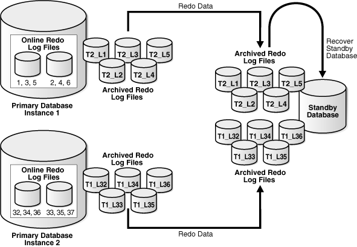

## D Data Guard and Oracle Real Application Clusters

An Oracle Data Guard configuration can consist of any combination of single-instance and Oracle Real Application Clusters (Oracle RAC) multiple-instance databases. This chapter summarizes the configuration requirements and considerations that apply when using Oracle Data Guard with Oracle RAC databases. It contains the following sections:

## D.1 Configuring Standby Databases in an Oracle RAC Environment

You can configure a standby database to protect a primary database using Oracle RAC. The following table describes the possible combinations of instances in the primary and standby databases:

| Instance Combinations | Single-Instance Standby Database | Multi-Instance Standby Database |
| --- | --- | --- |
| Single-instance primary database | Yes | Yes |
| Multi-instance primary database | Yes | Yes |

In each scenario, each instance of the primary database transmits its redo data to an instance of the standby database.

### D.1.1 Setting Up a Multi-Instance Primary with a Single-Instance Standby

Figure D-1 illustrates an Oracle RAC database with two primary database instances (a multi-instance primary database) transmitting redo data to a single-instance standby database.

Figure D-1 Transmitting Redo Data from a Multi-Instance Primary Database



> This illustration shows each instance of a Real Application Clusters multi-instance primary database archiving redo logs to a single-instance standby database. The text following this illustration describes how the standby database correctly applies the multiple archived redo logs that are arriving from each primary database instance.
>
> Copyright © 1999, 2014, Oracle and/or its affiliates. All rights reserved.  
> [Legal Notices](https://docs.oracle.com/cd/E11882_01/dcommon/html/cpyr.htm)
  

In this case, Instance 1 of the primary database archives redo data to local archived redo log files 1, 2, 3, 4, 5 and transmits the redo data to the standby database destination, while Instance 2 archives redo data to local archived redo log files 32, 33, 34, 35, 36 and transmits the redo data to the same standby database destination. The standby database automatically determines the correct order in which to apply the archived redo log files.

To set up a primary database in an Oracle RAC environment

Follow the instructions in [Chapter 3](create_ps.md) (for physical standby database creation) or [Chapter 4](create_ls.md) (for logical standby database creation) to configure each primary instance.

To set up a single instance standby database

Follow the instructions in [Chapter 3](create_ps.md) (for physical standby database creation) or [Chapter 4](create_ls.md) (for logical standby database creation) to define the `LOG_ARCHIVE_DEST_` `n` and `LOG_ARCHIVE_FORMAT` parameters to specify the location of the archived redo log files and standby redo log files.

### D.1.2 Setting Up Oracle RAC Primary and Standby Databases

This section describes how to configure an Oracle RAC primary database to send redo data to an Oracle RAC standby database.

#### D.1.2.1 Configuring an Oracle RAC Standby Database to Receive Redo Data

Perform the following steps to configure an Oracle RAC standby database to receive redo data from a primary database:

1. Create a standby redo log on the standby database. The redo log files in the standby redo log must reside in a location that can be accessed by all of the standby database instances, such as on a cluster file system or Oracle ASM instance. See [Section 6.2.3.1](log_transport.md) for more information about creating a standby redo log.
2. Configure standby redo log archival on each standby database instance. The standby redo log must be archived to a location that can be accessed by all of the standby database instances, and every standby database instance must be configured to archive the standby redo log to the same location. See [Section 6.2.3.2](log_transport.md) for more information about configuring standby redo log archival.

#### D.1.2.2 Configuring an Oracle RAC Primary Database to Send Redo Data

Configure each instance of the Oracle RAC primary database to send its redo data to the Oracle RAC standby database. [Section 6.2.2](log_transport.md) describes how to configure an Oracle database instance to send redo data to another database.

Oracle recommends the following best practices when configuring an Oracle RAC primary database to send redo data to an Oracle RAC standby database:

1. Use the same `LOG_ARCHIVE_DEST_n` parameter on each primary database instance to send redo data to a given standby database.
2. Set the `SERVICE` attribute of each `LOG_ARCHIVE_DEST_n` parameter that corresponds to a given standby database to the same net service name.
3. The net service name should resolve to an Oracle Net connect descriptor that contains an address list, and that address list should contain connection data for each standby database instance.

## D.2 Configuration Considerations in an Oracle RAC Environment

This section contains the Data Guard configuration information that is specific to Oracle RAC environments. It contains the following topics:

- Format for Archived Redo Log Filenames
- Data Protection Modes
- Role Transitions

### D.2.1 Format for Archived Redo Log Filenames

The format for archived redo log filenames is in the form of log\_%parameter, where %parameter can include one or more of the parameters in Table D-1.

Table D-1 Directives for the LOG\_ARCHIVE\_FORMAT Initialization Parameter

| Directives | Description |
| --- | --- |
| `%a` | Database activation ID. |
| `%A` | Database activation ID, zero filled. |
| `%d` | Database ID. |
| `%D` | Database ID, zero filled. |
| `%t` | Instance thread number. |
| `%T` | Instance thread number, zero filled. |
| `%s` | Log file sequence number. |
| `%S` | Log file sequence number, zero filled. |
| `%r` | Resetlogs ID. |
| `%R` | Resetlogs ID, zero filled. |

For example:

```
LOG_ARCHIVE_FORMAT = log%d_%t_%s_%r.arc
```

The thread parameters %t or %T are mandatory for Oracle RAC to uniquely identify the archived redo log files with the `LOG_ARCHIVE_FORMAT` parameter.

### D.2.2 Data Protection Modes

If any instance of an Oracle RAC primary database loses connectivity with a standby database, all other primary database instances stop sending redo to the standby database for the number of seconds specified on the `LOG_ARCHIVE_DEST_` `n` `REOPEN` attribute, after which all primary database instances attempt to reconnect to the standby database.

The following list describes the behavior of the protection modes in Oracle RAC environments:

- Maximum protection configuration
	If a lost destination is the last participating `SYNC` destination, the instance loses connectivity and will be shut down. Other instances in an Oracle RAC configuration that still have connectivity to the standby destinations will recover the lost instance and continue sending to their standby destinations. Only when every instance in an Oracle RAC configuration loses connectivity to the last standby destination will the primary database be shut down.

### D.2.3 Role Transitions

This section contains information about switchovers.

#### D.2.3.1 Switchovers

For an Oracle RAC database, only one primary instance can be active during a switchover when the target database is a physical standby. Therefore, before a switchover to a physical standby database, shut down all but one primary instance. After the switchover completes, restart the instances that were shut down during the switchover. This limitation does not exist when performing a switchover to a logical standby database.

Note:

The SQL `ALTER DATABASE` statement used to perform the switchover automatically creates redo log files if they do not already exist. Because this can significantly increase the time required to complete the `COMMIT` operation, Oracle recommends that you manually add redo log files when creating physical standby databases.

## D.3 Troubleshooting

This section provides help troubleshooting problems with Oracle RAC.

### D.3.1 Switchover Fails in an Oracle RAC Configuration

When your database is using Oracle RAC, active instances prevent a switchover from being performed. When other instances are active, an attempt to switch over fails with the following error message:

```
SQL> ALTER DATABASE COMMIT TO SWITCHOVER TO STANDBY; 

ALTER DATABASE COMMIT TO SWITCHOVER TO STANDBY * 
ORA-01105: mount is incompatible with mounts by other instances
```

Action: Query the `GV$INSTANCE` view as follows to determine which instances are causing the problem:

```
SQL> SELECT INSTANCE_NAME, HOST_NAME FROM GV$INSTANCE - 
> WHERE INST_ID <> (SELECT INSTANCE_NUMBER FROM V$INSTANCE);

INSTANCE_NAME HOST_NAME 
------------- --------- 
INST2         standby2
```

In the previous example, the identified instance must be manually shut down before the switchover can proceed. You can connect to the identified instance from your instance and issue the `SHUTDOWN` statement remotely, for example:

```
SQL> CONNECT SYS@standby2 AS SYSDBA
Enter Password:
SQL> SHUTDOWN;
SQL> EXIT
```