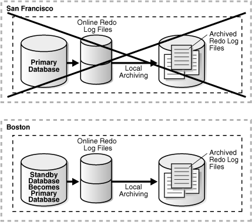

## 8 Role Transitions

A Data Guard configuration consists of one database that functions in the primary role and one or more databases that function in the standby role. To see the current role of the databases, query the `DATABASE_ROLE` column in the `V$DATABASE` view.

The number, location, and type of standby databases in a Data Guard configuration and the way in which redo data from the primary database is propagated to each standby database determine the role-management options available to you in response to a primary database outage.

This chapter describes how to manage role transitions in a Data Guard configuration. It contains the following topics:

Note:

This chapter describes how to perform role transitions manually, using SQL statements. Do not use the procedures described in this chapter to perform role transitions in a Data Guard configuration that is managed by the broker. The role transition procedures provided in [Oracle Data Guard Broker](https://docs.oracle.com/cd/E11882_01/server.112/e40771/toc.htm) should be used instead.

See Also:

[Oracle Data Guard Broker](https://docs.oracle.com/cd/E11882_01/server.112/e40771/toc.htm) for information about using the Oracle Data Guard broker to:
- Simplify switchovers and failovers by allowing you to invoke them using either a single key click in Oracle Enterprise Manager or a single command in the DGMGRL command-line interface.
- Enable fast-start failover to fail over automatically when the primary database becomes unavailable. When fast-start failover is enabled, the Data Guard broker determines if a failover is necessary and initiates the failover to the specified target standby database automatically, with no need for DBA intervention.

## 8.1 Introduction to Role Transitions

A database operates in one of the following mutually exclusive roles: primary or standby. Data Guard enables you to change these roles dynamically by issuing the SQL statements described in this chapter, or by using either of the Data Guard broker's interfaces. Oracle Data Guard supports the following role transitions:

- Switchover
	Allows the primary database to switch roles with one of its standby databases. There is no data loss during a switchover. After a switchover, each database continues to participate in the Data Guard configuration with its new role.
- Failover
	Changes a standby database to the primary role in response to a primary database failure. If the primary database was not operating in either maximum protection mode or maximum availability mode before the failure, some data loss may occur. If Flashback Database is enabled on the primary database, it can be reinstated as a standby for the new primary database once the reason for the failure is corrected.

Section 8.1.1, "Preparing for a Role Transition" helps you choose the role transition that best minimizes downtime and risk of data loss. Switchovers and failovers are described in more detail in Section 8.1.3, "Switchovers" and Section 8.1.4, "Failovers", respectively.

See Also:

[Oracle Data Guard Broker](https://docs.oracle.com/cd/E11882_01/server.112/e40771/sofo.htm#DGBKR3425) for information about event notification and database connection failover support available to database clients when a broker-managed failover occurs

### 8.1.1 Preparing for a Role Transition

Before starting any role transition, perform the following preparations:

- Verify that each database is properly configured for the role that it is about to assume. See [Chapter 3, "Creating a Physical Standby Database"](create_ps.md) and [Chapter 4, "Creating a Logical Standby Database"](create_ls.md) for information about how to configure database initialization parameters, `ARCHIVELOG` mode, standby redo logs, and online redo logs on primary and standby databases.
	Note:
	You must define the `LOG_ARCHIVE_DEST_` `n` and `LOG_ARCHIVE_DEST_STATE_` `n` parameters on each standby database so that when a switchover or failover occurs, all standby sites continue to receive redo data from the new primary database.
- Verify that there are no redo transport errors or redo gaps at the standby database by querying the `V$ARCHIVE_DEST_STATUS` view on the primary database.
	For example, the following query would be used to check the status of the standby database associated with `LOG_ARCHIVE_DEST_2`:
	```
	SQL> SELECT STATUS, GAP_STATUS FROM V$ARCHIVE_DEST_STATUS WHERE DEST_ID = 2;
	 
	STATUS GAP_STATUS
	--------- ------------------------
	VALID NO GAP
	```
	Do not proceed until the value of the `STATUS` column is `VALID` and the value of the `GAP_STATUS` column is `NOGAP`, for the row that corresponds to the standby database.
- Ensure temporary files exist on the standby database that match the temporary files on the primary database.
- Remove any delay in applying redo that may be in effect on the standby database that will become the new primary database.
- Before performing a switchover from an Oracle RAC primary database to a physical standby database, shut down all but one primary database instance. Any primary database instances shut down at this time can be started after the switchover completes.
- Before performing a switchover to a physical standby database that is in real-time query mode, consider bringing all instances of that standby database to the mounted but not open state to achieve the fastest possible role transition and to cleanly terminate any user sessions connected to the physical standby database prior to the role transition.

### 8.1.2 Choosing a Target Standby Database for a Role Transition

For a Data Guard configuration with multiple standby databases, there are a number of factors to consider when choosing the target standby database for a role transition. These include the following:

- Locality of the standby database.
- The capability of the standby database (hardware specifications—such as the number of CPUs, I/O bandwidth available, and so on).
- The time it will take to perform the role transition. This is affected by how far behind the standby database is in terms of application of redo data, and how much flexibility you have in terms of trading off application availability with data loss.
- Standby database type.

The type of standby chosen as the role transition target determines how other standby databases in the configuration will behave after the role transition. If the new primary was a physical standby before the role transition, all other standby databases in the configuration will become standbys of the new primary. If the new primary was a logical standby before the role transition, then all other logical standbys in the configuration will become standbys of the new primary, but physical standbys in the configuration will continue to be standbys of the old primary and will therefore not protect the new primary. In the latter case, a future switchover or failover back to the original primary database will return all standbys to their original role as standbys of the current primary. For the reasons described above, a physical standby is generally the best role transition target in a configuration that contains both physical and logical standbys.

Note:

A snapshot standby cannot be the target of a role transition. If you wish to use a snapshot standby database as a target for a role transition, first convert it to a physical standby database and allow all redo received from the primary database to be applied. See [Section 9.7.3, "Converting a Snapshot Standby Database into a Physical Standby Database"](manage_ps.md).

Data Guard provides the `V$DATAGUARD_STATS` view that can be used to evaluate each standby database in terms of the currency of the data in the standby database, and the time it will take to perform a role transition if all available redo data is applied to the standby database. For example:

```
SQL> COLUMN NAME FORMAT A24
SQL> COLUMN VALUE FORMAT A16     
SQL> COLUMN DATUM_TIME FORMAT A24
SQL> SELECT NAME, VALUE, DATUM_TIME FROM V$DATAGUARD_STATS;
 
NAME                     VALUE            DATUM_TIME
------------------------ ---------------- ------------------------
transport lag            +00 00:00:00     06/18/2009 12:22:06
apply lag                +00 00:00:00     06/18/2009 12:22:06
apply finish time        +00 00:00:00.000
estimated startup time   9
```

This query output shows that the standby database has received and applied all redo generated by the primary database. These statistics were computed using data received from the primary database as of 12:22.06 on 06/18/09.

The `apply` `lag` and `transport` `lag` metrics are computed based on data received from the primary database. These metrics become stale if communications between the primary and standby database are disrupted. An unchanging value in the `DATUM_TIME` column for the `apply` `lag` and `transport` `lag` metrics indicates that these metrics are not being updated and have become stale, possibly due to a communications fault between the primary and standby databases.

### 8.1.3 Switchovers

A switchover is typically used to reduce primary database downtime during planned outages, such as operating system or hardware upgrades, or rolling upgrades of the Oracle database software and patch sets (described in [Chapter 12, "Using SQL Apply to Upgrade the Oracle Database"](rollup.md)).

A switchover takes place in two phases. In the first phase, the existing primary database undergoes a transition to a standby role. In the second phase, a standby database undergoes a transition to the primary role.

Figure 8-1 shows a two-site Data Guard configuration before the roles of the databases are switched. The primary database is in San Francisco, and the standby database is in Boston.

Figure 8-1 Data Guard Configuration Before Switchover


> This illustration shows a Data Guard configuration consisting of a primary database named San Francisco and a standby database named Boston.
>
> On the primary database in San Francisco, online redo logs are being archived locally and over Oracle Net services to the standby database in Boston. At the Boston standby location, the archived redo logs are being applied to the standby database.
  

Figure 8-2 shows the Data Guard environment after the original primary database was switched over to a standby database, but before the original standby database has become the new primary database. At this stage, the Data Guard configuration temporarily has two standby databases.

Figure 8-2 Standby Databases Before Switchover to the New Primary Database


> This illustration shows a Data Guard configuration during a switchover operation. The San Francisco database (originally the primary database) has changed to the standby role, but the Boston database has not yet changed to the primary role. At this point in time, both the San Francisco and Boston databases are operating in the standby role.
>
> No redo logs are being sent or received over the Oracle Net network. Both of the standby databases are capable of operating in read-only mode.
  

Figure 8-3 shows the Data Guard environment after a switchover took place. The original standby database became the new primary database. The primary database is now in Boston, and the standby database is now in San Francisco.

Figure 8-3 Data Guard Environment After Switchover


> This illustration shows a Data Guard configuration after a switchover operation has occurred. The San Francisco database (originally the primary database) is now operating as the standby database and the Boston database is now operating as the primary database.
>
> Copyright © 1999, 2014, Oracle and/or its affiliates. All rights reserved.  
> [Legal Notices](https://docs.oracle.com/cd/E11882_01/dcommon/html/cpyr.htm)
  

Preparing for a Switchover

Ensure the prerequisites listed in Section 8.1.1 are satisfied. In addition, the following prerequisites must be met for a switchover:

- For switchovers involving a physical standby database, verify that the primary database is open and that Redo Apply is active on the standby database. See [Section 7.3, "Applying Redo Data to Physical Standby Databases"](log_apply.md) for more information about Redo Apply.
- For switchovers involving a logical standby database, verify both the primary and standby database instances are open and that SQL Apply is active. See [Section 7.4, "Applying Redo Data to Logical Standby Databases"](log_apply.md) for more information about SQL Apply.

### 8.1.4 Failovers

A failover is typically used only when the primary database becomes unavailable, and there is no possibility of restoring it to service within a reasonable period of time. The specific actions performed during a failover vary based on whether a logical or a physical standby database is involved in the failover, the state of the Data Guard configuration at the time of the failover, and on the specific SQL statements used to initiate the failover.

Figure 8-4 shows the result of a failover from a primary database in San Francisco to a physical standby database in Boston.

Figure 8-4 Failover to a Standby Database



> This illustration shows a two-site Data Guard configuration after a system or software failure occurred. In this figure, the primary site (in San Francisco) is crossed out to indicate that the site is no longer operational. The Boston site that was originally a standby site is now operating as the new primary site. The Boston site is writing to online redo logs and local archived redo logs.
  

Preparing for a Failover

Note:

If managed standby recovery at a physical standby database chosen for failover has stopped with error `ORA-752` or `ORA-600` `[3020]`, then proceed directly to [Section 13.6, "Recovering From Lost-Write Errors on a Primary Database."](scenarios.md)

Also see [Oracle Database High Availability Best Practices](https://docs.oracle.com/cd/E11882_01/server.112/e10803/outage.htm#HABPT5206) for further information about recovering from data corruption.

If possible, before performing a failover, you should transfer as much of the available and unapplied primary database redo data as possible to the standby database.

Ensure the prerequisites listed in Section 8.1.1, "Preparing for a Role Transition" are satisfied. In addition, the following prerequisites must be met for a failover:

- If a standby database currently running in maximum protection mode will be involved in the failover, first place it in maximum performance mode by issuing the following statement on the standby database:
	```
	SQL> ALTER DATABASE SET STANDBY DATABASE TO MAXIMIZE PERFORMANCE;
	```
	Then, if appropriate standby databases are available, you can reset the desired protection mode on the new primary database after the failover completes.
	This is required because you cannot fail over to a standby database that is in maximum protection mode. In addition, if a primary database in maximum protection mode is still actively communicating with the standby database, issuing the `ALTER DATABASE` statement to change the standby database from maximum protection mode to maximum performance mode will not succeed. Because a failover removes the original primary database from the Data Guard configuration, these features serve to protect a primary database operating in maximum protection mode from the effects of an unintended failover.
	Note:
	Do not fail over to a standby database to test whether or not the standby database is being updated correctly. Instead:
	- See [Section 3.2.7, "Verify the Physical Standby Database Is Performing Properly"](create_ps.md)
	- See [Section 4.2.6, "Verify the Logical Standby Database Is Performing Properly"](create_ls.md)

### 8.1.5 Role Transition Triggers

The `DB_ROLE_CHANGE` system event is signaled whenever a role transition occurs. This system event is signaled immediately if the database is open when the role transition occurs, or the next time the database is opened if it is closed when a role transition occurs.

The `DB_ROLE_CHANGE` system event can be used to fire a trigger that performs a set of actions whenever a role transition occurs.

## 8.2 Role Transitions Involving Physical Standby Databases

The following sections describe how to perform a switchover or failover to a physical standby database:

- Performing a Switchover to a Physical Standby Database
- Performing a Failover to a Physical Standby Database

### 8.2.1 Performing a Switchover to a Physical Standby Database

This section describes how to perform a switchover to a physical standby database.A switchover is initiated on the primary database and is completed on the target standby database.

Step 1 Verify that the primary database can be switched to the standby role.

Query the `SWITCHOVER_STATUS` column of the `V$DATABASE` view on the primary database.For example:

```
SQL> SELECT SWITCHOVER_STATUS FROM V$DATABASE;

SWITCHOVER_STATUS 
 ----------------- 
 TO STANDBY 
 1 row selected
```

A value of `TO STANDBY` or `SESSIONS ACTIVE` indicates that the primary database can be switched to the standby role. If neither of these values is returned, a switchover is not possible because redo transport is either misconfigured or is not functioning properly. See [Chapter 6](log_transport.md) for information about configuring and monitoring redo transport.

Step 2 Initiate the switchover on the primary database.

Issue the following SQL statement on the primary database to switch it to the standby role:

```
SQL> ALTER DATABASE COMMIT TO SWITCHOVER TO PHYSICAL STANDBY WITH -
> SESSION SHUTDOWN;
```

This statement converts the primary database into a physical standby database. The current control file is backed up to the current SQL session trace file before the switchover. This makes it possible to reconstruct a current control file, if necessary.

Note:

The `WITH SESSION SHUTDOWN` clause can be omitted from the switchover statement if the query performed in the previous step returned a value of `TO STANDBY`.

Step 3 Shut down and then mount the former primary database.

```
SQL> SHUTDOWN ABORT;
SQL> STARTUP MOUNT;
```

At this point in the switchover process, the original primary database is a physical standby database (see Figure 8-2).

Note:

In Oracle Database 11g release 2 (11.2.0.4) and later, it is not necessary to issue the `SHUTDOWN` `ABORT` statement in this step because the database instance is shut down by default when the `ALTER` `DATABASE` `COMMIT` `TO` `SWITCHOVER` `TO` `PHYSICAL` `STANDBY` `WITH` `SESSION` `SHUTDOWN` statement is issued.

Step 4 Verify that the switchover target is ready to be switched to the primary role.

Query the `SWITCHOVER_STATUS` column of the `V$DATABASE` view on the standby database.

For example:

```
SQL> SELECT SWITCHOVER_STATUS FROM V$DATABASE;

SWITCHOVER_STATUS 
----------------- 
TO_PRIMARY 
1 row selected
```

A value of `TO PRIMARY` or `SESSIONS ACTIVE` indicates that the standby database is ready to be switched to the primary role. If neither of these values is returned, verify that Redo Apply is active and that redo transport is configured and working properly. Continue to query this column until the value returned is either `TO PRIMARY` or `SESSIONS ACTIVE`.

Step 5 Switch the target physical standby database role to the primary role.

Issue the following SQL statement on the target physical standby database:

```
SQL> ALTER DATABASE COMMIT TO SWITCHOVER TO PRIMARY WITH SESSION SHUTDOWN;
```

Note:

The `WITH SESSION SHUTDOWN` clause can be omitted from the switchover statement if the query performed in the previous step returned a value of `TO PRIMARY`.

Step 6 Open the new primary database.

```
SQL> ALTER DATABASE OPEN;
```

Step 7 Start Redo Apply on the new physical standby database.

For example:

```
SQL> ALTER DATABASE RECOVER MANAGED STANDBY DATABASE USING CURRENT LOGFILE -
> DISCONNECT FROM SESSION;
```

Step 8 Restart Redo Apply if it has stopped at any of the other physical standby databases in your Data Guard configuration.

For example:

```
SQL> ALTER DATABASE RECOVER MANAGED STANDBY DATABASE USING CURRENT LOGFILE -
> DISCONNECT FROM SESSION;
```

### 8.2.2 Performing a Failover to a Physical Standby Database

This section describes how to perform a failover to a physical standby database.

Step 1 Flush any unsent redo from the primary database to the target standby database.

If the primary database can be mounted, it may be possible to flush any unsent archived and current redo from the primary database to the standby database. If this operation is successful, a zero data loss failover is possible even if the primary database is not in a zero data loss data protection mode.

Ensure that Redo Apply is active at the target standby database.

Mount, but do not open the primary database. If the primary database cannot be mounted, go to Step 2.

Issue the following SQL statement at the primary database:

```
SQL> ALTER SYSTEM FLUSH REDO TO target_db_name;
```

For `target_db_name`, specify the `DB_UNIQUE_NAME` of the standby database that is to receive the redo flushed from the primary database.

This statement flushes any unsent redo from the primary database to the standby database, and waits for that redo to be applied to the standby database.

If this statement completes without any errors, go to Step 5. If the statement completes with any error, or if it must be stopped because you cannot wait any longer for the statement to complete, continue with Step 2.

Step 2 Verify that the standby database has the most recently archived redo log file for each primary database redo thread.

Query the `V$ARCHIVED_LOG` view on the target standby database to obtain the highest log sequence number for each redo thread.

For example:

```
SQL> SELECT UNIQUE THREAD# AS THREAD, MAX(SEQUENCE#) -
> OVER (PARTITION BY thread#) AS LAST from V$ARCHIVED_LOG;

    THREAD       LAST
---------- ----------
         1        100
```

If possible, copy the most recently archived redo log file for each primary database redo thread to the standby database if it does not exist there, and register it. This must be done for each redo thread.

For example:

```
SQL> ALTER DATABASE REGISTER PHYSICAL LOGFILE 'filespec1';
```

Step 3 Identify and resolve any archived redo log gaps.

Query the `V$ARCHIVE_GAP` view on the target standby database to determine if there are any redo gaps on the target standby database.

For example:

```
SQL> SELECT THREAD#, LOW_SEQUENCE#, HIGH_SEQUENCE# FROM V$ARCHIVE_GAP;

THREAD#    LOW_SEQUENCE# HIGH_SEQUENCE#
---------- ------------- --------------
         1            90             92
```

In this example the gap comprises archived redo log files with sequence numbers 90, 91, and 92 for thread 1.

If possible, copy any missing archived redo log files to the target standby database from the primary database and register them at the target standby database. This must be done for each redo thread.

For example:

```
SQL> ALTER DATABASE REGISTER PHYSICAL LOGFILE 'filespec1';
```

Step 4 Repeat Step 3 until all gaps are resolved.

The query executed in Step 3 displays information for the highest gap only. After resolving a gap, you must repeat the query until no more rows are returned.

If, after performing Step 2 through Step 4, you are not able to resolve all gaps in the archived redo log files (for example, because you do not have access to the system that hosted the failed primary database), some data loss will occur during the failover.

Step 5 Stop Redo Apply.

Issue the following SQL statement on the target standby database:

```
SQL> ALTER DATABASE RECOVER MANAGED STANDBY DATABASE CANCEL;
```

Step 6 Finish applying all received redo data.

Issue the following SQL statement on the target standby database:

```
SQL> ALTER DATABASE RECOVER MANAGED STANDBY DATABASE FINISH;
```

If this statement completes without any errors, proceed to Step 7.

If an error occurs, some received redo data was not applied. Try to resolve the cause of the error and re-issue the statement before proceeding to the next step.

Note that if there is a redo gap that was not resolved in Step 3 and Step 4, you will receive an error stating that there is a redo gap.

If the error condition cannot be resolved, a failover can still be performed (with some data loss) by issuing the following SQL statement on the target standby database:

```
SQL> ALTER DATABASE ACTIVATE PHYSICAL STANDBY DATABASE;
```

Proceed to Step 9 when the `ACTIVATE` statement completes.

Step 7 Verify that the target standby database is ready to become a primary database.

Query the `SWITCHOVER_STATUS` column of the `V$DATABASE` view on the target standby database.

For example:

```
SQL> SELECT SWITCHOVER_STATUS FROM V$DATABASE;

SWITCHOVER_STATUS
-----------------
TO PRIMARY
1 row selected
```

A value of either `TO PRIMARY` or `SESSIONS ACTIVE` indicates that the standby database is ready to be switched to the primary role. If neither of these values is returned, verify that Redo Apply is active and continue to query this view until either `TO PRIMARY` or `SESSIONS ACTIVE` is returned.

Step 8 Switch the physical standby database to the primary role.

Issue the following SQL statement on the target standby database:

```
SQL> ALTER DATABASE COMMIT TO SWITCHOVER TO PRIMARY WITH SESSION SHUTDOWN;
```

Note:

The `WITH SESSION SHUTDOWN` clause can be omitted from the switchover statement if the query of the `SWITCHOVER_STATUS` column performed in the previous step returned a value of `TO PRIMARY`.

Step 9 Open the new primary database.

```
SQL> ALTER DATABASE OPEN;
```

Step 10 Back up the new primary database.

Oracle recommends that a full backup be taken of the new primary database.

Step 11 Restart Redo Apply if it has stopped at any of the other physical standby databases in your Data Guard configuration.

For example:

```
SQL> ALTER DATABASE RECOVER MANAGED STANDBY DATABASE USING CURRENT LOGFILE -
> DISCONNECT FROM SESSION;
```

Step 12 Optionally, restore the failed primary database.

After a failover, the original primary database can be converted into a physical standby database of the new primary database using the method described in [Section 13.2](scenarios.md) or [Section 13.7](scenarios.md), or it can be re-created as a physical standby database from a backup of the new primary database using the method described in [Section 3.2](create_ps.md).

Once the original primary database is running in the standby role, a switchover can be performed to restore it to the primary role.

## 8.3 Role Transitions Involving Logical Standby Databases

The following sections describe how to perform switchovers and failovers involving a logical standby database:

- Performing a Switchover to a Logical Standby Database
- Performing a Failover to a Logical Standby Database

Note:

Logical standby does not replicate database services. In the event of a failover or switchover to a logical standby, mid-tiers connecting to services in the primary will not be able to connect (since the creation of the service is not replicated), or will connect to an incorrect edition (since the modification of the service attribute is not replicated).

Oracle Clusterware does not replicate the services it manages to logical standbys. You must manually keep them synchronized between the primary and standby. See [Oracle Clusterware Administration and Deployment Guide](https://docs.oracle.com/cd/E11882_01/rac.112/e41959/toc.htm) for more information about Oracle Clusterware.

### 8.3.1 Performing a Switchover to a Logical Standby Database

When you perform a switchover that changes roles between a primary database and a logical standby database, always initiate the switchover on the primary database and complete it on the logical standby database. These steps must be performed in the order in which they are described or the switchover will not succeed.

Step 1 Verify it is possible to perform a switchover on the primary database.

On the current primary database, query the `SWITCHOVER_STATUS` column of the `V$DATABASE` fixed view on the primary database to verify it is possible to perform a switchover.

For example:

```
SQL> SELECT SWITCHOVER_STATUS FROM V$DATABASE;

SWITCHOVER_STATUS
-----------------
TO STANDBY
1 row selected
```

A value of `TO STANDBY` or `SESSIONS ACTIVE` in the `SWITCHOVER_STATUS` column indicates that it is possible to switch the primary database to the logical standby role. If one of these values is not displayed, then verify the Data Guard configuration is functioning correctly (for example, verify all `LOG_ARCHIVE_DEST_` `n` parameter values are specified correctly). See [Oracle Database Reference](https://docs.oracle.com/cd/E11882_01/server.112/e40402/toc.htm) for information about other valid values for the `SWITCHOVER_STATUS` column of the `V$DATABASE` view.

Step 2 Prepare the current primary database for the switchover.

To prepare the current primary database for a logical standby database role, issue the following SQL statement on the primary database:

```
SQL> ALTER DATABASE PREPARE TO SWITCHOVER TO LOGICAL STANDBY;
```

This statement notifies the current primary database that it will soon switch to the logical standby role and begin receiving redo data from a new primary database. You perform this step on the primary database in preparation to receive the LogMiner dictionary to be recorded in the redo stream of the current logical standby database, as described in Step 3.

The value `PREPARING SWITCHOVER` is displayed in the `V$DATABASE.SWITCHOVER_STATUS` column if this operation succeeds.

Step 3 Prepare the target logical standby database for the switchover.

Use the following statement to build a LogMiner dictionary on the logical standby database that is the target of the switchover:

```
SQL> ALTER DATABASE PREPARE TO SWITCHOVER TO PRIMARY;
```

This statement also starts redo transport services on the logical standby database that begins transmitting its redo data to the current primary database and to other standby databases in the Data Guard configuration. The sites receiving redo data from this logical standby database accept the redo data but they do not apply it.

The `V$DATABASE.SWITCHOVER_STATUS` on the logical standby database initially shows `PREPARING DICTIONARY` while the LogMiner dictionary is being recorded in the redo stream. Once this has completed successfully, the `SWITCHOVER_STATUS` column shows `PREPARING SWITCHOVER`.

Step 4 Ensure the current primary database is ready for the future primary database's redo stream.

Before you can complete the role transition of the primary database to the logical standby role, verify the LogMiner dictionary was received by the primary database by querying the `SWITCHOVER_STATUS` column of the `V$DATABASE` fixed view on the primary database. Without the receipt of the LogMiner dictionary, the switchover cannot proceed, because the current primary database will not be able to interpret the redo records sent from the future primary database. The `SWITCHOVER_STATUS` column shows the progress of the switchover.

When the query returns the `TO LOGICAL STANDBY` value, you can proceed with Step 5. For example:

```
SQL> SELECT SWITCHOVER_STATUS FROM V$DATABASE;

SWITCHOVER_STATUS
-----------------
TO LOGICAL STANDBY
1 row selected
```

Note:

You can cancel the switchover operation by issuing the following statements in the order shown:
1. Cancel switchover on the primary database:
	```
	SQL> ALTER DATABASE PREPARE TO SWITCHOVER CANCEL;
	```
2. Cancel the switchover on the logical standby database:
	```
	SQL> ALTER DATABASE PREPARE TO SWITCHOVER CANCEL;
	```

Step 5 Switch the primary database to the logical standby database role.

To complete the role transition of the primary database to a logical standby database, issue the following SQL statement:

```
SQL> ALTER DATABASE COMMIT TO SWITCHOVER TO LOGICAL STANDBY;
```

This statement waits for all current transactions on the primary database to end and prevents any new users from starting new transactions, and establishes a point in time where the switchover will be committed.

Executing this statement will also prevent users from making any changes to the data being maintained in the logical standby database. To ensure faster execution, ensure the primary database is in a quiet state with no update activity before issuing the switchover statement (for example, have all users temporarily log off the primary database). You can query the `V$TRANSACTION` view for information about the status of any current in-progress transactions that could delay execution of this statement.

The primary database has now undergone a role transition to run in the standby database role.

When a primary database undergoes a role transition to a logical standby database role, you do not have to shut down and restart the database.

Step 6 Ensure all available redo has been applied to the target logical standby database that is about to become the new primary database.

After you complete the role transition of the primary database to the logical standby role and the switchover notification is received by the standby databases in the configuration, you should verify the switchover notification was processed by the target standby database by querying the `SWITCHOVER_STATUS` column of the `V$DATABASE` fixed view on the target standby database. Once all available redo records are applied to the logical standby database, SQL Apply automatically shuts down in anticipation of the expected role transition.

The `SWITCHOVER_STATUS` value is updated to show progress during the switchover. When the status is `TO PRIMARY`, you can proceed with Step 7.

For example:

```
SQL> SELECT SWITCHOVER_STATUS FROM V$DATABASE;

SWITCHOVER_STATUS
-----------------
TO PRIMARY
1 row selected
```

See [Oracle Database Reference](https://docs.oracle.com/cd/E11882_01/server.112/e40402/toc.htm) for information about other valid values for the `SWITCHOVER_STATUS` column of the `V$DATABASE` view.

Step 7 Switch the target logical standby database to the primary database role.

On the logical standby database that you want to switch to the primary role, use the following SQL statement to switch the logical standby database to the primary role:

```
SQL> ALTER DATABASE COMMIT TO SWITCHOVER TO PRIMARY;
```

There is no need to shut down and restart any logical standby databases that are in the Data Guard configuration. As described in Section 8.1.2, all other logical standbys in the configuration will become standbys of the new primary, but any physical standby databases will remain standbys of the original primary database.

Step 8 Start SQL Apply on the new logical standby database.

On the new logical standby database, start SQL Apply:

```
SQL> ALTER DATABASE START LOGICAL STANDBY APPLY IMMEDIATE;
```

### 8.3.2 Performing a Failover to a Logical Standby Database

This section describes how to perform failovers involving a logical standby database. A failover role transition involving a logical standby database necessitates taking corrective actions on the failed primary database and on all bystander logical standby databases. If Flashback Database was not enabled on the failed primary database, you must re-create the database from backups taken from the current primary database. Otherwise, you can follow the procedure described in [Section 13.2](scenarios.md) to convert a failed primary database to be a logical standby database for the new primary database.

Depending on the protection mode for the configuration and the attributes you chose for redo transport services, it might be possible to automatically recover all or some of the primary database modifications.

Step 1 Flush any unsent redo from the primary database to the target standby database.

If the primary database can be mounted, it may be possible to flush any unsent archived and current redo from the primary database to the standby database. If this operation is successful, a zero data loss failover is possible even if the primary database is not in a zero data loss data protection mode.

Ensure that Redo Apply is active at the target standby database.

Mount, but do not open the primary database.

Issue the following SQL statement at the primary database:

```
SQL> ALTER SYSTEM FLUSH REDO TO target_db_name;
```

For `target_db_name`, specify the `DB_UNIQUE_NAME` of the standby database that is to receive the redo flushed from the primary database.

This statement flushes any unsent redo from the primary database to the standby database, and waits for that redo to be applied to the standby database.

Step 2 Copy and register any missing archived redo log files to the target logical standby database slated to become the new primary database.

Depending on the condition of the components in the configuration, you might have access to the archived redo log files on the primary database. If so, do the following:

1. Determine if any archived redo log files are missing on the logical standby database.
2. Copy missing log files from the primary database to the logical standby database.
3. Register the copied log files.

You can register an archived redo log file with the logical standby database by issuing the following statement. For example:

```
SQL> ALTER DATABASE REGISTER LOGICAL LOGFILE -
> '/disk1/oracle/dbs/log-%r_%s_%t.arc';
Database altered.
```

Step 3 Enable remote destinations.

If you have not previously configured role-based destinations, identify the initialization parameters that correspond to the remote logical standby destinations for the new primary database, and manually enable archiving of redo data for each of these destinations.

For example, to enable archiving for the remote destination defined by the `LOG_ARCHIVE_DEST_2` parameter, issue the following statement:

```
SQL> ALTER SYSTEM SET LOG_ARCHIVE_DEST_STATE_2=ENABLE SCOPE=BOTH;
```

To ensure this change will persist if the new primary database is later restarted, update the appropriate text initialization parameter file or server parameter file. In general, when the database operates in the primary role, you must enable archiving to remote destinations, and when the database operates in the standby role, you must disable archiving to remote destinations.

Step 4 Activate the new primary database.

Issue the following statement on the target logical standby database (that you are transitioning to the new primary role):

```
SQL> ALTER DATABASE ACTIVATE LOGICAL STANDBY DATABASE FINISH APPLY;
```

This statement stops the RFS process, applies remaining redo data in the standby redo log file before the logical standby database becomes a primary database, stops SQL Apply, and activates the database in the primary database role.

If the `FINISH APPLY` clause is not specified, then unapplied redo from the current standby redo log file will not be applied before the standby database becomes the primary database.

Step 5 Recovering other standby databases after a failover

Follow the method described in [Section 13.1](scenarios.md) to ensure existing logical standby databases can continue to provide protection for the new primary database.

Step 6 Back up the new primary database.

Back up the new primary database immediately after the Data Guard database failover. Immediately performing a backup is a necessary safety measure, because you cannot recover changes made after the failover without a complete backup copy of the database.

Step 7 Restore the failed primary database.

After a failover, the original primary database can be converted into a logical standby database of the new primary database using the method described in [Section 13.2](scenarios.md), or it can be recreated as a logical standby database from a backup of the new primary database as described in [Chapter 4](create_ls.md).

Once the original primary database has been converted into a standby database, a switchover can be performed to restore it to the primary role.

## 8.4 Using Flashback Database After a Role Transition

After a role transition, you can optionally use the `FLASHBACK DATABASE` command to revert the databases to a point in time or system change number (SCN) prior to when the role transition occurred. If you flash back a primary database, you must flash back all of its standby databases to either the same (or earlier) SCN or time.When flashing back primary or standby databases in this way, you do not have to be aware of past switchovers. Oracle can automatically flashback across past switchovers if the SCN/time is before any past switchover.

Note:

Flashback Database must be enabled on the databases before the role transition occurs. See [Oracle Database Backup and Recovery User's Guide](https://docs.oracle.com/cd/E11882_01/backup.112/e10642/toc.htm) for more information

### 8.4.1 Using Flashback Database After a Switchover

After a switchover, you can return databases to a time or system change number (SCN) prior to when the switchover occurred using the `FLASHBACK DATABASE` command.

If the switchover involved a physical standby database, the primary and standby database roles are preserved during the flashback operation. That is, the role in which the database is running does not change when the database is flashed back to the target SCN or time to which you flashed back the database. A database running in the physical standby role after the switchover but prior to the flashback will still be running in the physical standby database role after the Flashback Database operation.

If the switchover involved a logical standby database, flashing back changes the role of the standby database to what it was at the target SCN or time to which you flashed back the database.

### 8.4.2 Using Flashback Database After a Failover

You can use Flashback Database to convert the failed primary database to a point in time before the failover occurred and then convert it into a standby database. See [Section 13.2, "Converting a Failed Primary Into a Standby Database Using Flashback Database"](scenarios.md) for the complete step-by-step procedure.