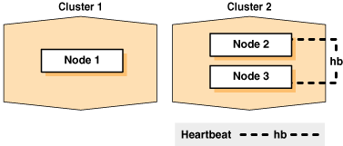
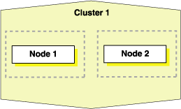

## 5 Cloning Oracle Clusterware

This chapter describes how to clone an Oracle Grid Infrastructure home and use the cloned home to create a cluster. You perform the cloning procedures in this chapter by running scripts in silent mode. The cloning procedures are applicable to Linux and UNIX systems. Although the examples in this chapter use Linux and UNIX commands, the cloning concepts and procedures apply generally to all platforms.

Note:

This chapter assumes that you are cloning an Oracle Clusterware 11g release 2 (11.2) installation configured as follows:
- No Grid Naming Service (GNS)
- No Intelligent Platform Management Interface specification (IPMI)
- Voting disk and Oracle Cluster Registry (OCR) are stored in Oracle Automatic Storage Management (ASM)
- Single Client Access Name (SCAN) resolves through DNS

This chapter contains the following topics:

## Introduction to Cloning Oracle Clusterware

Cloning is the process of copying an existing Oracle Clusterware installation to a different location and then updating the copied installation to work in the new environment. Changes made by one-off patches applied on the source Oracle Grid Infrastructure home are also present after cloning. During cloning, you run a script that replays the actions that installed the Oracle Grid Infrastructure home.

Cloning requires that you start with a successfully installed Oracle Grid Infrastructure home. You use this home as the basis for implementing a script that extends the Oracle Grid Infrastructure home to create a cluster based on the original Grid home.

Manually creating the cloning script can be error prone because you prepare the script without interactive checks to validate your input. Despite this, the initial effort is worthwhile for scenarios where you run a single script to configure tens or even hundreds of clusters. If you have only one cluster to install, then you should use the traditional, automated and interactive installation methods, such as Oracle Universal Installer (OUI) or the Provisioning Pack feature of Oracle Enterprise Manager.

Note:

Cloning is not a replacement for Oracle Enterprise Manager cloning that is a part of the Provisioning Pack. During Oracle Enterprise Manager cloning, the provisioning process simplifies cloning by interactively asking for details about the Oracle home. The interview questions cover such topics as the location to which you want to deploy the cloned environment, the name of the Oracle database home, a list of the nodes in the cluster, and so on.

The Provisioning Pack feature of Oracle Enterprise Manager Grid Control provides a framework that automates the provisioning of nodes and clusters. For data centers with many clusters, the investment in creating a cloning procedure to provision new clusters and new nodes to existing clusters is worth the effort.

The following list describes some situations in which cloning is useful:

- Cloning prepares an Oracle Grid Infrastructure home once and deploys it to many hosts simultaneously. You can complete the installation in silent mode, as a noninteractive process. You do not need to use a graphical user interface (GUI) console, and you can perform cloning from a Secure Shell (SSH) terminal session, if required.
- Cloning enables you to create an installation (copy of a production, test, or development installation) with all patches applied to it in a single step. Once you have performed the base installation and applied all patch sets and patches on the source system, cloning performs all of these individual steps as a single procedure. This is in contrast to going through the installation process to perform the separate steps to install, configure, and patch the installation on each node in the cluster.
- Installing Oracle Clusterware by cloning is a quick process. For example, cloning an Oracle Grid Infrastructure home to a cluster with more than two nodes requires a few minutes to install the Oracle software, plus a few minutes more for each node (approximately the amount of time it takes to run the `root.sh` script).
- Cloning provides a guaranteed method of accurately repeating the same Oracle Clusterware installation on multiple clusters.

A cloned installation acts the same as its source installation. For example, you can remove the cloned Oracle Grid Infrastructure home using OUI or patch it using OPatch. You can also use the cloned Oracle Grid Infrastructure home as the source for another cloning operation. You can create a cloned copy of a test, development, or production installation by using the command-line cloning scripts.

The default cloning procedure is adequate for most cases. However, you can also customize some aspects of cloning, for example, to specify custom port assignments or to preserve custom settings.

The cloning process works by copying all of the files from the source Oracle Grid Infrastructure home to the destination Oracle Grid Infrastructure home. You can clone either a local (non-shared) or shared Oracle Grid Infrastructure home. Thus, any files used by the source instance that are located outside the source Oracle Grid Infrastructure home's directory structure are not copied to the destination location.

The size of the binary files at the source and the destination may differ because these files are relinked as part of the cloning operation, and the operating system patch levels may also differ between these two locations. Additionally, the number of files in the cloned home would increase because several files copied from the source, specifically those being instantiated, are backed up as part of the clone operation.

## Preparing the Oracle Grid Infrastructure Home for Cloning

To prepare the source Oracle Grid Infrastructure home to be cloned, create a copy of an installed Oracle Grid Infrastructure home and then use it to perform the cloning procedure on other nodes. Use the following step-by-step procedure to prepare the copy of the Oracle Grid Infrastructure home:

- Step 1: Install Oracle Clusterware
- Step 2: Shut Down Running Software
- Step 3: Create a Copy of the Oracle Grid Infrastructure Home

### Step 1: Install Oracle Clusterware

Use the detailed instructions in the Oracle Grid Infrastructure Installation Guide to perform the following steps on the source node:

1. Install Oracle Clusterware 11g release 2 (11.2). This installation puts Oracle Cluster Registry (OCR) and the voting disk on Oracle Automatic Storage Management (Oracle ASM).
	Note:
	Either install and configure the Grid Infrastructure for a cluster or install just the Oracle Clusterware software, as described in your platform-specific [Oracle Grid Infrastructure Installation Guide](http://www.oracle.com/pls/topic/lookup?ctx=db112&id=GINST).
	If you installed and configured Grid Infrastructure for a cluster, then you must stop Oracle Clusterware before performing the cloning procedures. If you performed a software-only installation, then you do not have to stop Oracle Clusterware.
2. Install any patches that are required (for example, a Grid Infrastructure bundle patch), if necessary.
3. Apply one-off patches, if necessary.
	See Also:
	[Oracle Grid Infrastructure Installation Guide](http://www.oracle.com/pls/topic/lookup?ctx=db112&id=GINST) for Oracle Clusterware installation instructions

### Step 2: Shut Down Running Software

Before copying the source Oracle Grid Infrastructure home, shut down all of the services, databases, listeners, applications, Oracle Clusterware, and Oracle ASM instances that run on the node. Oracle recommends that you use the Server Control (SRVCTL) utility to first shut down the databases, and then the Oracle Clusterware Control (CRSCTL) utility to shut down the rest of the components.

See Also:

- [Appendix E, "CRSCTL Utility Reference"](crsref.md) for more information about CRSCTL
- [Oracle Real Application Clusters Administration and Deployment Guide](https://docs.oracle.com/cd/E11882_01/rac.112/e41960/srvctladmin.htm#RACAD005) for more information about SRVCTL

### Step 3: Create a Copy of the Oracle Grid Infrastructure Home

To keep the installed Oracle Grid Infrastructure home as a working home, make a full copy of the source Oracle Grid Infrastructure home for cloning.

Tip:

When creating the copy, a best practice is to include the release number in the name of the file.

Use one of the following methods to create a compressed copy of the Oracle Grid Infrastructure home.

Method 1: Create a copy of the Oracle Grid Infrastructure home and remove the unnecessary files from the copy:

1. On the source node, create a copy of the Oracle Grid Infrastructure home. To keep the installed Oracle Grid Infrastructure home as a working home, make a full copy of the source Oracle Grid Infrastructure home and remove the unnecessary files from the copy. For example, as `root` on Linux systems, run the `cp` command:
	```
	# cp -prf Grid_home copy_path
	```
	The preceding command copies the entire contents of `Grid_home` (for example, `/u01/app/grid/11.2.0`) to a new location (for example, `/home/grid/gridcopy`).
2. Delete unnecessary files from the copy.
	The Oracle Grid Infrastructure home contains files that are relevant only to the source node, so you can remove the unnecessary files from the copy of the Grid Infrastructure home in the `log`, `crs/init`, `crf`, and `cdata` directories. The following example for Linux and UNIX systems shows the commands to run to remove the unnecessary files from the copy of the Oracle Grid Infrastructure home:
	```
	[root@node1 root]# cd copy_path
	[root@node1 grid]# rm -rf crs/install/crsconfig_addparams
	[root@node1 grid]# rm -rf host_name
	[root@node1 grid]# rm -rf log/host_name
	[root@node1 grid]# rm -rf gpnp/host_name
	[root@node1 grid]# find gpnp -type f -exec rm -f {} \;
	[root@node1 grid]# find cfgtoollogs -type f -exec rm -f {} \;
	[root@node1 grid]# rm -rf crs/init/*
	[root@node1 grid]# rm -rf cdata/*
	[root@node1 grid]# rm -rf crf/*
	[root@node1 grid]# rm -rf network/admin/*.ora
	[root@node1 grid]# find . -name '*.ouibak' -exec rm {} \;
	[root@node1 grid]# find . -name '*.ouibak.1' -exec rm {} \;
	[root@node1 grid]# rm -rf root.sh*
	```
3. Create a compressed copy of the previously copied Oracle Grid Infrastructure home using tar or gzip on Linux and UNIX systems. Ensure that the tool you use preserves the permissions and file timestamps. For example:
	On Linux and UNIX systems:
	```
	[root@node1 root]# cd copy_path
	[root@node1 grid]# tar -zcvpf /copy_path/gridHome.tgz .
	```
	In the preceding example, the `cd` command changes the location to the copy of the Oracle Grid Infrastructure home with the unnecessary files removed that you created in the first two steps of this procedure, and the `tar` command creates a file named `gridHome.tgz`. In the `tar` command, `copy_path` represents the location of the copy of the Oracle Grid Infrastructure home.
	On AIX or HPUX systems:
	```
	tar cpf - . | compress -fv > temp_dir/gridHome.tar.Z
	```
	On Windows systems, use WinZip to create a zip file.

Method 2: Create a compressed copy of the Oracle Grid Infrastructure home using the -X option:

1. Create a file that lists the unnecessary files in the Oracle Grid Infrastructure home. For example, list the following file names, using the asterisk (\*) wildcard, in a file called `excludeFileList`:
	```
	Grid_home/host_name
	Grid_home/log/host_name
	Grid_home/gpnp/host_name
	Grid_home/crs/init/*
	Grid_home/cdata/*
	Grid_home/crf/*
	Grid_home/network/admin/*.ora
	Grid_home/root.sh*
	*.ouibak
	*.ouibak1
	```
2. Use the `tar` command or Winzip to create a compressed copy of the Oracle Grid Infrastructure home. For example, on Linux and UNIX systems, run the following command to archive and compress the source Oracle Grid Infrastructure home:
	```
	tar cpfX - excludeFileList Grid_home | compress -fv > temp_dir/gridHome.tar.Z
	```
	Note:
	Do not use the jar utility to copy and compress the Oracle Grid Infrastructure home.

## Creating a Cluster by Cloning Oracle Clusterware

This section explains how to create a cluster by cloning a successfully installed Oracle Clusterware environment and copying it to the nodes on the destination cluster. The procedures in this section describe how to use cloning for Linux, UNIX, and Windows systems. OCR and voting disks are not shared between the two clusters after you successfully create a cluster from a clone.

For example, you can use cloning to quickly duplicate a successfully installed Oracle Clusterware environment to create a cluster. Figure 5-1 shows the result of a cloning procedure in which the Oracle Grid Infrastructure home on Node 1 has been cloned to Node 2 and Node 3 on Cluster 2, making Cluster 2 a new two-node cluster.

Figure 5-1 Cloning to Create a Oracle Clusterware Environment



> This figure shows two clusters where Cluster 1 contains one node, Node 1. Cluster 2 contains two nodes cloned from Node 1 that are labelled Node 2 and Node 3. Node 2 and Node 3 exchange heartbeats with each other.
>
> End of figure description.
>
> [Copyright © 2007, 2015, Oracle and/or its affiliates. All rights reserved.](https://docs.oracle.com/cd/E11882_01/dcommon/html/cpyr.htm)
  

The steps to create a cluster through cloning are as follows:

- Step 1: Prepare the New Cluster Nodes
- Step 2: Deploy the Oracle Grid Infrastructure Home on the Destination Nodes
- Step 3: Run the clone.pl Script on Each Destination Node
- Step 4: Launch the Configuration Wizard

### Step 1: Prepare the New Cluster Nodes

On each destination node, perform the following preinstallation steps:

- Specify the kernel parameters
- Configure block devices for Oracle Clusterware devices
- Ensure that you have set the block device permissions correctly
- Use short, nondomain-qualified names for all of the names in the `/etc/hosts` file
- Test whether the interconnect interfaces are reachable using the `ping` command
- Verify that the VIP addresses are not active at the start of the cloning process by using the `ping` command (the `ping` command of the VIP address must fail)
- Copy the following Oracle Automatic Storage Management Cluster File System tunable files from the source node to each destination node:
	On Linux and UNIX: `/etc/sysconfig/advmtunables` and `/etc/sysconfig/acfstunables`
	On AIX: `/etc/advmtunables` and `/etc/acfstunables`
	On Solaris: `/etc/advmtunables` and `/etc/acfstunables`
	On Windows: `C:\windows\system32\drivers\advm\tunables` and `C:\windows\system32\drivers\acfs\tunables`
- On AIX systems, and on Solaris x86-64-bit systems running vendor clusterware, if you add a node to the cluster, then you must run the `rootpre.sh` script (located at the mount point it you install Oracle Clusterware from a DVD or in the directory where you unzip the tar file if you download the software) on the node before you add the node to the cluster
- Run CVU to verify your hardware and operating system environment

Refer to your platform-specific Oracle Clusterware installation guide for the complete preinstallation checklist.

Note:

Unlike traditional methods of installation, the cloning process does not validate your input during the preparation phase. (By comparison, during the traditional method of installation using OUI, various checks occur during the interview phase.) Thus, if you make errors during the hardware setup or in the preparation phase, then the cloned installation fails.

### Step 2: Deploy the Oracle Grid Infrastructure Home on the Destination Nodes

Before you begin the cloning procedure that is described in this section, ensure that you have completed the prerequisite tasks to create a copy of the Oracle Grid Infrastructure home, as described in the section titled "Preparing the Oracle Grid Infrastructure Home for Cloning".

1. On each destination node, deploy the copy of the Oracle Grid Infrastructure home that you created in "Step 3: Create a Copy of the Oracle Grid Infrastructure Home", as follows:
	If you do not have a shared Oracle Grid Infrastructure home, then restore the copy of the Oracle Grid Infrastructure home on each node in the destination cluster. Use the equivalent directory structure as the directory structure that was used in the Oracle Grid Infrastructure home on the source node. Skip this step if you have a shared Oracle Grid Infrastructure home.
	For example, on Linux or UNIX systems, run commands similar to the following:
	```
	[root@node1 root]# mkdir -p location_of_the_copy_of_the_Grid_home
	[root@node1 root]# cd location_of_the_copy_of_the_Grid_home
	[root@node1 crs]# tar -zxvf /path_name/gridHome.tgz
	```
	In this example, `path_name` represents the directory structure in which you want to install the Oracle Grid Infrastructure home. Note that you can change the Grid home location as part of the clone process.
	On Windows systems, unzip the Oracle Grid Infrastructure home on the destination node in the equivalent directory structure as the directory structure in which the Oracle Grid Infrastructure home resided on the source node.
2. If you have not already deleted unnecessary files from the Oracle Grid Infrastructure home, then repeat step 2 in "Method 1: Create a copy of the Oracle Grid Infrastructure home and remove the unnecessary files from the copy:".
3. Create a directory for the Oracle Inventory on the destination node and, if necessary, change the ownership of all of the files in the Oracle Grid Infrastructure home to be owned by the Oracle Grid Infrastructure installation owner and by the Oracle Inventory (`oinstall` privilege) group. If the Oracle Grid Infrastructure installation owner is `oracle`, and the Oracle Inventory group is `oinstall`, then the following example shows the commands to do this on a Linux system:
	```
	[root@node1 crs]# mkdir /u01
	[root@node1 crs]# chown oracle:oinstall /u01
	[root@node1 crs]# mkdir -p /u01/app/oraInventory
	[root@node1 crs]# mkdir -p /u01/app/11.2.0/grid
	```
	When you run the last of the preceding commands on the Grid home, it clears `setuid` and `setgid` information from the Oracle binary. It also clears `setuid` from the following binaries:
	```
	Grid_home/bin/extjob
	Grid_home/bin/jssu
	Grid_home/bin/oradism
	```
	Run the following commands to restore the cleared information:
	```
	chmod u+s Grid_home/bin/oracle
	chmod g+s Grid_home/bin/oracle
	chmod u+s Grid_home/bin/extjob
	chmod u+s Grid_home/bin/jssu
	chmod u+s Grid_home/bin/oradism
	```
4. It is important to remove any Oracle network files from the `Grid_home` directory on both the source and destination nodes before continuing. For example, remove any `tnsnames.ora`, `listener.ora`, or `sqlnet.ora` files.
	See Also:
	"Locating and Viewing Log Files Generated During Cloning"

### Step 3: Run the clone.pl Script on Each Destination Node

To set up the new Oracle Clusterware environment, the `clone.pl` script requires you to provide several setup values for the script. You can provide the variable values by either supplying input on the command line when you run the `clone.pl` script, or by creating a file in which you can assign values to the cloning variables. The following discussions describe these options.

Note:

After you run `clone.pl`, the script prompts you to run `orainstRoot.sh` and `root.sh`. Run only `orainstRoot.sh` and then proceed to "Step 4: Launch the Configuration Wizard". The configuration wizard will prompt you to run `root.sh`.

#### Supplying input to the clone.pl script on the command line

If you do not have a shared Oracle Grid Infrastructure home, navigate to the `Grid_home` `/clone/bin` directory on each destination node and run the `clone.pl` script, which performs the main Oracle Clusterware cloning tasks. To run the script, you must supply input to several parameters. Table 5-1 describes the `clone.pl` script parameters.

Table 5-1 Parameters for the clone.pl Script

| Parameters | Description |
| --- | --- |
| `ORACLE_BASE=` `ORACLE_BASE` | The complete path to the Oracle base to be cloned. If you specify an invalid path, then the script exits. This parameter is required. |
| `ORACLE_HOME=` `GRID_HOME` | The complete path to the Grid Infrastructure home for cloning. If you specify an invalid path, then the script exits. This parameter is required. |
| `ORACLE_HOME_NAME=` `Oracle_home_name` (or) `-defaultHomeName` | The Oracle home name of the home to be cloned. Optionally, you can specify the `-defaultHomeName` flag. This parameter is not required. |
| `INVENTORY_LOCATION=` `location_of_inventory` | The location for the Oracle Inventory. |
| ``` -O'"CLUSTER_ NODES={node_ name,node_ name,...}"' ``` | A comma-delimited list of short node names for the nodes that are included in this new cluster. |
| ``` -O'"LOCAL_NODE=node_name"' ``` | The short node name for the node on which `clone.pl` is running. |
| ``` CRS=TRUE ``` | This parameter is necessary to set this property on the Oracle Universal Installer inventory. |
| `OSDBA_GROUP=` `OSDBA_privileged_group` | Specify the operating system group you want to use as the OSDBA privileged group. This parameter is optional if you do not want the default value. |
| `OSASM_GROUP=` `OSASM_privileged_group` | Specify the operating system group you want to use as the OSASM privileged group. This parameter is optional if you do not want the default value. |
| `OSOPER_GROUP=` `OSOPER_privileged_group` | Specify the operating system group you want to use as the OSOPER privileged group. This parameter is optional if you do not want the default value. |
| `-debug` | Specify this option to run the `clone.pl` script in debug mode. |
| `-help` | Specify this option to obtain help for the `clone.pl` script. |

For example, on Linux and UNIX systems:

```
$ perl clone.pl -silent ORACLE_BASE=/u01/app/oracle ORACLE_HOME=
/u01/app/11.2.0/grid ORACLE_HOME_NAME=OraHome1Grid
INVENTORY_LOCATION=/u01/app/oraInventory -O'"CLUSTER_NODES={node1, node2}"'
-O'"LOCAL_NODE=node1"' CRS=TRUE
```

On Windows systems:

Note:

Do not use the `-O` option when you run this command on Windows.

```
C:\>perl clone.pl ORACLE_BASE=D:\u01\app\grid ORACLE_HOME=D:\u01\app\grid\11.2.0
ORACLE_HOME_NAME=OraHome1Grid "CLUSTER_NODES={node1, node2}"
"LOCAL_NODE=node1" CRS=TRUE
```

Refer to Table 5-1 for descriptions of the various parameters in the preceding example.

If you have a shared Oracle Grid Infrastructure home, then append the `-cfs` option to the command example in this step and provide a complete path location for the cluster file system.

#### Supplying Input to the clone.pl Script in a File

Because the `clone.pl` script is sensitive to the parameter values that it receives, you must be accurate in your use of brackets, single quotation marks, and double quotation marks. To avoid errors, create a file that is similar to the `start.sh` script shown in Example 5-1 in which you can specify environment variables and cloning parameters for the `clone.pl` script.

Example 5-1 shows an excerpt from an example script called `start.sh` that calls the `clone.pl` script; the example is configured for a cluster named `crscluster`. Run the script as the operating system user that installed Oracle Clusterware.

Example 5-1 Excerpt From the start.sh Script to Clone Oracle Clusterware

```
#!/bin/sh
ORACLE_BASE=/u01/app/oracle
GRID_HOME=/u01/app/11.2.0/grid
THIS_NODE=&rsquor;hostname -s&rsquor;

E01=ORACLE_BASE=${ORACLE_BASE}
E02=ORACLE_HOME=${GRID_HOME}
E03=ORACLE_HOME_NAME=OraGridHome1
E04=INVENTORY_LOCATION=${ORACLE_BASE}/oraInventory

#C00="-O'-debug'"
C01="-O'\"CLUSTER_NODES={node1,node2}\"'"
C02="-O'\"LOCAL_NODE=${THIS_NODE}\"'"

perl ${GRID_HOME}/clone/bin/clone.pl -silent $E01 $E02 $E03 $E04 $C01 $C02
```

The `start.sh` script sets several environment variables and cloning parameters, as described in Table 5-2. Table 5-2 describes the environment variables `E01`, `E02`, `E03`, and `E04` that are shown in bold typeface in Example 5-1, and `C01` and `C02`.

Table 5-2 Environment Variables Passed to the clone.pl Script

| Symbol | Variable | Description |
| --- | --- | --- |
| `E01` | `ORACLE_BASE` | The location of the Oracle base directory. |
| `E02` | `ORACLE_HOME` | The location of the Oracle Grid Infrastructure home. This directory location must exist and must be owned by the Oracle operating system group: oinstall. |
| `E03` | `ORACLE_HOME_NAME` | The name of the Oracle Grid Infrastructure home. This is stored in the Oracle Inventory. |
| `E04` | `INVENTORY_LOCATION` | The location of the Oracle Inventory. This directory location must exist and must initially be owned by the Oracle operating system group: oinstall. |
| `C01` | `CLUSTER_NODES` | This list of short node names for the nodes in the cluster. |
| `C02` | `LOCAL_NODE` | The short name of the local node. |

### Step 4: Launch the Configuration Wizard

The Configuration Wizard helps you to prepare the `crsconfig_params` file, prompts you to run the `root.sh` script (which calls the `rootcrs.pl` script), relinks Oracle binaries, and runs cluster verifications.

Start the Configuration Wizard, as follows:

```
$ Oracle_home/crs/config/config.sh
```

Optionally, you can run the Configuration Wizard silently, as follows, providing a response file:

```
$ Oracle_home/crs/config/config.sh -silent -responseFile file_name
```

See Also:

[Oracle Grid Infrastructure Installation Guide for Linux](https://docs.oracle.com/cd/E11882_01/install.112/e41961/app_nonint.htm#CWLIN362) for information about preparing response files

To use GNS, Oracle recommends that you add GNS to the cluster after your cloned cluster is running. Add GNS using the `srvctl add gns` command.

See Also:

[Oracle Real Application Clusters Administration and Deployment Guide](https://docs.oracle.com/cd/E11882_01/rac.112/e41960/srvctladmin.htm#RACAD7924) for more information about the `srvctl add gns` command

## Using Cloning to Add Nodes to a Cluster

You can also use cloning to add nodes to a cluster. Figure 5-2 shows the result of a cloning procedure in which the Oracle Grid Infrastructure home on Node 1 has been cloned to Node 2 in the same cluster, making it a two-node cluster. Newly added nodes to the cluster share the same OCR and voting disks.

Figure 5-2 Cloning to Add Nodes to a Cluster



> This figure shows one cluster, labelled Cluster 1, that contains two nodes: Node 1 and Node 2. Node 2 is a clone of Node 1.
>
> [Copyright © 2007, 2015, Oracle and/or its affiliates. All rights reserved.](https://docs.oracle.com/cd/E11882_01/dcommon/html/cpyr.htm)
  

Using Figure 5-2 as an example, the following procedure explains how to add nodes to a cluster using cloning. In this procedure, Node 1 is the source node from which you obtain the cloned copy, and Node 2 is the destination node, to which you copy the clone of Node 1:

1. Prepare Node 2 as described in "Step 1: Prepare the New Cluster Nodes".
2. Deploy the Oracle Grid Infrastructure home on Node 2, as described in "Step 2: Deploy the Oracle Grid Infrastructure Home on the Destination Nodes".
3. Run the `clone.pl` script located in the `Grid_home` `/clone/bin` directory on Node 2.
	See Also:
	Table 5-1 for more information about the parameters used in the `clone.pl` script
	The following example is for Linux or UNIX systems:
	```
	$ perl clone.pl ORACLE_HOME=/u01/app/11.2.0/grid ORACLE_HOME_NAME=OraHome1Grid
	ORACLE_BASE=/u01/app/oracle -O'"CLUSTER_NODES={node1, node2}"'
	-O'"LOCAL_NODE=node2"' CRS=TRUE
	SHOW_ROOTSH_CONFIRMATION=false INVENTORY_LOCATION=/u01/app/oraInventory
	```
	In the preceding command, `node_list` is a comma-delimited list of all nodes in the cluster.
	The following example is for Windows systems:
	Note:
	Do not use the `-O` option when you run this command on Windows.
	```
	C:\>perl clone.pl ORACLE_BASE=D:\u01\app\grid ORACLE_HOME=D:\u01\app\grid\11.2.0
	ORACLE_HOME_NAME=OraHome1Grid '"CLUSTER_NODES={node1, node2}"'
	'"LOCAL_NODE=node1"' CRS=TRUE
	```
	If you are prompted to run `root.sh`, then ignore the prompt and proceed to the next step.
4. This step does not apply to Windows.
	In the Central Inventory directory on Node 2, run the `orainstRoot.sh` script as `root`. This script populates the `/etc/oraInst.loc` directory with the location of the central inventory. For example:
	```
	[root@node2 root]# /opt/oracle/oraInventory/orainstRoot.sh
	```
	You can run the script on more than one destination node simultaneously.
5. Run the `addNode.sh` (`addNode.bat` on Windows) script, located in the `Grid_home` `/oui/bin` directory, on Node 1, as follows:
	```
	$ addNode.sh -silent -noCopy ORACLE_HOME=Grid_home "CLUSTER_NEW_NODES={node2}"
	"CLUSTER_NEW_VIRTUAL_HOSTNAMES={node2-vip}" "CLUSTER_NEW_VIPS={node2-vip}"
	CRS_ADDNODE=true CRS_DHCP_ENABLED=false
	```
	Notes:
	- Because you already ran the `clone.pl` script on Node 2, this step only updates the inventories on the node and instantiates scripts on the local node.
	- If you use the `-noCopy` option with the `addNode.sh` script, then a copy of the password file may not exist on Node 2, in which case you must copy a correct password file to Node 2.
	- The `addNode.sh` script runs the `cluvfy stage -pre nodeadd` verification.
6. Copy the following two files and the `gpnp` directory from Node 1, on which you ran `addnode.sh`, to Node 2:
	```
	Grid_home/crs/install/crsconfig_addparams
	Grid_home/crs/install/crsconfig_params
	Grid_home/gpnp
	```
7. On Node 2, run the `Grid_home` `/root.sh` script.
	Note:
	The cluster in this example has only two nodes. When you add multiple nodes to a cluster, you can run `root.sh` concurrently on all of the nodes.
	The following example is for a Linux or UNIX system. On Node 2, run the following command:
	```
	[root@node2 root]# Grid_home/root.sh
	```
	The `root.sh` script automatically configures the following node applications:
	- Global Services Daemon (GSD)
		- Oracle Notification Service (ONS)
		- Virtual IP (VIP) resources in the Oracle Cluster Registry (OCR)
		- Single Client Access Name (SCAN) VIPs and SCAN listeners
		- Oracle ASM
	On Windows, run the following command on Node 2:
	```
	C:\>Grid_home\crs\config\gridconfig.bat
	```
8. Navigate to the `Oracle_home` `/oui/bin` directory on the Node 1 and run the `addNode.sh` script using the following syntax:
	```
	$ ./addNode.sh -silent -noCopy "CLUSTER_NEW_NODES={node2}"
	```
	Note:
	Use the `-noCopy` option only if the Oracle home on the destination node is fully populated with software. Otherwise, omit the `-noCopy` option to copy the software to the destination node when you run the `addnode.sh` script.
9. Run the `Oracle_home` `/root.sh` script on Node 2 as `root`, where `Oracle_home` is the Oracle RAC home.
10. Run the `Grid_home` `/crs/install/rootcrs.pl` script on Node 2 as `root`, following the instructions generated when you ran `root.sh` in the previous step.
11. Run the following cluster verification utility (CVU) command on Node 1:
	```
	$ cluvfy stage -post nodeadd -n destination_node_name [-verbose]
	```
	See Also:
	`"cluvfy stage [-pre | -post] nodeadd"` for more information about this CVU command

## Locating and Viewing Log Files Generated During Cloning

The cloning script runs multiple tools, each of which can generate log files. After the `clone.pl` script finishes running, you can view log files to obtain more information about the status of your cloning procedures. Table 5-3 lists the log files that are generated during cloning that are the key log files for diagnostic purposes.

Note:

`Central_inventory` in Table 5-3 refers to the Oracle Inventory directory.

Table 5-3 Cloning Log Files and their Descriptions

| Log File Name and Location | Description |
| --- | --- |
| ``` Central_inventory/logs/cloneActions/timestamp.log ``` | Contains a detailed log of the actions that occur during the OUI part of the cloning. |
| ``` Central_inventory/logs/oraInstall/timestamp.err ``` | Contains information about errors that occur when OUI is running. |
| ``` Central_inventory/logs/oraInstall/timestamp.out ``` | Contains other miscellaneous information. |

Table 5-4 lists the location of the Oracle Inventory directory for various platforms.

Table 5-4 Finding the Location of the Oracle Inventory Directory

| Type of System | Location of the Oracle Inventory Directory |
| --- | --- |
| All UNIX computers except Linux and IBM AIX | `/var/opt/oracle/oraInst.loc` |
| IBM AIX and Linux | `/etc/oraInst.loc` |
| Windows | `C:\Program Files\Oracle\Inventory` |