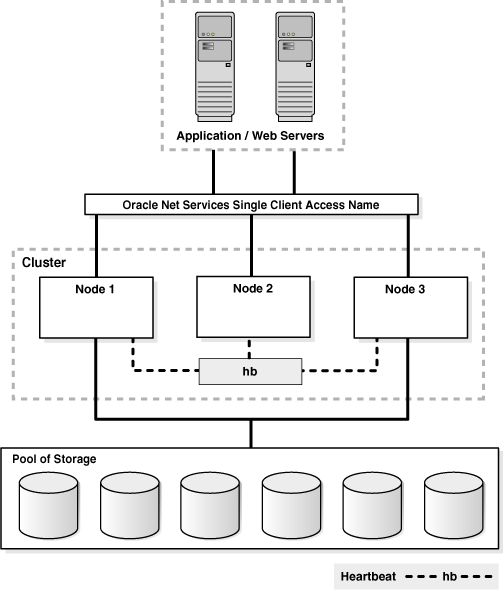
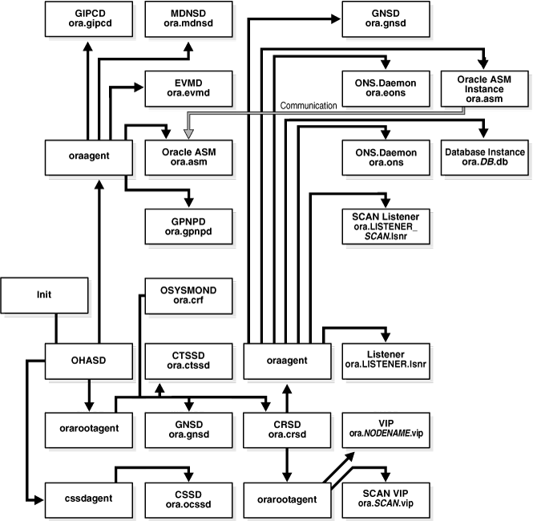

## 1 Introduction to Oracle Clusterware

This chapter includes the following topics:

## What is Oracle Clusterware?

Oracle Clusterware enables servers to communicate with each other, so that they appear to function as a collective unit. This combination of servers is commonly known as a cluster. Although the servers are standalone servers, each server has additional processes that communicate with other servers. In this way the separate servers appear as if they are one system to applications and end users.

Oracle Clusterware provides the infrastructure necessary to run Oracle Real Application Clusters (Oracle RAC). Oracle Clusterware also manages [resource](glossary.md) s, such as virtual IP (VIP) addresses, databases, listeners, services, and so on. These resources are generally named `ora.``host_name.resource_name`. Oracle does not support editing these resources except under the explicit direction of My Oracle Support.

See Also:

[Chapter 2, "Administering Oracle Clusterware"](admin.md) and [Chapter 6, "Making Applications Highly Available Using Oracle Clusterware"](crschp.md) for more information

Figure 1-1 shows a configuration that uses Oracle Clusterware to extend the basic single-instance Oracle Database architecture. In Figure 1-1, the cluster is running Oracle Database and is actively servicing applications and users. Using Oracle Clusterware, you can use the same high availability mechanisms to make your Oracle database and your custom applications highly available.

Figure 1-1 Oracle Clusterware Configuration



> This figure illustrates a multinode, clustered architecture in which both the applications and the Oracle Database are managed using Oracle Clusterware for high availability. Two servers are labeled "Application/Web Servers." Both servers connect to "Oracle Net Services Single Client Access Name" which, in turn, connects to three nodes within the cluster. Each of the three nodes exchanges heartbeats with the other two.
>
> The cluster connects to six disks that constitute the storage pool.
>
> End of the description.
  

The benefits of using a cluster include:

- Scalability of applications
- Reduce total cost of ownership for the infrastructure by providing a scalable system with low-cost commodity hardware
- Ability to fail over
- Increase throughput on demand for cluster-aware applications, by adding servers to a cluster to increase cluster resources
- Increase throughput for cluster-aware applications by enabling the applications to run on all of the nodes in a cluster
- Ability to program the startup of applications in a planned order that ensures dependent processes are started
- Ability to monitor processes and restart them if they stop
- Eliminate unplanned downtime due to hardware or software malfunctions
- Reduce or eliminate planned downtime for software maintenance

You can program Oracle Clusterware to manage the availability of user applications and Oracle databases. In an Oracle RAC environment, Oracle Clusterware manages all of the resources automatically. All of the applications and processes that Oracle Clusterware manages are either [cluster resource](glossary.md) s or [local resource](glossary.md) s.

Oracle Clusterware is required for using Oracle RAC; it is the only clusterware that you need for platforms on which Oracle RAC operates. Although Oracle RAC continues to support many third-party clusterware products on specific platforms, you must also install and use Oracle Clusterware. Note that the servers on which you want to install and run Oracle Clusterware must use the same operating system.

Using Oracle Clusterware eliminates the need for proprietary vendor clusterware and provides the benefit of using only Oracle software. Oracle provides an entire software solution, including everything from disk management with Oracle Automatic Storage Management (Oracle ASM) to data management with Oracle Database and Oracle RAC. In addition, Oracle Database features, such as Oracle Services, provide advanced functionality when used with the underlying Oracle Clusterware high availability framework.

Oracle Clusterware has two stored components, besides the binaries: The voting disk files, which record node membership information, and the Oracle Cluster Registry (OCR), which records cluster configuration information. Voting disks and OCRs must reside on shared storage available to all cluster member nodes.

## Understanding System Requirements for Oracle Clusterware

To use Oracle Clusterware, you must understand the hardware and software concepts and requirements as described in the following sections:

- Oracle Clusterware Hardware Concepts and Requirements
- Oracle Clusterware Operating System Concepts and Requirements
- Oracle Clusterware Software Concepts and Requirements
- Oracle Clusterware Network Configuration Concepts
- Overview of Upgrading Oracle Clusterware

### Oracle Clusterware Hardware Concepts and Requirements

Note:

Many hardware providers have validated cluster configurations that provide a single part number for a cluster. If you are new to clustering, then use the information in this section to simplify your hardware procurement efforts when you purchase hardware to create a cluster.

A cluster consists of one or more servers. The hardware in a server in a cluster (or cluster member or node) is similar to a standalone server. However, a server that is part of a cluster, otherwise known as a node or a cluster member, requires a second network. This second network is referred to as the interconnect. For this reason, cluster member nodes require at least two network interface cards: one for a public network and one for a private network. The interconnect network is a private network using a switch (or multiple switches) that only the nodes in the cluster can access.<sup>Foot 1</sup>

Note:

Oracle does not support using crossover cables as Oracle Clusterware interconnects.

Cluster size is determined by the requirements of the workload running on the cluster and the number of nodes that you have configured in the cluster. If you are implementing a cluster for high availability, then configure redundancy for all of the components of the infrastructure as follows:

- At least two network interfaces for the public network, bonded to provide one address
- At least two network interfaces for the private interconnect network

The cluster requires cluster-aware storage <sup>Foot 2</sup> that is connected to each server in the cluster. This may also be referred to as a multihost device. Oracle Clusterware supports NFS, iSCSI, Direct Attached Storage (DAS), Storage Area Network (SAN) storage, and Network Attached Storage (NAS).

To provide redundancy for storage, generally provide at least two connections from each server to the cluster-aware storage. There may be more connections depending on your I/O requirements. It is important to consider the I/O requirements of the entire cluster when choosing your storage subsystem.

Most servers have at least one local disk that is internal to the server. Often, this disk is used for the operating system binaries; you can also use this disk for the Oracle software binaries. The benefit of each server having its own copy of the Oracle binaries is that it increases high availability, so that corruption to a one binary does not affect all of the nodes in the cluster simultaneously. It also allows rolling upgrades, which reduce downtime.

### Oracle Clusterware Operating System Concepts and Requirements

Each server must have an operating system that is certified with the Oracle Clusterware version you are installing. Refer to the certification matrices available in the [Oracle Grid Infrastructure Installation Guide](http://www.oracle.com/pls/topic/lookup?ctx=db112&id=CWGEN) for your platform or on My Oracle Support (formerly OracleMetaLink) for details, which are available from the following URL:

```
http://www.oracle.com/technetwork/database/clustering/tech-generic-unix-new-166583.html
```

When the operating system is installed and working, you can then install Oracle Clusterware to create the cluster. Oracle Clusterware is installed independently of Oracle Database. Once Oracle Clusterware is installed, you can then install Oracle Database or Oracle RAC on any of the nodes in the cluster.

See Also:

Your platform-specific Oracle database installation documentation

### Oracle Clusterware Software Concepts and Requirements

Oracle Clusterware uses voting disk files to provide fencing and cluster node membership determination. OCR provides cluster configuration information. You can place the Oracle Clusterware files on either Oracle ASM or on shared common disk storage. If you configure Oracle Clusterware on storage that does not provide file redundancy, then Oracle recommends that you configure multiple locations for OCR and voting disks. The voting disks and OCR are described as follows:

- Voting Disks
	Oracle Clusterware uses voting disk files to determine which nodes are members of a cluster. You can configure voting disks on Oracle ASM, or you can configure voting disks on shared storage.
	If you configure voting disks on Oracle ASM, then you do not need to manually configure the voting disks. Depending on the redundancy of your disk group, an appropriate number of voting disks are created.
	If you do not configure voting disks on Oracle ASM, then for high availability, Oracle recommends that you have a minimum of three voting disks on physically separate storage. This avoids having a single point of failure. If you configure a single voting disk, then you must use external mirroring to provide redundancy.
	You should have at least three voting disks, unless you have a storage device, such as a disk array that provides external redundancy. Oracle recommends that you do not use more than five voting disks. The maximum number of voting disks that is supported is 15.
- Oracle Cluster Registry
	Oracle Clusterware uses the Oracle Cluster Registry (OCR) to store and manage information about the components that Oracle Clusterware controls, such as Oracle RAC databases, listeners, virtual IP addresses (VIPs), and services and any applications. OCR stores configuration information in a series of key-value pairs in a tree structure. To ensure cluster high availability, Oracle recommends that you define multiple OCR locations. In addition:
	- You can have up to five OCR locations
		- Each OCR location must reside on shared storage that is accessible by all of the nodes in the cluster
		- You can replace a failed OCR location online if it is not the only OCR location
		- You must update OCR through supported utilities such as Oracle Enterprise Manager, the Oracle Clusterware Control Utility (CRSCTL), the Server Control Utility (SRVCTL), the OCR configuration utility (OCRCONFIG), or the Database Configuration Assistant (DBCA)
	See Also:
	[Chapter 2, "Administering Oracle Clusterware"](admin.md) for more information about voting disks and OCR

### Oracle Clusterware Network Configuration Concepts

Oracle Clusterware enables a dynamic Grid Infrastructure through the self-management of the network requirements for the cluster. Oracle Clusterware 11g release 2 (11.2) supports the use of dynamic host configuration protocol (DHCP) for the VIP addresses and the SCAN address, but not the public address. DHCP provides dynamic configuration of the host's IP address, but it does not provide an optimal method of producing names that are useful to external clients.

When you are using Oracle RAC, all of the clients must be able to reach the database. This means that all the cluster's public addresses, the VIP and SCAN addresses, must be resolved by the clients. This problem is solved by the addition of the Oracle Grid Naming Service (GNS) to the cluster. GNS is linked to the corporate domain name service (DNS), so that clients can resolve these dynamic addresses and transparently connect to the cluster and the databases. Activating GNS in a cluster requires a DHCP service on the public network.

#### Implementing GNS

To implement GNS, you must collaborate with your network administrator to obtain an IP address on the public network for the GNS VIP. DNS uses the GNS VIP to forward requests for access to the cluster to GNS. You must also collaborate with your DNS administrator to delegate a domain to the cluster. This can be a separate domain or a subdomain of an existing domain. The DNS server must be configured to forward all requests for this new domain to the GNS VIP. Since each cluster has its own GNS, it must be allocated a unique domain of which to be in control.

GNS and the GNS VIP run on one node in the cluster. The GNS daemon listens on the GNS VIP using port 53 for DNS requests. Oracle Clusterware manages the GNS and the GNS VIP to ensure that they are always available. If the server on which GNS is running fails, then Oracle Clusterware fails GNS over, along with the GNS VIP, to another node in the cluster.

With DHCP on the network, Oracle Clusterware obtains an IP address from the DHCP server along with other network information, such as what gateway to use, what DNS servers to use, what domain to use, and what NTP server to use. Oracle Clusterware initially obtains the necessary IP addresses during cluster configuration and it updates the Oracle Clusterware resources with the correct information obtained from the DHCP server, including the GNS.

#### Single Client Access Name (SCAN)

Oracle RAC 11g release 2 (11.2) introduces the [Single Client Access Name (SCAN)](glossary.md). SCAN is a domain name registered to at least one and up to three IP addresses, either in DNS or GNS. When using GNS and DHCP, Oracle Clusterware configures the VIP addresses for the SCAN name that is provided during cluster configuration.

The node VIP and the three SCAN VIPs are obtained from the DHCP server when using GNS. If a new server joins the cluster, then Oracle Clusterware dynamically obtains the required VIP address from the DHCP server, updates the cluster resource, and makes the server accessible through GNS.

Example 1-1 shows the DNS entries that delegate a domain to the cluster.

Example 1-1 DNS Entries

```
# Delegate to gns on mycluster
mycluster.example.com NS myclustergns.example.com
#Let the world know to go to the GNS vip
myclustergns.example.com. 10.9.8.7
```

See Also:

[Oracle Grid Infrastructure Installation Guide](http://www.oracle.com/pls/topic/lookup?ctx=db112&id=GINST) for details about establishing resolution through DNS

#### Configuring Addresses Manually

Alternatively, you can choose manual address configuration, in which you configure the following:

- One public host name for each node.
- One VIP address for each node.
	You must assign a VIP address to each node in the cluster. Each VIP address must be on the same subnet as the public IP address for the node and should be an address that is assigned a name in the DNS. Each VIP address must also be unused and unpingable from within the network before you install Oracle Clusterware.
- Up to three SCAN addresses for the entire cluster.
	Note:
	The SCAN must resolve to at least one address on the public network. For high availability and scalability, Oracle recommends that you configure the SCAN to resolve to three addresses.

See Also:

Your platform-specific [Oracle Grid Infrastructure Installation Guide](http://www.oracle.com/pls/topic/lookup?ctx=db112&id=GINST) installation documentation for information about system requirements and configuring network addresses

## Overview of Oracle Clusterware Platform-Specific Software Components

When Oracle Clusterware is operational, several platform-specific processes or services run on each node in the cluster. This section describes these various processes and services.

### The Oracle Clusterware Stack

Oracle Clusterware consists of two separate stacks: an upper stack anchored by the Cluster Ready Services (CRS) daemon (`crsd`) and a lower stack anchored by the Oracle High Availability Services daemon (`ohasd`). These two stacks have several processes that facilitate cluster operations. The following sections describe these stacks in more detail:

- The Cluster Ready Services Stack
- The Oracle High Availability Services Stack

#### The Cluster Ready Services Stack

The list in this section describes the processes that comprise CRS. The list includes components that are processes on Linux and UNIX operating systems, or services on Windows.

- Cluster Ready Services (CRS): The primary program for managing high availability operations in a cluster.
	The CRS daemon `(crsd`) manages cluster resources based on the configuration information that is stored in OCR for each resource. This includes start, stop, monitor, and failover operations. The `crsd` process generates events when the status of a resource changes. When you have Oracle RAC installed, the `crsd` process monitors the Oracle database instance, listener, and so on, and automatically restarts these components when a failure occurs.
- Cluster Synchronization Services (CSS): Manages the cluster configuration by controlling which nodes are members of the cluster and by notifying members when a node joins or leaves the cluster. If you are using certified third-party clusterware, then CSS processes interface with your clusterware to manage node membership information.
	The `cssdagent` process monitors the cluster and provides I/O fencing. This service formerly was provided by Oracle Process Monitor Daemon (`oprocd`), also known as `OraFenceService` on Windows. A `cssdagent` failure may result in Oracle Clusterware restarting the node.
- Oracle ASM: Provides disk management for Oracle Clusterware and Oracle Database.
- Cluster Time Synchronization Service (CTSS): Provides time management in a cluster for Oracle Clusterware.
- Event Management (EVM): A background process that publishes events that Oracle Clusterware creates.
- Oracle Notification Service (ONS): A publish and subscribe service for communicating Fast Application Notification (FAN) events.
- Oracle Agent (oraagent): Extends clusterware to support Oracle-specific requirements and complex resources. This process runs server callout scripts when FAN events occur. This process was known as RACG in Oracle Clusterware 11g release 1 (11.1).
- Oracle Root Agent (orarootagent): A specialized `oraagent` process that helps `crsd` manage resources owned by `root`, such as the network, and the Grid virtual IP address.

The Cluster Synchronization Service (CSS), Event Management (EVM), and Oracle Notification Services (ONS) components communicate with other cluster component layers on other nodes in the same cluster database environment. These components are also the main communication links between Oracle Database, applications, and the Oracle Clusterware high availability components. In addition, these background processes monitor and manage database operations.

#### The Oracle High Availability Services Stack

This section describes the processes that comprise the Oracle High Availability Services stack. The list includes components that are processes on Linux and UNIX operating systems, or services on Windows.

- Cluster Logger Service (`ologgerd`): Receives information from all the nodes in the cluster and persists in a CHM repository-based database. This service runs on only two nodes in a cluster.
- System Monitor Service (`osysmond`): The monitoring and operating system metric collection service that sends the data to the cluster logger service. This service runs on every node in a cluster.
- Grid Plug and Play (GPNPD): Provides access to the Grid Plug and Play profile, and coordinates updates to the profile among the nodes of the cluster to ensure that all of the nodes have the most recent profile.
- Grid Interprocess Communication (GIPC): A support daemon that enables Redundant Interconnect Usage.
- Multicast Domain Name Service (mDNS): Used by Grid Plug and Play to locate profiles in the cluster, as well as by GNS to perform name resolution. The mDNS process is a background process on Linux and UNIX and on Windows.
- Oracle Grid Naming Service (GNS): Handles requests sent by external DNS servers, performing name resolution for names defined by the cluster.

Table 1-1 lists the processes and services associated with Oracle Clusterware components. In Table 1-1, if a UNIX or a Linux system process has an (r) beside it, then the process runs as the `root` user.

Table 1-1 List of Processes and Services Associated with Oracle Clusterware Components

| Oracle Clusterware Component | Linux/UNIX Process | Windows Services | Windows Processes |
| --- | --- | --- | --- |
| CRS | `crsd.bin` (r) | `OracleOHService` | `crsd.exe` |
| CSS | `ocssd.bin`, `cssdmonitor`, `cssdagent` | `OracleOHService` | `cssdagent.exe`, `cssdmonitor.exe` `ocssd.exe` |
| CTSS | `octssd.bin` (r) |  | `octssd.exe` |
| EVM | `evmd.bin`, `evmlogger.bin` | `OracleOHService` | `evmd.exe` |
| GIPC | `gipcd.bin` |  |  |
| GNS | `gnsd` (r) |  | `gnsd.exe` |
| Grid Plug and Play | `gpnpd.bin` | `OracleOHService` | `gpnpd.exe` |
| LOGGER | `ologgerd.bin` (r) |  | `ologgerd.exe` |
| Master Diskmon | `diskmon.bin` |  |  |
| mDNS | `mdnsd.bin` |  | `mDNSResponder.exe` |
| Oracle agent | `oraagent.bin` (11.2), or `racgmain` and `racgimon` (11.1) |  | `oraagent.exe` |
| Oracle High Availability Services | `ohasd.bin` (r) | `OracleOHService` | `ohasd.exe` |
| ONS | `ons` |  | `ons.exe` |
| Oracle root agent | `orarootagent` (r) |  | `orarootagent.exe` |
| SYSMON | `osysmond.bin` (r) |  | `osysmond.exe` |

See Also:

["Clusterware Log Files and the Unified Log Directory Structure"](troubleshoot.md) for information about the location of log files created for processes

Note:

Oracle Clusterware on Linux platforms can have multiple threads that appear as separate processes with unique process identifiers.

Figure 1-2 illustrates cluster startup.

Figure 1-2 Cluster Startup



> This figure depicts the startup process for Oracle Clusterware. The INIT process starts `ohasd`, which, in turn, starts the `oraagent`, `orarootagent`, and `cssdagent`. These processes then carry out the following steps:
>
> - The `oraagent` starts `mdnsd`, `evmd`, Oracle ASM, `gpnpd`, and `gipcd` (Grid IPC daemon).
> - The `orarootagent` starts `OSYSMOND` (which, on some nodes, starts `OLOGGERD`, not shown in the graphic), `ctssd`, the CSSD Monitor, `diskmon` (Disk Monitor daemon), and `crsd`. The `crsd`, in turn, starts another `oraagent` and another `orarootagent`.
> 	The `oraagent` starts Oracle Notification Service (ONS and eONS), an Oracle ASM instance (which communicates with Oracle ASM started by the `oraagent` that `ohasd` started), the database instance, the listeners, and the SCAN listeners
> 	The `orarootagent` starts `gnsd`, the VIPs, the SCAN VIP, and the network resources.
> - The `cssdagent` starts Cluster Synchronization Service (`ocssd`).
  

### Oracle Clusterware Processes on Windows Systems

Oracle Clusterware processes on Microsoft Windows systems include the following:

- `mDNSResponder.exe`: Manages name resolution and service discovery within attached subnets
- `OracleOHService`: Starts all of the Oracle Clusterware daemons

## Overview of Installing Oracle Clusterware

The following section introduces the installation processes for Oracle Clusterware.

Note:

Install Oracle Clusterware with the Oracle Universal Installer.

### Oracle Clusterware Version Compatibility

You can install different releases of Oracle Clusterware, Oracle ASM, and Oracle Database on your cluster. Follow these guidelines when installing different releases of software on your cluster:

- You can only have one installation of Oracle Clusterware running in a cluster, and it must be installed into its own home (`Grid_home`). The release of Oracle Clusterware that you use must be equal to or higher than the Oracle ASM and Oracle RAC versions that are running in the cluster. You cannot install a version of Oracle RAC that was released after the version of Oracle Clusterware that you run on the cluster. In other words:
	- Oracle Clusterware 11g release 2 (11.2) supports Oracle ASM release 11.2 only, because Oracle ASM is in the Grid Infrastructure home, which also includes Oracle Clusterware
		- Oracle Clusterware release 11.2 supports Oracle Database 11g release 2 (11.2), release 1 (11.1), Oracle Database 10g release 2 (10.2), and release 1 (10.1)
		- Oracle ASM release 11.2 requires Oracle Clusterware release 11.2 and supports Oracle Database 11g release 2 (11.2), release 1 (11.1), Oracle Database 10g release 2 (10.2), and release 1 (10.1)
		- Oracle Database 11g release 2 (11.2) requires Oracle Clusterware 11g release 2 (11.2)
		For example:
		- If you have Oracle Clusterware 11g release 2 (11.2) installed as your clusterware, then you can have an Oracle Database 10g release 1 (10.1) single-instance database running on one node, and separate Oracle Real Application Clusters 10g release 1 (10.1), release 2 (10.2), and Oracle Real Application Clusters 11g release 1 (11.1) databases also running on the cluster. However, you cannot have Oracle Clusterware 10g release 2 (10.2) installed on your cluster, and install Oracle Real Application Clusters 11g. You can install Oracle Database 11g single-instance on a node in an Oracle Clusterware 10g release 2 (10.2) cluster.
				- When using different Oracle ASM and Oracle Database releases, the functionality of each is dependent on the functionality of the earlier software release. Thus, if you install Oracle Clusterware 11g and you later configure Oracle ASM, and you use Oracle Clusterware to support an existing Oracle Database 10g release 10.2.0.3 installation, then the Oracle ASM functionality is equivalent only to that available in the 10.2 release version. Set the compatible attributes of a disk group to the appropriate release of software in use.
			See Also:
			[Oracle Automatic Storage Management Administrator's Guide](https://docs.oracle.com/cd/E11882_01/server.112/e18951/asmdiskgrps.htm#OSTMG10045) for information about compatible attributes of disk groups
- There can be multiple Oracle homes for the Oracle database (both single instance and Oracle RAC) in the cluster. The Oracle homes for all nodes of an Oracle RAC database must be the same.
- You can use different users for the Oracle Clusterware and Oracle database homes if they belong to the same primary group.
- As of Oracle Clusterware 11g release 2 (11.2), there can only be one installation of Oracle ASM running in a cluster. Oracle ASM is always the same version as Oracle Clusterware, which must be the same (or higher) release than that of the Oracle database.
- For Oracle RAC running Oracle9i you must run an Oracle9i cluster. For UNIX systems, that is HACMP, Serviceguard, Sun Cluster, or Veritas SF. For Windows and Linux systems, that is the Oracle Cluster Manager. To install Oracle RAC 10g, you must also install Oracle Clusterware.
- You cannot install Oracle9i RAC on an Oracle Database 10g cluster. If you have an Oracle9i RAC cluster, you can add Oracle RAC 10g to the cluster. However, when you install Oracle Clusterware 10g, you can no longer install any new Oracle9i RAC databases.
- Oracle recommends that you do not run different cluster software on the same servers unless they are certified to work together. However, if you are adding Oracle RAC to servers that are part of a cluster, either migrate to Oracle Clusterware or ensure that:
	- The clusterware you run is supported to run with Oracle RAC 11g release 2 (11.2).
		- You have installed the correct options for Oracle Clusterware and the other vendor clusterware to work together.

See Also:

[Oracle Grid Infrastructure Installation Guide](http://www.oracle.com/pls/topic/lookup?ctx=db112&id=GINST) for more version compatibility information

## Overview of Upgrading Oracle Clusterware

Oracle supports in-place and out-of-place upgrades. Both strategies facilitate rolling upgrades. For Oracle Clusterware 11g release 2 (11.2), in-place upgrades are supported for patches only. Patch bundles and one-off patches are supported for in-place upgrades but patch sets and major point releases are supported for out-of-place upgrades only.

An in-place upgrade replaces the Oracle Clusterware software with the newer version in the same Grid home. Out-of-place upgrade has both versions of the same software present on the nodes at the same time, in different Grid homes, but only one version is active.

Rolling upgrades avoid downtime and ensure continuous availability of Oracle Clusterware while the software is upgraded to the new version. When you upgrade to 11g release 2 (11.2), Oracle Clusterware and Oracle ASM binaries are installed as a single binary called the Grid Infrastructure. You can upgrade Oracle Clusterware in a rolling manner from Oracle Clusterware 10g and Oracle Clusterware 11g, however you can only upgrade Oracle ASM in a rolling manner from Oracle Database 11g release 1 (11.1).

Oracle supports force upgrades in cases where some nodes of the cluster are down.

See Also:

[Oracle Grid Infrastructure Installation Guide](http://www.oracle.com/pls/topic/lookup?ctx=db112&id=GINST) for more information about upgrading Oracle Clusterware

## Overview of Managing Oracle Clusterware Environments

The following list describes the tools and utilities for managing your Oracle Clusterware environment:

- Oracle Enterprise Manager: Oracle Enterprise Manager has both the Database Control and Grid Control GUI interfaces for managing both single instance and Oracle RAC database environments. It also has GUI interfaces to manage Oracle Clusterware and all components configured in the Oracle Grid Infrastructure installation. Oracle recommends that you use Oracle Enterprise Manager to perform administrative tasks.
	See Also:
	[Oracle Database 2 Day + Real Application Clusters Guide](https://docs.oracle.com/cd/E11882_01/rac.112/e17264/toc.htm), [Oracle Real Application Clusters Administration and Deployment Guide](https://docs.oracle.com/cd/E11882_01/rac.112/e41960/admin.htm#RACAD900), and Oracle Enterprise Manager online documentation for more information about administering Oracle Clusterware with Oracle Enterprise Manager
- Cluster Verification Utility (CVU): CVU is a command-line utility that you use to verify a range of cluster and Oracle RAC specific components. Use CVU to verify shared storage devices, networking configurations, system requirements, and Oracle Clusterware, and operating system groups and users.
	Install and use CVU for both preinstallation and postinstallation checks of your cluster environment. CVU is especially useful during preinstallation and during installation of Oracle Clusterware and Oracle RAC components to ensure that your configuration meets the minimum installation requirements. Also use CVU to verify your configuration after completing administrative tasks, such as node additions and node deletions.
	See Also:
	Your platform-specific Oracle Clusterware and Oracle RAC installation guide for information about how to manually install CVU, and [Appendix A, "Cluster Verification Utility Reference"](cvu.md) for more information about using CVU
- Server Control (SRVCTL): SRVCTL is a command-line interface that you can use to manage Oracle resources, such as databases, services, or listeners in the cluster.
	Note:
	You can only manage server pools that have names prefixed with `ora.*` by using SRVCTL.
	See Also:
	Server Control Utility reference appendix in the [Oracle Real Application Clusters Administration and Deployment Guide](https://docs.oracle.com/cd/E11882_01/rac.112/e41960/srvctladmin.htm#RACAD005)
- Oracle Clusterware Control (CRSCTL): CRSCTL is a command-line tool that you can use to manage Oracle Clusterware. CRSCTL should be used for general clusterware management and management of individual resources.
	Oracle Clusterware 11g release 2 (11.2) introduces cluster-aware commands with which you can perform operations from any node in the cluster on another node in the cluster, or on all nodes in the cluster, depending on the operation.
	You can use `crsctl` commands to monitor cluster resources (`crsctl status resource`) and to monitor and manage servers and server pools other than server pools that have names prefixed with `ora.*`, such as `crsctl status server`, `crsctl status serverpool`, `crsctl modify serverpool`, and `crsctl relocate server`. You can also manage Oracle High Availability Services on the entire cluster (`crsctl start | stop | enable | disable | config crs`), using the optional node-specific arguments `-n` or `-all`. You also can use CRSCTL to manage Oracle Clusterware on individual nodes (`crsctl start | stop | enable | disable | config crs`).
	See Also:
	- [Chapter 2, "Administering Oracle Clusterware"](admin.md) for more information about using `crsctl` commands to manage Oracle Clusterware
	- [Appendix E, "CRSCTL Utility Reference"](crsref.md) for a complete list of CRSCTL commands
- Oracle Interface Configuration Tool (OIFCFG): OIFCFG is a command-line tool for both single-instance Oracle databases and Oracle RAC environments. Use OIFCFG to allocate and deallocate network interfaces to components. You can also use OIFCFG to direct components to use specific network interfaces and to retrieve component configuration information.
	See Also:
	[Appendix D, "Oracle Interface Configuration Tool (OIFCFG) Command Reference"](oifcfg.md)
- Oracle Cluster Registry Configuration Tool (OCRCONFIG): OCRCONFIG is a command-line tool for OCR administration. You can also use the OCRCHECK and OCRDUMP utilities to troubleshoot configuration problems that affect OCR.
	See Also:
	[Chapter 2, "Administering Oracle Clusterware"](admin.md) for more information about managing OCR
- Cluster Health Monitor (CHM): CHM detects and analyzes operating system and cluster resource-related degradation and failures to provide more details to users for many Oracle Clusterware and Oracle RAC issues, such as node eviction. The tool continuously tracks the operating system resource consumption at the node, process, and device levels. It collects and analyzes the clusterwide data. In real-time mode, when thresholds are met, the tool shows an alert to the user. For root-cause analysis, historical data can be replayed to understand what was happening at the time of failure.
	See Also:
	["Cluster Health Monitor"](troubleshoot.md) for more information about CHM

## Overview of Cloning and Extending Oracle Clusterware in Grid Environments

Cloning nodes is the preferred method of creating new clusters. The cloning process copies Oracle Clusterware software images to other nodes that have similar hardware and software. Use cloning to quickly create several clusters of the same configuration. Before using cloning, you must install an Oracle Clusterware home successfully on at least one node using the instructions in your platform-specific Oracle Clusterware installation guide.

For new installations, or if you must install on only one cluster, Oracle recommends that you use the automated and interactive installation methods, such as Oracle Universal Installer or the Provisioning Pack feature of Oracle Enterprise Manager. These methods perform installation checks to ensure a successful installation. To add or delete Oracle Clusterware from nodes in the cluster, use the `addNode.sh` and `rootcrs.pl` scripts.

See Also:

- [Chapter 5, "Cloning Oracle Clusterware"](clonecluster.md) for step-by-step cloning procedures
- Oracle Enterprise Manager online Help system for more information about the Provisioning Pack
- [Chapter 4, "Adding and Deleting Cluster Nodes"](adddelclusterware.md)

## Overview of the Oracle Clusterware High Availability Framework and APIs

Oracle Clusterware provides many high availability application programming interfaces called CLSCRS APIs that you use to enable Oracle Clusterware to manage applications or processes that run in a cluster. The CLSCRS APIs enable you to provide high availability for all of your applications.

See Also:

[Appendix F, "Oracle Clusterware C Application Program Interfaces"](crs_api.md) for more detailed information about the CLSCRS APIs

You can define a VIP address for an application to enable users to access the application independently of the node in the cluster on which the application is running. This is referred to as the application VIP. You can define multiple application VIPs, with generally one application VIP defined for each application running. The application VIP is related to the application by making it dependent on the application resource defined by Oracle Clusterware.

To maintain high availability, Oracle Clusterware components can respond to status changes to restart applications and processes according to defined high availability rules. You can use the Oracle Clusterware high availability framework by registering your applications with Oracle Clusterware and configuring the clusterware to start, stop, or relocate your application processes. That is, you can make custom applications highly available by using Oracle Clusterware to create profiles that monitor, relocate, and restart your applications.

---

Footnote Legend

Footnote 1: Oracle Clusterware supports up to 100 nodes in a cluster on configurations running Oracle Database 10g release 2 (10.2) and later releases.  
Footnote 2: Cluster-aware storage may also be referred to as a multihost device.