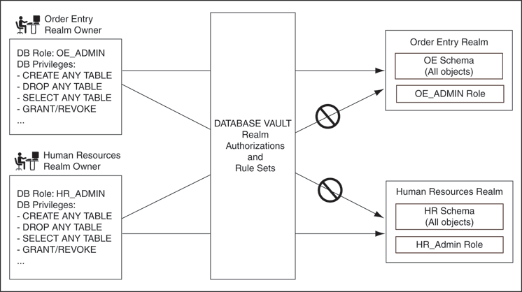

## 4 Configuring Realms

This chapter contains:

## What Are Realms?

A realm is a functional grouping of database schemas and roles that must be secured for a given application. Think of a realm as zone of protection for your database objects. A schema is a logical collection of database objects such as tables, views, and packages, and a role is a collection of privileges. By classifying schemas and roles into functional groups, you can control the ability of users to use system privileges against these groups and prevent unauthorized data access by the database administrator or other powerful users with system privileges. Oracle Database Vault does not replace the discretionary access control model in the existing Oracle database. It functions as a layer on top of this model for both realms and command rules.

After you create a realm, you can register a set of schema objects or roles (secured objects) for realm protection and authorize a set of users or roles to access the secured objects.

For example, after you install Oracle Database Vault, you can create a realm to protect all existing database schemas that are used in an accounting department. The realm prohibits any user who is not authorized to the realm to use system privileges to access the secured accounting data.

You can run reports on realms that you create in Oracle Database Vault. See "Related Reports and Data Dictionary Views" for more information.

This chapter explains how to configure realms by using Oracle Database Vault Administrator. To configure realms by using the PL/SQL interfaces and packages provided by Oracle Database Vault, refer to the following chapters:

- [Chapter 12, "Using the DBMS\_MACADM Package"](apis_dbms_macadm.md)
- [Chapter 15, "Using the Oracle Database Vault PL/SQL Interfaces"](plsql_interfaces.md)

## Default Realms

Oracle Database Vault provides the following default realms:

- Database Vault Account Management: Defines the realm for the administrators who manage and create database accounts and database profiles.
- Oracle Data Dictionary: Defines the realm for the following Oracle Catalog schemas.
	|  | `ANONYMOUS` | `DBSNMP` | `MDSYS` | `SYS` |  |
	| --- | --- | --- | --- | --- | --- |
	|  | `BI` | `EXFSYS` | `MGMT_VIEW` | `SYSMAN` |  |
	|  | `CTXSYS` | `MDDATA` | `OUTLN` | `SYSTEM` |  |
	This realm also controls the ability to grant system privileges and database administrator roles.
- Oracle Database Vault: Defines the realm for the Oracle Database Vault schemas (`DVSYS`, `DVF`, and `LBACSYS`), such as configuration and roles information.
- Oracle Enterprise Manager: Defines the realm for Oracle Enterprise Manager accounts (`SYSMAN` and `DBSNMP`) to access database information

## Creating a Realm

In general, to enable realm protection, you first create the realm itself, and then you edit the realm to include realm-secured objects, roles, and authorizations. "Guidelines for Designing Realms" provides advice on creating realms.

To create a realm:

1. Log in to Oracle Database Vault Administrator as a user who has been granted the `DV_OWNER` or `DV_ADMIN` role.
	["Starting Oracle Database Vault"](getting_started.md) explains how to log in.
2. In the Administration page, under Database Vault Feature Administration, click Realms.
3. In the Realms page, click Create.
4. In the Create Realm page, enter the following settings:
	- Under General:
		- Name: Enter a name for the realm. It can contain up to 90 characters in mixed-case. This attribute is mandatory.
			Oracle suggests that you use the name of the protected application as the realm name (for example, `hr_app` for an human resources application).
				- Description: Enter a brief description of the realm. The description can contain up to 1024 characters in mixed-case. This attribute is optional.
			You may want to include a description the business objective of the given application protection and document all other security policies that compliment the realm's protection. Also document who is authorized to the realm, for what purpose, and any possible emergency authorizations.
				- Status: Select either Enabled or Disabled to enable or disable the realm. A realm is enabled by default. This attribute is mandatory.
		- Under Audit Options, select one of the following:
		- Audit Disabled: Does not create an audit record.
				- Audit On Failure: Default. Creates an audit record when a realm violation occurs (for example, when an unauthorized user tries to modify an object that is protected by the realm).
				- Audit On Success or Failure: Creates an audit record for any activity that occurs in the realm, including both authorized and unauthorized activities.
		For additional audit options, see ["CREATE\_REALM Procedure"](apis_dbms_macadm.md).
		Oracle Database Vault writes the audit trail to the `DVSYS.AUDIT_TRAIL$` system file, described in [Appendix A, "Auditing Oracle Database Vault."](audplcy.md)
5. Click OK.
	The Realms Summary page appears, listing the new realm that you created.

After you create a new realm, you are ready to add schema and database objects to the realm for realm protection, and to authorize users and roles to access the realm. To do so, you edit the new realm and then add its objects and its authorized users.

## Editing a Realm

To edit a realm:

1. In the Oracle Database Vault Administration page, select Realms.
2. In the Realm page, select the realm that you want to edit.
3. Click Edit.
4. Modify the realm as necessary, and then click OK.

See Also:

- "Creating a Realm" to modify the settings created for a new realm
- "Creating Realm-Secured Objects" to add or modify realm secured objects
- "Defining Realm Authorization" to add or modify the realm authorizations

## Creating Realm-Secured Objects

Realm-secured objects define the territory that a realm protects. The realm territory is a set of schema and database objects and roles. You can create the following types of protections:

- Objects from multiple database accounts or schemas can be under the same realm.
- One object can belong to multiple realms.
	If an object belongs to multiple realms, then Oracle Database Vault checks the realms for permissions. For `SELECT`, DDL, and DML statements, as long as a user is a participant in one of the realms, and if the command rules permit it, the commands the user enters are allowed. For `GRANT` and `REVOKE` operations of a database role in multiple realms, the person performing the `GRANT` or `REVOKE` operation must be the realm owner.

You can manage the objects secured by a realm from the Edit Realm page, which lets you create, edit, and delete realm secured objects.

To create a realm secured object:

1. In the Oracle Database Vault Administration page, select Realms.
2. In the Realms page, select the realm you want, and then select Edit.
3. In the Edit Realm page, under Realm Secured Objects, do one of the following:
	- To create a new realm-secured object, select Create.
		- To modify an existing object, select it from the list and then select Edit.
4. In the Create Realm Secured Object page, enter the following settings:
	- Object Owner: From the list, select the name of the database schema owner. This attribute is mandatory.
		If you are creating a realm around the `AUD$` system table, then specify `SYSTEM` as the object owner. In an Oracle Database Vault environment, the `AUD$` table is moved to the `SYSTEM` schema.
		- Object Type: From the list, select the object type of the database object, such as `TABLE`, `INDEX`, or `ROLE`. This attribute is mandatory.
		By default, the Object Type box contains the % wildcard character to include all object types for the specified Object Owner. However, it does not include roles, which do not have specific schema owners in the database and must be specified explicitly.
		- Object Name: Enter the name of the object in the database that the realm must protect, or enter `%` to specify all objects (except roles) for the object owner that you have specified. However, you cannot use wildcard characters with text such to specify multiple object names (for example, `EMP_%` to specify all tables beginning with the characters `EMP_`). Nor can you use the wildcard character to select multiple roles; you must enter role names individually. This attribute is mandatory.
		By default, the Object Name field contains the % wildcard character to encompass the entire schema specified for Object Type and Object Owner. Note that the % wildcard character applies to objects that do not yet exist and currently existing objects. Note also that the % wildcard character does not apply to roles. If you want to include multiple roles, you must specify each role separately.
5. Click OK.

For example, to secure the `EMPLOYEES` table in the `HR` schema, you would enter the following settings in the Create Realm Secured Object page:

- Object Owner: `HR`
- Object Type: `TABLE`
- Object Name: `EMPLOYEES`

Editing a Realm-Secured Object

To edit a realm-secured object:

1. Select the object under Realm Secured Objects in the Edit Realm page.
2. Click Edit.
3. In the Edit Realm Secured Object page, edit the attributes as required.
4. Click OK.

Deleting a Realm-Secured Object

To delete a realm-secured object:

1. Select the object under Realm Secured Objects in the Edit Realm page.
2. Click Remove.
	A confirmation page is displayed.
3. Click Yes.
	This dissociates the object from the realm and unsecures it. (The regular database protections still apply.) However, it does not remove the object from the database.

## Defining Realm Authorization

Realm authorizations establish the set of database accounts and roles that manage or access objects protected in realms. A realm authorization can be an account or role that is authorized to use its system privileges in the following situations:

- When the user must create or access realm-secured objects
- When a user must grant or revoke realm-secured roles

A user who has been granted realm authorization as either a realm owner or a realm participant can use its system privileges to access secured objects in the realm.

Note the following:

- The authorization that you set up here does not affect regular users who have normal direct object privileges to the database objects that are protected by realms.
- Realm owners cannot add other users to their realms as owners or participants. Only users who have the `DV_OWNER` or `DV_ADMIN` role are allowed to add users as owners or participants to a realm.
- Users who have been granted the `DV_OWNER` role can add themselves to a realm authorization.
- A realm owner, but not a realm participant, can grant or revoke realm secured database roles to anyone.
- A user can be granted either as a realm owner or a realm participant, but not both. However, you can update the authorization options of a realm authorization.

Use the Edit Realm page to manage realm authorizations. You can create, edit, and remove realm authorizations. To track configuration information for the authorization of a realm, see ["Realm Authorization Configuration Issues Report"](reports.md).

To create a realm authorization:

1. In the Oracle Database Vault Administration page, select Realms.
2. In the Realms page, select the realm you want, and then select Edit.
3. In the Edit Realm page, under Realm Authorizations, do one of the following:
	- To create a new realm authorization, select Create.
		- To modify an existing realm authorization, select it from the list and then select Edit.
4. Click Create under Realm Authorizations in the Edit Realm page.
5. In the Create Realm Authorization page, enter the following settings:
	- Grantee: From the list, select the Oracle database account or role to whom you want to grant the realm authorization. This attribute is mandatory.
		This list shows all accounts and roles in the system, not just accounts with system privileges.
		You cannot select yourself (that is, the user logged in) or any account that has been granted the `DV_ADMIN`, `DV_OWNER`, or `DV_SECANALYST` roles from this list.
		- Authorization Type: Select either of the following. This attribute is mandatory.
		- Participant: Default. This account or role provides system or direct privileges to access, manipulate, and create objects protected by the realm, provided these rights have been granted using the standard Oracle Database privilege grant process. A realm can have multiple participants.
				- Owner: This account or role has the same privileges as the realm participant, plus the authorization to grant or revoke realm-secured database roles. The realm owner can grant privileges on realm-protected objects to other users. A realm can have multiple owners.
		- Authorization Rule Set: Select from the available rule sets that have been created for your site. You can select only one rule set, but the rule set can have multiple rules.
		See ["Creating a Rule to Add to a Rule Set"](cfrulset.md) for more information about defining rules to govern the realm authorization.
		Any auditing and custom event handling associated with the rule set occurs as part of the realm authorization processing.
6. Click OK.

Editing a Realm Authorization

To edit a realm authorization:

1. Select the realm authorization under Realm Authorizations in the Edit Realm page.
2. Click Edit.
	The Edit Realm Authorization page is displayed.
3. Edit the attributes as required.
4. Click OK.

Deleting a Realm Authorization

To delete a realm authorization:

1. Select the realm authorization under Realm Authorizations in the Edit Realm page.
2. Click Remove.
	A confirmation page is displayed.
3. Click Yes.

## Disabling and Enabling a Realm

By default, when you create a realm, it is enabled. You can disable a realm (for example, for system maintenance such as patch updates), and then enable it again afterward.

To disable or enable a realm:

1. In the Oracle Database Vault Administration page, select Realms.
2. In the Realms page, select the realm you want to disable or enable, and then select Edit.
3. In the Edit Realm page, under Status in the General section, select either Disabled or Enabled.
4. Click OK.

## Deleting a Realm

Before you delete a realm, you can locate the various references to it by querying the realm-related Oracle Database Vault views. See [Chapter 16, "Oracle Database Vault Data Dictionary Views,"](views.md) for more information.

To delete a realm:

1. In the Oracle Database Vault Administration page, select Realms.
2. In the Realms page, select the realm you want to delete, and then select Remove.
3. In the Confirmation page, click Yes.
	Oracle Database Vault deletes the configuration for a realm (header, secure objects, and authorizations). It does not delete the rule sets within the realm.

## How Realms Work

When a database account that has the appropriate privileges issues a SQL statement (that is, DDL, DML, `EXECUTE`, `GRANT`, `REVOKE,` or `SELECT`) that affects an object within a customer-defined realm, the following actions occur:

1. Is the database account using a DDL object privilege to execute the SQL statement?
	If yes, then go to Step [^1]. If no, then go to Step [^5]. If the session has object privileges on the object in question for `SELECT`, `EXECUTE`, and DML only, then the realm protection is not enforced. Realms protect against the use of any system privilege on objects or roles protected by the realm.
	Remember that if the `O7_DICTIONARY_ACCESSIBILITY` initialization parameter has been set to `TRUE`, then non- `SYS` users have access to `SYS` schema objects. For better security, ensure that `O7_DICTIONARY_ACCESSIBILITY` is set to `FALSE`.
2. Does the SQL statement affect objects secured by a realm?
	If yes, then go to Step [^2]. If no, then realms do not affect the SQL statement; go to Step [^5]. If the object affected by the command is not secured in any realms, then realms do not affect the SQL statement being attempted.
3. Is the database account a realm owner or realm participant?
	If yes, and if the command is a `GRANT` or `REVOKE` of a role that is protected by the realm, or the `GRANT` or `REVOKE` of an object privilege on an object protected by the realm, the session must be authorized as the realm owner directly or indirectly through roles. Remember that a role protected by realm is not the same as an authorized role in the realm. Then go to Step [^3]. Otherwise, realm violation occurs and the statement is not allowed to succeed. Note that `SYS` is the only realm owner in the default Oracle Data Dictionary Realm, and only `SYS` can grant system privileges to a database account or role.
4. Is the realm authorization for the database account conditionally based on a rule set?
	If yes, then go to Step [^4]. If no, then go to Step [^5].
5. Does the rule set evaluate to true?
	If yes, then go to Step [^5]. If no, then there is a realm violation, so the SQL statement is not allowed to succeed.
6. Does a command rule prevent the command from executing?
	If yes, then there is a command rule violation and the SQL statement fails. If no, there is no realm or command rule violation, so the command succeeds.
	For example, the `HR` account may have the `DROP ANY TABLE` privilege and may be the owner of the `HR` realm, but a command rule can prevent `HR` from dropping any tables in the `HR` schema unless it is during its monthly maintenance window. Command rules apply to the use of the `ANY` system privileges and direct object privileges and are evaluated after the realm checks.

In addition, because a session is authorized in a realm, it does not mean the account has full control on objects protected by the realm. Realm authorization does not implicitly grant extra privileges to the account. The account still must have system privileges or object privileges to access the objects. For example, an account or role may have the `SELECT ANY` table privilege and be a participant in the `HR` realm. This means the account or the account granted the role could query the `HR.EMPLOYEES` table. Being a participant in the realm does not mean the account or role can `DROP` the `HR.EMPLOYEES` table. Oracle Database Vault does not replace the discretionary access control model in the existing Oracle database. It functions as a layer on top of this model for both realms and command rules.

Note the following:

- Protecting a table in a realm does not protect the view by default. Any view that must be protected should be added to the realm regardless of whether the view was created before or after the table was added to the realm.
- For invoker's right procedures that access realm protected objects, the invoker of the procedure must be authorized to the realm.
- The execution of PL/SQL procedures that are owned by `SYS` are subject to the Oracle Data Dictionary realm enforcement. (The Oracle Data Dictionary realm is one of the default realms provided by Oracle Database Vault. See "Default Realms" for more information.) However, the session must have `EXECUTE` privilege on the procedure as normally required in the Oracle database.
- Be aware that realm protection does not protect a table if access to the table has been granted to `PUBLIC`. For example, if `SELECT ON` `table_name` is granted to `PUBLIC`, then every user has access to `table_name`, even if this table is protected by a realm. As a best practice, revoke unnecessary privileges from `PUBLIC`.

## How Authorizations Work in a Realm

Realms protect data from access through system privileges; realms do not give additional privileges to its owner or participants. The realm authorization provides a run-time mechanism to check logically if a user's command is allowed to access objects specified in the command and to proceed with its execution.

System privileges are sweeping database privileges such as `CREATE ANY TABLE` and `DELETE ANY TABLE`. These privileges typically apply across schemas and bypass the need for direct privileges. Data dictionary views such as `DBA_SYS_PRIVS`, `USER_SYS_PRIVS`, and `ROLE_SYS_PRIVS` list the system privileges for database accounts and roles. Database authorizations work normally for objects not protected by a realm. However, a user must be authorized as a realm owner or participant to successfully use his or her system privileges on objects secured by the realm. A realm violation prevents the use of system privileges and can be audited.

Example 4-1 shows what happens when an unauthorized user who has the `CREATE ANY TABLE` system privilege tries to create a table in a realm where the `HR` schema is protected by a realm.

Example 4-1 Unauthorized User Trying to Create a Table

```
CREATE TABLE HR.demo2 (col1 NUMBER(1));
```

The following output should appear

```
ORA-47401: Realm violation for CREATE TABLE on HR.DEMO2
```

As you can see, the attempt by the unauthorized user fails. Unauthorized use of system privileges such as `SELECT ANY TABLE`, `CREATE ANY TABLE`, `DELETE ANY TABLE`, `UPDATE ANY TABLE`, `INSERT ANY TABLE`, `CREATE ANY INDEX`, and others results in failure.

Example 4-2 shows what happens when an unauthorized database account tries to use his `DELETE ANY TABLE` system privilege to delete an existing record, the database session returns the following error.

Example 4-2 Unauthorized User Trying to Use the DELETE ANY TABLE Privilege

```
DELETE FROM HR.employees WHERE empno = 8002;
```

The following output should appear:

```
ERROR at line 1:
ORA-01031: insufficient privileges
```

Realms do not affect direct privileges on objects. For example, a user granted delete privileges to the `HR.EMPLOYEES` table can successfully delete records without requiring realm authorizations. Therefore, realms should minimally affect normal business application usage for database accounts.

Example 4-3 shows how an authorized user can perform standard tasks allowed within the realm.

Example 4-3 Authorized User Performing DELETE Operation

```
DELETE FROM HR.employees WHERE empno = 8002;

1 row deleted.
```

## Enabling Access to Objects That Are Protected by a Realm

There are situations in which you may want to protect an object by a realm, but still enable access to objects that are part of this realm-protected object. For example, suppose you create a realm around a specific table. However, you want users to be able to create an index on this table. You can accomplish this as follows, depending on the following scenarios.

- The user does not have the CREATE ANY INDEX privilege. As the realm owner of the table, grant the `CREATE INDEX ON` `table` privilege to the user who must create the realm.
- The user has the CREATE ANY INDEX privilege. In this case, create another realm and make all index types as the secured objects and grant that user participant authorization to the realm. (Remember that having the `CREATE ANY INDEX` privilege alone is not sufficient for a non-realm participant to create an index in a realm-protected table.)
- You want all of your database administrators to be able to create an index and they have the CREATE ANY INDEX privilege. In your data protection realm, specify all object types to be protected except the index types. This permits all of your administrators to create indexes for the protected table.

## Example of How Realms Work

Figure 4-1 illustrates how data within a realm is protected. In this scenario, two users, each in charge of a different realm, have the same system privileges. The owner of a realm can be either a database account or a database role. As such, each of the two roles, `OE_ADMIN` and `HR_ADMIN`, can be protected by a realm as a secured object and be configured as the owner of a realm.

Further, only a realm owner, such as `OE_ADMIN`, can grant or revoke database roles that are protected by the realm. The realm owner cannot manage roles protected by other realms such as the `DBA` role created by `SYS` in the Oracle Data Dictionary realm. Any unauthorized attempt to use a system privilege to access realm-protected objects raises a realm violation, which can be audited. The powers of each realm owner are limited within the realm itself. For example, `OE_ADMIN` has no access to the Human Resources realm, and `HR_ADMIN` has no access to the Order Entry realm.

Figure 4-1 How Authorizations Work for Realms and Realm Owners



> This figure illustrates how realm authorization works for two realm owners, the Order Entry realm owner and the Human Resources realm owner. The Order Entry realm owner has the OE\_ADMIN role, and the Human Resources realm own has HR\_ADMIN role. Both of these realm owners have the following database privileges:
>
> - CREATE ANY TABLE
> - DROP ANY TABLE
> - SELECT ANY TABLE
> - GRANT/REVOKE
>
> When these realm owners perform an action in their respective schemas—OE schema for the Order Entry realm owner and the HR schema for the Human Resources realm owner—the Oracle Database Vault realm authorizations allow them to perform any of the database privileges to which they are assigned.
>
> However, they are not permitted to perform these actions in each other's realm. For example, the Order Entry realm owner cannot create tables in the HR schema, nor can the Human Resource realm owner drop tables from the OE schema.
  

See Also:

["Quick Start Tutorial: Securing a Schema from DBA Access"](getting_started.md) for a tutorial on how to create and use a realm

## How Realms Affect Other Oracle Database Vault Components

Realms have no effect on factors, identities, or rule sets. They have an effect on command rules, in a sense, in that Oracle Database Vault evaluates the realm authorization first when processing SQL statements.

"How Realms Work" explains the steps that Oracle Database Vault takes to process SQL statements that affect objects in a realm. ["How Command Rules Work"](cfcmdaut.md) describes how command rules are processed.

## Guidelines for Designing Realms

Follow these guidelines when designing realms:

- Create realms based on the schemas and roles that form a database application.
	Define database roles with the minimum and specific roles and system privileges required to maintain the application objects and grant the role to named accounts. You then can add the role as an authorized member of the realm. For object-level privileges on objects protected by the realm and required by an application, create a role and grant these minimum and specific object-level privileges to the role, and then grant named accounts this role. In most cases, these types of roles do not need to be authorized in the realm unless `ANY` -style system privileges are already in use. A model using the principle of least privilege is ideal for any database application.
- A database object can belong to multiple realms and an account or role can be authorized in multiple realms.
	To provide limited access to a subset of a database schema (for example, just the `EMPLOYEES` table in the `HR` schema), or roles protected by a realm, create a new realm with just the minimum required objects and authorizations.
- If you want to add a role to a realm as a grantee, create a realm to protect the role. Doing so prevents users who have been granted the `GRANT ANY ROLE` system privilege, such as the `SYSTEM` user account, from granting the role to themselves.
- If you want to add the `SYS` user account to a realm authorization, you must add user `SYS` explicitly and not through a role (such as the `DBA` role).
- Be mindful of the privileges currently allowed to a role that you plan to add as a realm authorization.
	Realm authorization of a role can be accidentally granted and not readily apparent if an account such as `SYS` or `SYSTEM` creates a role for the first time and the Oracle Database Vault administrator adds this role as a realm authorization. This is because the account that creates a role is implicitly granted the role when it is created.
- Sometimes you must temporarily relax realm protections for an administrative task. Rather than disabling the realm, have the Security Manager (`DV_ADMIN` or `DV_OWNER`) log in, add the named account to the authorized accounts for the realm, and set the authorization rule set to Enabled. Then in the enabled rule set, turn on all auditing for the rule set. You can remove the realm authorization when the administrative task is complete.
- If you want to grant `ANY` privileges to new users, Oracle recommends that you add a database administrative user to the data dictionary realm so that this user can grant other users `ANY` privileges, if they need them. For example, using a named account to perform the `GRANT` of the `ANY` operations enables you to audit these operations, which creates an audit trail for accountability.
- If you drop a table, index, or role that has been protected by a realm and then recreate it using the same name, the realm protection is not restored. You must re-create the realm protection for the new table, index, or role. However, you can automatically enforce protection for all future tables, indexes, and roles within a specified schema. For example, to enforce protection for all future tables:
	```
	BEGIN
	 DBMS_MACADM.ADD_OBJECT_TO_REALM('realm_name', 'schema_name', '%', 'TABLE');
	END;
	/
	```

## How Realms Affect Performance

DDL and DML operations on realm-protected objects do not have a measurable effect on Oracle Database. Oracle recommends that you create the realm around the entire schema, and then authorize specific users to perform only specific operations related to their assigned tasks. For finer-grained control, you can define realms around individual tables and authorize users to perform certain operations on them, and also have a realm around the entire schema to protect the entire application. Be aware, however, that this type of configuration may slow performance, but it does enable you to grant realm authorization to some of the objects in a schema.

Auditing affects performance. To achieve the best performance, Oracle recommends that you use fine-grained auditing rather than auditing all operations.

You can check the system performance by running tools such as Oracle Enterprise Manager (including Oracle Enterprise Manager Database Control, which is installed by default with Oracle Database), `Statspack`, and `TKPROF`. For more information about Oracle Enterprise Manager, see the Oracle Enterprise Manager documentation set. For information about Database Control, refer to its online Help. [Oracle Database Performance Tuning Guide](https://docs.oracle.com/cd/E11882_01/server.112/e41573/toc.htm) describes the `Statspack` and `TKPROF` utilities.

## Related Reports and Data Dictionary Views

Table 4-1 lists Oracle Database Vault reports that are useful for analyzing realms. See [Chapter 18, "Oracle Database Vault Reports,"](reports.md) for information about how to run these reports.

Table 4-1 Reports Related to Realms

| Report | Purpose |
| --- | --- |
| ["Realm Audit Report"](reports.md) | Audits records generated by the realm protection and realm authorization operations |
| ["Realm Authorization Configuration Issues Report"](reports.md) | Lists authorization configuration information, such as incomplete or disabled rule sets, or nonexistent grantees or owners that may affect the realm |
| ["Rule Set Configuration Issues Report"](reports.md) | Lists rule sets that do not have rules defined or enabled, which may affect the realms that use them |
| ["Object Privilege Reports"](reports.md) | Lists object privileges that the realm affects |
| ["Privilege Management - Summary Reports"](reports.md) | Provides information about grantees and owners for a realm |
| ["Sensitive Objects Reports"](reports.md) | Lists objects that the command rule affects |

Table 4-2 lists data dictionary views that provide information about existing realms.

Table 4-2 Data Dictionary Views Used for Realms

| Data Dictionary View | Description |
| --- | --- |
| ["DVSYS.DBA\_DV\_REALM View"](views.md) | Lists the realms created in the current database instance. |
| ["DVSYS.DBA\_DV\_REALM\_AUTH View"](views.md) | lists the authorization of a named database user account or database role (`GRANTEE`) to access realm objects in a particular realm |
| ["DVSYS.DBA\_DV\_REALM\_OBJECT View"](views.md) | Lists the database schemas, or subsets of schemas with specific database objects contained therein, that are secured by the realms |

[^1]: Does the SQL statement affect objects secured by a realm?

If yes, then go to Step 3. If no, then realms do not affect the SQL statement; go to Step 6. If the object affected by the command is not secured in any realms, then realms do not affect the SQL statement being attempted.

[^2]: Is the database account a realm owner or realm participant?

If yes, and if the command is a `GRANT` or `REVOKE` of a role that is protected by the realm, or the `GRANT` or `REVOKE` of an object privilege on an object protected by the realm, the session must be authorized as the realm owner directly or indirectly through roles. Remember that a role protected by realm is not the same as an authorized role in the realm. Then go to Step 4. Otherwise, realm violation occurs and the statement is not allowed to succeed. Note that `SYS` is the only realm owner in the default Oracle Data Dictionary Realm, and only `SYS` can grant system privileges to a database account or role.

[^3]: Is the realm authorization for the database account conditionally based on a rule set?

If yes, then go to Step 5. If no, then go to Step 6.

[^4]: Does the rule set evaluate to true?

If yes, then go to Step 6. If no, then there is a realm violation, so the SQL statement is not allowed to succeed.

[^5]: Does a command rule prevent the command from executing?

If yes, then there is a command rule violation and the SQL statement fails. If no, there is no realm or command rule violation, so the command succeeds.

For example, the `HR` account may have the `DROP ANY TABLE` privilege and may be the owner of the `HR` realm, but a command rule can prevent `HR` from dropping any tables in the `HR` schema unless it is during its monthly maintenance window. Command rules apply to the use of the `ANY` system privileges and direct object privileges and are evaluated after the realm checks.