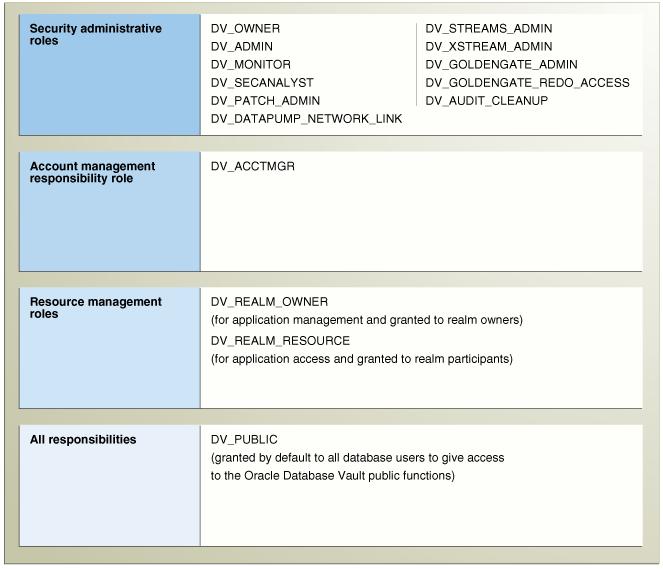

## 11 Oracle Database Vault Objects

This chapter contains:

## Oracle Database Vault Schemas

The Oracle Database Vault objects include two schemas with database tables, sequences, views, triggers, roles, packages, procedures, functions, and contexts that support the administration and run-time processing of Oracle Database Vault.

Oracle Database Vault has the following schemas:

- DVSYS Schema: Owns the Oracle Database Vault schema and related objects
- DVF Schema: Owns the Oracle Database Vault functions that are created to retrieve factor identities

### DVSYS Schema

The `DVSYS` schema contains Oracle Database Vault database objects, which store Oracle Database Vault configuration information and support the administration and run-time processing of Oracle Database Vault. In a default installation, the `DVSYS` schema is locked. The `DVSYS` schema also owns the `AUDIT_TRAIL$` table.

Oracle Database Vault secures the `DVSYS` schema by using a protected schema design. A protected schema design guards the schema against improper use of system privileges (for example, `SELECT ANY TABLE`, `CREATE ANY VIEW`, or `DROP ANY`).

Oracle Database Vault protects and secures the `DVSYS` schema in the following ways:

- The `DVSYS` protected schema and its administrative roles cannot be dropped. By default, the `DVSYS` account is locked.
- Statements such as `CREATE USER`, `ALTER USER`, `DROP USER`, `CREATE PROFILE`, `ALTER PROFILE`, and `DROP PROFILE` can only be issued by a user with the `DV_ACCTMGR` role. `SYSDBA` can issue these statements only if it is allowed to do so by modifying the Can Maintain Accounts/Profiles rule set.
- The powerful `ANY` system privileges for database definition language (DDL) and data manipulation language (DML) commands are blocked in the protected schema. This means that the objects in the `DVSYS` schema must be created by the schema account itself. Also, access to the schema objects must be authorized through object privilege grants.
- Object privileges in the `DVSYS` schema can only be granted to administrative roles in the schema. This means that users can access the protected schema only through predefined administrative roles.
- Only the protected schema account `DVSYS` can issue `ALTER ROLE` statements on predefined administrative roles of the schema. "Oracle Database Vault Roles" describes Oracle Database Vault administrative roles in detail.
- Only the protected schema account `DVSYS` can grant predefined roles to users along with the `ADMIN OPTION`. This means that a grantee with the `ADMIN OPTION` can grant the role to another user without the `ADMIN OPTION`.
- The `SYS.DBMS_SYS_SQL.PARSE_AS_USER` procedure cannot be used to run SQL statements on behalf of the protected schema `DVSYS`.

Note:

Database users can grant additional object privileges and roles to the Oracle Database Vault Administrative roles (`DV_ADMIN` and `DV_OWNER`, for example) provided they have sufficient privileges to do so.

### DVF Schema

The `DVF` schema is the owner of the Oracle Database Vault `DBMS_MACSEC_FUNCTION` PL/SQL package, which contains the functions that retrieve factor identities. After you install Oracle Database Vault, the installation process locks the `DVF` account to better secure it. When you create a new factor, Oracle Database Vault creates a new retrieval function for the factor and saves it in this schema.

## Oracle Database Vault Roles

This section describes the default roles Oracle Database Vault provides. It includes the following topics:

- About Oracle Database Vault Roles
- DV\_OWNER Database Vault Owner Role
- DV\_ADMIN Database Vault Configuration Administrator Role
- DV\_MONITOR Database Vault Monitoring Role
- DV\_SECANALYST Database Vault Security Analyst Role
- DV\_AUDIT\_CLEANUP Audit Trail Cleanup Role
- DV\_STREAMS\_ADMIN Oracle Streams Configuration Role
- DV\_XSTREAM\_ADMIN XStream Administrative Role
- DV\_GOLDENGATE\_ADMIN Oracle GoldenGate Administrative Role
- DV\_GOLDENGATE\_REDO\_ACCESS Oracle GoldenGate Redo Log Access Role
- DV\_PATCH\_ADMIN Database Vault Database Patch Role
- DV\_ACCTMGR Database Vault Account Manager Role
- DV\_REALM\_OWNER Database Vault Realm DBA Role
- DV\_REALM\_RESOURCE Database Vault Application Resource Owner Role
- DV\_PUBLIC Database Vault PUBLIC Role

### About Oracle Database Vault Roles

Oracle Database Vault provides a set of roles that are required for managing Oracle Database Vault.

Figure 11-1 illustrates how these roles are designed to implement the first level of separation of duties within the database. How you use these roles depends on the requirements that your company has in place.

See Also:

[Oracle Database Security Guide](https://docs.oracle.com/cd/E11882_01/network.112/e36292/toc.htm) for general guidelines on managing roles

Figure 11-1 How Oracle Database Vault Roles Are Categorized



> Figure roles\_power\_heirarchy.png illustrates how Oracle Database Vault roles are categorized. The roles fall into four categories, which are as follows, from top to bottom:
>
> - Security administrative roles: DV\_OWNER, DV\_ADMIN, DV\_MONITOR, DV\_SECANALYST, DV\_PATCH\_ADMIN, DV\_STREAMS\_ADMIN, DV\_XSTREAMS\_ADMIN, DV\_GOLDENGATE\_ADMIN, DV\_GOLDENGATE\_REDO\_ACCESS
> - Account management responsibility role: DV\_ACCTMGR
> - Resource management roles: DV\_REALM\_OWNER (for application management and granted to realm owners); DV\_REALM\_RESOURCE (for application access and granted to realm participants)
> - All responsibilities: DV\_PUBLIC (granted by default to all database users to give access to the Oracle Database Vault public functions)
  

Note:

You can grant additional object privileges and roles to the Oracle Database Vault roles to extend their scope of privileges. For example, `SYSDBA` can grant object privileges to an Oracle Database Vault role as long as the object is not in the `DVSYS` schema or realm.

Table 11-1 summarizes the privileges available with Oracle Database Vault roles. (The `DV_PATCH_ADMIN`, `DV_STREAMS_ADMIN`, `DV_XSTREAM`, `DV_GOLDENGATE_ADMIN`, and `DV_GOLDENGATE_REDO_ACCESS` roles are not included because they have no system privileges.)

Table 11-1 Privileges of Oracle Database Vault Roles

| Privilege | DV\_OWNER | DV\_ADMIN | DV\_MONITOR | DV\_SECANALYST | DV\_ACCTMGR | DV\_REALM\_OWNER | DV\_REALM\_RESOURCE | DV\_PUBLIC | DV\_AUDIT\_CLEANUP |
| --- | --- | --- | --- | --- | --- | --- | --- | --- | --- |
| `DVSYS` schema, `EXEC` | Yes <sup>Foot 1</sup> | Yes <sup>Foot 2</sup> | No | No | No | No | No | No | No |
| `DVSYS` packages, `EXECUTE` | Yes | Yes | No | No | No | No | No | No | No |
| `DVSYS` schema, `SELECT` | Yes | Yes | Yes | Yes, on some Database Vault views <sup>Foot 3</sup> | No | No | No | No <sup>Foot 4</sup> | Yes, on some Database Vault tables and views <sup>Foot 5</sup> |
| `DVSYS` schema, grant privileges on objects | No | No | No | No | No | No | No | No | No |
| `DVF` schema, `EXECUTE` | Yes | No | No | No | No | No | No | No | No |
| `DVF` schema, `SELECT` | No | No | No | Yes | No | No | No | No | No |
| Monitor Database Vault | Yes | Yes | Yes | Yes | No | No | No | No | No |
| Run Database Vault reports | Yes | Yes | No | Yes | No | No | No | No | No |
| `SYS` schema, `SELECT` | Yes | No | Yes | Yes, on the same system views as `DV_OWNER` and `DV_ADMIN` | No | No | No | No | No |
| `SYSMAN` schema, `SELECT` | No | No | No | Yes, portions of | No | No | No | No | No |
| `CREATE`, `ALTER`, `DROP` user accounts and profiles <sup>Foot 6</sup> | No | No | No | No | Yes | No | No | No | No |
| Manage objects in schemas that define a realm <sup>Foot 7</sup> | No | No | No | No | No | Yes <sup>Foot 8</sup> | No | No | No |
| `RESOURCE` role privileges <sup>Foot 9</sup> | No | No | No | No | No | No | Yes | No | No |

<sup>Footnote 1</sup> Includes the `EXECUTE` privilege on all Oracle Database Vault PL/SQL packages.

<sup>Footnote 2</sup> Includes the `EXECUTE` privilege on all Oracle Database Vault PL/SQL packages.

<sup>Footnote 3</sup> `DV_SECANALYST` can query `DVSYS` schema objects through Oracle Database Vault-supplied views only.

<sup>Footnote 4</sup> `DV_PUBLIC` can query `DVSYS` schema objects through Oracle Database Vault-supplied views only.

<sup>Footnote 5</sup> `DV_AUDIT_CLEANUP` can perform `SELECT` statements on the `AUDIT_TRAIL` $ table.

<sup>Footnote 6</sup> This privilege does not include the ability to drop or alter the `DVSYS` account, nor change the `DVSYS` password.

<sup>Footnote 7</sup> This privilege includes `ANY` privileges, such as `CREATE ANY`, `ALTER ANY`, and `DROP ANY`.

<sup>Footnote 8</sup> The user with this role also must be the realm participant or owner to exercise his or her system privileges

<sup>Footnote 9</sup> The `RESOURCE` role provides the following system privileges: `CREATE CLUSTER`, `CREATE INDEXTYPE`, `CREATE OPERATOR`, `CREATE PROCEDURE`, `CREATE SEQUENCE`, `CREATE TABLE`, `CREATE TRIGGER`, `CREATE TYPE`.

### DV\_OWNER Database Vault Owner Role

Use the `DV_OWNER` role to manage the Oracle Database Vault roles and its configuration. In this guide, the example account that uses this role is `lbrown_dvowner`.

Privileges Associated with the DV\_OWNER Role

The `DV_OWNER` role has the administrative capabilities that the `DV_ADMIN` role provides, and the reporting capabilities the `DV_SECANALYST` role provides. It also provides privileges for monitoring Oracle Database Vault. It is created when you install Oracle Database Vault, and has the most privileges on the `DVSYS` schema. In addition to `DV_ADMIN` role, the `DV_OWNER` role has the `GRANT ANY ROLE`, `ADMINISTER DATABASE TRIGGER`, and `ALTER ANY TRIGGER` privileges.

Tip:

Consider creating a separate, named account for the `DV_OWNER` user. This way, if the user is no longer available (for example, he or she left the company), then you can easily recreate this user account and then grant this user the `DV_OWNER` role.

To find the full list of system and object privileges associated with the `DV_OWNER` role, log in to SQL\*Plus with administrative privileges and then enter the following queries:

```
SELECT TABLE_NAME, OWNER, PRIVILEGE FROM DBA_TAB_PRIVS WHERE GRANTEE = 'DV_OWNER';
SELECT PRIVILEGE FROM DBA_SYS_PRIVS WHERE GRANTEE = 'DV_OWNER';
```

When you install and register Oracle Database Vault, the `DV_OWNER` account is created. The user who is granted this role is also granted the `ADMIN` option and can run any Oracle Database Vault roles (except `DV_ACCTMGR`) without the `ADMIN OPTION` to any account. Users granted this role also can run Oracle Database Vault reports and monitor Oracle Database Vault.

How Are GRANT and REVOKE Operations Affected by the DV\_OWNER Role?

Anyone with the `DV_OWNER` role can grant the `DV_OWNER` and `DV_ADMIN` roles to another user. The account granted this role can revoke any granted protected schema role from another account. Accounts such as `SYS` or `SYSTEM`, with the `GRANT ANY ROLE` system privilege alone (directly granted or indirectly granted using a role) do not have the right to grant or revoke the `DV_OWNER` role to or from any other database account. Note also that a user with the `DV_OWNER` role cannot grant or revoke the `DV_ACCTMGR` role.

Managing Password Changes for Users Who Have the DV\_OWNER Role

Before you can change the password for another user who has been granted the `DV_OWNER` role, you must revoke the `DV_OWNER` role from that user account. However, be cautious about revoking the `DV_OWNER` role. At least one user on your site must have this role granted. If another `DV_OWNER` user has been granted this role and needs to have his or her password changed, then you can temporarily revoke `DV_OWNER` from that user. Note also that if you have been granted the `DV_OWNER` role, then you can change your own password without having to revoke the role from yourself.

To change the `DV_OWNER` user password:

1. Log in to SQL\*Plus using an account that has been granted the `DV_OWNER` role.
2. Revoke the `DV_OWNER` role from the user account whose password needs to change.
3. Connect as a user who has been granted the `DV_ACCTMGR` role and then change the password for this user.
4. Connect as the `DV_OWNER` user and then grant the `DV_OWNER` role back to the user whose password you changed.

Alternatively, you can temporarily disable Oracle Database Vault, log on as a user who has been granted the `ALTER USER` privilege, and then modify the `DV_OWNER` user password. Afterward, re-enable Database Vault. See [Appendix B, "Disabling and Enabling Oracle Database Vault,"](dvdisabl.md) for more information.

What Happens When Oracle Database Vault Security Is Disabled?

The granting and revoking of all protected schema roles, including `DV_OWNER`, is enforced only if Oracle Database Vault is enabled. If Oracle Database Vault is disabled, then any account with the `GRANT ANY ROLE` system privilege can perform `GRANT` and `REVOKE` operations on protected schema roles.

[Appendix B, "Disabling and Enabling Oracle Database Vault,"](dvdisabl.md) explains how disable and enable Oracle Database Vault.

### DV\_ADMIN Database Vault Configuration Administrator Role

The `DV_ADMIN` role controls the Oracle Database Vault PL/SQL packages.

Privileges Associated with the DV\_ADMIN Role

The `DV_ADMIN` role has the `EXECUTE` privilege on the `DVSYS` packages (`DBMS_MACADM`, `DBMS_MACSECROLES`, and `DBMS_MACUTL`). `DV_ADMIN` also has the capabilities provided by the `DV_SECANALYST` role, which allow the user to run Oracle Database Vault reports and monitor Oracle Database Vault. During installation, the `DV_ADMIN` role is granted to the `DV_OWNER` role with the `ADMIN OPTION` during installation.

To find the full list of system and object privileges associated with the `DV_ADMIN` role, log in to SQL\*Plus with administrative privileges and then enter the following queries:

```
SELECT TABLE_NAME, OWNER, PRIVILEGE FROM DBA_TAB_PRIVS WHERE GRANTEE = 'DV_ADMIN';
SELECT PRIVILEGE FROM DBA_SYS_PRIVS WHERE GRANTEE = 'DV_ADMIN';
```

How Are GRANT and REVOKE Operations Affected by the DV\_ADMIN Role?

Accounts such as `SYS` or `SYSTEM`, with the `GRANT ANY ROLE` system privilege alone do not have the rights to grant or revoke `DV_ADMIN` from any other database account. The user with the `DV_OWNER` or `DV_ADMIN` role can grant or revoke this role to and from any database account.

Managing Password Changes for Users Who Have the DV\_ADMIN Role

Before you can change the password for a user who has been granted the `DV_ADMIN` role, you must revoke the `DV_ADMIN` role from this account. If you have been granted the `DV_ADMIN` role, then you can change your own password without having to revoke the role from yourself.

To change the `DV_ADMIN` user password:

1. Log in to SQL\*Plus using an account that has been granted the `DV_OWNER` role.
2. Revoke the `DV_ADMIN` role from the user account whose password needs to change.
3. Connect as a user who has been granted the `DV_ACCTMGR` role and then change the password for this user.
4. Connect as the `DV_OWNER` user and then grant the `DV_ADMIN` role back to the user whose password you changed.

Alternatively, you can temporarily disable Oracle Database Vault, log on as a user who has been granted the `ALTER USER` privilege, and then modify the `DV_ADMIN` user password. Afterward, re-enable Database Vault. See [Appendix B, "Disabling and Enabling Oracle Database Vault,"](dvdisabl.md) for more information.

What Happens When Oracle Database Vault Security Is Disabled?

The granting and revoking of all protected schema roles, including `DV_OWNER`, is enforced only if Oracle Database Vault is enabled. If Oracle Database Vault is disabled, then any account with the `GRANT ANY ROLE` system privilege can perform `GRANT` and `REVOKE` operations on protected schema roles.

[Appendix B, "Disabling and Enabling Oracle Database Vault,"](dvdisabl.md) explains how disable and enable Oracle Database Vault.

### DV\_MONITOR Database Vault Monitoring Role

The `DV_MONITOR` role enables the Oracle Enterprise Manager Grid Control agent to monitor Oracle Database Vault for attempted violations and configuration issues with realm or command rule definitions. This enables Grid Control to read and propagate realm definitions and command rule definitions between databases.

Privileges Associated with the DV\_MONITOR Role

There are no system privileges associated with the `DV_MONITOR` role, but it does have some the `SELECT` privilege on some `SYS` and `DVSYS` objects. To find the full list of `DV_MONITOR` object privileges, log in to SQL\*Plus with administrative privileges and then enter the following query:

```
SELECT TABLE_NAME, OWNER, PRIVILEGE FROM DBA_TAB_PRIVS WHERE GRANTEE = 'DV_MONITOR';
```

How Are GRANT and REVOKE Operations Affected by the DV\_MONITOR Role?

By default, this role is granted to the `DV_OWNER` role, the `DV_ADMIN` role, the `DV_SECANALYST` role, and the `DBSNMP` user. Only a user who has been granted the `DV_OWNER` privilege can grant or revoke the `DV_MONITOR` role to another user. You cannot grant this role with the `ADMIN` option.

What Happens When Oracle Database Vault Security Is Disabled?

The granting and revoking of all protected schema roles, including `DV_OWNER`, is enforced only if Oracle Database Vault is enabled. If Oracle Database Vault is disabled, then any account with the `GRANT ANY ROLE` system privilege can perform `GRANT` and `REVOKE` operations on protected schema roles.

[Appendix B, "Disabling and Enabling Oracle Database Vault,"](dvdisabl.md) explains how disable and enable Oracle Database Vault.

### DV\_SECANALYST Database Vault Security Analyst Role

Use the `DV_SECANALYST` role to run Oracle Database Vault reports and monitor Oracle Database Vault. This role is also used for database-related reports. In addition, this role enables you to check the `DVSYS` configuration by querying the `DVSYS` views described in [Chapter 16, "Oracle Database Vault Data Dictionary Views."](views.md)

Privileges Associated with the DV\_SECANALYST Role

There are no system privileges associated with the `DV_SECANALYST` role, but it does have the `SELECT` privilege for the `DVSYS` object schema and portions of the `SYS` and `SYSMAN` schema objects for reporting on `DVSYS` - and `DVF` -related entities. To find the full list of `DV_SECANALYST` object privileges, log in to SQL\*Plus with administrative privileges and then enter the following query:

```
SELECT TABLE_NAME, OWNER, PRIVILEGE FROM DBA_TAB_PRIVS WHERE GRANTEE = 'DV_SECANALYST';
```

How Are GRANT and REVOKE Operations Affected by the DV\_SECANALYST Role?

Any account, such as `SYS` or `SYSTEM`, with the `GRANT ANY ROLE` system privilege alone does not have the rights to grant this role to or revoke this role from any other database account. Only the user with the `DV_OWNER` role can grant or revoke this role to and from another user.

Managing Password Changes for Users Who Have the DV\_SECANALYST Role

Before you can change the password for a user who has been granted the `DV_SECANALYST` role, you must revoke the `DV_SECANALYST` role from this account. If you have been granted the `DV_SECANALYST` role, then you can change your own password without having to revoke the role from yourself.

To change the `DV_SECANALYST` user password:

1. Log in to SQL\*Plus using an account that has been granted the `DV_OWNER` role.
2. Revoke the `DV_SECANALYST` role from the user account whose password needs to change.
3. Connect as a user who has been granted the `DV_ACCTMGR` role and then change the password for this user.
4. Connect as the `DV_OWNER` user and then grant the `DV_SECANALYST` role back to the user whose password you changed.

Alternatively, you can temporarily disable Oracle Database Vault, log on as a user who has been granted the `ALTER USER` privilege, and then modify the `DV_SECANALYST` user password. Afterward, re-enable Database Vault. See [Appendix B, "Disabling and Enabling Oracle Database Vault,"](dvdisabl.md) for more information.

What Happens When Oracle Database Vault Security Is Disabled?

The granting and revoking of all protected schema roles, including `DV_OWNER`, is enforced only if Oracle Database Vault is enabled. If Oracle Database Vault is disabled, then any account with the `GRANT ANY ROLE` system privilege can perform `GRANT` and `REVOKE` operations on protected schema roles.

[Appendix B, "Disabling and Enabling Oracle Database Vault,"](dvdisabl.md) explains how disable and enable Oracle Database Vault.

### DV\_AUDIT\_CLEANUP Audit Trail Cleanup Role

Grant the `DV_AUDIT_CLEANUP` role to any user who is responsible for purging the Database Vault audit trail in a non-unified auditing environment.

Privileges Associated with the DV\_AUDIT\_CLEANUP Role

The `DV_AUDIT_CLEANUP` role has the `SELECT` and `DELETE` privileges on the `DVSYS.AUDIT_TRAIL$` table.

How Are GRANT and REVOKE Operations Affected by the DV\_AUDIT\_CLEANUP Role?

By default, this role is granted to the `DV_OWNER` role with the `ADMIN OPTION`. Only a user who has been granted the `DV_OWNER` role can grant or revoke the `DV_AUDIT_CLEANUP` role to another user.

Managing Password Changes for Users Who Have the DV\_AUDIT\_CLEANUP Role

Before you can change the password for a user who has been granted the `DV_AUDIT_CLEANUP` role, you must revoke the `DV_AUDIT_CLEANUP` role from this account. If you have been granted the `DV_AUDIT_CLEANUP` role, then you can change your own password without having to revoke the role from yourself.

To change the `DV_AUDIT_CLEANUP` user password:

1. Log into the database instance using an account that has been granted the `DV_OWNER` role.
2. Revoke the `DV_AUDIT_CLEANUP` role from the user account whose password needs to change.
3. Connect as a user who has been granted the `DV_ACCTMGR` role and then change the password for this user.
4. Connect as the `DV_OWNER` user and then grant the `DV_AUDIT_CLEANUP` role back to the user whose password you changed.

What Happens When Oracle Database Vault Security Is Disabled?

The protection of all Oracle Database Vault roles is enforced only if Oracle Database Vault is enabled. If Oracle Database Vault is disabled, then any account with the `GRANT ANY ROLE` system privilege can perform `GRANT` and `REVOKE` operations on protected Database Vault roles.

[Appendix B, "Disabling and Enabling Oracle Database Vault,"](dvdisabl.md) explains how to disable and enable Oracle Database Vault.

### DV\_STREAMS\_ADMIN Oracle Streams Configuration Role

Grant the `DV_STREAMS_ADMIN` role to any user who is responsible for configuring Oracle Streams in an Oracle Database Vault environment. This enables the management of Oracle Streams processes to be tightly controlled by Database Vault, but does not change or restrict the way an administrator would normally configure Oracle Streams.

Privileges Associated with the DV\_STREAMS\_ADMIN Role

There are no system privileges associated with the `DV_STREAMS_ADMIN` role, but it does have the `SELECT` privilege on `DVSYS` objects. To find the full list of `DV_STREAMS_ADMIN` object privileges, log in to SQL\*Plus with administrative privileges and then enter the following query:

```
SELECT TABLE_NAME, OWNER, PRIVILEGE FROM DBA_TAB_PRIVS WHERE GRANTEE = 'DV_STREAMS_ADMIN';
```

Be aware that the `DV_STREAMS_ADMIN` role does not provide a sufficient set of database privileges for configuring Oracle Streams. Rather, the `DV_STREAMS_ADMIN` role is an additional requirement (that is, in addition to the privileges that Oracle Streams currently requires) for database administrators to configure Oracle Streams in an Oracle Database Vault environment.

How Are GRANT and REVOKE Operations Affected by the DV\_STREAMS\_ADMIN Role?

You cannot grant the `DV_STREAMS_ADMIN` role with `ADMIN OPTION`. Only users who have been granted the `DV_OWNER` role can grant or revoke the `DV_STREAMS_ADMIN` role to or from other users.

What Happens When Oracle Database Vault Security Is Disabled?

The granting and revoking of all protected schema roles, including `DV_OWNER`, is enforced only if Oracle Database Vault is enabled. If Oracle Database Vault is disabled, then any account with the `GRANT ANY ROLE` system privilege can perform `GRANT` and `REVOKE` operations on protected schema roles.

### DV\_XSTREAM\_ADMIN XStream Administrative Role

Grant the `DV_XSTREAM_ADMIN` role to any user who is responsible for configuring XStream in an Oracle Database Vault environment. This enables the management of XStream processes to be tightly controlled by Database Vault, but does not change or restrict the way an administrator would normally configure XStream.

Privileges Associated with the DV\_XSTREAM\_ADMIN Role

There are no privileges associated with the `DV_XSTREAM_ADMIN` role.

Be aware that the `DV_XSTREAM_ADMIN` role does not provide a sufficient set of database privileges for configuring XStream. Rather, the `DV_XSTREAM_ADMIN` role is an additional requirement (that is, in addition to the privileges that XStream currently requires) for database administrators to configure XStream in an Oracle Database Vault environment.

How Are GRANT and REVOKE Operations Affected by the DV\_XSTREAM\_ADMIN Role?

You cannot grant the `DV_XSTREAM_ADMIN` role with `ADMIN OPTION`. Only users who have been granted the `DV_OWNER` role can grant or revoke the `DV_XSTREAM_ADMIN` role to or from other users.

What Happens When Oracle Database Vault Security Is Disabled?

The granting and revoking of all protected schema roles, including `DV_OWNER`, is enforced only if Oracle Database Vault is enabled. If Oracle Database Vault is disabled, then any account with the `GRANT ANY ROLE` system privilege can perform `GRANT` and `REVOKE` operations on protected schema roles.

### DV\_GOLDENGATE\_ADMIN Oracle GoldenGate Administrative Role

Grant the `DV_GOLDENGATE_ADMIN` role to any user who is responsible for configuring Oracle GoldenGate in an Oracle Database Vault environment. This enables the management of Oracle GoldenGate processes to be tightly controlled by Database Vault, but does not change or restrict the way an administrator would normally configure Oracle GoldenGate.

Privileges Associated with the DV\_GOLDENGATE\_ADMIN Role

There are no privileges associated with the `DV_GOLDENGATE_ADMIN` role.

Be aware that the `DV_GOLDENGATE_ADMIN` role does not provide a sufficient set of database privileges for configuring Oracle GoldenGate. Rather, the `DV_GOLDENGATE_ADMIN` role is an additional requirement (that is, in addition to the privileges that Oracle GoldenGate currently requires) for database administrators to configure XStream in an Oracle Database Vault environment.

How Are GRANT and REVOKE Operations Affected by the DV\_GOLDENGATE\_ADMIN Role?

You cannot grant the `DV_GOLDENGATE_ADMIN` role with `ADMIN OPTION`. Only users who have been granted the `DV_OWNER` role can grant or revoke the `DV_GOLDENGATE_ADMIN` role to or from other users.

What Happens When Oracle Database Vault Security Is Disabled?

The granting and revoking of all protected schema roles, including `DV_OWNER`, is enforced only if Oracle Database Vault is enabled. If Oracle Database Vault is disabled, then any account with the `GRANT ANY ROLE` system privilege can perform `GRANT` and `REVOKE` operations on protected schema roles.

### DV\_GOLDENGATE\_REDO\_ACCESS Oracle GoldenGate Redo Log Access Role

Grant the `DV_GOLDENGATE_REDO_ACCESS` role to any user who is responsible for using the Oracle GoldenGate `TRANLOGOPTIONS DBLOGREADER` method to access redo logs in an Oracle Database Vault environment. This enables the management of Oracle GoldenGate processes to be tightly controlled by Database Vault, but does not change or restrict the way an administrator would normally configure Oracle GoldenGate.

Privileges Associated with the DV\_GOLDENGATE\_REDO\_ACCESS Role

There are no privileges associated with the `DV_GOLDENGATE_REDO_ACCESS` role.

Be aware that the `DV_GOLDENGATE_REDO_ACCESS` role does not provide a sufficient set of database privileges for configuring Oracle GoldenGate. Rather, the `DV_GOLDENGATE_REDO_ACCESS` role is an additional requirement (that is, in addition to the privileges that Oracle GoldenGate currently requires) for database administrators to configure Oracle Streams in an Oracle Database Vault environment.

How Are GRANT and REVOKE Operations Affected by the DV\_GOLDENGATE\_REDO\_ACCESS Role?

You cannot grant the `DV_GOLDENGATE_REDO_ACCESS` role with `ADMIN OPTION`. Only users who have been granted the `DV_OWNER` role can grant or revoke the `DV_GOLDENGATE_REDO_ACCESS` role to or from other users.

What Happens When Oracle Database Vault Security Is Disabled?

The granting and revoking of all protected schema roles, including `DV_OWNER`, is enforced only if Oracle Database Vault is enabled. If Oracle Database Vault is disabled, then any account with the `GRANT ANY ROLE` system privilege can perform `GRANT` and `REVOKE` operations on protected schema roles.

### DV\_PATCH\_ADMIN Database Vault Database Patch Role

Temporarily grant the `DV_PATCH_ADMIN` role to any database administrator who is responsible for performing database patching or adding languages to Database Vault. After the patch operation or language addition is complete, you should immediately revoke this role.

Privileges Associated with the DV\_PATCH\_ADMIN Role

This role does not provide access to any secured data. The `DV_PATCH_ADMIN` role a special Database Vault role that does not have any object or system privilege. It is designed to allow the database administrator and the user `SYS` to patch the database including patching Database Vault without having access to realm-protected data. It also enables the database administrator to create users, because some patches may require the need to create new schemas.

How Are GRANT and REVOKE Operations Affected by the DV\_OWNER Role?

Only a user who has the `DV_OWNER` role can grant or revoke the `DV_PATCH_ADMIN` role to and from another user. You cannot grant the `DV_PATCH_ADMIN` role with the `ADMIN` option.

What Happens When Oracle Database Vault Security Is Disabled?

The granting and revoking of all protected schema roles, including `DV_OWNER`, is enforced only if Oracle Database Vault is enabled. If Oracle Database Vault is disabled, then any account with the `GRANT ANY ROLE` system privilege can perform `GRANT` and `REVOKE` operations on protected schema roles.

[Appendix B, "Disabling and Enabling Oracle Database Vault,"](dvdisabl.md) explains how disable and enable Oracle Database Vault.

### DV\_ACCTMGR Database Vault Account Manager Role

Use the `DV_ACCTMGR` role to create and maintain database accounts and database profiles. In this manual, the example `DV_ACCTMGR` role is assigned to a user named `amalcolm_dvacctmgr`.

Privileges Associated with the DV\_ACCTMGR Role

A user who has been granted this role can use the `CREATE`, `ALTER`, and `DROP` statements for users or profiles. However, a person who has been granted the `DV_ACCTMGR` role cannot perform the following operations:

- `ALTER` or `DROP` statements on the `DVSYS` account
- `ALTER` or `DROP` statements on users who have been granted the `DV_ADMIN`, `DV_OWNER`, `DV_SECANALYST`, `DV_AUDIT_CLEANUP`, and `DV_MONITOR` roles
- Change passwords for users who have been granted the `DV_ADMIN`, `DV_OWNER`, `DV_SECANALYST`, `DV_AUDIT_CLEANUP`, and `DV_MONITOR` roles

To find the full list of system and object privileges associated with the `DV_ACCTMGR` role, log in to SQL\*Plus with administrative privileges and then enter the following queries:

```
SELECT TABLE_NAME, OWNER, PRIVILEGE FROM DBA_TAB_PRIVS WHERE GRANTEE = 'DV_ACCTMGR';
SELECT PRIVILEGE FROM DBA_SYS_PRIVS WHERE GRANTEE = 'DV_ACCTMGR';
```

Tips:

- Oracle recommends that you add the user who has the `DV_ACCTMGR` role to the data dictionary realm. See ["Step 1: Adding the SYSTEM User to the Data Dictionary Realm"](getting_started.md) for an example.
- If you want the `DV_ACCTMGR` user to be able to grant or revoke the `ANY` privileges for other users, then log in as user `SYS` with the `SYSDBA` privilege and grant this user the `GRANT ANY PRIVILEGE` and `REVOKE ANY PRIVILEGE` privileges. Then add the user to Oracle Data Dictionary realm as an owner.
- Consider creating a separate, named account for the `DV_ACCTMGR` user. This way, if this user forgets his or her password, you can log in as the original `DV_ACCTMGR` account when you recreate the user's password. Otherwise, you must disable Oracle Database Vault, log in as `SYS` or `SYSTEM` to recreate the password, and then re-enable Database Vault.

How Are GRANT and REVOKE Operations Affected by the DV\_ACCTMGR Role?

Any account, such as `SYS` or `SYSTEM`, with the `GRANT ANY ROLE` system privilege alone does not have the rights to grant this role to or revoke this role from any other database account. The account with the `DV_ACCTMGR` role and the `ADMIN OPTION` can grant this role without the `ADMIN OPTION` to any given database account and revoke this role from another account.

What Happens When Oracle Database Vault Security Is Disabled?

The granting and revoking of all protected schema roles, including `DV_OWNER`, is enforced only if Oracle Database Vault is enabled. If Oracle Database Vault is disabled, then any account with the `GRANT ANY ROLE` system privilege can perform `GRANT` and `REVOKE` operations on protected schema roles.

[Appendix B, "Disabling and Enabling Oracle Database Vault,"](dvdisabl.md) explains how disable and enable Oracle Database Vault.

### DV\_REALM\_OWNER Database Vault Realm DBA Role

Use the `DV_REALM_OWNER` role to manage database objects in multiple schemas that define a realm. Grant this role to the database account owner who is responsible for managing one or more schema database accounts within a realm and the roles associated with the realm.

Privileges Associated with the DV\_REALM\_OWNER Role

A user who has been granted this role can use powerful system privileges like `CREATE ANY`, `ALTER ANY`, and `DROP ANY` within the realm. However, before this user can exercise these privileges, you must make this user either a participant or an owner for the realm. See ["Defining Realm Authorization"](cfrealms.md) for instructions.

There are no object privileges granted to the `DV_REALM_OWNER` role, but it does have some system privileges. To find the full list of `DV_REALM_OWNER` system privileges, log in to SQL\*Plus with administrative privileges and enter the following query:

```
SELECT PRIVILEGE FROM DBA_SYS_PRIVS WHERE GRANTEE = 'DV_REALM_OWNER';
```

How Are GRANT and REVOKE Operations Affected by the DV\_REALM\_OWNER Role?

The realm owner of the Oracle Data Dictionary realm, such as `SYS`, can grant this role to any given database account or role. Note that though this role has system privilege grants that `SYS` controls, it does not have the `DV_OWNER` or `DV_ADMIN` roles.

If you want to attach this role to a specific realm, then you must assign it to an account or business-related role, then authorize that account or role in the realm.

What Happens When Oracle Database Vault Security Is Disabled?

The granting and revoking of all protected schema roles, including `DV_OWNER`, is enforced only if Oracle Database Vault is enabled. If Oracle Database Vault is disabled, then any account with the `GRANT ANY ROLE` system privilege can perform `GRANT` and `REVOKE` operations on protected schema roles.

[Appendix B, "Disabling and Enabling Oracle Database Vault,"](dvdisabl.md) explains how disable and enable Oracle Database Vault.

### DV\_REALM\_RESOURCE Database Vault Application Resource Owner Role

Use the `DV_REALM_RESOURCE` role for operations such as creating tables, views, triggers, synonyms, and other objects that a realm would typically use.

Privileges Associated with the DV\_REALM\_RESOURCE Role

The `DV_REALM_RESOURCE` role provides the same system privileges as the Oracle `RESOURCE` role. In addition, both `CREATE SYNONYM` and `CREATE VIEW` are granted to this role.

There are no object privileges granted to the `DV_REALM_RESOURCE` role, but it does have some system privileges. To find the full list of `DV_REALM_RESOURCE` system privileges, log in to SQL\*Plus with administrative privileges and enter the following query:

```
SELECT PRIVILEGE FROM DBA_SYS_PRIVS WHERE GRANTEE = 'DV_REALM_RESOURCE';
```

Though this role has system privilege grants that `SYS` controls, it does not have the `DV_OWNER` or `DV_ADMIN` role.

How Are GRANT and REVOKE Operations Affected by the DV\_REALM\_RESOURCE Role?

You can grant the `DV_REALM_RESOURCE` role to a database account that owns database tables, objects, triggers, views, procedures, and so on that are used to support any database application. This is a role designed for a schema type database account. The realm owner of the Oracle Data Dictionary realm, such as `SYS`, can grant this role to any database account or role.

What Happens When Oracle Database Vault Security Is Disabled?

The granting and revoking of all protected schema roles, including `DV_OWNER`, is enforced only if Oracle Database Vault is enabled. If Oracle Database Vault is disabled, then any account with the `GRANT ANY ROLE` system privilege can perform `GRANT` and `REVOKE` operations on protected schema roles.

[Appendix B, "Disabling and Enabling Oracle Database Vault,"](dvdisabl.md) explains how disable and enable Oracle Database Vault.

### DV\_PUBLIC Database Vault PUBLIC Role

Use the `DV_PUBLIC` role to grant privileges on specific objects in the `DVSYS` schema. (Remember that in a default installation, the `DVSYS` schema is locked.)

Privileges Associated with the DV\_PUBLIC Role

The following Oracle Database Vault objects are accessible through `DV_PUBLIC`:

- PL/SQL procedures and functions, described in ["Oracle Database Vault Run-Time PL/SQL Procedures and Functions"](plsql_interfaces.md). These enable access control and Oracle Label Security processing in an Oracle database.
- PL/SQL factor functions, described in ["Oracle Database Vault PL/SQL Factor Functions"](plsql_interfaces.md). For the `DVF` schema, these are functions for each factor defined. These are functions that you can use in rule sets to inspect the SQL statement that you want the rule set to protect.
- `DBMS_MACSEC_ROLES` package, described in [Chapter 13, "Using the DBMS\_MACSEC\_ROLES Package."](apis_macsec_roles.md) This package enables you to check the authorization for a user or to set an Oracle Database Vault secure application role.
- `DBMS_MACUTL` package, described in [Chapter 14, "Using the DBMS\_MACUTL Package."](apis_dbms_macutl.md) This package is a set of general purpose utility functions that you can use throughout the application code you write for Oracle Database Vault.

There are no system privileges granted to the `DV_PUBLIC` role, but it does have some object privileges. To find the full list of `DV_PUBLIC` object privileges, log in to SQL\*Plus with administrative privileges and enter the following query:

```
SELECT TABLE_NAME, OWNER, PRIVILEGE FROM DBA_TAB_PRIVS WHERE GRANTEE = 'DV_PUBLIC';
```

How Are GRANT and REVOKE Operations Affected by the DV\_PUBLIC Role?

Oracle Database Vault does not enable you to directly grant object privileges in the `DVSYS` schema to `PUBLIC`. You must grant the object privilege on the `DVSYS` schema object the `DV_PUBLIC` role, and then grant `DV_PUBLIC` to `PUBLIC`. However, if you do this, it is important that you do not add more object privileges to the `PUBLIC` role. Doing so may undermine Oracle Database Vault security.

What Happens When Oracle Database Vault Security Is Disabled?

The granting and revoking of all protected schema roles, including `DV_OWNER`, is enforced only if Oracle Database Vault is enabled. If Oracle Database Vault is disabled, then any account with the `GRANT ANY ROLE` system privilege can perform `GRANT` and `REVOKE` operations on protected schema roles.

[Appendix B, "Disabling and Enabling Oracle Database Vault,"](dvdisabl.md) explains how disable and enable Oracle Database Vault.

## Oracle Database Vault Accounts

Oracle Database Vault prompts for two accounts during installation: Oracle Database Vault Owner and Oracle Database Vault Account Manager. You must supply an account name and password for the Oracle Database Vault Owner account during installation. Creating an Oracle Database Vault Account Manager is optional.

The Oracle Database Vault Owner account is granted the `DV_OWNER` role. This account can manage Oracle Database Vault roles and configuration. (See "DV\_OWNER Database Vault Owner Role" for detailed information about this role.)

The Oracle Database Vault Account Manager account is granted the `DV_ACCTMGR` role. This account is used to manage database user accounts to facilitate separation of duties. (See "DV\_ACCTMGR Database Vault Account Manager Role" for detailed information about this role.)

If you choose not to create the Oracle Database Vault Account Manager account during installation, then both the `DV_OWNER` and `DV_ACCTMGR` roles are granted to the Oracle Database Vault Owner user account.

Tip:

Oracle recommends that you grant the `DV_OWNER` and `DV_ACCTMGR` roles to existing user accounts. However, continue to maintain the original `DV_OWNER` and `DV_ACCTMGR` user accounts that you created during installation. This way, for example, if a user who has been granted one of these roles forgets his or her password, then you can log in as the original Database Vault Account Manager user and then recreate the password without having to disable Oracle Database Vault.

Table 11-2 lists the Oracle Database Vault database accounts that are needed in addition to the accounts that you create during installation.

Table 11-2 Database Accounts Used by Oracle Database Vault

| Database Account | Roles and Privileges | Description |
| --- | --- | --- |
| `DVSYS` | Several system and object privileges are provided to support Oracle Database Vault. The ability to create a session with this account is revoked at the end of the installation, and the account is locked. | Owner of Oracle Database Vault schema and related objects |
| `DVF` | A limited set of system privileges are provided to support Oracle Database Vault. The ability to create a session with this account is revoked at the end of the installation, and the account is locked. | Owner of the Oracle Database Vault functions that are created to retrieve factor identities |
| `LBACSYS` | This account is created when you install Oracle Label Security by using the Oracle Universal Installer custom installation option. (It is not created when you install Oracle Database Vault.) Do not drop or re-create this account.  If you plan to integrate a factor with an Oracle Label Security policy, you must assign this user as the owner of the realm that uses this factor. See ["Using Oracle Database Vault Factors with Oracle Label Security Policies"](dv_ols.md) for more information. | Owner of the Oracle Label Security schema |

You can create different database accounts to implement the separation of duties requirements for Oracle Database Vault. Table 11-3 lists some model database accounts that can act as a guide. (The accounts listed in Table 11-3 serve as a guide to implementing Oracle Database Vault roles. These are not actual accounts that are created during installation.)

Table 11-3 Model Oracle Database Vault Database Accounts

| Database Account | Roles and Privileges | Description |
| --- | --- | --- |
| `EBROWN` | `DV_OWNER` (with `DV_ADMIN` and `DV_SECANALYST`) | Account that is the realm owner for the `DVSYS` realm. This account can:  - Run `DVSYS` packages - Have `EXECUTE` privileges in the `DVSYS` schema - Grant privileges on the `DVSYS` schema objects - Select objects in the schema - Monitor Oracle Database Vault activity - Run reports on the Oracle Database Vault configuration |
| `JGODFREY` | `DV_ACCTMGR` | Account for administration of database accounts and profiles. This account can:  - Create, alter, or drop users - Create, alter, or drop profiles - Grant and revoke the `DV_ACCTMGR` role, but only if this account was created during the Database Vault installation (this account is created with the `ADMIN` option) - Grant the `CONNECT` role  Note: This account cannot create roles, or grant the `RESOURCE` or `DBA` roles. |
| `RLAYTON` | `DV_ADMIN` (with `DV_SECANALYST`) | Account to serve as the access control administrator. This account can:  - Execute `DVSYS` packages - Have `EXECUTE` privileges in the `DVSYS` schema - Monitor Oracle Database Vault activity - Run reports on the Oracle Database Vault configuration  Note: This account cannot directly update the `DVSYS` tables. |
| `PSMYTHE` | `DV_SECANALYST` | Account for running Oracle Database Vault reports in the Oracle Database Vault Administration application. |