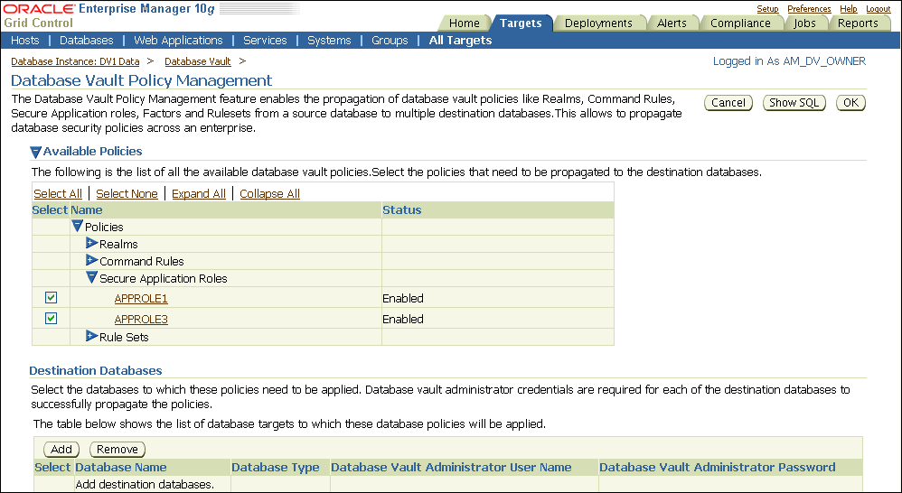
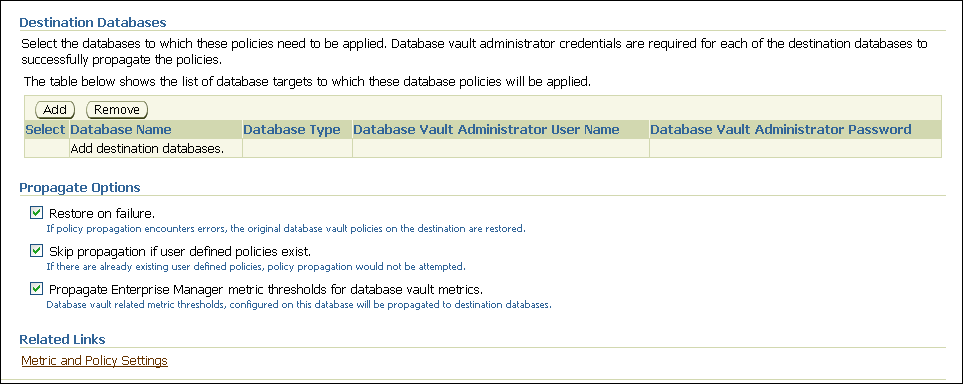

## 10 DBA Operations in an Oracle Database Vault Environment

This chapter contains:

## Using Oracle Database Vault with Oracle Enterprise Manager

This section contains:

- Setting the Database Vault Administrator URL in Oracle Enterprise Manager
- Propagating Oracle Database Vault Policies to Other Databases
- Using Enterprise Manager Grid Control Alerts for Oracle Database Vault Policies
- Using Oracle Database Vault-Specific Reports in Enterprise Manager Grid Control
- Changing the DBSNMP Account Password in an Oracle Database Vault Environment

### Setting the Database Vault Administrator URL in Oracle Enterprise Manager

You can configure Database Control or Grid Control to use a specific Database Vault Administrator URL.

1. Access Oracle Database Vault Home page from Oracle Enterprise Manager.
	See ["Accessing the Oracle Database Vault Pages and DVA from Oracle Enterprise Manager"](getting_started.md).
	If you want to save the Database Vault URL:
	- For Database Control: Ensure that in addition to being granted the `DV_OWNER` or `DV_ADMIN` role, that you are also an Enterprise Manager administrator.
		- For Grid Control: Ensure that you have been granted the `OPERATOR` privilege on the target database.
2. Access the Database Vault Administrator URL page.
	From the Database Vault Home page, click the Administration tab, and then under Policy Administration, click the Launch Database Vault Administrator link.
	The Database Vault Administrator URL page appears.
3. In the Database Vault Administrator URL field, enter the Database Vault Administrator URL that you want to use.
	For example:
	```
	https://myserver.us.example.com:1148/dva
	```
4. To test the URL, click the Launch to test URL button.
5. Click the Save button.

### Propagating Oracle Database Vault Policies to Other Databases

If you have Oracle Database Vault installed in an Oracle Enterprise Manager Grid Control Release 10.2.0.5 environment, then you can propagate Database Vault policies to other Database Vault-protected databases. Note that you cannot use Grid Control to create Database Vault policies or perform the actions normally provided for in Database Vault Administrator. If you want to perform these functions, then use Database Vault Administrator.

To propagate Database Vault policies to other databases:

1. Access Oracle Database Vault Administrator from Oracle Enterprise Manager, and log in to Database Vault as a user who has been granted the `DV_OWNER` or `DV_ADMIN` role.
	Ensure that you select the database that contains the policies that you want to propagate.
	See ["Accessing the Oracle Database Vault Pages and DVA from Oracle Enterprise Manager"](getting_started.md).
2. From the Database Vault home page, select the Administration subpage.
3. In the Administration page, under Policy Propagation, select the Database Vault Policy Propagation link.
	The Available Policies area in the Policy Propagation subpage lists a summary of the Oracle Database Vault policies that were created for the database that you selected in Step [^1]. From here, you can propagate these policies to another database.
4. Under Available Policies, select each policy that you want to propagate to another database.
	By default, all policies are selected.
	

> This screen shows the Database Vault Policy Management page, and focuses on the Available Policies area. Under "Database Vault Policy Management" is the following text:
>
> "The Database Vault Policy Management feature enables the propagation of database vault policies like Realms, Command Rules, Secure Application roles, Factors and Rulesets from a source database to multiple destination databases.This allows to propagate database security policies across an enterprise."
>
> Following this text is the Available Policies area, which has the legend "The following is the list of all the available database vault policies. Select the policies that need to be propagated to the destination databases." From left to right under it are the links Select All, Select None, Expand All, Collapse All.
>
> In the table that follows are these columns: Select, Name, and Status. Under Name is a Policies list, which contains the different categories of Database Vault components: Realms, Command Rules, Secure Application Roles, and Rule Sets. This screenshot shows the Secure Application Roles link expanded, with two roles displayed.
>
> Following Available Policies is the Destination Databases area, which isdescribed in the next step.

5. Under Destination Databases, click the Add button.
	

> This screenshot focuses on the Destination Databases area of the Database Vault Policy Management page. Under "Destination Databases" is this legend:
>
> "Select the databases to which these policies need to be applied. Database Vault administrator credentials are required for each of the destination databases to successfully propagate the policies.
>
> "The table below shows the list of database targets to which these database policies will be applied."
>
> Following the legend are Add and Remove buttons, which are followed by the table columns Select, Database Name, Database Type, Database Vault Administrator User Name, Database Vault Administrator Password. There are no databases listed yet in this screenshot.
>
> Following the table is the Propagate Options area, which is described in the following steps of this procedure.

6. Under Search and Select: Database Vault Enabled Destination Databases, search for the destination databases, and then select each database to which you want to propagate the policies. Then click the Select button.
7. Under Destination Databases, do the following:
	1. Under Apply credentials across destination database(s), enter the user name and password of the administrator of the Database Vault database that contains the policies you want to propagate.
		This feature applies the Database Vault administrator's user name and password to all of the selected destination databases.
		2. Select each database to which you want to propagate the policies.
		3. Enter the Database Vault administrator user name and password for each database.
		4. Click the Apply button.
8. In the Propagate Options page, select from the following options.
	Any changes made to the seeded realms, command rules, rule sets, and so on will not be propagated to the destination databases. Only custom-created data are propagated.
	- Restore on failure: If the policy propagation encounters errors, then the propagation is rolled back. That is, the original policies on the destination database are restored. If you do not select this option, then the policy propagation on the destination database continues and ignores any errors.
		- Skip propagation if user defined policies exist: If the destination databases already have the user-defined policies, then the policy propagation is not attempted. If you do not select this option, then regardless of whether user-defined policies exist on the destination database, all the existing policies are cleared, and the policies from the source database are applied to the destination database.
		- Propagate Enterprise Manager metric thresholds for database vault metrics: If the source database has Oracle Database Vault metric thresholds set, then these thresholds are also propagated to the destination databases. If you do not select this option, then only policies are propagated and not the Oracle Database Vault thresholds.
9. Click the OK button.
10. In the Confirmation window, click OK.
	A message indicating success or failure appears. If the propagation succeeds, then the policies are active right away in their destination databases.

### Using Enterprise Manager Grid Control Alerts for Oracle Database Vault Policies

Grid Control generates Oracle Database Vault-specific alerts. To view these alerts, you must be granted the `DV_OWNER`, `DV_ADMIN`, or `DV_SECANALYST` role. The alerts are as follows:

- Database Vault Attempted Realm Violations. This alert helps the Oracle Database Vault security analyst (`DV_SECANALYST` role) to monitor violation attempts on the Database Vault database. This user can select the realms to be affected by the alert and filter these realms based on the different types of attempts by using error codes. You can enable this metric from the Metrics and Policy Settings page. By default, the attempted realm violations are collected every 24 hours.
- Database Vault Attempted Command Rule Violations. The functionality for this alert is the same as for Database Vault Attempted Realm Violations, except that it focuses on violations on command rules.
- Database Vault Realm Configuration Issues. This metric tracks and raises an alert if users misconfigure realms. This metric is enabled when you install Oracle Database vault, and by default it collects data every one hour.
- Database Vault Command Rule Configuration Issues. This functionality for this alert is that same as Database Vault Realm Configuration Issues, except that it focuses on configuration changes to command rules.
- Database Vault Policy Changes. This metric raises an alert on any change to any Database Vault policy, such as policies for realms and command rules. It provides a detailed policy changes report.

### Using Oracle Database Vault-Specific Reports in Enterprise Manager Grid Control

From the Database Vault home page, you can find information about the following types of violations:

- Top five attempted violations on realm and command rule
- Top five attempted violations by database users and client host
- Time series-based graphical reports on attempted violations for more detailed analysis

To have full access to the Database Vault reports, you must log in to Database Vault Administrator as a user who has been granted the `DV_OWNER`, `DV_ADMIN`, or `DV_SECANALYST` role.

See Also:

[Chapter 18, "Oracle Database Vault Reports"](reports.md)

### Changing the DBSNMP Account Password in an Oracle Database Vault Environment

Before you can change the password for the `DBSNMP` user account, you must revoke the `DV_MONITOR` role from this account. In an Oracle Database Vault environment, the `DBSNMP` user account is granted the `DV_MONITOR` role. (The `DBSNMP` user can change his or her own password directly, without having to have the `DV_MONITOR` role revoked first.)

To change the `DBSNMP` user password:

1. Log in to SQL\*Plus using an account that has been granted the `DV_OWNER` role.
2. Revoke the `DV_MONITOR` role from the `DBSNMP` user account.
3. Connect as a user who has been granted the `DV_ACCTMGR` role and then change the `DBSNMP` user account password.
4. Connect as the `DV_OWNER` user and then grant the `DV_MONITOR` role back to the `DBSNMP` user account.

Alternatively, you can temporarily disable Oracle Database Vault, log on as a user who has been granted the `ALTER USER` privilege, and then modify the `DBSNMP` password. Afterward, re-enable Database Vault. See [Appendix B, "Disabling and Enabling Oracle Database Vault,"](dvdisabl.md) for more information.

## Using Oracle Data Pump in an Oracle Database Vault Environment

This section contains:

- About Using Oracle Data Pump in an Oracle Database Vault Environment
- Granting a Database Administrator Authorization to Use Oracle Data Pump
- Guidelines for Exporting or Importing Data in an Oracle Database Vault Environment
- Revoking Authorization from Databases Administrators Who Are Using Data Pump

### About Using Oracle Data Pump in an Oracle Database Vault Environment

Database administrators who want to use Oracle Data Pump must have Oracle Database Vault-specific authorization, in addition to the standard Oracle Data Pump privileges, if they want to export and import data in an Oracle Database Vault environment. (Note that you cannot use the legacy `EXP` and `IMP` utilities if Oracle Database Vault is enabled.) You can check a user's authorizations for using Data Pump in an Oracle Database Vault environment by querying the `DVSYS.DBA_DV_DATAPUMP_AUTH` data dictionary view.

The level of authorization that you must grant depends on the following scenarios:

- Users who import data into another schema must have the BECOME USER system privilege. To find the privileges a user has been granted, query the `USER_SYS_PRIVS` data dictionary view.
- A database administrator wants to export or import data in a schema that has no realm protection. In this case, this user only needs the standard Oracle Data Pump privileges, not the Oracle Database Vault authorization.
- A database administrator wants to export or import data in a protected schema. You must grant this user Database Vault-specific authorization by using the `DBMS_MACADM.AUTHORIZE_DATAPUMP_USER` procedure. This authorization applies to both the `EXPDP` and `IMPDP` utilities. Later on, you can revoke this authorization by using the `DBMS_MACADM.UNAUTHORIZE_DATAPUMP_USER` procedure.
- A database administrator wants to export or import the contents of an entire database. In addition to the authorization granted by the `DBMS_MACADM.AUTHORIZE_DATAPUMP_USER` procedure, you must grant this user the `DV_OWNER` role. For the import operation, this user must have the `BECOME USER` privilege.

See Also:

["DVSYS.DBA\_DV\_DATAPUMP\_AUTH View"](views.md)

### Granting a Database Administrator Authorization to Use Oracle Data Pump

To authorize a database administrator to use Data Pump in an Oracle Database Vault environment:

1. Log in to SQL\*Plus as a user who has been granted the `DV_OWNER` or `DV_ADMIN` role.
2. Ensure that the user to whom you want to grant authorization has been granted the `EXP_FULL_DATABASE` and `IMP_FULL_DATABASE` roles, which are required for using Oracle Data Pump.
	```
	SELECT GRANTEE, GRANTED_ROLE FROM DBA_ROLE_PRIVS 
	 WHERE GRANTED_ROLE LIKE '%FULL%';
	```
3. Grant this user Oracle Database Vault authorization.
	For example, to authorize the Data Pump user `dp_mgr` to export and import objects for an entire database:
	```
	EXEC DBMS_MACADM.AUTHORIZE_DATAPUMP_USER('dp_mgr');
	```
	Optionally, you can restrict `dp_mgr` 's activities to a specific schema or even a table, as shown in the following examples:
	```
	EXEC DBMS_MACADM.AUTHORIZE_DATAPUMP_USER('DP_MGR', 'HR');
	EXEC DBMS_MACADM.AUTHORIZE_DATAPUMP_USER('DP_MGR', 'HR', 'EMPLOYEES');
	```
	See ["AUTHORIZE\_DATAPUMP\_USER Procedure"](apis_dbms_macadm.md) for detailed information about this procedure.
	After you run the `DBMS_MACADM.AUTHORIZE_DATAPUMP_USER` procedure, the authorization is stored as a rule in the Allow Oracle Data Pump Operation rule set, described in ["Default Rule Sets"](cfrulset.md). You can refer to this rule set by querying the `DVSYS.DBA_DV_RULE_SET` view if you want to check the user's authorizations.
4. If the objects that this user wants to import are associated with other objects that are protected by a realm, then authorize the user to have access to that realm.
	For example, suppose user `dp_mgr` wants to export the `SCOTT` schema. However, the `SCOTT` schema is associated with the `SYSMAN.AQ$_MGMT_NOTIFY_QTABLE_S` table, and the `SYSMAN` schema is protected by a realm. So, before user `dp_mgr` can export the `SCOTT` schema, he must be authorized as follows:
	First, ensure that this user is a realm participant. For example:
	```
	BEGIN
	 DBMS_MACADM.ADD_AUTH_TO_REALM(
	  realm_name   => 'SYSMAN Realm', 
	  grantee      => 'DP_MGR', 
	  auth_options => DBMS_MACUTL.G_REALM_AUTH_PARTICIPANT);
	END;
	/
	```
	Next, run the following procedure to authorize the user for Oracle Data Pump operations:
	```
	EXEC DBMS_MACADM.AUTHORIZE_DATAPUMP_USER('DP_MGR','SYSMAN');
	```
5. If the user must export the entire database, then grant the user the `DV_OWNER` role.
	```
	GRANT DV_OWNER TO dp_mgr;
	```
6. Ensure that the Allow Oracle Data Pump Operation rule set has been enabled by querying the `DVSYS.DBA_DV_RULE_SET` data dictionary view as follows:
	```
	SELECT ENABLED FROM DVSYS.DBA_DV_RULE_SET 
	 WHERE RULE_SET_NAME = 'Allow Oracle Data Pump Operation';
	```

### Guidelines for Exporting or Importing Data in an Oracle Database Vault Environment

After you have granted the database administrator who is using Data Pump the necessary authorization, this user is ready to perform any export or import operations that are necessary. Before this user begins work, he or she should follow these guidelines:

- Create a full backup of the database datafiles. This way, if you or other users do not like the newly-imported data, you easily can revert the database to its previous state. This guideline is especially useful if an intruder had managed to modify Data Pump exported data to use his or her own policies.
- Decide how to handle exporting and importing multiple schemas or tables. You cannot specify multiple schemas or tables in the `DBMS_MACADM.AUTHORIZE_DATAPUMP_USER` procedure, but you can use either of the following methods to accomplish this task:
	- Run individual `DBMS_MACADM.AUTHORIZE_DATAPUMP_USER` procedures for each schema or table, and then specify the list of these objects in the `SCHEMAS` or `TABLES` parameter of the `expdp` and `impdp` utilities.
		- Perform a full database export or import operation. If so, see the next guideline.
- When performing an export or import operation for an entire database, set the expdp or impdp FULL option to Y. Remember that this setting will capture the `DVSYS` schema, so ensure that the user has been granted the `DV_OWNER` role. For detailed information about Oracle Data Pump, see [Oracle Database Utilities](https://docs.oracle.com/cd/E11882_01/server.112/e22490/toc.htm).
- You cannot use the legacy EXP and IMP utilities with the direct path option (direct=y) if Oracle Database Vault is enabled.

### Revoking Authorization from Databases Administrators Who Are Using Data Pump

To revoke authorization from the database administrator who is using Data Pump:

1. If you granted the user the `DV_OWNER` role, optionally revoke this role.
	```
	REVOKE DV_OWNER FROM dp_mgr;
	```
2. Query the `DVSYS.DBA_DV_RULE_SET` data dictionary view and then make a note of the user's authorizations that have been defined in the Allow Oracle Data Pump Operation rule set.
	```
	SELECT RULE_EXPR FROM DVSYS.DBA_DV_RULE_SET_RULE
	 WHERE RULE_SET_NAME = 'Allow Oracle Data Pump Operation';
	```
	For example, if you had authorized user `dp_mgr` to perform export and import operations on the entire database, a rule defining this authorization appears in the list of rule expressions in the Allow Oracle Data Pump Operation rule set.
3. Use the information you gathered from Step [^3] to build the `DBMS_MACADM.UNAUTHORIZE_DATAPUMP_USER` command.
	For example:
	```
	EXEC DBMS_MACADM.UNAUTHORIZE_DATAPUMP_USER('DP_MGR');
	```
	Ensure that this unauthorization complements the original authorization action. In other words, if you originally gave `dp_mgr` authorization over the entire database, then the following commands will not work:
	```
	EXEC DBMS_MACADM.UNAUTHORIZE_DATAPUMP_USER('DP_MGR', 'HR');
	EXEC DBMS_MACADM.UNAUTHORIZE_DATAPUMP_USER('DP_MGR', 'HR', 'EMPLOYEES');
	```
	See ["UNAUTHORIZE\_DATAPUMP\_USER Procedure"](apis_dbms_macadm.md) for more information.
4. If you needed to make the user a realm participant (for example, to access the `SYSMAN.AQ$_MGMT_NOTIFY_QTABLE_S` table objects, as described in Step [^2] under "Granting a Database Administrator Authorization to Use Oracle Data Pump"), then remove the realm authorization for this user.
	For example:
	```
	BEGIN
	 DBMS_MACADM.DELETE_AUTH_FROM_REALM(
	  realm_name => 'SYSMAN Realm',
	  grantee    => 'DP_MGR');
	END;
	/
	```

## Scheduling Database Jobs in an Oracle Database Vault Environment

This section contains:

- About Scheduling Database Jobs in an Oracle Database Vault Environment
- Granting a Job Scheduling Administrator Authorization for Oracle Database Vault
- Revoking Authorization from Job Scheduling Administrators

### About Scheduling Database Jobs in an Oracle Database Vault Environment

Users who are responsible for scheduling database jobs must have Oracle Database Vault-specific administration, in addition to the standard system privileges required for scheduling database jobs.

The level of authorization that you must grant depends on the following scenarios:

- An administrator wants to schedule a job in his or her own schema. An administrator who has been granted privileges to schedule database jobs can continue to do so without any Oracle Database Vault-specific authorizations, unless this schema is protected by a realm. In that case, ensure that this user is authorized to access the realm. See ["Defining Realm Authorization"](cfrealms.md) for instructions on granting a user realm authorization.
- An administrator wants to run a job in another schema, but this job does not access any Oracle Database Vault realm or command rule protected object. In this case, this user only needs job related system privileges, not the Oracle Database Vault privileges.
- An administrator wants to run a job under the schema of another user, including any schema in the database or a remote database. If this job accesses an Oracle Database Vault realm or command rule protected object, then you must grant this user Database Vault-specific authorization by using the `DBMS_MACADM.AUTHORIZE_SCHEDULER_USER` procedure. This authorization applies to both background and foreground jobs. For background jobs, the authorization applies to the last user who created or modified the job. In addition, ensure that the schema owner (the protected schema in which the job is created) authorized to the realm.
	Later on, you can revoke this authorization by using the `DBMS_MACADM.UNAUTHORIZE_SCHEDULER_USER` procedure. If the schema is not protected by a realm, then you do not need to run the `DBMS_MACADM.AUTHORIZE_SCHEDULER_USER` procedure for the user.

### Granting a Job Scheduling Administrator Authorization for Oracle Database Vault

To authorize a user to schedule database jobs:

1. Log in to SQL\*Plus as a user who has been granted the `DV_OWNER` or `DV_ADMIN` role.
	Only a user who has been granted either of these roles can grant the necessary authorization.
2. Ensure that the user to whom you want to grant authorization has been granted system privileges to schedule database jobs.
	These privileges include any of the following: `CREATE JOB`, `CREATE ANY JOB`, `CREATE EXTERNAL JOB`, `EXECUTE ANY PROGRAM`, `EXECUTE ANY CLASS`, `MANAGE SCHEDULER`. The `DBA` and `SCHEDULER_ADMIN` roles provide these privileges; however, when Oracle Database Vault is enabled, the privileges are revoked from these roles.
	For example:
	```
	SELECT GRANTEE, PRIVILEGE FROM DBA_SYS_PRIVS 
	 WHERE PRIVILEGE IN ('CREATE JOB', 'CREATE ANY JOB');
	```
3. Grant this user Oracle Database Vault authorization.
	For example, to authorize the user `job_mgr` to schedule jobs for any schema in the database:
	```
	EXEC DBMS_MACADM.AUTHORIZE_SCHEDULER_USER('JOB_MGR');
	```
	Optionally, you can restrict `job_mgr` 's activities to a specific schema, as follows:
	```
	EXEC DBMS_MACADM.AUTHORIZE_SCHEDULER_USER('JOB_MGR', 'HR');
	```
	See ["AUTHORIZE\_SCHEDULER\_USER Procedure"](apis_dbms_macadm.md) for detailed information about this procedure.
	After you run the `DBMS_MACADM.AUTHORIZE_SCHEDULER_USER` procedure, the authorization is stored as a rule in the Allow Scheduler Job rule set, described in ["Default Rule Sets"](cfrulset.md). You can refer to this rule set by querying the `DVSYS.DBA_DV_RULE_SET` view if you want to check the user's authorizations.
4. Ensure that the user has been authorized by querying the `DVSYS.DBA_DV_JOB_AUTH` data dictionary view as follows:
	```
	SELECT GRANTEE,OBJECT_OWNER FROM DVSYS.DBA_DV_JOB_AUTH 
	WHERE GRANTEE = 'user_name';
	```

### Revoking Authorization from Job Scheduling Administrators

To revoke authorization from a user for scheduling database jobs.

1. Query the `DVSYS.DBA_DV_JOB_AUTH` data dictionary view and then make a note of the user's authorizations that have been defined in the Allow Scheduler Job rule set.
	```
	SELECT GRANTEE FROM DVSYS.DBA_DV_JOB_AUTH;
	```
	For example, if you had authorized user `job_mgr` to perform schedule database jobs for the entire database, a rule defining this authorization appears in the list of rule expressions in the Allow Scheduler Job rule set.
2. Use the information you gathered from Step [^4] to build the `DBMS_MACADM.UNAUTHORIZE_SCHEDULER_USER` command.
	For example:
	```
	EXEC DBMS_MACADM.UNAUTHORIZE_SCHEDULER_USER('JOB_MGR');
	```
	Ensure that this unauthorization complements the original authorization action. In other words, if you originally gave `job_mgr` authorization over the entire database, then the following command will not work:
	```
	EXEC DBMS_MACADM.UNAUTHORIZE_SCHEDULER_USER('JOB_MGR', 'HR');
	```
	See ["UNAUTHORIZE\_SCHEDULER\_USER Procedure"](apis_dbms_macadm.md) for more information.

## Using Oracle Database Vault with Oracle Recovery Manager

You can use Recovery Manager (RMAN) in an Oracle Database Vault environment. The functionality of RMAN with Oracle Database Vault is the same as its functionality in a standard Oracle Database environment.

For more information about RMAN, see the following documentation:

- [Oracle Database Backup and Recovery User's Guide](https://docs.oracle.com/cd/E11882_01/backup.112/e10642/toc.htm)
- [Oracle Database Backup and Recovery Reference](https://docs.oracle.com/cd/E11882_01/backup.112/e10643/toc.htm)

## Using Oracle Streams in an Oracle Database Vault Environment

If you want to use Oracle Streams in an Oracle Database Vault environment, then you must have the following privileges:

- You must be granted the `DV_STREAMS_ADMIN` role in order to configure the Oracle Streams capture process. See ["DV\_STREAMS\_ADMIN Oracle Streams Configuration Role"](db_objects.md) for more information.
- Before you can apply changes to any tables that are protected by a realm, you must be authorized to have access to that realm. For example:
	```
	EXEC DBMS_MACADM.ADD_AUTH_TO_REALM('realm_name','username');
	```
	See ["ADD\_AUTH\_TO\_REALM Procedure"](apis_dbms_macadm.md) for more information about the `DBMS_MACADM.ADD_AUTH_TO_REALM` procedure.

## Using XStream in an Oracle Database Vault Environment

If you want to use XStream in an Oracle Database Vault environment, then you must have the following privileges:

- You must be granted the `DV_XSTREAM_ADMIN` role in order to configure the XStream. See ["DV\_XSTREAM\_ADMIN XStream Administrative Role"](db_objects.md) for more information.
- Before you can apply changes to any tables that are protected by a realm, you must be authorized to have access to that realm. For example:
	```
	EXEC DBMS_MACADM.ADD_AUTH_TO_REALM('realm_name','username');
	```
	See ["ADD\_AUTH\_TO\_REALM Procedure"](apis_dbms_macadm.md) for more information about the `DBMS_MACADM.ADD_AUTH_TO_REALM` procedure.

## Using Oracle GoldenGate in an Oracle Database Vault Environment

If you want to use Oracle GoldenGate in an Oracle Database Vault environment, then you must have the following privileges:

- You must be granted the `DV_GOLDENGATE_ADMIN` role in order to configure the Oracle GoldenGate. See ["DV\_GOLDENGATE\_ADMIN Oracle GoldenGate Administrative Role"](db_objects.md) for more information.
- You must be granted the `DV_GOLDENGATE_REDO_ACCESS` role if you want to use the Oracle GoldenGate `TRANLOGOPTIONS DBLOGREADER` method to access redo logs. See ["DV\_GOLDENGATE\_REDO\_ACCESS Oracle GoldenGate Redo Log Access Role"](db_objects.md) for more information.
- Before you can apply changes to any tables that are protected by a realm, you must be authorized to have access to that realm. For example:
	```
	EXEC DBMS_MACADM.ADD_AUTH_TO_REALM('realm_name','username');
	```
	See ["ADD\_AUTH\_TO\_REALM Procedure"](apis_dbms_macadm.md) for more information about the `DBMS_MACADM.ADD_AUTH_TO_REALM` procedure.

## Using Data Masking in an Oracle Database Vault Environment

This section contains:

- About Data Masking in an Oracle Database Vault Enabled Database
- Adding Data Masking Users to the Data Dictionary Realm Authorizations
- Giving Users Access to Tables or Schemas That They Want to Mask
- Creating a Command Rule to Enable Data Masking Privileges

See Also:

[Oracle Database Real Application Testing User's Guide](https://docs.oracle.com/cd/E11882_01/server.112/e41481/tdm_data_masking.htm#RATUG04000) for more information about data masking

### About Data Masking in an Oracle Database Vault Enabled Database

In an Oracle Database Vault-enabled database, only users who have Database Vault authorizations can mask data in Database Vault-protected database objects. In a non-Database Vault environment, users who have been granted the `SELECT_CATALOG_ROLE` and `DBA` roles can perform data masking. However, with Database Vault, users must have additional privileges. This section describes three ways that you can use to enable users to mask data in Database Vault-protected objects.

If users do not have the correct privileges, then the following errors can occur while creating the masking definition or when the job is executing:

```
ORA-47400: Command Rule violation for string on string 

ORA-47401: Realm violation for string on string. 

ORA-47408: Realm violation for the EXECUTE command 

ORA-47409: Command Rule violation for the EXECUTE command 

ORA-01301: insufficient privileges
```

### Adding Data Masking Users to the Data Dictionary Realm Authorizations

The Oracle Data Dictionary controls access to the Oracle Database catalog schemas, such as `SYS` and `SYSTEM`. (See ["Default Realms"](cfrealms.md) for a full list of these schemas.) It also controls the ability to grant system privileges and database administrator roles. If you add users to the Data Dictionary realm, and assuming these users already have the privileges associated with the Oracle Data Dictionary, then these users will have these same privileges in a Database Vault environment. Therefore, if you do add a user to this realm, ensure that this user is a trusted user.

For example:

```
BEGIN
 DBMS_MACADM.ADD_AUTH_TO_REALM(
  realm_name   => 'Data Dictionary Realm', 
  grantee      => 'DBA_JSMITH', 
  auth_options => DBMS_MACUTL.G_REALM_AUTH_PARTICIPANT);
END;
/
```

### Giving Users Access to Tables or Schemas That They Want to Mask

If the table or schema of a table that is to be data masked is in a realm, then you must add the user responsible for data masking to the realm authorization as a participant or owner. If the table or schema has dependent objects that are in other realm-protected tables, then you must grant the user participant or owner authorization for those realms as well.

The following example shows how to grant user `DBA_JSMITH` authorization for the `HR.EMPLOYEES` table, which is protected by a realm called Business Apps Realm:

```
BEGIN
 DBMS_MACADM.ADD_AUTH_TO_REALM(
  realm_name   => 'Business Apps Realm', 
  grantee      => 'DBA_JSMITH', 
  auth_options => DBMS_MACUTL.G_REALM_AUTH_PARTICIPANT;
END;
/
```

### Creating a Command Rule to Enable Data Masking Privileges

For data masking, users must have the `CREATE TABLE`, `SELECT TABLE`, `ALTER TABLE`, and `DROP TABLE` privileges for the masking objects and if there are any dependent objects to be created, the user must have the appropriate privileges such as `CREATE PACKAGE`, `CREATE TRIGGER`, and so on.

You can create command rules to control data masking privileges at a granular level. To do so, create a command rule that can either prevent or allow the user access to objects that must have to be data masked. For example, you can create a command rule called Allow Data Masking that checks if the user is in a list of users who are responsible for data masking. If the user logging in is one of these users, then the command rule evaluates to true and the user is permitted to create the data mask for the protected object.

To create this type of command rule:

1. Create the rule set rule.
	For example:
	```
	BEGIN
	 DBMS_MACADM.CREATE_RULE(
	  rule_name  => 'Is HDRISCOLL or DBA_JSMITH User', 
	  rule_expr  =>'USER IN(''HDRISCOLL'',''DBA_JSMITH'')';
	END;
	/
	```
2. Create a rule set and then add the rule to it:
	```
	BEGIN
	 DBMS_MACADM.CREATE_RULE_SET(
	  rule_set_name    => 'Allow Data Masking', 
	  description      => 'Allows users HDRISCOLL and DBA_JSMITH access', 
	  enabled          => 'Y',
	  eval_options     => 1,
	  audit_options    => 1,
	  fail_options     => 1,
	  fail_message     => 'You do not have access to this object.',
	  fail_code        => 20461,
	  handler_options  => 0, 
	  is_static        => TRUE);
	END;
	/
	BEGIN
	 DBMS_MACADM.ADD_RULE_TO_RULE_SET(
	  rule_set_name => 'Allow Data Masking', 
	  rule_name     => 'Is HDRISCOLL or DBA_JSMITH User'),
	  rule_order    => 1);
	END;
	/
	```
3. Create a command rule and then add this rule to it:
	```
	BEGIN
	 DBMS_MACADM.CREATE_COMMAND_RULE(
	  command         => 'CREATE TABLE', 
	  rule_set_name   => 'Allow Data Masking', 
	  object_owner    => 'HR', 
	  object_name     => 'EMPLOYEES', 
	  enabled         => DBMS_MACUTL.G_YES);
	END; 
	/
	```

[^1]: Access Oracle Database Vault Administrator from Oracle Enterprise Manager, and log in to Database Vault as a user who has been granted the `DV_OWNER` or `DV_ADMIN` role.

Ensure that you select the database that contains the policies that you want to propagate.

See ["Accessing the Oracle Database Vault Pages and DVA from Oracle Enterprise Manager"](getting_started.md).

[^undefined]: From the Database Vault home page, select the Administration subpage.

[^undefined]: In the Administration page, under Policy Propagation, select the Database Vault Policy Propagation link.

The Available Policies area in the Policy Propagation subpage lists a summary of the Oracle Database Vault policies that were created for the database that you selected in Step 1. From here, you can propagate these policies to another database.

[^undefined]: Under Available Policies, select each policy that you want to propagate to another database.

By default, all policies are selected.


> This screen shows the Database Vault Policy Management page, and focuses on the Available Policies area. Under "Database Vault Policy Management" is the following text:
>
> "The Database Vault Policy Management feature enables the propagation of database vault policies like Realms, Command Rules, Secure Application roles, Factors and Rulesets from a source database to multiple destination databases.This allows to propagate database security policies across an enterprise."
>
> Following this text is the Available Policies area, which has the legend "The following is the list of all the available database vault policies. Select the policies that need to be propagated to the destination databases." From left to right under it are the links Select All, Select None, Expand All, Collapse All.
>
> In the table that follows are these columns: Select, Name, and Status. Under Name is a Policies list, which contains the different categories of Database Vault components: Realms, Command Rules, Secure Application Roles, and Rule Sets. This screenshot shows the Secure Application Roles link expanded, with two roles displayed.
>
> Following Available Policies is the Destination Databases area, which isdescribed in the next step.


[^undefined]: Under Destination Databases, click the Add button.


> This screenshot focuses on the Destination Databases area of the Database Vault Policy Management page. Under "Destination Databases" is this legend:
>
> "Select the databases to which these policies need to be applied. Database Vault administrator credentials are required for each of the destination databases to successfully propagate the policies.
>
> "The table below shows the list of database targets to which these database policies will be applied."
>
> Following the legend are Add and Remove buttons, which are followed by the table columns Select, Database Name, Database Type, Database Vault Administrator User Name, Database Vault Administrator Password. There are no databases listed yet in this screenshot.
>
> Following the table is the Propagate Options area, which is described in the following steps of this procedure.


[^undefined]: Under Search and Select: Database Vault Enabled Destination Databases, search for the destination databases, and then select each database to which you want to propagate the policies. Then click the Select button.

[^undefined]: Under Destination Databases, do the following:

1. Under Apply credentials across destination database(s), enter the user name and password of the administrator of the Database Vault database that contains the policies you want to propagate.
	This feature applies the Database Vault administrator's user name and password to all of the selected destination databases.
2. Select each database to which you want to propagate the policies.
3. Enter the Database Vault administrator user name and password for each database.
4. Click the Apply button.

[^undefined]: In the Propagate Options page, select from the following options.

Any changes made to the seeded realms, command rules, rule sets, and so on will not be propagated to the destination databases. Only custom-created data are propagated.

- Restore on failure: If the policy propagation encounters errors, then the propagation is rolled back. That is, the original policies on the destination database are restored. If you do not select this option, then the policy propagation on the destination database continues and ignores any errors.
- Skip propagation if user defined policies exist: If the destination databases already have the user-defined policies, then the policy propagation is not attempted. If you do not select this option, then regardless of whether user-defined policies exist on the destination database, all the existing policies are cleared, and the policies from the source database are applied to the destination database.
- Propagate Enterprise Manager metric thresholds for database vault metrics: If the source database has Oracle Database Vault metric thresholds set, then these thresholds are also propagated to the destination databases. If you do not select this option, then only policies are propagated and not the Oracle Database Vault thresholds.

[^undefined]: Click the OK button.

[^undefined]: In the Confirmation window, click OK.

A message indicating success or failure appears. If the propagation succeeds, then the policies are active right away in their destination databases.

[^2]: If the objects that this user wants to import are associated with other objects that are protected by a realm, then authorize the user to have access to that realm.

For example, suppose user `dp_mgr` wants to export the `SCOTT` schema. However, the `SCOTT` schema is associated with the `SYSMAN.AQ$_MGMT_NOTIFY_QTABLE_S` table, and the `SYSMAN` schema is protected by a realm. So, before user `dp_mgr` can export the `SCOTT` schema, he must be authorized as follows:

First, ensure that this user is a realm participant. For example:

```
BEGIN
 DBMS_MACADM.ADD_AUTH_TO_REALM(
  realm_name   => 'SYSMAN Realm', 
  grantee      => 'DP_MGR', 
  auth_options => DBMS_MACUTL.G_REALM_AUTH_PARTICIPANT);
END;
/
```

Next, run the following procedure to authorize the user for Oracle Data Pump operations:

```
EXEC DBMS_MACADM.AUTHORIZE_DATAPUMP_USER('DP_MGR','SYSMAN');
```

[^undefined]: If the user must export the entire database, then grant the user the `DV_OWNER` role.

```
GRANT DV_OWNER TO dp_mgr;
```

[^undefined]: Ensure that the Allow Oracle Data Pump Operation rule set has been enabled by querying the `DVSYS.DBA_DV_RULE_SET` data dictionary view as follows:

```
SELECT ENABLED FROM DVSYS.DBA_DV_RULE_SET 
 WHERE RULE_SET_NAME = 'Allow Oracle Data Pump Operation';
```

[^3]: Query the `DVSYS.DBA_DV_RULE_SET` data dictionary view and then make a note of the user's authorizations that have been defined in the Allow Oracle Data Pump Operation rule set.

```
SELECT RULE_EXPR FROM DVSYS.DBA_DV_RULE_SET_RULE
 WHERE RULE_SET_NAME = 'Allow Oracle Data Pump Operation';
```

For example, if you had authorized user `dp_mgr` to perform export and import operations on the entire database, a rule defining this authorization appears in the list of rule expressions in the Allow Oracle Data Pump Operation rule set.

[^undefined]: Use the information you gathered from Step 2 to build the `DBMS_MACADM.UNAUTHORIZE_DATAPUMP_USER` command.

For example:

```
EXEC DBMS_MACADM.UNAUTHORIZE_DATAPUMP_USER('DP_MGR');
```

Ensure that this unauthorization complements the original authorization action. In other words, if you originally gave `dp_mgr` authorization over the entire database, then the following commands will not work:

```
EXEC DBMS_MACADM.UNAUTHORIZE_DATAPUMP_USER('DP_MGR', 'HR');

EXEC DBMS_MACADM.UNAUTHORIZE_DATAPUMP_USER('DP_MGR', 'HR', 'EMPLOYEES');
```

See ["UNAUTHORIZE\_DATAPUMP\_USER Procedure"](apis_dbms_macadm.md) for more information.

[^undefined]: If you needed to make the user a realm participant (for example, to access the `SYSMAN.AQ$_MGMT_NOTIFY_QTABLE_S` table objects, as described in Step 4 under "Granting a Database Administrator Authorization to Use Oracle Data Pump"), then remove the realm authorization for this user.

For example:

```
BEGIN
 DBMS_MACADM.DELETE_AUTH_FROM_REALM(
  realm_name => 'SYSMAN Realm',
  grantee    => 'DP_MGR');
END;
/
```

[^4]: Query the `DVSYS.DBA_DV_JOB_AUTH` data dictionary view and then make a note of the user's authorizations that have been defined in the Allow Scheduler Job rule set.

```
SELECT GRANTEE FROM DVSYS.DBA_DV_JOB_AUTH;
```

For example, if you had authorized user `job_mgr` to perform schedule database jobs for the entire database, a rule defining this authorization appears in the list of rule expressions in the Allow Scheduler Job rule set.

[^undefined]: Use the information you gathered from Step 1 to build the `DBMS_MACADM.UNAUTHORIZE_SCHEDULER_USER` command.

For example:

```
EXEC DBMS_MACADM.UNAUTHORIZE_SCHEDULER_USER('JOB_MGR');
```

Ensure that this unauthorization complements the original authorization action. In other words, if you originally gave `job_mgr` authorization over the entire database, then the following command will not work:

```
EXEC DBMS_MACADM.UNAUTHORIZE_SCHEDULER_USER('JOB_MGR', 'HR');
```

See ["UNAUTHORIZE\_SCHEDULER\_USER Procedure"](apis_dbms_macadm.md) for more information.