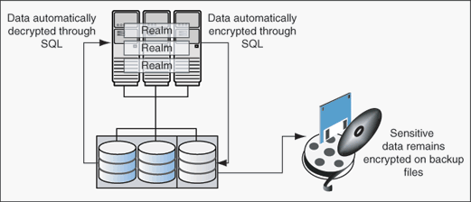

## 9 Integrating Oracle Database Vault with Other Oracle Products

This chapter contains:

Note:

If you plan to use Oracle Data Guard with Oracle Database Vault, see My Oracle Support Note 754065.1. You can access My Oracle Support from the following Web site:

[`https://support.oracle.com">>https://support.oracle.com`](https://support.oracle.com/)

## Integrating Oracle Database Vault with Enterprise User Security

You can integrate Oracle Database Vault with Oracle Enterprise User Security. Enterprise User Security enables you to centrally manage database users and authorizations in one place. It is combined with Oracle Identity Management and is available in Oracle Database Enterprise Edition.

In general, to integrate Oracle Database Vault with Oracle Enterprise User Security, you configure the appropriate realms to protect the data that you want to protect in the database.

After you define the Oracle Database Vault roles as needed, you can create a rule set for the Enterprise users to allow or disallow their access.

To configure an Enterprise User authorization:

1. Create a rule to allow or disallow user access.
	Follow the instructions in ["Creating a Rule to Add to a Rule Set"](cfrulset.md) to create a new rule. In the Create Rule page, enter the following PL/SQL in the Rule Expression field:
	```
	SYS_CONTEXT('USERENV','AUTHENTICATED_IDENTITY') = 'user_domain_name'
	```
	Replace `user_domain_name` with the domain, for example:
	```
	SYS_CONTEXT('USERENV','AUTHENTICATED_IDENTITY') = 'myserver.us.example.com'
	```
2. Add this rule to a new rule set.
	["Creating a Rule Set"](cfrulset.md) explains how to create a new rule set, including how to add an existing rule to it.
3. Add this rule set to the realm authorization for the database that you want to protect.
	["Defining Realm Authorization"](cfrealms.md) explains how to create realm authorizations. In the Authorization Rule Set list, select the rule set that you created in Step 2. Afterward, the realm authorization applies to all users.

For more information about Enterprise User Security, see [Oracle Database Enterprise User Security Administrator's Guide](https://docs.oracle.com/cd/E11882_01/network.112/e10744/toc.htm).

## Integrating Oracle Database Vault with Transparent Data Encryption

Transparent Data Encryption complements Oracle Database Vault in that it provides data protection when the data leaves the secure perimeter of the database. With Transparent Data Encryption, a database administrator or database security administrator can simply encrypt columns with sensitive content in application tables, or encrypt entire application tablespaces, without any modification to the application. For detailed information about Transparent Data Encryption, see [Oracle Database Advanced Security Administrator's Guide](https://docs.oracle.com/cd/E11882_01/network.112/e40393/asotrans.htm#ASOAG600).

If a user passes the authentication and authorization checks, Transparent Data Encryption automatically encrypts and decrypts information for the user. This way, you can implement encryption without having to change your applications.

Before you can use Oracle Database Vault with Transparent Data Encryption, you must enable the `SYSTEM` user (or other user with privileges to manage Transparent Data Encryption) as at minimum a participant of the Database Dictionary Realm. See ["ADD\_AUTH\_TO\_REALM Procedure"](apis_dbms_macadm.md) for more information about adding a user to a realm.

Once you have granted the Transparent Data Encryption user the appropriate privileges, then Transparent Data Encryption can be managed as usual and be used complimentary to Database Vault.

Figure 9-1 shows how Oracle Database Vault realms handle encrypted data.

Figure 9-1 Encrypted Data and Oracle Database Vault



> This figure shows a set of realms with data automatically being encrypted and decrypted through SQL. It also shows sensitive data encrypted on backup files.
>
> [Copyright © 2006, 2016, Oracle and/or its affiliates. All rights reserved.](https://docs.oracle.com/cd/E11882_01/dcommon/html/cpyr.htm)
  

## Attaching Factors to an Oracle Virtual Private Database

You can attach factors to an Oracle Virtual Private Database. To do so, define a policy predicate that is a PL/SQL function or expression. Then, for each function or expression, you can use the `DVF.F$` PL/SQL function that is created for each factor.

For more information about Oracle Virtual Private Database, see [Oracle Database Security Guide](https://docs.oracle.com/cd/E11882_01/network.112/e36292/vpd.htm#DBSEG007).

## Integrating Oracle Database Vault with Oracle Label Security

This section includes the following topics:

- How Oracle Database Vault Is Integrated with Oracle Label Security
- Requirements for Using Oracle Database Vault with Oracle Label Security
- Using Oracle Database Vault Factors with Oracle Label Security Policies
- Tutorial: Integrating Oracle Database Vault with Oracle Label Security
- Related Reports and Data Dictionary Views

### How Oracle Database Vault Is Integrated with Oracle Label Security

When you integrate Oracle Database Vault with Oracle Label Security, it means that you can assign an Oracle Label Security label to an Oracle Database Vault factor identity.

In Oracle Label Security, you can restrict access to records in database tables or PL/SQL programs. For example, Mary may be able to see data protected by the HIGHLY SENSITIVE label, an Oracle Label Security label on the `EMPLOYEE` table that includes records that should have access limited to certain managers. Another label can be PUBLIC, which allows more open access to this data.

In Oracle Database Vault, you can create a factor called Network, for the network on which the database session originates, with the following identities:

- Intranet: Used for when an employee is working on site within the intranet for your company.
- Remote: Used for when the employee is working at home from a VPN connection.

You then assign a maximum session label to both. For example:

- Assign the Intranet identity to the HIGHLY SENSITIVE Oracle Label Security label.
- Assign the Remote identity to the PUBLIC label.

This means that when Mary is working at home using her VPN connection, she has access only to the limited table data protected under the PUBLIC identity. But when she is in the office, she has access to the HIGHLY SENSITIVE data, because she is using the Intranet identity. "Tutorial: Integrating Oracle Database Vault with Oracle Label Security" provides an example of how to accomplish this type of integration.

You can audit the integration with Oracle Label Security by using the Label Security Integration Audit Report. See ["Label Security Integration Audit Report"](reports.md) for more information. Oracle Database Vault writes the audit trail to the `DVSYS.AUDIT_TRAIL$` system file, described in [Appendix A, "Auditing Oracle Database Vault."](audplcy.md)

You can use the Oracle Database Vault APIs to integrate Oracle Database Vault with Oracle Label Security. See [Chapter 12, "Using the DBMS\_MACADM Package,"](apis_dbms_macadm.md) for more information.

For more information about Oracle Label Security labels, levels, and policies, see [Oracle Label Security Administrator's Guide](https://docs.oracle.com/cd/E11882_01/network.112/e10745/toc.htm).

You can run reports on the Oracle Database Vault and Oracle Label Security integration. See "Related Reports and Data Dictionary Views" for more information.

### Requirements for Using Oracle Database Vault with Oracle Label Security

You must have the following requirements in place before you use Oracle Database Vault with Oracle Label Security:

- Oracle Label Security is licensed separately. Ensure that you have purchased a license to use it.
- Before you install Oracle Database Vault, you must have already installed Oracle Label Security.
- The installation process for Oracle Label Security creates the `LBACSYS` user account. As a user who has been granted the `DV_ACCTMGR` role, unlock this account and grant it a new password. For example:
	```
	sqlplus amalcolm_dvacctmgr
	Enter password: password
	ALTER USER LBACSYS ACCOUNT UNLOCK IDENTIFIED BY password;
	```
	Replace `password` with a password that is secure. See [Oracle Database Security Guide](https://docs.oracle.com/cd/E11882_01/network.112/e36292/authentication.htm#DBSEG33223) for the minimum requirements for creating passwords.
- If you plan to use the `LBACSYS` user account in Oracle Enterprise Manager, then log in to Enterprise Manager as user `SYS` with the `SYSDBA` privilege, and grant this user the `SELECT ANY DICTIONARY` and `SELECT_CATALOG_ROLE` system privileges.
- Ensure that you have the appropriate Oracle Label Security policies defined. For more information, see [Oracle Label Security Administrator's Guide](https://docs.oracle.com/cd/E11882_01/network.112/e10745/toc.htm).
- If you plan to integrate an Oracle Label Security policy with a Database Vault policy, then ensure that the policy name for Oracle Label Security is less than 24 characters. You can check the names of Oracle Label Security policies by querying the `POLICY_NAME` column of the `ALL_SA_POLICIES` data dictionary view.

### Using Oracle Database Vault Factors with Oracle Label Security Policies

Oracle Database Vault controls the maximum security clearance for a database session by merging the maximum allowable data for each label in a database session by merging the labels of Oracle Database Vault factors that are associated to an Oracle Label Security policy. In brief, a label acts as an identifier for the access privileges of a database table row. A policy is a name associated with the labels, rules, and authorizations that govern access to table rows. See [Oracle Label Security Administrator's Guide](https://docs.oracle.com/cd/E11882_01/network.112/e10745/toc.htm) for more information about row labels and policies.

Use the following steps to define factors that contribute to the maximum allowable data label of an Oracle Label Security policy:

1. Log in to Oracle Database Vault Administrator as a user who has been granted the `DV_OWNER` or `DV_ADMIN` role.
	["Starting Oracle Database Vault"](getting_started.md) explains how to log in.
2. Make the user `LBACSYS` account an owner of the realm that contains the schema to which a label security policy has been applied.
	This enables the `LBACSYS` account to have access to all the protected data in the realm, so that it can properly classify the data.
	The `LBACSYS` account is created in Oracle Label Security using the Oracle Universal Installer custom installation option. Before you can create an Oracle Label Security policy for use with Oracle Database Vault, you must make `LBACSYS` an owner for the realm you plan to use. See ["Defining Realm Authorization"](cfrealms.md) for more information.
3. Authorize the schema owner (on which the label security policy has been applied) as either a realm participant or a realm owner.
4. In the Administration page, under Database Vault Feature Administration, click Label Security Integration.
5. In the Label Security Policies page:
	- To register a new label security policy, click Create.
		- To edit an existing label security policy, select it from the list and then click Edit.
6. Enter the following settings and then click OK:
	- General
		- Label Security Policy Factors

General

Under General, enter the following settings:

- Label Security Policy: From the list, select the Oracle Label Security policy that you want to use.
- Algorithm: Optionally change the label-merging algorithm for cases when Oracle Label Security has merged two labels. In most cases, you may want to select LII - Minimum Level/Intersection/Intersection. This setting is the most commonly used method that Oracle Label Security administrators use when they want to merge two labels. This setting provides optimum flexibility when your applications must determine the resulting label that is required when combining two data sets that have different labels. It is also necessary for situations in which you must perform queries using joins on rows with different data labels.
	For more information on these label-merging algorithms, see [Oracle Label Security Administrator's Guide](https://docs.oracle.com/cd/E11882_01/network.112/e10745/toc.htm). If you want to use the `DBMS_MACADM` package to specify a merge algorithm, see [Table 12-57, "Oracle Label Security Merge Algorithm Codes"](apis_dbms_macadm.md) for a full listing of possible merge algorithms.
- Label for Initialization Errors: Optionally enter a label for initialization errors. The label specified for initialization errors is set when a configuration error or run-time error occurs during session initialization. You can use this setting to assign the session a data label that prevents access or updates to any data the policy protects until the issue is resolved.

Label Security Policy Factors

To select a factor to associate with an Oracle Label Security policy:

1. In the Available Factors list under Label Security Policy Factors, select the factor that you want to associate with the Oracle Label Security policy.
2. Click Move to move the factor to the Selected Factors list.
	Note:
	You can select multiple factors by holding down the Ctrl key as you click each factor that you want to select.

After you associate a factor with an Oracle Label Security policy, you can label the factor identities using the labels for the policy. ["Adding an Identity to a Factor"](cfgfact.md) provides detailed information.

Note:

If you do not associate an Oracle Label Security policy with factors, then Oracle Database Vault maintains the default Oracle Label Security behavior for the policy.

### Tutorial: Integrating Oracle Database Vault with Oracle Label Security

This section contains:

- About This Tutorial
- Step 1: Create Users for This Tutorial
- Step 2: Create the Oracle Label Security Policy
- Step 3: Create Oracle Database Vault Rules to Control the OLS Authorization
- Step 4: Update the ALTER SYSTEM Command Rule to Use the Rule Set
- Step 5: Test the Authorizations
- Step 6: Remove the Components for This Tutorial

#### About This Tutorial

You can use Oracle Database Vault factors with Oracle Label Security and Oracle Virtual Private Database (VPD) technology to restrict access to sensitive data. You can restrict this data so that it is only exposed to a database session when the correct combination of factors exists, defined by the security administrator, for any given database session.

This tutorial shows how you can integrate Oracle Database Vault with Oracle Label Security to grant two administrative users who normally have the same privileges different levels of access.

#### Step 1: Create Users for This Tutorial

1. Log in to SQL\*Plus as a user who has been granted the `DV_ACCTMGR` role.
	For example:
	```
	sqlplus amalcolm_dvacctmgr
	Enter password: password
	```
2. Create the following users:
	```
	CREATE USER mdale IDENTIFIED BY password;
	CREATE USER jsmith IDENTIFIED BY password;
	```
	Replace `password` with a password that is secure. See [Oracle Database Security Guide](https://docs.oracle.com/cd/E11882_01/network.112/e36292/authentication.htm#DBSEG33223) for the minimum requirements for creating passwords.
3. Connect as user `SYS` with the `SYSDBA` privilege and then grant administrative privileges to users `mdale` and `jsmith`.
	```
	CONNECT SYS AS SYSDBA
	Enter password: password
	GRANT CREATE SESSION, DBA TO mdale, jsmith;
	```
	At this stage, users `mdale` and `jsmith` have identical administrative privileges.

#### Step 2: Create the Oracle Label Security Policy

1. In SQL\*Plus, connect as the Oracle Label Security administrator, `LBACSYS`.
	```
	CONNECT LBACSYS
	Enter password: password
	```
	If user `LBACSYS` is locked and expired, connect as the Database Vault Account Manager, unlock and unexpire the `LBACSYS` account, and then log back in as `LBACSYS`.
	For example:
	```
	CONNECT amalcolm_dvacctmgr
	Enter password: password
	ALTER USER LBACSYS ACCOUNT UNLOCK IDENTIFIED BY password;
	CONNECT LBACSYS
	Enter password: password
	```
2. Create a new Oracle Label Security policy:
	```
	EXEC SA_SYSDBA.CREATE_POLICY('PRIVACY','PRIVACY_COLUMN','NO_CONTROL');
	```
3. Create the following levels for the `PRIVACY` policy:
	```
	EXEC SA_COMPONENTS.CREATE_LEVEL('PRIVACY',2000,'S','SENSITIVE');
	EXEC SA_COMPONENTS.CREATE_LEVEL('PRIVACY',1000,'C','CONFIDENTIAL');
	```
4. Create the PII compartment.
	```
	EXEC SA_COMPONENTS.CREATE_COMPARTMENT('PRIVACY',100,'PII','PERS_INFO');
	```
5. Grant users `mdale` and `jsmith` the following labels:
	```
	EXEC SA_USER_ADMIN.SET_USER_LABELS('PRIVACY','mdale','S:PII');
	EXEC SA_USER_ADMIN.SET_USER_LABELS('PRIVACY','jsmith','C');
	```
	User `mdale` is granted the more sensitive label, Sensitive, which includes the PII compartment. User `jsmith` gets the Confidential label, which is less sensitive.

#### Step 3: Create Oracle Database Vault Rules to Control the OLS Authorization

1. Connect to SQL\*Plus as the Database Vault Owner.
	For example:
	```
	CONNECT lbrown_dvowner
	Enter password: password
	```
2. Create the following rule set:
	```
	EXEC DBMS_MACADM.CREATE_RULE_SET('PII Rule Set',
	 'Protect PII data from privileged users','Y',1,0,2,NULL,NULL,0,NULL);
	```
3. Create a rule for the PII Rule Set.
	```
	EXEC DBMS_MACADM.CREATE_RULE('Check OLS Factor', 
	 'dominates(sa_utl.numeric_label(''PRIVACY''), 
	  char_to_label(''PRIVACY'',''S:PII'')) = ''1''');
	```
	Ensure that you use single quotes, as shown in this example, and not double quotes.
4. Add the Check OLS Factor rule to the PII Rule Set.
	```
	EXEC DBMS_MACADM.ADD_RULE_TO_RULE_SET('PII Rule Set', 
	 'Check OLS Factor');
	```
5. Synchronize the Check OLS factor rule.
	```
	EXEC DBMS_MACADM.SYNC_RULES;
	COMMIT;
	```

#### Step 4: Update the ALTER SYSTEM Command Rule to Use the Rule Set

1. As the Database Vault Owner, check the current value of the ALTER SYSTEM command rule, which is one of the default command rules when you install Oracle Database Vault.
	```
	SELECT * FROM DVSYS.DBA_DV_COMMAND_RULE WHERE COMMAND = 'ALTER SYSTEM';
	```
2. Make a note of these settings so that you can revert them to their original values later on.
	In a default installation, the ALTER SYSTEM command rule uses the Allow System Parameters rule set, has no object owner or name, and is enabled.
3. Update the ALTER SYSTEM command rule to include the PII Rule Set.
	```
	EXEC DBMS_MACADM.UPDATE_COMMAND_RULE('ALTER SYSTEM', 'PII Rule Set', '%', '%', 'Y');
	```
	This command adds the PII Rule Set to the ALTER SYSTEM command rule, applies it to all object owners and object names, and enables the command rule.

#### Step 5: Test the Authorizations

1. In SQL\*Plus, log on as user `mdale`.
	```
	CONNECT mdale
	Enter password: password
	```
2. Check the current setting for the `AUDIT_TRAIL` initialization parameter.
	```
	SHOW PARAMETER AUDIT_TRAIL
	NAME                                 TYPE        VALUE
	------------------------------------ ----------- ----------------------
	audit_trail                          string      DB
	```
	Make a note of this setting, so that you can revert it to its original setting later on.
3. As user `mdale`, use the `ALTER SYSTEM` statement to modify the `AUDIT_TRAIL` parameter.
	```
	ALTER SYSTEM SET AUDIT_TRAIL=OS, EXTENDED SCOPE=SPFILE;
	System altered.
	```
	Because user `mdale` was assigned the Sensitive label with the PII compartment, he can use the `ALTER SYSTEM` statement to modify the `AUDIT_TRAIL` system parameter.
4. Set the `AUDIT_TRAIL` parameter back to its original value, for example:
	```
	ALTER SYSTEM SET AUDIT_TRAIL=DB, EXTENDED SCOPE=SPFILE;
	```
5. Log in as user `jsmith` and then issue the same `ALTER SYSTEM` statement:
	```
	CONNECT jsmith
	Enter password: password
	ALTER SYSTEM SET AUDIT_TRAIL=OS, EXTENDED SCOPE=SPFILE;
	```
	The following output should appear:
	```
	ERROR at line 1:
	ORA-01031: insufficient privileges
	```
	Because user `jsmith` was assigned only the Confidential label, he cannot perform the `ALTER SYSTEM` statement.
6. Now log in as user `SYSTEM`, who normally has the `ALTER SYSTEM` privilege, and issue the same `ALTER SYSTEM` statement:
	```
	CONNECT SYSTEM
	Enter password: password
	```
	The following output should appear:
	```
	ERROR at line 1:
	ORA-01031: insufficient privileges
	```
	`SYSTEM` no longer has sufficient privileges needed to perform an `ALTER SYSTEM` statement. Only users who have been assigned the Sensitive label, as with user `mdale`, can use the `ALTER SYSTEM` statement.

#### Step 6: Remove the Components for This Tutorial

1. Connect as the Oracle Label Security administrator and remove the label policy and its components.
	```
	CONNECT LBACSYS
	Enter password: password
	EXEC SA_SYSDBA.DROP_POLICY('PRIVACY', TRUE);
	```
2. Connect as the Oracle Database Vault Owner and issue the following commands in the order shown, to set the ALTER SYSTEM command rule back to its previous setting and remove the rule set.
	For example:
	```
	CONNECT lbrown_dvowner
	Enter password: password
	EXEC DBMS_MACADM.UPDATE_COMMAND_RULE('ALTER SYSTEM', 'Allow System Parameters','%', '%', 'Y');
	EXEC DBMS_MACADM.DELETE_RULE_FROM_RULE_SET('PII Rule Set', 'Check OLS Factor');
	EXEC DBMS_MACADM.DELETE_RULE('Check OLS Factor');
	EXEC DBMS_MACADM.DELETE_RULE_SET('PII Rule Set');
	COMMIT;
	```
3. Connect as the Database Vault Account Manager and remove users `mdale` and `jsmith`.
	```
	CONNECT amalcolm_dvacctmgr
	Enter password: password
	DROP USER mdale;
	DROP USER jsmith;
	```

### Related Reports and Data Dictionary Views

Table 9-1 lists Oracle Database Vault reports that are useful for analyzing the integration of Oracle Database Vault and Oracle Label Security. See [Chapter 18, "Oracle Database Vault Reports,"](reports.md) for information about how to run these reports.

Table 9-1 Reports Related to Database Vault and Oracle Label Security Integration

| Report | Description |
| --- | --- |
| ["Factor Configuration Issues Report"](reports.md) | Lists factors in which the Oracle Label Security policy does not exist. |
| ["Identity Configuration Issues Report"](reports.md) | Lists invalid label identities (the Oracle Label Security label for this identity has been removed and no longer exists). |
| ["Security Policy Exemption Report"](reports.md) | Lists accounts and roles that have the `EXEMPT ACCESS POLICY` system privilege granted to them. Accounts that have this privilege can bypass all Virtual Private Database policy filters and any Oracle Label Security policies that use Oracle Virtual Private Database indirectly. |

Table 9-2 lists data dictionary views that provide information about existing Oracle Label Security policies used with Oracle Database Vault.

Table 9-2 Data Dictionary Views Used for Oracle Label Security

| Data Dictionary View | Description |
| --- | --- |
| ["DVSYS.DBA\_DV\_MAC\_POLICY View"](views.md) | Lists the Oracle Label Security policies defined |
| ["DVSYS.DBA\_DV\_MAC\_POLICY\_FACTOR View"](views.md) | Lists the factors that are associated with Oracle Label Security policies |
| ["DVSYS.DBA\_DV\_POLICY\_LABEL View"](views.md) | Lists the Oracle Label Security label for each factor identifier in the `DVSYS.DBA_DV_IDENTITY` view for each policy |