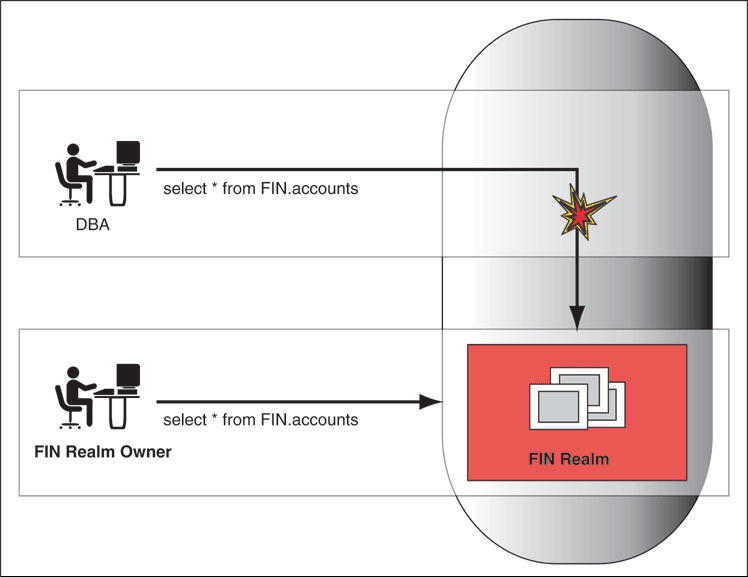

## 1 Introducing Oracle Database Vault

This chapter contains:

## What Is Oracle Database Vault?

Oracle Database Vault restricts access to specific areas in an Oracle database from any user, including users who have administrative access. For example, you can restrict administrative access to employee salaries, customer medical records, or other sensitive information.

This enables you to apply fine-grained access control to your sensitive data in a variety of ways. It hardens your Oracle Database instance and enforces industry standard best practices in terms of separating duties from traditionally powerful users. Most importantly, it protects your data from super-privileged users but still allows them to maintain your Oracle databases. Oracle Database Vault is an integral component of your enterprise.

With Oracle Database Vault, you address the most difficult security problems remaining today: protecting against insider threats, meeting regulatory compliance requirements, and enforcing separation of duty.

You configure Oracle Database Vault to manage the security of an individual Oracle Database instance. You can install Oracle Database Vault on standalone Oracle Database installations, in multiple Oracle homes, and in Oracle Real Application Clusters (Oracle RAC) environments.

For frequently asked questions about Oracle Database Vault, visit

`http://www.oracle.com/technetwork/database/focus-areas/security/dbv-faq-083210.html`

For Oracle Technology Network (OTN) information specific to Oracle Database Vault, visit

`http://www.oracle.com/technetwork/database/options/database-vault/index-085211.html`

## Components of Oracle Database Vault

Oracle Database Vault has the following components:

- Oracle Database Vault Access Control Components
- Oracle Database Vault Administrator
- Oracle Database Vault DVSYS and DVF Schemas
- Oracle Database Vault PL/SQL Interfaces and Packages
- Oracle Database Vault and Oracle Label Security PL/SQL APIs
- Oracle Database Vault Reporting and Monitoring Tools

### Oracle Database Vault Access Control Components

Oracle Database Vault enables you to create the following components to manage security for your database instance:

- Realms. A realm is a functional grouping of database schemas, objects, and roles that must be secured. For example, you can group a set of schemas, objects, and roles that are related to accounting, sales, or human resources. After you have grouped these into a realm, you can use the realm to control the use of system privileges to specific accounts or roles. This enables you to provide fine-grained access controls for anyone who wants to use these schemas, objects, and roles. [Chapter 4, "Configuring Realms,"](cfrealms.md) discusses realms in detail.
- Command rules. A command rule is a special rule that you can create to control how users can execute almost any SQL statement, including `SELECT`, `ALTER SYSTEM`, database definition language (DDL), and data manipulation language (DML) statements. Command rules must work with rule sets to determine whether the statement is allowed. [Chapter 6, "Configuring Command Rules,"](cfcmdaut.md) discusses command rules in detail.
- Factors. A factor is a named variable or attribute, such as a user location, database IP address, or session user, which Oracle Database Vault can recognize and secure. You can use factors for activities such as authorizing database accounts to connect to the database or creating filtering logic to restrict the visibility and manageability of data. Each factor can have one or more identities. An identity is the actual value of a factor. A factor can have several identities depending on the factor retrieval method or its identity mapping logic. [Chapter 7, "Configuring Factors,"](cfgfact.md) discusses factors in detail.
- Rule sets. A rule set is a collection of one or more rules that you can associate with a realm authorization, command rule, factor assignment, or secure application role. The rule set evaluates to true or false based on the evaluation of each rule it contains and the evaluation type (All True or Any True). The rule within a rule set is a PL/SQL expression that evaluates to true or false. You can have the same rule in multiple rule sets. [Chapter 5, "Configuring Rule Sets,"](cfrulset.md) discusses rule sets in detail.
- Secure application roles. A secure application role is a special Oracle Database role that can be enabled based on the evaluation of an Oracle Database Vault rule set. [Chapter 8, "Configuring Secure Application Roles for Oracle Database Vault,"](cfseappr.md) discusses secure application roles in detail.

To augment these components, Oracle Database Vault provides a set of PL/SQL interfaces and packages. "Oracle Database Vault PL/SQL Interfaces and Packages" provides an overview. [Chapter 16, "Oracle Database Vault Data Dictionary Views,"](views.md) provides information on data dictionary views that are specific to Oracle Database Vault.

In general, the first step you take is to create a realm composed of the database schemas or database objects that you want to secure. You can further secure the realm by creating rules, command rules, factors, identities, rule sets, and secure application roles. In addition, you can run reports on the activities these components monitor and protect. [Chapter 3, "Getting Started with Oracle Database Vault,"](getting_started.md) provides a simple tutorial that will familiarize you with basic Oracle Database Vault functionality. [Chapter 18, "Oracle Database Vault Reports,"](reports.md) provides more information about how you can run reports to check the configuration and other activities that Oracle Database Vault performs.

### Oracle Database Vault Administrator

Oracle Database Vault Administrator (DVA) is a Java application that is built on top of the Oracle Database Vault PL/SQL application programming interfaces (API). This application allows security managers who may not be proficient in PL/SQL to configure the access control policy through a user-friendly interface. Oracle Database Vault Administrator provides an extensive collection of security-related reports that assist in understanding the baseline security configuration. These reports also help point out deviations from this baseline.

[Chapter 4](cfrealms.md) through [Chapter 9](dv_ols.md) explain how to use Oracle Database Vault Administrator to configure access control policy defined in realms, command rules, factors, rule sets, secure application roles, and how to integrate Oracle Database Vault with other Oracle products. [Chapter 18, "Oracle Database Vault Reports,"](reports.md) explains Oracle Database Vault reporting.

### Oracle Database Vault DVSYS and DVF Schemas

Oracle Database Vault provides a schema, `DVSYS`, which stores the database objects needed to process Oracle data for Oracle Database Vault. This schema contains the roles, views, accounts, functions, and other database objects that Oracle Database Vault uses. The `DVF` schema contains public functions to retrieve (at run time) the factor values set in the Oracle Database Vault access control configuration.

[Chapter 11, "Oracle Database Vault Objects,"](db_objects.md) describes these schemas in detail.

### Oracle Database Vault PL/SQL Interfaces and Packages

Oracle Database Vault provides a collection of PL/SQL interfaces and packages that allow security managers or application developers to configure the access control policy as required. The PL/SQL procedures and functions allow the general database account to operate within the boundaries of access control policy in the context of a given database session.

See [Chapter 15, "Using the Oracle Database Vault PL/SQL Interfaces,"](plsql_interfaces.md) and [Chapter 12, "Using the DBMS\_MACADM Package,"](apis_dbms_macadm.md) for more information.

### Oracle Database Vault and Oracle Label Security PL/SQL APIs

Oracle Database Vault provides access control capabilities that can be integrated with Oracle Label Security. The Oracle Label Security database option is integrated with Oracle Enterprise Manager Database Control, which enables the security manager to define label security policy and apply it to database objects. Oracle Label Security also provides a collection of PL/SQL packages that can be used by a database application developer to provide label security policy and protections.

See ["Integrating Oracle Database Vault with Oracle Label Security"](dv_ols.md) for more information on how Oracle Database Vault works with Oracle Label Security. See also [Oracle Label Security Administrator's Guide](https://docs.oracle.com/cd/E11882_01/network.112/e10745/toc.htm) for more information about Oracle Policy Manager.

### Oracle Database Vault Reporting and Monitoring Tools

You can generate reports on the various activities that Oracle Database Vault monitors. In addition, you can monitor policy changes, security violation attempts, and database configuration and structural changes.

See [Chapter 18, "Oracle Database Vault Reports,"](reports.md) for more information about the reports that you can generate. [Chapter 17, "Monitoring Oracle Database Vault,"](monitoring.md) explains how to monitor Oracle Database Vault.

## How Oracle Database Vault Addresses Compliance Regulations

One of the biggest side benefits resulting from regulatory compliance has been security awareness. Historically, the focus of the information technology (IT) department has been on high availability and performance. The focus on regulatory compliance has required everyone to take a step back and look at their IT infrastructure, databases, and applications from a security angle. Common questions include:

- Who has access to this information?
- Where is the sensitive information stored?

Regulations such as the Sarbanes-Oxley Act, Health Insurance Portability and Accountability Act (HIPAA), International Convergence of Capital Measurement and Capital Standards: a Revised Framework (Basel II), Japan Privacy Law, Payment Card Industry Data Security Standard (PCI DSS), and the European Union Directive on Privacy and Electronic Communications have common themes that include internal controls, separation of duty, and access control.

While most changes required by regulations such as Sarbanes-Oxley and HIPAA are procedural, the remainder may require technology investments. A common security requirement found in regulations is stringent internal controls. The degree to which Oracle Database Vault helps an organization achieve compliance varies with the regulation. In general, Oracle Database Vault realms, separation of duty features, command rules, and factors help reduce the overall security risks that regulation provisions worldwide address.

Table 1-1 lists regulations that address potential security threats.

Table 1-1 Regulations That Address Potential Security Threats

| Regulation | Potential Security Threat |
| --- | --- |
| Sarbanes-Oxley Section 302 | Unauthorized changes to data |
| Sarbanes-Oxley Section 404 | Modification to data, unauthorized access |
| Sarbanes-Oxley Section 409 | Denial of service, unauthorized access |
| Gramm-Leach-Bliley | Unauthorized access, modification, or disclosure |
| Health Insurance Portability and Accountability Act (HIPAA) 164.306 | Unauthorized access to data |
| HIPAA 164.312 | Unauthorized access to data |
| Basel II – Internal Risk Management | Unauthorized access to data |
| CFR Part 11 | Unauthorized access to data |
| Japan Privacy Law | Unauthorized access to data |
| EU Directive on Privacy and Electronic Communications | Unauthorized access to data |
| Payment Card Industry Data Security Standard (PCI DSS) | Unauthorized changes to data |

## How Oracle Database Vault Addresses Insider Threats

For many years, worms, viruses, and the external intruder (hacker) have been perceived as the biggest threats to computer systems. Unfortunately, what is often overlooked is the potential for trusted users or privileged users to steal or modify data.

Oracle Database Vault protects against insider threats by using realms, factors, and command rules. Combined, these provide powerful security tools to help secure access to databases, applications, and sensitive information. You can combine rules and factors to control the conditions under which commands in the database are allowed to execute, and to control access to data protected by a realm. For example, you can create rules and factors to control access to data based on IP addresses, the time of day, and specific programs. These can limit access to only those connections pass these conditions. This can prevent unauthorized access to the application data and access to the database by unauthorized applications.

Oracle Database Vault provides built-in factors that you can use in combination with rules to control access to the database, realm-protected applications, and commands within the database.

You can associate rules and factors with dozens of commands within the database to provide stronger internal controls within the database. You can customize these to meet the operational policies for your site. For example, you could define a rule to limit execution of the `ALTER SYSTEM` statement to a specific IP address and host name.

## How Oracle Database Vault Allows for Flexible Security Policies

Oracle Database Vault helps you design flexible security policies for your database. For example, any database user, such as `SYSTEM`, who has the `DBA` role, can make modifications to basic parameters in a database. Suppose an inexperienced administrator who has system privileges decides to start a new redo log file but does not realize that doing so at a particular time may cause problems for the database. With Oracle Database Vault, you can create a command rule to prevent this user from making such modifications by limiting his or her usage of the `ALTER SYSTEM SWITCH LOGFILE` statement. Furthermore, you can attach rules to the command rule to restrict activity further, such as limiting the statement's execution in the following ways:

- By time (for example, only during 4 p.m. and 5 p.m. on Friday afternoons)
- By local access only, that is, not remotely
- By IP address (for example, allowing the action to only a specified range of IP addresses)

In this way, you can carefully control and protect your system. You can disable and reenable command rules when you need to, and easily maintain them from one central location using Oracle Database Vault Administrator.

## How Oracle Database Vault Addresses Database Consolidation Concerns

Oracle customers today still have hundreds and even thousands of databases distributed throughout the enterprise and around the world. However, database consolidation will continue as a cost-saving strategy in the coming years. The physical security provided by the distributed database architecture must be available in the consolidated environment. Oracle Database Vault addresses the primary security concerns of database consolidation.

Figure 1-1 illustrates how Oracle Database Vault addresses the following database security concerns:

- Administrative privileged account access to application data: In this case, Oracle Database Vault prevents the DBA from accessing the schemas that are protected by the FIN Realm. Although the DBA is the most powerful and trusted user, the DBA does not need access to application data residing within the database.
- Separation of duties for application data access: In this case, the FIN Realm Owner, created in Oracle Database Vault, has access to the FIN Realm schemas.

Figure 1-1 Oracle Database Vault Security

> Surrounding text describes this figure.
>
> [Copyright © 2006, 2016, Oracle and/or its affiliates. All rights reserved.](https://docs.oracle.com/cd/E11882_01/dcommon/html/cpyr.htm)
  

Database consolidation can result in multiple powerful user accounts residing in a single database. This means that in addition to the overall database DBA, individual application schema owners also may have powerful privileges. Revoking some privileges may adversely affect existing applications. Using Oracle Database Vault realms, you can enforce access to applications through a trusted path, preventing database users who have not been specifically authorized access from using powerful privileges to look at application data. For example, a DBA who has the `SELECT ANY TABLE` privilege can be prevented from using that privilege to view application data.