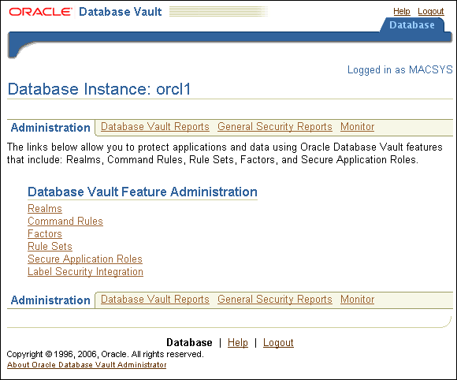

## 3 Getting Started with Oracle Database Vault

This chapter contains:

## Registering (Enabling) Oracle Database Vault

After you install Oracle Database, you must register (that is, enable) Oracle Database Vault. Oracle Database includes Database Vault by default, but you must register it before you can use it. As part of the registration process, you create the Database Vault administrative accounts. The registration process also creates the Database Vault `DVSYS` and `DVF` schemas. This procedure applies to both single-instance and Oracle RAC installations. To check if Database Vault has already been enabled, see ["Checking if Oracle Database Vault Is Enabled or Disabled"](dvdisabl.md).

Note:

You cannot enable Oracle Database Vault by using scripts that have been generated by Database Configuration Assistant (DBCA).
1. Ensure that the computer on which you want to register Oracle Database Vault has the Oracle Enterprise Manager Database Console available.
	You can check the status of the Database Console by running the `emctl status dbconsole` command. For example:
	```
	./emctl status dbconsole
	```
2. Stop the database, Database Control console process, and listener.
	- UNIX: Connect as user `SYS` with the `SYSOPER` privilege and shut down the database. Then from the command line, stop the Database Console process and listener.
		For example:
		```
		CONNECT sys as sysoper
		Enter password: password
		SQL> SHUTDOWN IMMEDIATE
		SQL> EXIT
		$ emctl stop dbconsole
		$ lsnrctl stop [listener_name]
		```
		For Oracle RAC installations, shut down each database instance as follows:
		```
		$ srvctl stop database -d db_name
		```
		- Windows: Stop the database, Database Control console process, and listener from the Services tool in the Control Panel. The names of Oracle Database services begin with `Oracle`.
3. Enable Oracle Database Vault as follows:
	- UNIX: Run the following commands. The `make` command enables both Oracle Database Vault (`dv_on`) and Oracle Label Security (`lbac_on`). You must enable Oracle Label Security before you can use Database Vault.
		```
		$ cd $ORACLE_HOME/rdbms/lib
		$ make -f ins_rdbms.mk dv_on lbac_on ioracle
		```
		If you want to use the RDS protocol for Oracle Exadata storage, then use the following commands to enable Database Vault and Label Security.
		```
		$ cd $ORACLE_HOME/rdbms/lib
		$ make –f ins_rdbms.mk dv_on lbac_on ipc_rds ioracle
		```
		- Windows: In the `ORACLE_BASE\ORACLE_HOME` `\bin` directory, rename the `oradvll.dll.dbl` file to `oradvll.dll`. Ensure that the name of the Oracle Label Security executable is `oralbacll.dll` (and not oralbacll.dll.dbl or some other backup name). You must enable Oracle Label Security before you can use Database Vault.
4. Restart the database and listener. (Do not restart the Database Control console process yet.)
	- UNIX: Log in to SQL\*Plus as user `SYS` with the `SYSOPER` privilege and restart the database. Then from the command line, restart the listener.
		For example:
		```
		sqlplus sys as sysoper
		Enter password: password
		SQL> STARTUP
		SQL> EXIT
		$ lsnrctl start [listener_name]
		```
		For Oracle RAC installations, restart each database instance as follows:
		```
		$ srvctl start database -d db_name
		```
		- Windows: Restart the database and listener from the Services tool in the Control Panel. The names of Oracle Database services begin with `Oracle`.
5. Start Database Configuration Assistant.
	- UNIX: Enter the following command at a terminal window:
		```
		dbca
		```
		By default, `dbca` is in the `$ORACLE_HOME/bin` directory.
		- Windows: From the Start menu, click All Programs. Then, click Oracle - ORACLE\_HOME, Configuration and Migration Tools, and then Database Configuration Assistant.
		Alternatively, you can start Database Configuration Assistant at a command prompt:
		```
		dbca
		```
		As with UNIX, typically, `dbca` is in the `ORACLE_BASE` `\` `ORACLE_HOME` `\bin` directory.
6. In the Welcome page, click Next.
	The Operations page appears.
7. Select Configure Database Options, and then click Next.
	The Database page appears.
8. From the list, select the database where you installed Oracle Database and then click Next.
	The Database Content page appears.
9. Perform one of the following actions:
	- If Oracle Label Security is already enabled: Select the Oracle Database Vault option, and then click Next.
		- If Oracle Label Security is not enabled: Select the Oracle Label Security option so that the Oracle Database Vault option becomes available for selection. Select the Oracle Database Vault option as well, and then click Next.
	The Oracle Database Vault Credentials page appears.
10. Specify the name and password for the Database Vault Owner account (for example, `DBVOWNER`) and the Database Vault Account Manager (for example, `DBVACCTMGR`).
	Do not enter the names `DV_OWNER`, `DV_ACCTMGR`, or the names of any other Database Vault roles for these user accounts. These names are reserved words. ["Oracle Database Vault Roles"](db_objects.md) describes the Database Vault roles.
	Enter any password that is secure, according to the password guidelines described in [Oracle Database Security Guide](https://docs.oracle.com/cd/E11882_01/network.112/e36292/authentication.htm#DBSEG33223). Oracle Database Vault has additional password requirements, which are displayed if you try to create an incorrect password.
11. Click Next.
	The Connection Mode page appears.
12. Select either Dedicated Server Mode or Shared Server Mode (depending on the selection you made when you created this database), click Finish, and then click OK in the confirmation prompts.
	Database Configuration Assistant registers Oracle Database Vault, and then restarts the database instance.
13. Exit Database Configuration Assistant.
14. Restart the Database Control console process.
	- UNIX: Run the following command:
		```
		$ emctl start dbconsole
		```
		- Windows: Restart the Database Control console process (for example, `OracleDBConsoleorcl` if the name of the database is `orcl`) from the Services tool in the Control Panel.

After you have registered Oracle Database Vault with an Oracle database, you can start Oracle Database Vault Administrator. See "Starting Oracle Database Vault" for more information.

## Starting Oracle Database Vault

This section describes how to start Oracle Database Vault Administrator. This section contains:

- Accessing the Oracle Database Vault Pages and DVA from Oracle Enterprise Manager
- Starting Oracle Database Vault Administrator

### Accessing the Oracle Database Vault Pages and DVA from Oracle Enterprise Manager

This section contains:

- Accessing Oracle Database Vault Pages from Database Control
- Accessing Oracle Database Vault Pages from Grid Control
- Accessing Database Vault Administrator from Database Control

#### Accessing Oracle Database Vault Pages from Database Control

From Database Control, you can use the Oracle Database Vault pages to monitor a Database Vault-enabled database and view Database Vault reports.

However, you cannot create policies or perform other Database Vault Administrator-related actions from Database Control. If you want to perform these tasks, use Database Vault Administrator, described under "Starting Oracle Database Vault Administrator". If you want to propagate Database Vault policies to other Database Vault-enabled databases, see "Accessing Oracle Database Vault Pages from Grid Control".

To access the Oracle Database Vault pages from Database Control:

1. If necessary, register Oracle Database Vault.
	If you have just installed Oracle Database Vault, you must register it with the database. See "Registering (Enabling) Oracle Database Vault" for more information.
2. Start Database Control.
	For example:
	```
	https://myserver.example.com:1158/em
	```
	See [Oracle Database 2 Day DBA](https://docs.oracle.com/cd/E11882_01/server.112/e10897/em_manage.htm#ADMQS033) for more information on logging in to Oracle Enterprise Manager.
3. Log in to Database Control with the following information:
	- Username: Enter the name of a user who has been granted the appropriate Oracle Database Vault role:
		- Creating and propagating Database Vault policies: `DV_OWNER` or `DV_ADMIN`
				- Viewing Database Vault alerts and reports: `DV_OWNER`, `DV_ADMIN`, or `DV_SECANALYST`
				- Creating and managing user accounts and roles: `DV_ACCTMGR`
		The Oracle Database Vault roles do not need any additional privileges (such as `SELECT ANY DICTIONARY`) to use Database Control.
		See ["About Oracle Database Vault Roles"](db_objects.md) for more information about these roles.
		- Password: Enter your password.
		- Connect As: Select Normal from the list.
		- Save as Preferred Credential check box: Select this check box if you want these credentials to be automatically filled in for you the next time that this page appears
4. In the Home page, click Server to display the Server subpage.
5. Under Security, select Database Vault.
	The Oracle Database Vault home page appears.

#### Accessing Oracle Database Vault Pages from Grid Control

From Grid Control, you can use the Oracle Database Vault pages to propagate Database Vault policies to other Database Vault-protected databases, administer and monitor Database Vault-protected databases from a centralized console, automate alerts, and view Database Vault reports.

However, you cannot create policies or perform other Database Vault Administrator-related actions from Grid Control. If you want to perform these tasks, use Database Vault Administrator, described under "Starting Oracle Database Vault Administrator".

To access the Oracle Database Vault pages from Grid Control:

1. Ensure that you have configured the Grid Control target databases that you plan to use with Database Vault.
	See the Oracle Enterprise Manager online help and [Oracle Enterprise Manager Advanced Configuration](http://www.oracle.com/pls/topic/lookup?ctx=db112&id=OEMCG) for more information about configuring target databases.
2. If necessary, register Oracle Database Vault.
	If you have just installed Oracle Database Vault, you must register it with the database. See "Registering (Enabling) Oracle Database Vault" for more information.
3. Start Grid Control.
	For example:
	```
	https://myserver.example.com:1158/em
	```
	See [Oracle Database 2 Day DBA](https://docs.oracle.com/cd/E11882_01/server.112/e10897/em_manage.htm#ADMQS033) for more information on logging in to Oracle Enterprise Manager.
4. Log in to Oracle Enterprise Manager as user `SYSMAN` and connect as `Normal`.
5. In the Oracle Enterprise Manager Database Home page (Database Home page), select the Targets subpage.
6. Select the Databases subpage.
7. In the Databases page, select the link for the Oracle Database Vault-protected database to which you want to connect.
	The home page for the database instance appears.
8. In the Home page, click Server to display the Server subpage.
9. Under Security, select Database Vault.
	The Database Login page appears.
10. Enter the following information:
	- Username: Enter the name of a user who has been granted the appropriate Oracle Database Vault role:
		- Creating and propagating Database Vault policies: `DV_OWNER` or `DV_ADMIN`
				- Viewing Database Vault alerts and reports: `DV_OWNER`, `DV_ADMIN`, or `DV_SECANALYST`
				- Creating and managing user accounts and roles: `DV_ACCTMGR`
		The Oracle Database Vault roles do not need any additional privileges (such as `SELECT ANY DICTIONARY`) to use Grid Control.
		See ["About Oracle Database Vault Roles"](db_objects.md) for more information.
		- Password: Enter your password.
		- Connect As: Select Normal from the list.
		- Save as Preferred Credential check box: Select this check box if you want these credentials to be automatically filled in for you the next time that this page appears
11. Click the Login button.
	The Database Vault home page appears.

See Also:

["Using Oracle Database Vault with Oracle Enterprise Manager"](dba.md)

#### Accessing Database Vault Administrator from Database Control

You can access Database Vault Administrator from Oracle Enterprise Manager Database Control.

- Step 1: Grant the DV\_OWNER User the Appropriate Privileges
- Step 2: As the DV\_OWNER User, Access Database Vault Administrator from Database Control

Step 1: Grant the DV\_OWNER User the Appropriate Privileges

1. Start Database Control.
	For example:
	```
	https://myserver.example.com:1158/em
	```
	See [Oracle Database 2 Day DBA](https://docs.oracle.com/cd/E11882_01/server.112/e10897/em_manage.htm#ADMQS033) for more information on logging in to Oracle Enterprise Manager.
2. Log into Database Control as the `SYSMAN` user or `SYSTEM`.
	The Database home page appears.
3. In the top-right corner of the window, click the Setup button.
4. Select the Administrators link.
5. In the Administrators window, click the Create button.
6. In the Create Administrator window, do the following:
	- User Name: Enter the name of a user who has been granted the `DV_OWNER` role. You can query the `USER_ROLE_PRIVS` data dictionary view to find the roles that have been granted to users.
		- E-mail Address: Optionally, enter this user's email address (but it is not required).
		- Administrator Privilege: Select View on All Targets.
		- Grant SELECT\_CATALOG\_ROLE: Uncheck this check box.
7. Click Review.
8. Click Finish.

Step 2: As the DV\_OWNER User, Access Database Vault Administrator from Database Control

1. If necessary, register Oracle Database Vault.
	If you have just installed Oracle Database Vault, you must register it with the database. See "Registering (Enabling) Oracle Database Vault" for more information.
2. Log into Database Control as the `DV_OWNER` user who you configured in "Step 1: Grant the DV\_OWNER User the Appropriate Privileges".
	The following message appears:
	```
	You have been logged in to a Database with Database Vault installed on it. As Database Vault enforces separation of duty you may not be able to use all the areas in EM. Please click the link below which will forward you to the area which you have access to.
	```
3. Click the Database Vault link.
	The Database Vault home page appears.
4. Click the Administration tab.
5. Select an administrative option (such as Realms).
6. When prompted, enter the URL to Database Vault Administrator, using the following syntax:
	```
	https://host_name:port/dva
	```
	- `host_name`: The server and domain where you installed Oracle Database Vault
		- `port`: The Oracle Enterprise Manager Console HTTPS port number
	For example:
	```
	https://myserver:1158/dva
	```
	If you are unsure of the port number, then open the `$ORACLE_HOME` `/` `host_sid` `/sysman/config/emd.properties` file and search for `REPOSITORY_URL`. In most cases, the host name and port number are the same as Oracle Enterprise Database Control.
7. Click Save.
	The next time that you select any of the Database Vault policy options, Database Vault Administrator will start.

### Starting Oracle Database Vault Administrator

If you are not using Oracle Enterprise Manager Database Control or Grid Control, or if you want to connect to Oracle Database Vault from a different computer, follow these steps to start Oracle Database Vault Administrator.

1. If necessary, register Oracle Database Vault.
	If you have just installed Oracle Database Vault, you must register it with the database. See "Registering (Enabling) Oracle Database Vault" for more information.
2. From a browser, enter the following URL:
	```
	https://host_name:port/dva
	```
	In this specification:
	- `host_name`: The server where you installed Oracle Database Vault
		- `port`: The Oracle Enterprise Manager Console HTTPS port number
	For example:
	```
	https://myserver:1158/dva
	```
	If you are unsure of the port number, then open the `$ORACLE_HOME` `/` `host_sid` `/sysman/config/emd.properties` file and search for `REPOSITORY_URL`. In most cases, the host name and port number are the same as Oracle Enterprise Database Control.
	If you cannot start Oracle Database Vault Administrator, check that the Oracle database console process is running.
	- UNIX: Go to the `$ORACLE_HOME/bin` directory and run the following command:
		```
		./emctl status dbconsole
		```
		If you must start the `dbconsole` process, then run the following command:
		```
		./emctl start dbconsole
		```
		- Windows: In the Administrative Services, select the Services utility, and then right-click the OracleDBConsolesid service. If necessary, select Start from the menu to start the database console.
	Log files for the database are in the following directory:
	```
	$ORACLE_HOME/sysman/log
	```
3. Log in by using the Oracle Database Vault Owner account that you created during installation.
	To log in, you must enter the full connect string. This enables you to manage multiple Oracle Database instances with Oracle Database Vault.
	By default, you cannot log in to Oracle Database Vault Administrator by using the `SYS`, `SYSTEM`, or other administrative accounts. You can log in if you have the `DV_ADMIN` or `DV_OWNER` roles.
	Enter the following values:
	- User Name: Enter the name of a user who has been granted the appropriate Oracle Database Vault role:
		- Creating and managing Database Vault policies: `DV_OWNER` or `DV_ADMIN`
				- Viewing Database Vault reports: `DV_OWNER`, `DV_ADMIN`, or `DV_SECANALYST`
				- Creating and managing user accounts and roles: `DV_ACCTMGR`
		See ["About Oracle Database Vault Roles"](db_objects.md) for more information.
		- Password: Enter your password.
		- Host: Enter the host name of the computer of the Oracle Database Vault installation you want. Use the following format:
		```
		server.domain
		```
		For example:
		```
		myserver-pc.us.example.com
		```
		- Port: Enter the port number for Oracle Database. The default port number is 1521. If you are unsure of the port number, check the `tnsnames.ora` file.
		For example:
		```
		1521
		```
		- SID/Service: Select either SID or Service. You can find these values in the `tnsnames.ora` file. By default, this file is located in `$ORACLE_HOME/network/admin`.
		- SID: Enter the name of the Oracle Database instance. For example:
			```
			orcl
			```
				- Service: Enter the service name of the database instance, in the following format:
			```
			service_name.domain
			```
			For example:
			```
			orcl.us.example.com
			```

Figure 3-1 shows the Oracle Database Vault Administrator home page, which appears after you log in.

Figure 3-1 Oracle Database Vault Administrator Home Page



> This figure shows the Database Vault home page, right after you log in. The Administration tab displays by default, which lists links to the following components so that you can start to configure them:
>
> - Realms
> - Command Rules
> - Factors
> - Rule Sets
> - Secure Application Roles
> - Label Security Integration
>
> Other tabs are Database Vault Reports, General Security Reports, and Monitor.
  

## Quick Start Tutorial: Securing a Schema from DBA Access

This section contains:

- About This Tutorial
- Step 1: Adding the SYSTEM User to the Data Dictionary Realm
- Step 2: Log On as SYSTEM to Access the HR Schema
- Step 3: Create a Realm
- Step 4: Secure the EMPLOYEES Table in the HR Schema
- Step 5: Create an Authorization for the Realm
- Step 6: Test the Realm
- Step 7: Run a Report
- Step 8: Remove the Components for This Tutorial

### About This Tutorial

In this tutorial, you create a simple security configuration for the `HR` sample database schema. In the `HR` schema, the `EMPLOYEES` table has information such as salaries that should be hidden from most employees in the company, including those with administrative access. To accomplish this, you add the `HR` schema to the secured objects of the protection zone, which in Oracle Database Vault is called a realm, inside the database. Then you grant limited authorizations to this realm. Afterward, you test the realm to make sure it has been properly secured. And finally, to see how Oracle Database Vault provides an audit trail on suspicious activities like the one you will try when you test the realm, you will run a report.

Before you can use this tutorial, ensure that the `HR` sample schema is installed. See [Oracle Database Sample Schemas](https://docs.oracle.com/cd/E11882_01/server.112/e10831/toc.htm) for information on installing the sample schemas.

### Step 1: Adding the SYSTEM User to the Data Dictionary Realm

In this tutorial, the `SYSTEM` user grants the `ANY` privilege to a new user account, `SEBASTIAN`. To do this, you must include `SYSTEM` in the Oracle Data Dictionary realm.

To include `SYSTEM` in the Oracle Data Dictionary realm:

1. Log in to Oracle Database Vault Administrator as a user who has been granted the `DV_OWNER` or `DV_ADMIN` role.
	"Starting Oracle Database Vault" explains how to log in.
2. In the Administration page, under Database Vault Feature Administration, click Realms.
3. In the Realms page, select Oracle Data Dictionary from the list and then click Edit.
4. In the Edit Realm: Oracle Data Dictionary page, under Realm Authorizations, click Create.
5. In the Create Realm Authorization Page, from the Grantee list, select SYSTEM \[USER\].
6. For Authorization Type, select Owner.
7. Leave Authorization Rule Set at \<Non Selected>.
8. Click OK.
	In the Edit Realm: Oracle Data Dictionary page, `SYSTEM` should be listed as an owner under the Realm Authorizations.
9. Click OK to return to the Realms page.
10. To return to the Administration page, click the Database Instance instance\_name link over Realms.

### Step 2: Log On as SYSTEM to Access the HR Schema

Log in to SQL\*Plus as user `SYSTEM` and access the `HR` schema.

```
sqlplus system
Enter password: password

SELECT FIRST_NAME, LAST_NAME, SALARY FROM HR.EMPLOYEES WHERE ROWNUM < 10;
```

Output similar to the following appears:

```
FIRST_NAME           LAST_NAME                     SALARY
-------------------- ------------------------- ----------
Donald               OConnell                        2600
Douglas              Grant                           2600
Jennifer             Whalen                          4400
Michael              Hartstein                      13000
Pat                  Fay                             6000
Susan                Mavris                          6500
Hermann              Baer                           10000
Shelley              Higgins                        12000
William              Gietz                           8300
 
9 rows selected.
```

If the `HR` schema is locked and expired, log in to SQL\*Plus as the `DV_ACCTMGR` user and unlock and unexpire the account. For example:

```
sqlplus amalcolm_dvacctmgr
Enter password: password

ALTER USER HR ACCOUNT UNLOCK IDENTIFIED BY password
```

Replace `password` with a password that is secure. See [Oracle Database Security Guide](https://docs.oracle.com/cd/E11882_01/network.112/e36292/authentication.htm#DBSEG33223) for the minimum requirements for creating passwords.

As you can see, `SYSTEM` has access to the salary information in the `EMPLOYEES` table of the `HR` schema. This is because `SYSTEM` is automatically granted the `DBA` role, which includes the `SELECT ANY TABLE` system privilege.

### Step 3: Create a Realm

Realms can protect one or more schemas, individual schema objects, and database roles. Once you create a realm, you can create security restrictions that apply to the schemas and their schema objects within the realm. Your first step is to create a realm for the `HR` schema.

1. In the Realms page of Oracle Database Vault Administrator, click Create.
2. In the Create Realm page, under General, enter `HR Realm` after Name.
3. After Status, ensure that Enabled is selected so that the realm can be used.
4. Under Audit Options, ensure that Audit On Failure is selected so that you can create an audit trial later on.
5. Click OK.
	The Realms Summary page appears, with HR Realm in the list of realms.

### Step 4: Secure the EMPLOYEES Table in the HR Schema

At this stage, you are ready to add the `EMPLOYEES` table in the `HR` schema to the secured objects of the HR realm.

1. In the Realms page, select HR Realm from the list and then click Edit.
2. In the Edit Realm: HR Realm page, scroll to Realm Secured Objects and then click Create.
3. In the Create Realm Secured Object page, enter the following settings:
	- Object Owner: Select HR from the list.
		- Object Type: Select TABLE from the list
		- Object Name: Enter `EMPLOYEES`.
4. Click OK.
5. In the Edit Realm: HR Realm page, click OK.

### Step 5: Create an Authorization for the Realm

At this stage, there are no database accounts or roles authorized to access or otherwise manipulate the database objects the realm will protect. So, the next step is to authorize database accounts or database roles so that they can have access to the schemas within the realm. You will create the `SEBASTIAN` user account. After you authorize him for the realm, `SEBASTIAN` can view and modify the `EMPLOYEES` table.

1. In SQL\*Plus, connect as the Database Vault Account Manager, who has the `DV_ACCTMGR` role, and create user `SEBASTIAN`.
	For example:
	```
	CONNECT amalcolm_dvacctmgr
	Enter password: password
	CREATE USER SEBASTIAN IDENTIFIED BY password;
	```
	Replace `password` with a password that is secure. See [Oracle Database Security Guide](https://docs.oracle.com/cd/E11882_01/network.112/e36292/authentication.htm#DBSEG33223) for the minimum requirements for creating passwords.
2. Connect as `SYSTEM` privilege, and then grant `SEBASTIAN` the following additional privileges.
	```
	CONNECT SYSTEM
	Enter password: password
	GRANT CREATE SESSION, SELECT ANY TABLE TO SEBASTIAN;
	```

Do not exit SQL\*Plus; you will need it for Step 6: Test the Realm, when you test the realm.

At this stage, even though `SEBASTIAN` has the `SELECT ANY TABLE` privilege, he cannot select from the `HR.EMPLOYEES` table because it is protected by a realm.

Next, authorize user `SEBASTIAN` to have access to the HR Realm as follows:

1. In the Realms page of Database Vault Administrator, select the HR Realm in the list of realms, and then click Edit.
2. In the Edit Realm: HR Realm page, scroll down to Realm Authorizations and then click Create.
3. In the Create Realm Authorization page, under Grantee, select SEBASTIAN\[USER\] from the list.
	If `SEBASTIAN` does not appear in the list, select the Refresh button in your browser.
	`SEBASTIAN` is the only user who has access to the `EMPLOYEES` table in the `HR` schema.
4. Under Authorization Type, select Participant.
	The Participant authorization allows the user `SEBASTIAN` in the HR realm to manage access, manipulate, and create objects protected by the HR realm. In this case, the `HR` user and `SEBASTIAN` are the only users allowed to view the `EMPLOYEES` table.
5. Under Authorization Rule Set, select \<Not Assigned>, because rule sets are not needed to govern this realm.
6. Click OK.

### Step 6: Test the Realm

To test the realm, try accessing the `EMPLOYEES` table as a user other than `HR`. The `SYSTEM` account normally has access to all objects in the `HR` schema, but now that you have safeguarded the `EMPLOYEES` table with Oracle Database Vault, this is no longer the case.

In SQL\*Plus, connect as `SYSTEM`, and then try accessing the salary information in the `EMPLOYEES` table again:

```
sqlplus system
Enter password: password

SELECT FIRST_NAME, LAST_NAME, SALARY FROM HR.EMPLOYEES WHERE ROWNUM <10;
```

The following output should appear:

```
Error at line 1:
ORA-01031: insufficient privileges
```

`SYSTEM` no longer has access to the salary information in the `EMPLOYEES` table. However, user `SEBASTIAN` does have access to this information. Try the following:

```
CONNECT SEBASTIAN
Enter password: password

SELECT FIRST_NAME, LAST_NAME, SALARY FROM HR.EMPLOYEES WHERE ROWNUM <10;
```

Output similar to the following appears:

```
FIRST_NAME           LAST_NAME                     SALARY
-------------------- ------------------------- ----------
Donald               OConnell                        2600
Douglas              Grant                           2600
Jennifer             Whalen                          4400
Michael              Hartstein                      13000
Pat                  Fay                             6000
Susan                Mavris                          6500
Hermann              Baer                           10000
Shelley              Higgins                        12000
William              Gietz                           8300
 
9 rows selected.
```

### Step 7: Run a Report

Because you enabled auditing on failure for the HR Realm, you can generate a report to find any security violations such as the one you attempted in Step 6: Test the Realm.

1. In the Oracle Database Vault Administrator home page, click Database Vault Reports.
	Before you can run the report, you must log in using an account that has the `DV_OWNER`, `DV_ADMIN`, or `DV_SECANALYST` role. Note that user `SEBASTIAN` cannot run the report, even if it affects his own realm. ["Oracle Database Vault Roles"](db_objects.md) describes these roles in detail. Currently, you should be logged in as the Database Vault Owner (`DV_OWNER`) account.
2. In the Database Vault Reports page, scroll down to Database Vault Auditing Reports and select Realm Audit.
3. Click Run Report.

Oracle Database Vault generates a report listing the type of violation (in this case, the `SELECT` statement entered in the previous section), when and where it occurred, the login account who tried the violation, and what the violation was.

### Step 8: Remove the Components for This Tutorial

1. Remove the `SYSTEM` account from the Data Dictionary Realm.
	1. Ensure that you are logged on to Oracle Database Vault Administrator using a database account that has been granted the `DV_OWNER` role.
		2. From the Administration page, select Realms.
		3. From the list of realms, select Oracle Data Dictionary, and then click Edit.
		4. Under Realm Authorizations, select `SYSTEM`.
		5. Click Remove, and in the Confirmation window, click Yes.
2. Delete the HR Realm.
	1. In the Realms page, select `HR Realm` from the list of realms.
		2. Click Remove, and in the Confirmation window, click Yes.
3. Drop user `SEBASTIAN`.
	In SQL\*Plus, log on as the Oracle Database Vault account manager (for example, `amalcolm_dvacctmgr`), and then drop `SEBASTIAN` as follows:
	```
	sqlplus amalcolm_dvacctmgr
	Enter password: password
	DROP USER SEBASTIAN;
	```
4. If necessary, lock and expire the `HR` account.
	```
	ALTER USER HR ACCOUNT LOCK PASSWORD EXPIRE;
	```